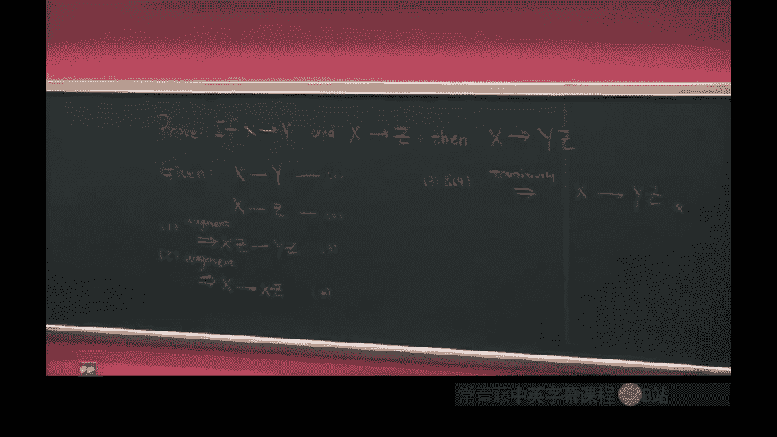
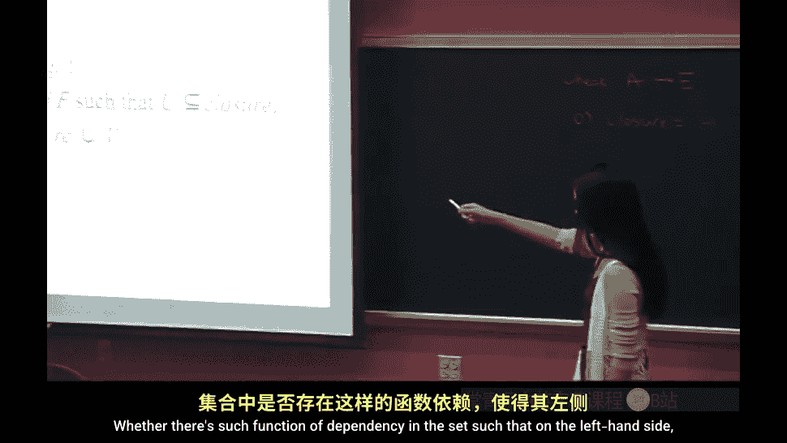
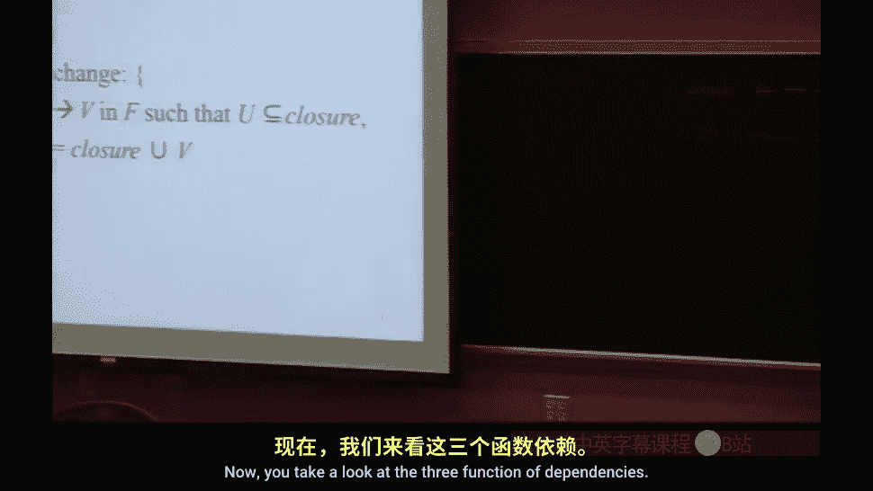
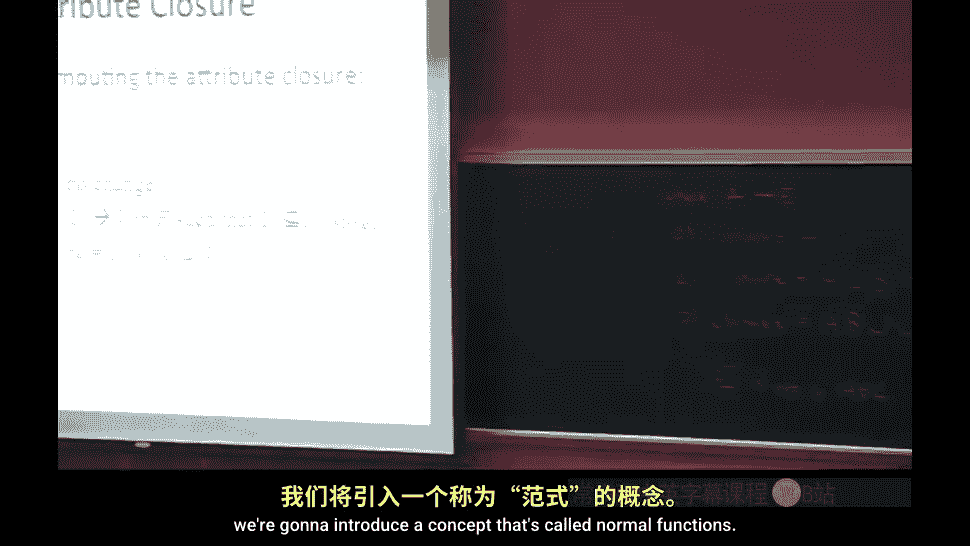

# 014：阿姆斯特朗公理与范式 🗂️

在本节课中，我们将要学习如何基于已知的函数依赖推导出更多依赖，并介绍几种范式，以帮助我们设计出更优化的数据库模式。

## 概述

上一讲我们介绍了函数依赖的概念。本节中，我们将继续学习阿姆斯特朗公理，并了解如何利用这些公理推导新的函数依赖。接着，我们将探讨几种范式，它们能帮助我们识别和解决数据库设计中的潜在问题。

## 阿姆斯特朗公理回顾

上次我们讨论了函数依赖，即在一个关系模式中，某些属性可以决定其他属性。例如，邮政编码可以决定城市和地址。另一个例子是，员工的评级可以决定其小时工资。

当我们谈论函数依赖时，我们思考如何基于已识别的基本依赖推导出更多的函数依赖。这就是阿姆斯特朗公理的作用。

阿姆斯特朗公理包含三条基本公理：

1.  **自反律**：如果 Y 是 X 的子集，则 X 决定 Y。公式表示为：若 Y ⊆ X，则 X → Y。
2.  **增广律**：如果 X 决定 Y，那么对于任意属性集 Z，XZ 决定 YZ。公式表示为：若 X → Y，则 XZ → YZ。
3.  **传递律**：如果 X 决定 Y，且 Y 决定 Z，那么 X 决定 Z。公式表示为：若 X → Y 且 Y → Z，则 X → Z。

这三条公理是完备且可靠的。基于这三条基本公理，还可以推导出另外两条规则：合并规则和分解规则。

## 推导规则的证明

接下来，我们证明由基本公理推导出的合并规则。合并规则表述为：如果 X 决定 Y，且 X 决定 Z，那么 X 决定 YZ。

我们的目标是证明：若 X → Y 且 X → Z，则 X → YZ。

以下是证明步骤：

1.  已知 X → Y。
2.  根据增广律，在两边同时增加 X，得到 XX → XY。由于 XX 即 X，所以有 X → XY。
3.  已知 X → Z。
4.  根据增广律，在两边同时增加 Y，得到 XY → YZ。
5.  现在我们有 X → XY 和 XY → YZ。
6.  根据传递律，可得 X → YZ。

至此，合并规则得证。分解规则的证明可以课后自行尝试。

## 函数依赖闭包与属性闭包

我们学习阿姆斯特朗公理，是为了基于给定的函数依赖集 F，推导出所有可能的函数依赖。这个推导出的完整集合称为 F 的**闭包**，记作 F+。

然而，对于一个包含多个属性的模式，F+ 的大小可能是指数级的，直接计算所有依赖非常低效。

因此，我们通常采用一种更高效的方法：计算**属性闭包**。给定属性集 X 和函数依赖集 F，X 的属性闭包（记作 X+）是所有能被 X 决定的属性 A 的集合。

要判断一个函数依赖 X → Y 是否在 F+ 中，我们只需计算 X+，然后检查 Y 是否是 X+ 的子集。如果是，则 X → Y 成立。

以下是计算属性闭包的线性算法：

1.  初始化结果集 closure = X。
2.  循环检查 F 中的每一个函数依赖 U → V：
    *   如果 U ⊆ closure，则将 V 加入 closure（即 closure = closure ∪ V）。
3.  重复步骤 2，直到 closure 不再变化为止。此时的 closure 就是 X+。

让我们通过一个例子来理解这个算法。

## 属性闭包计算示例

假设我们有函数依赖集 F = {A → B, B → C, CD → E}。我们想判断 A → E 是否成立。

这等价于检查 E 是否在 A+ 中。以下是计算 A+ 的步骤：

1.  初始 closure = {A}。
2.  检查 F：
    *   A → B：左边 {A} ⊆ closure，将 B 加入 closure。closure = {A, B}。
    *   B → C：左边 {B} ⊆ closure，将 C 加入 closure。closure = {A, B, C}。
    *   CD → E：左边 {C, D} 不是 closure 的子集，跳过。
3.  再次检查 F（closure 已更新）：
    *   A → B, B → C 条件依然满足，但 closure 已包含 B 和 C，无变化。
    *   CD → E：左边 {C, D} 仍不是 closure 的子集。
4.  closure 不再变化，因此 A+ = {A, B, C}。
5.  由于 E 不在 A+ 中，所以 A → E 不成立。

## 范式简介

学习了如何推导和验证函数依赖后，我们来看看如何将这些概念应用到数据库设计中，特别是你们的项目里。为了评估和优化设计，我们引入**范式**的概念。

范式定义了关系模式应满足的条件。如果一个关系满足某个范式的所有要求，就能避免某些特定类型的问题。我们将讨论四种范式，它们限制性依次增强：

1.  第一范式
2.  第二范式
3.  第三范式
4.  BC范式（Boyce-Codd Normal Form）

如果一个关系满足 BC 范式，那么它必然满足前三种范式。我们先从最简单的开始。

## 第一范式

一个关系模式 R 满足**第一范式**，当且仅当每个属性域都只包含原子值。

所谓原子值，是指不可再分的最小数据单元。例如，一个单元格里不能存储一个列表或集合。在传统关系型数据库中，这通常是一个隐含要求。

判断以下哪个表满足第一范式：

*   表1: (SSN: 123, Name: ‘Alice’, Phone: ‘555-0100’) ✅
*   表2: (SSN: 456, Name: ‘Bob’, Phone: [‘555-0201’, ‘555-0202’]) ❌

表2的“Phone”字段包含了列表，因此不满足第一范式。在你们的项目中，应该已经避免了这种情况。

## 第二范式

在定义第二范式前，需要理解两个概念：

*   **完全函数依赖**：在函数依赖 X → Y 中，如果移除 X 中的任何一个属性都会导致该依赖不再成立，则称 Y 完全函数依赖于 X。
*   **部分函数依赖**：如果移除 X 中的某个属性后，X → Y 仍然成立，则称 Y 部分函数依赖于 X。

一个关系模式 R 满足**第二范式**，当且仅当每一个非主属性都完全函数依赖于 R 的每一个候选键。

不满足 2NF 的模式可以通过分解来规范化。

让我们看一个例子。假设有一个关系模式 `WorksOn(SSN, Pnumber, Hours, Ename, Plocation)`，并有以下函数依赖：
*   `{SSN, Pnumber} → Hours`
*   `SSN → Ename`
*   `Pnumber → Plocation`

候选键是 `{SSN, Pnumber}`。我们来分析非主属性：
*   `Hours` 完全函数依赖于候选键（缺少任何一个属性都无法决定 Hours）。
*   `Ename` 部分函数依赖于候选键（仅 SSN 就能决定 Ename）。
*   `Plocation` 部分函数依赖于候选键（仅 Pnumber 就能决定 Plocation）。

由于存在部分函数依赖，该模式不满足 2NF。为了消除冗余和更新异常，我们可以将其分解为三个模式：
1.  `WorkHours(SSN, Pnumber, Hours)`
2.  `Employee(SSN, Ename)`
3.  `Project(Pnumber, Plocation)`

## 第三范式

第三范式的要求比第二范式更严格。一个关系模式 R 满足**第三范式**，当且仅当对于其函数依赖集 F+ 中的每一个非平凡函数依赖 X → A，至少满足以下条件之一：
1.  X 是 R 的超键（即 X 包含候选键）。
2.  A 是 R 的某个候选键的一部分（即 A 是主属性）。

简单来说，3NF 旨在消除非主属性对非超键的传递依赖。在项目第二阶段，你们需要将模式至少规范化到第三范式。

如果违反了 3NF，通常表现为两种问题：
1.  **部分依赖**：这其实也是 2NF 要解决的问题。
2.  **传递依赖**：例如，存在 Key → X 和 X → A，其中 X 不是超键，A 也不是主属性。

## 总结

本节课中我们一起学习了：
1.  **阿姆斯特朗公理**：包括自反律、增广律和传递律，它们是推导函数依赖的基础。
2.  **属性闭包**：一种高效算法，用于判断某个函数依赖是否可以从给定集合中推导出来。
3.  **范式理论**：
    *   **第一范式**要求数据原子性。
    *   **第二范式**要求消除非主属性对候选键的部分函数依赖。
    *   **第三范式**要求消除非主属性对非超键的传递依赖。

理解这些概念有助于我们设计出更合理、更少冗余和更新异常的数据库模式。在下节课中，我们将继续探讨更严格的 BC 范式。