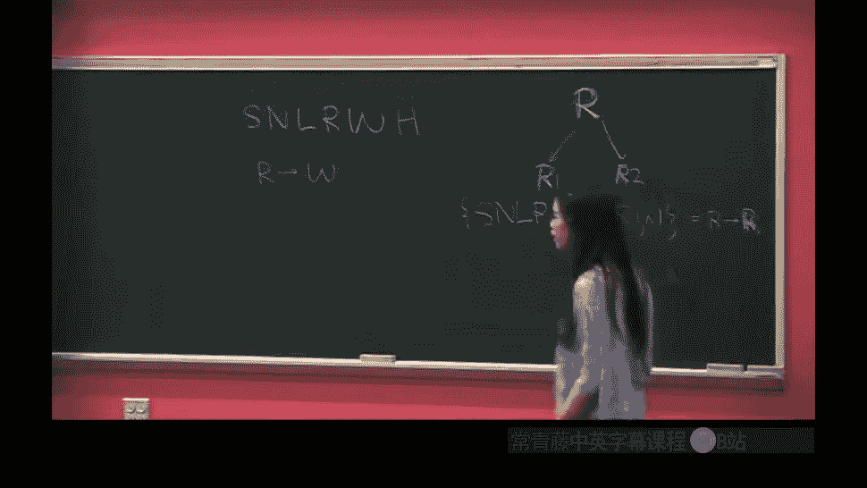
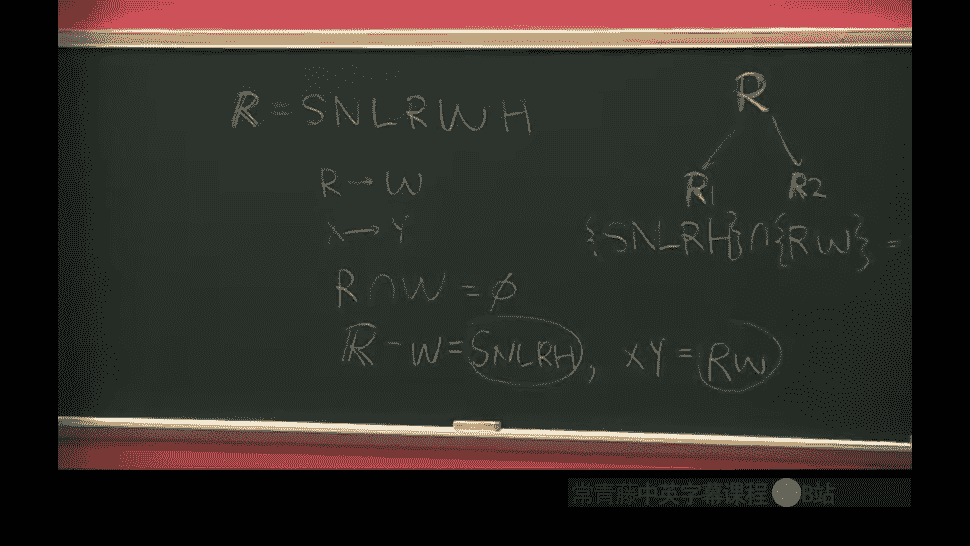
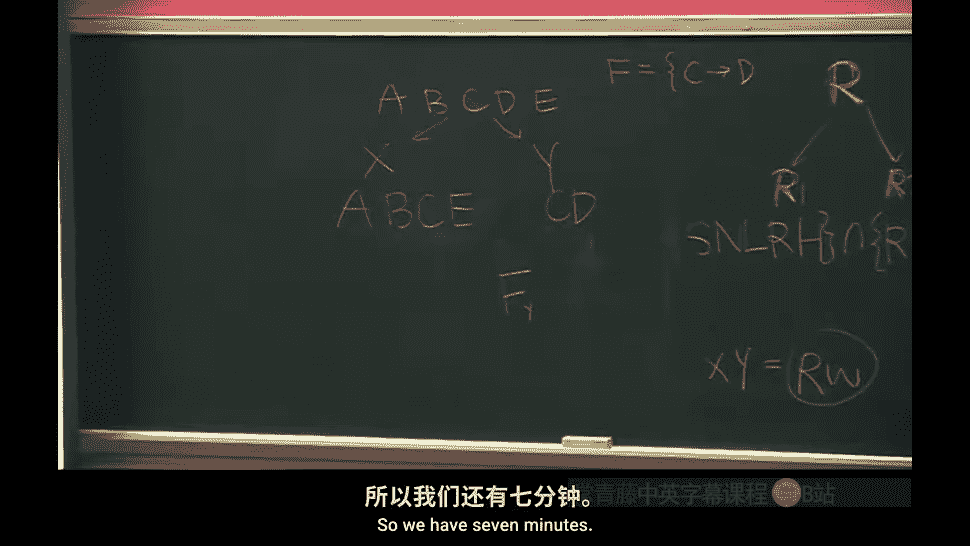

# 016：BCNF范式与分解 📚

在本节课中，我们将要学习数据库设计中的最后一个重要范式——BCNF范式，并探讨如何通过“分解”关系模式来达到范式要求。我们还将学习两种关键的分解属性：无损连接和依赖保持。

---

## 回顾已学范式

上一节我们介绍了第一、第二和第三范式。本节中，我们来看看这些范式的核心概念和修正方法。

### 第一范式 (1NF)
第一范式要求所有属性都是原子的，即属性值不可再分。
*   **测试方法**：检查是否存在非原子属性（如列表）。
*   **修正方法**：为每个非原子属性创建新的关系。

### 第二范式 (2NF)
第二范式在1NF基础上，消除了非主属性对候选键的“部分函数依赖”。
*   **核心概念**：**完全函数依赖** 与 **部分函数依赖**。
*   **修正方法**：通过分解，为每个部分依赖创建新的关系，使其变为完全依赖。

### 第三范式 (3NF)
第三范式在2NF基础上，进一步消除了非主属性之间的传递依赖。
*   **测试方法**：检查是否存在非键属性被另一个非键属性函数确定的情况。
*   **修正方法**：通过分解，创建一个包含该非键属性的新关系。

这些范式的要求是逐级严格的。我们今天要学习的BCNF范式是其中限制最严格的一种。

---

## BCNF范式 (Boyce-Codd Normal Form) 🔑

BCNF范式比第三范式更为严格。一个关系模式R及其函数依赖集F满足BCNF，当且仅当对于F闭包中的每一个函数依赖 **X → A**，都满足以下条件之一：
1.  **A ∈ X** （这是一个平凡依赖）。
2.  **X 是 R 的一个超键**（即X包含R的某个候选键）。

与第三范式的定义相比，BCNF不允许第三范式中“A是候选键的一部分”这种例外情况。因此，BCNF是更严格的。

**直观理解**：在BCNF中，每一个非平凡的函数依赖，其决定因素（左边）都必须是一个超键。这意味着每个数据块都可以看作是由一个键唯一标识的实体或关系。

### BCNF示例分析
考虑一个关系实例，其中存在函数依赖 **X → A**，且X不是超键。这会导致数据冗余。例如，如果两行数据具有相同的X值，那么根据函数依赖，它们的A值也必须相同，这就造成了冗余存储。

为了满足BCNF，我们需要通过分解来消除这种由非超键决定因素引起的冗余。

---

## 关系分解

当我们有一个庞大的、不符合范式要求的关系时，可以通过“分解”将其拆分成多个较小的关系，以达到目标范式。

然而，并非所有的分解都是好的。我们需要确保分解满足两个重要性质：
1.  **无损连接**：能够从分解后的关系通过自然连接完全恢复出原始关系，不丢失也不增加信息。
2.  **依赖保持**：分解后，所有原有的函数依赖约束仍然能够被有效地检查。

下面我们分别探讨这两种性质。

---

## 无损连接分解

上一节我们介绍了分解的概念，本节中我们来看看如何确保分解是无损的。

**定义**：将关系R分解为属性集分别为X和Y的两个关系模式，如果对于满足函数依赖集F的每一个合法关系实例r，都有 **r = π_X(r) ⋈ π_Y(r)**，则该分解是关于F的**无损连接分解**。

**简单来说**：将原表按列拆分成两个子表后，再将这两个子表进行自然连接，结果必须和原表一模一样。

### 无损连接的快速判定定理
有一个更简便的方法来检验分解R为R1和R2是否为无损连接分解：
*   计算 **R1 ∩ R2**（两个属性集的交集）。
*   检查交集 **R1 ∩ R2** 是否是 **R1** 或 **R2** 的超键（即在F闭包中，R1 ∩ R2 → R1 或 R1 ∩ R2 → R2 成立）。

如果上述条件满足，则该分解是无损连接的。

### 无损连接的性质
以下是关于无损连接分解的两个重要观察：
1.  如果函数依赖 **X → Y** 在R上成立，且 **X ∩ Y = ∅**，那么将R分解为 **(R - Y)** 和 **(X ∪ Y)** 是无损连接分解。
2.  无损连接性具有传递性。如果将R无损分解为R1和R2，再将R1无损分解为R11和R12，那么从R到{R11, R12, R2}的分解也是无损的。

---

## 依赖保持分解

确保能够恢复数据后，我们还需要确保分解后的模式依然能方便地维护数据的完整性约束（即函数依赖）。

**定义**：将关系R分解为一组关系模式{R1, R2, ..., Rn}，如果函数依赖集F的闭包 **F+** 等价于所有在子模式Ri上成立的函数依赖的投影的并集，则该分解是**依赖保持**的。

**简单来说**：原有的所有函数依赖，要么直接保留在某个子表中，要么可以从几个子表中的依赖逻辑推导出来。这样，我们就不必为了检查某个依赖而频繁地连接多个表。

### 函数依赖的投影
如何计算函数依赖集F在属性集Z上的投影（记为 **π_Z(F)**）？
*   取F闭包 **F+** 中的所有函数依赖。
*   只保留那些**左右两边的属性都包含在Z中**的依赖。
*   这些保留下来的依赖的集合就是π_Z(F)。

### 依赖保持的示例
考虑一个合同关系，具有函数依赖：`{C → JP, JP → C, SD → P}`，其中C是候选键。
*   依赖 `SD → P` 违反了BCNF（因为SD不是超键）。
*   如果我们将其分解为 `(CSDJ)` 和 `(SDP)`，可以解决BCNF违例。
*   但是，原依赖 `JP → C` 没有被保留在任何子关系中。要验证该依赖，必须对两个子表进行连接操作，这很不高效。因此，这个分解不是依赖保持的。

一个更好的、依赖保持的分解可能是 `(CJP)` 和 `(CSD)`，这样`JP → C`和`C → JP`保留在第一个子表，`SD → P`？等等，这里需要重新设计以满足BCNF和依赖保持，这通常需要权衡。

---

## 总结

本节课中我们一起学习了数据库设计中的关键进阶内容：
1.  **BCNF范式**：比3NF更严格的范式，要求所有非平凡函数依赖的决定因素都是超键。
2.  **关系分解**：通过拆分大表来满足范式要求的主要手段。
3.  **无损连接分解**：确保分解不会导致信息丢失或扭曲，可以通过子模式交集是否为键来快速检验。
4.  **依赖保持分解**：确保分解后，原有的所有数据完整性约束（函数依赖）仍然能够被有效地检查和维护。

在实际数据库设计中，我们通常力求达到BCNF，但有时为了保持依赖性或出于性能考虑，可能会止步于3NF。理解无损连接和依赖保持这两个概念，对于评估和设计一个良好的数据库模式至关重要。