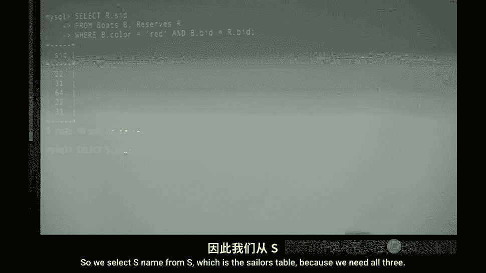
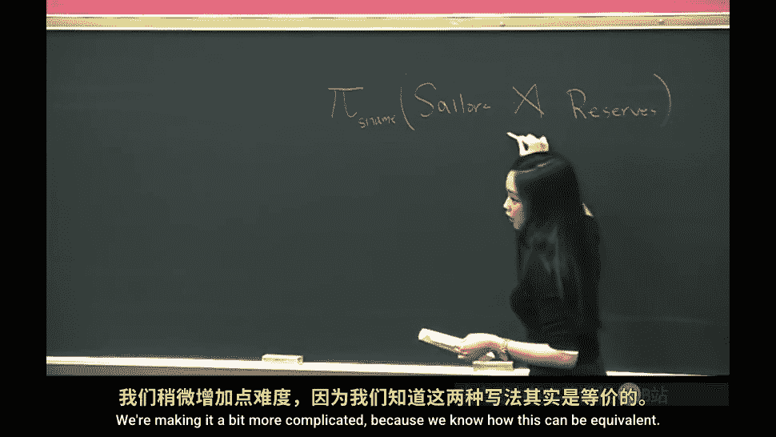
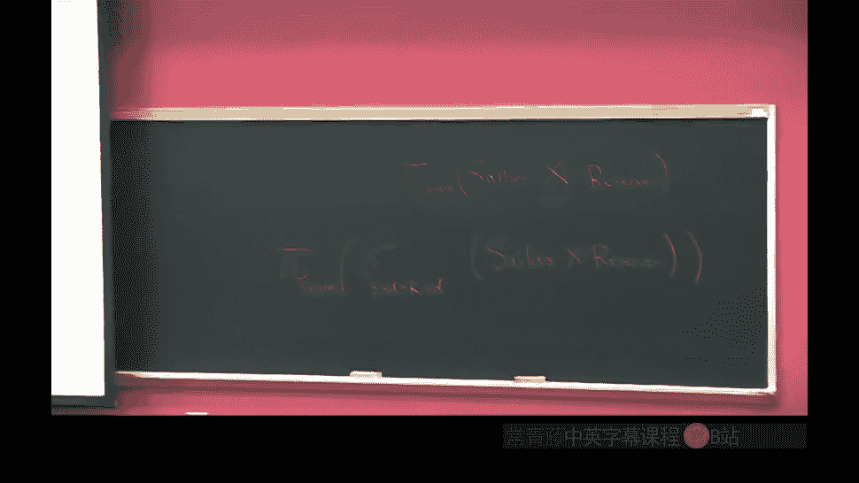
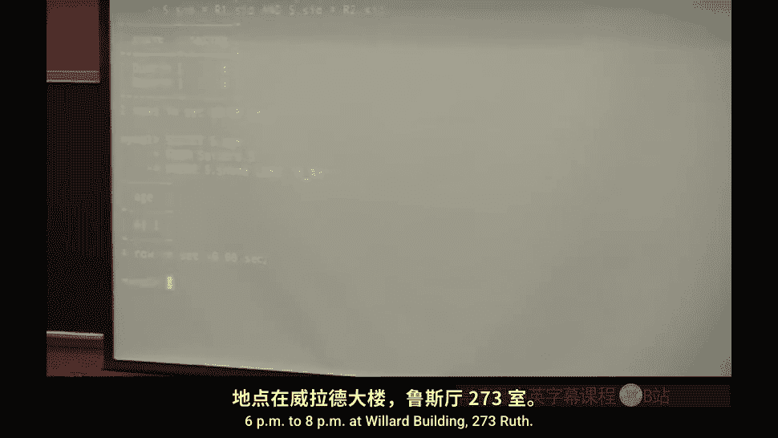

# 018：SQL - 第1部分

## 概述
在本节课中，我们将学习结构化查询语言的基础知识。我们将从最简单的查询开始，逐步了解如何使用 `SELECT`、`FROM` 和 `WHERE` 子句从数据库中检索数据。课程将使用我们熟悉的水手、船只和预订数据库模式进行演示。

---

## 基本SQL查询结构 🧱
上一节我们概述了课程内容，本节中我们来看看SQL查询的基本构成。

一个基础的SQL查询包含三个关键字：`SELECT`、`FROM` 和 `WHERE`。
*   `SELECT` 后面跟一个可选的 `DISTINCT` 关键字，然后是目标属性列表。
*   `FROM` 后面跟关系（表）列表。
*   `WHERE` 后面跟查询条件。

这里有一个容易混淆的点：在SQL中，`SELECT` 子句指定我们想要输出的列，这类似于关系代数中的**投影**操作。而真正的**选择**操作（即按条件筛选行）发生在 `WHERE` 子句中。

`DISTINCT` 关键字用于消除结果中的重复行。在关系代数中，我们通常假设结果集没有重复，但在实际的数据库系统（如MySQL）中，如果不使用 `DISTINCT`，查询结果可能会包含重复的元组。

---

## 简单查询实践 🔍
理解了基本结构后，我们通过几个例子来实践。

### 查询Q1：查找所有水手的姓名和年龄
以下是实现步骤：
1.  确定涉及的表：只需要 `Sailors` 表。
2.  确定要选择的属性：`sname` 和 `age`。
3.  确定筛选条件：无。

因此，SQL语句如下：
```sql
SELECT sname, age
FROM Sailors;
```
执行后，会返回 `Sailors` 表中所有水手的姓名和年龄。

如果想消除重复的姓名（尽管在这个例子中不太可能），可以加上 `DISTINCT`：
```sql
SELECT DISTINCT sname
FROM Sailors;
```

---

### 查询Q2：查找评分高于7的所有水手
以下是实现步骤：
1.  涉及的表：`Sailors`。
2.  要选择的属性：所有属性（使用 `*`）。
3.  筛选条件：`rating > 7`。

SQL语句如下：
```sql
SELECT *
FROM Sailors
WHERE rating > 7;
```
这条语句会返回 `Sailors` 表中所有评分高于7的水手的全部信息。

---

## 查询执行过程与多表连接 ⚙️
我们执行了简单查询，现在来看看数据库背后是如何处理这些查询的，并开始学习多表连接。

当数据库处理 `SELECT ... FROM ... WHERE ...` 查询时，逻辑上会按以下顺序执行：
1.  计算 `FROM` 子句中所有表的**笛卡尔积**，生成一个巨大的中间表。
2.  根据 `WHERE` 子句中的条件，对中间表进行筛选，只保留满足条件的行。
3.  根据 `SELECT` 子句指定的属性列表，对结果进行投影，只保留需要的列。
4.  如果指定了 `DISTINCT`，则消除最终结果中的重复行。

需要注意的是，这只是逻辑上的理解模型。实际上，数据库的**查询优化器**会尝试找出最高效的执行计划，而不会真的去计算完整的笛卡尔积。

---

### 查询Q3：查找预订了103号船的水手姓名
现在我们来处理一个需要连接两个表的查询。
以下是实现步骤：
1.  涉及的表：`Sailors` 和 `Reserves`（因为需要水手姓名和预订信息）。
2.  要选择的属性：`Sailors.sname`。
3.  筛选条件：
    *   预订的船ID (`Reserves.bid`) 等于103。
    *   并且，`Sailors` 表中的水手ID (`sid`) 必须与 `Reserves` 表中的水手ID (`sid`) 相匹配，这样才能正确关联。

由于两个表都有 `sid` 列，为了避免歧义，我们使用**范围变量**（即表别名）来区分。SQL语句如下：
```sql
SELECT S.sname
FROM Sailors S, Reserves R
WHERE R.bid = 103
  AND S.sid = R.sid;
```
这个查询先对 `Sailors` (别名S) 和 `Reserves` (别名R) 做笛卡尔积，然后筛选出同时满足 `bid=103` 和 `S.sid=R.sid` 的行，最后投影出水手的姓名。

---



## 更复杂的多表连接 🔗
我们学会了连接两个表，现在尝试连接三个表。

### 查询Q4：查找预订了红色船只的水手姓名
以下是实现步骤：
1.  涉及的表：`Sailors` (S), `Reserves` (R), `Boats` (B)。需要 `Boats` 表来判断颜色。
2.  要选择的属性：`S.sname`。
3.  筛选条件：
    *   船只颜色为红色：`B.color = ‘red’`。
    *   连接条件：`S.sid = R.sid` 且 `R.bid = B.bid`。

SQL语句如下：
```sql
SELECT S.sname
FROM Sailors S, Reserves R, Boats B
WHERE B.color = ‘red’
  AND S.sid = R.sid
  AND R.bid = B.bid;
```


---





### 查询Q5：查找名为‘Lubber’的水手所预订船只的颜色
这个查询与上一个类似，但初始筛选条件是基于水手姓名。
以下是实现步骤：
1.  涉及的表：同样需要 `Sailors` (S), `Reserves` (R), `Boats` (B)。
2.  要选择的属性：`B.color`。
3.  筛选条件：
    *   水手名为‘Lubber’：`S.sname = ‘Lubber’`。
    *   连接条件：`S.sid = R.sid` 且 `R.bid = B.bid`。

SQL语句如下：
```sql
SELECT B.color
FROM Sailors S, Reserves R, Boats B
WHERE S.sname = ‘Lubber’
  AND S.sid = R.sid
  AND R.bid = B.bid;
```

---

## 字符串匹配与表达式 📝
我们已经掌握了基础的多表连接，本节来看看SQL中两个有用的特性：字符串匹配和算术表达式。

SQL允许在 `WHERE` 子句中进行字符串模式匹配，使用 `LIKE` 操作符和两个通配符：
*   `_` （下划线）：匹配任意**单个**字符。
*   `%` （百分号）：匹配**零个或多个**任意字符。

同时，可以在 `SELECT` 子句中使用算术表达式，计算结果会作为新列返回（但不会存储到数据库中）。

---

### 查询Q6：查找姓名以‘B’开头和结尾，且至少包含3个字符的水手的年龄
以下是实现步骤：
1.  涉及的表：`Sailors`。
2.  要选择的属性：`age`。
3.  筛选条件：姓名匹配模式 `‘B_%B’`。
    *   第一个 `B`：以B开头。
    *   `_`：确保至少还有一个字符（与开头的B一起，保证最少2个字符）。
    *   `%`：匹配中间任意数量的字符（包括零个）。
    *   最后一个 `B`：以B结尾。
    *   组合 `‘B_%B’` 确保了姓名至少为3个字符（如 Bob 符合 B_b）。

SQL语句如下：
```sql
SELECT age
FROM Sailors
WHERE sname LIKE ‘B_%B’;
```
注意，`LIKE` 匹配默认可能区分大小写，这取决于数据库的配置。

---

### 查询Q7：计算在同一天驾驶过两艘不同船只的水手的评分增量（评分+1）
这是一个更复杂的查询，它需要同一张表（`Reserves`）的两个副本。
以下是实现步骤：
1.  涉及的表：`Sailors` (S)，以及 `Reserves` 表的两个别名 `R1` 和 `R2`。
2.  要选择的属性：水手姓名 `S.sname` 以及评分加1的结果 `S.rating+1 AS inc_rating`。
3.  筛选条件：
    *   `R1` 和 `R2` 是同一天：`R1.day = R2.day`。
    *   `R1` 和 `R2` 是不同的船：`R1.bid != R2.bid`。
    *   连接水手信息：`S.sid = R1.sid` 且 `S.sid = R2.sid`（确保是同一个水手的两条不同预订记录）。

SQL语句如下：
```sql
SELECT S.sname, S.rating+1 AS inc_rating
FROM Sailors S, Reserves R1, Reserves R2
WHERE R1.day = R2.day
  AND R1.bid != R2.bid
  AND S.sid = R1.sid
  AND S.sid = R2.sid;
```
这个查询找出了在同一天有两条不同船只预订记录的水手，并返回了他们的姓名以及评分加1后的值。

---



## 总结
本节课中我们一起学习了SQL查询语言的第一部分。我们从最简单的单表查询开始，逐步深入到多表连接，理解了如何使用 `SELECT`、`FROM` 和 `WHERE` 子句来检索和筛选数据。我们还探讨了查询背后的逻辑执行过程，并实践了字符串匹配（`LIKE`）和在 `SELECT` 中使用算术表达式等实用特性。这些是构建更复杂SQL查询的基石。