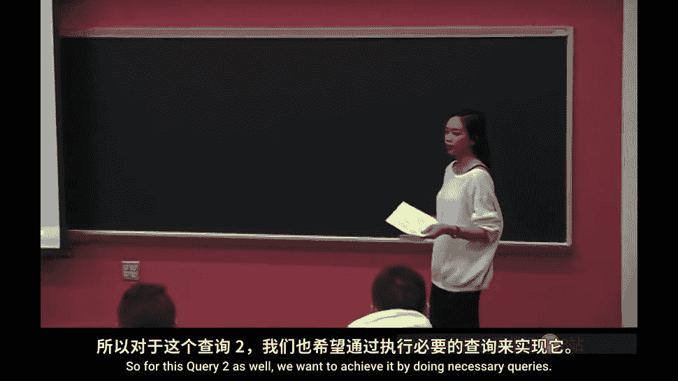
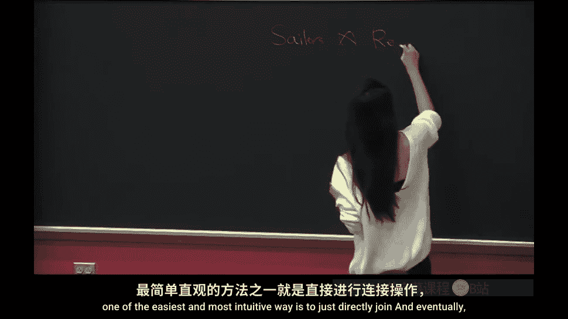
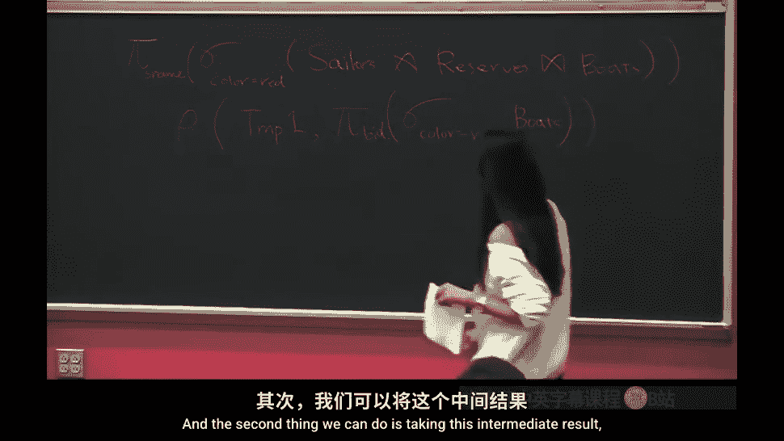

# 020：SQL编程进阶


在本节课中，我们将继续深入学习SQL编程，重点探讨嵌套查询、相关子查询、集合比较操作以及聚合函数的使用。我们将通过具体的查询实例来理解这些概念，并学习如何编写高效、准确的SQL语句。

---



## 嵌套查询与关系代数

上一节我们介绍了SQL的基本查询结构。本节中，我们来看看如何通过嵌套查询来实现更复杂的查询逻辑，并将其与关系代数的操作联系起来。



考虑查询2：**找出预订了红色船只的船员姓名**。

在关系代数中，一种直接的方法是连接 `Sailors`、`Reserves` 和 `Boats` 三个表，然后进行选择和投影。其过程可以表示为：

**公式：** `π_{sname}(σ_{color=‘red’}(Sailors ⨝ Reserves ⨝ Boats))`



然而，这种方法会产生大量的中间结果。更高效的方法是分步操作：
1.  先从 `Boats` 表中选出红色船只，并只投影出 `bid`。
2.  将上一步的结果与 `Reserves` 表在 `bid` 上连接，并投影出 `sid`。
3.  最后将上一步的结果与 `Sailors` 表在 `sid` 上连接，并投影出 `sname`。

在SQL中，我们可以用嵌套查询来实现这个分步逻辑：


```sql
SELECT S.sname
FROM Sailors S
WHERE S.sid IN (
    SELECT R.sid
    FROM Reserves R
    WHERE R.bid IN (
        SELECT B.bid
        FROM Boats B
        WHERE B.color = ‘red’
    )
);
```

嵌套查询的逻辑评估通常从最内层开始理解，但数据库引擎的实际执行可能从外层开始，并为外层的每一行计算内层查询。

---

## 相关子查询

在嵌套查询中，内层查询可以依赖于外层查询当前正在处理的行，这被称为相关子查询。

考虑查询1：**找出预订了103号船只的船员姓名**。

我们可以使用 `EXISTS` 关键字和相关性来实现：

```sql
SELECT S.sname
FROM Sailors S
WHERE EXISTS (
    SELECT *
    FROM Reserves R
    WHERE R.bid = 103
    AND R.sid = S.sid
);
```

在这个查询中，内层查询的 `S.sid` 依赖于外层 `Sailors` 表当前行的 `sid`。它检查是否存在一条预订记录，其 `bid` 为103且 `sid` 与当前船员的 `sid` 匹配。

---

## 集合比较操作

SQL提供了 `ANY` 和 `ALL` 关键字，用于将某个值与子查询返回的集合进行比较。

以下是关键点：
*   `IN` 等价于 `= ANY`。
*   `NOT IN` 等价于 `<> ALL`。

考虑查询22：**找出评级高于任意一个名为“Horatio”的船员的船员**。

```sql
SELECT S.sname, S.sid
FROM Sailors S
WHERE S.rating > ANY (
    SELECT S2.rating
    FROM Sailors S2
    WHERE S2.sname = ‘Horatio’
);
```

考虑查询23：**找出评级高于所有名为“Horatio”的船员的船员**。只需将 `ANY` 改为 `ALL`：

```sql
SELECT S.sname, S.sid
FROM Sailors S
WHERE S.rating > ALL (
    SELECT S2.rating
    FROM Sailors S2
    WHERE S2.sname = ‘Horatio’
);
```

从逻辑上理解，`> ALL` 意味着大于集合中的最大值，而 `> ANY` 意味着大于集合中的最小值。

---

## 使用否定实现除法操作

关系代数中的除法操作在SQL中没有直接对应的运算符。但我们可以通过“双重否定”的逻辑来实现。

考虑查询：**找出预订了所有船只的船员姓名**。

思路是：对于每个船员，检查是否不存在任何一艘船没有被该船员预订。

```sql
SELECT S.sname
FROM Sailors S
WHERE NOT EXISTS (
    SELECT B.bid
    FROM Boats B
    WHERE B.bid NOT IN (
        SELECT R.bid
        FROM Reserves R
        WHERE R.sid = S.sid
    )
);
```

这个查询解读如下：
1.  最内层查询：找出当前船员 `S.sid` 预订过的所有船只ID。
2.  中间层查询：找出所有不在该船员预订列表中的船只ID（即该船员未预订的船）。
3.  最外层查询：选择那些“不存在未预订船只”的船员，即预订了所有船只的船员。

---

## 聚合函数

SQL提供了多种聚合函数，用于对一组值进行计算并返回单个值。

以下是主要的聚合函数：
*   `COUNT`：计数。
*   `SUM`：求和。
*   `AVG`：求平均值。
*   `MAX`：求最大值。
*   `MIN`：求最小值。

对于 `COUNT`、`SUM`、`AVG`，可以使用 `DISTINCT` 来去重。`MAX` 和 `MIN` 使用 `DISTINCT` 在逻辑上不改变结果。

考虑查询25：**找出所有船员的平均年龄**。

```sql
SELECT AVG(age) AS avg_age
FROM Sailors;
```

考虑查询26：**找出评级为10的船员的平均年龄**。

```sql
SELECT AVG(age) AS avg_age
FROM Sailors
WHERE rating = 10;
```

考虑查询27：**找出最年长船员的姓名和年龄**。

一个错误的尝试是：
```sql
SELECT sname, MAX(age) FROM Sailors; -- 错误！
```
这会返回所有姓名中的第一个和最大的年龄值，导致数据不匹配。

正确的方法是使用子查询，找到最大年龄，然后匹配对应的船员：


```sql
SELECT S.sname, S.age
FROM Sailors S
WHERE S.age = (SELECT MAX(age) FROM Sailors);
```

考虑查询28：**统计船员总数**。

```sql
SELECT COUNT(*) AS sailor_count FROM Sailors;
-- 或使用主键
SELECT COUNT(sid) AS sailor_count FROM Sailors;
```

考虑查询29：**统计不同的船员姓名数量**（去重）。

```sql
SELECT COUNT(DISTINCT sname) AS distinct_name_count
FROM Sailors;
```

---

本节课中我们一起学习了SQL编程的进阶主题。我们探讨了如何利用嵌套查询和相关子查询构建复杂查询，理解了 `ANY` 和 `ALL` 集合比较操作符的用法，学习了通过否定逻辑模拟关系代数的除法操作，并掌握了 `COUNT`、`AVG`、`MAX` 等聚合函数的使用方法。掌握这些技巧对于编写高效、精确的数据检索语句至关重要。