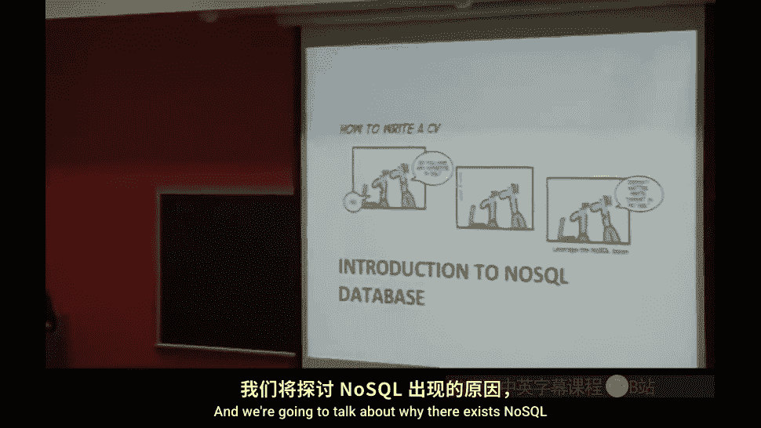
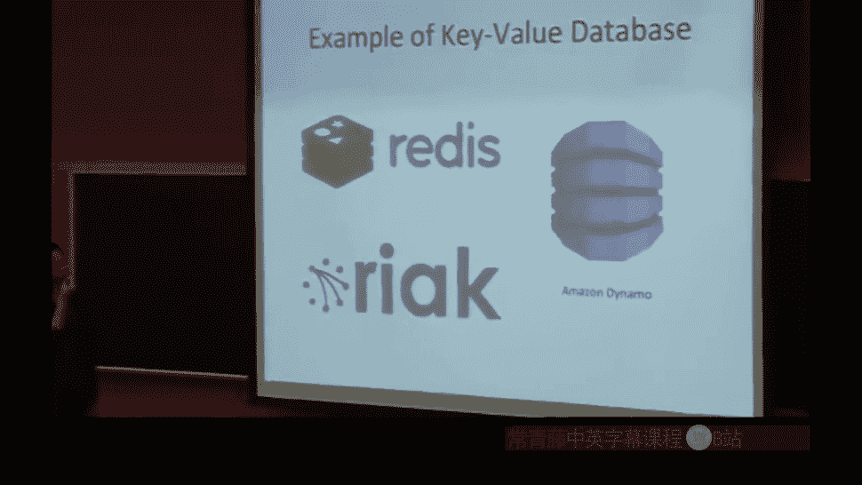
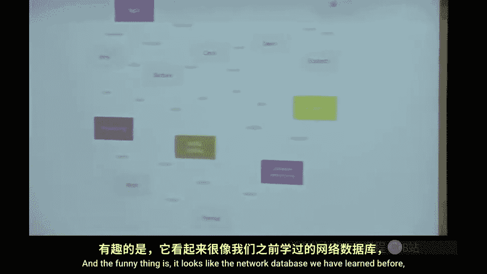
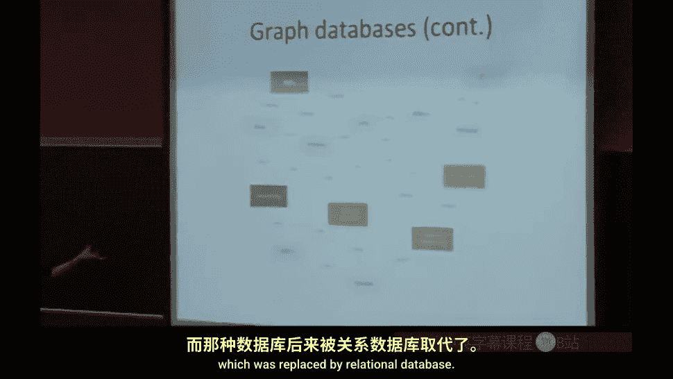

# 022：NoSQL导论 🚀

在本节课中，我们将要学习NoSQL数据库的基本概念。我们将探讨NoSQL为何出现，它与传统SQL数据库有何不同，以及它的主要类型和应用场景。

## 课程概述

上一节我们介绍了关系型数据库的规范化与设计。本节中，我们来看看另一种数据库范式——NoSQL。随着互联网和分布式系统的发展，传统的关系型数据库在处理海量、非结构化数据时面临挑战，NoSQL应运而生。

## NoSQL的起源与定义

NoSQL并非“不要SQL”，而是“不仅仅是SQL”。它是一种非关系型数据库管理系统，专为分布式数据存储设计。在谷歌、Facebook、Twitter等公司，每天产生TB级的数据，传统的关系模型在处理这种规模和数据灵活性上存在局限。

## 为什么需要NoSQL？

与传统SQL基于“存储什么数据”来设计数据库不同，NoSQL的起点是“我要回答什么问题”。这使得它在设计上更加灵活，能够适应快速变化的业务需求，例如社交网络功能的每日更新。

此外，NoSQL数据建模通常需要对数据结构和算法有更深的理解，因为它允许开发者更底层地设计数据存储和检索方式。

一个有趣的现象是，在NoSQL中，我们常常会做两件在SQL中极力避免的事：**数据复制**和**非规范化**。我们将在后续课程中详细探讨其原因。

## NoSQL与关系型数据库对比

以下是两者的核心区别：

*   **数据模型**：关系型数据库数据高度结构化，存储在表中；NoSQL数据可以是半结构化或非结构化的。
*   **查询语言**：关系型数据库使用声明式的SQL；NoSQL没有统一的查询语言。
*   **模式**：关系型数据库有预定义的严格模式；NoSQL通常无模式或模式灵活。
*   **一致性模型**：关系型数据库强调ACID属性；NoSQL通常遵循**最终一致性**，并受CAP定理约束。
*   **设计目标**：关系型数据库关注数据完整性和复杂的关联查询；NoSQL优先考虑**高性能**、**高可用性**和**可扩展性**。

## CAP定理

CAP定理是分布式系统中的一个基本原理，它指出以下三者不可兼得：
*   **一致性**：所有节点在同一时间看到相同的数据。
*   **可用性**：系统始终响应，每个请求都收到成功或失败的回应。
*   **分区容错性**：即使网络出现分区，系统仍能继续运行。

理论上，任何分布式数据存储只能同时满足其中两项。NoSQL数据库会根据应用需求，在C、A、P中做出权衡和选择。

## NoSQL的优缺点

**优点**：
*   **高可扩展性**：易于在分布式集群中扩展。
*   **低成本**：通常利用廉价的硬件集群。
*   **模式灵活**：可以动态调整数据结构。
*   **适合非关系型数据**：如层次化、图形化数据。

**缺点**：
*   **无统一标准**：种类繁多，选择和学习成本高。
*   **查询能力有限**：相比成熟的SQL，查询功能相对简单。
*   **最终一致性**：可能不适用于需要强一致性的场景（如银行交易）。

## NoSQL的主要类型

NoSQL数据库主要分为四类，每种适合不同的应用场景。

### 1. 键值存储 🗝️

这是最简单的NoSQL形式。数据以键值对形式存储，通过唯一的键来检索值。

**核心概念**：
*   数据模型：`{ key: value }`
*   值可以是字符串、数字、列表、JSON对象甚至二进制大对象。
*   适合场景：用户会话、购物车、配置信息。

**示例数据库**：Amazon DynamoDB, Redis, Riak。

### 2. 列族存储 📊

数据按列族组织，同一列的数据连续存储。每行可以拥有不同的列。

**核心概念**：
*   优化了对某一列进行聚合查询（如求和、求平均）的性能。
*   适合场景：大数据分析、内容管理系统。

**示例数据库**：Google Bigtable, Apache Cassandra, HBase。

### 3. 图形数据库 🕸️

数据以图的形式存储，包含节点和边。

**核心概念**：
*   节点代表实体（如用户、帖子）。
*   边代表实体间的关系（如朋友关系、点赞）。
*   适合高效处理复杂的关联关系，例如社交网络、推荐系统。
*   与关系模型的映射：表→节点集合，行→节点，列→属性，连接→边。

**示例数据库**：Neo4j, InfiniteGraph。

### 4. 文档数据库 📄

数据存储在类似JSON的文档中，文档是键值对的集合，且值可以嵌套。

**核心概念**：
*   数据模型：`{ “key1”: “value1”, “key2”: { “nestedKey”: “nestedValue” } }`
*   文档格式灵活，无固定模式。
*   与关系模型的映射：表→集合，行→文档，列→文档中的字段。
*   通常不支持跨文档的连接操作。
*   适合场景：内容管理、博客平台、用户配置文件。

**示例数据库**：MongoDB, CouchDB。

## 总结

本节课中我们一起学习了NoSQL数据库的基础知识。我们了解了NoSQL出现是为了解决海量数据、高并发和灵活模式的需求。我们对比了NoSQL与关系型数据库的核心差异，介绍了CAP定理，并详细探讨了四种主要的NoSQL类型：键值存储、列族存储、图形数据库和文档数据库。每种类型都有其适用的场景，在实际应用中，系统也常常混合使用多种数据库技术。从下一讲开始，我们将深入探索文档数据库MongoDB的具体使用。