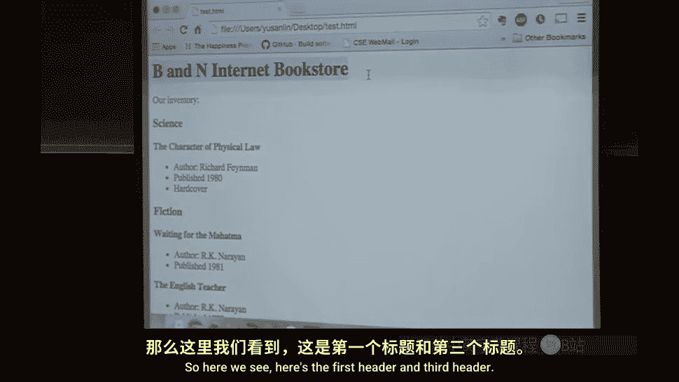
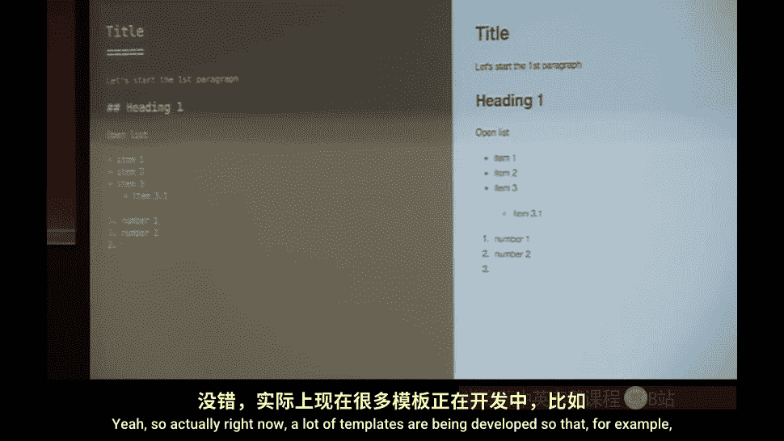

# 027：互联网应用 - 第1部分

在本节课中，我们将学习互联网应用的基础知识，特别是与数据库交互相关的概念。我们将从互联网的基本通信原理开始，然后探讨几种在网络上表示数据的格式。

---

## 互联网概念与通信协议

上一节我们介绍了课程概述，本节中我们来看看互联网的基本概念和通信协议。

到目前为止，我们讨论的所有内容都假设发生在本地机器上。在本章中，我们将重点讨论数据库应用中的互联网概念。

互联网的核心概念之一是**统一资源标识符**。URI用于标识互联网上的资源，资源可以是网页、图像、视频或电子邮件地址等任何需要通信的内容。

URI通常包含三个部分：
1.  **协议**：用于访问资源的协议，例如 `http`、`ftp` 或 `mailto`。
2.  **主机名**：托管资源的计算机名称，例如 `www.example.com`。
3.  **路径名**：资源在主机上的具体位置，例如 `/path/to/resource.html`。

URL是URI的一个子集，但在日常使用中，这两个术语经常互换使用。

通信协议是定义通信双方消息结构的一组标准，以确保彼此理解。常见的协议包括TCP/IP和HTTP。

**HTTP**是一种无状态协议，这意味着服务器不会记住之前的请求。每次请求和响应都是独立的。

以下是HTTP通信的基本流程：
1.  客户端（如Web浏览器）向服务器发送一个HTTP请求消息。
2.  服务器接收请求后，向客户端返回一个HTTP响应消息。
3.  客户端（浏览器）接收响应并渲染显示内容。

一个HTTP请求消息示例：
```
GET /index.html HTTP/1.1
User-Agent: Mozilla/4.0
Accept: text/html, image/gif
```
*   `GET` 是HTTP方法，表示请求获取资源。
*   `/index.html` 是请求资源的URI。
*   `HTTP/1.1` 是协议版本。

一个HTTP响应消息示例：
```
HTTP/1.1 200 OK
Date: Sun, 18 Oct 2015 10:27:04 GMT
Server: Apache/2.2.14
Content-Length: 1024
Content-Type: text/html

<html>...</html>
```
*   `200 OK` 是状态行，表示请求成功。
*   中间部分是响应头，包含服务器信息、日期、内容类型等元数据。
*   `<html>...</html>` 是响应体，即返回的实际内容（如HTML代码）。

由于HTTP是无状态的，为了实现购物车、用户登录状态记忆等功能，需要额外的机制。最常见的方法是使用 **Cookie**，它可以将状态信息编码在每次请求和响应中。

---

## 网络数据格式

了解了基本的网络通信后，本节我们来看看在网络上表示数据的几种常见格式。

主要有三种数据格式用于网络数据交换：
1.  **HTML**：超文本标记语言，用于网页呈现。
2.  **XML**：可扩展标记语言，用于描述和交换结构化数据。
3.  **JSON**：JavaScript对象表示法，一种轻量级的数据交换格式。

### HTML：超文本标记语言

HTML是一种标记语言，它通过向普通文本添加具有特殊含义的“标签”来工作。这些标签告诉Web浏览器如何渲染和显示内容。

HTML的基本格式是使用标签包围内容：
```html
<开始标签> 内容 </结束标签>
```
例如，一个简单的HTML文档结构：
```html
<html>
  <head>
    <title>页面标题</title>
  </head>
  <body>
    <h1>这是一级标题</h1>
    <p>这是一个段落。</p>
    <ul>
      <li>列表项一</li>
      <li>列表项二</li>
    </ul>
  </body>
</html>
```
*   `<html>` 标签定义了整个文档。
*   `<head>` 包含元信息，如标题。
*   `<body>` 包含页面的可见内容。
*   `<h1>`、`<p>`、`<ul>`、`<li>` 等标签定义了内容的格式（标题、段落、无序列表、列表项）。

HTML的局限性在于它主要关注内容**如何呈现**，而不是描述数据本身的结构和含义，因此不适合用于复杂的数据交换。

### XML：可扩展标记语言

XML是为了弥补HTML的不足而开发的。它也是一种标记语言，但重点在于描述数据的**结构和含义**，而不是其表现形式。XML在文档视图和数据库模式视图之间架起了桥梁。

XML使用用户自定义的标签来创建层次化的元素，元素可以拥有属性和数据。

以下是一个XML数据示例：
```xml
<book genre="science" format="hardcover">
  <author>
    <firstname>Richard</firstname>
    <lastname>Feynman</lastname>
  </author>
  <title>The Character of Physical Law</title>
</book>
```
*   `<book>` 是一个元素，`genre` 和 `format` 是其属性。
*   `<author>` 和 `<title>` 是嵌套在 `<book>` 内的子元素。
*   这种结构清晰地描述了数据的层次和关系。

### JSON：JavaScript对象表示法





JSON使用人类可读的文本来传输数据，它由键值对组成，格式简洁。近年来，JSON在许多应用中已经很大程度上取代了XML。

使用相同数据的JSON表示如下：
```json
{
  "book": {
    "genre": "science",
    "format": "hardcover",
    "author": {
      "firstname": "Richard",
      "lastname": "Feynman"
    },
    "title": "The Character of Physical Law"
  }
}
```
与XML相比，JSON的优势包括：
*   **更简洁**：不需要闭合标签，占用字符更少。
*   **解析更快**：对计算机程序而言，解析JSON通常比解析XML效率更高。
*   **压缩率更高**：在数据压缩时表现更好。
*   **与JavaScript天然集成**：在Web开发中处理起来非常方便。

---

## 标记语言与标记down语言

我们讨论了HTML和XML这两种标记语言。现在，让我们简单了解一种特殊的“标记down”语言——Markdown。

Markdown不是标记语言的对立面，它本身就是一种轻量级的标记语言。它的目标是让人们使用易读易写的纯文本格式编写文档，然后可以转换成有效的HTML。

Markdown常用于格式化README文件（如在GitHub上）、在线论坛消息，或者创建富文本内容。

以下是Markdown与HTML的简单对比：

| 目的 | Markdown 语法 | HTML 语法 |
| :--- | :--- | :--- |
| 一级标题 | `# 标题` 或 `标题` 后跟 `======` | `<h1>标题</h1>` |
| 二级标题 | `## 标题` 或 `标题` 后跟 `------` | `<h2>标题</h2>` |
| 加粗文本 | `**加粗文本**` | `<b>加粗文本</b>` |
| 无序列表 | `- 项目一` | `<ul><li>项目一</li></ul>` |
| 段落 | 用空行分隔 | `<p>段落</p>` |

Markdown的语法更直观、更简洁，特别适合快速书写和记笔记。

---

## 文档类型定义

最后，我们简要介绍**文档类型定义**。DTD用于定义XML文档的合法构建模块，它规定了XML文档中可以有哪些元素、属性以及它们的排列规则。


DTD使用类似正则表达式的语法来定义元素出现的规则：
*   `*`：表示前面的元素可以出现零次或多次。
*   `+`：表示前面的元素必须出现一次或多次。
*   `?`：表示前面的元素可以出现零次或一次。
*   `,`：表示元素必须按指定顺序出现。
*   `|`：表示在列出的元素中选择一个出现。



例如，一个简单的DTD定义：
```
<!ELEMENT booklist (book*)>
<!ELEMENT book (author, title, published?)>
```
*   第一行定义 `booklist` 元素可以包含零个或多个 `book` 子元素。
*   第二行定义每个 `book` 元素必须包含 `author` 和 `title` 子元素，并且可以包含一个可选的 `published` 子元素。


DTD帮助确保XML文档的结构符合预定义的模式，是验证XML文档有效性的工具之一。

---

本节课中我们一起学习了互联网应用的基础部分。我们了解了URI和HTTP协议如何实现网络通信，探讨了HTML、XML和JSON这三种关键的网络数据格式及其特点，简单认识了Markdown这种轻量级标记语言，并介绍了用于定义XML文档结构的DTD。这些知识是构建和理解现代Web数据库应用的重要基石。