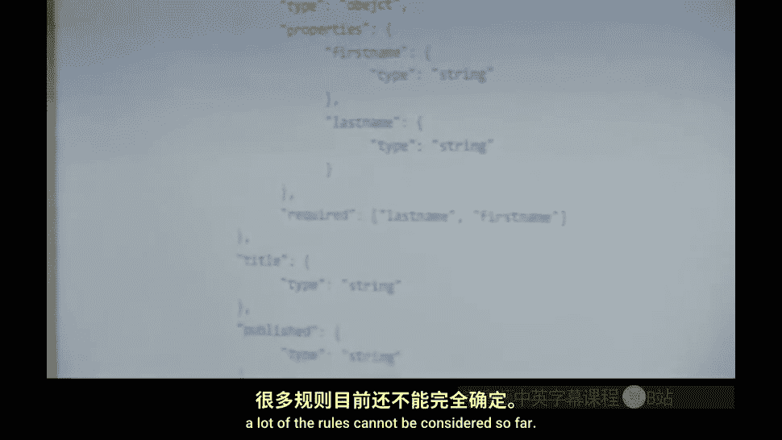
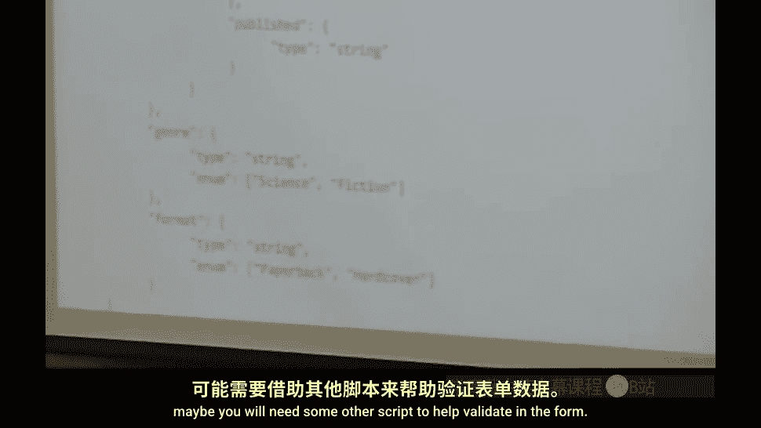
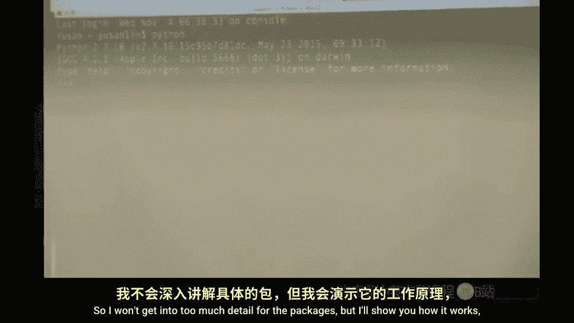
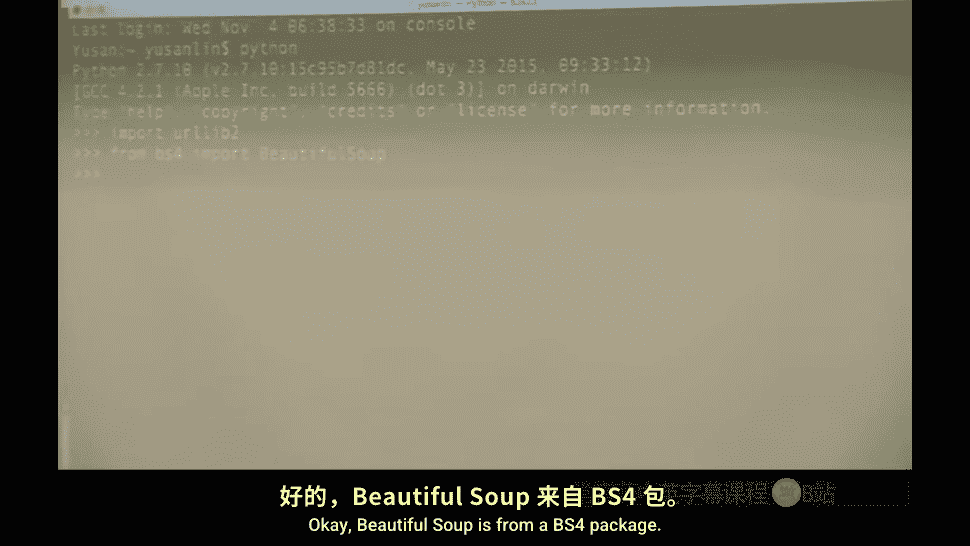
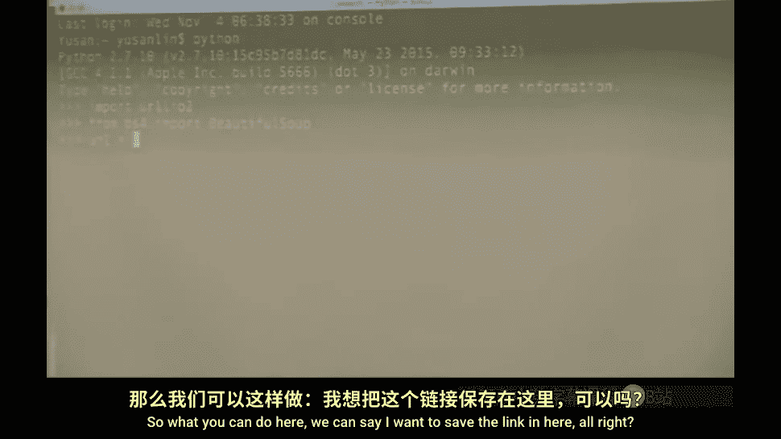

# 028：互联网应用 - 第二部分

在本节课中，我们将继续学习第7章关于互联网应用的内容。我们将回顾DTD（文档类型定义），了解JSON模式，并学习如何从网页上抓取数据。最后，我们将探讨数据密集型系统的架构演变，从单层到三层架构。

---

## 回顾：文档类型定义（DTD）

上一节我们介绍了XML和DTD的基本概念。本节中，我们来回顾一下DTD中如何使用正则表达式来定义元素结构。

DTD使用类似正则表达式的符号来定义XML文档中元素的结构和出现次数。以下是一些关键符号的含义：
*   `*`：表示零次或多次。
*   `+`：表示一次或多次。
*   `?`：表示零次或一次（即可选）。
*   `,`：表示序列（即“与”关系，所有元素必须按顺序出现）。
*   `|`：表示选择（即“或”关系）。

在DTD中，我们可以定义元素的内容类型。以下是两种主要类型：
*   **元素内容**：指一个元素内部包含其他子元素，从而形成数据的层次结构。例如：
    ```xml
    <booklist>
        <book>
            <author>...</author>
            <title>...</title>
        </book>
    </booklist>
    ```
*   **混合内容**：指一个元素内部可以包含文本和/或其他元素的混合。在DTD中，这通常用 `(#PCDATA)` 表示，代表可解析的字符数据。

此外，DTD还可以定义属性和其他约束：
*   `#REQUIRED`：表示该属性是必需的。
*   用括号 `()` 括起来并用 `|` 分隔的列表，表示枚举选择。例如，`(平装 | 精装) "平装"` 表示 `format` 属性可以是“平装”或“精装”，且默认值为“平装”。





现在，请判断以下XML片段是否符合前面描述的DTD规则：
```xml
<booklist>
    <book genre="科技">
        <author>
            <firstname>张</firstname>
        </author>
        <title>数据库导论</title>
    </book>
</booklist>
```
**解析**：此XML片段存在两处不符合DTD规则的地方：
1.  `author` 元素下缺少必需的 `lastname` 子元素。
2.  `book` 元素的 `genre` 属性是必需的，但示例中提供了该属性，所以这一点是正确的。

另外，如果 `booklist` 中不包含任何 `book` 元素（即为空），根据DTD中 `book*` 的定义（零个或多个），这也是有效的。

---

## JSON模式

我们之前提到，JSON格式因其高效性（如解析速度快、压缩率高）在许多方面已取代XML。然而，与XML需要DTD进行验证类似，JSON数据也需要一种方式来确保其结构符合预期。

JSON模式是一种目前仍处于草案阶段的标准，它提供了一种一致的方法来验证JSON数据项。其核心思想与XML DTD相似，都是通过定义规则来描述数据的预期结构。

以下是一个简单的JSON模式示例，它定义了一个包含书籍列表的对象：
```json
{
  "type": "object",
  "properties": {
    "booklist": {
      "type": "array",
      "items": {
        "type": "object",
        "properties": {
          "author": {"type": "string"},
          "title": {"type": "string"}
        },
        "required": ["author", "title"]
      }
    }
  }
}
```
这个模式表示：根是一个对象，它有一个 `booklist` 属性；`booklist` 是一个数组，数组中的每个项目都是一个对象；每个对象必须包含 `author` 和 `title` 这两个字符串类型的属性。

由于JSON模式尚不成熟，在实际应用中（例如网站表单验证），可能需要借助额外的脚本或函数库来完成验证。




**小结**：我们讨论了三种主要的网络数据格式。HTML专注于内容在网页上的呈现方式；XML在HTML的基础上，增加了描述数据结构和语义的能力，作为关系型数据库和网页之间的桥梁；而现代的JSON格式，兼具XML的层次化数据表达能力，并在存储和传输效率上更具优势。





---

## 从网页抓取数据

了解了数据格式后，我们来看看如何从互联网上获取这些数据。网络抓取是指编写程序自动浏览指定网页并收集页面上可见数据的过程。它通常用于在网站不提供官方API接口时获取数据。

网络抓取可以获取HTML源码中包含的任何内容，如文本、图片链接等，但无法直接访问网站的后端数据库。

有许多工具可用于网络抓取。本节将演示使用Python语言及其库进行抓取的基本方法。即使你不熟悉Python，其语法也相对简单易懂。

我们将以从亚马逊网站抓取产品名称作为示例。基本思路是：分析网页结构，找到目标数据所在的HTML标签和CSS类，然后用程序模拟访问并提取信息。

以下是使用Python进行抓取的核心步骤和代码片段：

1.  **导入必要的库**：`urllib2` 用于打开网页，`BeautifulSoup` 用于解析HTML。
    ```python
    import urllib2
    from bs4 import BeautifulSoup
    ```

2.  **读取网页内容**：将目标网页的URL地址存储下来，然后打开并读取整个页面的HTML代码。
    ```python
    url = "https://www.amazon.com/s?k=thanksgiving+decorations"
    response = urllib2.urlopen(url)
    html = response.read()
    ```

3.  **解析HTML并定位数据**：使用BeautifulSoup解析HTML。通过检查网页元素，我们发现产品名称位于 `<h2>` 标签中，并且具有特定的class属性。
    ```python
    soup = BeautifulSoup(html, 'html.parser')
    # 找到第一个符合条件的产品名
    product = soup.find('h2', {'class': 'a-size-medium a-spacing-none a-color-base a-text-normal'})
    product_name = product.get_text()
    print(product_name)
    # 找到所有符合条件的产品名
    all_products = soup.find_all('h2', {'class': 'a-size-medium a-spacing-none a-color-base a-text-normal'})
    for prod in all_products:
        print(prod.get_text())
    ```

通过类似的方法，你可以定位价格等其他信息，并将它们组合起来。要抓取多页数据，需要分析翻页时URL的变化规律（例如 `&page=2`），然后通过循环构造不同的URL重复上述抓取过程。

---

## 数据密集型系统架构

现在，让我们从具体的数据格式和抓取技术，转向支撑互联网应用的系统架构。数据密集型系统的架构决定了其数据管理、应用逻辑和表示层这三个核心组件是集中在一台机器上，还是分布在多台机器中。

### 单层架构
这是最早期的架构形式。所有组件（数据库、业务逻辑、用户界面）都集中运行在一台主机（如大型机）上。用户通过简单的“哑终端”进行访问。
*   **优点**：易于维护和管理，所有东西都在一起。
*   **缺点**：缺乏图形界面，中心系统计算压力大，难以扩展和互联。

### 两层架构（客户端-服务器架构）
这种架构将系统分为两部分：
1.  **瘦客户端**：客户端仅负责图形用户界面，所有业务逻辑和数据管理都放在服务器端。
2.  **胖客户端**：客户端不仅负责界面，还包含了业务逻辑，服务器端仅负责数据管理。
    *   **缺点**：业务逻辑更新困难（需更新所有客户端），存在安全隐患（服务器必须完全信任客户端），客户端软件笨重。

在胖客户端架构中，数据库的**存储过程**可以发挥优势。通过将关键业务逻辑以存储过程的形式放在数据库服务器端执行，可以减少客户端实现的多样性，提高安全性和一致性。

### 三层架构
现代Web应用普遍采用三层架构，它将系统清晰地分为：
1.  **表示层**：直接与用户交互，负责渲染界面（如HTML、CSS、JavaScript），并适配不同设备（电脑、手机、平板）。
2.  **中间层（应用服务器）**：包含核心业务逻辑，控制业务流程（如购物车状态管理），处理用户请求，并作为表示层与数据库层的桥梁。它动态生成HTML页面，并控制对数据库的访问（通过JDBC等接口）。
3.  **数据管理层**：即数据库管理系统（DBMS），负责数据的存储、查询和完整性管理。

各层之间通过特定协议通信（如HTTP用于浏览器与中间层，JDBC用于中间层与数据库）。

**实例分析**：
*   **航空订票系统**：
    *   数据层：存储航班、座位、客户信息。
    *   中间层：处理订票、取消、航班创建等逻辑。
    *   表示层：显示查询表单、航班列表，并进行输入验证。
*   **课程注册系统**：
    *   数据层：存储学生、课程、教师信息。
    *   中间层：处理选课、退课、开课等逻辑。
    *   表示层：显示课程表、注册表单，并进行输入验证。

三层架构的**优势**在于职责分离、易于扩展、维护方便，并且安全性更高（业务逻辑集中在受控的中间层）。

---

## 总结

本节课中我们一起学习了互联网应用的几个关键部分。我们回顾了如何使用DTD定义和验证XML文档的结构，了解了作为XML现代替代品的JSON格式及其模式验证。接着，我们探索了从网页抓取数据的实用技术，通过Python和BeautifulSoup库演示了基本流程。最后，我们系统地回顾了数据密集型系统架构的演进，从早期的单层主机架构，发展到客户端-服务器两层架构，直至现代普遍采用的表示层、中间层、数据层分离的三层架构，并理解了各层的职责与优势。这些知识将帮助你理解当今网络应用背后的数据流动与系统组织原理。