# 029：互联网应用 - 第3部分 🖥️

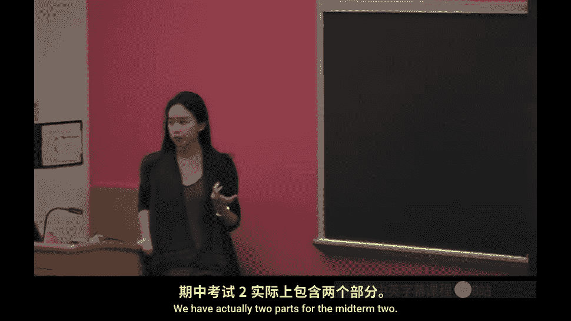

在本节课中，我们将学习互联网应用架构中的表示层技术。我们将了解HTML表单如何收集用户数据，JavaScript如何为网页添加简单的交互功能，以及CSS如何控制网页的样式和布局。课程最后，我们还会简要了解现代前端框架Bootstrap。

---

## 期中考试安排 📢

在开始今天的课程内容之前，有几个关于期中考试的重要通知。

期中考试分为两个部分。第一部分是编程考试，由于机房容量限制，我们将分为两组进行。

以下是考试时间安排：
*   第一组：下午5点至6点。
*   第二组：晚上8点至9点。

考试地点在218号Linux机房。考试预计只需15分钟左右，不会占用整个小时。对于没有CC账户的同学，我和助教可以登录我们的账户供你们使用。在Linux机房考试的好处是无需再次配置VPN。

考试第二部分将在周五进行。请记住，周一是作业和复习课，周二晚上是正常上课时间，我会展示报名表格。周三没有课。

关于报名，我会在课后通过Angel系统发送一封包含Google表单链接的邮件。请尽快选择你的考试时间并告知我，以便我尽早安排。

---

## 关于作业与项目的说明 📝

接下来，我想谈谈作业和项目相关的一些事情。

我上传了一个关于网络数据抓取的示例代码，虽然你们现在可能因为项目而对此不感兴趣，但可以将其作为一个简单的实验来看。这个例子和我们之前抓取感恩节装饰品数据的例子完全相同。

关于作业4，很多同学已经发现，问题4中的许多查询要求实际上没有返回任何结果。

这是因为最初我使用了一个更大的数据集导入到我的数据库，但提供给你们的版本数据有所截断，丢失了很多匹兹堡地区的数据。不过没关系，只要你的查询语句正确，就可以得分。有些问题可能没有答案，因为我选取了很多匹兹堡的例子。例如，有一个关于匹兹堡“Shady Side”社区的问题，如果你在查询时发现城市为匹兹堡且社区名为“Shady Side”的记录，就可以作答。

---

## 表示层技术概述

上一讲我们介绍了互联网应用的三层架构。最底层的数据库管理层是我们直到第5章SQL查询为止一直在学习的内容。今天，我们将简要浏览表示层和中间层，但主要聚焦于表示层。

表示层的技术发展相对稳定，而中间层在过去十年间变化巨大。教科书出版于2002年，其中提到的中间层技术（如CGI）现在已很少使用。因此，我们将更多关注表示层，内容会非常简单。

表示层的主要功能是作为用户的主要界面，负责所有的网页设计，并能适配不同的显示设备（如PC、平板、手机或手表）。发生在表示层的功能通常不复杂，可能包括一些字段验证，例如检查网页表单中填写的信息是否正确。除此之外，大部分工作并不单独由表示层处理。

表示层使用的技术主要有以下几种：
*   **HTML表单**：用于将数据从客户端传递到中间层的常见方式。
*   **JavaScript**：一种基于Java的脚本语言，可以在客户端进行轻量级计算。
*   **CSS**：负责网页的外观，如格式、颜色和布局。

我们还有一项技术XSL，但经过查阅，它现在已不常用。教科书也提到了它，但当前主流是CSS。

接下来，我们将逐一讨论这些技术。

---

## HTML 表单

HTML表单是将数据从客户端传递到中间层的常用方式。表单只负责从客户端到中间层的数据传递，中间层如何访问数据库则由中间层自己处理。

很多同学已经做过表单，但也有一些同学还没有。我将展示如何创建一个非常简单的表单。

在HTML中创建表单的基本结构如下，你总是以`<form>`标签开始，并设置一些属性，然后以`</form>`标签结束。在表单内部，你可以放置任何你希望用户输入的字段。

```html
<form action="处理文件.jsp" method="post" name="表单名">
    <!-- 表单字段放在这里 -->
</form>
```
*   `action`属性指定处理该表单的JSP文件。
*   `method`属性可以是`get`（更像登录表单）或`post`（用户提交信息，如发送邮件）。
*   你也可以为表单命名，以便识别。

在动手创建简单表单之前，我们先看看有哪些可用的输入选项。

创建表单时，我们有多种输入类型：
*   `input`：最简单的文本框，也可以改变类型为单选按钮等。
*   `select`：下拉列表。
*   `textarea`：更大的文本框，用于评论等，可以指定大小。


让我们尝试一下，以便你能看到效果。

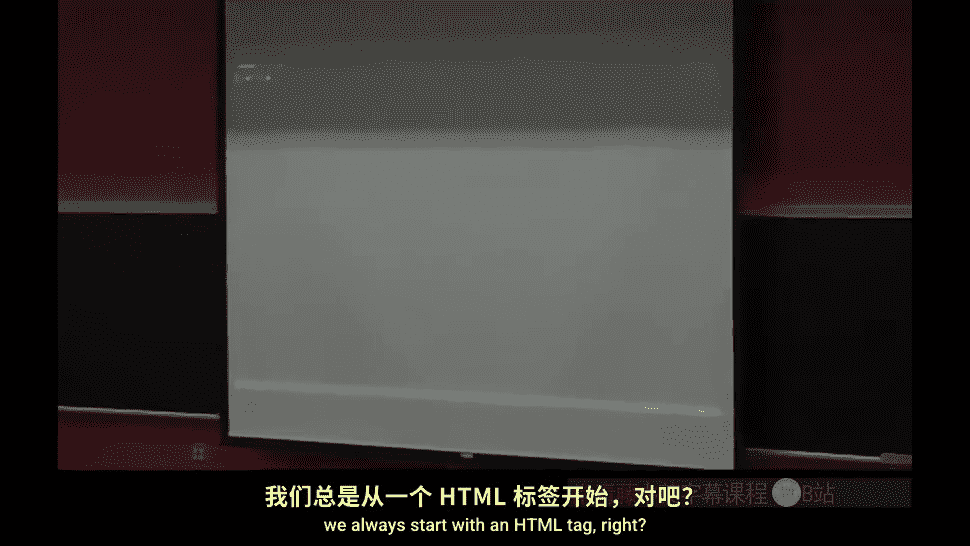

假设你从未写过HTML。正如我们上节课或上上节课讨论的，HTML总是以`<html>`标签开始。

```html
<html>
```

并以`</html>`标签结束。在HTML中，我们有不同的部分，第一部分是`head`部分，然后是`body`部分。`head`包含所有信息，例如页面标题，或者你可以链接不同的主机或外部文件。`body`负责网页内容。

由于我们希望表单在网页上呈现，它实际上会出现在`body`部分。正如之前所说，表单以`<form>`标签开始。

假设我们想给这个网页一个标题。你可以使用`<h1>`标签，它表示一级标题。

```html
<html>
<head>
    <title>页面标题</title>
</head>
<body>
    <h1>注册表单</h1>
    <form action="imaginary.jsp" method="post" name="signupForm">
        <!-- 表单内容 -->
    </form>
</body>
</html>
```

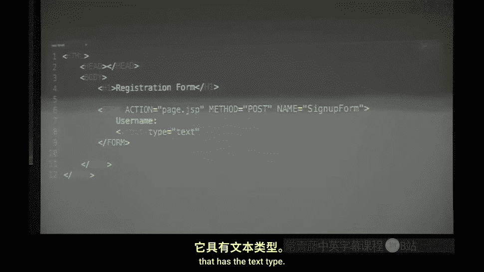

现在，因为我们想创建一个表单，正如之前看到的，我们应该设置不同的属性。例如，对于这个表单的`action`，我们假设稍后会有一个JSP文件来处理它。今天实际上不会发生什么，但我们假设有一个虚构的JavaScript会处理将信息传递到中间层。今天我们不处理那部分。

对于`method`，我们使用`post`，因为我们要注册用户。如果我们想给这个表单命名，可以随便起一个名字。

首先，假设我们希望用户输入用户名。如果我们直接放文本，它只是HTML中的纯文本。在这里，我们想要一个常见的矩形细长输入框。

```html
用户名: <input type="text" name="username">
```

在HTML中，表单有趣的一点是，只有`input`标签没有结束标签。出于某种原因，他们这样设计。

也许你想要密码字段。如果你不希望所有内容都在同一行，可以插入换行。在HTML中，`<br>`标签用于换行。

```html
<br>
密码: <input type="password" name="password">
```

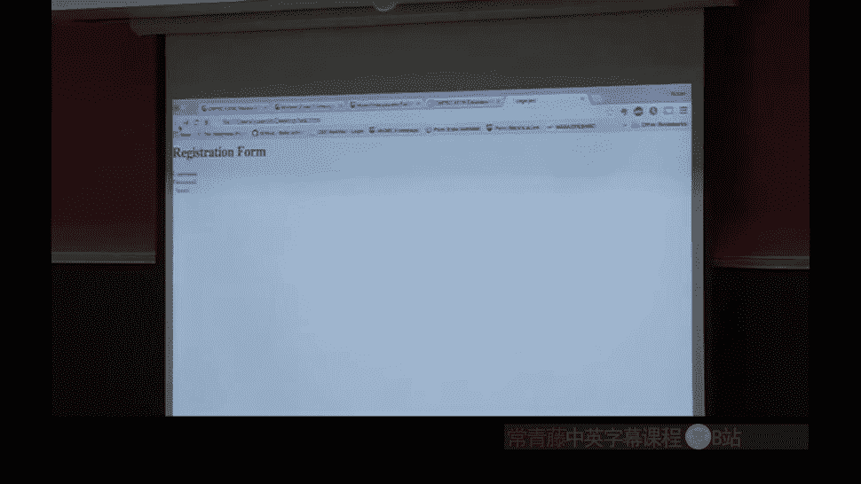

现在你可以想象，除了标题，你会看到一个用于输入用户名的文本框和一个用于输入密码的文本框。当你输入密码时，不会显示密码，而是显示点号。

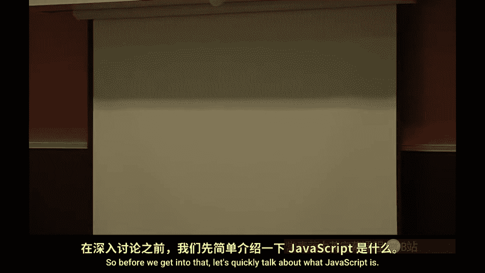

如果我们想提交表单，可以添加另一个`input`，但将类型改为`submit`。这将给你一个按钮。`value`属性是显示在按钮上的标签。

```html
<br>
<input type="submit" value="提交">
```

现在我们可以打开它看看效果。这是一个非常简单的表单，我们有两个字段。你可以尝试输入内容，但因为我们没有链接到任何实际的操作，所以提交任何内容都不会发生任何事情。

你们想看看其他类型的输入字段吗？比如单选按钮或下拉菜单？我们可以试试。

---

## JavaScript 表单验证

现在，我们想为这个表单添加一点功能。例如，即使用户没有输入任何内容就提交，表单也会通过。也许你想说，至少必须填写用户名。

这实际上可以通过使用JavaScript来实现。

在深入了解之前，我们先快速谈谈JavaScript是什么。它的目标是为表示层添加更多功能。正如我所说，完整的表示层除了显示和渲染外，做的事情不多。

JavaScript可以帮助你做得更多一些。JavaScript的一些示例应用包括：
*   检测浏览器：不同的浏览器可能兼容不同的功能，你可能需要先检测。
*   表单验证：我们稍后会尝试，例如，如果用户遗漏了某些字段，你应该弹出一个对话框提示。
*   浏览器控制：例如，你可以打开新窗口，或实现返回上一页的功能。

通常，JavaScript可以直接嵌入到HTML中，使用`<script>`标签，或者你也可以编写一个完全独立的脚本文件，然后链接到它。我们将尝试直接嵌入。

如果你将其嵌入，可以指定语言，但如果不指定，默认是JavaScript。你也可以通过`src`属性链接外部文件。

让我们看看如何直接嵌入。通常的做法（或个人偏好）是将其放在`body`部分的末尾。

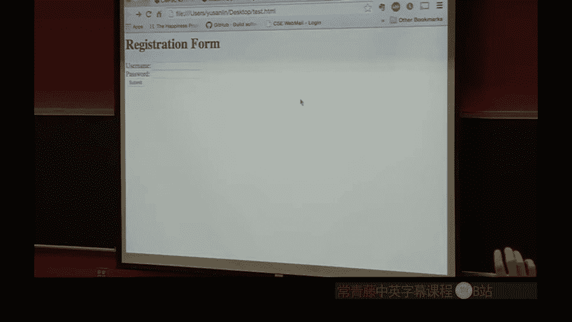

正如之前所说，你以`<script>`标签开始，然后以`</script>`标签结束，然后在里面放入你希望拥有的任何功能。

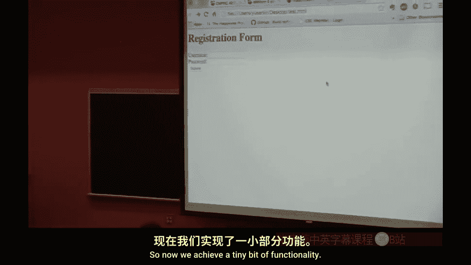

假设今天我们希望有一个功能来测试用户名是否已填写。如果未填写，我们希望提醒用户。

在这里，正如你所知，JavaScript是一种基于Java的语言，所以你在里面看到的代码与Java非常相似。

我们将声明一个函数，用于检查用户名是否为空。这个函数不需要参数，因为它直接链接到同一HTML文档中的表单。

你可以说我想检查变量`x`，希望它直接是这里的用户名。你可以通过`document.forms`来访问它，指定是哪个表单（这里是`signupForm`），然后指定要检查的字段（`username`）。所有这些都通过之前设置的`name`来引用。

我们感兴趣的是`username`的`value`，不关心类型或其他东西。`value`将是用户输入的内容。

获取用户名的值后，我们可以进行检查。如果用户名为空，我们弹出一个对话框提示“请输入用户名”。因为这是一个错误情况，我们返回`false`。如果这种情况没有发生，我们就返回`true`。

```html
<script>
function validateForm() {
    var x = document.forms["signupForm"]["username"].value;
    if (x == "") {
        alert("请输入用户名");
        return false;
    }
    return true;
}
</script>
```

这非常直观，但现在别忘了，你实际上需要将它链接回表单，否则什么也不会发生，它只是一个独立的脚本，表单不会知道它在为表单本身做某事。

你可以做的是，除了这些属性，你可以在表单标签中添加`onsubmit`事件。当提交表单时，返回我们刚刚声明的函数，让它来帮你检查。

```html
<form action="imaginary.jsp" method="post" name="signupForm" onsubmit="return validateForm()">
```

现在表单变得稍微复杂了一点，至少我们有一些事情在进行，而不仅仅是输入。我们可以保存并刷新页面。现在，如果我们不在用户名中输入任何内容就提交，就会弹出提示。这是最简单的有效性检查。

---

## CSS 样式表

现在，我们实现了一点功能，让我们看看如果想改变一下样式可以做什么。

让我们谈谈样式表。一般来说，样式表的想法是我们希望将显示与内容分离。

这样更好吗？比如用我的工作做验证？我认为在安全性方面，有些检查如果你能在浏览器级别完成，会快很多，而不是访问数据库。很多检查实际上不需要你去数据库，例如，用户名是否被占用，你就不能在浏览器级别完成，必须去数据库查看。所以我认为这取决于你想要实现什么功能，但如果我们只在JavaScript级别做，很多功能可以更快完成。

样式表的想法是我们希望将显示与内容分离，并使显示适应不同的呈现格式。你可以想象，有时你只想以一种方式设计网站，并指定要显示的内容，但你希望有其他来源来决定它应该看起来如何。

你可能会注意到，这种情况很少发生，但有时你打开Facebook，它看起来有点乱，你只看到内容，所有颜色都是默认的。这很少发生，但有时会发生在我身上，也许那时他们的CSS暂时不可用，没有链接好，所以你可以看到所有内容，但显示方式不美观。这就是CSS缺失的时候，但内容都在那里。

在样式表方面，有两个方面。第一个方面是文档转换，它将帮助你决定文档的哪些部分以什么顺序显示。样式表最常用的第二个方面是文档渲染，它将帮助你决定文档的每个部分如何显示。例如，之前我们的表单中有纯文本和标题，我们也有文本字段，实际上你可以说所有的标题我都想以这种方式显示，所有的文本字段我都想以另一种方式显示。

我们为什么想使用样式表？有不同的原因：
*   我们希望为不同的显示重复使用相同的文档，正如我们之前所说，CSS或其他样式表可以帮助你在不同设备上以不同方式呈现。
*   根据用户偏好定制显示，有时你可以触发一些设置，让用户希望同一网页以不同方式显示。
*   必须在不同上下文中重复使用相同的文档。

有两种主要的样式表语言。第一种是我们今天要讨论的级联样式表，也就是CSS。它是为HTML做的。另一种是可扩展样式表语言，我们称之为XSL，用于我们上次讨论的XML文档。但请记住，我之前说过它现在正慢慢消失。有一段时间，一切都用HTML完成，然后人们说现在我想更面向模式而不是面向文档，所以他们转向XML来实现数据层次结构。但现在人们为了压缩或效率原因又回到了JSON。所以现在你看那些源代码，就像我们上次为Amazon做的那样，你看不到任何关于XML的东西，它看起来还是HTML。所以现在，人们不再使用XML来处理表单，而是又回去了。但当教科书在13年前编写时，他们还在谈论XML现在取代了HTML。现在如果你不回头看，我也会谈到Bootstrap，现在很多人都在使用Bootstrap，它实际上是HTML和CSS的组合。

CSS到底是什么？CSS代表级联样式表，它定义了如何显示HTML元素。CSS文件包含样式定义，你可以设置你想使用的字体、字体大小和颜色等。许多不同的HTML文档可以引用同一个CSS文件，所以在同一个网站内，如果你们都引用同一个CSS文件，那么每个人都有相同的样式。如果你想改变整个网站的风格，但希望内容保持不变，那么只需更改那一个CSS文件，每个人都会改变。

CSS被认为是实现内容与呈现分离的第一步。与在Word中手动设置样式不同，如果你在Word中不应用样式，比如标题，你可能会手动高亮这一行，将其设置为14磅，设置为其他字体，这意味着这是一级标题。然后一切都是在行内完成的，这样做不连贯，如果你突然想改变标题样式，你必须回去再次更改每一处。如果你想象在Microsoft Word中操作，使用顶部的样式选择标题、标题一、标题二，这是类似的想法。

CSS文件是什么样子的？CSS文件通过以下行包含到HTML文件中。我们可以使用`<link>`标签链接我们编写的外部CSS文件。

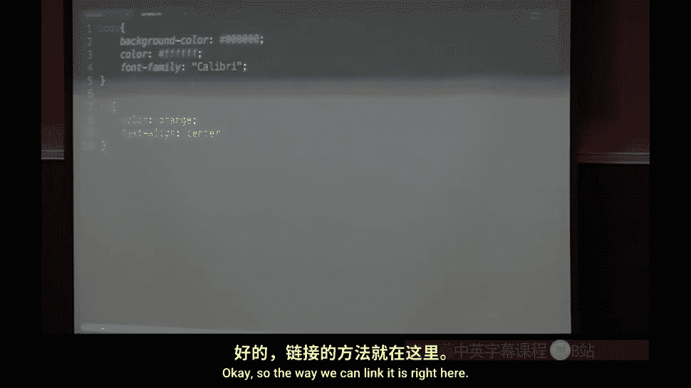

在CSS文件中，有这样的格式。你总是以一个选择器开始，然后在花括号内说属性的值是什么，就像键值对。例如，对于`body`部分，我希望所有`body`部分的背景颜色是黄色。这完全等同于在HTML中直接设置，说它是`body`，背景颜色是黄色。

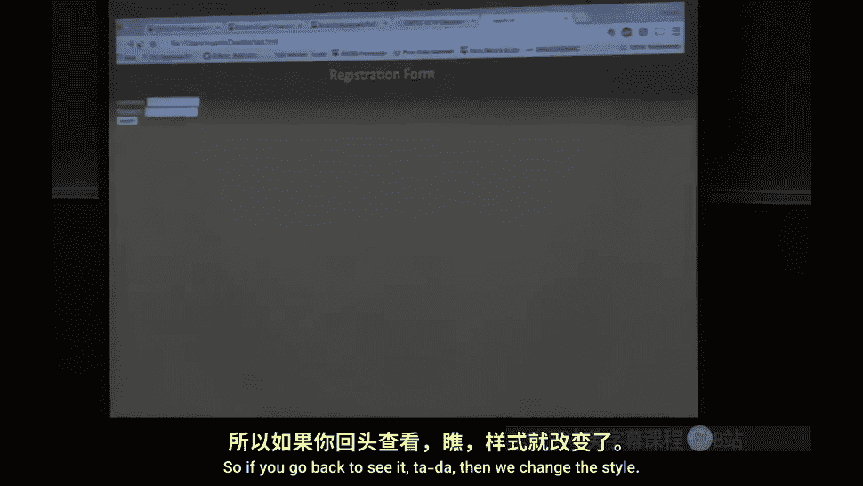

让我们看看。我们可以做什么？我们想试试。例如，我们可以创建一个新文件，简单地将其保存为`sample.css`。

例如，今天，我们希望`body`部分的背景颜色全是黑色。如果你不熟悉这种表示颜色的方式，它是十六进制数。从0到f，0表示0，一直到9，然后是A、B...所以它不是二进制，是十六进制数。这是表示颜色的方式。如果全是0，表示黑色。也许我们可以说，让字体颜色全是白色。如果你放F，那是最大值。这对这门课来说不是那么重要，只是让你知道，这不是网页设计课，所以没关系。也许我们不喜欢默认字体，我们可以说我们想将字体系列改为Calibri。这是我们幻灯片一直使用的字体，因为我喜欢它，我们也可以用于网页。除此之外，也许我想说对于标题，我也想改变它。也许我想把标题变成橙色。你可以看到我们也可以放一些颜色的常规名称。除了放在左边，我可以将其对齐到中心。这只是向你展示详细的语法，我来展示我们如何使用一个统一的样式。

现在我们设计好了，然后我们需要将其链接回去。我们可以这样做，正如你所记得的，我们将东西放在`head`部分。我们可以用这种方式链接，使用`<link>`标签。

```html
<link rel="stylesheet" type="text/css" href="sample.css">
```

基本上，我们刚刚做的是指定我们希望文本是白色，背景是黑色，标题是橙色。我们改变了字体。

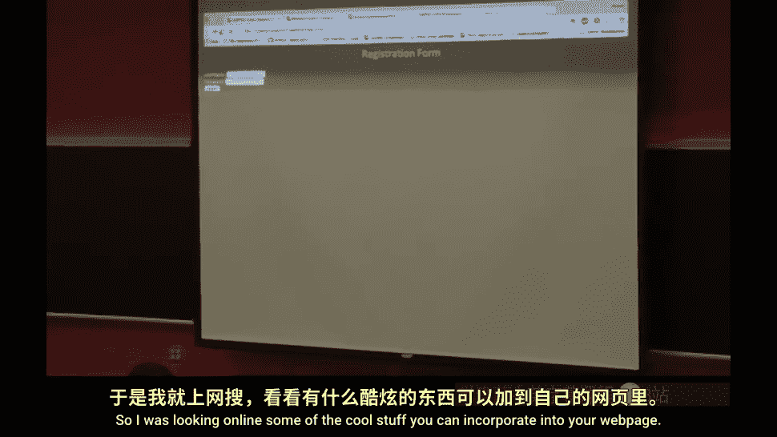

在从CSS继续之前，我只想做多一点事情。

---

## JavaScript 动画示例

我认为JavaScript已经存在很长时间了。有一段时间人们也使用Java Applet，它更像是与JavaScript一起使用，但在网页上显示更多动画或图形功能，我认为这是一项非常古老的技术，现在正在消失，但JavaScript仍然存在。我只是想向你展示我10岁左右第一次接触JavaScript的经历。那时我们在小学开始上计算机课，当时我们使用一个叫FrontPage的软件。这暴露年龄了，这就像一个网页编辑器，你可以使用它。它很糟糕，但我们作为孩子仍然玩得很开心，我们试图使用它。当时我总是看课堂上的电脑工具包。我在网上寻找一些可以融入你的网页的酷东西，我发现有一些小动画。我不知道为什么我会想我可以做，但就像我小时候，我会直接把东西粘贴到我的网页源代码中，像那样。所以我发现有一些下雨的动画，或小云飞的动画，或下雪。所以我找到了这个下雪的JavaScript，我真的很开心，我只是想展示给你们看。主要想法是向你展示这些拖放脚本也可以实现超级简单的动画。当你打开它时，可能太详细了，你不想理解，但它们会谈论很多关于雪的速度，它如何飞，或者你可以与雪进行一些交互，所以你的光标移动，雪会改变方向所有这些小事。你不必理解这个，但网上有很多不同的功能，你可以直接下载。例如，我有这个雪暴JavaScript，我想在我自己的网页上试试。我们可以直接把它合并到我们的网页中。这就是我把背景改成黑色的原因。现在，我们有雪了。所以你看，即使是简单的JavaScript，没有任何图像，因为它们都只是小点，也可以做到这一点。你可以改变雪如何飞等等。

所以这是JavaScript讨论的结束。你可以发现不同种类的小功能，当然，为你的项目添加雪并不是真的有用，但你可以添加更多的有效性检查。当我小时候，我觉得这很酷。好的，这就是JavaScript，也是我今天要讲的表示层的全部内容。因为这不是网页设计课，所以我不会在表示层上放太多重点。

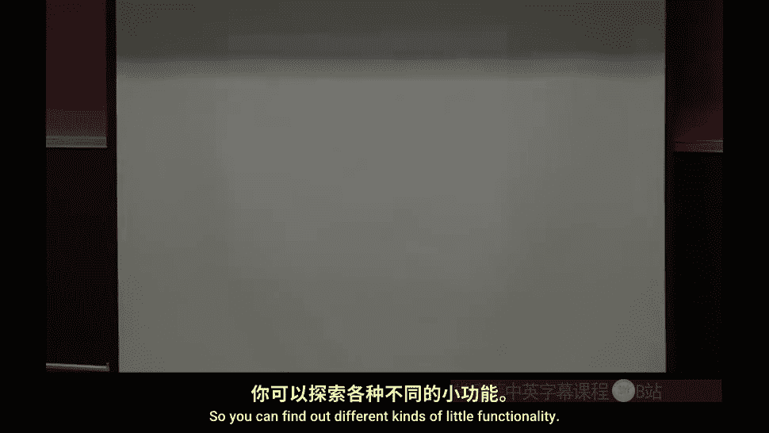

---


## Bootstrap 框架简介

在我们继续之前，实际上关于表示层还有一件事。Bootstrap。我想你们很多人都听说过。谁听说过Bootstrap？相当多。好的，我认为现在使用Bootstrap作为前端设计是一种趋势。

当我第一次接触Bootstrap时，我觉得它看起来真的很花哨。这是我的第一印象，它看起来非常整洁，非常流畅，更像现代的设计方式。但后来它到了被过度使用的程度，无论你去哪个小网页，都是Bootstrap，不管他们有多少内容，都是Bootstrap。每个人看起来都像Bootstrap，但我仍然认为它是目前最好看的网页设计模板。

Bootstrap最初是由Twitter的人开发的。它最初名为Twitter Blueprint，由Twitter的Mark和Jacob开发，供内部使用。一开始，他们并没有真的想让其他人使用它，除了Twitter内部人员，他们可以在内部使用它。也许一开始，每当他们展示工作进展时，展示的演示文稿太乱了，所以他们决定，在公司内部，我们将有一种统一的方式来显示结果，这就是为什么他们开发了Bootstrap。但后来，他们发现这个东西可以非常强大，因为他们设计的方式非常易于使用，并且非常容易在此基础上开发其他类型的样式。所以他们将其开源，它是一个用于创建网站和Web应用程序的开源工具集合。

正如我之前所说，现在人们从XML转向，回到JSON和HTML来显示数据，所以Bootstrap你可以认为它是基于HTML和CSS的设计。它自带许多组件，包括排版、表单、按钮、导航和其他界面组件。你可能不知道课程网站使用的是Bootstrap。好的，这是一个例子。我为你选择了Bootstrap作为课程网站。Bootstrap，你可以看到这只是另一个Bootstrap例子。所以我认为当你回去时，你可以尝试看看其他Bootstrap例子，我们也有一个团队，项目销售Bootstrap模板。所以你可以去看看一般的主题是什么样子，它们有不同的东西。最常见的是很多人会使用Bootstrap来编写他们的GitHub仓库Wiki，所以他们会为仓库编写自己的文档，或者另一种就是这种看起来非常宽，每个部分都是一整行颜色。

这就是Bootstrap。我原本想演示如何在Bootstrap中做事，但会变得太复杂，因为他们自己开发了这么多组件。所以我认为如果你以后想改变，如果你没有使用Bootstrap或者你想改变，你可以去看看。链接到Bootstrap CSS非常容易。然后你查看文档，看看如何使用不同的组件。我快速展示一下课程网站。所以这是导航栏。然后我们也有这里，都是Bootstrap完成的，即使有，我不知道你们有没有人注意到我的设计有一个缺陷，网站上无法向下滚动，但我想你们可以滚动右侧。所以，这是一个基本的Bootstrap例子，但它看起来不那么花哨，因为如果你去很多当前的网站，我想很多会议网站或很多初创公司网站，它们看起来超级Bootstrap风格。所以你可以试试。

这就是Bootstrap，这就是我们表示层的结束，我们在那里花了很多时间。

---

## 课程总结与后续安排

实际上，我们没有时间讲中间层了，或者添加太多乐趣。对于中间层，我想我会在期中考试后讲，所以它不会在期中考试中。今天我们就到这里，直到第13讲。之后的所有内容，我们下次再讲。期中考试二，我不会考这些东西。

在你们离开之前，我还有一个关于DTD的小测验。如果你们记得我们上次讨论的XML文档类型定义，它非常简单，非常相似的例子，所以我可以给你一个DTD，然后你只需检查给出的例子是否遵循它。就是这样。DTD代表文档类型定义。好的，我想我应该宣布的一切都宣布了。现在，在开始之前，我再快速过一遍。


---

本节课中，我们一起学习了互联网应用表示层的核心技术。我们了解了如何使用HTML表单收集用户输入，如何用JavaScript进行简单的客户端验证以提升用户体验，以及如何用CSS来控制网页的视觉样式，实现内容与表现的分离。最后，我们还简要介绍了现代流行的前端框架Bootstrap。这些工具共同构成了构建现代、交互式网页应用的基础。