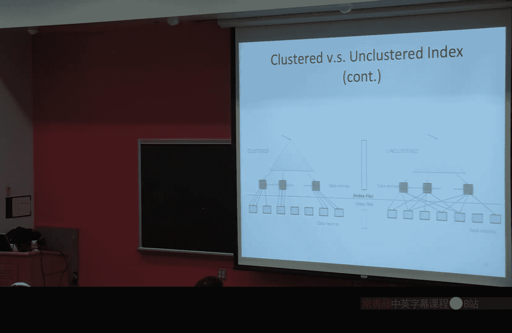
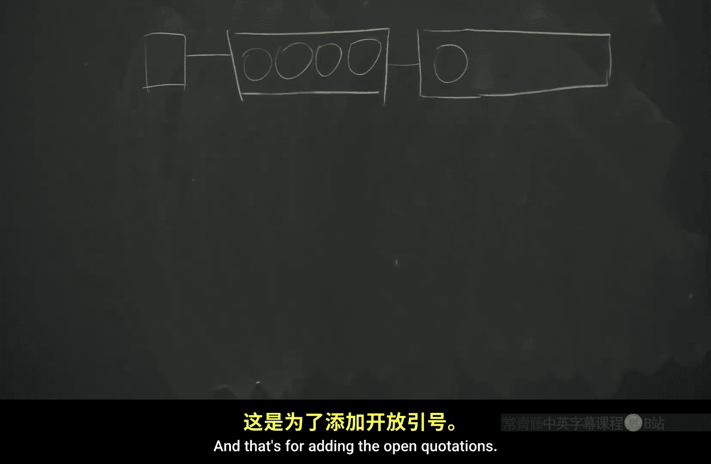
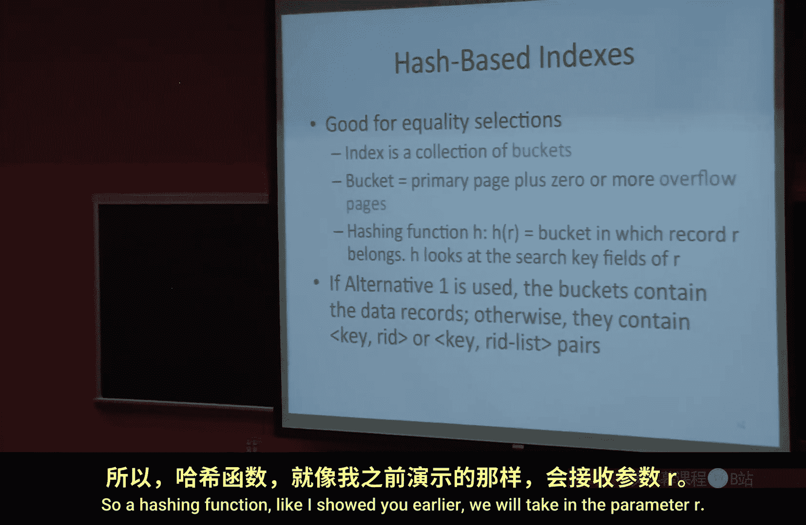
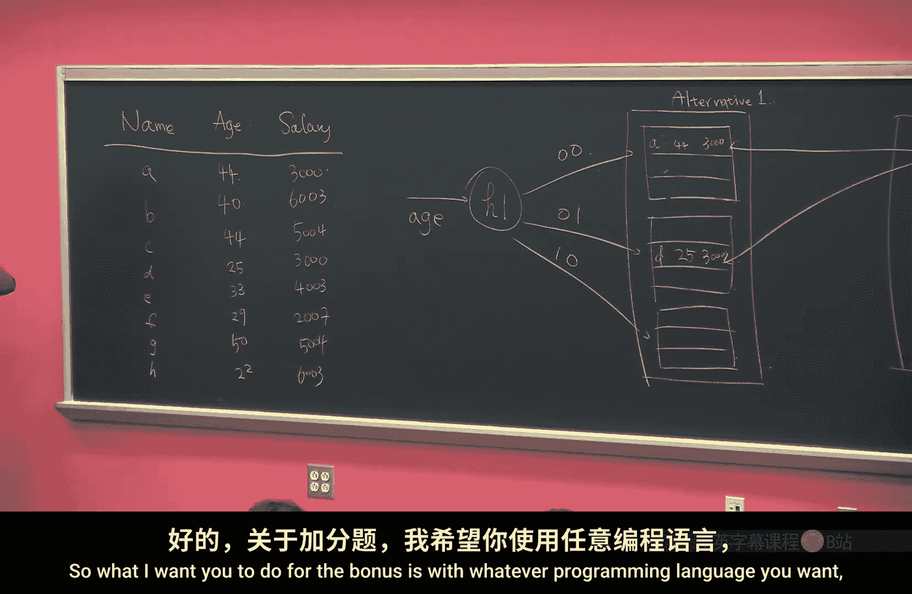

# 031：基于哈希的索引 📊

在本节课中，我们将继续学习第8章的内容，重点探讨索引的分类以及基于哈希的索引技术。我们将了解索引如何根据不同的属性进行分类，并深入理解哈希索引的工作原理及其优缺点。

---

## 课程安排更新 📅

在开始新内容之前，先对课程安排进行一些调整。原定的第16章内容已被移除，期末考试将涵盖第1、2、8和12章的内容。第二次作业的截止日期已调整至12月2日。此外，新增了一项加分作业，要求使用任意编程语言实现本节课讨论的数据结构，最多可获得2分。项目演示将在假期后的一周进行。

---

## 回顾：数据项的三种形式

上一节课我们介绍了指向数据记录的“数据项”的三种替代形式。理解这些形式是学习索引的基础。

以下是三种数据项形式的总结：
1.  **实际数据记录**：数据项本身就是包含键值K的完整数据记录。
2.  **键值-记录ID对**：数据项是键值K和对应的记录ID（RID）的组合，形式为 `(K, RID)`。
3.  **键值-记录ID列表对**：数据项是键值K和一组记录ID列表的组合，形式为 `(K, List of RIDs)`。这种形式允许一个数据项指向多个数据记录，更为紧凑。

---

## 索引分类 🏷️

索引可以根据不同的标准进行分类。本节中，我们主要关注两种重要的分类方式。

### 主索引 vs. 辅助索引

*   **主索引**：索引建立在关系的主键上。由于主键具有唯一性，因此主索引默认也是唯一索引。
*   **辅助索引**：索引建立在其他属性上。该属性可能包含重复值，因此辅助索引不一定是唯一的。

### 聚集索引 vs. 非聚集索引

这个分类关注数据记录的物理存储顺序与索引中数据项顺序的关系。
*   **聚集索引**：数据记录的物理存储顺序与索引中数据项的排序顺序相同或接近。
*   **非聚集索引**：数据记录的物理存储顺序与索引中数据项的排序顺序无关。

**重要说明**：数据项的“第一种形式”（即数据项就是数据记录本身）必然意味着聚集索引。然而，一个数据库文件最多只能在一个搜索键上建立聚集索引，因为数据记录本身只能按一种顺序物理存储。

检索数据的成本因索引类型的不同而有很大差异，聚集索引通常对范围查询更高效。

---

## 基于哈希的索引 🔑

在了解了索引的基本分类后，我们来看看一种具体的索引技术：基于哈希的索引。

### 哈希索引原理

哈希索引的核心是使用一个**哈希函数**。该函数以搜索键值作为输入，计算出一个哈希值，这个值直接决定了数据项应该存储在哪个**桶**中。
`bucket_number = hash_function(search_key_value)`

理想情况下，哈希函数能将数据均匀地分布到各个桶中，从而实现快速的等值查询（时间复杂度接近O(1)）。然而，哈希索引通常不适合范围查询，因为哈希函数破坏了键值的顺序关系。

### 桶溢出处理

每个桶通常有一个初始的固定容量（主页）。当向一个已满的桶插入新数据时，系统会使用**溢出页**来存储额外的数据，而不是重新组织整个结构。溢出页链接到主桶之后。

### 哈希索引示例

假设我们有一个简单的`Employee`关系，包含`name`， `age`， `salary`字段。我们可以设计两个哈希索引：
1.  基于`age`的哈希索引（使用数据项形式1）。
2.  基于`salary`的哈希索引（使用数据项形式3）。

哈希函数可以这样设计（示例）：
*   对于`age`：将其转换为二进制，取最低两位，根据`00`， `01`， `10`， `11`分配到4个不同的桶。
*   对于`salary`：采用另一种哈希计算方式。

通过编程实现这个结构，可以清晰地看到数据是如何通过哈希函数映射到各个桶中的，以及不同数据项形式（如形式1和形式3）在存储上的区别。

---

## 基于树的索引 🌲（简要介绍）

作为对比，我们简要介绍另一种主流索引技术。基于树的索引（如B+树）将数据项组织成层次化的树形结构，并保持数据项按键值排序。

与哈希索引擅长等值查询不同，基于树的索引特别适合**范围查询**。因为键值是有序存储的，所以可以高效地找到某个范围内的所有记录。我们将在下一节课中详细讨论这种索引结构。

---

## 课堂测验 ✏️

请准备一张纸，回答以下问题：
1.  在基于哈希的索引中，哈希函数的作用是什么？它决定了数据项将被分配到何处。

---

## 总结

本节课我们一起学习了以下内容：
*   回顾了数据项的三种形式。
*   学习了索引的两种主要分类：主索引/辅助索引，以及聚集索引/非聚集索引。
*   深入探讨了**基于哈希的索引**的工作原理，包括哈希函数、桶和溢出页的概念，并分析了其适用于等值查询但不适用于范围查询的特点。
*   简要对比了基于树的索引，为下节课的内容做了铺垫。

下节课我们将继续深入探讨基于树的索引结构。