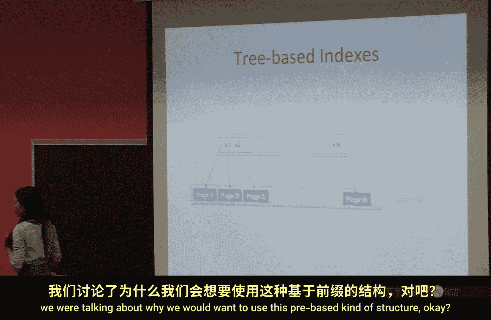
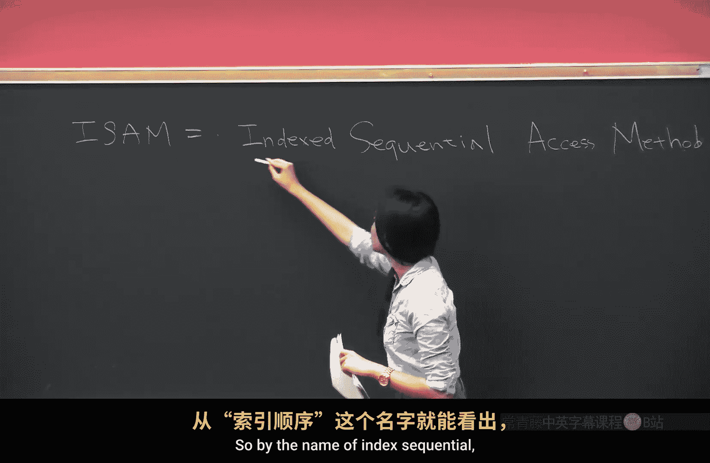
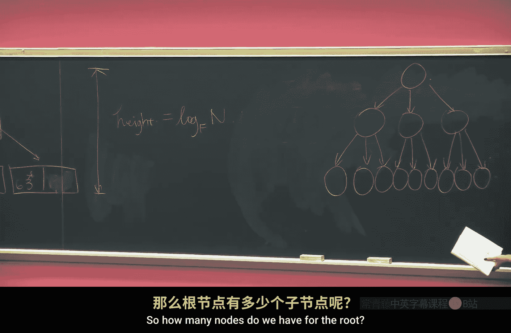

# 032：基于树的索引与ISAM 🗂️

在本节课中，我们将继续学习文件组织，并重点介绍一种新的数据结构——基于树的索引。我们将从回顾哈希索引开始，然后深入探讨一种名为ISAM（索引顺序存取法）的树状索引结构，了解其工作原理、构建过程以及优缺点。

## 回顾：哈希索引

上一节我们介绍了哈希索引。哈希索引使用一个**哈希函数**，将输入值（如键）映射到不同的存储桶中。

**公式**：`bucket_number = hash_function(key)`

每个存储桶都有其容量。如果数据条目超过容量，就会发生溢出，通常通过创建溢出页来处理。数据条目本身可以存储实际数据记录（替代方案1），也可以存储指向数据记录的指针（替代方案2或3）。

## 引入基于树的索引

与哈希索引不同，基于树的索引结构天然支持数据的有序性。这对于范围查询（例如，查找某个区间内的所有数据）非常高效，而哈希索引在这方面则效率较低，因为它无法直接体现数值之间的顺序关系。

一种基本的树状索引思想是使用一个索引文件来指向数据文件。数据文件被分成多个页，索引中的键用于指示应该访问哪个数据页。例如，一个键K1左侧的指针指向所有属性值小于K1的页，而K1和K2之间的指针则指向属性值在K1和K2之间的页。

## ISAM 索引详解 🌲

ISAM是一种静态的树状索引结构。“索引顺序”意味着数据条目在底层（叶节点）是按顺序存储的。

### ISAM的结构

ISAM树由多层节点构成：
*   **叶节点**：存储实际的数据条目，这些条目已按键值排序。
*   **非叶节点（索引节点）**：存储键值和指针，用于导航到下一层节点。
*   **根节点**：树的顶层节点。

每个节点对应一个磁盘页，有固定的容量（例如，每页可存放2个键值-指针对）。

### ISAM的构建过程

以下是构建一个ISAM索引的步骤：

1.  **创建叶节点**：将所有数据条目按键值排序，然后根据页容量将它们配对分组。每一组形成一个叶节点页。
2.  **创建上层索引**：
    *   为所有叶节点创建一个上层索引页。
    *   该索引页中的键值通常取自其指向的子节点中的最小键值（或能区分子节点范围的值）。
    *   指针用于指向对应的叶节点页。规则是：指针Pi指向的子树中，所有键值都小于键值Ki。
3.  **创建根节点**：如果上层索引页多于一个，则继续创建更上层的索引，直到最终形成一个根节点。

**关键概念**：
*   **主页**：在初始构建过程中创建的页（包括叶节点和索引节点）。
*   **溢出页**：后续插入新数据时，如果目标叶节点已满，则不会重构整个树，而是链接一个新的页来存放多余数据，这个新页就是溢出页。

### 插入与删除操作

*   **插入**：找到正确的叶节点，如果该节点已满，则在其后链接一个溢出页来存放新数据。**索引结构本身（主页）不会改变**。
*   **删除**：找到并删除数据条目。删除后，主页中可能留下空位，但ISAM不会自动重新填充这些空位或合并半空的页。

### ISAM的性能分析

访问一个数据条目的成本（I/O次数）通常等于树的高度。

**公式**：`访问成本 ≈ 树的高度`

树的高度可以通过叶节点数量 `N` 和每个索引节点的扇出 `F`（即最多可指向的子节点数）来估算。

**公式**：`高度 ≈ log_F(N)`

ISAM的主要优点是初始构建后，点查询效率很高（因为树矮且平衡）。然而，其主要缺点是随着数据不断插入，溢出链会变得很长，导致查询性能下降，因为可能需要遍历很长的溢出链才能找到数据，从而失去了树结构原本的高效优势。

## 总结

本节课我们一起学习了基于树的索引结构，并深入探讨了ISAM。
*   我们首先回顾了哈希索引的局限性，特别是在范围查询方面。
*   接着，我们介绍了树状索引如何通过有序性来高效支持范围查询。
*   然后，我们详细讲解了ISAM索引的静态结构、构建过程以及插入删除操作。
*   最后，我们分析了ISAM的性能，并指出了其因使用溢出页而可能导致的性能退化问题。

ISAM的静态特性是其弱点。在下节课中，我们将学习一种动态的、能够保持树平衡的索引结构——B+树，它被设计用来克服ISAM的缺点。