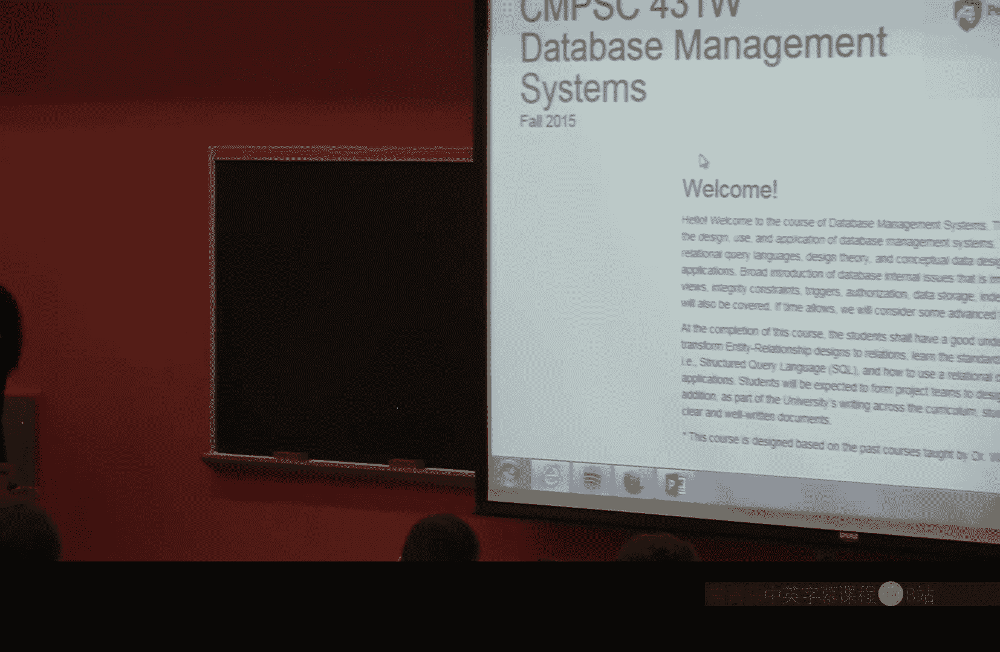
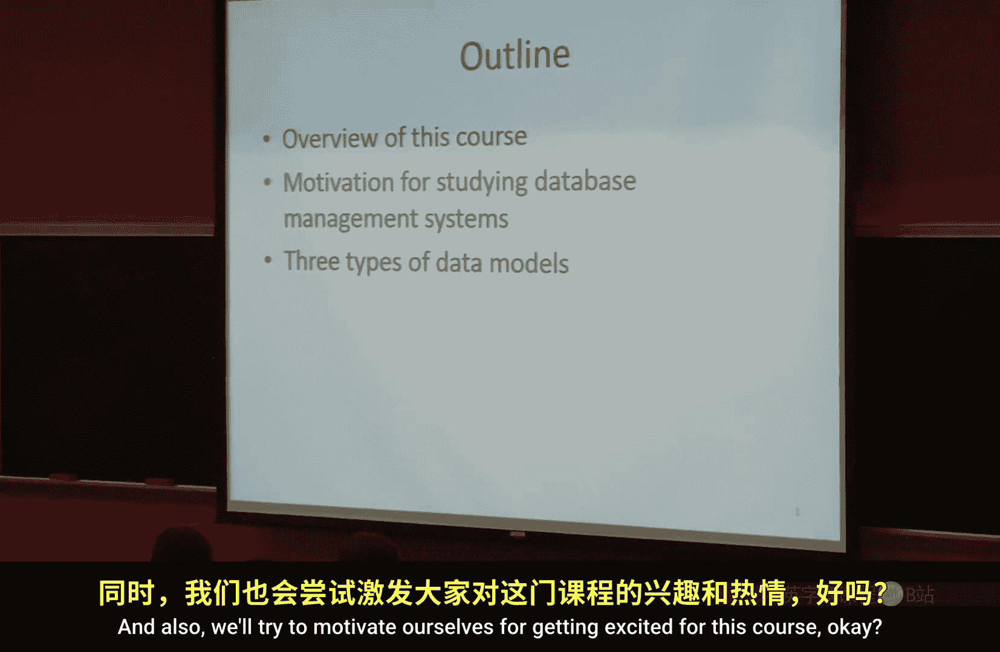
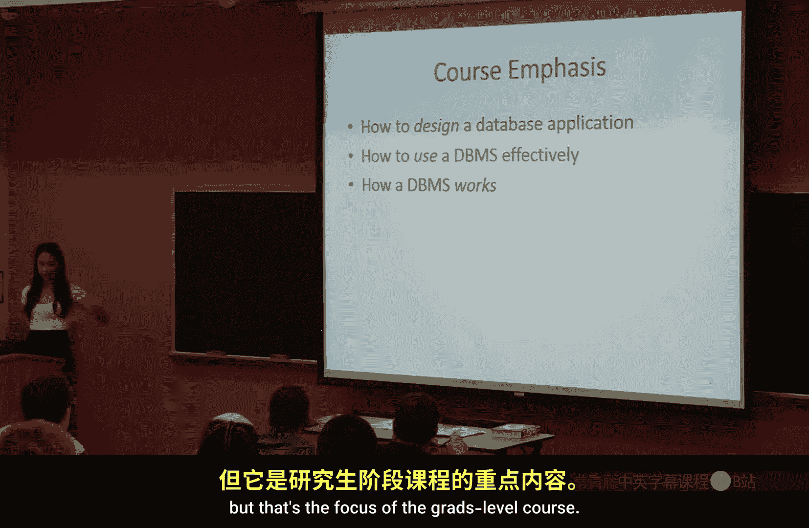
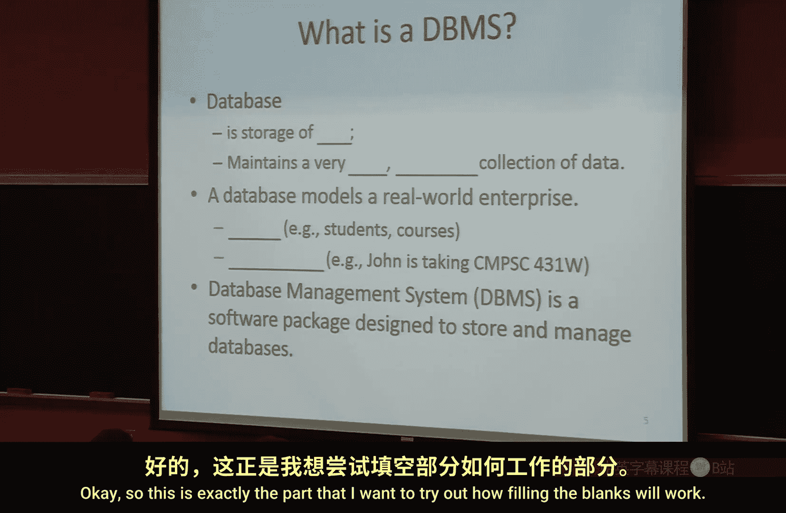
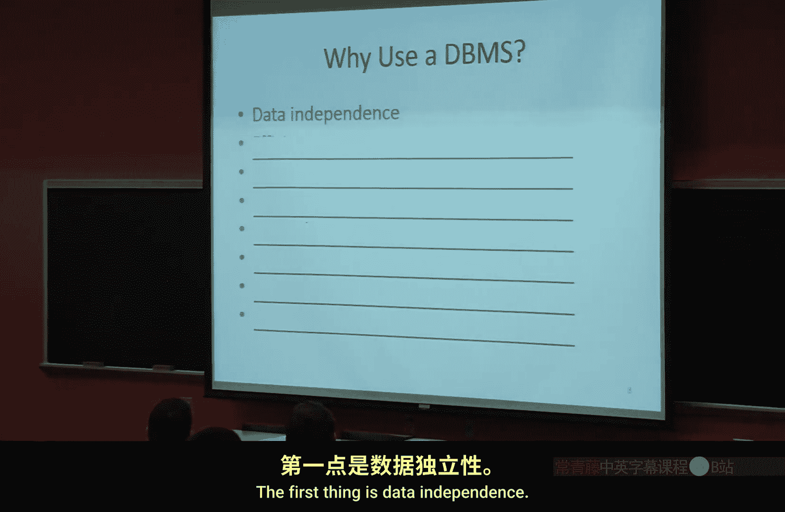
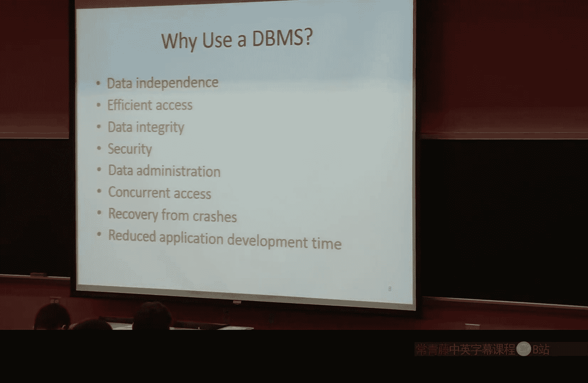
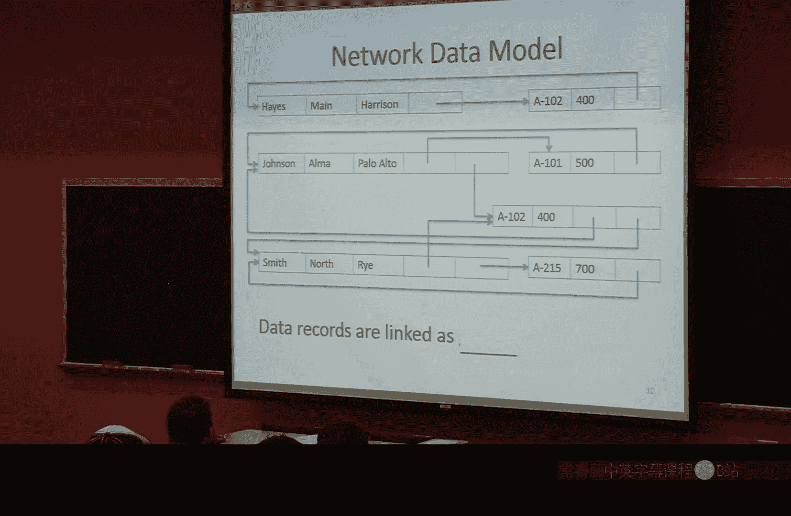
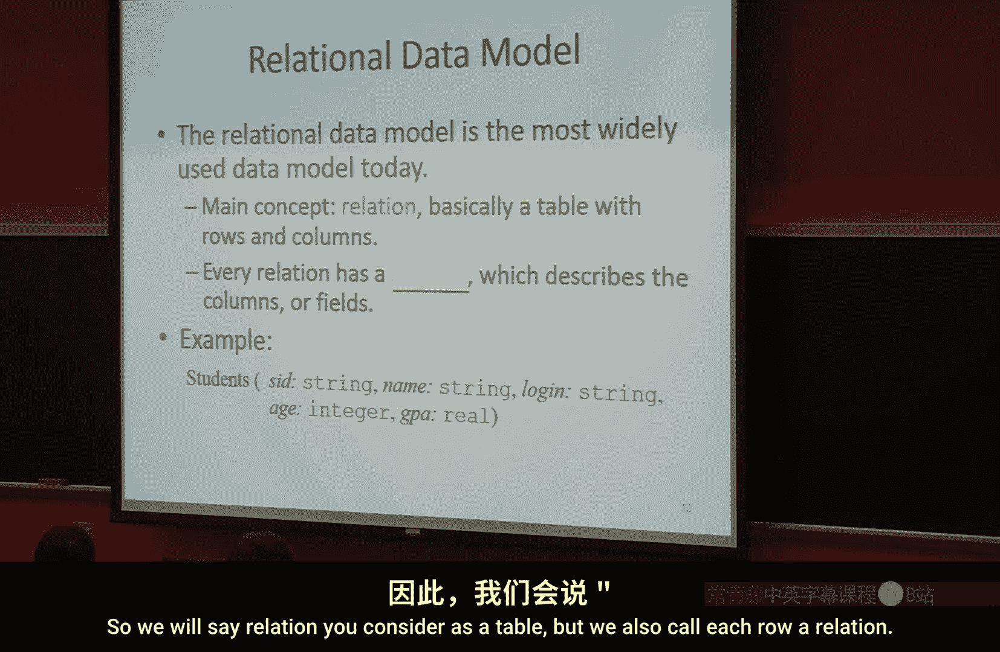
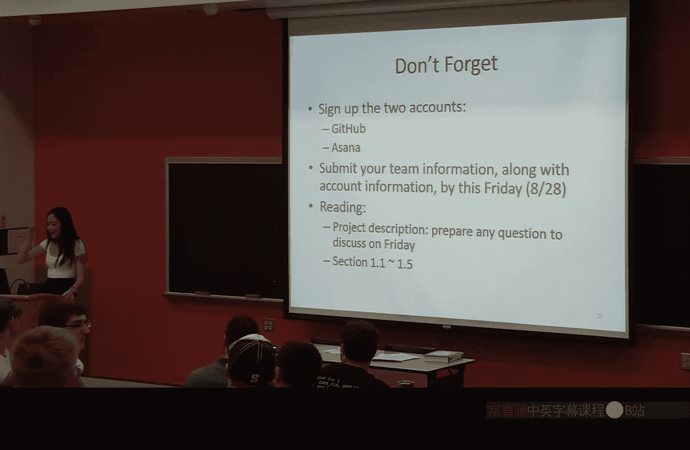

# 宾夕法尼亚州立大学【中英⚡数据库管理系统｜CMPSC431 Fall 2015, Database Management Systems】 p01 P1 数据库管理系统导论 - 第1部分 -BV1N76CBwEXb_p1-

Hey， so is 8 o'clock shop。Let's get started。First thing first。

 I want to welcome you all to the database management assistant。

 I will be your instructor for this semester， my name is Yuslin。

 I am currently a PhD candidate in the Department of Computer Science and Engineering。

So I think quite a few of you have seen it before。Because I might have been your TA in the past since you were already my students。

And welcome to be my students again。So before we get started， I'll talk about the。Syllabus。

 and then we go into the lecture before we get started。I just want to say。

You guys are very brave for signing up at 8AM class。I think it's so， come on Monday Wednesday Friday。

Yeah， I will make sure it's worth it for you to wake up every morning as early and come here as I like to。

嗯。And even though it's super early， I wouldn't allow any absence。All right， just to put it clear。

Okay， so let me see。Before I get into the syllabus， I think all of you have one copy of it。

I want to talk about quickly just about the registration。

 so some of the students have already written me about not being able to add this class Last time I checked this morning we only have five spots left。

So if you want to add in， we still have five spots left， you just have to come to me。

And you can fill out the a drop form and I'll approve you， but if we have more than five。

 then we have to figure out。己吧。Okay。Okay， so I'll spin around。

And minutes or 15 minutes talking about some of us， then we'll go into the lecture， okay？

So let's take out your sortab list and we'll talk about what's going to happen in this semester。

And what are the rules， I'll just talk about these rules type of thing one time a。

 because I think they don't sound as friendly as I am， but。Yeah， if you have any future questions。

 just refer to this one okay。So let's look at the from the very beginning。

As you can see the course site， we have a website and also we'll have the materials up on the Angel system if you're a new student you might want to ask some senior students about what an angel system is。

So for this website。I made it and I'm really proud of it all right so please make sure you make good use of it I'll upload quite a few stuff and a lot of information will be up here like use holding system。

😊，嗯。So as you can see the class meeting time will be Monday， Wednesday， Friday， 8 o'clock to 850。

 we'll meet at this room， but these will just be for regular classes。

 we will also have midterm exams that will be held in the evening， but it won't be this classroom。

Also。Later， I'll talk about we will have project and project had project presentations that would take actually quite a long time。

 and we won't do it in the regular class time。As well， right， and that that will be in other。

And to make up for that， I think out would a good for you guys so you guys don't hate me for taking up your evening。

嗯。Okay， so my office hours will be Monday and Wednesday right after the class so if you we can walk back to the IT building together you do want to ask me a question。

 this course， unfortunately we don't have a TA， but I am lucky enough to get an LA who knows what LA is。

Yeah， learning assistant。So his name is Douglas Jordan。

 He was actually a student of mine in the past course， and he did really well in particular。

 the project， their team almost duplicate like the Facebook， so I had him as my。Learning assistant。

 he will be helping out mainly for the project if you have any question you can ask him。

 he will also hold office his hours， but he hasn't decided when will he will hold his office hour。

 also two hours week。Okay， when that's decided， I'll update the syllabus online。

So we have two midterms and a final， as you know， the final exam time will not be determined until quite late in the semester。

 but for midterm I already schedule them and please make sure you will have time on those two evenings that I list okay the only excuse that you can have to have makeup exam will be having another conflict with another course if you say I have a part time job I have to go I have some other club things I'm sorry it has to be other course okay and I would like you to tell me like in advance so I can prepare。

Don't just make my show up and say， ah， I had something else going on， couldn't make it， okay。

So course objectives。We will introduce you guys the design。

 use and application of database management systems。

And you will also obtain broad knowledge and concepts at database management system。喂。嗯。

So some of you have written me emails regarding to the prerequisite。 I know a lot of you。

 this is actually your very first semester in Penn State。

 so don't really worry about it I know like on the course。System they list。

 you have to have the engineering。202 right like the writing course。

 Don't worry about it as long as you can make sure you can write in English。系。嗯。Textbook。

I will need you guys to get this textbook。Okay。Legally。And Ged made me from Amazon。The bookstore。

 some I just got the uniform， so you don't have to buy any one for that。Or you can rent it。

Second page， the lecture format， it's going to be a little bit different from all the courses that you will attend。

I will have the slide， some words being taken out。So you will have to attend the lectures to be able to know what the words are in those ways。

That's one way of me like forcing you guys to come to the class so I will have the lecture slides printed out instead of uploading and have you print out and the main reason is because sometimes I'll work until the last minute so I want to make sure that you guys can get the older version or something but if you are someone who prefer to take notes on your tablets on your laptop。

 you can email me and let me know so I'll print less al right。嗯。Oh let me see grading policy。

 we have three exams as I said before and in total the exams are 40% because it's 40% so the way I assign is super weird is 13 for each midterm and then 14 for the final because I feel like I don't want to make the final weighing more because in the end you will actually focus more on the project or you have other courses yeah Yeah。

 so it will be accumulative， but now like。But it will mainly focused on the newer materials。

also still a team project in the past， this course was design in the way that a team project actually weighed quite a lot less than an exam。

 but I do value what you will learn from the project。 So I only have the five personal less。

 and for the team project that I will get into。A then more later and also on Friday。

You will have three phases that you will need to do phase one only take5% and phase two， 10%。

 phase  three， 20%。And for the homework assignments。

 as you can see we actually have six homeworks throughout the semester， not that much。

 and they take up the 15%， so actually I will only count five out of six of the assignments so if one of them you do really bad。

 that's fine， we can drop it at the end of the semester。Okay， and quizzes quizzes is。

Something you really want to be careful， we will have 1 quizzes throughout the semester if that will be all of them will be not enough。

So they will be pub quizzs if you don't come to the class and the quizzes happen， I'm sorry。

 and it's a zero。Okay，But if you do have anything that you think you can't make it to the lecture with。

Like a reasonable excuse。 You can email me the day before， Okay， 5 PM before the class。

 and let me know。 maybe you have a doctor appointment。 You really cannot make it or yourre。

I don't know。 car broke down I had that before， and I feel bad saying no， so okay。

So if you look at the grading skill， you actually have to work quite hard to get A。But。😡。

We have lots of extra credit。 so you don't have to worry about that。

 And one of the extra credit will be the impression I got from the lecture。

 So if you are someone who's very aggressive， raising hand， answering my question。

 I have a super very good impression of you。 even if you in the air， you got B plus。

 I might boost it up。マイナス。Okay so that would be the grading policy so I want to make the grading policy really just transparent and clear so throughout the semester you can trace your progress on Angel system so you can see where you are compared to other students as well Okay Any question for the grading policy I think is super harsh。

Yeah。We'll see。 I really don't know how you guys will do。 but if in the end， everyone is kind of。😊。

I don't know if the distribution is not as ideal adjusted， but for now， stick to this okay。Homework。

 as I said before， we will have six throughout the semester。

 And one thing you might think I'm super annoying about the homework is。

I will ask you guys to all write on a letter size paper。I have things like Macs turn it to me full。

 and I don't want that not only is like super hot to collect， super hot to grain as well。

 and I lose it or something。I want a letter size。 so try not to use any crazy shapes of。First， also。

I want you to staple on the top left corner。 That's kind of a stupid rule。

 But I have students who didn't staple before and just like roll it to me or you know。

 and this is a bad example today。 So yeah， I want you just staple it。 Top left corner。

 You just sta in， I don't care， but just kind of。Making the work。Clear。And for the exams。

 I think I kind of covered it already， those two times I want you to make sure you can。

You will be available。嗯。As I said at the very bottom of page 2。

 So if you really cannot make it unavoidable situation。

 please inform me at least one week in advance of the midterm。 Let me know。

 and then I'll make a makeup exam for you。ok。Let's go to page 3， so。

A big part of this course will be the project。You'll be forming a team from four to five people into what kind of project。

So。For the project you will I will talk about it more on Friday and if you are interested。

 you can look it up on the description I post on Angel or later on I'll click through the project tab。

嗯。Basically， you will be creating an online store with your teammates using the knowledge you learn from this class。

 Okay so the project you will have to write project reports， three faces。

 and you will have to make project presentation three phases as well。

 and you will have to make demonstration to the learning assistant。

Okay so he will be the one to kind of help you out。Track your progress along the semester。

 So you will show him where you're at in every phase we will tell you what you are supposed to achieve。

ok。And those things will get a bit more on Friday。And because does anyone know what the 431 WW means？

Is for writing。 So this cause， we actually emphasize quite a lot on writing。

 when you turn in the document of project documents。

 I will expect you to have high quality documents， not like something just。

Everything in bullet points。 Okay， just I want you to have。

Well we paragraphs and everyone work on it together to make sure it makes sense and it can address your project really well。

Okay。嗯。Let me see。 Okay， last two。No last few things so as I said before。

 participation is very important in this course I will expect you to come to every class if you get lucky on that class you didn't come and there's no p quizzes then we will forget about it but normally you don't get that lucky so if you really have excused that you cannot come and that's reasonably excuse as I said before please email me or here I say to but we don't have T you so just email me。

5 PM the day。Okay， also late policy， we don't accept any late。

Submission so everything has to be turned in on time for the homework。

 you will turn in hard copies and in class Okay， so every due date will be the lecture date so you just turn in in class and for anything you have to submit electronically you guys will see the angel has drop boxes say I'll set the deadline So just make sure you turn in before the deadline Otherwise the dropropbox will I don't know will disappear or。

It just not allow you to submit anymore。Okay。In communication。

 please send me emails via Angel and I have students before Facebook messaged me tweet me text it me。

 please don't do that。 It's kind of hard to collect。 I want them to all one place so yeah。

Send me and the learning assistant through Angel system。Okay。I think oh， also one thing。

 one pretty exciting thing， we actually have all the lectures recorded。

 we have T over there helping us out， he will also waking up early every Monday。

 Wednesday and Friday and come to the lecture with you guys to record the lectures。😊。

Couple of reason I want to record it first is because I want to make sure I have a good quality lecture。

 So I'm kind of forcing myself。 Another reason is because I personally don't remember things by just listening to them once。

 So I always thought it would be nice if my Instagram just have been recorded。

 So Ill put them on the website。 So you guys can also go back to watch it。

 if you forget anything or you want to review anything。😊，Okay。

 I hope that'll be helpful so also because we're recording， if you raise your hand or anything。

 you will be recorded， some people might think it's not。Ideal。

 some people might get quite excited about it if you say some really， I don't know。

Amazing thing that will get recorded so you can save it up。Okay， so。

Just's really quick before we get into the lake。So this is a course website I have the link。

So I think the most important thing will be the schedule right here。

So when you go back and you have a laptop now you can click on it。

 I'll keep updating it if anything changes， so here I have columns of what topics will be covered in this week and whether you'll have to turn it homework and what are the things that you're supposed to do。

In terms of projects is the。Okay， so this will keep being updated if anything change。

 but for now I'll try to stick to this schedule。嗯。Yeah。

 so that would be it when you go back you take a look at the project I written quite a lot about the project。

 so if you have any question， feel free to email me and ask me what does that mean or what do you expect by saying that。

One thing I'll just go through really quick。You will have to have a GitHub account and another is in Asana。

 if you don't know what it is， you can go back to Google it， it's like a project。

Pool so when you work on the project with your teammates。

 it will be a lot easier to track who's responsible for what and it's also easier for me in the LA to see how you guys are doing。

So this will be it。Yeah， I won't cover this too much today the one thing to note before I start the lecture is that I would expect you right after this class to start walking around and find your teammates because we want you to have the team ready by frame。

Okay， so four to five people。Just look around and see who you think you would get along with。

He find him。If you have any trouble forming your team， you can definitely email me and I help you。So。

 let's get started。So the way I organize the lectures will be I'll put the slides by lecture。

 I won't put them by chapter。Okay， so every lecture we just have one second slide。Yeah。

 if you're missing any of the pages， I know it's kind of afuing。かした？

So since I guess most of you will be writing on the hot coffees today。

 so make sure you'll have a pen if you don't have one， please borrow。This slide that t sheet。官方也。好嗯。

佢坐啲啊。あやや。Okay， now。So for today's lecture chat。What I will be covering will be the overview for this course。

 what you would expect to learn from this course and also。

We'll try to motivate ourselves for getting excited about it。

Okay， so some of the motivation for study database management systems。

And then I'll briefly talk about three types of data models that we will getting a bit deeper。

Wednesday。So the emphasis of this course， we will talk about the design of database application。

 which will be the main focus for your project as well。

And then we move on to talk about the use of database management systems。

 so DBMSS stands for database management。Then finally。

 we'll talk about how a database management system works。

The thing is because this is a 400 level so a 400 level course。

 so we won't get into too much of how the database works。

But if you are more interested after this course， you can go take the fight00 level Im not sure where they'll be open。

That's the focus of the grad level course。

So the organization of this courts。This is following the textbooks chapter， Okay。

 so you can see the numbers are the chapter numbers。

All I forgot to say the slides are based on the slides from the publisher and my previous professor。

 but not completely just kind of based on it。So this is the organization of this course。

 As you can see， we will start from the foundations that are introduction in the conceptual design。

 relational model and relational algebraic calculus。 If you don't know what they are right now。

 that's fine。 Well get to them really quickly。 So from Cha 1 to 4 is what you will be learning for midterm1。

 Okay， so until midterm  one， that's what we will cover。Then after chapterpt4。

 we actually jump all the way to 19 for schema refinement， functional dependencies and normalization。

 this will be one of your biggest tasks for phase two for project for your project。

 so we will learn that first instead of learning these。After 19 we'll jump back to learn。

 I think everyone knows or everyone expect to learn SQL from this course。

 so thatll be in chapter five and this textbook is actually is classic so it's pretty old so at that point they only teach until SQL have anyone heard of No SQL。

Okay， so this will be a new material for this semester， it hasn't been covered in the past。

 but I think it's kind of the thing right now we have to add it。

 so after SQL I'll add a lecture or a couple of lectures on those SQL。And for your project。

 you are free to choose whatever database you want to use。

 but No SQL will kind of be away from the theories we。So okay， after five。

 chapterer five we'll teach you chapter six and seven， mostly applications。

 so until that that will be form chapter2。Okay。Then finally， getting to a bit more background stuff。

 we will talk about chapter 8， 12 and 16， so that will be all the way。え？これ？

So today we will talk about chapter one， just a little bit of chapter。ok。

More like a fun chapter to give you some background knowledge。デトベー前。O。

So this is exactly the pod that I want to try out how feeling the blankks will work if you think I'm being annoying and let me know。

 because some pods， I seriouslyly took them out just for the sake of taking them out。

I want to see how that will work。So also for the complaint， feel free。Feel free。

 please raise your hand if you know the answer。You guys know what benefits you can get by raising your hand？

Just good impression from me。And that's very important， Okay， so who knows。

 database is a storage of book。Yeah。You want to awesome them， okay， get them。

so this life going is pretty encouraging。Maybe not for the second life because。Today。

 when I review them， I was like， why did I take their out kind of silly？

So Data maintains a very what and what collection of data。W。large， second one is clothes， though。😊。

Systematic close。Start with an eye。Almost okay， I think this is annoying， it's very integrated。😊。

Okay， so okay， later on， they will make。The one I today。

So yeah database is a storage of data and it maintains a very large and integrated collection of data。

 I think for now you would think I don't why integrate it， but it will make more sense later。

So the database has modeled a real world enterprise。By using two components right here。嗯。

So this will be mostly because we have different kind of data models。

 so here the one we talk about will mainly refer to relational data model that I'll briefly talk about later。

So two components that we will use， the first one is called entities。

And I want you to never guess the second one， any John in this class？You are drawn Okay。

 you are done off。 So you guys are taking this course。 So what is it between John and this course。

 There is a watch。So two components， entities and relationships。Doing well okay。

 so this is for database， so our database management system is a software package designed to store and manage database。

 and that's what we will learn。橡皮盒儿。Okay so there are many database applications I'll just list them here I won't have you fill them out so for banking for example。

 transactions you go to the ATM machine to deposit some Im to withdraw it something you can deposit。

That will be examples for banking another one will be airlines for booking flights。

 looking up flights at universities that's a perfect example for you guys signing up courses that there's like a。

Well maintain database behind。You don't expect them to get messed up like you sign up for this course and the next day。

 they switch to another one。And then sell in manufacturing。

 they kind of go hand in hand because now we have the online shop。

 so cells in manufacturing are kind of like Amazoncom。Then finally， human resources， for example。

 in a company the departments， they will have to have budgets for hiring people。

 so they will need database to maintain that。Also they would need to maintain the record for employees。

So the list goes on。Anyone have any other examples？Database。Application。

Or this is too comprehensive this。Hospitalital。Maintaining the doctors and the patients。Injuries。

 yeah， I guess。ok。So before we get to the next slide。

Why do you guys think we need database managements？How do you normally store your data？

F if you have a bunch of pictures， you kind of create your folders and。

Your own way of defining a path。不定。In the past。Then why do we need it？So for a flower system。

 as I said before， that's bad。Okay， we care about it。Okay。😊，可 we should have been to pay so far。

They're just giving you some hints right there。Yeah。Okay， so yeah。

 thought system is a collection of individual files。Access by app programs， as I said before。

 you might have your pictures stored in your own file system， Another way， like we normally store。

For example your slides you've downloaded from the course website。

 you have your own way of defining them。In the thought system。AComputer file system。

 a database management system， is a computerized record keying system。Okay， that sounds tricky。

Can anyone tell me why we will want to use a database management system instead of processing？

What are the drawbacks that you can think of？反诉讼的。Yeah， that's wondering。

Database management's system might be able to。Manage bigger size of files， anything else。旅びの。

Or some renovations with we do。I did these something thing。但时我哋。え党で。Yeah， exactly。

 So let's say sometimes you store data in one way in the file system。

 but later on you want to retrieve them from a totally different kind of。

By looking at the relationships， then that's kind of hot， right。

 because you can't remember how straight back to。So the drawback I'll give you right here is。

 first of all， the separated and isolated data of cloud system， as I said earlier。

 all the files are not related when you store them in the cloud system right， you won't say。

 oh this is related to that file in what folder them。So。They're kind of separate and isolated。

 so it's kind of difficult to coordinate data when they have relationships。

The second reason would be data duplication。sometimes in order to make sure all to manage different kind of relationships between files。

 so you just have duplicate click to them， what if you change one and then the other one didn't change right。

 theyre not linked together。So this will also create waste space and inconsistency。

For this duplication problem。Another reason， another drawback would be application program dependencies。

 this is kind of similar to this last one incompatible files。So for using file systems。

 sometimes you store a different OS has different kind of file format。

 then maybe they are very application dependent when you move on to another application and move on to another OS。

 it will not work anymore， so it's a lot easier to use database。谁。

But I won't stop you from storing photos you just thought。我 got it。All right。

 so this is really bad covering。嗯。So why use a database management system So the first reason。

like we just talked about the drawback and now I want to talk about why what are the good things about database management？

The first thing is data independence。

So what I mean by data independence is that。The developers of application don't have to know how the data are actually stored in the disk。

Or how the representation of the data really is you just have to know the higher level data model of the database management system。

 then the developer will be able to retrieve and use data。是系。That's what I mean by the。

The second reason would be efficient access。So this will mainly relate to retrieving data from the database。

 so a lot of times you have bunch of data stored in the database and you want to retrieve them by using some queries。

 using some criteria， some comparison。It's hard to imagine how you would do that on the file system。

Maybe you have to look through all the files， trace the past。

 and then to compare the contents or compare the filing， but with data place management system。

 they already took care of a lot of the background comparison and。So it's a lot more efficient。

Another thing is data integrity， so this will relate to the later concept that we will introduce is called integrity constraint。

 so what it mean by integrity constraint is that for example。

 the department is going to hire some new faculty but they don't have enough budgets so you have to make sure every time you want to hire someone you check whether you will fulfill the company。

Okay， so different kind of scenario have different kind of integrity countries。Also。

 if it's on an online shop， a user is registering as an online member。

 then you want to check whether the address they put in about it。

Another integrity essentially so it's super。啊。Business or application depends。

Another reason will be security it's a lot easier to maintain or to manage the permission or access control in database management。

So for example。As an instructor， we can see more data than you guys in terms of the core system and plus the department can see even more than us。

So that's the permission level like Zhara。So with database management system。

It's easier to maintain that。Another is our data administration。I would say this will come in。

 for example。I'm an online shop owner， this will be easier for me too。Administrrate the data。

 I don't think that's a really good example， but just data administration is a lot easier database management system than passes。

The other one is more interesting， I think， it the concurrent axis。So。For example。

I was looking the flight back home the other day in。I was thinking， yeah。

 this is like a perfect example for。Concurring access， for example， when you book the flight。

 then you move on to the next step and select your seats， right？For example。

 if they do a really bad job on concurrent axis， you book the C and the other person book the exact same seat at the same time。

 and then when you finally get on the plane， like two people are going to sit on the same seat and that's a bad concurrent。

Another reason the larger thing will be， for example， you share a bank account with someone else。And。

If you are going to withdraw a lot of money from it and it's actually going to。

Take them mostly out and the other person is also going to take money out and the original amount of money actually can now let both of you guys take out the money if the concurrent access is bad then。

I don't need you two or more of pain loose。Yeah， what an example。O对。

The next one will be recovering from crashes， so crashes are kind of unavoidable。

 sometimes they happen and database management systems are better at recovering the crashes。

The last thing is reduce application development time。

I have more personal experience with this because at the very beginning I have all my data for a research store in the file systems。

And it's super annoying to retrieve the data from the program every time figuring out， oh。

 how did I store that and how did I store that？In the end。

 it's just taking too much development time。But if you have a really nicely stored data set in the database management system。

 retrieving them from the programI cloud a lot easier。As you can imagine。

 the Facebook will not store their data in the file system。

This is that person folder in a trace being posted 2015， 2014 no they will not do that。

 they will do it with the database management system and there's a reason。

Okay， so as I said， I want to talk about data models。

So a data model is a collection of high level constructs for describing stored data that ties low level storage data。

There are three major data models。W who can't answer any these， do you think you will know。

 actually you can just flip to the later pictures？What is the first one？那我。내我定。

Actually what's the second one。아 then。します。So the relational one will be the one we focus on throughout the semester。

 that will be the theories we teach。We networking hierarchy we'll just kind of talk about it and let you know they existed because they were just like the ancestors for relational freedom。

So。You will not be required to completely understand。我是。where data model is。

Or a hierarchyco data modelist， but when you see the graph representation of them。

 you should be able to identify at this is a network model。So for example。

 this one is in network data model。

嗯。The main night， this is the earliest data model。Introduced and proposed so the main idea for this one is we have so many different kinds of entities and they store different attributes and with the links we link them to create the relationship。

Okay， so。What do you think the high records are linked to？Its like I guys。嗯。The green the structure。

对。Yeah， I think Colleen and Lyuist is kind of。Iable， but the material is it's a crash。Yeah。

 it's more compared to the later one， it's more like a。The later on when you see the other one。

 you see I。What crap。Okay， then next one。It's a hierarchy。

So if different're from the other one right， you can see it has more of a hierarchies structure there。

So。What kind。I it data structure， I didn't think this is。Yes。So it's different from grabab right？

I like a train。Okay。Lasting。I want to talk about relational data model。

 but I won't give you a visual representation of it because we want to state that for it next time。

Relational data models， so this is the focus of this semester。

Even though you won't really use this later on if you decide to go for No SQL in your project。

But this is a very important concept with that。Is still considered as the。Main stream in database。

FSo the relational data model is the most widely used data model today， the main concept is that。

Relation。It's basically a table with rows and column。So you can imagine。

storing all your data into tables and then you just say this table is related to okay table A relates to table B by what relation。

 for example， you have a table storing all the employee information。

 another table storing or the department's relation and then you can say the employee table works for。

Department。你声。So if we wrote that we call a gra。And。Works in the concept is a relationship。

So that will be the tricky part that you don't want to。Get confused peace。So what is a relation？

Is a row？And what is a relationship？The relationship between two tables。Do that computing。So。

RelationWe will say relation you consider as the table。

But we also call like erow a relation。So every relation。还子。

So an example of the schema will be right here。Okay， so as I said before。

 this will be the student example employee， so for students。

 if you want to decide what will be stored in the student table。

 then you will have to initialize with the schema first。So for example。

 we want to store the students student ID in the student ID， we store them as a stream。

And we store the name， also as a string。And log in。What does it mean， login。

 I guess it's last login time， maybe and you can either save it as a string or a time。

And age is integer， GPA， real number。So。Anyone can spot any。

Flaw in this design that you think it's better。Do not have or have something else。😔。

Instead of that work。One of the attributes not。A really good attribute to store。決で選て。Why is that。

That's it， yeah， that's a good reason。No 나。Yeah啊。There I is there。 So how the I is unique。い。

But then where do use or？我基本下到你哋。O。Bdy， do you know why it。ね。That's too deep for now。

 but that' that's correct。Yeah， so they're saying the student ID should be unique。

 but we will talk about it later， so now we just put it。

Yeah because the age is going every exactlyact so what should we store in instead Yeah so age because it changes every year so if you store the age it's kind of annoying that every year you have to refreshsh everyone right update everyone so if we just store the date of birth that's a lot easier in the application when you need the age just compute it。

Okay。Yeah， the good news， I think I'll let you guys go kind of early today minutes。

 but before we do that， don't forget， I want you to when you go back。

 I want you to sign up to account， so one would be for GitHub。And one would be from us on okay。

 if you don't know what As Sanna is， if you don't know what GiHub is， look online。

 I have the link in the course website。Also form your team so we can actually use this time to form the team。

 okay find who you want to be your team four to five people。And submit your team by writing。

 calm down， calm down， not on you。Wait， wait， and we have breathing， okay。

Reading so3 from section 1。1 to 1。5 that。You know， on Wednesday， when you come in class。

 you know better。And also I have already uploaded the project description on Angel so you can go and read through it it's quite long。

 I think I wrote all the way up to eight pages but you can read the first two or three and then see whether you have any question that we can discuss on Friday。

O。😊，Okay， that will be it for today， I'll see you on Wednesday。

