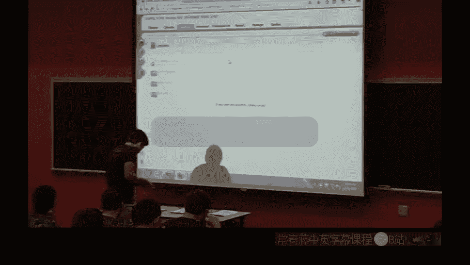
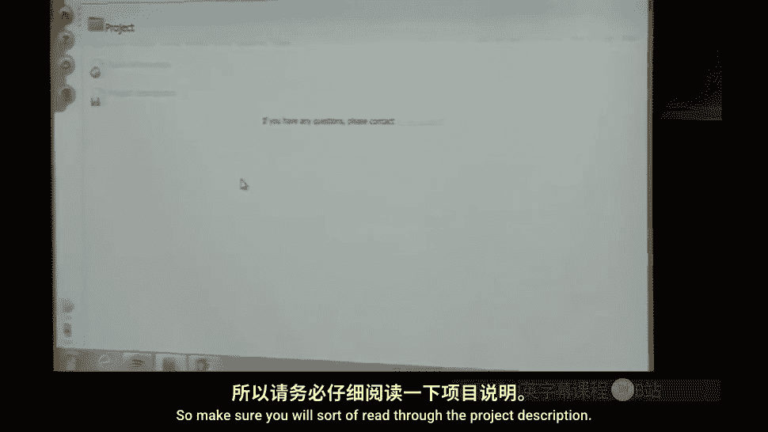
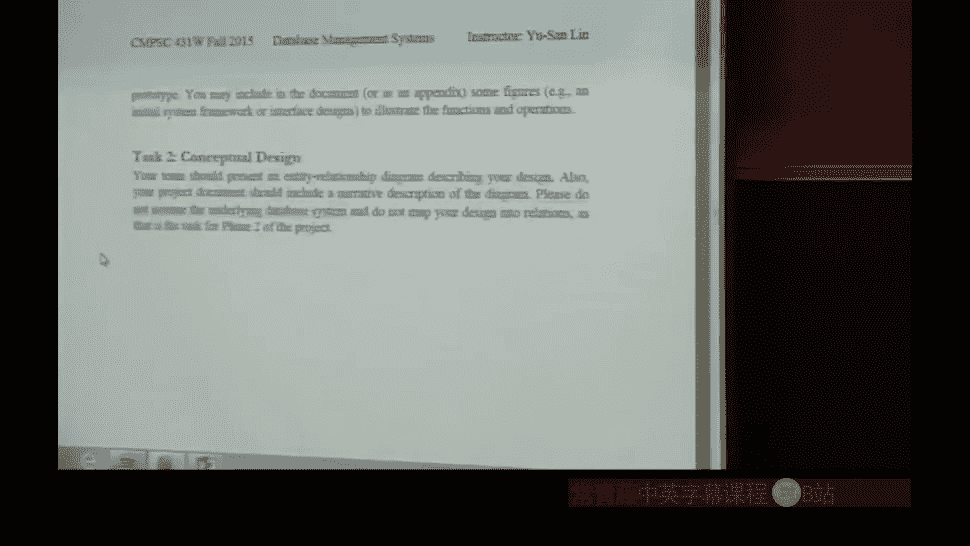
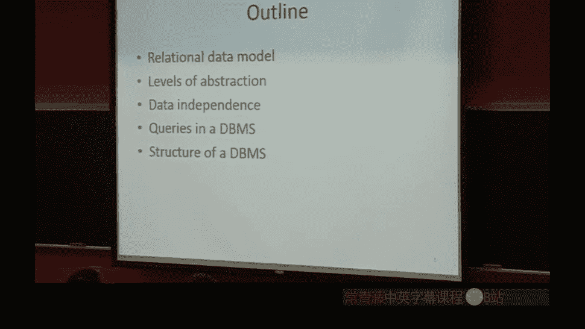

# 宾夕法尼亚州立大学【中英⚡数据库管理系统｜CMPSC431 Fall 2015, Database Management Systems】 p02 P2 数据库管理系统导论 - 第2部分 -BV1N76CBwEXb_p2-

Hey， good morning， guys。

I'm impressed you guys are very。Many people arrived so early。あ。Okay。

 a few things before we start today's。な here。Okay， so just you know。お在。And。食啲钟。

I won't really repeat the rules you。I think。Second thing， the good news， we got today。ち。

So I'll have to be here on Friday to introduce herself and she' will be the ones helping you guys out for the project。

So now he live in LA。Another thing。So who。Iテ。So you guys can， who has submitted to team？那你。

So if you belong the team， you can go to the project folder in Angel and you can just click this team information。

It really simple。谁借的呀？Make sure your team has a GitHub repository， put the link here。s me。

So only put five spots for each team to make sure you don't speak。No that's the call。とさ。

And I would expect you to have your teams phone by Friday by PM。Okay。

 if your team you don't have a team like Friday at 5 p。

m or you do feel like you don't really care about。See with。

Don't submit the phone and then I'll take it for you。So that's how I happened。Rightriday。Also。

 because on Friday we will talk a bit more。バジェクトラ。Mday， so make sure you will。

Read through the project description， I think it's a bit long for so you can just read。to play。Oh。

 and there's this main character in the project， I don't know how to name him。

 so you guys can name it。Think of any。9ペ。あ丈夫で。Souper creative so that you can just read through。😊，可。

啊。

One to five， we your teammates， you guys can switch split like you're going to be。

And you do feel like there's any pause that you're not sure of what I mean。Let me know on Friday。都是。

就底会变咧。こケたで。Today's lecture two。I'll giveive you a little bit of outline for today。

So just to hip up， you might want to pay attention for today's lecture。Because we will wrap。

And you know something might happen on Friday。じあ。Okay。😊，So what I'm going to cover today。

 just to talk a bit more。Just a tiny bit unrelational data model that we mentioned at the very end。

なで。And we will talk through the levels of abstraction。

 because of levels of abstraction and data independence。

These two will kind of be the emphasis for today。嗯。

We will talk about the queries in the database management system and structure of DVMS。

If we have time， we might move on to Cha two， but I'm not sure because last time I kind of end this a bit earlier。

 so today I just prepared that a bit more， but I'm not sure whether we were getting。Well。

 we're definitely attention。So this is from last time we talked about relational data model that has the main concept of relation。

And schema， so I want to clarify， I made a mistake last time I said。

 and I think some of you pointed it out， I say relation can be a capable wheel。

 but actually not relation refers to the table itself。

 and we have other names for the row and column and the table Okay， just don't get confused。

So before we move on to the next slide， imagine it's good to be super basic if you're go a store。デ下。

Say an Excel spreadsheet of students in。What will you put on？The names of the column。Okay。

 the names of the column， okay， so normally we do it not like we don't put the names of the columns vertically。

 we kind of conventionally we just put it。So row by row。

 you put the student's information following whatever。

Names and the columns that you put at a very close row，So here， anyone remember what this is？金まけま。

いつな。It's like a TV show like your。So yeah， this is a schema and last time I said， oh。

 maybe login is the last login time now I figured it out it's email。😊。

So this will be the example that we use throughout。So。

Imagine we put this in Excel Fheet that you would put the first。There is a cell there is first。SID。

 sick and fell in the3 first row， named login。That's how you going put。W。开了品。Mackkin。

Window is not compatible。 So you're going to put it kind of like this and you fill out the information right here。

 right， So right here I was supposed to， you can see the different fonts。

 So it was supposed to be the schema。But anyway， it says schema。

What do you think it's a what for describing a do？好。Yeah， it's a template。

 so for every student that you enter the information。

 you will follow whatever that's defined in the schema。Okay，You will follow the data type。

 You will follow the。The names of the college。再 just换。So。What do we call for the whole table。

 that I said earlier？We call the relationship。So we call the whole table a relation。

So how about each row， what do you think we would call it？Yes。How about each column。

 would just say would be the names of the column？Fiels can be failed or。Okay。

So just remember here is just kind of some terms that we'll keep using reusing throughout the semester so you don't want to get confused so the whole table for the relation。

Okay，And for each row， we call it a record， so one student is a record。And every student has。

Several attributes。So there's actually way more about relational data model that we can learn。

 but for chapter one， we'll just stop here。並べ。Inれル。Okay， so now just want to make sure catttle milk。

What is the basic idea？嗯。So。There's one really important concept for levels of abstraction in VBMS。嗯。

Basically， we separate the BBMS into different levels and each level takes care different。

And later on， we will talk about what benefits you have by having different levels。

Taking care of you。So。This start from the very top， as you can see the red pot， we have little boxes。

We call it。The view。Okay。So on the very top level， we have multiple beers。For example， on EliL。

 you can view the student's view so you will have the information that students can access and faculties will have the faculty feed。

even though everyone shares the same database， same data。

 but then because of the views defined differently。

 you retrieve different kinds of data that you can see on a browser or on a different kind of interface。

そう。Le we call the external schema。That's where the users。理うの。Okay。

 so external schema describe how users。Then move on。Is the conceptual scene。The concept schema。

It's more like what we just talking about the relationship。How you're going to organize your。

They defines the logical structure。付けれな部の。And finally， the bottom。けてく。

Different schema takes care of different things。You want to make sure that when you see。

A past and figure out which。So let's go through。我在不。Let's start from the concept。

We also call the logical school。Okay。So as we said before。The relational data model it defines。

So it describes the store data in terms of the data model。So in the relational model。

 what do you think the conceptual is in our world？Yeah。Oder religion。

So fast I can even find who said it。Okay， so relations， what do you think relations were describe。

 as we said earlier？😊，We have the students students。What。Tables can be。电视。Yeah。

Is this too easy or you guys？Okay， so yeah， in relational model。

 the concent that would describe to relations and relations can be entities or relationships。😊。

As we said on Monday， entities can be in one of you。You guys hear students， students can be entities。

 also the courses can be entities， so you are taking the course that's the relationship between you。

And this course。没看。So here's an example of what conceptual schema takes care。

That this scheme of it would just suck okay。How about physical。

So physical stigma summarizes how the relation is described in。Yeah， the concept。

And actually stored on secondary storage devices such as disk。So if you see the task like this。

 it says the relations which are the tables are stored as on order files。

 that's what the physical Cma will take care of。Other schemema won't care about it at all。

 or you can say， oh， the second column of the student relation is indexed by a B tree。So， these。定。

If you don't know， E tree is down。That's an external scheme。

So external schema is a collection of one or more。YouYeah。

So it allows data that access to be customized at the level of individual users。

So one thing to note is that records in the view are not stored explicitly and it's computed as needed。

 but I mean by that you can take a look at this example here so this example is the course information。

So you will have the course ID to stored as string right and then enrollment means the number of students enrolled do you think we will create a table just for。

Storing number of。like one call story number。Or we would rather have just compute it from。

How do I say it selecting the students who actually enroll in their course and then just something of counting？

so you don't actually have to store one more。Information about number of enrollments。In the table。

 but then when you want to show it on the external schema， you have other indirect way。So。

 that would be。Different levels of spectrum。So why do we need levels of？

That's because we want to have。即做地材。知吧。The show earlier， we had different kind of schema right here。

 right？So between different levels， we have different kinds of data。For example， between。

My conceptualセ schemeは？We have this data independence called logical Data independence。

So what it does is that it can predict from changes in the logical structure of the data。

 for example， web developer that might take care of the external schema。

 deciding what will be shown on the web pages。So when something happens。

 when something changes in the conceptual schema， do you think the web developer has to know？

Or as long as the APIPA， the poets are the same then。Different developers when they change。

The design of the concession seat sma。Externals。So another data dependence is between conceptual schema and physicalche。

We call it the physical data。So。This is very similar。ToThe idea of the logical one， but。

In a sense that。When physical schema changes， maybe it changes the way of indexing。

One kind of attributes for it。The changes by。Allocating the space and this kind of thing。

 so when something happens。嗯。In the physical schemeche of size than the concept social sma。Okay。

 so that's where you。queries。So since we have day， it doesn't just sit there and you don't use it。

You definitely want to ask them questions and get the answer。Daatase。

So when a user asks different kinds of questions。We call these questions。So。The recipe。So。

So we have different kinds of aqua languages， so aqua language。てた。Who can tell me what is the。

Bous player。So what did it stand for？国家。ゃち。Stuc cur length。でそあといく時は。

So this supposed a rich class occurrence。We greatly lead to a success。で。

Forqueries for query languages， there are two。Really important concepts that we will learn later。

It's week or a week later。That were。Deine the formal。Logics for programming。

So they are the relational algebra。And relational。We'll spend quite a lot of time there。Anyones seen？

houseuse。嗯。大好き。Single we call single。男性。So here's an example。For example。

 we repeat the question that we raise。The previous slide。

 what is the name of the student with student ID？5，36，8。An example。

 you don't have to memorize it now， but I think it's super simple。

 you can understand by just reading the read， right？嗯。So， let's say。Let's start from here。

 So you want to say from which relation that you want to take the information， Okay。

 so this is the students's table， right， the student's relation do you say from students。

And what is the attribute you want to select。The name， right， so you want to select the name。

From the students' relation， if you don't define the criteria here。

 which is the where it will actually return you all of the names storing the student's relation。

 But because we。State the criteria here saying， I only want the student's name whose SID is equal to this one。

 then it will only return who。うんです。すめ。Okay， so this is just an example。

And we will talk a bit a bit more， I think chapter five。

 so now just give you an idea of how it looks like and you will learn about it after the first。

So this is for cr。T。So a transaction is any one execution of a user curve。We can think of an example。

Even more like。Like a real lightning。嗯哼。Yeah， so you're go to the bank or you're to the ATM。

The deposit money。That one action。To the end is a intervention。Anyニを？まず回言たも。你老一个边。What does it mean？

Like an example for a transaction。Yeah， booking airline tickets， okay。

 so the whole action itself is called in transactionaction。So for having a transaction。

 we have to make sure that the transaction doesn't rule the database or the transaction is successful。

 so there are four requirements for a transaction。Okay。The first one is called atity。

Just from justging from the word。Who can think of what does it mean， what it means for it？回た。Yeah。

 it cannot be breakdown down with broken。So。Well， more formally。

 we say the idea of atity for a transaction is either war or nothing， all or nothing。

What it means that if part of the transaction fails。The whole thing just you just don't do it。

 for example， let's imagine if the bank works this way if you say I want$1，000。

Now you want to withdraw $1 thousand0。It's just imaginable， it will give you $1 by $1。

So let's say if the transaction suddenly just felt， you just got 300。And the AM machine wing咧。

stop I you the next time can't do that。 No， right， so it's for autoity okay。

 transaction is old or nothing。 You cannot just stop there there and like。

So another one is consistency。So， consistency。Do you consistently return the same？大推す。Yeah。

 so when you have queries， yeah you put the same queries on same database as you return the same answer。

Yeah， so that's one。Another one。Is that if the data stored in the database。

 they are all valid in the sense that it all fulfilled the。Constraints we define， bring down。

All the students IDs。Sts or。Let's say we have a maximum。The budgets and the department。needed。

Then after a transaction， the consistency should remain， so you cannot say， after one transaction。

 I just break the rule。It has to be the same， so it's moving from one invalid state to another。

It's still satisfying。The third one is called isolation。Anyone。What you think as。Yeah。そしても。こテに。没。

つてまし。7。Yeah， so what Jason was saying is that isolation means if you have multiple transactions happening concurrently at the same time。

The result the end result of the database should be the same as if you do those transaction sequentially。

Okay， you cannot be like if we do it together。So that's for I。The last one is durability。

So durability means once transaction is committed。It your remains。Who can think of them？

Acounting number of。Yeah。It can handle a lot of transactions。

So durability is more like when once the transactions are committed， it will stay the same。

你 lose our。没没。the。Yeah， exactly so for example。Let's say。

Let's say you guys are all signing up for courses here。😔，And suddenly。

 the Penn registration shuts down。You cannot be like wake him next morning。

 Osie did't register for that， you cannot be like that， so it has to remain the same。

Okay we covered from。Okay。So， for these four。What do you guys think it will call？や。对。い来に？

Most exciting。so this is the structure for a DBMS。If I see this part stores the data。

Then what do you guys think the blue pot is。Halt， blue， big box。Yeah。Software subscription。Which is。

Yeahや。So the blue pie is the DBMS。Okay。And sitting on public database。

So what do you guys think will be the？For taking it。Yeah。It goes in the deep elements。So。

When a DBMS takes a SQL comment。What do you think will be the first thing that should be done？嗯。

 before一个呢。What separate to come in？你把。日本語の？So that's the process of understanding。Or yes。So。

What do you think understanding the comment will me？ましぬ。你这就他说的。これめ。So if you are passing。The query。

We say the sequL from it。So， it's。Like a process for evaluating。かめ。So for the whole red。

We call the credit evaluation engine。So this SQL command goes in。

 the query will be evaluated and in the evaluation engine we have。Different little pots。Okay， so。

As we just said earlier， the first part。W learned twice I taken course？Okay。

 so in a compiler that you will pass the codes， right， you write the code。

It will get passed but so we will need a passa。😔，Okay， like the example we just had earlier。

 you have select from where that kind of SQL come in， so we get into first。Because。

So that can in order to get understood。So。So after the SQL comment is passed。

We will move on to an optimizer。So。What the optimizer will do is that you will。

Generate an execution plan。Ex plan， because even for the same query you can have different kinds of approaches of doing it of retieving data from the database。

 so the execution plan will be generated。Then the plan will get executed by the pres。And right here。

 we also have an operator evaluator。We will talk about this a lot more later on in the semester。

 so as I said earlier we have the same command， it can be done in different wayss。

 so you guys know operators。So even for the same comment。

 it can have different kind of combinations for operators。Affect how performances。

So now it might still be a debate but we will move on later。So the whole thing。

 the whole part of the query evaluation engine is sitting。On top of files and。

So the files and access method。It supposed the concept of files， So here it says files。

 but actually we can think of。The records or relations。Okay。

 different kind of data models will have different kind of files but for relational data model。

Take care of。And for the files， we can think of it as a collection of。

You guys have learned the complicated page。So the whole file and access method sits on top of a buffer manager。

As I just said earlier。The files thing。Pages， so the buffer。

 what it does is that it actually brings pages from the disc。Paang to the main memory。

Those request it， so every time you have a query， then maybe you will have to bring in different kind of pages。

And the whole buffer manager did some help。So what the disk space manager does is it would just manage the spa。

这。くえか。Okay， so buffer manager， it brings the pages。これです。So until here。

 these are like the basics for the DBMS， but to make things more secure。

 DBMS also have the other two partss。So on the left hand side。Green box。Is the concur controlled。

 okay？So the concurency control has two components， okay。

 the first component is called transaction Manager。😊，Yeah。はい。Oh， so in the disk， things are stored。

 you the concept of pages。So the buffer manager takes care of bringing the pages to the main memory。

So that when we have the query request different， you will need different partss of the data bringing into the main memory。

 then later we'll return。Of the result。So the transaction manager。It ensures that transactions。

Request and releases laws。So anyone took operating。Yeah。

 so you know that you have to take care of the locks。So this is what the concept of。

 so transaction manager， it will make sure that the transaction they will request。At least the lock。

And who will be granting the lock？There will be a lot。

So the lock manager will keep track of the locks and also make sure it can grind。

So the two components together。They call in the conference。And as we said earlier。

 when we talk about the durability， we mentioned that when the power is off。

 you want to make sure things。recoveredカ？あ。So on the right hand side。国民。

So the recovery manager maintained lock to restore the system。素て？嗯。Before。

So this is just the big picture of the structure。Oh。嗯听。二かし？申。

The transaction manager ensures that the transaction will release。Or request the lock。

But the lock manager is the one team program。到的呢啊。実連習結も。

The transaction manager is not the one printed。你点啊一。Now if you speak。たつ。ぱ日見。Let's say the play is。嗯。

先生はいや。that you be on one or on the name。ま不しな。但是呢。てて。data我。把呃。Do you mean where the lock will be。

I think it has to depend on many things。Depend on different data models。

 If you have different kind of blocks。So you were saying when two students have。声。これまけで。And yeah。

まあ、デトな忘れない。冷線を？Com with selecting。Any。理ル部？You made1。Can these commands be excluded comprehensive。

出ってるや。I think it depends。depend on how。じて。volunteer a don。や。Any other questions。Okay。

 so now we haven't really ci with a question time。But I think you guys already know the it。

All exampless from here to slide。啊。Remember the levels of abstraction sorry。

 to go back to the last side like， can you explain a little bit more about the block manager like what exactly？

呃。Yeah， sure。 The lock manager。So。Transaction manager。

 it makes shows that the transaction will request and release locks，For the lock manager。

 it is the one granting the locks。So transaction manager doesn't have the permission of deting the transaction log。

So。L together， control the concurrency。But then they take care of it。や発でそは。ベル三分。So the log。

 you can think of it as。When the transaction gets the lock。So it will be granted。

 it's permitted or allowed to access some parts of the data。

 while the other one has to wait for the log when it doesn't have that it can access。Yeah。昔のま。

Give back to question time。So for the first， two。I think you guys remember when we talk about relations are stored as what kind of files or we say a certain attribute indexed by a certain data structure。

 which Sma takes care of。い成。Okay。So how about the second one， when we define schemas as this way。

 we have students that have SID that are strings， name the strings， logging in strings or courses。

Attributes， which schema takes care。Logical or conceptual。系。Lastly。This one。

Defins what they use in a campus。被上。This is like one of the favorite questions to be tested on。

that all right。Next one。Don't know whether itll be a bit trickier。

So we talk about different kinds of data independently two。あ近か。Okay。So for each example。

 I want you to figure out whether it's a logical data independence or a physical data。Lo as L。

So let's start from the first one， so we say the ability to change the logical sma without having to change the external scene。

There's a lot of fun。 Okay， this way。It's kind of obvious。How about this take on one。

 and let's say we are using a new storage device in America。How about。

We want to change the indexing approach from hash。で是候。よろしく。嗯。remember。Data structure。嗯嗯。Remember。

 we said earlier。How do民法年。He right， so for the physical schema。It is the schema that takes care of。

嗯。The test includes how you're going to index。The attributes or any kind of data。

so when we just change the way of indexing。It's between the physical schema and the concept of schema。

And because it's between the typical schema and concept of schema。For physically。感しを。O。啲呢你哋。So。

How about adding new entities？啊，最近。Last one， used different file organizations。

Story to starting to do。でテと。Yeah。So that is for chapter one。Okay， yeah。EnitiesSo adding new entities。

Go back to their favorite。So when you add new entities。That's for conceptual scheme marketing。

Because let's say。Let me think， so in a university database we have students。Faculties。

We have courses。So let's say today we want to add an entity。What entity do you think we can ask？

Classrooms， okay， yeah， I was thinking about pet。陈个会。😊，Okay， let's say we at classroom。Do you think？

The external schema has to change the way。They repeat data。All right。Any other questions for Cha one？

今こっ。Yeah。出人。いや。还在做追。完ざいす。完。まそるな。You mean the query of。はい、終わった。So if you they come to。Yeah。

 then that one。Any other question before we move on to basics of to basics for Trump to two，こ没改。とレ。

という。手단だするので。we how。この？的まる。でも。としまてした。But also。Now， using think the advice。

So'm using new devices the concept。自的。So then basically go see my things here。ok。Okay。

 any other questions？5ive minutes left， let's talk a little bit。バた。Doer 2。So chapterer two。

 I think is a super important chapter。And also for your。Phase one in your project。

You will heavily use what you learn。So。I think we discussed in the very。8。

About entities and relationships， right？So for this kind of data model。

 having entities in relationship， which is co this entity relationship model， this ER model。

So what is the thing that is a real world object isqueable from other？Okay。So as we said earlier。

 for a students， we have different kinds of what describing it。Yeah。

 so the entities described in the database using instead set of action。All right。

 so here's an example of a graphical representation。In the ER model。We use rectangle。

To represent the entity， to say we have employees。And for each employee。

 we will have different kind of attributes describing the employee。

 and we use this was's an oval to describe to represent the attribute。Yeah。

 so then because one entity， it can have multiple attributes。あせ挙。So some more basics on the ER model。

So we call an entity set， a collection of similar entities。So to make it a bit clearer， we can't see。

Is an entity？But a group of students， because they are similar entities， so we called them。Okay。

 so all of the entities in an entity set have the same set of what。

So the attributes should be the same， okay， you can be like this student has this set of attributes and the other students。

The attributes can have different values for the old。Another concept that we will get is a bit more。

time。Is that each entity set？开得起。So the key is the minimal set of attributes whose value uniquely identity。

EnEnity。For example， what do you think will be a good key for？The student I right。

 you won't use the student's name as the king because of。せね。喂。😊。

The concept of key and the key we can get it results the next。So you set just a table or？あこで。Yeah。

 In set is one big table。thinkます。Okay， so make sure you form routine okay and send the form。

By Friday I。