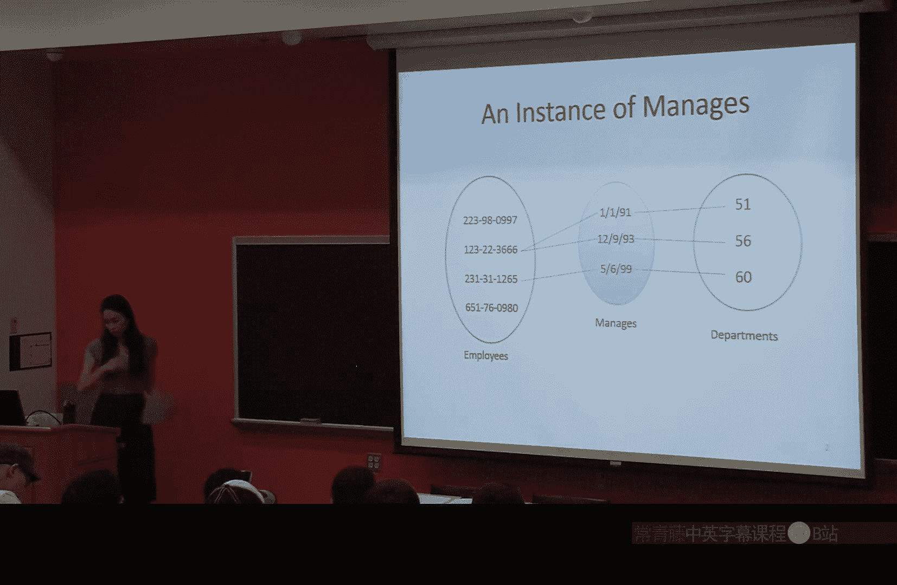
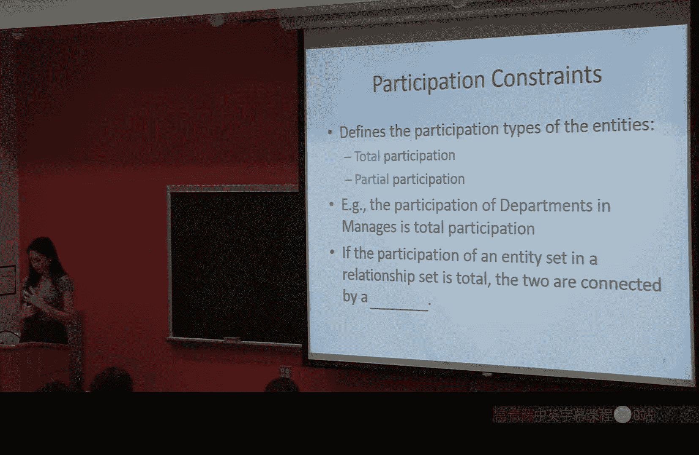
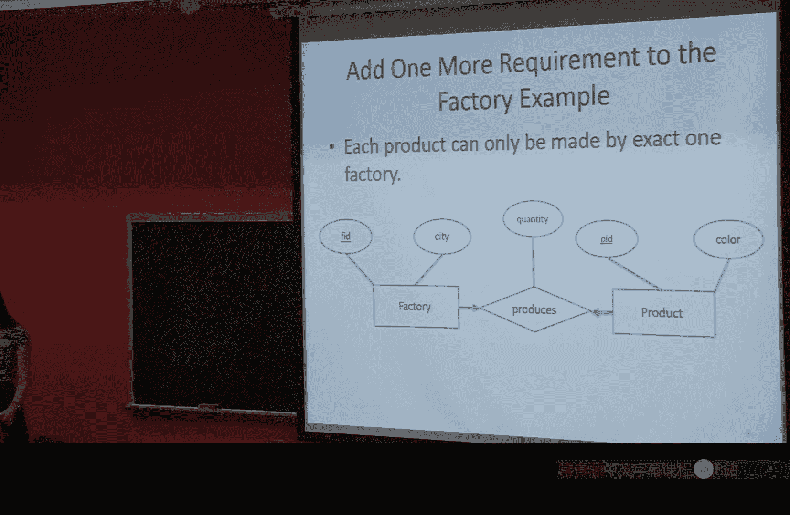
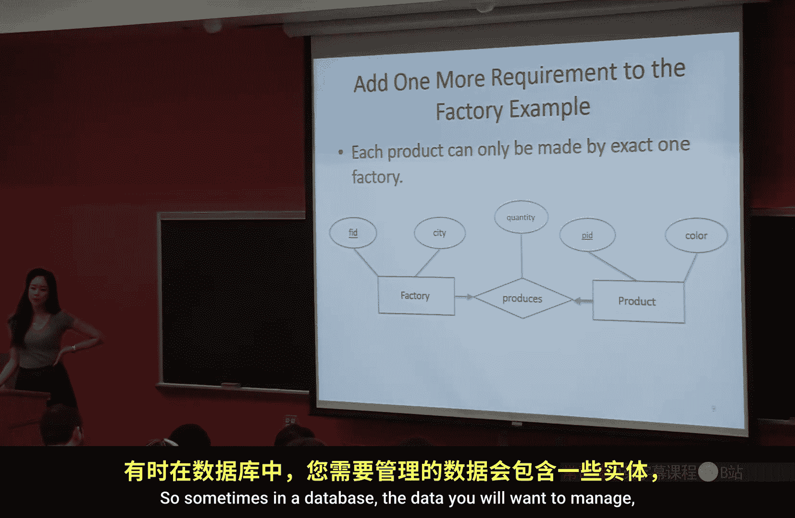
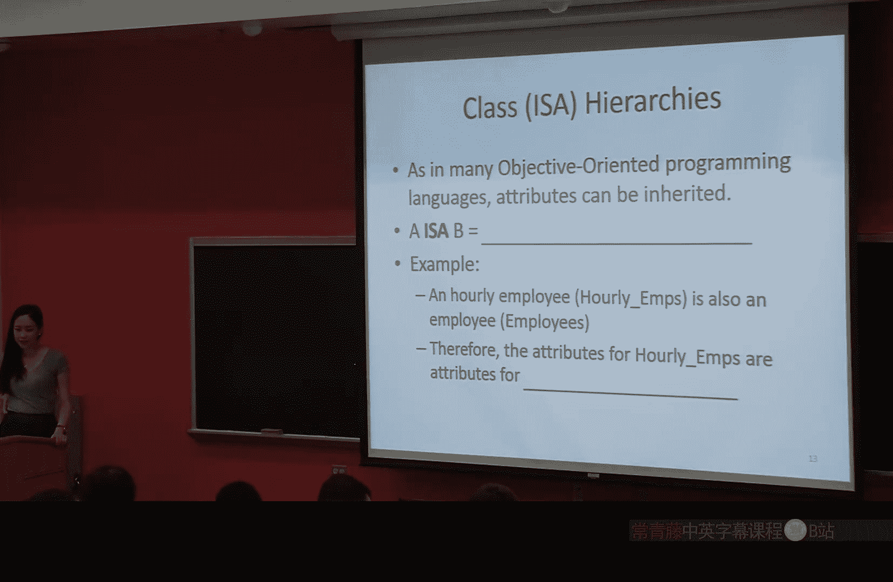
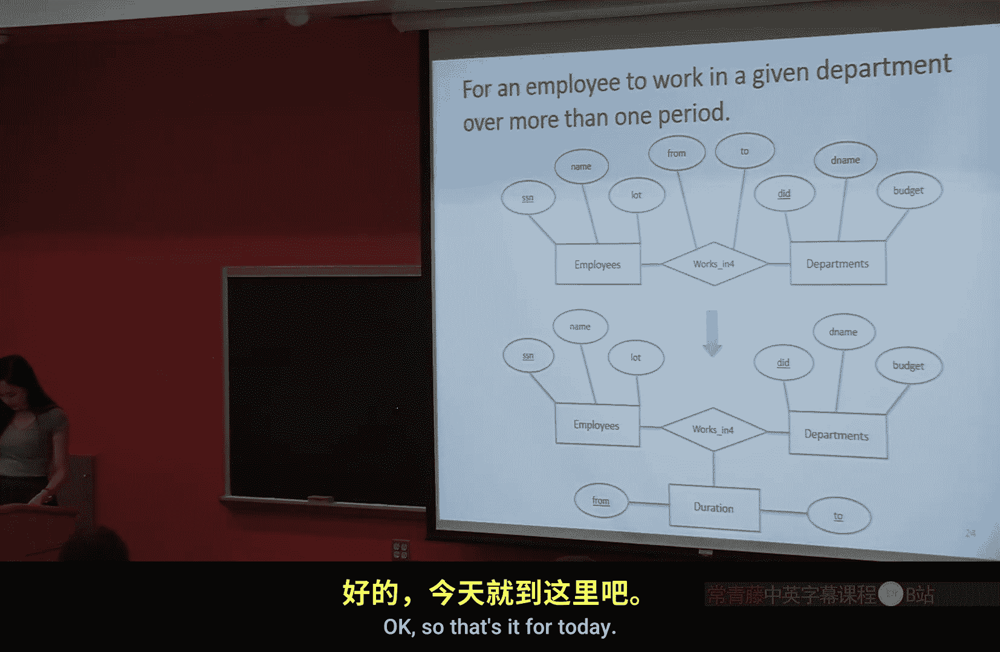
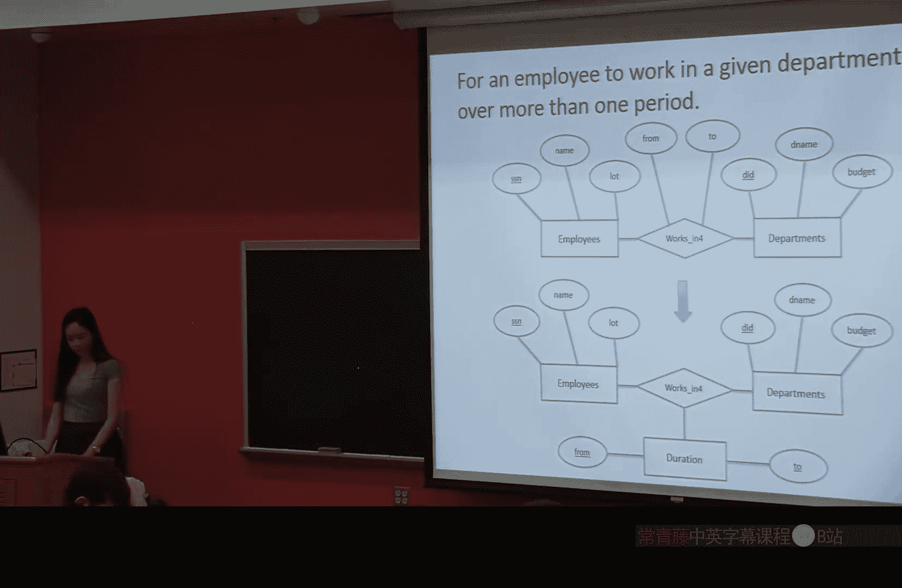

# 宾夕法尼亚州立大学【中英⚡数据库管理系统｜CMPSC431 Fall 2015, Database Management Systems】 p03 P4 实体关系模型（ER模型）- 第2部分 -BV1N76CBwEXb_p3-

お外の？Good morning， guys。First of all， I want to apologize for the printing trail。

I feel like I've been giving you guys the。This slide in every possible different way。Yeah。

 I did it this time by myself， I would do it by the department。So like nicely printed。So one thing。

I about the team， so all the teams are formed。啊，Total of one of the things I formed in for you。

And also， one of the teams had。3 members also。You two。So then that's for the team。

Things are all four right now。ITo start working on the project， actually we do for。就ないあ。All right。

 on the 18th， you will submit your document and also do your presentation。

 so you might want to start it now if you haven't。Also because for phase one， we have two pots。

 right？先生の活セデザイン。This week we finish。All the knowledge you need to now heard。

DeBut now you should be able to work on requirement。哎。Another thing is the quiz。

 The quiz last Friday。Is already graded， so the TA posted the grade and also。

 I think she sent out the rubric。嗯。Yeah， so that's for the quizzes。

 do you guys want the quizzes return？Or if I posted answer。我的呢。It's up to you guys。

 if you want to back then we will return it to you in。Okay。

And that will be a chance for me to trying to know your name as well。

I figure I don't know your name at all。Next thing， okay。

So last time at the very end of the lecture we were working on an exercise right。

 the factory produce this product and after the lecture。

 quite a lot of you came to me to ask them questions。

 we will also discuss that today Okay so sometimes it is kind of confusing， we'll talk about that。

So let's start from。slide that was missed from last lecture。

 remember I could have finished all of them， right？So let's start on this one。

So this is an instance of managers。So we start by looking at the manager's relationship。

Who can tell me judging by here in the department。What to what is the manager's。Remember。

 we have four kind of combinations。This can be。W the many。Because。For here。

 one employees can manages multiple departments， however。One department can only by managed by one。

唔可 okay。Then let's take a look at here。Since not all of the employees right here are involved in the manager's relationship。

 what kind of participation we say it is？二手。We didn't get into too much about the participation last lecture。

 but we will talk about the modest。Okay。As for the departments。

 you can see all of the departments are involved in the manager's relationship。

 so what kind of participation will say it is。Yeah， it's total participant。

So today we'll talk about more on the participation。

Lastly we paid quite a lot of attention on the key constraint。

 right remember we're saying if we have the arrows， then it will represent the utmost one。Okay。

 so let's take a look at this。Okay。We can also add arrows when the relationships are ternary。

 remember what ternary is？When we have three entities involved in one relationship， Okay。

 we say it's a ternary relationship。 So let's say today we also want to add a key constraint for thisterernary relationship right here。

 we say each employee can work at most。I work in at most Point department。

How would you modify this diagram so that it satisfied staff？Arrow on which one。And to。Here。

 everyone okay。Yeah。So then that will give you the result that each employee can work in at most one。

Okay。Who's sort of unclear on this。So let's take a look。Instance for that。Okay。

 so here if we look at employees。To the department looks kind of bizarre right now。

 but if we look at the employees， to the department。

 you can see one employee will only link to one department， right？And also from here。

 we will link to the location that is where the employees work。All right， but what how about？

If we look at departments to the location。Can we find any that's like one department locates in multiple locations。

If you trace it from the department。We can find different departments in the same location。对谁。いせ？

What's it，56。Yeah， so 56 for this employee， it works in Delhi。But for that employee， it would am。

Okay， how about employee to the location？Can。まなし。Say it again。のケです。Yeah， so for the employee too。

 the location that will be。We need to one right， we can see this employee working badly。

One of this employee as well。Okay， so this is how you can interpret from the instance。

 It will give you an instance like this and tell you oh， compare the。

Which entity to which entity is a many to one， many to many it should be able granted。Okay。

 so let's take a look on the quiz from last time。Remember last time one of the requirements I asked you to change it from by only one factory to buy at most one factory。

 and at that time you guys were kind of like，W， I wanted to change that。That's actually because。

We call that when we have the arrows indicating the key constraints， it's for ut most， okay。

 it's for the upper bound。So when I say at most， do you think it's okay for a product in this scenario to not produce by any factory？

Yes， that was still satisfy the diagram， right。So what if we want to make sure a product has to be produced by at least one factory？

We'll talk about it later， okay？嗯。Another thing that was raised。

Another question that was raised for this quiz， I think maybe applies to other electedive employees work in departments。

What's your name that you raised the question about the relationship having two primary keys？啊。开话。

Okay， anyway she raised the question about， remember I said for a relationship。

 you identify that by the two entities that are involved in the relationship instead of having an ID for the relationship。

 right？😊，So。The question was raised that when we store the information in the table。

 isn't that weird if we identify that by two primary keys？Then what is the primary key for this one？

You should have only one， right？I was。Goon to talk about it today but I realize it shows up in chapter3。

 so we wait and see okay， just keep that in mind for now。

 keep that in mind even though we say we are going to identify the relationship by two involved entities。

 but we won't identify them saying that it has two primary keys。Okay， also， if you look it up。

 sometimes the design will give them。Unique key to identify that， but。

I think in different kind of practice， they have different role and for our textbook they will just say。

 we don't have special extra keys。Further the relationship。睇。Another thing about the quiz is that。

When a lot of you came to me and say， is it okay that we have a factory locate city instead of just factory with city attributes。

so that's the only change compared to the last one。 What do you guys think， is this valid？嗯。嗯。生です。

Yeah， so if you do that， unless you create like a city with maybe a seat like ID or that city or a name of that。

 then that would make sense， right？Also， another thing is。

If you don't have anything else to sort store about the city。Is doing this necessary？Not right。

 even though if we add on attributes， then it's valid， it's not wrong， nothing wrong about it。

 but it won't make sense because it's just a city information and you fact locate city if you say how about product。

 we can say product has the color。Then you can expand the attributes。All of them can change into。

So it's not necessary， but if like Bertie said， if there's an attribute there。

 then it's actually valid。Trase is not necessary。So that's for。Quz last time。

Let's move on and talk about the participation that I talked about earlier。

 because we have filter participation and posture。All right。

 so today we'll talk about the participation constraints。

 so participation constraint defines the participation types of the entities。

What are the two types of practices？So little impartial。

So one of the examples is the one that we just said earlier。

 the participation of departments it manages a total participation。

 which means that for the manager relationship， all of the department has to participate so for the manager's relationship。

Department is a total participant。Okay。So if the participation of an entity set in a relationship set is total。

 then the way we did note that in the ER diagram， we connect them by a signal。

So you don't want to get confused between participation constraints and key constraints。

For key constraints， we denote that by an  error， but for participation in constraint。

 we use specific。So let's try out an example right here。Right here。

 I haven't den any constraints on it and you would be the one to add it on。Okay。

 let's think about three requirements，1 by one。 So let's say for the first one。

 each employee has to work for at least one department。 So if it's at least one。It's the lower band。

 not the upper band， right？So what should you do for this first report？Sick line between。Yeah，我可。

这 be在。Allright。I don't know whether is that obvious that it's a bit thick of？

I was like adjusting the thickness of the line。Okay。

How about the next one if we say each department has to have at least one employee。

This one we make it a thick one。How about the third one。

 you say each department has to be managed by exact one employee。

How can we break down the idea of be exact？リストは。Yeah， it's at least in at most one。

 so what would you do with that then？Yeah。So from the department to the manage。

 now while you add a safe line， you're also make an arrow。Any question right here？Okay。

 so let's say we want to。Add more requirements for the quiz from last time。Okay。

So this is the exercise from last time。 if you say we want to add this contrain。

 each product can only be made by that one factory， How will we change it？

Because if we follow this diagram， it is each product can be produced by at most one factory， right？

The thick one on the right。 so that's full the participation。So don't confuse that between the key。

Right。Then the next concept， before I move on to the next slide I want to talk about。

Let's imagine a scenario， so sometimes in the database， the data you want to manage。

We'll have the。Some entities that rely on certain entities in order to exist， for example。

 in a university， for the faculties， they can have their families also be in the insurance plan。

So if the faculty leaves， the university do you think that insuranceim will still apply for the family？

No， right， so for this kind of entities。For example， the family， we call them the dependent。

 we call them the weak entities， so entities that do not have key attributes。Our col entities。

By not having key attributes， I mean， for example。Let me see imagine I'm a faculty even though I'm still not。

 and imagine I have family， even though I still still have okay， say I have a kid。

When I store the information of the kid in the university database。

 do you think the kit has to have a key attribute， like the primary key？Or when we identify the kid。

 it can just go through me right， so for weak entities they don't have key attributes。All right。

 so the example will be the dependence of a department。So how do we identify weak entity。

 a weak entity can be identified uniquely only by considering some of its own attributes。

 for example， I can have more than one case， right？So when want to identify the kid。

 like which kid then it would depend on。The attributes of the kid， for example， I have a kid called。

This' is so awkwardnautical Amy， event we can just identify that。By their name， plus。

The primary key of mine。Okay， did that make sense？So then by doing that， you don't actually have to。

I try to my Keith for a week。哦。The first one， right？一。by that。

 I mean they don't have like the keys to， for example， primary keys。So for example。

 you don't have to have the dependent to have IDs。So the entity that has weak entity associated with it。

 we call it the identifying on them。Okay， so just like the example like I made up earlier。

 L would be the identifying Onna for the two kids。An example， as we have taken kind of health。

In terms of kids， there all be this。We take some other examples where we can have a lot of。

The are a lot of entities in the weak entities。So in that case， we have to take a lot of attributes。

So why shouldn't we just how primary for the weekend it is？嗯。

One of the reasons is because it's easier to manage when you remove the identifying owner from the database than they all are done it。

Yeah， so you don't have to have extra things sewing it。That's a good question。Okay。

 so let's see how we will denote weak entities in the ER diagram。

So say we have employees having the policy。For the dependence， Okay， right here， let me see。Okay。

 right here， I now put this because。One dependent in the system。

Can have only relate to at most one employee？Re missinging。Okay， so for the dependent。

 that would be the weak entity in this example， right？The entity is dependent。

And the employee will be the identifying owner。诶。So。

To denote that the entity is weak entity the way we do it。Is we draw the thick line。

Around the entity box。Okay， so if you draw a sync line around dependence。

 you're saying that's a weak entity。And also to denote that the relationship is associating with the weak entity。

 you also draw a thick line around the policy。So another thing is that。If you look at here。

This is the thin line， okay， so if you say a dependent has will have at most one employee in the system that is associated with the policy。

 do you think this makes sense？Because if we allow that， this is a thin line， right。

 you can say I have a weak entity in the system not relating。To any employee。

So how can we change that to make it， make it make sense？Yeah。

 you change this to the thick line so then you are saying the constraint every dependent have to have。

Exact one employees in there。 Okay， so that's actually the constraint for weekend。So。Earlier I said。

 okay， if I have kit， then not only can the kid identify through my primary key。

 but also they have their own attributes yeah。安砖包心。Oh。

 it's just saying that that's relating to a weak entity。 So this relationship is a social， yeah。

So as I said earlier， not only。To identify my kid， not only does I have to go through my primary key。

 but also have to go through some of the attributes of my kids so if I have multiple kids。

 then I know which one they're talking about right so to do that。

Which attribute do you think will be of good choice？Name， right。

To denote that this is the attribute you want to use for identifying。Which dependent it is。

 you draw like home。おせか。Dot headline or dashed line。Under that so for primary Ke。

For the identifying owner， it would be the solid on the line， right？And that one we put together。So。

 we call the。嗯。He名。The pars。So if we take a look at this one。

Do you think there are any constraints of how many dependents an employee can have？

If we go from here to there。No constraint， right， one employee can have as many。As yes has。

 but not the other way around， dependents can have exact one。Employee associated with the policy。So。

We say the owner entity set and the weak entity set must participate in a once a relationship。

Make sense。Right one many from the employee to the dependent， that's the one many。Okay。

 so earlier in the previous diagram， we have the policy。Relationship， so all of those。

Let me see all of the relationships。Or like policy。

 you can code them the identifying relationships set。ケジま。女性啦。So。

What kind of participation will the weak entity sit？😔，In the identifying relationships。

 when we look at the dependent。What kind of participation does it have？都多ね。T， right。

 because we don't have。Dependent left。theデす。What be the idea for weak entities。给。なてるなど思。嗯。

It's called class hierarchy。When we did note that we use ISA， it just is up。嗯。So I guess。

Most of you have learned object oriented。Programming， right？So after oriented programming。

A good objective， I'm sorry。Op okay。When you learn that you can inherit some objects， some classes。

 right， so why would do we do that？

I don't know whether one of the classic examples you guys learned is like vehicle。One vehicle。

 and then the ones inherited can be of car early。whatever right so that's a classic example for inheritance so right here we also have that in the ER diagram。

 okay， so if we say a it's a B。Then that means every eight entity is also the entity。Okay。

So for example， here we can say a is the car， B will be vehicle， or here we can say。

This kind of weird example， maybe we can stay student， there's also people in university or faculty。

 also people。诶。So it means whatever attributes beat past a little habit。Great。Okay。

 so here we have an example based on our favorite department employee example。

 so say we want to have an hourly employee， okay？And our employee is also an employee， right？

Therefore， the attributes for hourly employees are attributes for the employee plus the hourly。Okay。

So how can we denote that？えないやだよ。So here we have。These kind of different entities all right。

 so say we have an employee's entity that's like the vehicle we just talk about and maybe this is different kind of cars or car and boat。

So， employee。Have these different kind of sub classes and our employees is an employee and a country employee。

 also an employee to denote that you draw a little triangle。诶。So you read it from bottom top。Okay。

 our employee is our employee。Conuntrary employee is a。Ptty。Okay。

 so there are two different ways that we can view this concept， we can either go from top to bottom。

button up。Okay， so if we look from top to bottom。It's saying when we identify subset of an entity set that share common distinguishing characteristics。

 so that would be for specialization， right， we go from employee to our link or contract。Okay。嗯。

So for identifying a subset of an entity set， we call them the superclass。

I guess all of you must have the knowledge for that。So that's first initialization。

Then I guess it's pretty easy to figure it out if we go fuck them up。Well willie College。Yeah。

 that would be generally。So for generalization， it's to identify some common characteristics of the collection of entity sets。

Also， create a new entity set a company's entities。Possessing these common characters。

So it is possible at the beginning of your design， you just have R employee and country employee separate。

And then when you identify them， you figure out， oh， maybe we can put them together。

 then that's when you create the employee and then have them as hierarchy。Okay。

 so that just a process。So whenever you want to apply the is a concept。

 there are different constraints that you want to think about， two constraints。Okay。For example。

 the first one。We want to determine whether two subclasses are allowed to contain the same entity。

 What do I mean， for example， in the hour employee and Con employee example。

 should we allow an employee to be hourly employee in a country employee at the same time？Then。

Intually should be note， right，'s kind of weird。But in other scenarios。

 it's possible that it can be both。So this， we will call the overlap。Okay。

 whether the subclasses had any overlap between them。Another constraint you will want to think about。

Is that we want to determine whether the entities in the subclasses collectively include all entities in this survey。

For example， again， our employee example。Does all of the employees in the hourly employee。

 plus all the employees in countryly together make all of the employees in the employee entity？That。

 I mean， does just taking two of those。Cover olive inquiry。So that would be the caring condition。

Okay， so these things， there's no exact yes or no when you design it。

 it just depends on how you want to design it， okay and it's highly application。So they were。

I' just kind of talk through this， there are different reasons why we want to use the concept in is。

I found out it's not a very popular concept to be adopted when students design their。

Project maybe they think， you know they don't see the benefit we kind of risky to use it you are afraid of using it wrong。

 but there's their reasons for using that， okay？嗯。For example。

 you want to add descriptive attributes specific to a subclass。

 so they are attributes that apply for the hourly employee， but not apply for the contract。Okay。

 or another reason will be you want to identify entities that participate in the relationship。

Let me see what it means。I forgot what I was writing。So motor vehicles include motor boats and costs。

 both each licensed。And the licensed relationship between motor view。哦，O。So for example。

 we will have like a motor vehicles as the superclass right and it is a motor boat or cars and if we say we want to have a licensed relationship。

 then the licensed relationship can just directly connect to the motor vehicles。

 the superclass instead of connecting the boats。😊，Okay， so that would be another reason for use it。

Before we move on to the next concept that I want to talk about。

 that's the last one for an ER diagram。I prepared a little question for you。Yeah。

 so just like last time read through these requirements and try to draw the diagram， okay。

 so these will。Not only based on the basics we learned in that lecture。

 but also a little bit up until sale here。I made it up myself so you do find anything wrong。😔，这す。

Tell me if you later will review what it is。While the diagram is like anything think it's wrong。

 feel free to tell。I'll give you。5 minutes。Oh yeah， don't draw the attributes。

 just draw the entities and our relationship。嗯。Who wants a little bit more time。30 seconds。All right。

 but before I show you how it's supposed to look like， can you tell me what？

Component you use in your diagram。や一方。Of the entity， Okay， tell me the entities。People， movies。

 actors that。Okay。So what are the concepts you use for maybe grouping entities together？一す。Is a for。

People that。Okay， so are there any weak entities there？か。Exactly。Awesome， okay。

 so that's how he's supposed to look like。Okay， and we also have a couple of constraints right。

 so as I said before let me take the。The first one。

 I say people in the movie industry can be actors or directors。

 so then we have people as a superclass can be actor， director。He。

The second one people works in movies， so we have people that works。In， you just bought any mistakes。

 tell me。The third one， each movie has to have at least one people working in it。

So that's why we have the contrain right here。你该下班。Okay， but not the other way around， right。

 because it's fine if I sometimes damn some people in the industry not working anymore。诶。Okay。

 fourth one。Maybe the trickier one， I guess movies have characters， okay the movie has characters。

And each character can only belong to exact one movie， so that's why we have the thick arrow， right？

So if the movie ends up not released， the character will not exist。

 so that's why we change it to a weak entity okay if the movie disappear。

 then the character won't exist either。So that's for requirement4。Okay， so for the last requirement。

 we say each character has to be played by exact one actor。So character， after us a character。

and we want the character to be played by。Exact one。So here's the tricky part。Anything。

Do you guys think this should also be with thick lines？And I'm confusing myself。If。Yeah， no。

 because okay， if something happened to the actor。A to disappeared， but this deal sticks。

Read can move on you want to。Coffee of a more time。Okay， next's next to。

Let's go to the very last concept that well learn from the year divver。It's called aggregation。哇我。

あとますか。Ignore that Okay， so the last comes that we want to talk about is called the aggregation， okay。

😊，That's another fail today。Sometimes we have to model a relationship between collection of entities and relationships。

😊，Okay so so far it sounds confusing， and allows us to treat a relationship set as an entity。😊。

I'll show you how it play later if we want to denote。Aggregation。

We use the dash box around the relationship set to no application Okay， I'll show you how we do。三杯。

Okay， so you use dashboards。So this is one thing of the。Examples when you want to use aggregation。

 right？So， for example， we have this project department relationship。 That's the first sponsor。

So you can say a department。Sponsor a project， okay， and you want to have someone monitor。

The whole relationship。So we have employees that want to monitor。The whole relationship。

 so this relationship neither go here。なので。Okay， so you want to go to the whole set of the sponsor relationship。

To do that。We just add a dash box。So then。What the employee is monitoring is the whole sponsor relationship sets。

Okay。I think this one is used a lot rarely。So you can think of it in your project that will be great。

I don't think it's that。て看な。Okay， so that's it for the ear diagram up until here we have learned。

All of the components you would need to know。For the year diagram and after here。

 we will do some comparison because so far you have learned kind of everything in every component and you might be confused when you want to use what。

In the last few slides of today and next lecture， we will make some comparison of the usages。Okay。

So before we do that， let's wrap up real quick so for conceptual design with ER model。

 you guys have practiced a few of the exercises that I made up， so there are different steps。

That you might already know because when you were thinking you exactly think this way right so when you look at the question you would think should a concept be modeled as an entity or attribute。

 for example， earlier when you read through the requirements，Acctors， you would naturally。

ly make them the entities？And also you would think should a constantly model as an entity or a relationship？

Okay。Then later on， you might think more complicatedly what are the relationship sets in their participating。

For example， sometimes in examples， we have relationships that actually involve more than two entities then that turn into aernary relationships。

in theA you will think about whether we should use aage， which is quite rare。

 but sometimes the scenarios might still occur。Okay， before we end today。

 we'll just do one comparison。That's the entity versus who action。So。

Let's think about when we store the address information for employees。

 do you think it should just be an attribute or an entity？Yes。

So it depends on how we want to use the address information and the semans of the data， for example。

 multivally， if we have several addresses per employee that we must use，え。Okay。

So if the structure is important。We must model it us。Yesity as well。Like we said， I think last week。

One of the lectures last week， we say we can have。呃。

When you want to turn the attribute into a structure attribute， for example， name， first name。

 middle name， last name， you can turn the whole name into an name。Okay。

 so that will be the usage between entity and attributes。So let's take a look at。

We want to have several addresses per employee， this kind of idea， we want to have several something。

For。Okay。So let's look at the top one first， they're separate okay so for the top one for an employee to work in a given department over more than one period。

 so a bit different from the， this works in relationship we have instead of having just a stin we have from and to so that can give you the ability to compute the duration。

What if it's possible for an employee， let's say a faculty go on theatic and come back later。

 then there has another set of Fmin two， so how should we fix that？Because if you only have this。

 then you can store only one from and one two for a one working relationship， right？

So how can we change that so we can store multiple sets of multiple pairs of from into？

Make an entity where。You put works in with an entity。And then。你盆。責任もした。You put the from in two， okay？

So you can just add， let's say a duration， right？And then you put a from in two。

But why does it have to。Yeah， I ignore that， I'll figure that out。

I don't know why I had to on the on。Don't put the underlines this time just yet。Okay。

 so you add an entity called duration。So that's it for today。

Don't forget the homework one is posted。RightAnd。Next Friday。I think you should be more than ready。

Okay everything you learn so far is sufficient。

至 you on Wednesdaynes。