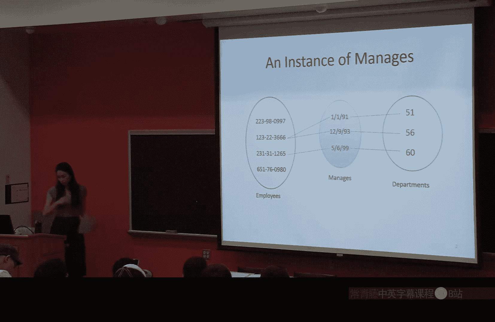
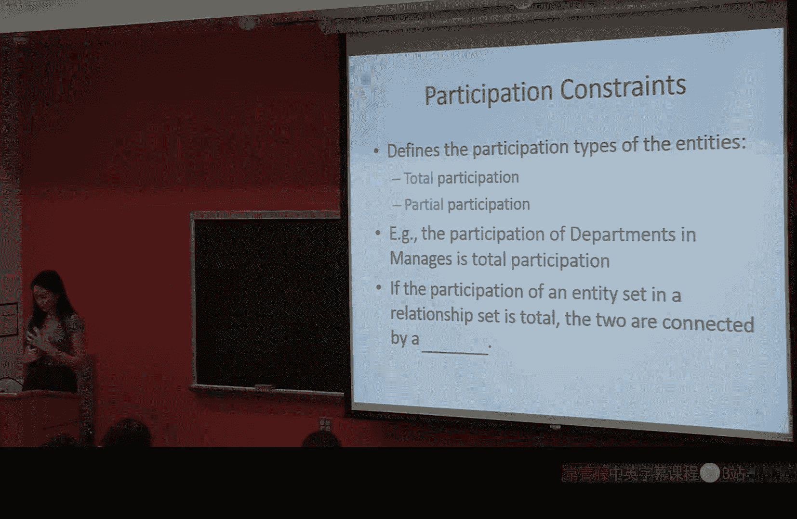
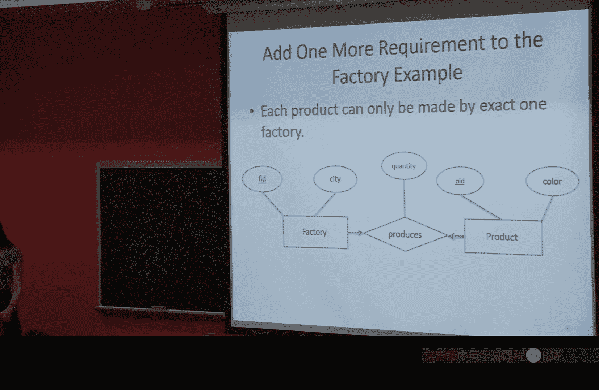
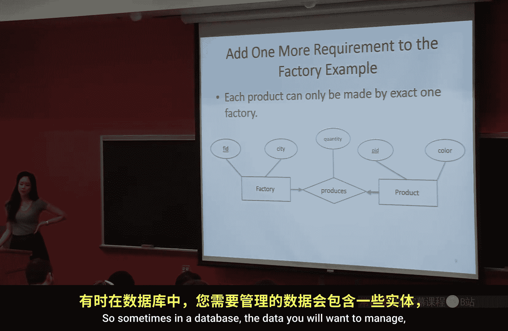
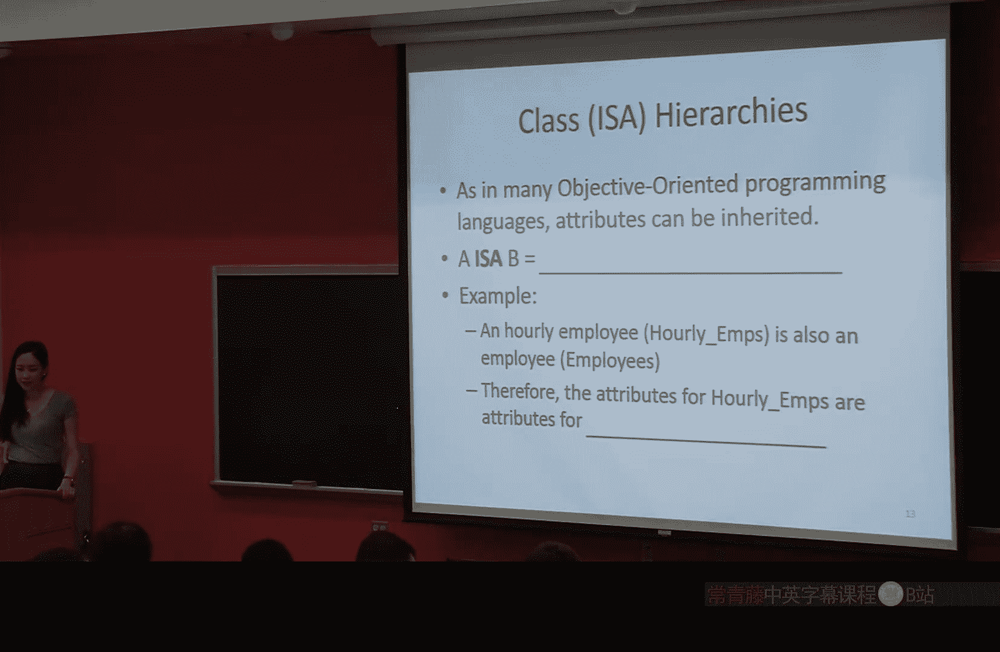
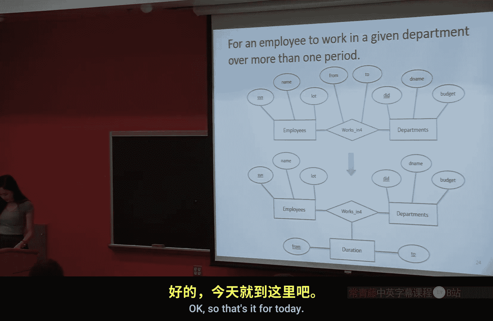
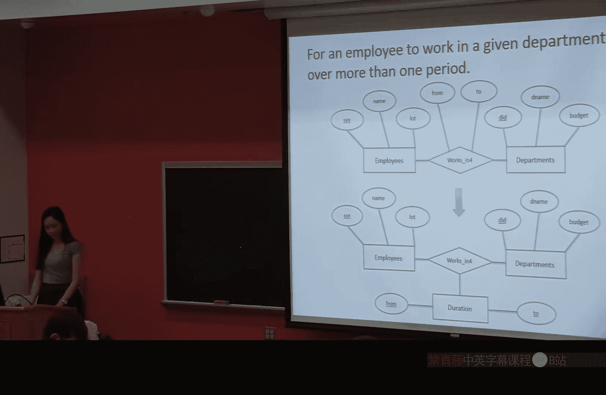

# 数据库管理系统：03：实体关系模型（ER模型）- 第2部分

## 概述

在本节课中，我们将继续学习实体关系模型（ER模型）的核心概念。我们将重点探讨参与约束、弱实体、类层次结构（ISA）以及聚合等高级主题，并通过实例练习来巩固理解。

---

## 回顾与课程安排

上一节我们介绍了ER模型的基本组件和键约束。本节中，我们来看看更复杂的约束和设计概念。

首先，关于课程项目，所有小组已组建完毕。项目第一阶段要求完成概念设计，本周讲授的知识已足够支持大家开始工作。请于规定日期前提交文档并进行演示。

上周的小测验已评分完毕。成绩和评分细则已公布。

---

## 参与约束

参与约束定义了实体在关系中的参与类型。主要有两种类型：**完全参与**和**部分参与**。

*   **完全参与**：实体集中的**每一个**实体都必须参与到关系集中。
*   **部分参与**：实体集中的**部分**实体参与到关系集中。

在ER图中，我们使用**粗直线**连接实体和关系来表示完全参与。请注意区分参与约束（粗直线）和键约束（箭头）。

### 练习：添加约束

考虑以下“雇员-部门”场景，初始图无任何约束。

**要求1**：每位雇员必须至少为一个部门工作（`at least one`，下限约束）。
*   **解决方案**：在`雇员`到`工作于`关系之间画一条粗直线。

**要求2**：每个部门必须至少有一名雇员。
*   **解决方案**：在`部门`到`工作于`关系之间画一条粗直线。

**要求3**：每个部门必须由恰好一名经理管理（`exactly one`，即“至少一个且至多一个”）。
*   **解决方案**：在`部门`到`管理`关系之间画一条粗直线（至少一个）**并**添加一个箭头（至多一个）。

---

## 弱实体

有些实体的存在依赖于其他实体，它们没有自己的键属性，被称为**弱实体**。例如，公司数据库中雇员的家属。家属信息可以通过其雇员的标识符（键）加上家属自身的某个属性（如姓名）来唯一确定。

*   **标识所有者**：弱实体所依赖的实体。
*   **标识关系**：弱实体与其标识所有者之间的关系。

在ER图中表示弱实体：
1.  将弱实体的矩形框改为**双线矩形**。
2.  将其标识关系改为**双线菱形**。
3.  弱实体必须**完全参与**到标识关系中（即用粗直线连接）。
4.  构成弱实体标识的属性（称为**部分键**）用**虚线下划线**标注。

**公式/规则**：
*   弱实体 `E` 的标识通常形式为：`(标识所有者的主键, E的部分键)`
*   标识关系是从标识所有者到弱实体的 **1:N** 关系。

---

## 类层次结构（ISA）

ISA关系模拟了面向对象编程中的继承概念，允许我们定义实体集的超类和子类。

*   **特化**：自顶向下，从一个实体集中提取出具有特殊特征的子集（如从`雇员`中特化出`小时工`和`合同工`）。
*   **泛化**：自底向上，从多个实体集中识别共同特征，并创建一个包含这些特征的超类。

在ER图中，使用**三角形**连接超类和子类，三角形指向超类。

设计ISA关系时需考虑两个约束：
1.  **重叠约束**：是否允许一个实体同时属于多个子类？（例如，一个雇员能否同时是小时工和合同工？）
2.  **覆盖约束**：子类中的实体是否包含了超类中的所有实体？（例如，小时工和合同工的集合是否等于全体雇员？）

使用ISA的原因包括：
*   为特定子类添加描述性属性。
*   定义仅适用于特定子类的关系。

---

## 练习：电影行业ER图设计

请根据以下需求设计ER图（仅需画出实体和关系）：

1.  电影行业中的人可以是演员或导演。
2.  人员参与电影工作。
3.  每部电影必须至少有一人参与工作。
4.  电影包含角色。每个角色只属于一部电影。如果电影未上映，角色也不复存在。
5.  每个角色必须由恰好一位演员扮演。

**设计要点分析**：
*   需求1：使用ISA层次，`人`为超类，`演员`和`导演`为子类。
*   需求2 & 3：`人`与`电影`之间存在`工作于`关系，并在`电影`端设置完全参与约束（粗直线）。
*   需求4：`角色`是弱实体，依赖于`电影`。`角色`到`属于`关系为完全参与，且`属于`关系是1:N（从电影到角色）。
*   需求5：`角色`与`演员`（子类）之间存在`扮演`关系，并带有键约束（箭头）表示每个角色由至多一位演员扮演。此处是否为完全参与需根据业务逻辑判断：若角色必须由演员扮演，则是完全参与（粗直线）；若允许角色暂未分配演员，则是部分参与（细直线）。

---

## 聚合

聚合是一种高级建模概念，用于表示**关系集与关系集之间**的联系。它允许我们将一个关系集本身视为一个实体，以便与其他实体或关系建立联系。

在ER图中，用**虚线矩形框**将需要被聚合的关系集框起来。

**使用场景示例**：`部门`与`项目`之间存在`赞助`关系。现在想记录哪位`雇员`监控了哪一项`赞助`关系。这时，可以将`赞助`关系集聚合为一个整体，然后与`雇员`建立`监控`关系。

---

## 概念设计决策总结

至此，我们已学完ER模型的所有核心组件。在实际进行概念设计时，通常遵循以下思考步骤：

1.  **实体 vs 属性**：一个概念应建模为实体还是属性？例如，`地址`是作为`雇员`的属性，还是作为一个独立的`地址`实体？这取决于业务需求（如是否需要存储多个地址、地址结构是否复杂）。
2.  **实体 vs 关系**：一个概念应建模为实体还是关系？有时需要将关系（特别是带有属性的关系）提升为实体。例如，为了记录雇员在部门工作的多个时间段（`开始日期`, `结束日期`），可以将`工作于`关系建模为实体`工作期`，并让其与`雇员`和`部门`分别建立关系。
3.  **二元 vs N元关系**：关系涉及多少个实体？是否需要用聚合来表示更复杂的关系？

---

## 总结

本节课我们一起深入学习了ER模型的高级概念。
*   我们明确了**参与约束**（完全/部分）的表示方法。
*   我们理解了**弱实体**依赖于标识所有者，并通过双线框和双线菱形表示。
*   我们掌握了**类层次结构（ISA）** 用于表示特化与泛化，并通过三角形符号连接。
*   我们接触了**聚合**这一高级概念，用于处理关系之间的关系。
*   最后，我们通过综合练习和设计决策讨论，整合了ER模型的各种组件用法。

掌握这些概念将帮助你更准确、更灵活地进行数据库概念设计。下节课我们将进一步比较和巩固这些概念的用法。