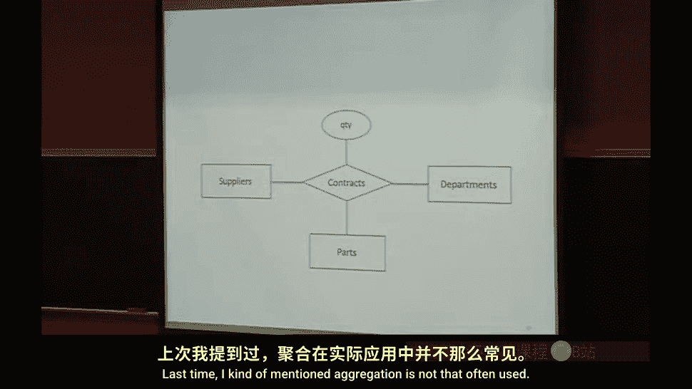
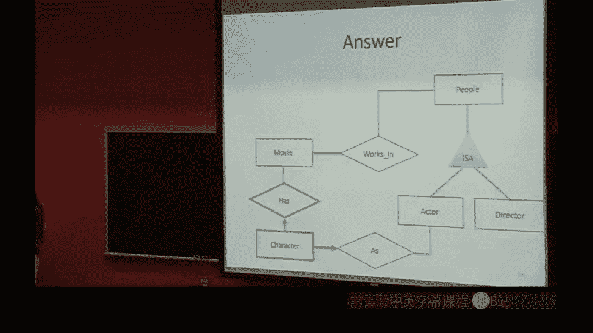

# 宾夕法尼亚州立大学【中英⚡数据库管理系统｜CMPSC431 Fall 2015, Database Management Systems】 p04 P5 实体关系模型（ER模型）- 第3部分与关系模型 -BV1N76CBwEXb_p4-

嗯。ラステクス。那对。Return your quick。So up' pull your knee。え？啊。So I think it would be great for me to。非。

You didn't get your quiz after。The name。は？で公安。Another thing is for the quiz。就 t就 t。

I think as long as you。T。嗯。At least。At least a year。That you did really well。80% of you got。Okay。

 so this will be the poll。声。Practice。So make sure anytime you right。Kin here。

 do you have any questions asked right now？That can有点 quickz。嗯。Okay， rockale。Bart。将。啊，第一天。学包。哦，这一层。

And make sure you write your name exact name。I know there are two students with the exact。参与吗？

And another还有。Ben。BR IM。Or不。You go。Mvy。清年。그。二十枚。It was like to。Thank you。今すれない。Don right。

Johnang great。Someone has crazy station。 And then she just something look like go。にクスて。Willing。对位。

Weno。你睇 her。我。整期。第二。我系。あこ。可。あさ。おにさめよ。这个。な。who。I stock with K and you。你在支枪。VA。So。Joshua。我。因为。ま。

And wasn always something。I have。Yeah。際かこ。赵华王。我哋会。すし。W。地なでが。怎么去な。哪问可。の我有。防し。各位拿个。那。我是。不で。でも。46。

I go pick up the other。Frankly。そ什么。つなですけ。过。なで。have to be out I had to work 4 to 11 people。我。

It're pretty much going to go here。And selling to。we finish。Let just do it for you。这不容易。我。张。

It meeting on Sunday。加层次的。我系两。Andde。えとね。Okay。Okay， whoever didn't get yours。

 come and get it after a class。I have you。关题。年。Yes。I'll finish chapter two today。3。Chapter3。そ。T it。

bring your。听到分据。愛け。try。嗯。たちでいい。えちょ。どせ。Remember we were talking about this one and we say we want to transform。

From the upper。死てど？快点捞去。はご。3。哎啊。For the upper one， that's。Only one entry for the。

He couldn't believe he one。If keep goes and come back。So yeah， actually。😊。

The reason is on top of the text is for an employee to work in a given department although。😊。

If we only do the upper one。How many pairs are from a too。For any。one。Yeah， I mean。

 unique you can identify better more。て。But it comes and goes and that is a problem with that one right。

Yeah， identify， so if we want to identify， that's why we ask。Allright。😊，And later。Policcy。去好的就。叫刘。

Come car。人間も？あ、ベさ。So， for example。seem really。お。To say here we have this binary relationship of equally managers departments。

 we have seen this a lot with。With this key constraint。You tell me for。日級ってパーね。

The manager's relationship is。One美。もいいけ。Mage。あここ。And for this。

It means the department has to be managed， can't be managed by most one manager。Can it have none。

It's okay。Yeah， because we don't have the total court。If it has。ホステージもビる。真的。All right。

 so this is the very intuitive binary relationship design that we will have， but today if。😊。

We want the manager gets。Disary budget that covers all men。What I mean by that is。Pofully。

 it's okay to manage more。If today we say we have a synphon amount。

So we want to give to that employee。To cover all departments。先 manageです。Can we do that with this。

You think what world did we add。I you here at Ko budget。おい変です。tain quite a bit。

I can capture the idea of the budget。Another view。What do we want to use just beR？そて clerk。

So one department has to have it。at mostYeah， according to this key concerned。

So we have this kind of problem？Just having the relationship。So it might be miss。So， let me ask you。

Do all employees think for the employees not managing them？Ca about。把这他。

Only those employees managing with the comments。😊，So when this happens， what can we do with these？

I had a weekend。对对。分手那个。So， only。I also。不同意 right。The manager owned the manager。

So now do we still collect the inquiry？这ま。一緒し？Or we can just very。记住你如果你。B。がな。有政发明。

Withhich department I D how how many department。How many departments work。えにま。法月8。在点。Yeah。

 we break this now。So you are saying the manager。Yeah， so then。The manager。Connect with the manager。

So this is the exact thing。Example in Texas。However， you might wonder。第二。disconnect have done screen。

But do you think we'll make sense of now end？Because you a manager。

I think it will make sense if we have。はです。The text doesn't happen。

 but it will also instance if you say all of the managers at the store in a database now。可。Yeah。

我那思面就他。Oh yeah， because earlier we said we want to make the design wear。

A manager can manage just multiple departments and the manager will be assigned with this。か。

That all of the time is sun。警于嚟讲。そさ。その意見。I I do。This the employee because that is。マネ。

You say the weekend to see。Being a manager。You right。😊，No。So then the one employee has manager。ぱり。

Employee。Because they didn' use be conflict of leak。So kind of the employees， the manager leaves。

 obviously that person is office。あ、美し。Infully， having a weekend to hold。完成こ。Conceptually。

 theyre different but kind of working。研究性？Because like if the employee manager needs。そう、こデ的像す。我给。

The manager。I think I。Apply other scenario。Any questions here？このか。Pinary。So is it the minor。

OkaySo this will be released about to the。Employee， policy dependence， example we saw last time。

 however， last time we have the dependent。嗯。So this is a newer way of designing yet。

 even though we haven't used the concept of liquidity， but if we use the policy。Here。Then。健こいい。

Just one point。This is really similar to why we use the duration。At the very beginning。Okay。

So these are kind of silly but you will figure it out。

 So what does the above diagram imp each employee can have。😊，But it is very much。

So each policy can be owned by how many employees。ありとうございます。没。The each dependent can be covered by。

How many policies。So do you think this is a real？So， we have a couple。嗯。So。

Another reason we have the policy right， let's say you want to。这个パプ。其实呢。我忘你搜。Re design。で。

ItAlways better。better。So let's say we want to meet these retirement。Okay。

 we want to change the previous one to meet this。あが。

The first requirement is a policy cannot be owned jointly by two Omo and police， so can agree be one。

啊。Allow a policy be owned by two or more。You can， you don't have any constraints on that。

We want to also meet a second requirement that every policy has to be owned by something police。回归从安。

やさ。And the third requirement is dependent is a weak。Each dependent is uniquely identified by。

Pmaker policy。いだ。我们。be through part。でデザイン？If you want to say you need the post one right？

A policy cannot be owned jointly by two or more employees。

If you want to keep the primaryary in your kitchen。毫无纠。在 least斯 will。

A policy cannot be owned jointly by two or more employees。That will pinch you of which。可せ。Yeah。

So we want to have a policy pointing to couple。😊，The error。コピ？第一个。そう？Do we do that。

At least you can meet a question。Is stick to the termer rateator。How about they second him one？問題？

So that's a little participation plan。And the in。Right here。Then， we have。is a we。All right。

 so when you see dependent weekend。这谁啊。What are that like big line， right？

So each dependent is uniquely identified by key name in policy is the identify owner。

So if this is the I。一般で。I。にか意見たどで。And thick line this one。But then how do you know， is it a weak？

不大我知 that。你为一啲分馆咧。你没。まに。We policies。So by using this， is this enough？Something else Er。So。3 separate。

So。好。We still。It place to pop us。Between the in and policy。Do keep this relationship。And right here。

 we have。Total participation and the key constraint so that we can。这。ね。

Those recommend beingpoli can not be owned by jointly。Don it on by two on。

And the second requirement is every policy has to be owned by some employee。total parties。So that。まセ。

Another part that we want to add now is the relationship between policies and dependence so that we cant have dependent cleaning policies。

However new name is the name for the relationship as long as it make sense。

have to be really purchasingive。So now we have dependence being beneficiary public policy。

And because it's we can with thick blanket it。ての。这。毕。ダめです。Another thing。Something you。当西。Yeah。这么我太。

TheP A should be under by the。It can be the。So this example tells us， sometimes。Neces可。Use。place。いバ。

So theres。さするできた。嗯。Do we have entity set？That's a scenario we have pod。W啊。The class of white。

And we have a relationship。With the quantity being the attribute。

So a contract specifies that a supplier would supply some quantity of a pot。

Can we do this with combination of minor？Think about it。 We have three。あめに。Do think。あていいです。の问题。Pre。

もす因。Sified that supplier was。呃80。you。啊これ。here。just开。たてか。でるか。And also。一只买噶。But。

And the conference will have associated。The can we just。呃一の。喂。So there's no really right or wrong。

他理我。我那方。还可以。

And use。So remember this sticky and I。Kind of the end of that。So let's say we have this。

 it can include E monitoring the whole sponsorship village。

If today we kind of say we don't need to record the until。I you。哦对吗。

Do you guys think witch is still keep the whole aggregation？Do you want to to。You believe it。

Do you still what。Or we can actually。さてお。I mean，每天 they that。How would。らさもれ。あれる。抓。嗯哼。会几单。前です。仮な。

晒时大嘅情况。对大。さ。Okay， let's see。Yeah， let's say now we don't care about the until information。哦。

But it would directly connect from people ease。Dspons。Can it still keep track of the？

It's still monitoring。ポツパンサル。And still associate。会。So will these information be lost？

It's not necessary to use。でビです。Before we interact。Quick review。定 now。是。

For a concept design inR model。😊，Are the basic？And。Special or additional。北天过。What kind of entities？

明白呢定嘅你会定。Or。Another time。We。そだっ。Hre啊。いしか？And finally， another one。How会。場イ。せ？啊。

What is the focus country that we learned that when you quantify。Such as the show。ま。嗯，还湾的。あ就す。

So I think this one we didn't。こね。経験でそ。So it's a hierarchy。😊，Remember we have different a subclass。

whether the subclass will。Whether。Ojectで。Or whether all of the south classes。か。That overlap。

So when we design here， I run these are things you want。

When you see the requirements folks identify identify what will be your entities。TheRe。

A where are the。Not just anything。は。Then you might want to think about what。でな。月休ぎ。And whether。一万多钱。

可以在。没反。Oh yeah，呃，对我。I want。There little be that we talk about。Pot major， because it's kind of。これは。

're kind of construct。Don want to make。So last time we talked about we want to design the year diagram。

民都明。So the first requirement being people in the movie industry can be actors or directors。

 so what is the first requirement？これ。对身不。So， do you see。Can be what and what。 So we find the first。

It is the hierarchy， so we have to subclass people。😊，And this isn't one people working。

Relationship hold in and then another empty。Ca bigger and right here do we specify any questions。

 so it's just a。😊，In the So at one， each movie has to have at least one people working in it。

 so here's the plot that gives you historical。Participation，So that's called the movie。

But not也 other way噶。Okay， so after these two requirements。

 can we say it's okay for the people not working。Okay， so then the fourth requirement。

 the needs have characters each character。Okay so the first thing has really have character。没。

That gives you。Another relationship。Between the movies and the new。in each character。

 I can only belong to exact one movie。😊，ぱです。Yeah， that's a one one。 So its。やてこの。AndFinally。

 even then the end up not release， the capcto will not exist。😊，This tells you bigger。ok。

There last requirement， each character has to be played by exact one pair。对。

So that's the answer。对。Allright。Let's see， somehow goes to common。

 people can be an actor or director。And people works in the movie。At that point。

 we don't have any constraints。And we say really has to be has to about people working in it。

 because that's why we have a total participation with a fixed plan idea。系啊。Oh， movie has characters。

In a cat， one character has to do。没有。Right finally。Actor place the cap the。推本。Is any why。時代に。けす。

佢こ you。theory。It's just the exact same thing。第一个。哦，关机关。Ex me。しす。素敵な大夫。生ほど上。Oh。

 there were a circle on the diagram。All right， so you just feel like。

we you feel like an entity and relation。Let say， and was do。If it happens on。やちさ。哪れ啊？

Are there any empty one？You just have to circle it you don'。嗯。Okay。て業。集中高い。どうしさ。つけてますで。

What was an example。そです。你 give you。你的 base。RelationsAny want remember？对。你的。We have two。

App applies name or release cause name and title of E。Looks like this going the work。

Then the next one， I think I didn't put in those emphasiss。啊。I it different？あカテンツ杯。

ICon when you think of the table， as femalema would be like the head top。Will be the actual。大。

That we normally use to describe。The for number。教后。比如。超然的て。おいあ。嗯。それ再见。現現て。The啊。Content in the table。

So we can think of it a sense of tus。So we throw the student information in。で差多。

So here is Zning example。For really killing。They are right here。What is the cr？せす。

I don't think it was。对。Just want to make sure when you reach。そでビ。Cant be identical。

So that's just really form of for。In the commercial system a lot of times， we go active。で理。

So for the order。系 this。Compposed records I going to call， do you think the older mask？八十めですね。嗯。

Quickically go through。我在是不。表明行。So the domain train that the value。表 name。火锅。なぜどせ。

The relation schema。ゆく likeて 아。Relation。That one is still one。And this one actually has。

I know what happened。A few one。诶。The valuess from domain one。Okay。da all the way to you。

We have in attributes in this schema。Okay， and FN， Q N。Good I。That's the central value。We始终 make年。So。

你要买。我週。さは？屋。So couldnt you optimize the database by actually。そなれ？哦嗯。I would say。

I think the order right here is more like。The when you actually stole them。Inて。

When you want to optimize them， they will have another data structure story。扱い的な。quickly。

Related to the order。So that may you can use pass。出した？

