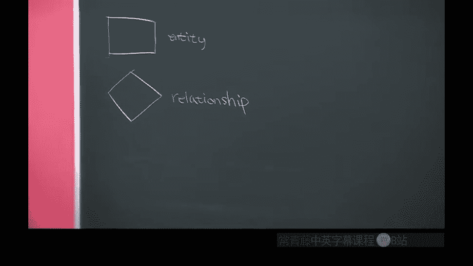
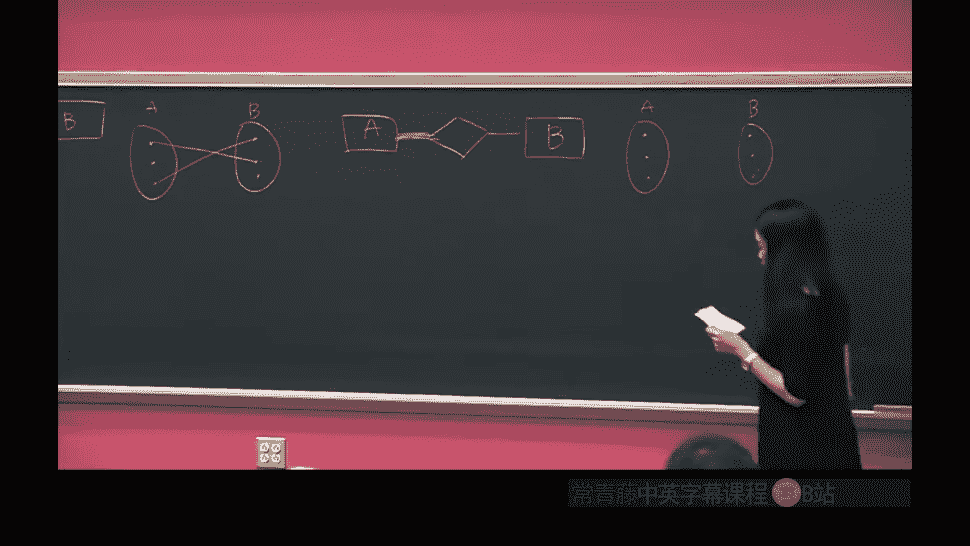
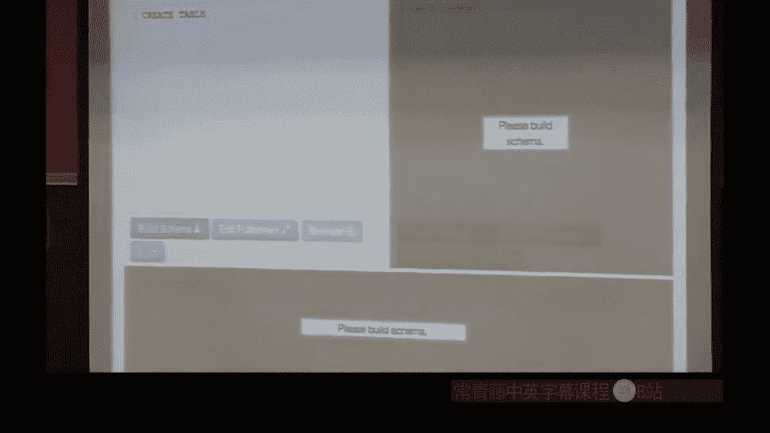
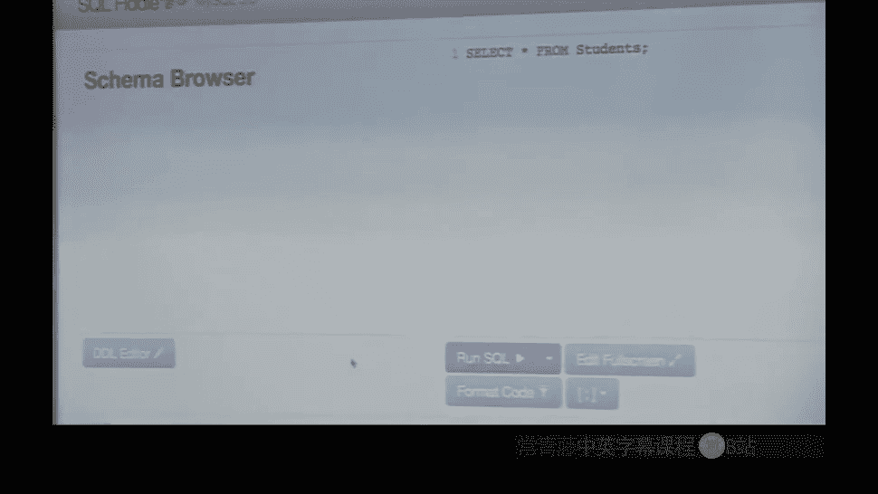

# 宾夕法尼亚州立大学【中英⚡数据库管理系统｜CMPSC431 Fall 2015, Database Management Systems】 p05 P6 关系模型（续）与SQL编程导论 - 第1部分 -BV1N76CBwEXb_p5-

So couple of this things before。Rece the email I sent。So yeah啊。ゆ。可 take。滑了。

In case you purchased the textbook now。他那个。Oh， you might。I he helped us。Regarding to your。

Before that， Matt， I think I will talk about it next。Has any of views。Thisly。Like to see if the。

Like BN。三0。The whole process， they just changed， I think， in this summer。

It's kind of complicated but。We need to learn。We to our CSC network in order to access。Have。

I set up for you from your laptop， otherwise， if you want to use those。

It would actually have to go to the clinic。チャンピン？So how is everyone project？Have you guys started？

So two weeks left from today。Remind you。You you have any questions you can seek for help from me。

Or the TA。Our office hour。Last thing today before we get into little lecture， we get。So。

 we will get on。But before we do that I want to do。Reビ。第二マ。Again。其 are being short。

We understand everything I want。Could do a summary。If you can。

 I think the print out what the handouts today in the back is。You can dry。On back with your handout。

 a very last pages。So yeah， I think our goal is to。Youve got this suggestion to。Pa버 수요。Also。

I really ask。of the simple teeth when you。って。They turns URL。bringring cheap sheet so you can。

Your own notes。So let's review ER model really quick okay before we start。

It's equal programming today。Three basic construct， what is the first one？

How would you represent that？Tectangle。you say this is the answer。And that second one。Relationship。

How would you call this Co is？对。Okay， we said this is the relationship。

Can people go on the back seat by right？That one， third construct？

A出病。So for these three， I think you guys have no problem， we call them the basic country。

Or however you play it as long as you see know。TheThree basic things are entity。

 relationship and attribute， and more formally， we'll actually call this the entity set， right？

Relationship set。Okay。I think the most complicated thing for you guys are the key constraints and the total participation and the participation cons。

So， let's say。We have En A。Having a relationship。With into T， okay。

 if we just put this most simple line， so there is no constraint whatsoever。

What to what is this relationship？It's a many to many， right？To think about it。

Will always put them like so。Okay， say for A， we have。Only three。D a point。

Be only 3 data points as well。 So if it's many to many。え？One data point from 8 can map to。

More than one， so is B。我我 up。But is it okay to leave out some of the data points？In both sides。

It's fine， right， because we don't put any participation and constraint on it。So for this。

You can think of it in this way。Oh， no， I'll talk about it later。 So this is many too many。Okay。

 getting a little bit more complicated。And we have。And entity A。We like to entity B。

 and we have an arrow pointing。From A to B。Okay， some people already say it's one too many。

 so how do we get there？You can't think of it this way。

So also we use the same example that we have three data points each。Okay so when you see this。

 you reel it from the side that has the arrow pointing out so you can say。For each B。There is。

At most。one。Hey， correct， so for arrow， it means at most。So after you figured this out。

 if you map that。I'm here。So for each B， we can only have at most 1 A。In this one， I most1 A。

 but maybe from the A side， you can have multiple Bs。Correct。So。If we look at from A to B。

 there will be one to many。诶。Does it make it easier to figure out ways。二つ目に？For this， let's say。1，2。

So then if we flip it another way around， then you know， it's many to work。I won't put that。That one。

A。B。Also， the other way around。What is this relationship？It's a one to one， right。

 so we can think of it as same thing for each B， there's atmost 1 a， okay I won't write it down。

And also for each A， there is atmost 1 B。So we say。Maybe it's a bit harder that' what you can think。

Again。抓了。For A。I only have atmost1 B。For being。So for three relationship examples we talk about here。

 it is all over。To have data points left out。So that's because we are not putting。

What comes from granted it？Participation country。So for these three。We use the arrow。So we call them。

 we are using。key感。Clickically， talk about。ミシフーションか。I'll start from。

If I'm writing anything really missing。Consider。いて？Having already。And this time。

The thick line right here。So for this situation。We forget about talking in the many many okay。

 we focus more。Oh weather therere。拭いてるこ。

Because this time the thick line is here， so you can say。For each a。B。At least one。

So when we draw it from here。For each A， there is at least1 B implying when we look at this side。

 no data poll should be left down。ButWhether it's mapping to multiple B or。Just one beat doesn。

For example， we can have this。Or you can even。诶诶。It is bad。I want to show from the piece I。でせす。反5宣。

Participation。Then we think about another。This time。

If I think advice which side or having both side you can figure it out。So this time if we have。

Pickline。て？For each a。There it is。one。对。你不个开。This time we change it up。On the beach side have。そ？

Number 1A。To be just for one day applying。Because we have thick line。

 so no data point in the A side can be left out。arrow。1，8 cannot back。But then it's okay to have。

ピーさでど。For these two。Of course， you can make up more combinations and examples。これ？

Any questions so far？に。It's here and we will talk about the last two。Oh， three actually。

So besides the basic construct， remember last time we were summarizing it。

But we also have a couple of special construct。First one being。Okay， the first one。We can to。So。

 you can have。A having a relationship。P。How would you make B a weekend。The full line around where。B。

And。Dner。the relationship， So you're disnoing。This relationship。I's a relationship between。

A weekend to。And the walk， we call this one。先輩でて。こ the I crying。うん。So。For weekend。

 there will be one attribute we use to identify it， how do we denote that？Like a。0ing。

There are other attributes。How do we denote the one？That we can， I think。Aductive。

So I didn't say before but here。4 normal entity。It would just be so。Another concept。

What is the other additional contract I can think of？心理意。那个。Hey， here's the superclass， right？

Normally， we put just two subclasses but actually we can put more than one。

So I'll just put three this time in case you get。thinking we can。So this is。Structure， right？是啊。

Which direction do we read it， Do we read it。あ down。me。But I'm not right。 B is an A。 C is an A。

 T is an A。 If you read it another way than that。啊。What is the final special？

Another one that we rarely use。Okay， I won't draw like a whole example。

 but just know that you can have。How do we den know？どてな。Yeah， the dotted black， right？

I just try that box。别上我的没。So that's the idea。When do we use aggregation？Tospec and little women。

When you want to。this， including the whole relationship。コピーで？

A quick review for all of the concepts we learned。みやも？Any questions so far？担青。

Ps like maybe you can keep your sights。Likes on the side bus。you you。Nothing is showing there。にわ？でき。

😊，第一。Okay， so outline for today， as we just did， we did the era model。

And last time we didn't finish the domain cont。it up。I think this is what you've got。Until we finish。

We talk about there domain constrain and domain constrain means the value that appear in a column must be drawn from the domain associated with that column and before we wrap up the lecture you guys quickly wrote down R is the relation schema okay？

What does F mean。That's the field。 And oh， I didn't fix it， but one is subscript。 So D is the。Doma。

 so we said DOMI is the set of values in domain I。Okay。

So we want to write up an instance of a that satisfies the domain constraints in the shema。

Right this way。So， we are saying。嗯。The instance of awe is a set of topples withinfield。

 so for bracket。We say it's the tupper， okay， we to't know it's a tupper and how about curly braces？

When do we normally use it？When it's a set okay， so in this set。

 all of the tuples following this format。Well， satisfy the ruler right here。

That's how we normally put。Values are setfi in the set。To give you。

Let's say today we have this tiny table。Can you just see from there。😀呵。😊，Okay。

 if I write like around here you see。そ。So。This is just like a quick example， for example。

 the SID in the student table， one of the student SID is 5000。His name is Dave。嗯。And maybe。

Just whatever。M。Oh。Do play 3。2 okay， to denote that in a coupleple following the format of the M one。

Colllon D1， so you just say this top book。嗯。For Dave is SID。拷文。5000。哎。And name。Dave。

 and then you keep going listing all of the information and then finish it with the breath。Okay。

你扣 this。我呀。Then what's the。Thank you。No， because in Chinese， we call this like the。

 I think the small。Prenhesis。Medium parenthesis。And large breakfast。

 so I had no clue when I saw these。や生ルリミング。Okay， so that's where the domain comestrain。え中？一構がで。So。

 in sQL。Instead of calling these tables， relations。SQL language， the convention just call it single。

So in SQL language， we can actually separate。I just del into CPA。

 one part that takes care of creating the data， deleting the data or modifying the data。

Everything happens on table that we change the contents。We call it the。这下 the position来。

We say it's DDL。So some of you might already know there's one part of SQL language you do the select from where。

I show pretty early。lecture。If you do selecting which is querying the data from the tables。

 that's not data definition okay， that's not a DDL。

 so DDL are the partsds that actually can change or modify， very delete anything。

On the actual content。So really quickly， these will be the things we will use today。If we have time。

 we might be able to finish， try them all。 So for creating a table。

 you just simply start with create table Okay for insert values， So later on what we will try。

 we put insert into。And for deleting， you can delete from and modifying we will use update。And go to。

地候制度をた。So I was trying to get out yesterday。I kept crashing it so I'm coming。

I think the most ideal situation will still be for you to log in。My see。terminal。

That will be way more stable。Likeect your purpose， I think this one。

But just keep in mind later on in mind。ing it because it cannot handle all of us。あよう。Got to the page。

I'm not sure that I type but it will be。也在。なてが。So this is a pretty interesting online tool On the left hand side。

 It's the D editor。 So that's the data definition part。 Okay， and later on。

 we will do some querying from the right part。 So it kind of separates both sides。

 And the querying would the only thing we。Almost the only thing we'll do today is just to show the whole table。

 okay， so we won't do anything fancy like based on what criteria。But we will get into more later。

 So today we'll focus right。So you can have your slides on your side。Tk faith。

 have you write anything on this？So just。Have been on site。Think code。嗯。

We haven't done anything on it。So if you just。Click on buildスマ。Okay， it will say email I ready。

Then you can go to browser， the browser will show you the old。So一经。Nothingで。Because we haven't done。

Every time you click into the browser， you want to come back。右ティア。大も見なたい。

Another thing you can try right here。Before we create any tables。Is to see what's in there。デすプれ？么。

Fin with the。So for things you type in on the right side。you want to execute it。

 this might take super long but something iss like。2。在第二。So you can click wrongron SQL。会饿了 bit。

I think very long， but yeah， when it finally finished executing。

 it would show you there's zero record。😊，なげ？Anyway。Let's try while waiting for it。

 we can create some tables。😊，So let's say we want to create the。ASt table that we kept talking about。

So as I said before， we want to create a table we with。Table， okay， so you do。Betweenen a table。

再可。Is that small or you can still see？People from the back cant to see it。He's finished。 Yeah， okay。

 so Rick count0。So you start with create table and say we want to call it the student table。因为。

The name for the table。After that， we can start specifying our schema。

So the first field is the student ID， which is good essay。And you press。Space。

That we want to specify。The domain constraint。So the example we talk about。

 I think we just specify it as a。净师咕。こ。欲し？Everyone knows what that will mean。いこにげ。So we can put that。

 so however you specified that I'm just following the year。

So this is also implying you cannot exceed the limit。Okay， I'll type in the rest。The field and。

And you also want me。Also won the lobby。He。For eight， which is one integer。So when you're ready。

You can click view。Okay do my回た。你 after。今。You can click to the browser。That gives you tables。

And give you expand table。You can see it shows the the of just high。To video editor。

If you are very patient， then you can click Re SQL again。あ決。The empty table。

So that's for creating a table。Or waiting for it， I'll tell you。Another way that you can show。

Ema from the right hand side。If you do this。Then that would return you。

 what are the schema in Dominica？こつき？So you look at the。です。Create table would just type in。

Have you noticed that we are not specifying something that we talk about when we are designing yourO？

So we havent not yet specified primary key， but we feel the schema， they didn't say any error。Okay。は。

That happens。So that might hypo a be。オー。😊，That's very sad， okay， so anyone can think of why。

SQL allows here。When you create a video。Or maybe there are other usage。これ。而家系。然ていの。まてて。まれ全でかれ。Mmhmm。

やっぱりみなアマインで。エンリリだ。买方钱过嚟咯。ゆ目？Yeah， that's a really good answer。And another reason。The relationships。

The store as table， right？For relationships。Do we have priority？啊。So that will be for if。

For creating。I'm not certain if this happens in you refresh it。So after creating a table。

 you want to add data into it。诶。So then we want to use insert。Into。Any values。will we just create？哎？

So we want to insert into the student table。YouIner into and you put the paper name。And you want to。

Put the order that you were take in。So you just quickly type in。星星。To enter the values。Vals。Okay。

And here you can make it up Iy more， I'll just follow the。So we have， I think we have。

You can put whatever。てだ。这一天定。えタプ。Let's try building。it will work。You must go， but if you go to the。

It would just still show the schema off the table， right？If we want to see what are the content？

In the table， what you can do is to do select。Oh brown。This we will learn a bit later。

 before now it' just  querying the table saying， I want to select。All of the fields。

From the students table， Okay， you guys know that means all right。So呢个。こは。对。If it works。

 then I we'll show you a table with the contents we just added it。So what if we want to？

I in multiple topicss。So。Don't forget to put the semi。So you do want to add in multiple。가不。O。

If you want to add multiple couples， what you can do。It's been a comment。Right after the coupleple。

 the first couple， and then。研究園なのもの？み？So you can do that。不停你 come up。

After the couple and then continue this next one。I guess I won't mess around from where I am sign know。

 I'll focus on listening。So since we are following all of the rules， it we' built schema。

And from here so it's schema ready。But because right here we actually specify the domain constraint。

 so if we violate it when inserting the values。Let's say。Change the 2。3。

joke there you build this schema。Then you will be。The证 number。です。SQL make sure。All right。

 so these are for。Adddding values into the table。The next thing we want to try out is modifying。

That's said we already store these two students in here。We want to update the students。Re？

So what you can do is to put update。And on the handout， on the slides， I could didn't。

How about white。So you want to update students， you put the table's name。

 and then you gives it a complete name。OkayOr another。You want to set。In the题目。Increment by。Okay。

Where。The couple has。きるないィ。Okay， so by doing these。

 it will go to find from the table whose SID is this and then update the A by incrementing one。Okay。

 can anyone think of why that we put an S right here。 What， What can they use like the user it。Stがで。

But when we only have one table。It's actually fine， if we just say set age equals to age plus one。

If we don't want to specify the niname。So the main usage。Will be when we have multiple tables。Okay。

 so say we want to update in the criteria you're actually comparing from other table。

Then say we have a student table， if we have a course table。

 then we can have the student table as S course table as C。Okay， so that can making clear。

choose to avoid you。やび。本港につい。Yeah， exactly I was just going to say if two tables。

 they have the same field names， then you can say， oh， this is the age from S。

 that's the age from that's the core have H okay then。やてえ。So that's for modifying it。

So I think I wont。That's because they won't show。呃。So。If you want to delete。One tupo or some tucos。

Following certain criterias。You can do delete。From。屌你。Here I will。実際 students。Whereas tables。

Where name。So if you do that。Then it will go to find in the student's table whose name is Smith。

And then take out tu。 So if there are multiple students。ぱ。Acuting them all of the couple with names。

Okay，The next thing we want to try out is to。We call it aler。So the main usage for this is。

After you built the schema， maybe you think。In the table， the one you can do you can do Alta。起个。

I supply which table you want to out。Okay， and you ask。你后位。組敷？気て。So for altering。

 not only can you do add， you can offer the delete。 Okay。

 so we alter the table students and we add one column。Thank you。絶対。都没看水。Before。

We take a look at how cable will be like。What do you think will happen？

What will happen for the two top posts that we didn't originally specify the first year？是挺苦救的。

你俾咩系 empty。Yeah， so for those we typed in first， but we have not yet specified the first year by empty data。

 so SQL will give it no value。Then let's try。Let's try out。Two ways of destroying the table。

First way is cook trunking。So if you窗。いようぜ。What it's doing is actually just。Takeing note。

The records we store in the table。So if you go to the browser。And take a look。

 the student's table is still big。But if you really want to delete a whole table。

 you don't even want schemema to exist there。You use bro。Okay， so after you drop the table。

 if you feel it。And you go to the browser。

なで。So there's a difference between truate。AndSo D is deleting focus schema information。

And the couple。when you go back and try it out。When you go back to try it out。

 you can try it out in both situations and do the select all from students to see how。😊。

Any questions so far？Let me just quickly talk about the integrity constraintstrain。

So we'll go back to this slide。And I'll keep。The rest of the exercise next time。Hopefully， next time。

Can come up with the better。都て。So when we talk about the integrity constraints。

 that will be the conditions that must be true。For any instance of the database。

 just like we said before， we will specify this sEma and for whatever tus。

This schema has to follow it， right？For example， for student ID， you follow the character 20 or 30。

So some of the examples were integrity constraints。All be the one that we just learned。

To follow that。One type of。The domain country。Domain constraint is one type of the integrity constraint。

Also， later on when we design using the SQL， you can also specify saying no two students have the same SID。

 there will also be another type。So where were integrity constraints being enforced？

So that will be wind schema。Its defined just like when we are creating a table。

 that's when we are specifying。Inteity constraints。And when， when will it be。

That will be when the relations。So that's like when we are inserting values into the table。

That's when the relations are on。In integrity becomestrain。

The database management system should not allow。We have only one minute left， so I will just。

Rightr to the reminder。As you can see， I have a bit more time yesterday， so I did a lot of things。嗯。

So don't forget a homework is due next Friday， okay， I updated a question。Also project you next。

 next Friday。No class on Monday， everyone knows Ray， don't call， I won't be here。

And also bring your laptop again on Wednesday。And here at the reading。

 I realize I haven't giving you guys readings for a while I forgot。

And everyone knows it's free dawn a day today。I'm going， so you guys should go。It's on the Frer。

In downtown the。Actually right after we finish the class。😊，9 a to 9 pm。

 there's a bakery called Good Sea Company or Bakerry。Go free。たそ。You guysて。Yeahや、そ。あはい。guys上て。

