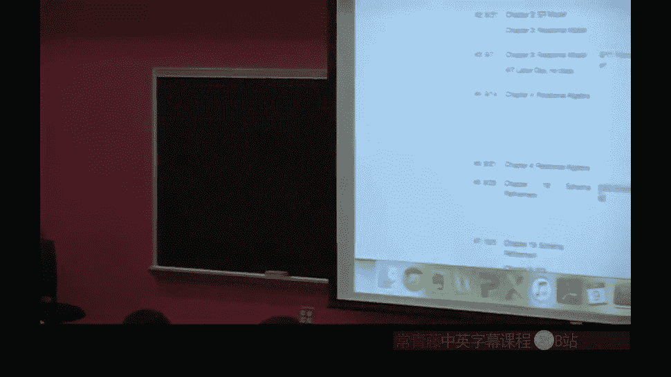
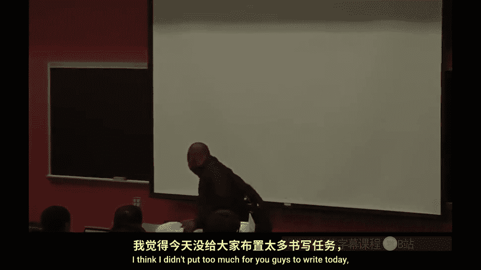
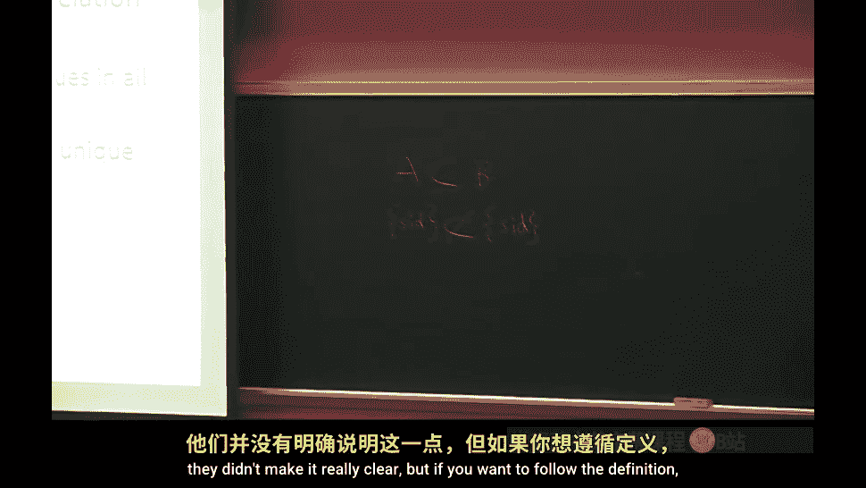
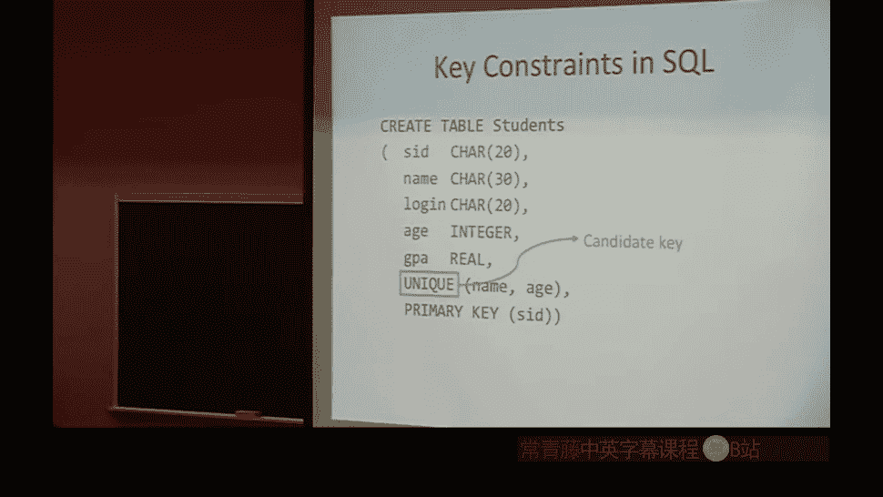
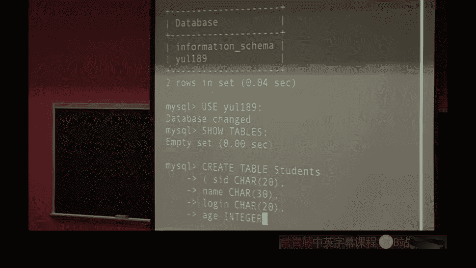
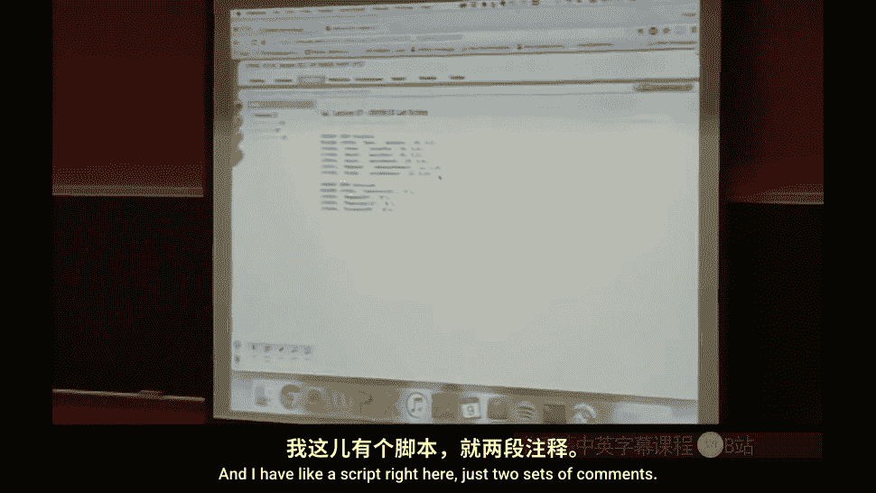
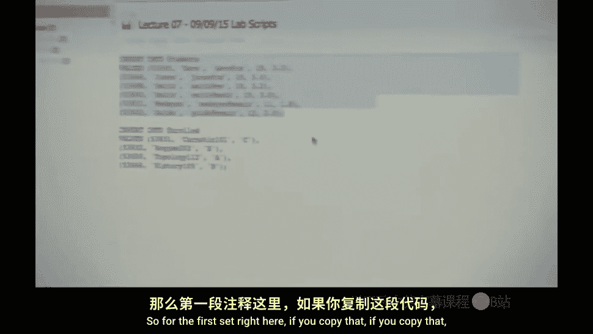
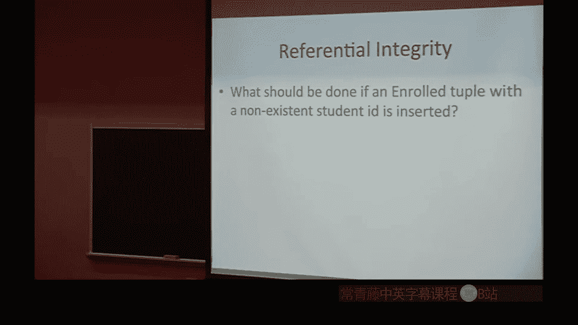

# 宾夕法尼亚州立大学【中英⚡数据库管理系统｜CMPSC431 Fall 2015, Database Management Systems】 p06 P7 SQL编程导论 - 第2部分 -BV1N76CBwEXb_p6-

Good morning， guys。How was your long weekend？It't went anywhere。I have some new experiences。

Last weekend I went to the volleyball game。first I watching that。Who went， anyone？

Only I was having fun， okay。All right。So how the homework going， how is homework？

At least you have started。So don't forget to do this Friday。

And I think I forgot to emphasize it a few more times that I'm pretty picky about how youre going to submit it。

Please submit it in like Let us size paper， I don't care whether you have something printed in the back the so have it on let us say。

Not on any kind of other papers。Try not to use a loose leash。And they it on the top。

Kind of specific but。Can do that。嗯。How about the project？At least you have thought it。

So don't forget that you will present it next Friday。

 so I've been getting some questions regarding to。😊，Project so you will be giving a presentation。

At first， I think on the website I say five minutes。Can we make it for a minute？

As I realize we have 13。And I will exceed the time if we do like five minutes。

I won't be happy every day here。So we will try to make it for a minute。Okay。Yeah。

 I'm sorry about the urgency for the VPN thing， I was thinking I will feel bad advice。On a vacation。

I one day left for you to figure everything out。So if you don't have it， figure out today。

 that's all right。You'll have another lab on Friday。But today， if you have already figured out that。

If you don't want to figure it out， yeah。Just about to say。

 so if you don't want to figure it out and you actually install it on your local machine。

 that's totally fine for me。So at first， our intention was that it might be easier if we help you to skip the steps to install things。

 but it turned out that the VPN is a norm。More annoying。You decide， okay。

 whether you want to use VthN and use the account。U for you or you wanting install on your own。

I think in my experience， installing on Windows。Linux，So if you're using Windows。

 what I would suggest is you can just have a virtualrg machine in it。They'll be making。

So much easier。Last thing before we get started。I want to ask you。So， at first。

home up to due October the 2。

And I plan to include both chapter three and four into the panel。However theめ。男こにない。

So I'm wondering whether you guys want to move the home a bit earlier。You can know the answer。

Maybe we won't be able to grade it before the midter。

 but you will copy answer key for that homework and then you can use that three years。

Would that be a better point？So what I'm planning to do， maybe I'll move this homework to。

To the Friday of week five。So。After this Friday， after you submit homework one。

 I will have homework two posted and then you have another two weeks to work on。

And because even though I say it will will include chapter three and four。

 but because chapter four will finish on the day， you submit a homework over for that very last part of Cha4。

I won't include that to。Just子。So I'll change that。When I go back to this。可以啊。

Will be the end of September。I think it didn't took too much for you guys too。

Right。な表育。开可。This seven。Just a little bit。Really basic commands that we might be using today。

 I think I did stretch it enough。Last time， so later on today， whenever you want to。

 I think that's the first step later when we get into MySQL。

 you want to show what are the databases you have， you just try to show databases。

And last time I also didn't emphasize it， but don't forget you need the same column。After we comment。

Before you enter。Another thing is。Okay， so after you show the databases you will get a list of databases that are in you can view。

 then you can choose the database that you want to use so later on I'll show you you can say use whichever a database database。

Then in database， we have tables， which are the relations， right？So that you can show the tables。

 I will assume you have not created anything in your account or your local machine。

 So when you show the table， what will you get。You should get an MT set， right。

 because we have not yet created anything。 And these two， I think I talked about last time。

 So if you want to see the schema of a table， you create it， then you can describe the table。

Okay later on， I'll show you， and also， if you want to just show the content of a table。

 which is all of the rows in a table， you put select all from。The table name。

So these are a couple of comments。Me using。Before we get to。M equal programming。

Just go through a couple of concepts that we didn't finish last time。

So let's talk about key constraints first， last time we focused on creating tables。

I think inserting values and modifying right。For modification， we tried to do。

Then today we will focus on。Can illustrate。So a set of field is a war for a relation if no two distinct couples have。

very。So no subset of。in a key using unique identifier for。If you remember， we have primary key。

For the key， what is the other one。いや。So when I was reading the twoth definition。

 I actually found it really confusing。So the first one was fine。

 it say no two distinct tuples I can't have same values in old tea fields。

Within a second one and no subset of。The set of field in the key is a unique identifier for a topic。

 Just keep in mind， when we say key， it means candidate key。

 So people call candidate key a key as well。So the second definition。

The subset of the set of fields in a key is a unique identifier for a tu。If we think about this。

Let's say。嗯。In this example， SID， normally if it's an ID。

 we say it's a unique identifier right for all of the records。So can this one be a candidate key？

Why is that。Because。也思荣李思荣。Because SID is a unique identifier， right？

So if we think about it this way， SID is a unique identifier and SID is a subset。Of this set。

So this set， according to this rule， this rule， it cannot be a candidate。Does it make sense？

So I was thinking。In general， if we could only consider a set that has only S ID。Is a set。

Containing SID， a subset of a set containing SID。So。I think normally we will say。A。え？Over here。

 if we do matter as strictly as。Okay， so when I was thinking about it。こにくいていきこ。Condition。

 before here， we don't consider the equal。You was said only has an SID。

That's just cute they didn't make it really clear of us。If you want to follow the definition。

To think about something in a way that strictly。Excludingグ。So that's our pe contrain。So。

If we don't call this。A candidate key。 So the answer is no， right。

 this is not candidate key because of this rule。 So we cannot call it a candidate key。

It also has a name。It's called a soup。So for super key。It is a set of field that contains the key。

Because of that， so we can say a topple or a record。In the table is always a supermarket key， right。

 because they always contain heat。It's only one candidate key。Don't wait super key。

 only one candidate key is chosen to be the primary key， if you remember， okay？

So we have so many can keys。In the table。When we define a schema。

Do you think we can just pick whichever？But， there are some。Situation we have to consider。

To make it better。W do you think we have so many candidate keys。Ping which are。Are all the same。

So sometimes there are different reasons why you pick certain and keys so one of the biggest reason is。

For some of the keys。DBMS may create an index with the primary key fields。

So some key is just easier for the whole index。other time its just these keys are more intuitive。

That makes more sense。So now we want to go。To some programming。Before we get started。

 I'll just show you how it will look like if we want to specify some key constraints。嗯。

So last time we created very simple students table， right， I think we only got until here。

 we just specify the SID name， login A， and GPA。And there。Doomain。So this time if you use it unique。

That's for candidateid fee。Okay。

have。The unique is for the candidate key。And primary key。Is for。So you just use these two keyword。

小さだ。Okay。一てね？Are you guys connected？PSTVPN or。Fool needs more time to set it up。

So I try to make the font super bit。Is it big enough for you guys？I was trying to set the background。

So。Fri。I think it was fine。Have have your terminal open or you already SSH， like byputti， whatever。诶。

I'll do as I said。You can pick whichever machine。So。If you have run through the instruction。

 you can just put P 218 and INSC， and for the 30， you can pick all the way from 09 to。33。

Just to make sure we are all on the same page， you don't know what I'm talking about。

This is written on the。How I啱。So who uses this smartphone too？考えて。kind of bizarre。次は。Can anyone考て？

Did it take longer？No， I， I can't even know。才经。発少？だけ。John。Will you come next to。你直是。

I said the domain restoration was。If you guys can discuss all the materials or whatever。

 give me one second。Okay。Your不这。Try the AC。So we're now in。network。

So if you are also using the Linux terminal。What you want to type in instead using Hoie。As a search。

Did you hear town。Whichever machine？You want to use okay？And so as I said before。

 if you are not sure what I'm talking about。I list that under the left page。So， that will be here。

So for the machine that you can choose， you can choose all the way from zero9。てうテリ。Everyone with me。

So once you have that， you hit。And you type in your CSE password right。

 not the one Bobbar assigned you。So then we're。The one you see。

here it means you' in one of the Linux exchange change in the Linux computer room。

So now we want to get into your MysQl and to do that， I list the。

That's the comment you want need to do。And here's where you type in the password above our scene。

Then， we are in。All right， so now we're in my SQL。One more time working。Yeah。This is the My SQL。喂。

I use them my SQL or advantage be。If you have it， then you don't have to do it for me。Yeah。

 I just want to make sure that you know the。で仮面ず。Yes。Really， I just never changed this。

 somehow memorized it。Okay， Ill， I'll ask her。To see whether maybe she sent the wrong comment I suppose。

Yeah， okay。All right， so now we're in my SQL， so what should we do if want to see what are the databases available？

Can you show database。So if you hit enter。Do you see needs to。

So we will get dont want the information schema for now， but for the second one with your account。

That should be the but。ってこういう。So before we having any comments， creating any tables。

 we want to make sure that we use the correct database。So how do we do that？You want to do years。

And then just type in the database name。To do as you want。てばいし。So as I said earlier now。

 I was assuming you to start。不に。I'll just assume that。No take will create。

So we want to see what are the tables in there。変こ？Then I would tell it it's an empty set。

I not created。It's thought from creating the students table。

Remember from last time we want to create tables。What should we do first？

What are the keywords to stop？create提。We do create table。大ゆ？Cable name that you want to。

So when you are in this MySQL shell， when you hit enter。Without putting a semi column in the front。

 you would just assume that you are continuing。明均 comment面。け？Split one5 one。So。Specify theスma？

Are you familiar with。I also have it on the slide so you can just copy the exact same thing。诶怎。こちゃ。

Then these two are。Sort of different from last time。

Because today we actually specify what is the candidate key？And what is the。done with that。

So if you don't have any error in the command， it will tell you clearly OK and because we are just creating a sma in like an empty table。

 so it'll actually tell you zero rows effective。So in the middle of it， you types something wrong。

Type semico in hands。嘿嘿嘿。😊，Thank you。😊，Yeah， I missed GP， so there are ways that we can add columns。

 right？Yeah，Should we do our？I want to keep it the same。No， I just。

Remember to draw tables like delete double whole favor。然后就面这。Sorry for those who were。So again。

 unique is for。え歴き？And primary？ごます。いや。And don the。研業がしな。Yeah。You mean， ohtoror Data birth。

 I'm just following the exact example as a textbook。

 so the textbooks reason is for just for the education purpose that we are not sooring the age。

 but when you're designing a story age just bad。Yeah， that's a good point， so we're using H now。

 but when you're designing your。do that。Okay， so。Now we created the table and want to review a bit about the schema we did。

 so if you want to see that， you can do this drag。Sr the table。And I will show you this。ァインド？

Ring because I make the font too big。You can see here it will tell you what are the fields and whether to type for the field and whether they can be null or not is you can see the SID cannot be null and the reason it' because。

His ideas。Is primary， So it cannot be known。 and will tell you。SID is the primary key。

So now we created a table。What do we want to do next？You should insert。

information isn't it right now it's just empty。 So if you do if you want to see what are the content in the table。

 you can do select all。From the table name。So what you will expect is。エティ。

So the example that we will follow today。We will create two tables。

And the example we'll follow today will be on your slide seven。I have a song。The thing。

Exactle from the textbook。So。I think typing in in certain value is boring。

If you don't want to type that in， type the exact information。T will show。On the slide。

 you can go to the lap folder and I have like a screen。Just two sets of comment。

The the foot set right here。Did you copy that。

You copy that， then that will。Insert all of the values that we will go through。For the students。

I think that was thing。いり？Just paste it。Copy and paste it。They would tell you。Very okay。

 And now this time because we insert six instances。

 so six rows are affected and will'll tell you we have six records in total and there are no duplicate。

So remember， even though when we introduced the relational model， we say duplicates are not allowed。

 but in commercial purposes， sometimes they're allowed。お前てこ。So， this time。一せ。To see what are in。

The students table， do the same， select all from students。You see的。slide room。Okay。

 so now we have the student table and we want to create a relation。

Relationship with it with the course， we won't get into the course table today。

 but we will do the relationship table the enroll。Okay。So。Remember。

 we are saying for if you want to identify any。Specific relationship in the relationship table。

 you will need to use information from here and there to identify， right？So what we will need。

For example， right here we created a student table and enrolled people。Here are the schemas of them。

So what you will need is that for the enroll table， we have an STUDID， the student ID。

 referring to the SID in the student's table。喂。So for that， we say the STUDID。

In enrolled is the flooring key。So we will call it a flu fee。That resource。土しれ。

That's why we have that point。From his TUDID pointing to us。

So let's take a look at the example that we will be using throughout。あて？

This will be the enroll table， and that would be the student's table。Okay。

 so here I the only students listed in the student's relationship should be allowed to enroll for a course。

 which makes more sense right if today you have。A couple here having a student ID that actually does not exist in the student table that should not be allowed right。

 so if you look at here here have the arrows， all of them can map to a student。言 the。

So in order to do。あ。The foreign key。In He command， this is what we will be doing。Okay。

 we will create a table cooling roll。 same thing that we repeat here。 Okay， we have just。

The student ID， course ID and grade。And this one I think last time a student mentioned that after class so we were saying we don't have specific primary key for the relationship itself it actually both come from the two tables that it's related to so this is how you look at it。

 the STU DID is from the student' table and this D IDD will be from the course table on the other。

Ontter side， right？And here is how we do the foreign key， so you say foreign key。

As I we said earlier SU， the ID is the foreign key it references to students。え最。

Okay so this is actually not complete because you actually also have to say CID refer references to the course CID。

 but we are not creating the course table with today so let's just forget about that for now。So。

 this will be the。How we normally。Do it， but if you are using the CSE， MySQL account。

I feel there's a little problem that I found。After you finish right here right here。

You will actually also need to put an engine that you want。I didn't know this before。I found out。

found out yesterday that by default， the CSC machine is not using this engine。

The engine that it was using actually will not support。Relational table， which is kind of crazy。

The engine was using cannot allow you to do any。So。Just remember， I think for those。

 if you cant locally， maybe body default， it's already this engine so you don't have to worry about it。

Okay， but if you're using the CSE one， just make sure you also specify I want to use this engine。

And another thing that。I didn't do earlier is because we have quarantine in the enroll table referencing to the students。

So it would expect you to reference to a table that's also created with this engine。

And I forgot to do that， so we have to do it again。

 but just remember when you go back to the student table， you also specify the engine。😊，Otherwise，你会。

You cannot。And I think this might be a bit annoying。テ望に。がて特点。嗯。Oh yeah。

 just a reminder if we use drop table that actually。There read a whole table， including the schema。

 but if you use trunk k。What is that do you remember。Yeah， I only delete the rows with a。そう。

I'll drop for the again。So， we can make it。Connected to the。C later。Okay， so let's create a table。

クラくるの。That put this script。I'll talk about how you can write this script and do it next time so you don't have to type it in the show。

So here's where you're want to be careful of after you specify everything before you hit。

Any any con in the enter。With engine。那你。And now I'm just going to quickly insert the values。別チや。

Is it going too fast。So now we will create the inroll table。You would finishた。

St table then we just do the email。If you have not you are。Not with us， all the comments are on。変て？

With modification。つられちゃして。Okay， we type in the inroll table now， and then well demonstrate how the。

Constraints will effect。Some transaction。Here is the new things that we want to do forine。

Remember the foreign key。STU DID in enrolled in the for。And we want to refer。To the students。Then。

Before we finish， also don't forget to put the engine。semimer we。

So if you want to add in the values for enrolled， I also have that on the script right here。

 so it's just this we have four couples。Okay， we copy that？Does the record taste？

And that will give you the contents for you。So again， if you want to see how the。

Rural table looks like right now。So let's all from enroll， okay？我ず。O。Okay。

 so let's try to do something that will give us error。So as we see， if we go back to check。

What are in the students table？Because he already had these students， right？

And on the left hand side， it's kind of messy， but on the left hand side。

Those five digit ones are the SID， as we said， because SID is the primary key。

Is it allowed that we enter that we insert？Rs that have。Saying asI。No right。

 so we can try it out and see how。They can say insert into。The students's table。

 I think that's how we insert values。And then you do values。

And you can specify the value you want to do， so let's just try whatever。

Say we want to repeat the same ID。As this guy， okay， you can put。5，6，3，6，88。Just some random name。前。

每只。17 years old。本当？Okay， the whole point here， you can into whatever as long as follows as the。

So if you have an SID that repeats。The ones that already exist in that。Any没 tell。So that's an error。

Another thing that will give us error。Will be。So for the primary key， can it be known？

You want to recall whether the primary can be known， you can describe the student's table again。

And as you can see here it's say S ID， no， no。Because of the primary key。

 it will not allow you to have the S I in。Okay， Mary。我他。

So what should be done is an enrolled couple with a。What you think so far。喺食点钟。연でて嬉。

We have all the students listed。In the student table。

 and now you're going to add some enrolled relationship。天での。

You enter the value with the student ID that actually does learning this。到问题。you reject。Con。Yeah。

 I think I make much agree。可以的嘅。You relationship。The student acting not exist。是 not很辣的。

But in different designs， maybe when。法律。よせにけ生が。Insert and your relationship and for this。空调。

Just the idea with all the other values we know。でたのこ。

That might happen is what should be done if the student's code is deleted and the。role take。

So we have these couple of options。The first one is to delete all enrolled rows that refer to the deleted student group。

Which I think makes the most sense。Another thing is this allows the deletion all the students wrote。

😊，G is an enrolled row。Secondly， just。よ見るのが。The third option is set the student ID column to the SID of something folks。

So you still delete from the student。then for enrolled row maybe。う好けだね。理公回の外なな。However。

For the last option。I think that's not enough。Thing that I know。

It we should be outcome upsetting the student ID of loans that will actually。Coner day。嗯。It primary。

We can just think about。担业人。Nothinging。What do we do get the priority ranking value。决定在我们。ア。Well。

 I guess if you were actually allowed to do that you have to update all the student values that resite。

 but then I don't think that that would be， I guess good depends what he created if you allowed it。

じ一个。So the whole thing of the here model design is when you change one table。

You don't want to really change all of them that relates to it otherwise。

And there's no point of separating them。So Austin。嗯。It makes more sense that you don't allow。

It happenapp， but if you allow so， then all of the tables arelay。And that mentioned the primary。

It just makes her sense if you don't even allow to。Like I won't imagine your student ID。

Maybe I can call point yourself they cant。That time you is in your。嗯。Great。

Like it took me two years to was students。Thank。Re。Okay， so for rep showing integrity。哦。生有机会我も财取人。

And I think you' hate me， we dropped the table。So this is how you would create the enroll table。😊。

Okay， so I to。Here go。And then。The fact that we have to say we。对。here we add two more things。两口饼啊。

You want you to take care of different kind of scenario。For me and the whole thing。

All these added to it。So the whole thing we call it quarantine declarationlar。So if you say unbel。

 then test。This cascade meaning row referred to it are to be deleted above。

So that was one of this scenario we have。The other one that aren' nothing。

So that's when you update something like what you insert or update of value。

No action in which rejected。So you guys drop me。Like we did earlier， if you own a day。

 and you do cascade， so then we will cascade all of the changes。Thank you Frank。Okay so we do test。

So we have some other options that you can use， that we just mentioned earlier。

So for delete update you have these four options to choose， so no action。

 as we said earlier is reject and actually if you don't specify it。

 I think by default there would just be no action。But if you do a cascade。

 and that means for any deletions or updates， all， the refer to delete updated couple。

Then you can either set to move or set the。So。hear today but before you。Reminder， reminder。嗯。Yeah。

 homework due this Friday， okay， so you will turn it in in class。😊，Unless any official。多め。

Then bring your right up。天。Rightriday I think that we are last。

Another thing is don't forget about the project。And don't give your report I at。

And over again next week， you'll be presenting your problem face。And youre the meeting。你个开。

