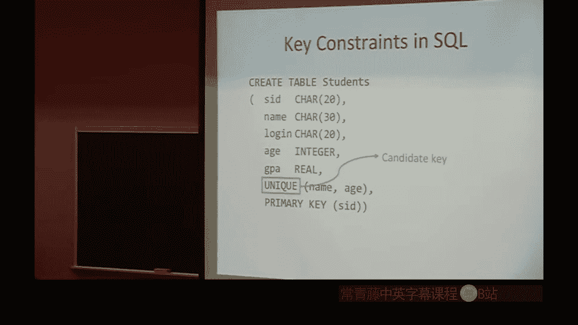
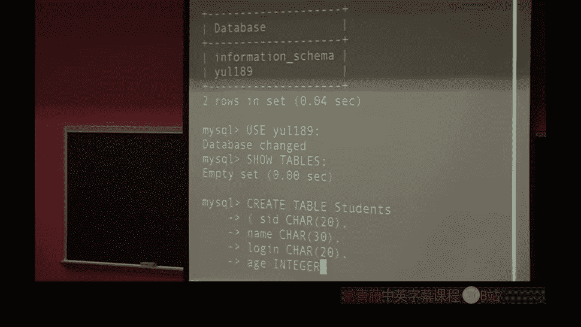
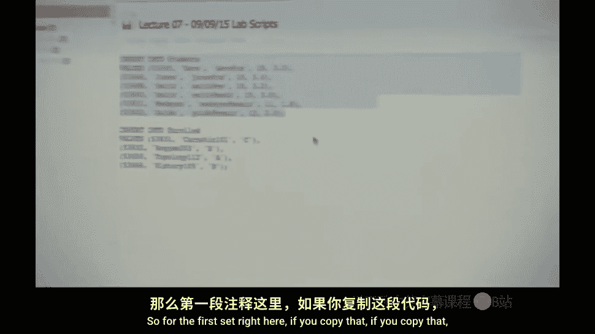

# 数据库管理系统：第6讲：SQL编程导论 - 第2部分 🗄️

在本节课中，我们将继续学习SQL编程，重点探讨键约束、外键以及如何在MySQL中实际操作这些概念。我们将通过创建表、插入数据并理解约束如何影响数据库操作来巩固知识。

---

## 概述


上一节我们介绍了SQL的基本命令和表的创建。本节中，我们将深入探讨键约束（如主键和候选键）的概念，并学习如何定义表之间的关系，特别是通过外键来实现。我们还将实际操作MySQL，创建具有关系的表，并观察约束如何防止无效数据的插入。


---

## 键约束回顾

首先，我们来回顾一下键约束的核心概念。一个关系的**键**是一组字段，用于唯一标识该关系中的每个元组。

*   **超键**：是一组能唯一标识元组的字段，但它可能包含不必要的额外字段。
*   **候选键**：是最小化的超键，即它的任何真子集都不能唯一标识元组。一个表可以有多个候选键。
*   **主键**：是从候选键中选出的一个，作为表的主要唯一标识符。数据库管理系统（DBMS）通常会为主键自动创建索引以提高查询效率。

选择哪个候选键作为主键，通常基于直观性（如学号`SID`）或索引效率。

在SQL中，我们使用以下方式指定：
*   候选键：`UNIQUE`
*   主键：`PRIMARY KEY`

例如，创建学生表时指定主键：
```sql
CREATE TABLE Students (
    SID INT PRIMARY KEY,
    Name VARCHAR(50),
    Login VARCHAR(50),
    Age INT,
    GPA FLOAT
);
```


---

## 连接到MySQL并创建表



在开始编程前，我们需要连接到MySQL环境并创建基础表。

以下是连接到课程服务器MySQL的基本步骤：
1.  通过SSH连接到指定的Linux机器（如 `p218.insc`）。
2.  在终端中输入命令 `mysql -u [用户名] -p`，然后输入密码。
3.  成功登录后，你将进入MySQL命令行界面。

进入MySQL后，可以执行以下基本命令查看环境：
*   `SHOW DATABASES;`：显示所有可用的数据库。
*   `USE [数据库名];`：选择要使用的数据库。
*   `SHOW TABLES;`：显示当前数据库中的所有表。

假设我们使用一个空数据库，首先创建`Students`表。

```sql
CREATE TABLE Students (
    SID INT PRIMARY KEY,
    Name VARCHAR(50),
    Login VARCHAR(50),
    Age INT,
    GPA FLOAT
) ENGINE=InnoDB;
```
**注意**：在课程服务器上，我们需要显式指定存储引擎为`InnoDB`，因为它支持外键等关系特性。

创建后，可以使用`DESCRIBE Students;`查看表结构，确认`SID`是主键且不允许为`NULL`。

---



## 插入数据与基本查询

表创建后，我们需要向其中插入数据。

以下是向`Students`表插入多条记录的示例：
```sql
INSERT INTO Students VALUES
(53666, 'Jones', 'jones@cs', 18, 3.4),
(53688, 'Smith', 'smith@ee', 18, 3.2),
(53650, 'Smith', 'smith@math', 19, 3.8);
```
插入后，使用`SELECT * FROM Students;`可以查看表中的所有行。

---




## 理解与实践外键约束

现在，我们来创建第二个表`Enrolled`，它表示学生选课的关系。这个表将包含一个指向`Students`表的外键。

`Enrolled`表的核心是`StudID`字段，它引用了`Students`表的`SID`字段。这确保了只有存在于`Students`表中的学生才能被记录为选课。

创建`Enrolled`表的SQL语句如下：
```sql
CREATE TABLE Enrolled (
    StudID INT,
    CID VARCHAR(20),
    Grade CHAR(2),
    PRIMARY KEY (StudID, CID),
    FOREIGN KEY (StudID) REFERENCES Students(SID)
        ON DELETE CASCADE
        ON UPDATE NO ACTION
) ENGINE=InnoDB;
```
在这个定义中：
*   `FOREIGN KEY (StudID) REFERENCES Students(SID)`：声明`StudID`是外键，引用`Students`表的`SID`字段。
*   `ON DELETE CASCADE`：当`Students`表中被引用的学生记录被删除时，`Enrolled`表中所有引用该学生的选课记录也将被**自动删除**（级联删除）。
*   `ON UPDATE NO ACTION`：当`Students`表中的`SID`更新时，拒绝此更新操作（如果会导致不一致）。

然后，我们可以向`Enrolled`表插入数据：
```sql
INSERT INTO Enrolled VALUES (53666, 'Carnatic101', 'C'),
                            (53666, 'Reggae203', 'B'),
                            (53650, 'Topology112', 'A');
```

---

## 约束如何生效：错误示例

定义了主键和外键约束后，数据库会阻止破坏这些规则的操作。

以下是几个会导致错误的操作示例：

1.  **违反主键唯一性**：尝试插入一个`SID`已存在的学生。
    ```sql
    INSERT INTO Students VALUES (53666, 'NewStudent', 'new@cs', 20, 3.0);
    ```
    **结果**：操作被拒绝，因为主键`53666`已存在。

2.  **违反外键约束**：尝试在`Enrolled`表中插入一个`StudID`在`Students`表中不存在的选课记录。
    ```sql
    INSERT INTO Enrolled VALUES (99999, 'History105', 'A');
    ```
    **结果**：操作被拒绝，因为`Students`表中没有`SID`为`99999`的学生。

---

## 引用完整性操作选项


当被引用的主键记录被删除或更新时，对于引用它的外键记录，我们可以定义不同的处理策略。这就是`ON DELETE`和`ON UPDATE`子句的作用。

主要选项有：
*   `NO ACTION` / `RESTRICT`：拒绝执行会破坏引用完整性的删除或更新操作（默认或常见行为）。
*   `CASCADE`：级联操作。如果主表记录被删除，则从表所有相关记录也被删除；如果主键值被更新，则从表外键值同步更新。
*   `SET NULL`：将外键字段设置为`NULL`（要求该外键字段允许为`NULL`）。
*   `SET DEFAULT`：将外键字段设置为默认值。

在我们的例子中，`ON DELETE CASCADE`意味着删除一个学生时，他的所有选课记录会自动清理，保持了数据的一致性。

---

## 总结

本节课中我们一起学习了SQL编程中关于键约束的核心内容。我们回顾了超键、候选键和主键的区别，并在MySQL中实践了如何创建带有主键和外键约束的表。我们重点理解了外键如何强制表间的引用完整性，并通过实例看到了违反约束时数据库如何阻止操作。最后，我们介绍了`ON DELETE`和`ON UPDATE`子句，它们定义了当被引用数据发生变化时，数据库应采取的维护引用完整性的策略。掌握这些概念是设计健壮、一致的关系型数据库模式的基础。

---
**课程事务提醒**：
*   作业一将于本周五提交，请使用Letter尺寸纸张打印。
*   项目报告将于下周五进行演示，演示时间约为4分钟。
*   请确保已配置好VPN或本地MySQL环境以便完成实验。