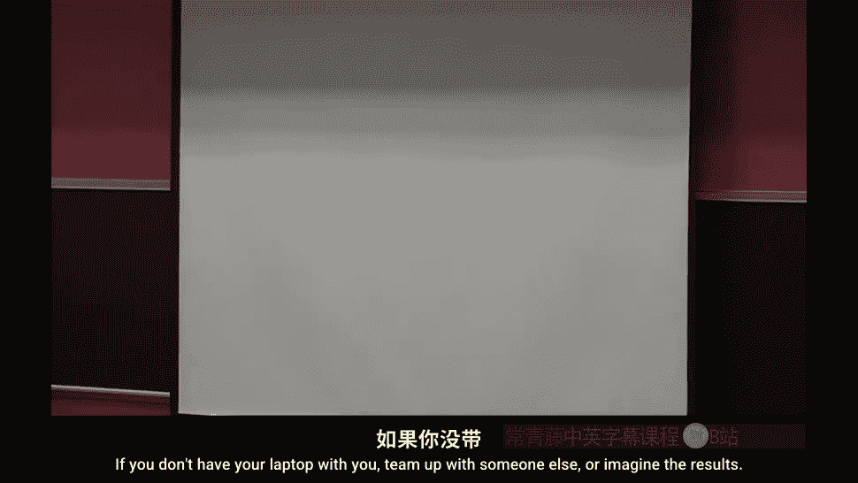
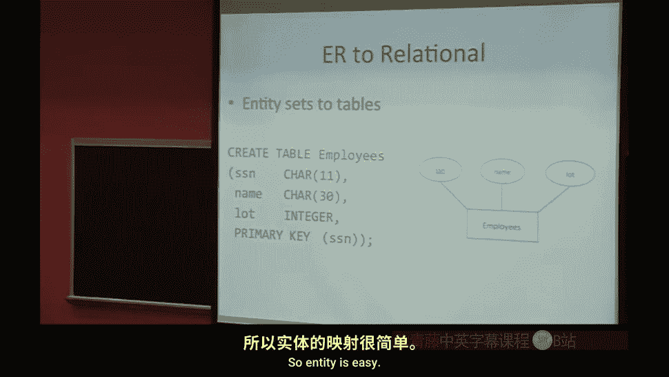

# 宾夕法尼亚州立大学【中英⚡数据库管理系统｜CMPSC431 Fall 2015, Database Management Systems】 p07 P8 SQL编程导论 - 第3部分 -BV1N76CBwEXb_p7-

错。Yeah。Good morning， guys。So if you haven't done so。

 you can submit your homework one in the table right here。I also now you submitted your homework one。

 I was opposed homework I。And it's due in two weeks， okay？So today， we'll finish。Chapter 3。

Which means something might happen on Monday。Okay， no what happens and we had out a chapter minutes。

嗯。What else。I白。Oh， how's the project going？嗯。I have a。All things to ask。

The project so I just added two drop boxes。So remember for the project report。

 you will submit both in hard copy and electronically。

So for the electronic version， submit it to the dropropbox right here and you want to submit it before。

Started。And for the presentation slides， you might want to be careful because you want to submit it in the night。

So。Are there any things that plan to do it not in PowerPot？

Like you didn't decide you're not going to do PowerPoint， let me know。

 but you're going to do PowerPoint submitted the midnight before。

So I'll compile them all so we save time， so all of the slides will be just in one file。

I think that's it for。Couple of announced。So for the SQL programming last time， everyone got。

Like everyone are on the same page。Are you kind of falling behind？For whatever that we did last time。

 we had it。Do you have your laptop today？

So I think this is where we were last time right， this is where we finished。And last time。

 if you recall， we created two tables， one is the students' table and one is the enroll table。

 and for the enroll table last time the version we had， we have not yet specified any foreign key。

Okay， so if you were following last time， I think we created until this pot。

 and I kind of just talked through here and we have not yet put on the th key。And last time remember。

 whenever I made this cake， I just dropped the whole table。

 so today I will show you how we can add some country。😊，Okay， so we don't have to actually。we家屋企。

I a couple of modifications。And I think。Yeah， a few things last time I didn't put the parenthesis SID behind the student table and make sure you do that just a good practice so you know which primary key it's referring to。

嗯。And don't forget for cascade。What it means in no action， what it means。So before we go into some。

Practices and exercise， I want to show you a couple of comments that might be useful。

 you don't have to remember then just have to refer to them when you want to use them。

If you remember last time we talked about the engines okay and I said if you're using the CSE。

 My SQL， the default engine actually won't allow you to have the foreign key functionality and that's kind of weird we are learning relational model so don't forget that you actually set the engine to this engine okay and last night we did it while we were creating the table but actually you can change it after you created the table and also I'll show you later。

 you can change the default setting as well。And here is how you will add the constraints for foreigninki。

So if it were last time I would say I'll drop the hotel when we retype everything again so these are the three commands that you will follow if you directly try the one in the middle that's like the main part for modifying the foreign key it won't work because there is a lock locking it so you want to set it like disable it first and then you can do that。

Another thing is remember when we want to see how what's the schema for the table we use describe。

 but if you use describescribe it actually won't show you any kind of foreign key that you just set so if you do show create table and followed by the table name。

对。Can see how people。Is defined， including the point。So， I'll show you。

You are already in a nice equalel South。Let's say we just enter。What will be the first thing you do。

Before we do anything。Remember。それ。说得要的。And this will show you the databases。Are you available？

So what should I do next if I want to choose one to use？The use。

And I've seen Barbara created the database you with your own company。

Okays that you use the database and now the database could change。

So what else can we do after we enter the database？嗯嗯。You can show tables。

You were with me last time and now we should have two cases， one is enrolled and one is student。

All right， so let's take a look at the en students。 We won't do anything on the。Inrolltable。

 we won't do anything on the student table to say。So for enrolled for showing the table。

 there are a couple of things you can do like last time if you want to see the contents of the table。

 we do select all。From the hand。This is how you can see the content。

So what should we do if you want to see a schema？You describe？谢程工。And I will show you who the。

Because it's an enroll table， so it has to consider both a student ID and course ID。

There's white Bo I showley turning。And for grade， it's okay to be know。

So today I'll show you another one that you can actually see a bit more。

 so you can also see the constraints you have。So what you can do is to show。Create table。

 And you put the table name。So this is what you'll get， you can type that。Yeah。

 so you type show create a table。Enroll， then you see this。Okay。

 so here you can see here are the fill that we have in the table and who's the primary key and also what is the engine。

For this table。Okay。And we don't have any foreign key right right now， right。

 so it's not showing in regarding to the foreign key。So let's say if your engine is not this one。

But's I think it's my IHA something like that。If you want to change it。What you can do is。

You can sit。Thank。Z first， till0 disabled is black。

And then what you can do this is for modifying whatever kind of modification you want to do on the table。

 so youd say you want to alter a table enroll and。Oh noな。なら。Give little what I was saying。

 I was trying to add short heat， so we wanted to change the engine for that， right？

So you want to alter。So if you want to change the engine， you don't have to do this part， ignore me。

 but if you want to change the engine， you out to table and you put the table in。

OkayAnd you tie engine。The engine of your choice。 And we always use this。Yeah。Okay。

So if you go back to check it。It will show you that the end now。可。

But that's just a couple of little things。Be careful。嗯。And now we want to add the foreign key。

So if for adding a foreign keyi， you have to start with doing this thing。Okay。

 so you disable the flat。And what you want to do， so I will go back to the slide to quickly show you。

Yeah。So what we want to do is to add this pop。Okay， I just brought to the table we created。

To do that。They also do。Yeah。你不懂。And put the table on name。Okay， the one you want to modify。

Then you say。I want to add。For me。Okay， then just tighten。The same thing。你 you would do。

Setting for keep when you're creating。And hear these。Options that we do。Both delete and update。嗯。

But once you hit enter。Do a see that the curryries okay？And the rows。

 four rows that storming the table are affected。OkaySo you want to see how it looks like right now？

You can say show， create table， and you put the table name。So this time。

The result will be a little of bit different。嚟。You can see from last time we only have until here the primary key。

 but this time it tells you we now have constraints， what is the constraint。

 the constraints for the foreign key， and then follows the same thing we just typing。

Just remember by doing show C table， followed by the table name though。A lot of details were there。O。

So now I want you to try out。F things。If you don't have your laptop with you came up with someone else。

Or imagine the results。哦。嗯。So I changed a couple of。The IDs， so it's different from the slides。

 the one I use red， because the one I put on the slide actually is not that interesting。嗯。

so for the park missing， you can look at your slide。

But I want you to think about and also try out on your。

On your computer to see what will happen when you already set these up okay and also following the constraints we just set what will happen if you tried these？

In order。Yeah。あ明て。Yeah， show create table。어 어 어， yeah。查。This in general， for the whole。

By default they said to one。Yeah。Do either wants to try it out or just want too。Think about it。Okay。

I don't mind。 We don't have to try out because。Have something for you to practice before the lecture end。

So what do you think will happen if we， based on this and based on the table we created。

 what will happen if we delete the tuple with student ID53650？

So what will happen when we update the inroll table as follows？下完了。One， five， three， six， five，0。

Its here。です。What do you think will happen with you from the enrolling？

Someone say the student table referring to it will be deleted as well。No。Other opinions。Yeah。Yeah。

 actually， only the tu。With student ID 53650 in the enroll table will disappear。

 but the one in student table will stay Okay Ill just try out real quick for you。So。

Right here if you want to delete。

Okay， click delete from。Enroll， okay， and you specify the criteria。 So it is where the。

Two I equals to5 is3。ok。So now you see。What are the contents from enrolled？You can see the one with5。

 three，6，50 is gone， right？这离不开。The one from students。And he's still here。Anyone can explain why？

Yeah， this is just。

You if I deleted that break the。嗯哼。😊，こ。Yeah， so。If we just by judging by this design。

Do you think it's allowed if we want to delete something in a role that's referring to students？Yeah。

 so。That's so it's a bit tricky。 if you look at this。 You will think， oh， on the then cascade。

 So the student one should disappear as well。 But actually， the way to think about it is。

It's referencing to students。 and on delete means when the delete on students happen。Then。

 the matching one。On the inroll Cacade。Okay and here as well。

 on the update that when update happens on the students。

 the matching S ID in enroll will have no action。Okay， so that's the tricky part。

 These things are saying any changes when it happens to the students。

So because we don't have the same thing specify in the student' table， right。

 so we can actually delete。Froming will。So what do you think will happen if we insert a couple？

With student ID like this。嗯。So do you think you will accept it or reject it， why is that？Be结。Yeah。

 so you mentioned the term。 So you can call this the child table and this the parent table。 right。

 This one is referring to it， so。We guess now that this action will be rejected because is there a student with this ID in the student table？

No。

めて。I think I won't go through。

好了。Into enroll。This is how you insert things with values。And let's just say。Bye。5，3。

And we just say it's。宴解。matter。Actually， you will。我欢。おでは。给嘅せ。です。Wait， this is awkward。He checked to。

小。😔，Anyone can figure out what I did wrong？Yeah， let's just say normally you should be rejectedive。

I'll fix in and tell you what happened。ok。Sorry about it， that's great。我你て。我俾て。我呢啲。Oh。

 I didn't enable it back。

Thank you。雰キ？O。笑午。If I delete。Do it again。Thank you。So remember the environment。

 the flag that I set to disable it first， I forgot to set it back。😊，Okay。Thank you。

So that's what's going to happen。You didn't sit to her。

Okay， now， so for the rest， I won't go through it。You can imagine what what happened so for the third one。

 if we update a topicple with student ID 53650253666。Imagine we didn't do this and it's still there。

Do you think we can do that？Yes or no。Yes， why yes。

Because there's not actually no constraints stopping you when you modify the enroll， right。

 but when modifying the students， that's where we have the foreign key constraints that will stop you to do a few things。

So how about when we update the tuple with5，3，8？3 one， that one。25， three6，0，0。Okay or not。Not。

 why not。Does't exist in the steer table。O。Next one， let's look。

So now we want to modify the student's table one instead。Okay。So we want the insert tople with ISID5。

3，6，0。What what happened。嗯，能不能。Just normal insertion， right。

 and nothing will happen on the enroll just on the student' table。

So how about when we lead the couple with SID 53666？嗯。What will happened yeah。Yeah。

 because of the cascade right， remember what you do recall when we define the constraints we have on the league cascade。

 so then not only this row was disappeared。The alsoで。Okay， final one。

 when we update the tuple with ASID 53，A31。2，5，3，6，0，0。 What do you think will happen。嗯。

because we say on update， we define no action， so what will be the result？

Do you think will be accepted or error will drop？There would actually be an error。Because。

Like remember when we define we have， what's it？On update， no action。 So it's not allowing you to。

Modify here and then。That power was on ifify。Right， but what if we change it to on update cascade。

即睇啦呢有。Okay， so then when you change it， that part would change。来办你见。Okay。Any question here？

So a few things on query， so right now we have only use select all from table。So far， right。

 we haven't put any criteria。 But you you do select all from a table and you put criteria where。

Whatever criteria you want to put， then based on the criteria， you return the results。

So up until now we only use select all， so it will give you the whole row。

 the o rows that satisfy the criteria， the result will be returned。What if you only want to。

Have a certain fields return。Then you can do this。Okay， so if you select。

And you just put the field name。Okay， then this time you will only return just the name and the lock。

I won't find it out。And remember last time we said we put the。I call it the nickname for the table。

 so it's actually putting a variable name for the table。Remember why we want to do that？Yeah。Yeah。

Yeah， unless in case when we have other tables， right。

 you can make it clearer and also sometimes two tables。

 they will have the same filming so you can specify this is this S from this table and that SAT。

So here I will show you。For example， sometimes you want to select things from table A。

 but the criteria is actually based on table table B。 So you can do this。 For example。

 you want to select。The name from student table， which is the S。In the course ID from Enroll table。

 which is the E where。The SID matches the student ID in the enroll table。And also。

 in the enroll table， it shows the greatest A。Okay， so this is how you can use the idea of。看売でで。

Any question here？校長。Not yet， right， yeah， that's for。That's a， but for now this will work。Okay。

 so we want to move on to see。So now we are only just creating a table by Sco coming。

 but we actually want to see how you can translate from the ER model to the Sco coming。

So you don't have to do this for your project F phase one， but you'll be doing this in。

Homemo2 and phase two。Okay， so this so far is still very easy， right。

 when you see an neo model like this， if we just have a very simple entity set right here。

 it's very intuitive to directly translate it to this area。ItShould be easy Okay。

 you just put the whatever attribute you have and say， out of all these attributes。

 SN is the primate Okay， so you can simply map this。是的。So anything is easy。

Relationships。等。So we consider this a little bit complicated relationship set。

Well call the works in two because remember， I think。In chapter two。

 we have so many different type of works in that this is working here。

So when translating a relationship set to a relation， which is the table。

 attributes of the relation must include coupons。The first part is the keys for each participating entity。

And it he correct。So what will we call it？If we just put all the key for each participating。

So for it works in。All the keys are。To get。こし。Yeah， for each of them。Yeah。

So for each of them is the foreign key。And you're right， when we think about them together。

I at club the primary keep for now。We call a concept we talked about last time。Together。

 they are super key。Why is it super keen in that candidate？あな。嗯。对对对。So that's why I call it。

And other than that。Here we also include the descriptive attributes。

 so if you have other attributes just for this relationship set， then you will also include it。イチー。

So you can refer to this ER diagram and in the next slide。This is how we can create。啊。

The table floor works in two relationships。Okay。So as you see we have SSN department ID in the address from the location。

 that's down there， the entity set location， and I think I was missing Ss。

 the attributes so you can draw it on the relationship， okay， I was missing the Ss。

 you can declare as a date。So what will the primary key be for a work thing？二性。Maybe I just。

So for now， we just say。Yeah。So you put three of them together。As the primary。我 the放。

Should they reasonship the？Right now it's the case。

 so we will talk about different situation later when we have different kind of come。Yeah。

 but for now because as you can see， we didn't specify any key constrain of participating cons。

 so you just simply put all of the primary key from all the participating。An。

And then this pie is easy， right？For the foreign key of SSN， where does it come from。

 it comes from the SSSN in employees， okay， and so on。How about if you remember this example？

We will want to translate。An entity say like this。Where the relationship set only involves one。

Kin of cutting out here。Okay， so here。For the same relationship， it will refer let's say。

For one relationship of reports to you will refer to two employee right and one is the supervisor。

 one is the subordining so here we will have the SSN for supervisor and the SSN for subordining here should be fine no problem。

Now， how would you specify the primary key？Also， just put them both together。So yeah。

 this is actually very simple， but I just want to fill that out。

 So what were the first references to？😊，Employees， then a second one。やまし。

Yout want to put that in your head。So he's referring to。The same。Okay。

 so so far we have not yet considered any kind of。So let's take a look when we actually cast in those strength。

Okay， let's review a little bit。 This is not a thick line in its in。

So we will say for each department， there is law employee management。1 or x。And what was one。

So is it okay for a department to not be managed by any employee？Yeah。

 and is it okay frankly to manage more than one department？Yeah， right。😊，Yeah， it's in a so。

So for manage's relationship， for that relationship。Based on what we just figured out。

For employee to department， it's a what to what。3ly。As I said， one employee can manage more than one。

So if we think of it another way， it means。When we have a department。

At most it will only have one employee managing it right， So when you have a department。

 you don't have to worry about making， there will be multiple employees associating it regarding to the manager's relationships。

So we have two options for creating this relationship，The first one is like this。

 can you just simply put both the primary keys from both sides， the SSN and the DID？

And did I have a sense？notMaybe on the managers relationship since so what should the primary take be。

 what do you think？😊，Do you think it's necessary for us to take both？Both the SN and theAD。

Someones shaking their head so you know why。I most one。うん、すごで。Yeah， exactly。

I put the lines in the long bit。Just DID。OkaySo this is because， like you said。

 when we already find a department， there will only be one DID that's managing it when you're thinking about the management。

The very be department great。哦，不变了。约定。So if we already have this， we can actually put it further。

You can just。Simply merge the whole manager concept。

Into the table where we call it the department manager。

 so here are actually the attributes for the department。没。And。We just simply say。Or the foreign key。

诶 this。References the employee。喂。So actually you can have one less table。You don't have to happen。

That's what will happen when we have a keep。So other than heat contrain。

 what is the other contrain that we have？Participation constraint。So let's looks a bit crazier。

These areThese three are thick ones。But for every DI value and departments table must appeared in a row of managing table with a non。

Okay， so we think about for each department。How many employees can they have to manage it？

Exactly one， right， because it's a thick line。In error。How about for？Each department。

If we consider the works in。Then what is it？あり。at least one for each department。

 there is at least one employee working it。😊，Yeah， and the other way around。

 which is for each employee you should work in。For at least one department。 Okay， so that's for this。

No problem。But how will we translate that？嗯。わです。So we look at the managing， yeah。

 the managing relationship。Okay。So these should be。O。

 but the thing I want to ask you is now we have the foreign key， which is the SSN of the employee。

What other things should we。Specify。You can take a look at。So if we let's say。

Thinking about a department when it's the managing。Relationship。

 if we delete the employee that's managing it。Why do you think should happen？

The employee is managing a certain department， and we delete the employee that's managing it。て发。

你 많이そ。But then the department will have no。It should be an error， right， So instead of doing delete。

 what will happen if you want to change the manager for a company。Yeah， you can just do update。

 right， because if you allow the situation when it can be deleted， then this will not satisfy。O。

So what should we do if we want to？like the delete。Would you put on the？では。They you just go on doing。

佢哋家点翻。人面で。They entire。Organ that。你五万。Yeah。What you mean。If the department is gone。I mean。

 if you use the managers that only it can get to produce。嗯嗯。いい。Yeah。

 this is preventing the situation where。To have the missing manager。What quite。不よ。这当呢个系。Yeah。

 it will give you error saying you cannot just directly delete that if you， okay。

 let's say if that employee is leaving and not working anymore。

 then what you should do is to replace a manager to the manager's relationship first。

So then you can delete whatever， whoever you want to delete。

But if you allow the case to have the manager's relationship to be gone。Even temporarily。

 then that will break。The constraint where we say for each department， there should be exactly one。

买呢啲两。嗯，你该。完璧？你先一点一啲。下面你呢啲 sense team。系呢。不是得。Because it won't tell to give。

In is when the manager is left。又行你啲你。你不好。你啲。我哋得。that。はいない。

We not like the until leave who didn't find a new man。So you want to keep that so for the deny， okay。

 maybe sometimes not realistic because realistically can be gone for a while thats fine。

 but for this one， just guarantee。😊，All time， it was the exact one in。Okay， so let's take a。Well。

 what happened for weekends？So for weak entity。If we recall， let's ignore this plot。

 We entity set only got a partial key， right， The partial key is。Denoted by the dash line。

And need to take the key of owner and entity， right？Employee is the owner to entity。

 so to identify which dependent it is， not only does it have to look at the pen name。

 but it also has to look at the primary key of the employee。诶。

So what will happen when the owner entity， which is we say the identifying entity is deleted？

You're so fast， yeah。Depenent will be gone as well， right。

And that's the exact mapping of the company。Remember。

 one really important thing is when we design a weak entity。We will put。The dependent looking。

 the weak entity and the relationship associating with it in the same table。Anyone can answer why。

 why we only need the same table instead of having an employee table， policy table。

 and independent table。あそ。平きす？系系都。明年。The relationship should be。究中。우리니까 과디。发现你。Yeah。

 so then you can not only have。Like a dependent table there， right？Can you。

So how would you translate that？Let's say we want to do the dependent and policy。

So we have a dependent name。dependence age。And the cost of the policy。In the assistant of the at。

What are the prim？そ。件。It is在。Okay， so for foreign key assistance referencing to the employees。

 we said earlier if the weak entity is deleted， oh no， no no， if the employee。

 the identifying owner is deleted。Which is from the employee table right。

 then the weak entity should also be deleted as well， so this is on the。

So now we have five minutes left。And I want you to think about。

 I haven't talked about the IA hierarchki， Elie， whether do we have time next month？We talk over it？

next week， I want to move on to chapter4。Which is a very easy chapter。😊，嗯 okay。So before we finish。

 I want to use the five minutes for you to think about how you would design this。

You can either try it out on your My SQL shell or just write it down。ですか？

Would yourcramate okay I actually。A very simple data set just on Angel that you can。

See what will happen？Okay， so when you look at this， what are the tables you think you should create？

Which one is obvious that we will have the paper frame？We always for。你不好意思。感谢则。这是。De。Oh yeah。

 dependence with the beneficiary。Do we have to have a purchase？没有。Yeah， no。

This't so firm no we don't have to have it， right， why？いかです。呃一上次。中意关联。来。嗯m哼。😊，Exactly， so。

To finalize what how many tables you mean？Free majority employee， policy。Yes。

YouThink about how you would design it and then it has to satisfy。

All of the key times made in participate。Do you have any question in terms of doing things in My SQL or getting things working under my SQL account My SQL shell。

 make sure you can get it work。Because for your homework activity。

 you actually have to do those things。You will have to type in a comment and I will ask you to provide the result you have。

The return result with your coming。If you want to make sure you can get it work I don't care whether it's on your local machine or anything。

 so if you still have problems setting it up you can。Let me help you are。Or in the T。Yeah， I go。

 Im like you guys can't go to sleep。