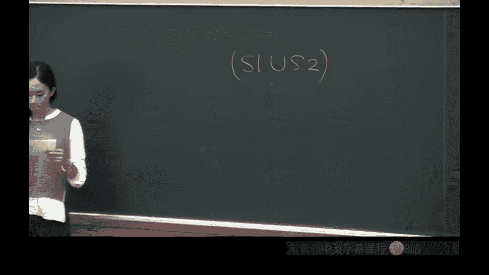
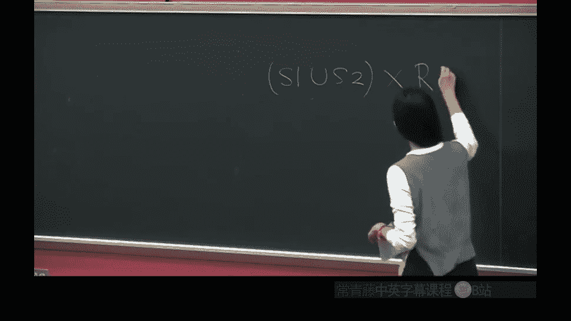
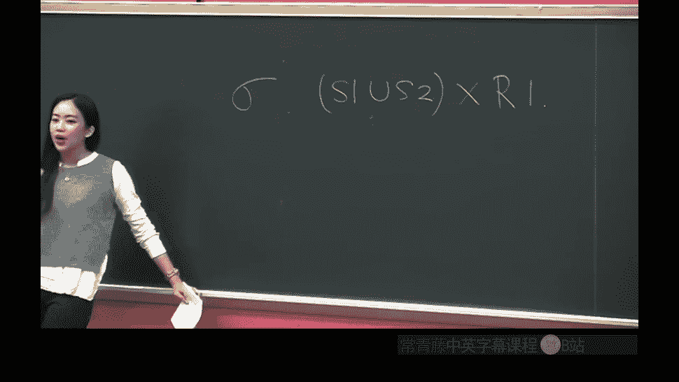
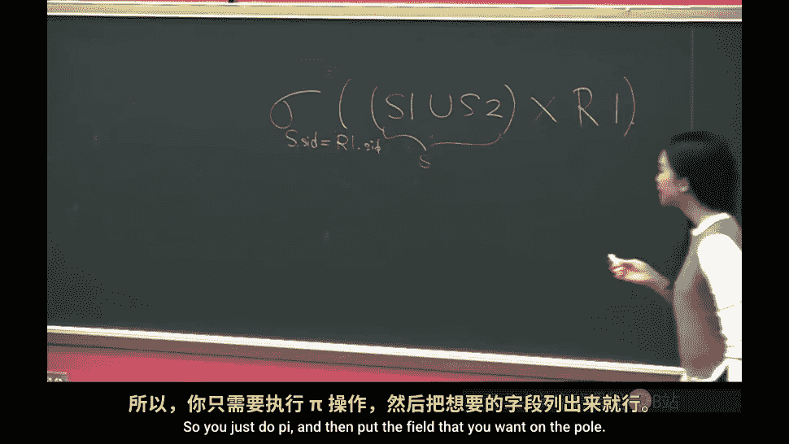
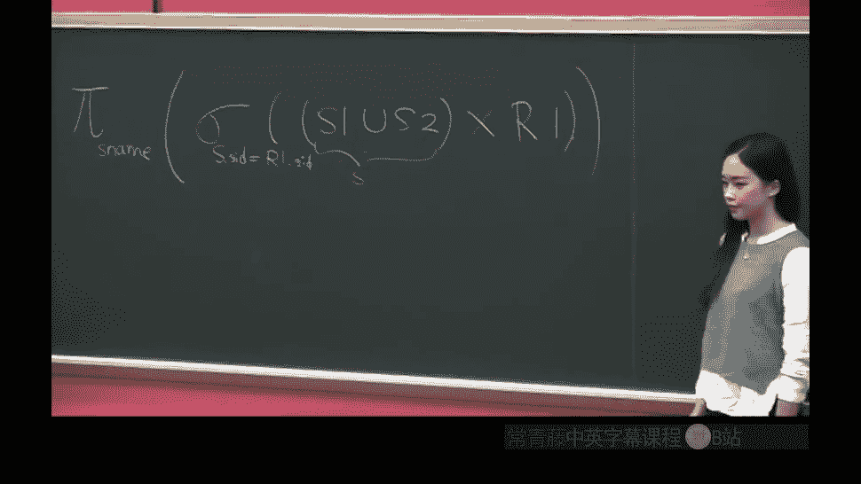

# 宾夕法尼亚州立大学【中英⚡数据库管理系统｜CMPSC431 Fall 2015, Database Management Systems】 p08 P9 关系代数 - 第1部分 -BV1N76CBwEXb_p8-

Good morning guys。Before we get started， do you have any question regarding through the project？

Like for the document。おし。Okay， so one thing I want to talk about for the presentation。

 even though I listed a team can present for four minutes， but then I figure we have 13 teams。

So can we do it in- oh no， I say five minutes， but can we do it in four？Is it too short。

 The sure iss good。Okay， so we're do it in full， even though I kind of found out。

Next class will not be here。めそういうのの風かで。我す。Yeah。Yeah。

 also on the course website I listed the content that you should try to include don't get into too much detail。

That just four minute。Yeah， and make sure you submit the slides the night before so I can compile them。

Okay， so things we will do today。嗯。I will review the exercise。安すい？

Remember the last time we had like a bigger year diagram and I asked you to think about how you will create that through the SQL command。

嗯。And then I'll talk about the very last concept in chapter three， just really quickly。

 like one minute。It's called a beer， if you remember that's the most external level of the abstraction。

Our database management assistant。And then before we get into chapter4， we will have。The quiz。

 as I kind of hinted last time， so before we get into quiz， you can ask any questions regarding to。😊。

八く？Ha anyoneone thought about this？After last lecture。Like how you will create。

Tables through SQL commands for this design。嗯。Does anyone remember last time we discussed about how many tables that we finalized and we want to create？

喂。Which do。我れで。Yeah， we we want to create employees。

 policies and beneficiaries that along with dependences right， so why do we need purchase？

So let's start from here， what does this mean， the thick line with arrow。好食。Exact one， right。

 so this is saying for a policy， it has exact one employee purchased it。

So the reason we don't need another table for the purchaser。

Is because by just identifying the policy， we actually know which employee it is。

 because we have exact one。Okay， so whenever you see this。

 you know you can kind of merge them together。You don't need another table for to purchase a relationship and same reason for dependent is the weak entity。

 So it already has this。Key constraint plus participation constraint right here， so we it together。

Yeah。没意见。野てね。Oh yeah， again， yeah， I don't know。 that that should be a dash。😊，The point。So。

Let's start from the dependence table。Okay， so we know dependent is a weak entity and all these are simple。

 you need to create the attributes for that。So what should the primary key for dependent be。

It weak entity， so how should we identify？Weend。あれて。Yeah。

 so you will want to identify that with the partial key。Of the weak。

 along with the primary key of the identifying owner。Co。

 so what we will put right here is the name in the policy ID。Name of the。ああ、も一件出て。Okay。

 so right here， I say we have foreign key it's referencing to the policy entity set。

 so what will the foreign key be？So let's say we want to create a table for。The weak entity。

 including dependents and beneficiaries， we want to have a foreign key that references to the policy。

 what would the foreign key be？け定。好点。Because we want to know which policy it is refercing to。

So this might be a little bit trickier for here you need to add one more constraint you want to think about when we delete the policy。

The dependents also disappear。So what should this be on？I do。

So here is a really good example of how you want to create table when it's a weak entity and SQL comment。

 Okay， remember that you might need to use that in， all right。Okay， here。I's a little bit different。

I forgot to talk about it。So here we want to create the table for policies。

But obviously we need the policy ID and the cost。And why do we need the SS？The employee right。

 so we only have exact one purchases， so we just directly merge it into here using the assistant。

And last time， I didn't。Put emphasis on here， you actually need to put not no。After SSN。

Anyone know why？就是。Because you have to have an employee because this not nu is due to the participation and constraint。

Okay， so it's at least one。 So you cannot have that accent。

 And another reason for having to need this is because we didn't include SN。Into the primary key。

Okay， so you need the not know。 primarym key by default cannot be known。Okay。

 so now we also know the foreign key is SSN is referencing to employees。What should this be。

Underly cascaine or。It cacake。外呢。好意思。おつか？Yeah， and also， yeah。Okay。

 so here the logic will be if we delete the employee。

 the policy with it doesn't have to exist anymore， and another reason to think of it is because we talked about it before we wanted to delete an employee and the dependence would go away so the whole thing kind of come next together yeah。

scenario that same employee。嗯应该。It like I assume that the SSN be needs like a primary。

I guess you can。Either。Randomly generate a unique。Number for that。

 because when I first came to America， I don't have it， it says Anita。

 but I think the back end mechanism must have some sort of way of dealing with it。Yeah。

Or I think maybe in real life， they will just generate like a random sequence of numbers for every register user。

Okay。Any question on this？Now I want to put emphasis on this last time weak entity。

 you want to identify that with the partial key of the weak entity and the primary key of the identifying owner。

 this pop okay the second part you want to note that when you delete that you want to do undlete cascade。

 right， because when the policy is gone， dependence is gone。哎。

So a very quick concept at the end of chapter three is viewed。

 so we talked about creating tables that will actually get stored in the database。

But a lot of times you show things on the front end you use view and actually you don't show all of the things that you actually saw in the database for example。

 I think this is a kind of lame example， but I'll just talk about it anyway。

 for example you want to show maybe on your web page that linked to the database。

 you want to show a table that show all of the students that have grade B。

So you can define this view with this keyword view and you call it the B student and you will talk about okay later I will have name student ID0 and course and how you're going to do that is just to view in us exact same SQL command you will do request to query the data from the database here I'm missing a。

え。Okay， so this is how you can use it so it can be used to present necessary information while hiding details in underlying relations Anyone can think about any scenarios that you will use this。

Yeah。But you have。personersons made of birth。Yeah， exactly。嗯。Actually， when you do the S。Select。

 then you can do some kind of computation right there actually， yeah， that's a good。

So you don't actually- so that would be a perfect example of you don't actually have to store the age information in the database。

 but you complete it as a。Okay， any other question for？嗯。やer three。Andき。So for。

Her relation you can have。AMip candidate key。In。For a candidate key。

It cannot have a subset that be that can be a unique key。And one of the candidate he can be primary。

奥了曼。什么意思？So we need to find in the SQL command， we do primary key， specifying the primary key。

 but when we do unique。And we can have a couple of different fields， and that's the candidate。

嗰得 last水。Which one。This one。Oh yeah， because we were talking about。

 then this is based on the design right， because when the employee is gone。

 you want a policy to be gone。那没什么 sense。I not like you believe the policy table。そ我。Oh， so yeah。

 when you think about this， this is saying for the policy table if you。

Don't delete on the one you are referencing。Instead of saying if I do delete on policy。Okay。

 so you want to make sure you know， this delete is saying the table you reference this to。Yeah。Okay。

こい。Department。You mentioned last to。It way。じゃ呃ちゃ是。Oh， last time I manage。いや、こしす。Mage was， also。

Exact one。It also that。I that one with know。好。那 last time。Oh。

 last time I think we put the department and management。Or is it just manages relationships？So。

 if we。Icade the whole department。時間？That if we do。But we cannot believe。这块。But practically。

 I think it makes sense， you can delete the policy。To independent， but leading the department。也许。て早。

Make sense。Yeah。All right， just make sure you know everyone。Right now， okay。And put your stuff aside。

ok我。ItJust five minutes。Any empty one in the back？嗯。然不。And you want about these。

You you need more time raise your hand。Okay， pass。这个。Everyone turn it in。Allright， let's get。

I'll find out time to give it back because I found that really time consuming。Okay。

 let's get into chapter4。Chaopt school is relation and algebra。I。For three。

 this is going to go back to a lot more conceptual and theoretical。So。Yeah， for the。

So let's talk about formal relational languages， so there are two mathematical Carran languages like form the faces of real languages。

 for example， SQL that you learned in the last chapter。

 so the two formal mathematical languages that can do it，One is relation to algebra。

And wine is relational calculus， and in this chapter out we will spend most of its time learning relational algebra。

So it's sort of like the theory behind thequeries。So relational algebra is more operational。So。

What you expressed in relation to algebrat is actually saying how you want to do the credit how you want to。

Retrieed information from police。诶。Relational calculus， on the other hand， is very declarative。

So instead of saying how you want to do it。最国はイワ。Okay。

So you're not telling it this is how I want to do interesting in the final result。

And we will spend more time on relationship。诶。So a couple look eliminaries。

A query that we learned like the SQL command， is applied to award。

These apply to a relation instance Okay， so here we will talk about relation instance a lot because for the same type of relation you can have different kind of contexts like a snapshot storing in it and we call it an instance。

just the。Name difference， but you don't have to really worry about it。

 You can just think about query is apply to a table with some companies。So how about the。

 a result of thequa' award？Saying means also our religionist。Okay。So。Here we kind of。

You kind of want to be careful of the pluralurals and the singular。

 so a query can be applied to multiple tables together， multiple relation instances together。

 and every time the result will be one single table， one thing。So here's just some。

Really quick preview of what we will use later we will be using positional versus name field notation so for positional it's saying when I want to refer to a field or an attribute on a table I use the position like the index like I equals to what so we have SID and student name something like that we can say SID is one your name is two okay just the position。

Or we can just stick to what we used before， use the name field notation， so we use the name of。

So here's an example that we'll be using throughout our the chapter。

It's a story about sailors reserving boats okay so they just keep talking about， okay。

 find the sailor who we reserve this boat on what day okay and today we will not get into the boat information so here well just use the sailors in reserve。

😊，嗯。So you can see here that we have two instances for Solus， one is we call the S1， one is S2。

 so even though they all have the same schema， they're all about the cells。

 okay they actually have different contents in there。So this is S 1， This is S 2。

 And that is an instance for reserves。Okay so for reserves。

 you can see this ID here is the seller ID reserving boat with boat ID right here on what day。Okay。

 so that's just the information we'll be using and the partd that underlying right here are。あでき theパ。

so for relational algebra， prairies in algebra are composed using a collection of operators。

So operators can be urary or binary。As you can imagine， urinary means we only take one argument。

 binary， we take two。So every operator in the algebra accepts one。

 two binaryary or binary relation instances or arguments and returns a relation instance as a result。

So that's why we say on the cr。Okay， now that's why we say the result is always like a single thing。

So I want to talk about a couple of the operators that you'll be using a lot。

The first one is selection。So selection， we use sigma， this is small sigma to denote that。

 So selection select subset of rows from a relation。 for example， right here， we have sigma。

You put a criteria or a condition in the subscript and which table you want to apply on。Okay。So。

Selection is it urary or binary。Uary because we only apply on one table， okay。

 so it's an unary operator。And here， what we are saying is we want to select from S2 instance。

 You can keep referring back to the slide where we have the complete table。

 We want to select from the S2 instance where the sellers have rating greater than8。Okay。

 so then this will return the rows that satisfy the condition。So observe this in。

Has the schema changed？From S2。Stays the same， right， So for a selection。

 if you simply use the selection operator， input and output has the same schema。

Okay you just saying which row I want to select， not saying which field。

 so here I say schema of the result of a selection equals the schema of the inputrelation。

So first selection。We have the sub of as the selection condition， right。

 So selection condition is a bowling combination of terms that have the forms。

 We can have terms having attribute with。Comparison operator comparing against a constant。

 like a number or whatever string you want to compare and another one is attribute。

 comparison operator with attribute。So what I mean by comparison operators， these we all know， right。

 greater than larger than greater equal to or not equal。

So we want we say selection condition is a bullying combination of terms。

 When we say bullying combination， what do you think will be the one combining the terms？

So what are the most simple tubes？In and over， so we use this。I'm sure you willt know。This one's。

And now it's all， okay。So the reference to an attribute can be either。By physician or by name。

So later on， when you want to refer。By a position， you will just use the index of the field and if you want to use the name。

Okay， so the reason we have dot。Here。Its because you can put the variable name of the table。

 remember we say student is S， so you can put S。That I sing here is stunning。

But when you are only working on one table， then you might not need to assign a variable。

Is there any problem for selection？Pretty straightforward right， just selecting the row that's fine。

And the next one is projection。Projection， on the other hand。

 is talking about this vertical direction， so projections delete the unwanted columns from a relation you only keep the ones you specify to keep so for projection we use Pi。

To denote that。 And also on Sub， we， we put the fields that we want to keep。

 So here is not conditioned anymore。 We just simply list the fields you want to keep， okay。

And apply it on the table， so is it urary or binaryary？In okay so for this one。

 we're saying same on the S2 instance， this time we want to directly just keep the S and ratinging。

 so we keep all of the rows， but this time only two columns。So we can see the other fields。

 we can just simply think of them as predicted of。我想。Oh， it's unsy。Yeah， so that's the Yeah。

 if you kind of lose track， slide8 is the example we keep referring back to。So youre actually。生造？

Yeahやや yeah。So that's my projection。A little bit more rejectionion。

So we want to remember we say the duplicates are eliminateinated it。

What do you think will be the result when we do this？嗯。So we will have the each column。Where。

 how many rows？For。If we remove the difference。 we we remove the duplicatet， you only got two。

I think this is one of the two tables I'll have you to draw because it's small enough。

The other one I still big I was like no。Okay， so。Theoretically。

 you want to remove the duplicateus because remember relations， the definition of relation。

 it's sets of totals。😊，So when we talk about set， we don't allow duplicates， okay？

But you realize life， you do try this out in My SQL that you just learned。

When you learn how to translate the relational algebra to my SQL comment。

 you'll see it will still keep the duplicate， so theoretically， the。

So now we learn selection and prediction， we can actually combine them together。睇。

So we can combine saying。We want to select。Yeah， we want to select the sellers whose rating are greater than eight。

 but we only want to know their name and the rating information。So if we do this。

Relation and algebra， what do you think will be returned？If type the table at slide eight。

 what do you think the results should？What's the size， What time it's what。出帯して。

At least for this it's simple， like we already know we want the ethnic name and rating we know on this direction。

 we have two columns for sure。Then this direction， just think about how many rows will be left。

It's a two times two table and it looks like this。哎。If you look at the S2 on slide8。

 we will have S name and rating with these two sellers because the ratings are。Greater than。

So if you look at that relational algebra， what do you think will be the order that we apply the operator？

Which first。Seelection first， wise thing？Yeah， because we put that in the core emphasis。

 so when you think about the order。Selection。In the inner part of the parenthesis will actually be applied first。

Then this pipe itself already generated a table running。Then this takes as an input。

For the projection。So the order will be selection first and in project。So essentially。

 the operator is going generate。Exact。退行ま言て。No， yeah， it does not manipulate the original one。

It actually creates a copy。For that， okay， so it won't affect the original data。いこれ。

That's for selection。えこしなら。We'll move on to the couple of set operations。The first one is union。Okay。

 as you all know， union， we use this symbol to denote that。

The union returns a relation instance containing all topples that occurred in either relation instance R or relation instance book。

Just take them off。R and S must be union compatible。

 what we mean by union compatible is that first of all， RNS has to have the same number of fields。

 okay， secondly， the corresponding field have the same domain。So essentially。

 these two things are just saying they have the same schema。So we' talking about union。

If you look at slide8， we can do union on S1 and S2， but can we do union on S1 and R1？No。

 it's because they are actually different schema， so you cannot just do union on it。So an example。

I won't ask you to draw for union S1 and S2， which is take the two tables and put all of the rows together。

 take out the duplicates， and this is the result of union of S1 and S2。S for it。So we have union。

 what is the other operation you think we will talk about？Interception。哎。

So we have in the and we have。Intersection the other direction this way。

 so if we take the intersection of R andS， it returns the relation into containing old tu those that occur in both R andS okay so we all know that。

嗯。And also， it will be very intuitive to think about if it's intersection。

 the relations should be union compens as well。We just call union compact code。

 but you can also think about it as intersection compatible。政の。I mean。

 every field needs to be exactly the same。All of them。Yeah， because as you see。

 like they actually merge together and then this them all in the same table。

 So the result still follows the same sma。嗯。So this will be the intersection of S1 and S2。

 makes sense。So these two rows both exist in as one instance in a students。Okay。

After union and intersection， we want to talk about difference。

So set can take difference if we want to do R。hiI'll call the minus R minus S。

So what do you think it will return a relation instance containing all topples that occur？嗯ね。

In urban readiness。So this is a the trick here， so the orders actually matters。

 sometimes people will think。Because kind of intuitively。

 you would think oh set difference might be just the union part taking out the intersection。

 so that's the part。We do。And normally when we talk about sets， we talk about。We like this， right？

This is art。And this is。So a lot of times people would just think oh set difference might be just these two big parts。

Well that's not the case， right？So be careful of that， so if we swap into saying s minus r。

 then it returns all toples that occur in S。Right。Same， the relations must be union compatible。

So if we do S1 taking difference on S2， then this one will be returned， so this row exists in S1。

 but on S2。So that's for set difference。The last one that we want to talk about is the cross part。

So crash product。It returns to relation instance whose schema contains all of the fields of R followed by all of the fields of F。

Sort of confusing， but if you think about theirs， do you think it has to be union compatible？

If we just simply take all of the films together， then we don't have to。给。嗯。

So RNS don't have to be unitcomp when we are doing cross product。

And you can simply write the result of our crash product S in this form。

 this will be the definition for that。So you can think of it as this kind of familiar right。

 we talked about this before， but here we say we use this。Let's say bracket， bracket。To denote tops。

 and here we put R common S is because we want to say R， then concatenate with the content in S。

And all of the R exists in the upper K R， All of the small AS exist in uppercase。

And curly Bras means。Set。And here， because we actually allow all of the fields to be together and they're concatenate together。

 so you want to be careful the naming conflict might appear because sometimes in R。

 there might be a field that has the same name as the oneiness。

So we will talk about how to deal with that next time。You call the rename。So。Next slide is。

The one I don't want you to draw at all， this is the result when you take product of S1 and R1。Okay。

 so as you can see， all the way until H is from Sala and the last three columns are from reserves。

And here you can just kind of think about the just。

You just double them up and then keep cycling those parties。

To do all the possible combinations between the two。Nickthan。Okay。

 so we actually still have 10 minutes left。I have a question for you today。

 let's just try to step spend more time on this。Okay。

 so I want you to ride the relation of algebrabra to find the sailor's names who reserved both with BID close to 101。

点解对。One more minute， and we can work on it together。对。保护过题。あ。嗯。家我啊。我来看看。Okay。I。Yeah。

 so you will have to。以知后。就一。标明。what你嘅声。好会痛。出ている。Yeah。弁護し。어。How work through that？I worked on the。最工。

O。So what would be the first thing you think you will do do we actually so I think it will be tempting to look at the table and see hmm the one or reserving BID equal to 101 is 22 so I just take 1 22 but actually when you put the relation out you should assume you won't know the SID is equal to 22 right？

So we know 22 only exists in， is it S1 or S2？That's one so we actually don't know where 22 is。

So should you take both。So if you want to take both， what would you do？Union， so first thing first。

 we take the union。Oh， there's one， too。

Okay， so now we have for this， it gives us a table of the information that all of the cells in S1 and S2。

What next， we want to see how this will work with the reservation。😔。

So what is the one that can allow us to combine two tables that have this different schema？

Chrisre product。So we do crush part。

So this will be like a humongous table。Of all of the stilliller information cross product。

Reservation information。How can we know？嗯。Where。Like the reservation is by that。Seller。

How do we do that。Which。How do I say。Which operator gives you the ability to put a condition？

Selecting。So okay， say we know we want to be select， but what condition would we want to do？で、すね。

When they have the same S ID， Okay， so this creates a problem， as we said before。

 Like we want to identify when they have the same S ID， but then both have S IDs。

 We don't know which ones which。 So let's just assume。

I'll talk about this part next time， but let's such assume we call when this got Nian we call it S。

 and that one still called part of one。Okay， so we want to select the condition where。SID。From the S。

It's equal to SID。From R one。So from here you create a super big table and here you just take out the rows that satisfy this。

Okay。Finally， the easiest path makes last step。I want the name only。😔，Pricition。诶。

Can you just do。And then put the fuel that you want。航悟空。

Yeah。Okay。要可见。A not。Yeah， okay。Okay， so yeah， that's a good one。

 if I don't put the boat ID equals to 101， this will just give us all of the names of the sailor who have reserved votes。

Yeah， good， so we have to put where our one。有啲。Thank you。あ方は？非なや。Yeah。

 you could just keep connecting them， so the whole thing is still considerably bullying。Expression。

 you can keep concatetinating them， You can even do this in it or。

So there's one pod that we can actually make the whole table that in intermediately in the process of it smaller。

Because if we do the whole thing from S1 Union S2 and the press credit R1。

 it's going to be super big。If we move one of the condition。边チ the咩度。

It will make the intermediate table a bit smaller and on sea we。Yeah， so you can actually do it here。

If you don't want to do that， because we already know we want the boat ID that's equal to 101。

So you can also do it here when you just select。啊。啊。TheBID。Equs to 101。So then this pot。

 taking part of with that pot， would just have one row in。So the intermediate step is a bit small。

It will ignore that focus。And I'll talk through this tip again。Okay so S1 union S2。

 first step we think about is to give you all of the students in both instances。

 okay take the product with R one so then we get the reserve information working together with the cellular information。

Then we select where the SID are equal， so we get the road that where the sailors have reserved both before。

 and we only want the reservation information where the boat ID is going to。Finally。

 take the solar thing。Okay， a couple of things before you go。

 don't forget a presentation this Friday， okay I list all those things on there if you want to do some readings。

Yeah。Section 1 to section 2 in Cha 4。Do you on Wednesday say。

