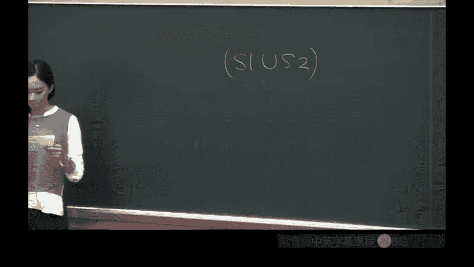
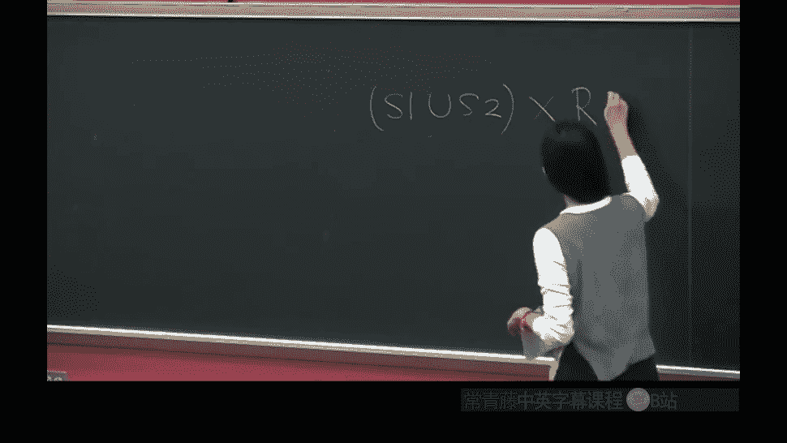
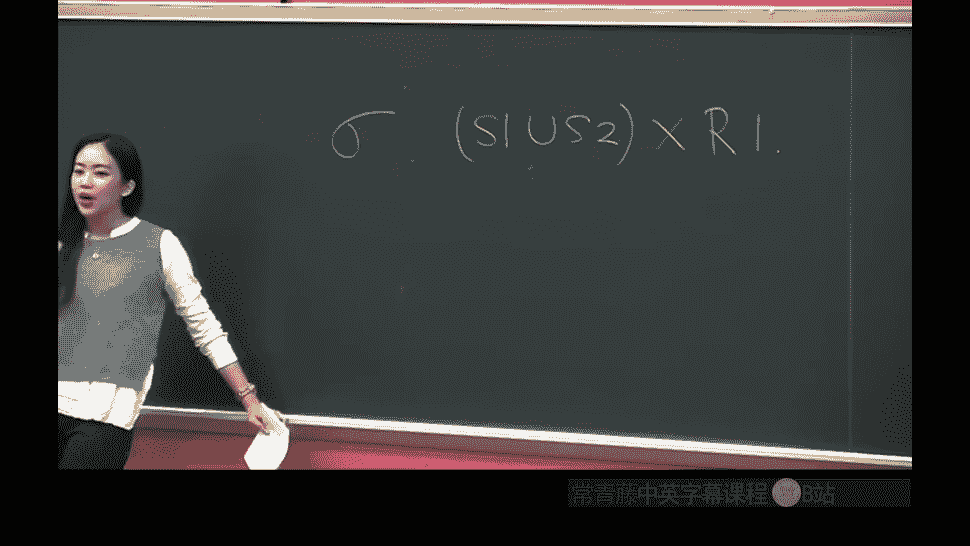
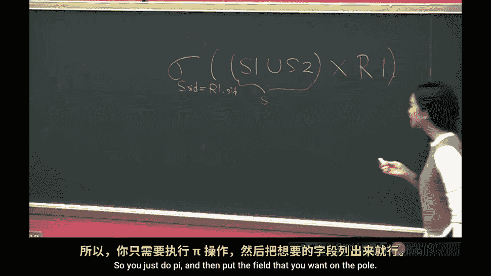
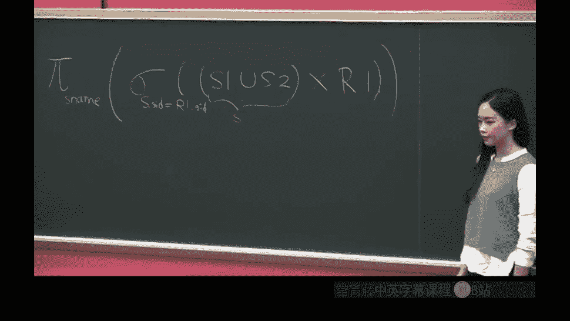

# 数据库管理系统：第4章：关系代数 - 第1部分

在本节课中，我们将要学习关系代数的基本概念和核心操作符。关系代数是SQL等查询语言的理论基础，它提供了一种形式化的方法来描述如何从数据库中检索和操作数据。我们将从几个基本操作符开始，并通过实例来理解它们如何工作。

---

## 回顾与课程安排

上一节课我们讨论了如何根据ER图设计来创建SQL表。本节中，我们将快速回顾一个练习，并结束第三章关于“视图”的最后概念，然后进入第四章的核心内容——关系代数。

以下是关于上节课ER图练习的要点总结：
*   **弱实体的处理**：对于像`dependent`这样的弱实体，其主键应由其自身部分键和其标识所有者（如`policy`）的主键共同组成。例如：`PRIMARY KEY (name, policy_id)`。
*   **外键约束**：在弱实体的表中，需要设置引用所有者表的外键，并通常使用`ON DELETE CASCADE`，以确保所有者被删除时，弱实体也随之删除。
*   **合并关系**：对于“一对一”或“多对一”且具有完全参与约束的关系（如图中的`purchases`），其属性可以直接合并到实体表中，无需创建单独的关系表。

## 视图：概念简介

在深入关系代数之前，我们简要介绍第三章的最后一个概念：视图。

视图是一种虚拟表，其内容由查询定义。它不存储数据，而是基于一个或多个底层表（称为基表）的查询结果。视图可以用于简化复杂查询、提供数据安全性（例如隐藏敏感列）或计算派生数据。

创建视图的基本SQL语法如下：
```sql
CREATE VIEW view_name AS
SELECT column1, column2, ...
FROM table_name
WHERE condition;
```
例如，创建一个只显示成绩为B的学生的视图：
```sql
CREATE VIEW B_students AS
SELECT name, student_id, course
FROM students
WHERE grade = 'B';
```

---

## 关系代数导论

现在，我们正式进入第四章。关系代数和关系演算是两种形式化的关系查询语言。关系代数是一种**过程性**语言，它指定了查询执行的详细步骤（即“如何”获取数据）。相比之下，关系演算是**声明性**的，它只描述所需结果的条件（即“要什么”）。本章我们将重点学习关系代数。

在关系代数中：
*   **查询**应用于**关系实例**（即某个时刻表中的具体数据）。
*   查询的结果始终是一个新的**关系实例**（即一张新表）。
*   操作由一系列**操作符**构成，这些操作符接受一个或两个关系实例作为输入，并产生一个新的关系实例作为输出。

我们将使用一个关于水手预订船只的数据库示例。主要涉及两个关系模式：
*   **Sailors(sid, sname, rating, age)**
*   **Reserves(sid, bid, day)**

---

## 核心操作符

### 选择 (Selection)

选择操作符（σ）用于从关系中**水平地**筛选出满足特定条件的元组（行）。它是一个一元操作符。

**公式**：`σ_condition (R)`
*   `condition` 是一个布尔表达式，可以包含属性与常量的比较，或属性与属性的比较。
*   结果的关系模式与输入关系`R`的模式完全相同。

**示例**：从水手表`S2`中选出评级（rating）大于8的水手。
`σ_(rating > 8) (S2)`

### 投影 (Projection)

投影操作符（π）用于从关系中**垂直地**筛选出指定的属性（列），并去除重复的元组。它也是一元操作符。

**公式**：`π_attribute_list (R)`
*   `attribute_list` 指定要保留的属性列表。
*   结果的关系模式仅包含列表中指定的属性。

**示例**：获取所有水手的姓名和评级。
`π_(sname, rating) (S2)`

### 操作符的组合

选择与投影可以组合使用，形成更复杂的查询。运算顺序遵循从内到外的原则。

**示例**：找出评级大于8的水手的姓名和评级。
`π_(sname, rating) ( σ_(rating > 8) (S2) )`
该表达式首先执行选择操作（σ），然后对结果执行投影操作（π）。

---

## 集合操作符

以下操作符要求参与运算的两个关系是“并兼容”的，即它们具有相同数量的属性，且对应的属性域相同。

### 并集 (Union)

并集操作符（∪）返回出现在关系R**或**关系S中的所有元组，并自动去重。

**公式**：`R ∪ S`

### 交集 (Intersection)

交集操作符（∩）返回同时出现在关系R**和**关系S中的所有元组。

**公式**：`R ∩ S`

### 差集 (Set Difference)

差集操作符（-）返回出现在关系R中但**不**出现在关系S中的元组。**顺序很重要**。

**公式**：`R - S`

---

## 笛卡尔积与综合示例

### 笛卡尔积 (Cross Product)

笛卡尔积（×）返回两个关系所有可能的元组组合。它不要求关系并兼容。结果关系的模式是R的所有属性后接S的所有属性。

**公式**：`R × S`
如果R有m个元组，S有n个元组，则结果有m*n个元组。需要注意属性名可能冲突的问题。

### 综合查询示例


让我们运用以上操作符，构建一个查询：“找出预订了BID为101的船只的所有水手的姓名”。





**思路分析**：
1.  首先，我们需要所有水手的信息。水手数据可能分布在多个实例（如`S1`和`S2`）中，因此第一步是取并集：`Sailors_All = S1 ∪ S2`。
2.  为了将水手信息与预订信息关联，我们需要进行笛卡尔积：`Temp1 = Sailors_All × Reserves`。
3.  从上一步得到的庞大组合中，筛选出实际有效的预订记录，即水手ID匹配的记录：`Temp2 = σ_(Sailors_All.sid = Reserves.sid) (Temp1)`。
4.  进一步筛选出船只ID为101的预订记录：`Temp3 = σ_(bid=101) (Temp2)`。
5.  最后，从结果中投影出水手的姓名：`Result = π_(sname) (Temp3)`。

**整合的关系代数表达式**：
`π_(sname) ( σ_(bid=101) ( σ_(Sailors_All.sid = Reserves.sid) ( (S1 ∪ S2) × Reserves ) ) )`



为了优化，可以将对`bid`的选择条件提前，以减少中间结果的规模：
`π_(sname) ( σ_(Sailors_All.sid = Reserves.sid ∧ bid=101) ( (S1 ∪ S2) × Reserves ) )`





---

## 总结

本节课中我们一起学习了关系代数的基本框架和核心操作符。
*   我们了解了关系代数作为过程性查询语言的角色。
*   我们掌握了四个关键的基本操作符：**选择（σ）**、**投影（π）**、**并集（∪）**、**交集（∩）**、**差集（-）** 和 **笛卡尔积（×）**。
*   我们通过一个综合示例，演示了如何将这些操作符组合起来，以表达一个完整的查询意图。

理解这些操作符是学习更复杂的关系代数操作和后续理解SQL查询执行的基础。下节课我们将继续学习重命名、连接等高级操作符。