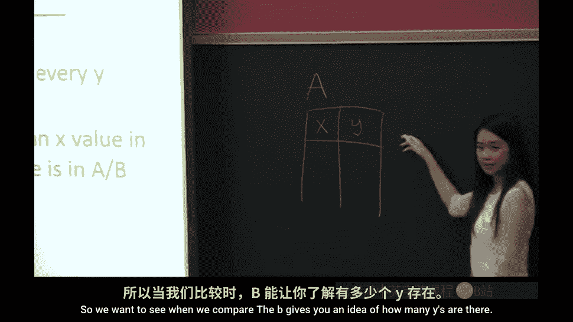
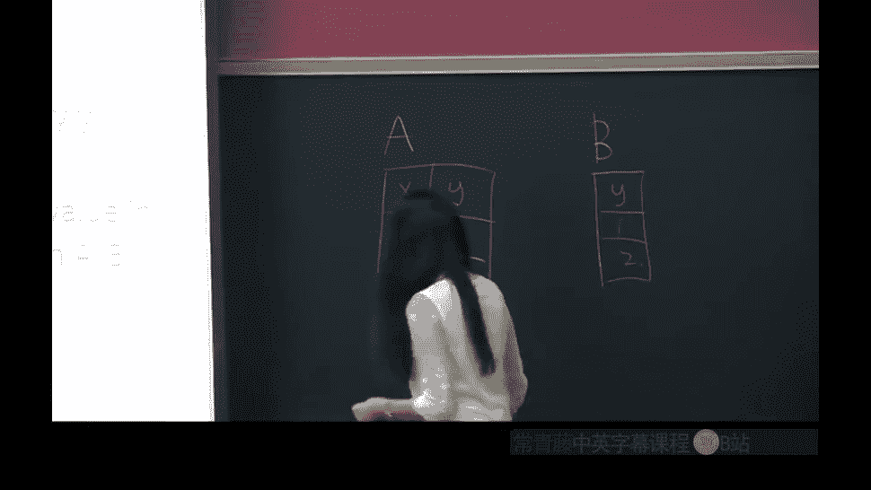
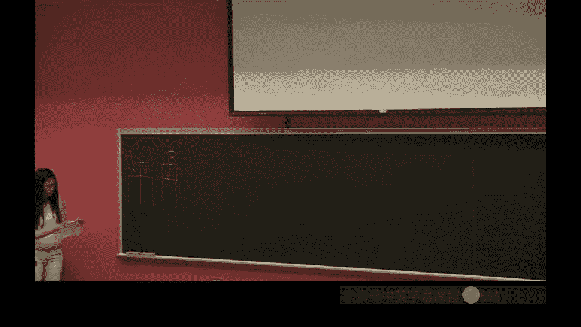
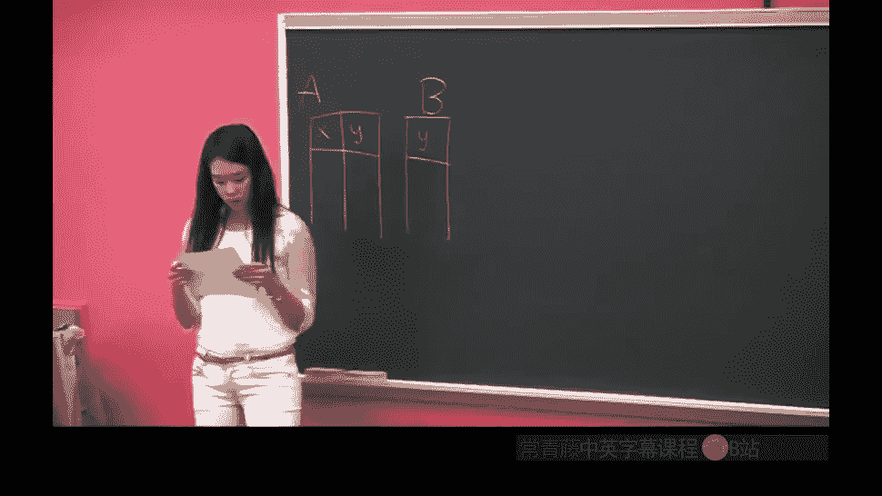
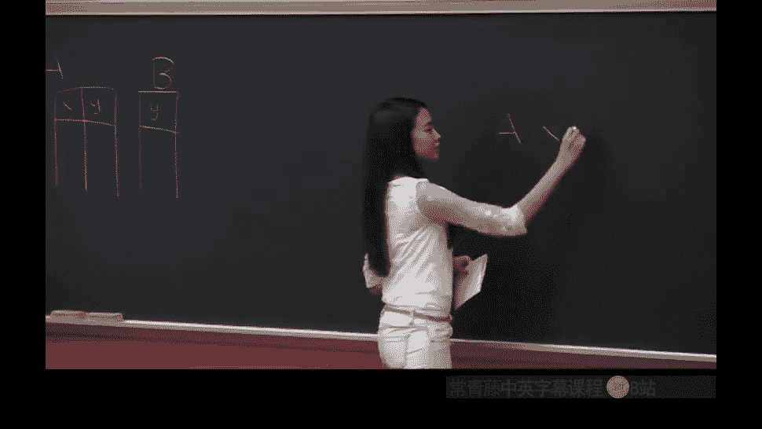
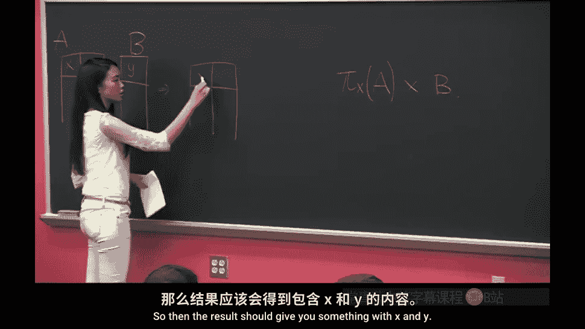

# 宾夕法尼亚州立大学【中英⚡数据库管理系统｜CMPSC431 Fall 2015, Database Management Systems】 p09 P10 关系代数 - 第3部分 -BV1N76CBwEXb_p9-

没。Okay， good morning， guys。啊。

So I didn't sleep much last night。Today。Second what I say。嗯。So for the project。

 you guys don't know you'll be presenting it on Friday， right？So I just want to remind you guys。

 I'm not sure whether everyone knows I've talked about。You will have to propose two extra。

Is that in screen。Okay， and I'll just assume。Doも do two extra。差多。So today， we'll continue the。

Relationgional， relational。last time。These are the couple of operators we learned from last thing。So。

These are more like the basic ones。The first one is selection， so we use Sigma to den that。

Anyone can tell me what the selection should be？我れと个。Select rows based on the condition you' given。

To the silicon。系。The second one is projection， so we use pi to know that， what does projection do？

So if selection can。Fel dough rose out of prediction。The other direction。

So projection you can specify。The field you want to keep。So that's to which out columns。

So that's selection of prediction。How about you mean we take the relation R？When Re S。

 we seeking union of？Then the results would have worked。Like the coupleples that are。In either R or。

How about intersection？If it's intersection， then the tus in the result will have to be。

I mean you are。Correct。Okay， the next one is set different。

 So if we take a set difference between R and S， we say R taking a set different。OnS。

What are the results？And I just， I felt everyone sleeping， come on， my god。So if we take our。

 a set difference on S， the we little tuple。Are the ones in our？But not in thisす。原了。Okay。

 how about cross credit？Maybe we take cars product between RMSs。一応それ。It gives you a big table。

That combines all the possible combination of tuples between irons。Okay。

 so just talk through what each of them do， so which are urary and which are binary？時。Okay。Yeah。

 so selection and prediction are inary because they only apply on one relation。And the other。

 the risks are fine because they will have。One relation are right inside side。

 one right on left side。So。Which operator need the relations involved to be union compatible？

Do you remember what it means？Union compatibles mean basically the schema has to be the same。

 So the input is。Then which operators would need that？Interaction。You mean。

 how about that difference？So three of them。These three。

 you need to have the input2 relations having the same thing。So。

Which operators will give you the input and the output same thing？Conviction。Oh yeah。

 so which operators were you giving the input？Either it's one relation or multiple。

 the result will have the same。好定。这し。Projection is the one selecting column。

So that might change the sche I， so selection， I already know it will keep it if you don't apply for on it。

How about the risk？有で。Yeah， union intersection and said difference。

They will all give you the same thing。Okay last question。Which operator。

 the order you put the relationship？Maters。ち这。Yeah。

 set difference right because set difference is when you take the set difference between R and S。

 if you put r minus S， the result is the coupleples in Rity in S。If you swap it。

 then the result would be in this。Okay， so last time。We did an example on this， and on a slide。

 I made the same mistake as last time like I pointed out， so I didn't put E IDD supposed to be 101。

So put that in great， don't forget to correct that。

Last night we did that at the very end of the lecture。

 so we were basically trying to find the sailors' names who reserved both with VID 101。

But I didn't talk through how at each step the table will actually look like。

 so I want to spend a little time today to talk about that。

So if we just basically look at this answer right here。

 we know like the first thing we do is the the most inner part of the parenthesis， right。

 So the first thing we do when we did the。Union between。Instance S1 for Saor and instant S2 for Saor。

 that gives us all of the sailors in this one and S2。 That's what union does。

 And why did we take a cross product between。This and the reserve table。

Why would we want to take cross for that？嗯。Yeah， because now we have the cellular table okay。

 that we union them together， if you take a press product。

 then they will be in something get associated with each other into a big table。Okay。

 so that's that for that pot。And here we did selection。

So we only keep the rows where the ACIDs match because when it doesn't match， actually it's useless。

 so we only take the one that match。And then according to that， this one。

 so we only take the one with boat ID 101。Okay， that's for selection。

 so that gives you the rows that you want。So why did we finally do that？Yeah。

 because we ask for the name， right， we find the sailor's name。

 so you only do projection to return the desired fields。Now go over the table step set。

So this is what's going to happen first。Okay， so the first thing is we take the union between this one and S2。

 so this gives you the topfls that are either in this one or S2 Okay so that's the result for the first step The second step is the big curse product。

So it take- you can refer to the previous slide for the table。

 so it will take the crush product between this one and the R1 table。So as you can see。

 how we will write it here is because for reservation， we have two rows in total。

 so you kind of just double every single one coupleple from here and then cycle through。第二个。

So that's what's going to happen for a crash product。

 So I want to take a really quick note on crash product。 if we say this is kind of tiny。

 but because you can see on your slide if we say a taking crash product with D gives us the results C。

What's the cardinality of the， Remember which direction is cardinality？Number of ropes。

So what were the number of rows of CB？Yeah， the number of rows of A times number row。

So that's the two carinology。快点。That's for the cardinality， and you can figure out what's the degree。

you look at how many fields。The result has。Just a summary， you just plus two。这简单。

But that's her degree。So just remember when you take a cross product between。

The table is the final result is actually。The product of the cardinality。Times。

The sum of the degree that big。So that's the second step， now we got that。In the third step。

 we filter out the rows we don't want， I made a mistake here again。

 but you can refer to the previous one， so we only keep those。Oh yeah， I made a wrong。

 we only keep those we want， here is different from the previous one。

So we actually just want to keep the BID that's 101。So supposedly we shouldn't have。It's true。

But here， anyway， if you follow this， the selection， juredging by the criteria。

 we only leave the rows that satisfy that， so we only leave these because the SIs aret the same。

Right，啲。And finally， the final result， we only the， but we do the projection on only S。

That's what we got。So right here at step three。As you can see， there is a problem occur because。

When information comes from the sailor table and the reserve table， they both have。SID。

So here I actually just assume that we will call them I or R1 so you know where they're from。

But when you really need to write them in relation to algebra。

 this is where we face the naming conflict， so this is why we mean。Rename。

OkaySo here I put the example again， I don't know why I did that。

There's already example previous this slide。Anyway。

 just make sure you can refer to know what data we were talking about。So， yeah，s like6。

Here's where we need renameing okay。Mainly， we have two reasons for reing。

 the first one in as I've said。It's because we want to resolve the conflict。

A lot of times after a student step at the result intermediatemedia result。

 you will have the names from different relations that are the same。By using renaming。

 we can know which field that with the same name is actually from which relation。

Okay so here's an example， the result of S1， taking course credit with R1 there are two fields with the same name as I。

So later， I'll show you how we can do we need。Another reason is actually we can break large expressions into smaller ones。

So we can give names to the result of subextions， for example， right here。

 this bigger relational algebra we did earlier， it's pretty convoluted that you have so many parentheses in between so you can actually break them down like when you write how you will want to write this at the first line and then assign them to some variable so renaming is actually the exact thing。

So you just break them down and have a clear idea。😔，我不确定。So how are we going to do remain？

This is the syntax。Forign name。For F， this actually is an overline。

 but somehow they can overlap together， but there's an overline。According to definition。

So for remaining， we use。The symbol road。This one。Okay， did you note remaining。

And right here the E is the relational relational algebra expression。

 so for every relational algebra expression， the result is still a relation so here an input you can still use it just as a simple table。

 you don't need to use it as a relational expression is just when you have relational algebra expression that's when you actually need so the later one。

Is the input？And R is the name of the new relation for result E。So for example， earlier。

 Ie will be S1 P， press product with R1， and you can rename it with something else。

And here is the trickier part， so F with an overline。We call it the renaming list。

 so it's just the reming list you can put the old name saying， so now the new name is this。Okay。

And if they are all having the same name like SID from both S1 and R1， you can just put in S1。

 the SID I want it to become what？Okay， so that's for renaming。

 So remember last time we say to refer to an attribute， you can either use position or the name。

 So sometimes you can also just use the position。 For example， we can do S1 that one。

 then we know it's the first attribute。So that's for re naming。

The field name in R is the same as the E， except for those renamed in。So if you don't specify it。

The your name in a renaing list， then the result would just keep。So let's see how we can do that。

Here's an example。So we want to use the S1 taking current product with our one。So as we know。

 if you look at the previous table that has a lot of field in the result。

 so this would be the schema for the result。We have not done any renaing yet。

 so we just keep the name for now。So as you can see， both have SID。

So then this is where it actually creates the naming conflict。So we want to avoid the situation。

 to avoid confusion， so that's why we will need renaming。Okay， so as I said before， you put here。

After the comma， you put the input of relational algebra。Expression。

 so that's the one we want to do renaing so we put it right here。Into the road。Operator。

And what does this scene mean？Yeah， so then this is the。

Variable now you can say full S1 per product r1， okay， we want to call it C。

So what's within the parenth？Yeah， so these。 so this one and five right here directly refers to this is the position one。

Posion five， we would just directly call it。Okay， and we say we wanted to become SID1 and the fifth fifth field become SID。

So this is what you will get finally， so now you can see both field names change and also here we rename the whole。

Relation。Okay， so I'm here。That's where we need。Any question meaninging。Prety obvious。

So just to prevent any confusion or ambiguity。The next。Operator， I want to talk about today's join。

So there are a couple of different types of joints， so I put joins。Join， we use this symbol。

To den that， I actually don't know how to pronounce that but。 Just remember that one is。

Do you guys know？Is there a name for that？I didn't remember that had the butterfly looking thing。

Jo is one of the most useful operations Yeah I was trying to do that symbol on PowerPoint。

 I couldn't find it but search like this what cool symbol is like they have so many and I couldn't find them because I didn't even know how to do byult by actually looking through the whole and and found it。

😊，So join is one of the most useful operations and most commonly used ways to combine information from two or more relations if you can recall last time we were doing the example。

We want to somehow associate between sellers and reservations。

 so that's why we took the cross product right， took the cross product first。

 and then we actually need to do a selection。Toine where the SID matched。So this thing。

 as you can imagine， is actually done pretty commonly， pretty frequently。

 so if we always do course product first， then selection， course product selection。

So you can just come up with joint that do two steps together。So according to what I just said。

 what is joint equilibrium？What then what。First but。In， sometimes we use。Okay。

 so this is what joins equal。Okay， there。A couple of reasons that you want to use the joint operator。

I said， Jo thank you so much more。But I so often， so we want to just have this useful operation。

The second reason is actually， as we saw before earlier， you field on the cardinality and degree。

 the result of creditparta tend to become very big。So in the intermediate step。

 they will actually get stored that big table， it would get stored， but if you do join。

T can be do together， so after you do the selection， the video table will not be stored。

 so it's just easier and safe。So there are three types of join。

 the first one we call the condition join。So we use the symbol join symbol， and you put a C。

 which is the condition in the subscript。 Then that's how you do the condition join。 Okay。

 so you will join relation R and relation S， based on condition C。So this is actually equal to。

 as I just said， you take the cross product of RN first， and then you do a selection on condition C。

Okay， so those are equivalent。So。The condition is the same as the one we learned in selection。

So it can either refer to religion art religionness。Here's an example that we want to track。

So this is the。Condition join on S1 and R1 where the S1s SID is smaller than R1s SI。Yeah， so that's。

 can you imagine why happened？So actually。In the background。

 they take the cross product of S1 and R1 first。 that's why we have so many infield right。

 the degree is so high， so the degree is a1 S1s degree plus S2 no R1 degree。

Then you simply take the rows that satisfy。So if we only use the operators we learned from last time。

 then you will need to do both press product and selection， but this time you do it in one condition。

So as you can see， the results schema same as that of doing more。Taking a join。

 the result schema is the same as taking a look。嗯哼。Because as we said earlier。

 the first step is to take the correct credit。And that gives you this。Number of degree。

And doing selection actually doesn't change。This game right right。

So that's why we say pretty much the same as that a charge product。So that's the first type of join。

The second one。Yeah， that's a bill the second one。It's used so often that it's just called echocojo。

 there's no space in between。So it's a special case of condition join where the condition contains only equality。

So in the previous one， we said when。We want to keep the rows with the SID from S1 is so smaller than SID from。

打完。But here， aqui jointin is just a special case， so we only say， okay。

 we want to compare SID and as long as it's the same。So you can just write that。

 but this is actually equal to this。But the condition will be when the name is the same。そ在いくった。

If not both as one and R one name it of SID， then you can't just。It could join on。Oh。

So here I made a mistake。The results schema will be similar to the one of Cr product。

 but it only keeps one copy of the field for which equality is specified so actually。Just put。这是。

Cross that out， this won't be you， okay。So if you do Equi join。They would just only keep。

One field that you specify to do the equality comparison。So similar to the credit products。

One feel different。That。Okay， then the very last one。It's not that commonly used。

 it's called an natural joint， so you don't fit any condition。

It's a further special piece of the joint。It compares all the equalities between the field。就系个定明。

But that doesn't happen that often because。Normally， we compare between the primary key。I。

Both table that that might be the only field they have the same name so this idea is just saying。

 okay， we would look for all of the fields that have the same name between the two relations and make sure they are。

一個。So this is an atro。The more commonly used ones will be conscious to joint in。B。

 I might finish earlier today。やな。Great。😊，Okay， the last one。

 the last actually this is the last concept I want to talk about today， but it might take forever。

在那出。It's called vision。O。So division， before we get into what division actually is。Yeah。

 in the following few lectures， our example got a bit bigger and this time we have vote information。

So forget about the previous one now we work on。So if you look at this table。

 what would you do if you want to find the names of the sellers that had reserved all books？😔。

Do you think based on the upgrade？代 you。有利。えてし。A lot of steps。

Anyone has any thoughts of how you would do that？No。With with the idea。how do you make。

The sailor reserve。We want the sellers that- so for the return sellers for each of them。

 you want to make sure they reserve all of the。This is where we need division。

So it's start from easier。So let's say we have Re A。A really be。Assume A only have two fields。

 x and y， and B have only field y。And our goal is to find。X。That associated with all of war。Okay， so。

I can just think of it as this。Can you guys see that from there？No。Okay， I'll draw a copy of it。

One second。就往。A。ま feelで。

嗯。So we want to see when we compare， the B gives you an idea of how many Y are。えも。

And you want to make sure， for example， we don't have want to do。And if you have an A that has an x。

都佢 a。And if you have。Like one or two。全て。Today， you only have a place。同 me的时 with one。えすた。其他时间。

That's what we want to do， so if you want to write in the set definition like we always do with the curley braces is what you would do。

It looks super crazy for now。It's actually pretty simple when you break it down。Okay。

 so according to the definition here， we want to get all of the X。That satisfy the condition。

Where there exists a topple called X， Y。That is in a。So that for each， why。It's in the。But all why。

 all why。Makes sense。So that's a definition for A is taking a division on B。

 so we are finding the x and y that associates with all of the possible y。

 x and a that associated with all of the possible Y。나를 생다。So there are two ways to interpret that。

Firstly， I think it is similar to the one I just said， so it's A taking a division on B。

 the result contains all the x couples， such that for every Y couple in B， there is an XY couple。

Somehow make it more complicated， but second one， if the set of y values associated with an x value。

In a contains all y values in B， the x values is in a8 division B。Okay， so you might think。

 why would we want to use this idea and call it revision？So there's one way of thinking about it。😔。

So you do an analogy on the integer division。Let's say we want to， let's imagine today A and B。

This James， if we take the division。A divided by B， let's just think of it when you're coding。

 so the result is still integerative。So the result should be smaller than the actual insert of a divided by B。

So。When we do that， A divided by B when A and B are broken into just。If the result is Q indicator。

 we want the Q。To be the largest integer such that when u times Q and B。It's still smaller。

This is what we normally do。For in division。 So if you think of it。As our relation instances。

 today we change the concept from integer through rerelation instances on AMMB。

Then A taking a division on B should return you the largest relation instance Q。Such that this was。

So it it means such that when we take a cr product between Q and B。It should still be。一緒？

How will we think about it， Let's go through an example。So then you have a clear idea。

I was supposed to take all them ins or out but God and just print them a lot so you guys have it。

So let's try we have these。A， we have a big A。And three smaller bees。

And I want you to think about why you would get those results when you take division。

So the first one， we take division a divided by B1。What would you do So here we have。

If you only look at it， so this left column in a， you can imagine it as the x。Okay and here is the Y。

Okay。S number。Is X P number。嗯。Stop me if you feel like you're still confused。So right here at the X。

 you can see for a， we have four。Different valuess for it， right？As one， you hear？

It's too long to hear。It's three only here。He has a。So we have four possible values for the x and x。

You want to find the ones that satisfy the requirement where they are associated with all of the ys in B。

 So if we only do the first one， then because it only has one value。OnlyP2。

So whoever have associated with P2。In the A table will be the result。 Okay。

 so let's check the first one。 Does S1 associated with P2。Yeah， here。And how about S S2 as well？

Asssociiate with Peter。It's three， associated with P2， it's4， associated with P2。

So that is why in the result， we have them all。问题回。Okay， let's try the second one。

So the second one we want to find this time， the Ss。That associated with both P2 and P4。

 So if you look at S1。Only until a hearing。Does everyone associate with both P2 and P4？Yeah，就。哎。

How about S 2。Not anymore， right， S2 here only associated with P1 and P2， so S2 disqualify。가바。

Dqual as full， Yeah， so then that's why we have the result。でねす。

If you want to go through the last one or you're all good。Okay， you can figure out。O。So let's see。

So this is the concept of division。And actually， we can。Express division by using the basic operator。

And then that's where things get a bit crazier。So the is not an essential operator。

And it can be expressed using the basic operators， Another example that we learn is the joint。Jo。

 we can also do it without the other basic。So how would you do it？To write it with。Simr operators。

The idea here。Remember earlier I said disqualified？So we will use the concept asqu。

You take out those that don't follow。So I want you to use the black hole。

Alright， so the first thing we want to do。Since we are actually doing things between A and B。

So whenever we want to do something some kind of association between two relations， what do we do？

What do we do to make them into one table？开始 product。ちす。

I think to us。Take the question button。Okay then think about the previous example where we have。

A with two columns， B with one column。So if you do the cross product。It actually gives。

Three columns right。And thatBecause they already have one field in common。Do you want to steal。

The other one to keep this one。啊要吧。Only need the one that B doesn't have。Correct。

So what can we do to？Make it smaller。To keep the one that won't be。Only keep the1 B don't have from。

Projection， okay， we do。So what can think of it is。And we do a projection on a。

 and that gives you only knit column。Can you cross Bta？This one。Okay。

 so then the results will give you something with。

Again， schema do x and y， but this time x is from a to y。

So then you can make sure this y actually contains all。Of the wises。

 because it's not guaranteed the wises here involves all of the wises thinking。The following。O。

So that's the first step。嗯。So what do you think this will give you？Let's say here we have。And here。

 we only have one。So if we do this after the crust product。

 here it will' actually completely transform。InSo that would be all of the possible x in a。

 taking car chartta with all of the possible y in。So then I will give you。黄娃湾。QQQ。And then three，3。

 three。And then here it will be one， two， three。1。Make sense。

So this will be all of the possible combinations， but as you can see， you be comparative。ごいですて。

If we compare this with egg。A exactly is smaller than that。It's possible to be equal。Smallerly。です。

So what do you think will happen， so this is the result of the。

 what do you think will happen if we directly take a set difference between these？

Then what does this mean？It's saying the whole thing will result in couples that are in here。不到庭听。ok。

So the result of the whole thing for now。Actually means none of them are in A。

So we call them the old disqualified one。Oh， disqual。こ。So if we recall our goal。Is to get the ones。

That a。So what do you think we will eventually do？Now we get it this qualify。

We want the ones there anything。That we the goal for division， we are finding the X。

That somehow associate with all the wise。In8。 so here。What you will finally do。

What would you find up to。Take it out。嗯。Doesn't have any of the。你就多。あの。嗯。嗯。

And then we can do that but。哦。In here。要年に。全全。All are disqualifying。brain up stuck this。

We can do that way here。诶好多。Wait， write that down。We can we can't do that。You just give us back a。No。

Because。What doing No， no， no， no， no。Because this pot makes a big difference。Yeah。嗯。

Have you guys got write that down， I put the。Steps in example， we can take a look。ok。

 so we can see唔仔。デテート projectジショ。て。Without the project， you just。Oh yeah yeah， project。Yeah。

 all you said here right， I missed one step。It practical。两份。那么把对昌平台呃。そ说。This is that a from here。

what are originally A is one1 one。you to hold。ち？お前。呃。あ。To啊。これはいやいうかのワ。three weeks5。

I need you choose protection。Does directly do that。3，3，3。One， two，3 pave， extend that from here。

Alright， so that's。Here。Correct， that's cross Prata。Take it out。Take the one that are in here。

 but not。So then we will keep。 we will keep the one in here， but not in。Hey， so this one。你送不。你错没有。

Now， without taking the projection， we subscribe and register。And then now we take the projection。

After projection it work but without the projection。Yeah， yeah。 So without projection。

 that was wrong。 So because with the projection， then now we get。Only two and three， right？

So we call them the disqualified ones。Yeah， yeah， yeah， you're it。

 and then we take out from all of the possible X。マイナスです。Yeah， thank you。You miss that part。

 so that makes a victory。Let's see it in action。Yeah。All right。

 so here's a bigger example if you can see。Here's the part when we take the crash credit， right？

And here is essential。 we need to take the projection。

 so we give a non duplicateup set of the possible axis。And finally。

 we use all of the x's in the original A taking out with this color。Yeah， sorry for the coming。だった。

O with他。Okay。T thing and only have。た。So here is just the operations that we learned so far。

Just so you don't forget。We learn selection， we learn projection， CRpart accept difference。

Union and intersection from last time。And today we got drawing， don't forget。

 joint has three types of joints。And we learned division， also we we name。Before you go。

Fup of things don't forget， so you will want to remember。诶。Proraject presentation on Friday Day。

And homework is due next Friday。I'll try to give you the grade homework for a Home of one by this writing。

En the midterm is actually coming really。Next。Next， next。No， next Tuesday。Almost two weeks from。

And it's an evening， so don't forget。I。And there will be a review session the date before。

