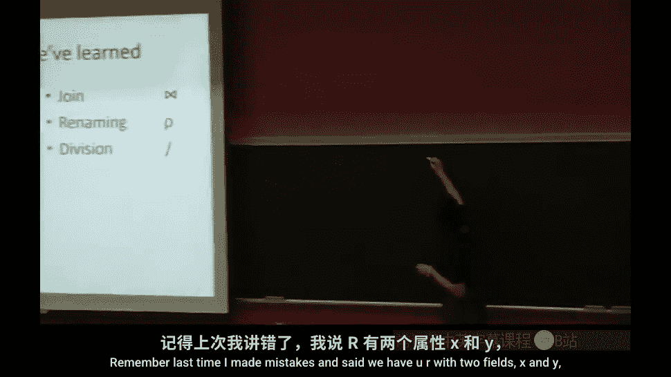
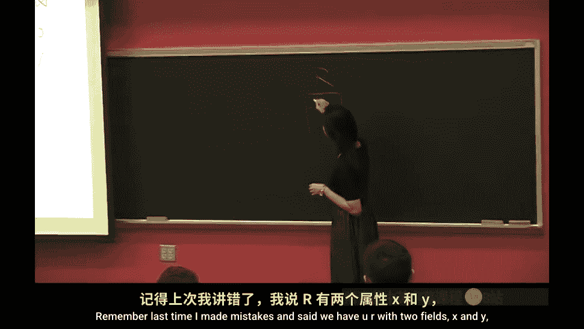
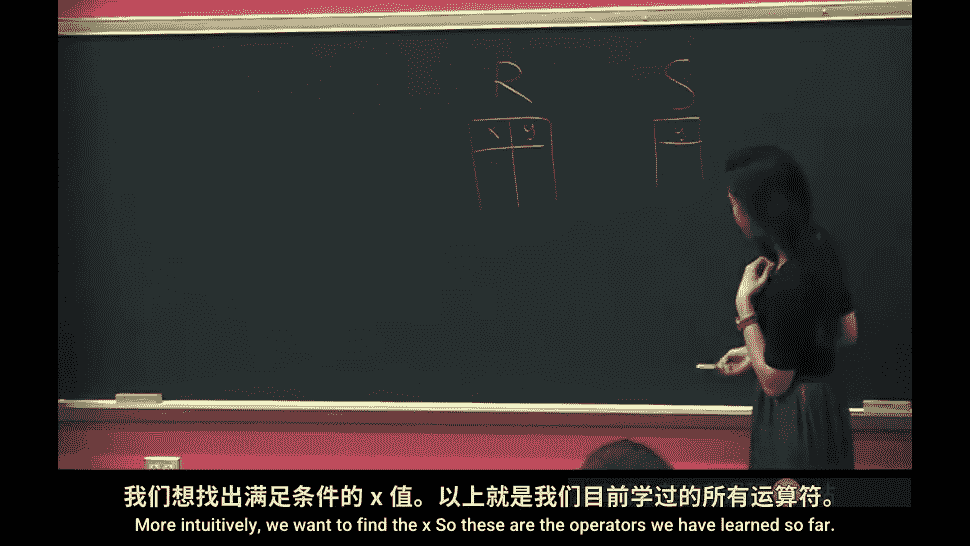
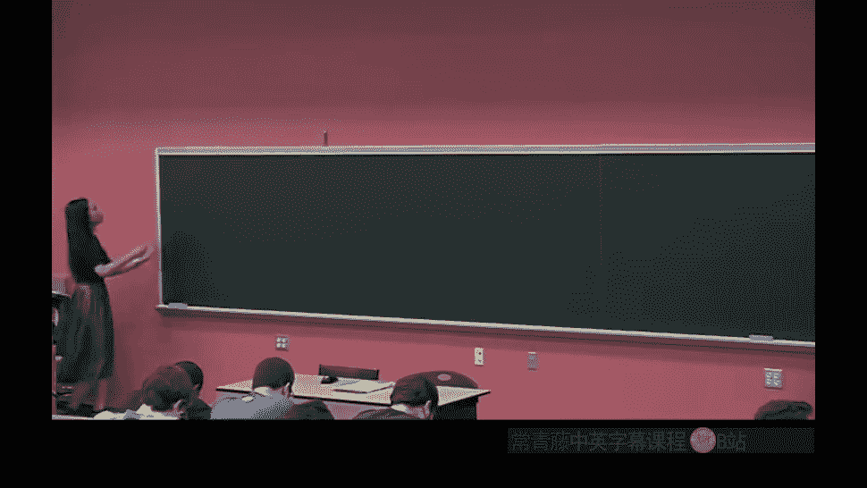
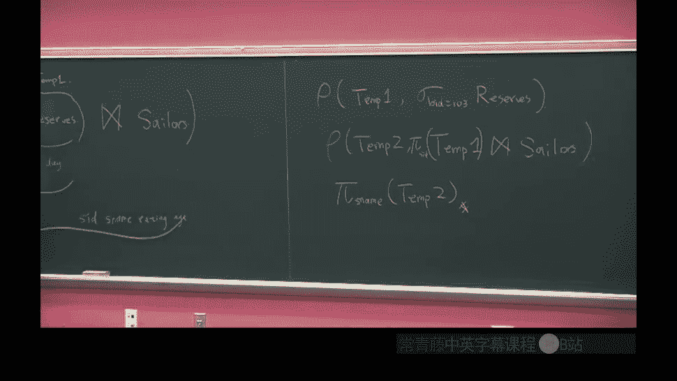

# 宾夕法尼亚州立大学【中英⚡数据库管理系统｜CMPSC431 Fall 2015, Database Management Systems】 p10 P11 关系代数 - 第3部分 -BV1N76CBwEXb_p10-

All right， good morning guys。So as you can see from the slides today。

They have tons of blanks to fill up。So today we'll mostly work on stuff on blackboard。Okay。

 we weren' going to use。The operators。For a relation algebra to work on somequeries， some examples。

そでたな。So before we get started， I just want to quickly review the operators we have learned so far。

Ill ask you a couple of questions and you can answer me which operators would do that and these operators can do what。

So these are the nine upgraders we have learned so far， I think I didn't miss any。

So the first one is selection， we use Sigma， the noary， so what does selection do？大かを特め参会。

So like the road basement criteria， so for selection。

 you will actually put a condition on that and then select the road that sats such condition。

For a selection， isn't it urary or binary？Uary，So you take in wine relation。You one relation。

How about the schema， schema for input and output are they the same？Yes， right？Okay。

 so that's door selection。Based on criteria， we says led to row satisfy the criteria。

Normally for the criteria， we denote it in the substrate。Of the stigma。Second one is projection。

 projection we use pi to didn know that what does projection do？

Remove the unwanted columns so when we look at selection and projection。

 selection works on the horizontal direction， okay we select the rows but for projection we select the columns。

😊，So for our projection， what do you put in the subscript？たパ。The columns you want to keep。

 that you wont keep here。 So in the sub apply， you put just list the columns that you want to keep。

Is projection urary or binary？You没。And input and output， did they keep the same schema？You过清。

So that's selection and projection。Union， what does union do when we have our thinking union going this？

The result relations is going to include rows that。Yeah。被么。Both or either。Is it both or either？Yeah。

 either， right， so how about intersection？That'll be both。Okay yeah， so for union。

 you will include the ones that are in R and S or in Eva。😊，And for intersection。The one。

So for union intersection， we say R ands， if they're taking union or taking intersection。

 we say they have to be what。Union compatibleible and what do you mean by union compatible？一ち？

hi is saying。つま？So for union and intersection， they are finery。And not ordinary。

And also the input and output。是他 think定了。Co， so up until here， the first four。

 they all have things thema input enough。How about set difference。

 What does set difference mean when we take R taking set difference with S？Yeah。Yeah。

 so the result tus will be the tuples in ourbanardness right， so for set difference as well。

 we will get。Same feEma for infant output。And also。

The two relations involved intercept difference have to be unioncomp。Okay。

The fifth one is cross product， what does CA product do？So if we take our fresh product with S。

We get all of the seals from our， all the fields from Earth。

 and the rows are basically just all the possible combinations from both。Tables。

 so we talked about the card di and the gradeful。So what's the cardio of？なからく。Predduct of both。

And the degree。Some sum book so degree is the number of fields and we say for crest product。

 the result degree is going to be the sum of the two inputs and also we talk about the cardinality。

 which is the number of rows， which is going to be the product。Two tables。Numb of。

The best one here and for first credit， will the schemechema stay the same？No。

 and do those two relations involved in crossspra have to be union compatible？Now。

 they can be totally different schema and just to put them all together。And crush butter use。Okay。

 join。So we talked about join last Wednesday。 join can be into a combination of which two。

For which three？あます。You first take a crush product。Okay， then you will take a selection。Optionally。

 we will have selection，How many joins do we have？But we talked about three types of drawings。

Condition join where we give and condition。哎。And another one is equicojo。

Where the condition is special case， just equivalentence， third one is natural joint。

 where we don't specify any conditions or we just simply compare all the fields with the same name。

Into tables。How about second one， renaming， What do we do with that。

Why do we need remaining because we will face a problem？Nining conflict， okay， so we use renaming。

To rename。嗯。Not only just the result of visual and algebra expression。

Also renamed the fields because。The result fields will have remaining in conflict。

 so we remainname the field。That's for renaming。And the very last one is division。If we take R。

Divided。Byエ。What does the result mean？Remember last time I kind of made mistakes。Sa， we have。

Your。

We fulfill fill this X and Y。今个哎。よは？So if we take r over F。The division operator， what is the result？

ワか。More intuitive。We want to find the X。That it will all be wise。

くっさい。So these are the operators we have learned so far。And division is also。Bary。

And also as you just saw earlier for division， the two relations have to be union compatible。

 do they have to have say schema？いてろ？They don't have to have the thinking。Okay。

Before we get into theque's practices， I'll quickly show。

There's the part I messed up last time just to make sure you guys understand where this is from。Okay。

Yeah， I'm basically just put in to remind myself to tell you guys last time I kind of missed off so。

I can't remember to see it。If there any question asked me。So we talked about so many operators。

 so operators for sure， will have president。So in relation to algebra。We take selection， project。

 and renaming as the highest priority。And then we would take Cru product， join a division。Later on。

 intersection， the last one union and set。So these are just the conventions that people use when you are missing some parenthsesis and will cause confusion。

 but in general I would just。Try to do by。Which I think is the key。So。

Before I get into the queries of today， we have 10 they over the textbooks。

So I want to work through all of these queries by using relation algebra。😔。

Referencing to the example right here。And we have two options to do it today。I want you guys to pick。

 the first one is I'll just talk about all of them all ten of how you learn or you raise your hands and tell me what you think。

いのまで。The second one is， I'll show you the question， you think about it。

 if you want to come up and try it， you can do that。And whoever assaulted right。

 get one point in the total race。I was attempting of you think that。患じがのい。What do you guys think？

And you did try it， but you didn't get it， I still give you high points。

And if you get it for the one question， you cannot get it。お願いしま。

Want to try it or didn't want me to do it。O。If you want to try it to come up and try it out。

 you think that's a better option， raise your hand。We got two votes， want me to do it。All right。

 so this will be the example。😊，That we work I was really looking forward to， okay， I'll do it all。嗯。

So you can just refer back to the table we had and I'll quickly write down the schema right here。

So in general， when we are writing the relational out， we just have to。Referred to the schema itself。

 we don't have to worry too much about the instance like the conluscing the table。

But there are parts that we want to look at why we cannot do that or whatever by looking at content。

So for this schema， I'll just write the field name I won't write。It don't mean。決水がれる。

So I'll just admitit that。And normally for a sma， we wanted to know who is the key we will try under。

えアディ。え？ so for the first one， we want to find the name of sellers who have reserved vote。Number one。

You can try to write down what you think。We going to work on this together。All right。

 any thoughts of how we should start？第一。て个人？嗯ん。Do we have to do division in this way？

The vision normally will be like sailors who are reserve all local votes。If we just want to。

Get the boats with。Id 103。Okay， let's focus on what we should do to get vote with IDm  one of3。私初の。

完感。てな。いや。Oh， yeah， just to。Today is a bit different。 I will follow the the way the textbook says it。

 So even though we put the instances like the be a be wander， textbook just put the。

The whole name of it， so we will do that for today。Okay。

 so say we want to focus on just getting votes with ID 103， so we do selection on boats with this。

 so they return the rows with bows with I 103。What next。そか？ばまた。Yeah。It is。いでにてにまかている。嗯哼。

So people are saying， is it necessary to use the boat？然不你。We can just use。没事。

Because reserves also yeah。So up until here。The ski out of this will be we have FID。EI D and there。

あれ。ねん。ポジクシ。Prejectction of all。 Oh， if you don't do any projection， then it returns。

The original schema Oh yeah， now we can do prediction。 So what do you want to do？我觉这是 on the。

イコリでスジクション。so prediction。And take which pill。え細に。Okay， so up until here， this whole thing。

 now we only have SD。で。But our final goal is to get the names of the sellers who have reserved the boat。

 and now we actually get the ID of the sellers who have reserved the boats， so we should do what？

How can we associate this， how can we associate two relations？Now we have the SI。

 we want to use this to get the S name in sail to this。女せ。Sovi as ID。健更式給で。とれはござない。Yes。

So remember in the very first lecture we talked about relation to algebra。

We would just take the cross product with the sailors， and then we go all the way back。

And select where the SIDs match。But last time we introduced in concept that can replace these two steps into one step。

Join。So if we do a natural joint right here。What it's going to do is to replace the concept of here。

 the whole thing， we take the cash product with sailors。And then we take out the rows that match SIs。

Why don't we have to put where the SIs are the same？Because this is a natural joy。

 so you will automatically find the fields with the same name。 so this step。

Replaces crush spreader then。Soction。Makes sense。So up until here。This whole part。

What do you think will be the schema for that？SID would be there for sure， right？ですね。

So right here I write one SID that's from this and sailors also have SID。

 do you think we should have two copies of SID？ so when we are doing joints， add natural joints。

 we'll actually keep just one copy。Off the field and it does a comparison， remember？

But if we do cross product。We keep up。in just wanted to just keep there。ところ。Yeah， yeah， yeah。

 here because we， oh， I it no on a BID。SIイディいやいやディ。Yes I prediction of the name。Yeah。

 now last step projection of the name okay。有没证。So that's the first one。

 which is supposed to be the easiest one。系ど。この感。やり場しなんですか。Before we move on to the sticking。Question。

 I want to just quickly show you how we can decompose the whole thing by using remaining。

 so it looks a bit clearer。There obstructure of it。So first thing we can try doing renaming。

 these will be the exact same thing。いね。にこれて。えこ言ててでしょう。みなのてそで。Yeah对其实。Oh。

 every time when it gets here， they already have no duplicates。You那个SAD。ラクレーション一象。嗯， do you have。

2 SID。 No， no， no， because for。Natural joint it only keeps one copy of the column。Yeah。

 that's by definition。Alright， so let's do what remaininging to kind of decompose the whole part。

 Let's say we want to look at。The first part， we did very simply named in11，11。Okay， we can do。

Here where the BID is equal to one of three。So this is just basically we do this part first。

And we store them。Those1 one。Then what you can do。Secondly， we can do the pause。

That are in the aler parenthees， so we can do say， okay， I want to just store them。In tip two， where。

It paid11。Joining the sailors。おています。哦。Take the project here。So here's if we take the second？So， then。

The whole part from here， all the way to here， we call temp2。Okay， and finally。全部いてる。It name。

So the boat left side and right side is equal。Just to use the remaining operator to become po to make it bigger。

Today I will be for question one。

え最し東票。ついで今くなっていたら。我你可放这个。世界の？あちゃんと専言。催。Which part are you for best one？Okay， John。

 if you us simply get the cross border。在不な。Like two Ss in one day。明白哦 yeah。嗯。

So you're saying how do they know from Oh yeah if we take the normal cross product。

 remember we would take the cross product first and generate like a really big tables and right after that we do a selection by saying。

Resultves nott as educationtation all。Oh yeah， so if we do a cross product here。

 let's say we do a crush product here。Replace this with CRP， okay。

 so the schema we will get is actually SID。And then another one is also SIP。

 So this is where we have the naming conflict。 so we can just assume if we know okay。

 so if we this is S ID 1， S I D 2。AndHis name。so on so that's the result schema if we take CA product and to make sure that this match so we would just say and we do a selection where SID1 equals to S well put the table。

Okay， let's move on to this second one。While I'm erasing and you can think about it。

 find the names of sellers who have reserved a rep book。Do我。Okay。

 what's the first study you want to do？さらし。Selection with the。So。YouDo here。Where the color is red。

On boat。Okay。First set， we got the bows that we were shawl colors our rip。What next？Okay。

 join the reserves。And reserves have SIDs， but does it have name？やちゃ現状。Sailors。And then。

Our final goal is to find the names of sails， so for single。O。So this is correct。

 but is it the most optimize？Like in the middle of it， we would generate tables think？

By doing something we can generate a smaller table。プイです。It sales's no be in the same day。嗯。

So give you a selection card to regular your votes。you just with wejo them with reserves， okay？Yeah。

 okay， so what we can do is as Kelly said， we do selection on a projection on BID right here。

All right， so this will actually take out the unnecessary information so we generate just the smaller。

But both are committed。Invation。诶。So I think this one is pretty straightforward， so I won' to。

The renaming。Very2。Let's take a look at querying3， find the colors of boths reserved by lover。😊。

也是够宝贝。What should we do。お願しま。You want to。So that。Lo of。Which table？Sellers。We still。

The sailor's name who whole。こ。So this is the book's part。あ変。You know， we get the sellers。嗯。

But our callover so if we only do this， we get as they need as name raising。そ。应该是。So。

Because a point here。get s d。This name。8。So we want to use the information of SID to join in with reserves？

嗯。So if we join with reserve。And the whole part， you might kind get even crazier we look at。系点。day。

So there's nothing about optim it yet。Then。Join me with boths。And even bigger。

Now we have a color email the color。Two colors what we want。ぱね。Projection。Make sense。

 even though in the middle of it would create tos of。Couples and。Degrees really high。

Still the correct one And from this one， you know， by doing what we can make it more of。

We can just take， for example， until here， take up the SID。Or after on'm campaign only。

In the middle of operation， where saw was being stored。诶头先大家视频。It won't be stored into database。

还有一个可以他行那个。两个杯子回去。Oh， so this is just telling you what will be more optimizeim what will be not。

 but actually when you really write SQL command。Remember when we learn very beginning in the chapter when we have a query optimizer。

 so this is what the query optimizer is doing， it will convert the query into a more optimized way。

Yeah。是实。那你。Yeah。And we should need。Okay， so that's for K week。So far also good。 We have。7。

Just think about the fourth one。What do you think， find the name of sellers for reserve at least one book？

月や？あし？要是。す。Selection。This sounds tricky， but actually it's super easy。Can you doing inter？え。😊。

So before we write that down， can you do intersection between sellers and reserves now。

 because they are not not union compatible， different schemas can't do intersection so。Awesome。

 you guys just figure that out。 We just take。Join between sailors。

And So this will be an empty step if none of the sellers have been made any reservation。

But this will return you。With something。And then we want to find the name， so。Prediction。That's back。

一。You got。Because they want to ride 35 at the same spot。

So that's full curiffo if you want to find names of sailors who are reserved at least one boat。

Take joint between sailors and reserves。Then because we won' just the S name， take rejection。Okay。

P so。Let's work on Cur 5。 Cur5 is very similar。 because 6。 So I want to do a comparison。

If we re clarify， we want to find the names of sellers who have reserved a red or green boat。Okay。

So when we think about or， what kind of concepts that we have learned so far do you think？点 two。い。

Union， yeah， the first one is union。How about second one。I okay。take union。First approach。Second one。

Remember when we do selection in the condition we can do。And or or。Okay。

So let's just say we want to do the or， we'll do it later。Okay， so that's another way。So we can try。

Which one do you guys want to go。も？So one。So let's start from having or in the condition first。

How would you do that？Start from the boat， say we want to get the boats that are either red or green。

So you will do boths。Selection。はいと close。Bat。Do a selection。 So color。Es to red。Oh。可乐。こしてく。Right。

 so you but using。This all right there in the condition。We combine two bullying terms。

And we get the bows that are either red or green， and that's the first step。Very very easy。

 we want to get the names of sellers who have reserved， so we want to involve the other two tables。

Wejo reserves first。And we join sail。And。What is the information of sellers we want？Nam so we do。

Projection。Okay， first checkout approach we did and that's by using。Or。

Then we want to think about how we can use。Union。Right。Let's try to do some renaming this time。

 So it's a bit clearer。Let's say we want to say。Some just ten't votes。That are either green or red。

How would you do it by using。union。有の selectionを。嗯，对。So you can do selection on color that are red。

On the about。That's the first part。Take a union。On the color。Okay， so we do this first。

 we take a union of that。And name it。Then the second step should be exact same as what we just do。

So what would the second step be？中。Just take join our reserves and stay us。So second step。

We just directly take what we have created and rename。Take points on reserves。And cells。

And because we only care about。Your name。Your protection。Okay， so that's for the first approach。you。

Okay， so that's the difference between these two。Any questions so far for finding red or greenfield？

但系你你时政府你诶。tableworkう。So just to rename， actually， we can just put the whole thing right here。

 but I think it'll be a little too long。 So I just rename。 Rename is always optional。Yeah。

 question there。So that's for query 5。 Now let's quickly change the。

TheQurry into find the names of sellers who have reserved a rent in the green。

So that would be your career six。How would you change based on those。

 let's say we start from changing approach2。そさ？そしのもはそ度できるかあげると。

Efficiency of those how they goingize to sail or just like that。哦。This like a real world like。Oh。

 I think are they？I think the evaluation will be different for the first one you will actually have to generate two separate tables and then you take a union of them。

 but for this one when it only gets to this pot， it actually goes through every row and just check is the color red or green。

 red or green， so it will only get one table。Yeah。Yeah。But， it won't。

Be overca when we do different things。Okay， so let's think about query6。

If you want to find the names of sailors who have reserved a red and the greenb。Let's say。

 can we directly fix it？From approach to。什么了？What do you guys think。

Is it kind of tempting to just change this to end？Oh you know， it's wrong， Why is it wrong？

Why can't we just change that because one bow cannot be red and green at the same time。

 so when we want to do Currry six where we find about that sailors who have reserved a red bow in a green bow。

😊，We shouldn't just directly change here to end。So let's give up here the second approach first and try to do the first one。

Since we are doing end， we want to change union into。Re section。那我给觉。If you look at that。

What do you think。Directly。Chhenzhen。关掉。完了。あ。せ年法の？Why would you问。Yeah， why， why won't to work。Okay。

 let me see。😊，So people are saying we cannot just directly change it to intersection。

Let's see why we cannot do that。Ill quickly write it。He。So for selection。On boat。

And then the result we will get is actually PID。电年。Car， that's the first table， right？

Was the the idea of this？10 three， what's the name of it？ど I inter。行。What's the name of the？やつ五年ちを。

R one there to。Oh， there are two records。Okay， what's the name。つい。어디 있을 있어요？Mary。哦，没听。Allright，非常况老亲。

Okay， how about green boatats？Wes really have one on three and then。でな。I'mな。All right。

 and then it's green okay， with all these echo I I write it up down。

 it's because I want to show you if you take an intersection between these two。😊，我 do you get。my。MD。

 yes。给大再说一个问题。So if you want to get。Cary six， by directly changing the union intersection。

 you cannot do that。So。What will make him able to do that？だてどうしてぐらいの。文点。就策け。Put them separate。

This will be one。しょう。What we can do is actually right here。

 we want to associate somehow with the cellular information first。Then we can actually take。诶应食。

On the sailer that seems like one we want， Okay， so how do we do it to make it associated with sailer？

Draing with Ru what， which grew？Yeah， good reserves。😊，Sa here。明究。Are we getting mess here？Okay。

If we do them separately first。听咩冇。交。你就个死。我哋。After we actually get。没有异议。

Can we transaction right away？こでて最近。Yeah， we should project this idea for quite that。

Because here are some of the fields。😔，They will actually be for sure different。Because right now。

 the field we have is。BIデ。E made color。際に？对。It doesn't matter what right here。Okay。

 on the left side and here for the color pop。Okay。So you do take an intersection。Still empty。是。

So in order to prevent this from happening。We actually do projection。SID。好高。で。Yeah， finally。

We take intersection here。Superm。But we want the names。 we so we want to join the whole thing。

Let's rename it real things。😊，Are you raised here。You will got to the left side。Or yeah。

 we can just do it since I。The whole thing。那也嗯。嗯。Yeah， the's three。什么呃。We will say this is1。O。So。

Because in the end， we want to get the sailor's name。So for the1。He actually need to do。

Drawing with sailors， right？So人。欢 a位。Projection。Okay。for。Where is6。Oh。All right， before we go。

 I do want to quickly say one thing。 So here we。Project SID， right？

Why don't we just predict isn't it？对可以。それには。Yeah， exactly。

 because it's not guaranteed his name will not have duplicates， so you might get the wrong。What'。Oh。

 getting。应该じ会。😊，Bad question， whatever just make sure we projected the keys， okay？Yeah。

 we'll work on the floor next time。Okay。And don't forget the midterm is next Tuesday in the evening。

 I won't have review question， like review exam， correcting the exam。

Because I'm not creative enough to create two copies of inter。

 but we will have a review session next Monday。Okay。

So lectures that will be covered in midterm one will be finished this Friday。

and also don't forget you will be turning in your homework to this f。Yeah。喂。说。In class， yeah。

They'll start reviewing all right， so midterm one is from chapter one to chapter4。😊。

