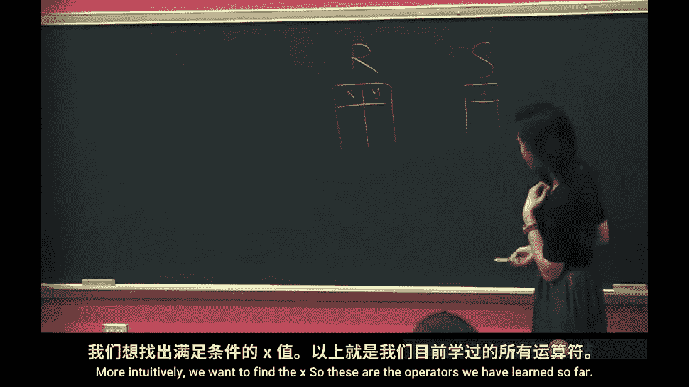
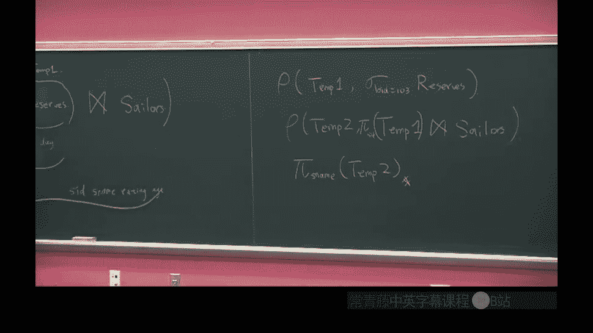

# 数据库管理系统：第3章：关系代数 - 第3部分

在本节课中，我们将通过一系列查询示例，深入学习如何综合运用关系代数的各种运算符。我们将基于一个包含水手、船只和预订信息的数据库模式，逐步构建查询表达式，并探讨如何优化这些表达式。

---

## 运算符回顾

在开始查询练习之前，我们先快速回顾一下目前已学过的九个关系代数运算符。理解每个运算符的功能是构建复杂查询的基础。

以下是九个运算符及其简要说明：

1.  **选择 (Selection - σ)**：这是一个一元运算符。它根据给定的条件筛选出关系中满足条件的元组（行）。输入和输出的模式（Schema）相同。
    *   **公式**：`σ_条件(关系R)`

2.  **投影 (Projection - π)**：这是一个一元运算符。它从关系中移除不需要的属性（列），只保留指定的列。输入和输出的模式不同。
    *   **公式**：`π_属性列表(关系R)`

3.  **并集 (Union - ∪)**：这是一个二元运算符。它返回两个关系中的所有元组，重复元组只出现一次。参与运算的两个关系必须**并兼容**（即具有相同数量的属性且对应属性域相同）。

4.  **交集 (Intersection - ∩)**：这是一个二元运算符。它返回同时存在于两个关系中的元组。参与运算的两个关系必须**并兼容**。

5.  **差集 (Set Difference - -)**：这是一个二元运算符。它返回存在于第一个关系但不存在于第二个关系中的元组。参与运算的两个关系必须**并兼容**。

6.  **笛卡尔积 (Cross Product / Cartesian Product - ×)**：这是一个二元运算符。它返回两个关系中所有可能的元组组合。结果的度（属性数）是两个关系度之和，基数（元组数）是两个关系基数之积。参与运算的关系不需要并兼容。
    *   **公式**：若 `degree(R) = m`, `degree(S) = n`，则 `degree(R × S) = m + n`；若 `|R| = x`, `|S| = y`，则 `|R × S| = x * y`。


7.  **连接 (Join - ⋈)**：连接本质上是笛卡尔积后接选择操作的组合。我们学过三种类型：
    *   **条件连接 (Theta Join)**：基于任意条件进行连接。
    *   **等值连接 (Equijoin)**：条件连接的特例，连接条件为相等比较。
    *   **自然连接 (Natural Join)**：自动比较两个关系中所有同名的属性，并只保留一份同名属性。



8.  **重命名 (Renaming - ρ)**：这是一个一元运算符。用于重命名一个关系或其属性，常用于解决连接操作中可能出现的属性名冲突。

9.  **除法 (Division - ÷)**：这是一个二元运算符。对于关系 R(X, Y) 和 S(Y)，`R ÷ S` 的结果是满足以下条件的 X 值：对于 S 中所有的 Y 值，组合 (X, Y) 都出现在 R 中。

---

## 查询实践

现在，我们将基于以下数据库模式，运用上述运算符来解决十个具体的查询问题。模式包含三个关系：
*   **Sailors(sid, sname, rating, age)**
*   **Boats(bid, bname, color)**
*   **Reserves(sid, bid, day)**

### 查询 1：找出预订了船只 103 的水手姓名


我们的目标是找到预订了特定船只（bid=103）的水手姓名。思路是先从预订记录中筛选出目标船只的预订，然后关联到水手信息，最后提取姓名。

以下是构建查询的步骤：

1.  从 `Reserves` 关系中选出 bid 为 103 的预订记录：`σ_(bid=103)(Reserves)`。
2.  将上一步的结果与 `Sailors` 关系进行自然连接，通过共同的 `sid` 属性关联水手信息：`(σ_(bid=103)(Reserves)) ⋈ Sailors`。
3.  从上一步连接后的结果中，投影出我们最终需要的 `sname` 属性：`π_(sname)( (σ_(bid=103)(Reserves)) ⋈ Sailors )`。

**最终表达式**：
```sql
π_sname( (σ_bid=103(Reserves)) ⋈ Sailors )
```

---

### 查询 2：找出预订了红色船只的水手姓名

这个查询需要找到预订了红色船只的水手。我们需要先确定哪些船只是红色的，然后找到预订了这些船只的水手。

构建查询的步骤如下：

1.  从 `Boats` 关系中选出颜色为红色的船只：`σ_(color=‘red’)(Boats)`。
2.  将红色船只与 `Reserves` 关系进行自然连接（通过 `bid`），得到红色船只的预订记录：`(σ_(color=‘red’)(Boats)) ⋈ Reserves`。
3.  将上一步的结果与 `Sailors` 关系进行自然连接（通过 `sid`），关联水手信息：`((σ_(color=‘red’)(Boats)) ⋈ Reserves) ⋈ Sailors`。
4.  投影出水手的姓名：`π_(sname)( ((σ_(color=‘red’)(Boats)) ⋈ Reserves) ⋈ Sailors )`。

**最终表达式**：
```sql
π_sname( ((σ_color='red'(Boats)) ⋈ Reserves) ⋈ Sailors )
```

**优化提示**：可以在连接 `Reserves` 后立即对 `sid` 进行投影，减少中间结果的属性数量，但最终结果不变。

---

### 查询 3：找出名为“Lubber”的水手所预订船只的颜色



这个查询需要根据水手名找到其预订船只的颜色。我们需要先找到名为 Lubber 的水手，然后追踪他的预订记录，最后找到船只颜色。

构建查询的步骤如下：

1.  从 `Sailors` 关系中选出名为 ‘Lubber’ 的水手：`σ_(sname=‘Lubber’)(Sailors)`。
2.  将 Lubber 的水手记录与 `Reserves` 关系进行自然连接（通过 `sid`），得到他的所有预订：`(σ_(sname=‘Lubber’)(Sailors)) ⋈ Reserves`。
3.  将上一步的结果与 `Boats` 关系进行自然连接（通过 `bid`），得到所预订船只的详细信息：`((σ_(sname=‘Lubber’)(Sailors)) ⋈ Reserves) ⋈ Boats`。
4.  投影出船只的颜色属性：`π_(color)( ((σ_(sname=‘Lubber’)(Sailors)) ⋈ Reserves) ⋈ Boats )`。

**最终表达式**：
```sql
π_color( ((σ_sname='Lubber'(Sailors)) ⋈ Reserves) ⋈ Boats )
```

---

### 查询 4：找出至少预订了一艘船的水手姓名

这个查询相对简单，目标是找出所有有过预订记录的水手。我们只需要查看 `Reserves` 关系中出现的 `sid`，然后找到对应的水手即可。

构建查询的步骤如下：

1.  将 `Sailors` 关系与 `Reserves` 关系进行自然连接。连接会自动匹配 `sid`，结果中只包含那些在 `Reserves` 中有记录的水手：`Sailors ⋈ Reserves`。
2.  从上一步的结果中投影出水手的姓名。注意，由于一个水手可能有多次预订，姓名可能会重复，但关系代数集合操作会自动去重：`π_(sname)(Sailors ⋈ Reserves)`。

**最终表达式**：
```sql
π_sname( Sailors ⋈ Reserves )
```

---

### 查询 5：找出预订了红色或绿色船只的水手姓名

此查询有两种实现思路：一种是在选择条件中使用 `OR`，另一种是使用并集 `UNION` 操作符。

#### 方法一：使用 `OR` 条件

1.  从 `Boats` 关系中选出颜色为红色 **或** 绿色的船只：`σ_(color=‘red’ OR color=‘green’)(Boats)`。
2.  将这些船只与 `Reserves` 连接，再与 `Sailors` 连接：`((σ_(color=‘red’ OR color=‘green’)(Boats)) ⋈ Reserves) ⋈ Sailors`。
3.  投影出水手姓名：`π_(sname)( ((σ_(color=‘red’ OR color=‘green’)(Boats)) ⋈ Reserves) ⋈ Sailors )`。

#### 方法二：使用 `UNION` 操作

1.  分别找出红色船只和绿色船只的预订记录对应的水手ID：
    *   红色部分：`π_(sid)( (σ_(color=‘red’)(Boats)) ⋈ Reserves )`
    *   绿色部分：`π_(sid)( (σ_(color=‘green’)(Boats)) ⋈ Reserves )`
2.  对两个结果取并集，得到预订了红船或绿船的所有不重复水手ID：`π_(sid)( (σ_(color=‘red’)(Boats)) ⋈ Reserves ) ∪ π_(sid)( (σ_(color=‘green’)(Boats)) ⋈ Reserves )`。
3.  将这个水手ID集合与 `Sailors` 关系连接以获取姓名：`( π_(sid)( (σ_(color=‘red’)(Boats)) ⋈ Reserves ) ∪ π_(sid)( (σ_(color=‘green’)(Boats)) ⋈ Reserves ) ) ⋈ Sailors`。
4.  投影出水手姓名：`π_(sname)( (…union expression…) ⋈ Sailors )`。

**方法一表达式（更简洁）**：
```sql
π_sname( ((σ_color='red' OR color='green'(Boats)) ⋈ Reserves) ⋈ Sailors )
```

---

### 查询 6：找出预订了红色和绿色船只的水手姓名

这个查询的关键在于“和”，意味着我们要找的水手必须同时预订过红色船只和绿色船只。不能简单地将查询5中的 `OR` 改为 `AND`，因为一艘船不能同时是红色和绿色。正确的方法是找到预订了红船的水手集合与预订了绿船的水手集合的交集。

构建查询的步骤如下：

1.  分别找出预订了红色船只和绿色船只的水手ID集合：
    *   预订红船的水手ID：`π_(sid)( (σ_(color=‘red’)(Boats)) ⋈ Reserves )`
    *   预订绿船的水手ID：`π_(sid)( (σ_(color=‘green’)(Boats)) ⋈ Reserves )`
2.  对这两个集合取**交集**，得到同时预订了红船和绿船的水手ID：`π_(sid)( (σ_(color=‘red’)(Boats)) ⋈ Reserves ) ∩ π_(sid)( (σ_(color=‘green’)(Boats)) ⋈ Reserves )`。
3.  将交集结果与 `Sailors` 关系连接以获取姓名：`( π_(sid)( (σ_(color=‘red’)(Boats)) ⋈ Reserves ) ∩ π_(sid)( (σ_(color=‘green’)(Boats)) ⋈ Reserves ) ) ⋈ Sailors`。
4.  投影出水手姓名：`π_(sname)( (…intersection expression…) ⋈ Sailors )`。

**重要提示**：在取交集前对 `sid` 进行投影是必要的，因为我们需要基于水手ID进行比较，而连接后的结果可能包含其他无关属性（如 bid, day, color），这些属性会导致交集结果为空。

**最终表达式**：
```sql
π_sname(
    ( π_sid( (σ_color='red'(Boats)) ⋈ Reserves )
      ∩
      π_sid( (σ_color='green'(Boats)) ⋈ Reserves )
    ) ⋈ Sailors
)
```

---

## 总结

本节课中，我们一起学习了如何将关系代数的多个运算符组合起来，以解决复杂的数据库查询问题。我们从简单的单表条件查询开始，逐步深入到需要连接多个表、处理集合运算（并、交）的查询。

核心要点包括：
1.  **自然连接 (⋈)** 是组合信息的强大工具，它隐式地完成了笛卡尔积和等值选择。
2.  使用**投影 (π)** 在中间步骤减少不必要的数据，可以优化查询效率（这是查询优化器的工作之一）。
3.  **并集 (∪)** 用于实现“或”逻辑，而**交集 (∩)** 用于实现“和”逻辑，但在使用交集时必须确保比较的是关键属性集合。
4.  **重命名 (ρ)** 操作符有助于使复杂的表达式更清晰，尤其在分解步骤时。

通过这六个查询示例的练习，你应该对如何用关系代数思维拆解查询问题有了更深入的理解。这些基础将帮助我们后续学习 SQL 语言，因为 SQL 查询在数据库内部常常被转换为类似的关系代数表达式进行处理。