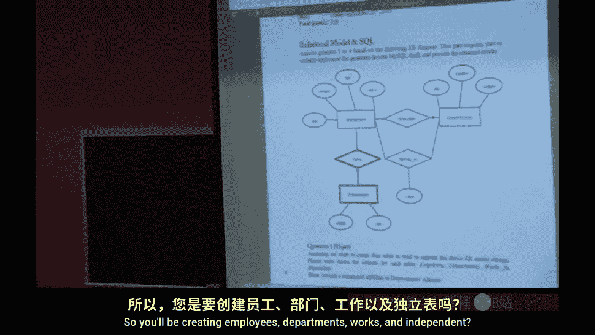
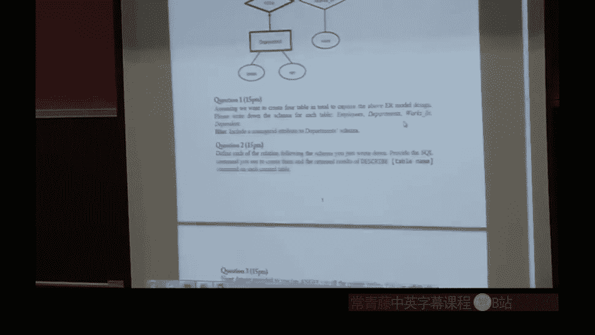
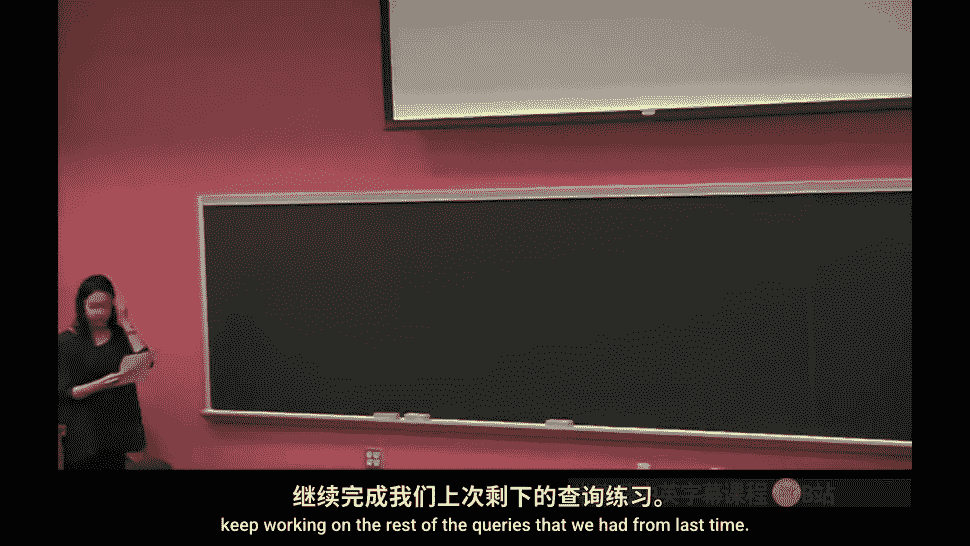
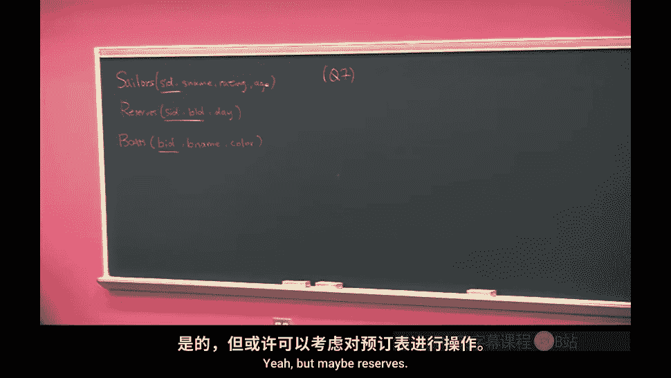
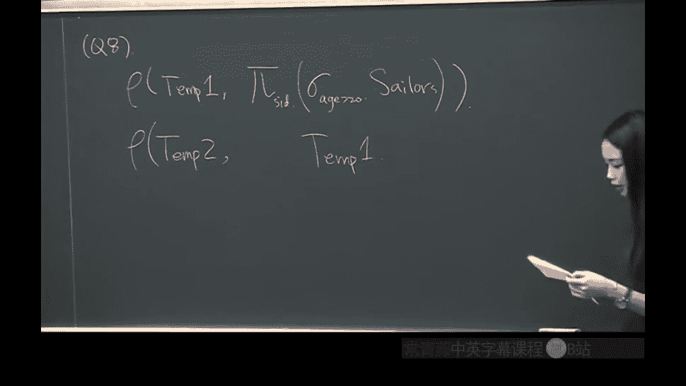

# 宾夕法尼亚州立大学【中英⚡数据库管理系统｜CMPSC431 Fall 2015, Database Management Systems】 p11 P12 关系代数 - 第4部分与关系演算 -BV1N76CBwEXb_p11-

Good morning， guys。So， if you know， we will have。Homework two deadline this Friday。

 Do you guys have any questions？嗯。呃。Yeah， I only got from Cook， so which one were you referring？

The first one is。So you'll be creating an employee。Departments works in independent。

哦。That means the managers。PoOh no， remember， because of the weekend。And also for things。

They can actually。点你。So if you have any question for homework to。

 come to my officear today or go to the TA tomorrow。

I would expect one question popping out， I'm not sure， so for the sequL parts as well。

We actually have to give me the screenshot of the output。So just make sure you can do it。

You'all right。So what will will do today。Actually， I think I won't use。か？

Working on。The rest of the prairries that we had from last year。

And introduce one more operator that we didn't talk about before。干啥是吧？

Then we'll get into relational calculus to it。So last time I'll write down the schema first。

You can think about。Qurry 7。Yeah。37。Find the names of sailors who high reserve at least two gos。

 any thoughts？Remember last night work got witch cur， but we were thinking about。

Find the sailors named who have reserved at least one vote。

This time we want to see at least two votes。What do you think will'll be in？Good approach to start。

能くる。So。Could can we join reserves？Overre joining and going to take every road。あの。一こわな。可呀。はうね。

Okay， so you say。これドビアリ。SeeSo we do a join。Do you have to put any condition？We don't do math。

Because if it's natural join。You will compare every fields that are the same name。 S。

 So you are saying。If it's equal joint， then we just put， this is the E joint， right？

Just compare as I。对。We want to rename the second column through the item1。いわ事業。Good。就厉害。

So after this part。We actually did。细细啲。DIテ。Okay， and we don't repeat。哔别。

No it' was going to be the fourth。So then another VV。Another day。So you're saying you want to。明年。

I tend to be PID1。And the fourth to be the 82？So how do we do。Renaing the field。連中？

We put it right after the tu of variable。So we say two becomes。V I D1。More becomes。Bアリ2。O。Now。

 we got that。给忘。We select for big one。し。ピ journalist。So now we have this。

 so this part changed to BID1。This cartoon to be idea true， right。So we want to select those rows。

Where。The I D1。Not equal。ToB true。那。And in order to get the sailor's information。

 what do we need to do？You need to join it with the sailors。よし？Finally。嗯。그ね。Yeah， actually。

 I have another approach with the deathing your。So。The texts are actually suggested。

We replace here with cross credit。And then you still need to do those， like SIs are the same。

 the IDs are different， so yours is more efficient。你m pretty啊。Any question for this one？

Can guys see why we can get？The sailors that deserve them。So here is the。

The most important part right here and this is。The first time when we are practicing。

 we actually reate the field， last time we only just give the relational ultrabi expression tu ra。

We didn't give it。 We didn't remain the。Okay， so that's for Queie7。cur8。

For currently anyone to find the IDee of sellers with page over 20 who have not reserved？

Let me me off on this one， how we can start。Whenever we think about。Who have not done what。

What do you think will be an easier way？You want to try subscription， which is like。

We take the difference， thick difference。So instead of finding who have not reserved a red bow。

 how about let's start with finding cost reserve？诶喂。

And another criteria here we are having is to think to consider only those sailors who are over 12 years old。

 we can also start from there。Let's say。I don't really have good。A couple of verys herefoot。

There with me。So if you want to select Saor。Who are older than 20 years。WhatU do you use？ExSe action。

And the criteria will be8 greater than 20。I guess when you say oh。いく。Whatever you want。

I admit the people。So that's it for now。Leave a space here we might come back to。O。

Second thing we want to do， we want to find the sailor。嗯ん。他这个。なれも。And before we start。

 let's take a look because in the end we only care about。It's that these。

 do you think we can do some prediction here？抜けて。これね。熱してかね。So how can we do to take those？

SID who have reserve record。Does tend to store such information。How can you get those up？

Reserve the record。So we want to start with those that are already greater than 20 years old。

Oder 10 years old。But instead of putting the seller information。Take one。Which is you。

Saalors have other been0 they want should do。

How do we proceed from here to get those that have reserved them？And here how show me。アシ？

So right here， do we have any reservation or vote？そわし言ってる。From here， how do we get， okay。

 let's say reservation。Who should we join with？So you can see from Tmp1， the schema we only have SID。

And we join it with reserves。😊，Now， we have。はい？最近？对。I remember I lot to get those。

So we are actually matchinging the color information， which is from。So， so we should。Okay。

So far so good， but we only along those。That was the rip。So， we should。So they plant more。😔。

Select those。To color。So as you can see now， the whole main scheme is actually。Oh here we also have。

二零。ほ。But let's say our goal is to have here story。Just the SID of those sellers。

Greatser than 20 years old， and who has also reserve rip。这个人。Any other Facebook but。Here。

So this we think again when we are doing this， for this part。

 we are taking those sellers who are greater than 20 years old， and we keep the SID information。

And for this one， we are saying we want the sailors who are not only greater than 20 years old。

 but who have all reserved the both。That is right。对。So go back to our goal。

 our goal is to find the SID of sellers with age over 20 who have not reserved the votes。

So here is a way we want to take the set difference and notes right here we are taking projection。

It's because set difference require both relations to be what。Things in my union complex。

So let me write a result。The final answer。For all of the sailors who are。Older than 10 years old。

 take a sip they。Those who are not only 10 old， but older than 10 years old， but also reserved them。

Anyone still need the left part？O。Let's get into。Query 9。Okay， so clearly9。

 we want to find the names of scholars who have reserved old。What is the keyword you see here？

That makes this。Kide the new compared to the previous eight ones， we haven't used one operator。

We haven't used division and which keyword will imply division。All boats， okay。

 so whenever you see all。Think about you want you。I't that implies， but when you see oh。

 you want to take division。Okay， so let's recall division a little bit。remember。

 we are saying when a。divided by B。To use division， we are assuming。A has two fields。

Did we say X and Y？And one of the seal will be in V。我江。LetsSa why。

So if were taking division A divided by B with this schema。What does the result mean。Remember。おり。

Which are associated with every value。The answer of IA divided by B will give us the x that are associated with all the possible y values。

Correct。So now if we want to use this concept in querying9。What were A B。Which table？

We want to find sailors who have reserved all boats。Reserves。

 let's replace it saying we want reserves。Let's acknowledge note the fact that in the end we want the silver name。

🤧咳。So because we want to follow the formula where。This one has two fields， This one has one field。

What are the fields and reserves you will want to keep？What will the X be， X， B， S I D and Y be？

So for both， we also just keep。EID。So in order to get just these columns， we need to do what？

Pjectction。So reserves， we first do。Sa E and BID。And on'm boats。一。All right。

So if we simply write down this。😔，What do we have。嗯哼。Yeah， so if you only look at this part。

What's the schema for this result of， how many fields do we have？Only one， and that is。

And we have SID。But the goal in the end is to get。Sailorss names。 So we have to。

Associated with the sailor table by using each operator。

And because we want to finally get the sailor's name。重すに。check。Salor's name。嗯。Great。

Any question for this one？That's how you would use division。Almost done。 You're gonna get the。看。

But when do you think we're query1？Qu every10， we want to find the names of sellers who have reserved allvo。

So this reminds me of one of the clries who did the first one actually。

 I remember a quote who was saying we could use division。Remember the first query were just saying。

 find the sailors who have reserved。Both would V 103。明明没有？

And at that time we didn't use division at all like that。Does we call that real quick？Fine sailors。

不好。I remember at the time we only did， okay， let's just say we used the SID。

But even though I think we use things。ID， so remember we take a reserve。And you just simply have to。

Solect BID。う。At that time we didn't use division at all。Why is that。あのせ。Because what？

It's who he wants to go in。Because this is unique。Okay。Because this is unique。

 so theres no such problem as saying fine。Where。It reserves all。O codes that have I1。

But here is different10 for question 10。We change this。

5 set who have reserved both with the I D equal to one of three into。Reserve votes with name equal。

But because the name proposed。あに。So they're making multiple boats that complaint paint。

 and we want to find those sailors who have reserve all of the boat。大。

So that's why for this one we actually meet。对 not very困。Okay， so we are going to use division again。

2。Did you decompose this  query。What do you first。たしと。So Iction on growths。ね。

So we want to select on the burs where。Name is inter lake。Sore this just incredible。

And because later on， this will be the part that'。Denominator or。Angguized by mean。In okay。

We' like to directly use it of the demo， us the demo nominator。😊，What should the schema be？Right now。

 we have。So far we think about BID。The name and color。

But we want to use it as a denominator in the division。Only have one field。

So we should do extra step。Right here。Which is。Projection。DI。哎。So then this is ready to be company。

Then what would another be。你 were other。What was the new way？Res。Yeah really bad at those names。

All right， so if reserves， we want to make it the numerator。What are the skills？也。

I the NBA is what we should do。And because here we actually prepare it。Only one field likes rain。

Be on。To。收。How's the schema for this so far？Only也兄弟。what is those S mean。Fillers SID。

 who have reserved all those code。Right。One our final。Again the names。

 you go want and get a similar name， so what other information should we associated with？ないよ？Colors。

まし projectが。So that's for the1 turn。Any question。I you kind of。

Not kind of as long as you understand all these 10 thing you should be。Good for relation to algebra。

90%， because then we have another offer。Okay。I giveive you a few more seconds or you all about that。

Put the screen down。そう。So。So that was for the10 queries that we practiced on the。

 I think a relational algebra operators that we have learned。

 those are the ones included in the textbook。But actually。

 there's another one pretty important that I want to talk about today。

 which will take care of the idea of aggregation。Iing。What I mean by agreg grouping。In that。

So in addition to retrieve data， some computation is often needed。

 if you think about the tank queries that we have worked on。

 actually there was no computation included。We were just retrieving data based on different criterias and what are the fields we want。

 how do we join tables together， but there was no computation involved at all， for example。

 counting or want to find the average or we want to find a sum so none of that was include。

So right here you can see concepts we will want to use frequently will be maximum。

 maybe won't the minimum a column in a field or the summation counter app。For example。

 how many sailors reserve blue boats？Do you think by what we have just learned in nine operators。

 we can achieve this？We can achieve all the sailors who have reserved blue votes。

 but we are not able to do the counting just yet， okay？

Another one is find the average age of all sellers， we can get all the age of all the sellers。

 but now based on the things we have learned， we're not able to do the average yet。

The third example will be to find the highest rating of sellers younger than 20 years old。

Right now we can get all the rating of sellers who are youngerling10 years old。

 but not taking the maximum of it。Just thank you。So what we will need to do。Besidesside that。

 sometimes we want to do some grouping。For example。

 we have some fields that we want to group the sailors by。For example。

 we want to find the average age of sellers in each rating level。

 we have different kind of rating if we want to group the sellers first， for example。

 though we want to group them into this group or the sellers we have rating equals one。

 this group rating equals2， and then we take the average age in each。Another example。

 if we could find the highest rating of sellers at each age group。

 then we just swap the order we grew by the age first and then find the highest rating。

So these are the concepts that we want to achieve。Besides the nine operators we have learned so far。

So this is where we want to use。Epha。Operator。So there are two formats。

 or you can see two formulas of alpha operators。The first one is the one I said earlier。

 we just simply do some sort of computation among all of the value。

Maybe in a column or a whole painting。For example。not okay。

 so that's the formula for that we will put alpha in subscript put one argument。

And we put art as the input， so for the argument one， we call it the aggregation function。

OkaySo right there you can say I want to take the average， I want to take the maximum on what。

And are it just simply the relation？이 want to work까？So if we have this。

 let's think about how we would do to find the average age of all sews。😔，To start with the easy po。

What will the R be？Do we want to find the average age of sellers。

What do you think the input relationship will？Just the sda。

And what would the aggregation function be？Without thinking how you will write it。

 but what's the content？Average of the eight， so this is how we would write it。

We just simply put alpha and on the subscript， we say we want to take the average of H。

Bong sailor relation。That's how we can do the first example for Al operator。

Let's think about the second one then I'll let you try。

 how would you find the number of sellers who have reserved glucose？Let's say very simply。

If you want to find the number of sellers， we do accounting。And which field will you count。

SID because it's unique， so you don't want to count S because there might be duplicates。

 so we count SID。let's say we do count， then we can get a number of sellers。

And what would the input relations be？We want fills who have research。

How many relations will be involved？2， which two。Why not sell？

We don't need a name and we are counting SID and that's already in reserve。That's right。

 so we will have reserves and votes we need those two， and what do we do with them？Do it join？

Between them。How do we get loops？So，Okay， so the answer should look like this。We take a joint。

 natural join between reserves and boats。Take this selection of the color， which is blue。Finally。

 we just say we want to count。てえ。Any question for this one？Then I'll move on to the second type。嗯。

Of the out。So the second time this time we actually take two arguments instead of just one。

When I first learned this， I think it was kind of confusing。

 but then later on I thought it makes sense。 So this time for argument one。

 instead of doing the aggregation function， do grouping first。Then argument 2 is the act。Right。

So why do you think we'll be in this order？Because if it's based on the first type of alpha operator。

 wouldt it be nicer if we just keep arguing one as the same purpose and then the one added to the grouping？

Any thoughts why the orders is like this？Yeah。さん。や。Exactly， because when you think of the process。

 you actually do the grouping first， and then you apply the aggregation function on each group。So y。

 that's right， so we want to put the grouping as the first argument in the aggregation function。

Normally。The way we do for grouping is just saying you put the field name that you want to group by。

 that would be。To think about how we would do for each rating。In sailors find the oldest age Well。

 I mean like you group by racing first and then find the oldest age among each group。

How would you do it， what would the first argument be？Rating， yet right。

 because we want to group by rating， so you will first say alpha and the first argument will be rating。

 so then we group the sailors by rating。And what would you do to find the oldest age among each group？

Maximum， max A， yeah。So that's it。First argument， we grew by rating。And then after this part。

 they are broken down into groups， then we find the maximum H among each group。In the relation。

Let's try the next one， so for each color we want to find the number of votes。

What would you do for the first argument？い。嗯哼。The first argument we put color。F bright color。

And then。Just simply count。And also here， always be careful you want to count primary。

So that's for the second type of alpha。So I think in Home War two， you will be using alpha upgradeer。

I think I put that- I forgot which question but I was asking for。

Employees and department is something you want to do them first。And find average。

So that's where you will use alpha。Just remember for the second type of alpha operator。

 the first argument you put is grouping， the second one is whatever aggregation function。

But that's for that， and for alpha operators， let's think about when we think of them in tables。

 when input as tables， output as tables， what would they look like？

Let's try all the for example we have。So I use the data that we always we've been using for the10que。

 so for the first one it's very simple， we take the average age among all sellers and this is how the result should be。

Just one few， one row。And you can see the field name， actually， it just really simply。

Rename it as average。Okay， so this is what they should be。How about the second one。

 I put down the intermediate part。I put down the paw。嗯。Until selection。So what do you think will be。

The end result。So the part this one， this table right here， is actually equal to just this part。

Until you。So what do you think will happened after we applied？Co is。One column。So that对。

So then the end result also。Would just be。完了。快点。So as you can notice。The first two examples。

 we only have one value for each。 That's because we don't do grouping。

 So we just do an aggregation over all of the rows。So that's why we only get one right in。

Let's think about the third example we did earlier where we said we want to find the average age of sellers。

We want to find for each rating find the oldest。So as you can see we first did the grouping right。

 and that's how the number of rows will be generated based on how many unique ratings there are in our data。

 and then in the end we just find the maximum age among each group。So as you can see。

 for this result， we get the number of roast。Rose is based on。

The number of unique values in the first grouping one。number of groups， right。

 and then the number of fields is always two。Because the first one will indicate what's the grouping based on。

 and second one is the value， so that's for this。Ohmim。

For the fourth example I did the same I gave you the intermediate park first。

 and then you want to think about what's the end result。So until here， I did the grouping。

I did a group in based color， so we have three groups right now， the first one is red。Dely blue。

 everyone it's green。We want to count the number of votes in each group。

 So what do you think the final result will look？你怎么看。Two column and the first column will be。好了。

The color， in the second will be。Cos BID and how many rows will be？3。

So this is how it should look like。So we get three unique colors， red， blue， and green。

 and red we have two coats。Right here， blue we only have one green blue， so just have one。他的没走。

So even when you think about doing aggregation without grouping。

 you would just think about a value as a result， but the result is actually still a table。

Later in this semester we will work on the aggregation CQL comments and you will see that when it returns field。

Allright， so。Muno here， we finished all of the relation on algebra。

And in the rest of today in next lecture， I'll quickly talk about another concept called relationlational ccus。

Okay， more focus， more emphasis， let's say， on midterm。More emphasis will be on relational algebra。

 but relational calculus， I think you guys would think it's familiar because we use that。

Before you you have seen it before。So let's talk about relational calculus。

 remember at the very beginning of this chapter we were saying there are two ways of presenting relational model。

 one is relational algebra， another one is relational calculus。And for relational algebra。

 we were saying it's basically expressing how the queries will be done， so how we do it。

But for relational couples， instead of saying how we will do it。

 we're just saying how the results will be like。So。Instead of being procedural， this is difficult to。

So there are two variants of relational calculus。The first one。It's basically take on tops as values。

 so it's called PRRC， what do you think the team will be like？5比。What the T stands for？

非常 couple of values。パ。CanRelation。Because I haven't put this blanks for a while， I would just say。

 I want to do it based on what I working key words。The second one is domain。Okay。

 so we have two types。Relational calculus， the first one is upper relational calculus。

 which take on tops that's the values， the second one will be domain relational calculus。

 we call it DRC， the variable range overfield。😊，So more emphasis will be put on couple relational couples。

で。All right， so for couple relational calculus。We have seen this recording。

 we have been doing this since the beginning of the semester we kept doing in a set。

 we have these topples that satisfy the criteria so this format hit the current。

 but we never really talked in details about it。So a top of relational company is queryie。

 will have this form。Where the T we call the tupo barrier。

I used to call him like the nickname for the relation was the ever。

This time we call it the topple variable。In。For P。It's actually a formula that describes T。

So for this kind of form， the output will be the set of olds on T for which the formula P evaluated。

So let's think about how we should。What we will write down。In terms of tough relational calculus。

 for this example。We want to find all sellers with a raising the bus。ワゅって。

This is a bit tricky because we want to。I think conventionally， they always rename it。

 so in relation to the elder we just use sailors， right used the name sailors。

Unless we want to use them as S。Do we put S as the top variable？

What do you think would go on the right hand？いや。So this is a bit trickier。You want to say S。

Is in sellerer， So S we denote as tuple， and this is the in simple。 So for S ins in。

The top was rating。Will be greater than 7。So that's how we will write it for a couple of。So， before。

Next， we'll work on different examples， also mapping to the1que we did。Relation algebra。

 but before that we do that this time， I'll just quickly talk about some of the very basic。

Background for CRC， couple relational public。So。嗯。For the notations。

These are a location that would be easier。When I talk about here， so if we use REEL。

 we are just saying it's the relation A， if we use RNS， we're very familiar with them。

 just a couple of variables， which are the relations a。We say it will be the attribute from R。

 B attribute from S， and operators can be anything from here。

Okay so for the TRC we have the most basic building blocks for it， we call it the atomic formula。

 so as you see earlier we have S in sailors so here we have just seeing R in REEL。And also。

 we can say the attribute in R， having an operator with attribute in this。

And instead of comparing between two attributes， we can also compare between attribute and the constant。

So that's the most basic building blocks for TRC and based on these atomic formula。

 we can just combine them however we want。OkaySo on the right hand side when we talk about the criteria that the tus should satisfy。

 you can combine them， however， you can either be just any atomic formula or you can use them like this。

 it's either P and Q P or Q or a P so that Qs。And here this means。Exist in this means。For all。

So these are just。What you will write on the right hand for the。Okay。Easy， so that's it for today。

So I just want to remind you， don't forget to turn in your homework to this Friday and review session next Monday in class。

Also midter， in case you don't know， that would be too thick even。Anyone cant make it。Let me know。

装到先。I think yeah， yeah， yeah。Because I don't really want to make another。

 so you'll be nice everyone can do there。Let me know as soon as possible， you really cannot make it。

All， see you on Friday and don't forget a homework。

