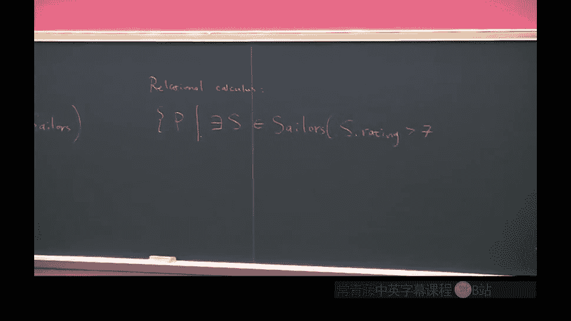
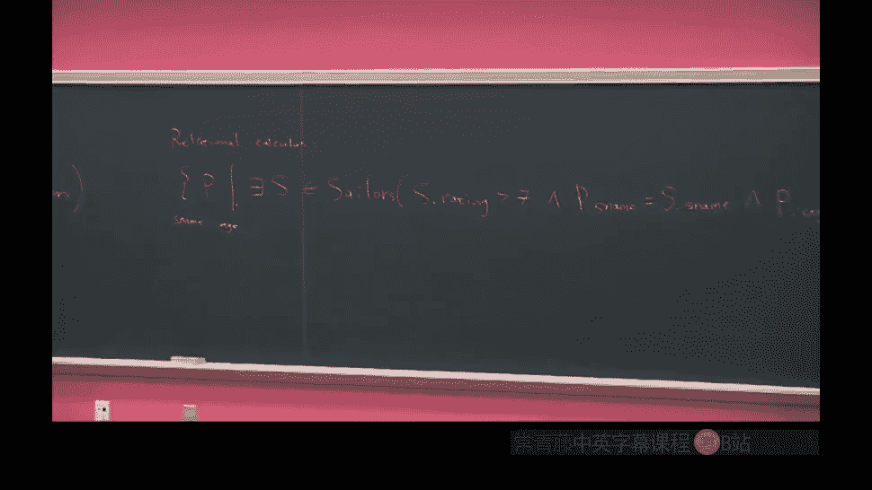
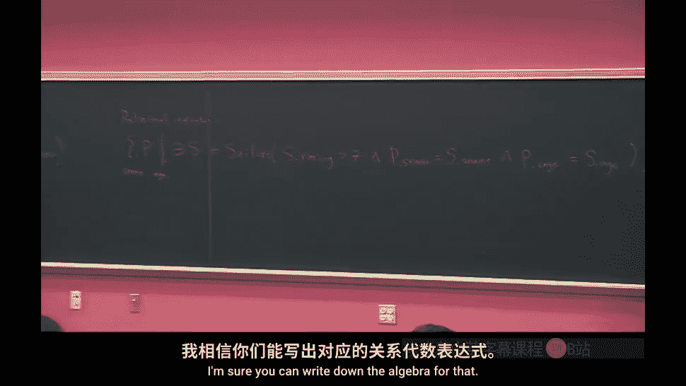

# 宾夕法尼亚州立大学【中英⚡数据库管理系统｜CMPSC431 Fall 2015, Database Management Systems】 p12 P13 关系演算 - 第2部分 -BV1N76CBwEXb_p12-

Good morning， guys。If you haven't done so， please put your homework to right there。

And what I will be doing now is to give you back your homework one and two two and quiz three。あ。

Valeie。ま头。Bussy， last name， Bussy。Eric。In。For those who have missed down。Come to me after class。And。

I'll give you a， maybe I missed it。All right， so before the T comes here。

Just want to quickly start ourll lecture today to work on a little bit of relational calculus。

 So as you can see the slides today， we have some queries that we're going。Some are new ones。

 so the number that are exceed 10 are the new ones。

And we will work on both algebra and calculate for that。

 And for those that we have done before which are at numbers less than 10。

 then we will only work on the。cover是。Okay。So let's start from queryry。12。Where it says。

 find the names in ages of sellers with the rating above 7。

So if we are only doing an inter relational algebra。I guess this is already very easy for you， Gu Ty。

What would you do first if you want to solve this query in relational algebra。

We want to first find the sailors who have ratings over seven， so we will use watch。Selection。

 select onward。Ring is greater than seven。 and then we apply this。Sellers， right。

 and what's the next step everyone names in ages？MThe project on the name。And the age。

So up can tell here it's really simple， we're really familiar with relational algebra。

Then I think the next page I asked you to write calculus， right？So for the first one。

 Ill work through it first。Then for the later one， you can think about it。

So we want to sort of map that。Map calculus from algebra in a sense that remember the format of。

Calculus， what will be the most outer thing？Curly braces， okay。

 so let's say we start from Mc curly braces。And on the left hand side， we always give the tus names。

 So let's say we just name a P for now。And we put the criteria on the right hand。And look at here。

 we only involve one relation this time， so let's say we say there are there exist。S。That are in。

Saillor。Okay， so that's the first thing you want to write down。And we will work on criteria。

So the first criteria we want to think about is。This one。

We want only the sellers we rating above seven。So what do you think should be the first one we were right now？

え。Dt rating。Greater。等車。

And for now we only have S happening here， but want to somehow make sure that we then generate two fields right here。

 which are。S name him H。So let's just assume we already have results and the result have two fields。

 one is S name， one is8， where will those fields values from come from？They come from S。

So what we can do is we just simply by saying。The P name。Is from the。You basically is putting in。

And keep going。And P。移行中。Close the criteria with with another grade， close the whole formula。

So that's how we do work on。プショか。你看看。北ジ？

So if you take a look at relational calculus in relational algebra。

 you can see the way we're thinking for different approaches are a little bit different when we look at relational algebra。

 it's more like how we are going to retrieve the data。

 but relational calculus is more like presenting how the results would be。

 So here we say the result T should be this and we describe。あれですま。That's for relation。

Incussion so far。Then let's try out Pra 13。I'm sure you can write down the algebra for that。

So try to write down the algebra。Where we want to find the sailor's name。

 both ID and reservation day for each reservation。So who can tell me what are the relations that will be involved into this one？

How many relations will we need？Two， which two？Sailors in reserves again。Why do we need boats？

You have the BIDs oring reserve？Okay， so what should we do for sailors？And reserve。We joined them。So。

The query wants us to find。Sailor name， VI D and J， what do we want to do？我们。

P drag on the field you want。N name。So the relation entrepreneur for this one is really simple。

 that's it。Yeah。So let's think about how the relational calculus will be them。

We also start from a P that would be the tufl variable where we say the result relation。

And if we want to follow the same way we did in the previous query。How will we start？

Take a look at here we have two relations involved。So what will be the first thing on right now？Yeah。

There is this。Yes。That's in。Salor。Things is are。That is in reserves。How should we work on the。テテシンで。

Do we have any selection in the algebra？そ。So because there is no selection or whatsoever。

 you just have to make sure the S I D here。Its equal to the SI here。Correct。

So let's start from the first thing。All right， from here。So you say the SD in S。

Will be equal to the S I D。In R。That's the first thing and this is sort of saying the same idea as the natural joint or we can say it could join because we're just comparing for the field with the same name。

 whether they have the same values。What next？Take a look at the P。He has three fields。

 which is S name。又啲。And。So what would you do？Next， in these condition。

A criteria we set so that you can make sure those fields help that。MHe S name。

Its from as is its name。And。と？Our。Finally， the last field。い day。So having worked on the first one。

 which is Cur 12 now13 seems to make more sense right。that for。313。And for this exercise。

 we actually have a carry 14， but before we do that， quickly go back。IWhere we have worked on before。

It is be 1，2。给那个。You guys all got here this part？So let's go back to our very first one。

Buthich is to find the names of sellers who have reserved vote 103。

 since we have already worked on this before， I'll just quickly write that down。

And the version I'm writing down is sort of。Ignoring whether is optimal。嗯。Okay。

 so here is for the relational algebra。You we want to find the sailors who have reserved both 103。

 So we want to first associate sails and reserves by using join。

And we select those rows that the BID is equals one of three。

We finally selected the S because that's what we want from the query。

 So how would you proceed from here to write down the relational calculus？

WeStart from Mc curly braces。Sa。Couples P are in the result。So， again。

 what are the relations involved。Sails in reserves， so how should we start？

There exists as that belongs to sailors。Oh， so there exists are。That belongs to reserves。

So that's how we want to start。And this time we have selection。So what should we do。第。一讲。Yeah。

 we have children。We can start from there as well。 So let's say we want to say because we join them。

 so the SSID。Will be the same as the one。哪儿。Okay so that's the first part where we take care of the joint。

What's the next thing you will want to do？20。嗯。😊，RBID。put one or three。Correct。

What's the final thing since we won the S？So P dot asking。Where does it come from？So。Right here。

 the first term。Take cares of。The joint。Right。How about the second term？Selection。And the final one。

フjectクシ。朝？So that's what cr you want。We go back to the curriculum we have worked on before。

 this is how we would write in terms of relational calculus instead of relational algorithm。

Any question？And we want to try curry too。So inquiry to want to find the names of sellers。なった？不。

I'll quickly write down the algebra first。So we want to find the seller name。

This is the first approach to writing it。Another one you can do。

Which is actually less optimized but easier to think about。这都同一。bright's Christian。

Do they generate the same result？Yeah， they do， right， but which one's intermediate table is smaller？

The first one， because we do selection at the very beginning， so we avoid when we're joining them。九結。

This trail。The calculus。So actually for。Those two approaches。

 we can write down different relational calculus based on that。然后 that。first one。你是谁？

Let's try from the first one。And let's try from the second one。How would you start？

We always start curley braces。He， to ofee， back satisfy。So what would you do first？S from sail。

 S are in sailor are in reserves。比后。There existss S。That's in sailors。There is its R。

That's in reserves。There also exists fee。In books。So here we take care of the joint。系。What next。

Take a look at it here。Yeahり。呢一电话。Okay， what do you guys want to do if we are trying to write。

Based on the second one。How will we start from this election？Then what would you do。今天。听好了。Of course。

 the red， okay， that part takes surface selection。可。问了。You want to take care of projection or joint？

Either way。Lets can join them。 So let's say we want to take care of the join。 What should we do。I洲。A。

TheBID。Will be equal to be。WI。嗯。Pect， yeah。Anything else we're missing？Now， that's for joining。嗯。

What should we do if we want to then finally take care of the projection？

He that is name comes from sailors。As。All right， so that's for the first one。

So you also can see here this term we takes care of the selection。

This term we take care of the joint。Finally， take care of。Projection。

So if you take a look at this relational calculus， all of the terms that we have。In the condition。

 does the order matter？But how just don't care， we just think about it and then we put it down so the order doesn't want up。

 we just connect them with。Can's think about how we will interpret the first one。Also。P that。H。こ自で。

So this is a little bit trickier so I' work。So we want to first say there exists S。

That is in sellers。They're also in this part。Is in the reserve。And up until here。

 which is basically say。We take care of。Before him。Well basically say so in order to join them。

The SID from S。結構？To the SID from R。I think more to vote。

And then we also take care of the projection where we say， okay， the S。放听。Will be coming。

So far so good， but we haven't taken care of here。So what we can do is actually。Continuing in。

They're actually。B， that is。上口。It's kind of weird here so we say。And so。Very good me。From both。Where。

The BD from art will be coming from here。And also。The colors。Could this be a little bit weird？

Okay so let's start from the very last one。So you're basically saying there is this fee that are from those。

Where we can associate。TheビIディー in both to the VIディグ。And then you're saying， also， I only care about。

For both who have color red。So when we look at here。

 this is joining with preserves but not thinking about sailors' now。And when we look out back。

We look back here and then you're saying， okay， I'm joining sailors and reserve by comparing as they need has to be retain and then take care of projections。

The result is seen。How from。So even though this is more optimized when we write down the relational algebra。

 when you interpret it is a bit convolutative， a bit more complicated。But that' part of the lucky。

Any question for that one？So in a test I ask you， I don't really care about which one you write。

Let's take a look at Fer7。Where you want to find the names of sellers who have reserved at least two boats。

Anyone tell me what we did in relational algebra when we are working on this？I think it was。William。

It was you， May you answered this one。So what did you do。Every name of。今チービアイデス。Yeah。

 you join which two relations。呃。You join reserves， with reserves， and then we rename the field。

To avoid the name of conflict。And we keep the rows where SIDs are the same。

 but the IDs are different。So that's what we did in。relationlational algebra。

Let's not write that down yet。But if you think of it， I say the output is here。

There's the output in yet because we are asking for S。So we only have ethnic。Right。And input。

Will be because we want S names。 So you have to come from sailors。 Okay， So we have S I D。Its name。

Rating。嗯A。These are from sailors。那 we finally哈。And say the the idea day。That's from reserves。

But instead of having just one copy of it， we have two。So let me say it again the input。

 we take it from sailors。Reason B， we won the S。Another two inputs are both from reserves。

Reason we need to is because we want to see。Which sailors have reserved at least two goalss？

And we want to make sure we can compare the BIDs are different。

Will it be easier now that weve covered the count？どて。So yeah， yeah。 So can you do that。

Let's quickly work on the aggregates。Affgregation。还有第一点。

So right now we weren't using aggregation because the ccu cannot not be directly translated from that。

 well let's quickly try out aggregations as we mentioned。

So let's say if you're going to work on aggregation， what would you do？Arvation over are from Alpha。

Do we need grouping for this？Yeah， what do we group find？SID。What's the input。Yeah。

 we can just use reserve。And what's the aggregation function？高边。看。いアイディ。哎。So that's Ar one。

Grouping criteria argument2， the aggregation function。So let's store it quickly。where。Yeah。

So one of attempt looks like， how many columns will we have？Two， which are。

So what should we do let's say we want to get the II who have reserved more than two votes。

So let's wear the towels。EID。回程认。And we feel that。不呵。But for now， this will get us still。Two columns。

 right。And what's our final goal？We still want the name， right， so we can join with sailors。

Either you want to do projection here or later， it doesn't matter。

We don't care about whether it's optimized， so let's say we join with sailors。

And what do we finally do？If we want the name。Project。催眠で。But yeah， that's so one。

 we river for relation ultragraph using aggregation。Any questions about that。Okay。

 let's go back here。Again cant get back to our relational calculus。What would it do for this one？

I' to switch our brain back here。So。top of pe， satisfy what。

A hint right here since we have two reserves。Let's call1 R1 another one RPp。

So how will you start with the existing lines？Okay， we start from S。That is from。Sellers。Okay。

Then we have。R 1。That is from。Reserves。对。Then we have what。R 2。Who's also。From reserves。

So that part takes care。Just saying how many relation we want to use。One next。

 which do you want to take care of？Let's say， we want to use。Prediction first。And here we only have。

Is me。So what will the projection be。Yes is nameing hes from。at98。

 let's say we want to take care of the projection。Its name from。He is from S。Is snake in。Okay。

 and then Cork said， the BI D， what about it？Like。Okay， so R1， B， I D。Should be different。

From R2 BID。That's the part we can take care of and has at least two boat reserved。

What else should we do？开始。Ass the。S ID。一個。TheR one。对吧。お？We only keep one equal。

So then what should we do for the next？え。Yes。嗯诶。二去。Anything else？Yeah。

 the reason I positive it was because。This is right。But then you will want to be careful then。

 we actually don't need to say， oh， then we join R1 and our2 so we should compare our1 SD equal to R2 SD。

This priority take。But that's what Kie said。It's actually easier。To think for this one。

 in relational culture， I've been the one。In。Relay for algebra。We actually have two more。

But I think I'll leave 14 for you and Ill work on nine。

Because I still want to spend a lit bit of time talking about。嗯。Homework。In teens as well， in。Okay。

 let's take a look at Que9， we want to find names of sellers who have reserved。我 would you听回来。

I'm not about occasionally。In most of the cases that you were doing before。

 we were actually trying to match from the liberal。です。いや、そな。边系。そう。trying thatYeah actually。

 the reason I map it there， even though the end result is really different just because we can be clearer what are the tables that will be involved in stuff。

 but when you really read this， it's just basically saying the result itself， like the topples。

 what are the criteria that topples satisfy。😊，But when we read the algebra。

 it's saying what are the process I'm taking？To get the result。So it's still different so yeah。

 like mapping it from relational algebra to relational calculus might be conflict with the core concept because one is procedural。

 one is declarative。But for now you for the purpose of practicing nerve。And that's a good one。

 so they actually have really different purposes。😊，One is for' declaring what should the result be。

 one is for saying， what should the steps be to get the data。But。

The reason I do that is because I want to。Kind of make sure you know what are the relationships。Okay。

 Prairie9， we want to find the names of sellers who have reserved all boat。The keyword here is alt。

 so what did we do for alt？フレーション。Division， so in relation with U， we use division。

Before we get in here， what do you think can be used for couple we're talking about all？For every。

 so that will be。That thing right so we have。レセジグです。And that's where every。Okay。So in cultures。

 we use that。So when we are in algebra Bro use division。さ howしみ you。这ら我。Also。here。

This is kind of tricky I would work on。So we say the couples P。There exists as from sailors。In board。

For every vote。Okay keep reading like this P satisfied the criteria where there exists as from sailors。

And for every B from both。Exist。Reservd from an art from reserve。Which satisfy the condition。

I the project first。His name will be coming。嗯。Sailors。And。第细啲。声一。Joing reserve。

So we read through that， we are just basically saying， for topples P。

 it satisfies the criteria where S there exists S from sailors。And for every be from both。

 there is reservation。That satisfied。Sort of tricky。TheDo。はい。我 put to my。いやこ。我的。

After the boards in is old。嗯。What are the bracketet？就咁啊系啊。No， not the curriculum obviously just idea。

 this one， this one had before。For some。Forwhere。Think Dr。 Woods。

Yeah the just from open back before this yeah。Yeah， we this remove this。嗯。じ。

So we are just adding it book。Oh you're saying we remove this， right？

Do you think it makes a difference？ I just put it because the interpretation feels more intuitive。😊。

やて管。Okay， we have a little bit of time， I want the T to quickly tell you about the graing。

The don点 homework work。嗯，上到申就行。So， I think。You are doing great job this time。And before。

There some platform。嗯。さ point。For example， like for this time。

 I think the question to is to answer the。They take independence， right？And some of you might。

I don't know where to get the idea like the。In heads。

Its provided by the logical stma or something of internal space stma。I have to say if you saw some。

Similar answer from。Somewhere。Just。Because we if to focus on as lies。

 right and Lisasan and I both wanting to focus on lies since example from the Wikipedia， right？

And of the third answer。有下。好的。Yeah， the three is okay and the four。About the four。

 I think the most problem is about the fun It's about the third question。 He asked whether its a。

Have actually increased。And the correct answer will be conscious。

But some of you might answer relatively value， I think that's okay。诶新态嘅。啊，安呃审判。

Sometimestime差不多因为你 show每天。他们可以。And if I。Get use like national airplanes give you acid。貌似鬼了。

Attribut just a naami and I would do。And。That about the shorter diagram。嗯。

The part is the question slide。About the。我翻了讲。Yeah。If you read it if you。Have very carefully uniform。

 There is one sentence that no one professors can it is possible that no one professor can teach。

させます。Right， but it also means that。There is possible。 There is possibility that only one。

Professor can teach that。So you have to connect the professor and teach。自解。

So basically that's my point， follow the lines and answer don't forget or don't miss any entities or attributes it might possibly to review some。

Okay， so that will be it if you have any greeting issue。

 you can email you and drink and discuss with her and you are missing your home。

that I haven't given the back to you， please come here and take it。

