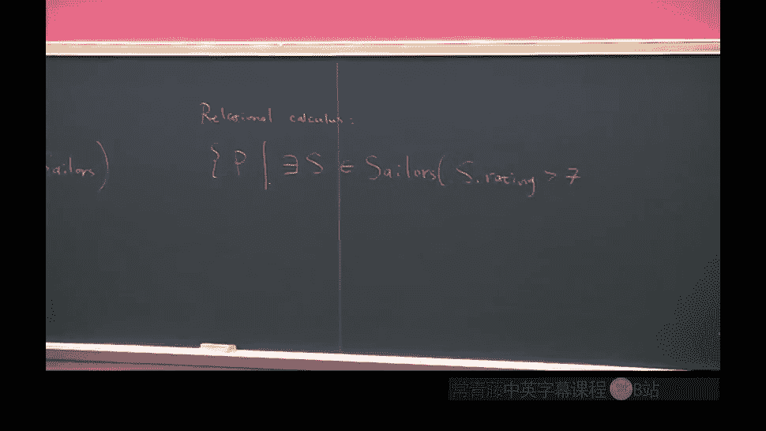
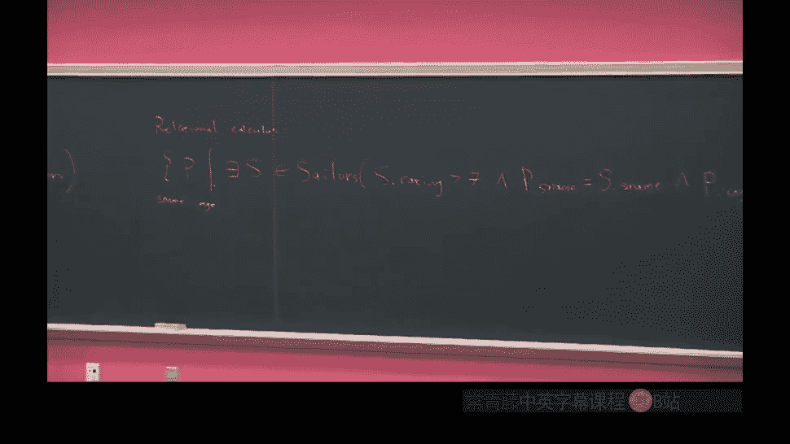

# 数据库管理系统：第12讲：关系演算 - 第二部分

在本节课中，我们将继续学习关系演算，并通过一系列查询示例来练习如何将关系代数转换为关系演算。我们将重点关注涉及多个关系、选择和投影操作的查询。

## 概述

上一节我们介绍了关系演算的基本概念和形式。本节中，我们将通过具体的查询例子，学习如何用关系演算来表达更复杂的查询逻辑，并与关系代数进行对比。

## 查询12：查找评分高于7的水手姓名和年龄



首先，我们来看一个简单的查询。在关系代数中，这个查询很容易实现。



**关系代数表达式：**
```sql
π_{sname, age}(σ_{rating > 7}(Sailors))
```


现在，我们将其转换为关系演算。关系演算的思考方式更侧重于描述结果元组应满足的条件。

**关系演算表达式：**
```
{ P | ∃ S ∈ Sailors (S.rating > 7 ∧ P.sname = S.sname ∧ P.age = S.age) }
```

在这个表达式中：
*   `P` 是结果元组变量。
*   `∃ S ∈ Sailors` 表示存在一个属于 Sailors 关系的元组 `S`。
*   `S.rating > 7` 是选择条件。
*   `P.sname = S.sname` 和 `P.age = S.age` 是投影条件，指定结果中的字段来自元组 `S`。

## 查询13：查找每个预订的水手姓名、船只ID和预订日期

这个查询涉及两个关系：Sailors 和 Reserves。

**关系代数表达式：**
```sql
π_{sname, bid, day}(Sailors ⨝ Reserves)
```

在关系演算中，我们需要表达两个关系的连接以及结果的投影。

**关系演算表达式：**
```
{ P | ∃ S ∈ Sailors, ∃ R ∈ Reserves (S.sid = R.sid ∧ P.sname = S.sname ∧ P.bid = R.bid ∧ P.day = R.day) }
```

表达式解析：
*   `∃ S ∈ Sailors, ∃ R ∈ Reserves` 引入了两个元组变量。
*   `S.sid = R.sid` 是连接条件，相当于自然连接。
*   后续三个等式定义了结果元组 `P` 的三个字段分别来自 `S` 和 `R`。

## 回顾查询1：查找预订了103号船只的水手姓名

我们已经用关系代数解决过这个问题，现在用关系演算来表达。

**关系代数表达式：**
```sql
π_{sname}(σ_{bid=103}(Sailors ⨝ Reserves))
```

**关系演算表达式：**
```
{ P | ∃ S ∈ Sailors, ∃ R ∈ Reserves (S.sid = R.sid ∧ R.bid = 103 ∧ P.sname = S.sname) }
```

这个表达式清晰地分为三部分：
1.  `S.sid = R.sid` 处理连接操作。
2.  `R.bid = 103` 处理选择操作。
3.  `P.sname = S.sname` 处理投影操作。

## 回顾查询2：查找预订了红色船只的水手姓名

这个查询涉及三个关系。关系代数有两种写法，我们先看第二种（可能非最优但更直观）。

**关系代数表达式（写法二）：**
```sql
π_{sname}(σ_{color=‘red‘}(Boats) ⨝ Reserves ⨝ Sailors)
```

对应的关系演算表达式如下：

**关系演算表达式：**
```
{ P | ∃ S ∈ Sailors, ∃ R ∈ Reserves, ∃ B ∈ Boats (S.sid = R.sid ∧ R.bid = B.bid ∧ B.color = ‘red‘ ∧ P.sname = S.sname) }
```

表达式解析：
*   同时引入三个关系的元组变量。
*   `S.sid = R.sid` 和 `R.bid = B.bid` 处理三个关系的连接。
*   `B.color = ‘red‘` 是选择条件。
*   `P.sname = S.sname` 是投影条件。

需要注意的是，关系演算中条件的顺序并不重要，它只是声明性地描述结果，而不指定执行过程。

## 查询7：查找预订了至少两艘不同船只的水手姓名

这个查询的关键是“至少两艘”。在关系代数中，我们曾通过自连接Reserves关系并比较`bid`来实现。

在关系演算中，我们可以通过引入Reserves关系的两个实例变量来表达“至少两个”的概念。

**关系演算表达式：**
```
{ P | ∃ S ∈ Sailors, ∃ R1 ∈ Reserves, ∃ R2 ∈ Reserves (S.sid = R1.sid ∧ S.sid = R2.sid ∧ R1.bid ≠ R2.bid ∧ P.sname = S.sname) }
```

表达式解析：
*   `∃ R1 ∈ Reserves, ∃ R2 ∈ Reserves` 引入了Reserves关系的两个实例。
*   `S.sid = R1.sid` 和 `S.sid = R2.sid` 确保两个预订都属于同一个水手。
*   `R1.bid ≠ R2.bid` 确保预订的是两艘不同的船。
*   `P.sname = S.sname` 投影出水手的姓名。

另一种方法是使用聚合函数（计数），但这通常超出了基础关系演算的范围，更接近于SQL或扩展的关系代数。

## 查询9：查找预订了所有船只的水手姓名

这个查询的关键词是“所有”。在关系代数中，我们使用除法运算。在关系演算中，我们使用全称量词 `∀`。

**关系演算表达式：**
```
{ P | ∃ S ∈ Sailors (∀ B ∈ Boats (∃ R ∈ Reserves (S.sid = R.sid ∧ R.bid = B.bid)) ∧ P.sname = S.sname) }
```

表达式解析（从外向内阅读）：
*   结果元组 `P` 满足：存在一个水手 `S`，并且对于所有船只 `B`，都存在一个预订记录 `R`，使得该预订记录属于水手 `S` 且预订了船只 `B`。
*   最后，`P.sname = S.sname` 将水手姓名投影到结果中。

这种嵌套的量词结构（`∃ ... ∀ ... ∃ ...`）是处理“所有”这类查询的典型模式，它直接而声明性地表达了查询意图。

## 总结

本节课中我们一起学习了如何为多种类型的查询编写关系演算表达式。
*   我们练习了从简单选择投影到多表连接、条件比较（至少两个）以及全称量词（所有）的转换。
*   关系演算是一种**声明式**语言，它描述“结果是什么”，而不关心“如何获取”，这与**过程式**的关系代数形成对比。
*   尽管在初学时常通过映射关系代数的步骤来理解关系演算，但理解其声明式的本质至关重要。

通过对比两种语言对同一查询的表达，我们加深了对关系数据查询理论基础的理解。