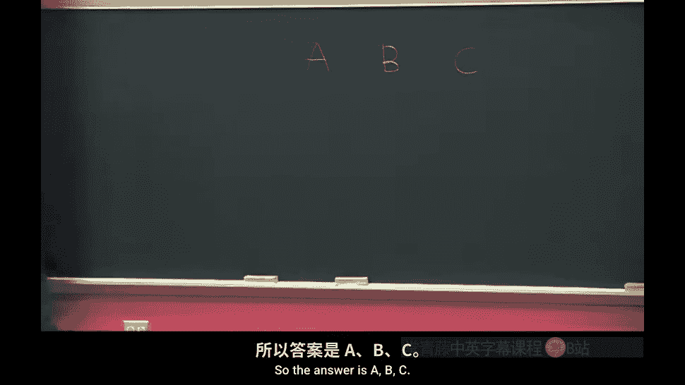
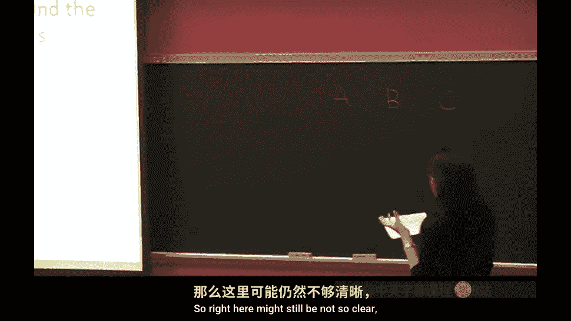
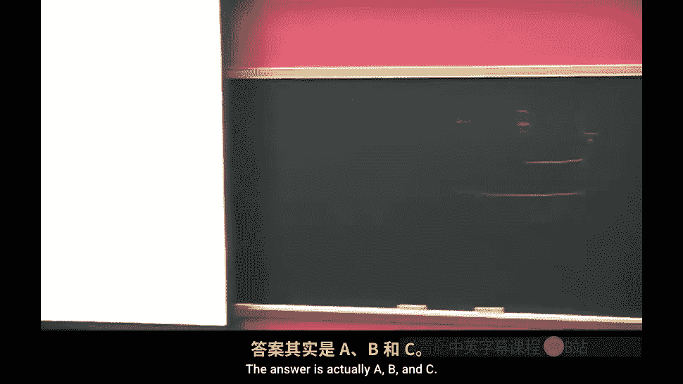
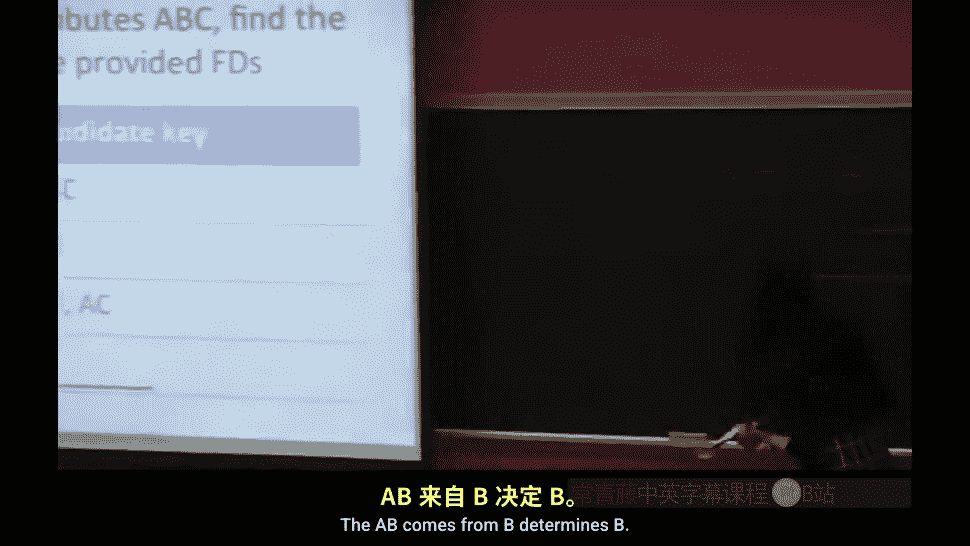
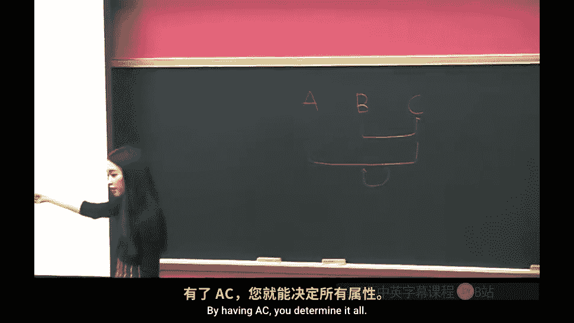
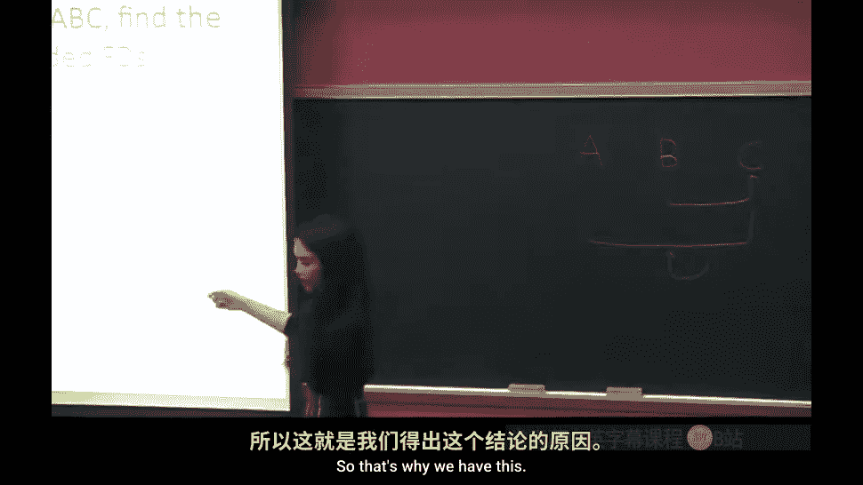
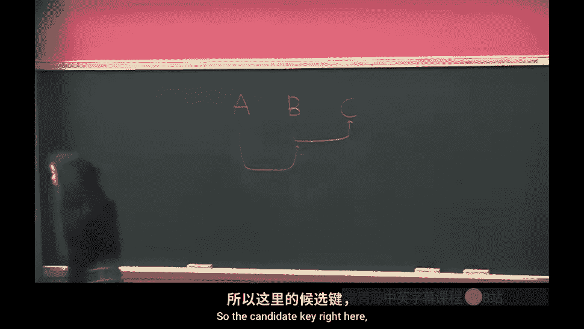
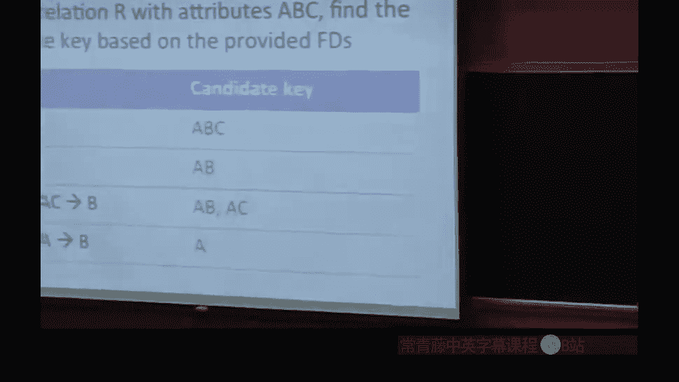

# 宾夕法尼亚州立大学【中英⚡数据库管理系统｜CMPSC431 Fall 2015, Database Management Systems】 p13 P14 函数依赖与阿姆斯特朗公理 -BV1N76CBwEXb_p13-

Good morning， guys。Yeah对。I kind of expected this。Everyone kind of burned all their energy， so these。

That' one standing。How was the midterm like？It was reasonable。Wouldn't itか。次。Yeah。

 I felt I don't know， it was interesting to watch you guys write it， it sounds really weird。

 but I never made exams before， so yesterday I was like oh people are trying to answer my questions。

That was really。Enjoing it and I talked to my roommate about it， I said。

 I think it's very easy and then she said， yeah， all the professor thinks so。I don't know。

 I hope you guys。So we have come this long， we are actually at week six。

And I think it will be kind of smoothly if we directly transition to chapter five because chapter five basically focus on trying to write this SQL command based on the relation and algebra expression we have learned。

However， I would jump all the way to chapter 191 because chapter 19 about。

Schema Re will be the main emphasis on your phase two of your project。

So what we are teaching today is kind of important。快递过。

Yeah， and now that， we'll go back to chapter5。Okay。嗯。So a few things before we start。

 I think the midterm should be finished graded。Next Monday。

 I'm Monday day and then we'll talk about it and then if you have any questions we can discuss at the time。

おっしゃ？Before we start chapter 19， I want to quickly talk about something that's about chapter5 because I've been saving this up since the beginning of the semester。

 there's actually a joke。😔，For chapter five， but I don't want to wait it' still quite long。

 and I heard at the beginning of this semester。So as I said before。

 chapter5 is writing SQL comments on relation algebra。So as you know。

 SQL can represent can express relation to algebra。So the joke goes like this。

One day Sequel walks into the restaurant。And he sees two tables， then he asks them， can I join you？

All right I've been waiting like for six weeks to talk about this and this is the only audience I've got。

 so whatever you guys this is a reward for coming to class。😊，タです。And I've read a lot more online。

 but I don't know whether it's my English problem or culture I just don't get the punchline。

 I was like reading or something I'm like， so what's so funny about it？😔，This is the only one I。Okay。

 lecture 14， let's get started The lecture 14 will be on chapter 19， it's about schema Rement in。

So we have talked so much。Relational model and designing the database and so on。

But how do we know the design we've got is the most optimized？In different kind of aspects。

 for example， storage wise， is it the most optimized most efficient。

 So this is what chapter 19 is trying to。Tll you。 So remember we were talking about it before。

 there are sometimes they are bad design。 Some attributes is actually better not to store them。

 One of the example will be it's better to enough store age。

 would store the date of birth because each year the age changes。 and it will be easier。

 if we just compute it from the。Another example， for example， when you're designing your online shop。

 you might store the address with attribute of zip code and also the state， however。

 the state can actually I guess can directly be derived from the zip code。哎行。

So maybe it will be more efficient if we only store in the table the zip code。

 and then from that we can derive the state。So schema refinement will help you to find this kind of we call functional dependency。

 so some attributes will depend on the other attribute。

So some problems that might be caused by having redundancy in your database。

These are the four big categories where we say four types of problems that might be cost。

 The first one will be redundant in storage， as I said before。

 some information that will be sold repeatedly。 So sometimes you don't have to store that much。

 you just have to have another reference。The second type of problem will be the update anomalies。

 so here it says if one copy of repeated data is updated inconsist it might happen。

In a sense that if we update the zip code， but it for some reason when the administrator manually enter the information and forgot to enter to change the state。

 then that will cause inconsistency， it would stop following the rules。

Another one would be insertion anomalies so it may be possible to store certain information unless it may be impossible to store information unless some other information is stored as well for example。

 when you're a  typeping you don't know the state but you know the zip code then what should you do to just leave the state is known or it would be better if I'm referencing already there。

The fourth one will be deletion anomalies， so if we store it just in all one table。

 sometimes if we delete enough of the entries， we might lose the association associations of which they do code mapping。

So these are the four major types of problems that might be caused by redundance。

let's talk about functional dependenciesencies I talked about before some attributes will definitely rely on other attributes。

 so functional dependency， it is actually a type of integrity constraint。

So we have learned quite a few of different types of in inivity constraint before， for example。

 key constraint is one type， participation constraint is one type。

 but for key constraint on participation constraint， they can both be。Presjectative。

In the ER diagram， but there are some that cannot be， for example， functional dependency。

 when we draw the ER diagram， we couldn't observe any attributes relying on other attributes budgets looking at your design。

So some integrity constraints will not show that ER di work and functional dependency is one them。

And whenever we talk about functional dependency， the rest of the chapter， we use FD to denote that。

A functional dependency occurs when one attribute in a relation uniquely determines another。

So this is the example which is talked about where zip code will determine。

So let's take a look at an example that we will use in this chapter。Mostly to talk about FDs。

 the function of the tendency。So I guess we just really briefly talked about the hourly employees us one of the entity set in the I hierarchy when we were talking about employees entity set。

 but we never really show an instance。So this will be one of it。Let's talk about it so our employees。

 the schema goes like this， we have SSN， Ma， parking lot， rating， hourly wages， and hourss worked。

So here's the instance for that。嗯。For the sake of dereevity， in the rest of the chapter。

 we will just。Deote the schema in this way。 Allright， so we would just write the letter。

So one letter will represent one field I quickly circle if you don't have to do that just just so you know S means SSN n means name。

 L means lot and so on For now， you might think it's kind of weird but later on because we're going to write so many functional dependencies derived from this schema。

Also， because we den it as this， you might think。This means that it has to be in this order。

 but actually this is totally equivalent when we write them as just a set。

So that is because the order doesn't matter。It just want to。看。

The order doesn't matter when we talk about functionality。

So now you sort of have a sense of what functional dependency might be。

 Can you observe this table and tell me what sort of dependency you can find from this instance。

 for example， which attribute differently。Observe the values and how they change over。😔。

Can you find two column always change together。いや。I know in a lot of places you were heard for you。

スタしで。Oh， so then you think the hours worked。Goes with。できますです。嗯。Yeah， so that would be。

 we say from your knowledge of it， but from the example， if you look at 40， okay maps to 10。

 30 maps to 10， but now 30 maps to seven。Anyone else？Yeah。Yeah。

 so if you look at rating and hourly wages you can see if rating is8， hourly wage is definitely 10。

 if rating is5， hourly wage is definitely is7 and rating is8， hour wage is definitely 10。😊。

OkaySo up here we can kind of assume there are sorts of functional dependencies between rating and hourly wages。

 sometimes you cannot say this for sure because it might be coincidence。

But now if we think is's reasonable， like your rating with employees rating well decide and are the wages。

 then we can say there is a functional。So let's let's see how we would。

Express function of dependency。So the first one you talked about here。

 let's talk about this one first， so the rating we say it determines hourly wages。

Then the way we can write it would be like this。 so you write R， which is rating。

 determines with an arrow。And W， just the hourly wages。You might think based on the instance。

 you can actually write it the other way around。But let's just say in this scenario。

 we think it makes more sense where the rating determines the hourly wages instead of hourly wages determines rating。

And another functional dependency you might not notice because it just comes with every table is actually the primary key determines all of the other field。

All right， so here the primary key is SSN and it determines all the other fews。

So we write it like this。OkaySo for this kind of function of dependency naturally comes with every design of the table。

Because whenever you have the primary key， you should be able to determine all of the other values。

So this is how we will write down the functional dependency。

 but if today we want to draw it on the schema。Let's take a look at how we were write。

SSN determines all the other fields。This is how we will actually write to it。So starting from SSN。

 it points to every other field。So what do you think， how we will write the second one。

 the rating determines hourly wages？hich is simply。抓point。Short the error。From rating to early wages。

So this， what you see right here is what I want you to do for phase two。😔。

You want to go back to your design of your ear of your database， or your schema。

 and then identify what are the functional dependencies exist in there and you want to draw this out。

In terms of normalizing them， make them more efficient when you say optimizing them。

 we'll talk about it later。So as we talked about earlier。

 there are four types of problems that might be caused by redundancy right so let's take a look at how those four types will map to the example we are talking about right here。

So the first type of problem we talk about is the redundant storage。

 so if you take a look at the instance back， we have rating equals to eight corresponding at R wages equal to three and we repeat it three times。

So in some sense that's not so necessary， we can actually have the external table storing this kind of map。

In another type of problem， which is the update anomalies。

 we have hourly wages could be updated without making corresponding change to rating。

 so that's another potential problem that might be caused by the design。

And the third type is the insertion anomaly， so we cannot insert the tuple for an employee unless we know the hour language for the input rate。

So a lot of times if this happens， if the bat design leads to this kind of problem。

 a lot of times when we。Enter the topic who will have some set to know。

So the fourth type of the problem will be deletion anomalies if we delete old toples with the given rating value in。

So that's like the zip code and state。So before we move on。

 now we know what functional dependency is and what problems it might potentially cause。

What kind of solution can you think of？If we take a look at。Take a look at the original table。

 how would you do to prevent those things from happening？Yeah。

You you have a separate table that map tower where you just destroy。

So you will want to break this table down into how many。2。So yeah， exactly。

 so what we can do to solve this kind of functional dependencies problem or the redundancy problem is to actually deupose。

So that's where we talk about the decomposition。So problems caused by redundancy can be solved by replacing a relation with the collection of smaller relations。

Did I take all the smaller relations？当。So it can be replaced with pollution。

So when you're doing decomposition of a relation schema， let's say the schema we call it R， okay。

 we used uppercase art and didote that。You want to make sure that， all right。

 you can replace it with two or four， okay， doesn't have to be two because sometimes there are more information that you want to do external differences。

And also you want to make sure that decompose schemechema together， doesn't matter how many you have。

 two or three， together they have to include all of the attributes in art。

So you cannot be like ay compose which somehow miss some of the column。な理だ。

Let's take a look at how the composition will be in action。In terms of the example， we just。

So previously we had this sma all right， over here our employees with that many attributes and now we break them down into two smaller tables。

So this will be how the final result should look like。Okay， and in something you'll be like。

 so what's so good about it if you just look at the number of values at store right now。

 it doesn't seem like you've got less right because here originally we have one more column and that will be。

F cells more。 And now we have four cells。So that's just one out down。

 but when your database get bigger， when your data gets more。

 this would be more efficient in terms of storage also to solve the other problem that we just talked about。

So for functional dependency， let's talk about how it would be formally defined。

A functional dependency， so as we said before， we will use the arrow to denote that。

 so x determines y we use x arrow y。嗯。So for x and Y， each of them。

 we say they are a set of attributes。So it can be multiple attributes for each set。

X determines why hold over relation R if for every allowable instance， R。Smar， little R of the big R。

Okay。It shows satisfied this， so here it seemed really weird what we are talking about。All right。

So for the the。Uppercase are。Capital R， it means the whole original schema。Okay。And for smaller。

 it means one of the couples。Okay， so here we say if。For this T 1 in R， which means it's a。啊，好看。Okay。

 this is the instance。 And R， I know。 This is the schema as little R is the instance。 Okay。

 so for a topple in the instance， T 1 and another topple， T 2 in the instance。

If we take the X field in T1。And the x in T2。If she implies if we say x determines what。

And that make more confusing？开着。It will imply that if you take。

The y field from T1 were also equal to the y fields from T 2。Let me talk through it again here。

R is the relation， so that will be the schema。And little R will be the instance that satisfy the schema。

 so that's by the data in the schema。And here it's he1。Is one of the couples。In the instance。

 T2 is another。So if we say x determines y， then whenever you take out。The x from T1。

Equal to a from T2， then it should directly imply y from T1 equal。听清。

Let's take a look at this example right here。If we have an instance of schema ABCD like that。

And this is given if we say A B together。Determines see。Okay， let's take a look whether that's true。

 and we can see whenever we have A1， B1， A B。Cea will be seaor。Whenever A1， B1。

C will be C1 and whenever so these doesn't matter right A1， B2， we get C2， A to B1， we get C1。

 so we can say that， satisfy this functional dependency。Then can we add a couple that we have A1， A1。

 C2 C？Why呢？Because that will。Conflict， the function depends。Because we would take a look here is A1。

 B1， according to that， the C should be。See what。Right。So the answer is no。

 we cannot act such a coupleple because it violates the。Fctional defense。That is good。

So a few more things on cultural dependence。Do we say a functional dependency is a statement about all allowable relations？

So it must be identified based some semantics。Like earlier， it was said。

 maybe it'll make sense if the hours worked， we'll finally determine the wages。

 so that would be sort of a semantics in the application。So when you're doing your project。

 you're the one saying which will actually depend？Another thing about functional dependency is that given an allowable instance are one of。

Relation art， we can check if it violates some of the function dependence。Like we just did earlier。

 right we saw in the instance and we have a couple we are checking whether they will violate the function dependency before we even。

So。Here， can we tell if F holds over R by checking the instances and database？

Remember earlier we were talking about sometimes data that might make you feel like there are some kind of functional dependencies。

 however， it might be just a coincidence。In different domain。

 there will be different kinds of interpretation， so some it looks like maybe there'。

But it was actually not just because you have so few data points and that they look that way。

 so we can't actually not tell。Unless it makes sense in your application。

So a few notes on functional dependencies and keys。

 let's review a little bit of some of the terms that we might have forgot。

So the first one is super key。Super key is actually an implicit function of dependency。

 but it is not minimal。喂。Because。You might have forgotten what super key is。

 soll here I list the definition of them。Super key is a set of fill that contains the key。

And a tuple is always a super key。你们不来。So why is superhe an implicit function？

Because whenever we have keys。😔，The key can determine all the rest of them。That's why I'm super。

If it contains the key。Then the key itself can determine the other field in。

That's why super key is an implicit function of dependence。But it is not minimal。外带。

Because like here we said， a coupleple is always a superhe。Okay， so it's not minimal because。

When we say key。A key is actually candidate， key， it's not primary key。

So maybe it doesn't even determine that many， but because theyre olds of the key。

 so the key is determines all the other。So a functional dependency can also determine the candidate key。

Where we sometimes optionally call it the key。Don't get confused。ケ金すき。Primary key is primary key。

Let's recall， candidate keys are where no two distinct couples can have same values in all。

And no subset of the settled field in Canada Key is a unique identifier for a couple。

So this means can candidate keys have primary key？As one of appeal。

 because then there'll be a subset。So here it might get more and more confusing but let's take a look at。

how we will actually use functional dependency to find candidates。So here I say we have。😊。

3 attributes，8。If got right hear people from that site， can you guys see it？So， let's say we have a。

野性。やいいてよ。And for the first。嗯。First case， we have no functional dependence。

What do you think the candidate teach。If no two distinct couples can have same values。

Then what kind of candidate heat do you think still uniquely？他も。听你倾啊。So in the answer。

Is ABC。There是 have no方。哦。全輩。So right here， you might still be not so clear。

 but how about would we say there's a function of dependency where B dependency？

AV deterency。What kind of candidate he do？Yeah。咦你点开晒。Because C is determined。えていい。

And we can not only have beads because。B actually doesn't deterinate。系。Second 어디。I take a look at it。

Including B determine C。Also have AB determination。This might kind of neat， but let's do a theme。

It does this AC deter。ご解でキ。嗯。There are too。The first one。

系。The answer is actually a。Why is that。The Amy comes from these。

并给我。どどい。You can take。A determines B， and then B determines。If having A C。

你 determined到。So that's what we。

哎。だらで。Let's take a look at the fourth one， where we also。Have these current fee。And this time。

We have a。What do you think。Whi。1。Just a， because right here we see A determines B and then B determines C。

 which means it implies a connection。So the candidate came at CF。

It's just a。

We'll talk more about this like because of which determines which and then which determines which there's so many kind of transition。

😔，All right。So the reasoning about functional opinions。Given some function dependency。

 we can infer additional function dependency， like we just did， A determines B， B determines C。

 so that by that we know a difference。This is what we mean by inferring。

 so here is an example if a person's SSN can determine the department ID he works for and the department ID can determine the parking lock。

Then what does imp？The SSN can also determine。The。Okay。So this is sort of this is rather。Intuitive。

So this is what we say if the functional dependency F is implied by a set of functional dependencies。

 which we denote as uppercase F。If F holds whenever all the set of function dependencies hold。

 so this is by this， we mean， for example， in the example， this F。

 we can say its SSN determines a lot，It's implied by a set of functional dependency。

 which is these two。If it holds。Whenever all of them。So。For this kind of concept， we use F。Plus。

 in the what this。Super， he didn't know that， we called the closure。We call the closure。をって。

It will be set up all the functional dependencies in play。So from a starting point。

 you might be able to identify some of the functional dependency because of the application。

 because of your knowledge of your database design， but later on you might be able to derive。

All of the other functional dependencies imply by the functional dependency originally。Identify。

So in the end， if all of them are found， they are called closure。

So how do we actually find these closure？In today and Friday， well talk about the Armstrong exams。

That we will actually use。There are some exams that we will use to repeatedly apply on the functional dependencies you identify。

To eventually infer all of those。All their derived function。So now you is still thinking。

 what are they？So there are three basic ones。Right here， so we have reflexivity and augmentation。

So let's take a look at the first。So earlier when we talked about that we said ABC。

 each of them is a field， but actually you can also think of them as set of fields。

 just a set of attributes。So here you can either think of X， Y， Z as just。One attribute each。

 or you can think of them as a set of attribute。So what refx means is that if。Why is a subset of。

Then what， what do you think will happen？Who can determine who？When you do mapA to the example。

Right here， which one do you think is y， Which one do you think is x？This is。W。This is x， right。

 because y is a subset of x。 So we say if y is a subset of x， then。Who determine。Ex determined one。

Okay， so this is rather intuitive，If we have， this is really intuitive have。

This set of attributes of an employee's SSN and the department I D he works for。

 Then we can definitely find his department I D。this is a very simple one。

 but because it's so simple， the code in trial。Okay we we will' talk about more next time0。

Before we get into the next， I just want to briefly talk about。

So today we'll mainly just focus on why it makes sense， but we won't prove it yet， but on Friday。

 we'll prove why they are。我也要去。The second one is augmentation， so augmentation， we say if。

X determines y。Judging by the example， what do you think？I would say then what？X。Yeah。

 X determines Y Z。So in some sense， this feels like。

The left hand side and right hand side of an equation you can multiply by the same values， okay。

 it has that kind of sense。So for augmentation， we say if x determines y。

 then Xz determines yz for anyz here we look at it。

 we say if a persons even an employee's SSN determines his department's ID。

 then we can imply if together the SSN with the name determines the ID。Okay， that's where I。So far。

 I feel really obvious。Then the third one is actually the one we used already in the example of finding Kennedy key。

That's the transitivity。So we say if x determines y。In why turn the。等我。M exiter。

So this is really intuitive as well if a person's SSN determines his DID and DID term determines a lot that implies SSN determines the lot。

 which is actually to。So let's work through each of the examxis and see whether they。Stay correct。

Okay。So for each of them， I will give you the examples of the s factor。Let's book on the first one。

Reflxivity。So say we want to show this is not proving， even though it looks like proving。

 we're just showing that it makes sense， So let's show。If y is a subset of x。

 then x determines y using these。It should be really intuitive。

So for the first thing you just want to say if y， so y is a subset of x。

 then in your example you say name in the set is a subset of SSN and name both in a set。

SoThese are very why we want you to write down the steps so you can see。How they might be taken that。

So we only have second step left for this one， what do you think the second step？

The second line we want to write there for。Next determines white， and then here will be。SS呢。

Oh want to。So judging by this， we can say if I see that same values for SSNN name。

 I must also see the same value。Let's try the second one now you know。What to do。

 what should be the first step， let's say we want to show if x determines y。

 then Xz determines yz for N， and the example here we are using is x has only one attribute in the set is SSSN Y has name。

 Z has parking lot。So what do you think the first step should be？We want to start from the if。

So x determines y。And that should be here we say I。Determins name。Then what next。こてね。耶。

This isnt a lot。Super simple， so then we can see if I see the same values what this in lot。

 we must also see the same value for me。Then let's get into the third one。

 which is also really simple， we want to take a look at the example of sensitivity。

So for transitivity， we want to show if x determines y and y determines z， then x must determine z。

 and given these examples。I'm sure you can， right。First， write down how you will map x determine y。

Right then right down， y determine V。And the third night is there。

So the first line would just be x determines y， which is SSN determines rating。

Second one would simply be in y determin Z， which is rating determinants wages。시운点地가。

What bring need to the therefore。X determines Z， which is SSN determines our of the wages。

 so this is the transitivity。I've seen already a few times today。

So here I wrote a lot because I wanted to make sure you know when we read them。

How we should be interpreted so we can say by C that for the same values for SSN。

 I will see the same value for rating。And if I see the same value for rating。

 I must have seen the same value for hourly wages。Together， then device C SSN， same value for SSN。

 I will have this。Value for our。先こすね。So the above three are the armsmstr vaccine。So。

Armstrong athes was actually proposed by guy called Armstrong， and he proposed it。

 I think 1974 in a paper on relationlational model。

 so he was trying to have the athes that would help people to identify all of the functional dependence based on the over sets of functions。

So that brings you to a closure。So there are a couple of theorems for Armstrom atheums。

 the first one， Theorem one。Armstrong astheiums， we can say。It is。Two things right。

 so when we talk about theor， we can say。The exams are sound。And we can also say it is complete。

So Armstrongng Englandington has both of these properties。It is sound in the sense that the aM。

 they can generate only the function dependencies in F plus when applied to a set F of functional dependencies。

And it's complete in the sense that the repeated application of these rules would generate all of it。

Dive function dependency in the final closure。はい。So I won't get into here too much today。

 but we will prove them on Friday and these things you can say in other words， they are this。

 even only this， have you guys seen these symbols， so this one we call it the intels， EN TAILs。

 okay we say uppercase F， intels small F。Okay， I'll get into more next time。

 but for now for this part， this term， the interpretation will be。In every model。

 talk about the model， this is true。Then this must be also true。But for now， just remember。

 this is Intel。This is harder to understand， but let's look at here first。For this。

If we use this symbol， we' saying。It means derived。Okay， or you can say info。

 So all of the little Fs。Or derivable。From the uppercase app。

We say little things on the right hand side are all derivable from the left hand side。Okay。

 so for soundingcomplete together， we will have this in other words that。Thatしょ。

The next time I'm not sure whether I'll prove the completeness， but definitely proof the sadness。

And the sound is a lot easier。So the reason we will be proving them。

 even though we looked at those exempts and they make sense。

 but we always want to make it precise and prove why。And other than those three a thems。

 we actually have some additional rules that we might use really frequently。

 and they are the union and decomposition and when I last checked I found I missed。Z on your slide。

 So it looked really weird。 You would just read through without the Z。やくたるよ。

So next time I'll also show how you can get the union intocomposition from3 hc and we learn。

 so now for union you just have to remember if x determines y and x determines Z。

 then x can together determines Yz okay when we put them together and means taking the union of the sets。

And for decomposition， that's the other way around， at least say if x determines yz。

 then separately x determines y and x determines Z。Next time I'll go show how it comes from me。

So before we finish the lecture today， let's quickly go through an example。

We only have three minutes I'm not sure whether we can finish them but we can try here's the example schema so it's the contract schema where we have these attributes and as we talked about at the beginning of the lecture we will just use these letters to represent each field and here I'll give you three of the integrity constraintstraint。

So let's ignore these sentences first， but just look at here。

 we have this that comes from the primary key， and then we have that JPE together determines Y。

 and we have SD together determines P。Okay this is the example we want to use。

And let's quickly look at how we can derive more functional dependencies based on these three。

The first one。If we have JEP determines C and C determines that all the other fields。我 do听会好。

By those two， what can you derive？Yeah， JP determines all the rest， right， putting them together。

 It's very tempting to cancel them out。 So this determines all of them。 It's through which atheM。

Transitivity， all right， so through transitivity。We can derive JP。

Determines all the rest of the fields。It's because of transit in the C， we can think of it as the Y。

And because earlier we said if。A field that can determine all the rest of the tuple is a key。

 so we can also say JDP is the key。So for the second one， where we have SD determinemins P here。

 I'll just quickly give you。This one。If we have SD determinemins P。

 we can also get SDJ determines JP。By adding。J on both sides right so you look back to the ATMs。

 this is based on which one。Augmentation， so it feels like multiplying the same values on both sides of the equation。

哦 of theこ。Okay， for the third one， what do you think？We have SDJ。Now we derive more right。

 so we keep going。 Now we derive more SD DJ determines JP， and JP determines this many。

 So we take the two derived ones together。 What more can we write。When you see these together。

Transitivity， exactly， so that。It TJ。Itters all the rest。Okay。So now we come to the end of the class。

 let's really quickly look at this。 Now we have STJ determines all the rest。

Because we talked about multiplication on both sides of the equal sign。

Isn't it kind of tempting to cancel out both Jay？No， no， some people say no。

So we'll talk about why next time， but the answer is no， we cannot do。All right。We cannot cancel。

 even though。It might be tempting to do that， but we cannot cancel。So that's for it。

I'll see you on Friday and while last to work for the teams， I sent an email last week for the team。

 so if you want to reform the team， inform me by Thursday。

