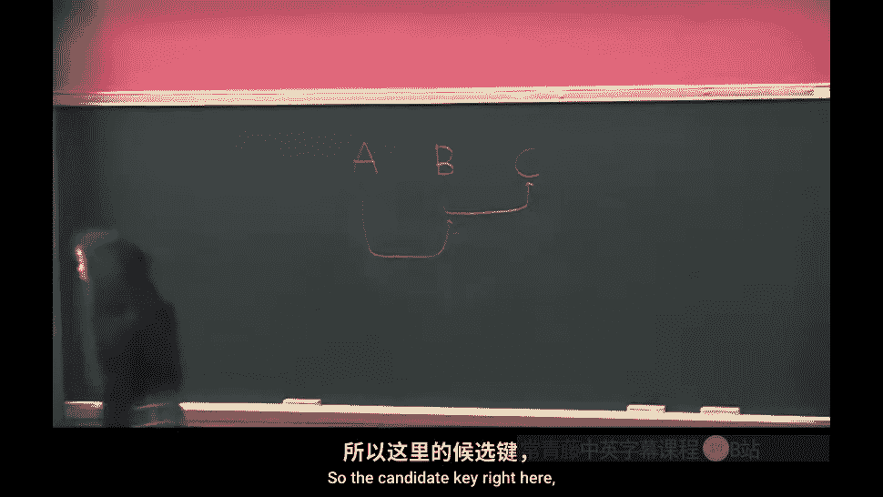
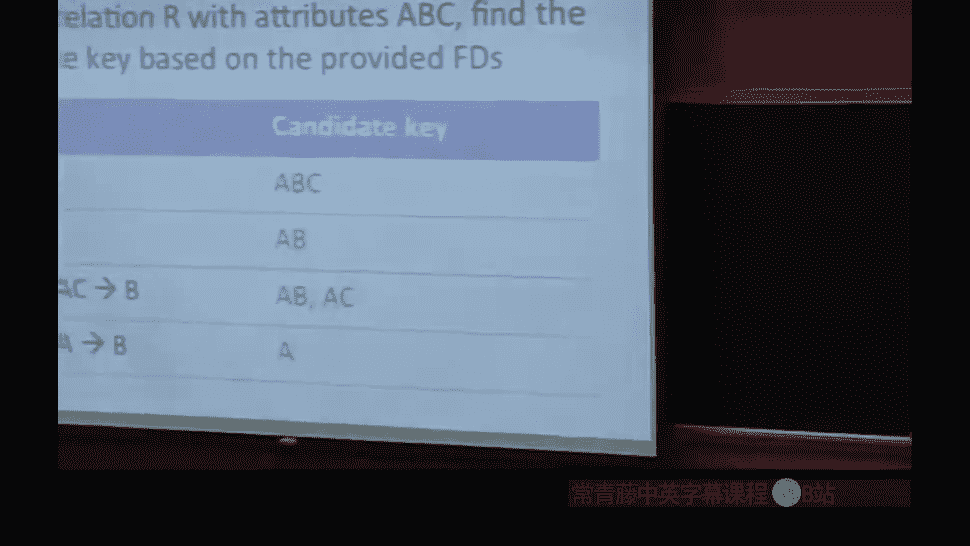

# 数据库管理系统：第19章：函数依赖与阿姆斯特朗公理

## 概述
在本节课中，我们将学习数据库模式精化中的一个核心概念：函数依赖。我们将了解什么是函数依赖，它可能引发哪些问题，以及如何使用阿姆斯特朗公理来推导和验证函数依赖。这对于优化数据库设计、减少数据冗余至关重要。

## 冗余引发的问题
在深入函数依赖之前，我们首先需要理解不良的数据库设计，特别是数据冗余，可能带来的问题。以下是四种主要的问题类型：

1.  **冗余存储**：相同的信息在数据库中重复存储多次，浪费存储空间。
2.  **更新异常**：当重复数据的一个副本被更新，而其他副本未被同步更新时，会导致数据不一致。
3.  **插入异常**：由于某些字段之间存在依赖关系，可能无法插入某些信息，除非同时插入其他信息。
4.  **删除异常**：删除某些数据时，可能会意外地丢失其他重要信息之间的关联。

## 函数依赖简介
上一节我们了解了冗余的危害，本节中我们来看看如何识别冗余。函数依赖是一种完整性约束，它描述了关系中属性之间的决定关系。

**定义**：设X和Y是关系模式R的属性子集。如果对于R的每一个合法实例r中的任意两个元组t1和t2，只要t1[X] = t2[X]，就必然有t1[Y] = t2[Y]，则称在R上**X函数决定Y**，或称**Y函数依赖于X**，记作 **X → Y**。

**示例**：在一个`员工(SSN， 姓名， 部门ID， 停车位)`关系中，如果`部门ID`可以唯一决定`停车位`，那么存在函数依赖：`部门ID → 停车位`。同时，主键`SSN`可以决定所有其他属性：`SSN → 姓名， 部门ID， 停车位`。

函数依赖是基于业务逻辑的语义约束，不能仅通过观察有限的数据实例来断定，而必须根据对应用的理解来确定。

## 函数依赖与键
函数依赖与我们在关系模型中学习的“键”的概念紧密相关。让我们回顾并关联这两个概念：

*   **超键**：一个能唯一标识元组的属性集。超键隐含了一个函数依赖：超键 → 所有其他属性。但它不一定是最小的。
*   **候选键**：最小的超键，即其任何真子集都不能成为超键。候选键也隐含了函数依赖：候选键 → 所有其他属性。
*   **主键**：被选中的那个候选键。

通过分析属性间的函数依赖，我们可以推导出关系的候选键。

## 阿姆斯特朗公理
给定一组已知的函数依赖，我们如何推导出所有隐含的函数依赖呢？这需要使用推理规则。阿姆斯特朗公理是一组基本且完备的推理规则。

以下是三个基本公理：

1.  **自反律**：如果Y是X的子集，则 X → Y。这是显而易见的，例如 `{SSN， 姓名} → {姓名}`。
2.  **增广律**：如果 X → Y，则对于任何属性集Z，有 XZ → YZ。这类似于在等式两边同时加上相同的项。
3.  **传递律**：如果 X → Y 且 Y → Z，则 X → Z。这是最常用且直观的规则，例如 `SSN → 部门ID` 且 `部门ID → 停车位`，可推出 `SSN → 停车位`。

## 附加推理规则
除了基本公理，还有一些非常实用的衍生规则，它们可以由阿姆斯特朗公理证明：

*   **合并规则**：如果 X → Y 且 X → Z，则 X → YZ。
*   **分解规则**：如果 X → YZ，则 X → Y 且 X → Z。
*   **伪传递规则**：如果 X → Y 且 WY → Z，则 WX → Z。

这些规则简化了函数依赖的推导过程。

## 闭包与推导示例
**闭包**：设F是关系模式R上的一组函数依赖。F的**闭包**（记作F+）是指能被F根据阿姆斯特朗公理推导出的所有函数依赖的集合。

让我们通过一个例子来练习推导。假设有一个合同模式，属性为：`合同号(C)， 供应商(S)， 项目(J)， 部门(D)， 零件(P)， 数量(Q)， 价值(V)`。已知以下函数依赖：
1.  C是主键：`C → S， J， D， P， Q， V`
2.  `J， P → C`
3.  `S， D → P`

**推导1**：由 `J， P → C` 和 `C → S， J， D， P， Q， V`，根据传递律，可得 `J， P → S， J， D， P， Q， V`。因此，`{J， P}`也是一个候选键。

**推导2**：由 `S， D → P`，根据增广律，在两边添加J，得到 `S， D， J → P， J`。

**推导3**：将推导2的结果 `S， D， J → P， J` 与已知的 `J， P → S， J， D， P， Q， V` 结合。注意，虽然`J`在两边都出现，但**不能**像代数等式那样直接“消去J”。我们需要谨慎应用传递律。实际上，`S， D， J` 可以决定所有属性，因此它也是一个超键。

## 总结
本节课我们一起学习了数据库模式精化的核心工具——函数依赖。我们首先了解了数据冗余可能导致的四种问题。然后，我们正式定义了函数依赖，并将其与键的概念联系起来。为了系统地处理函数依赖，我们介绍了阿姆斯特朗公理（自反律、增广律、传递律）及其衍生规则，它们构成了推导函数依赖闭包的基础。最后，我们通过一个示例演示了如何应用这些规则进行推导。理解并运用这些概念，是进行有效的数据库规范化设计、消除冗余和异常的关键步骤。