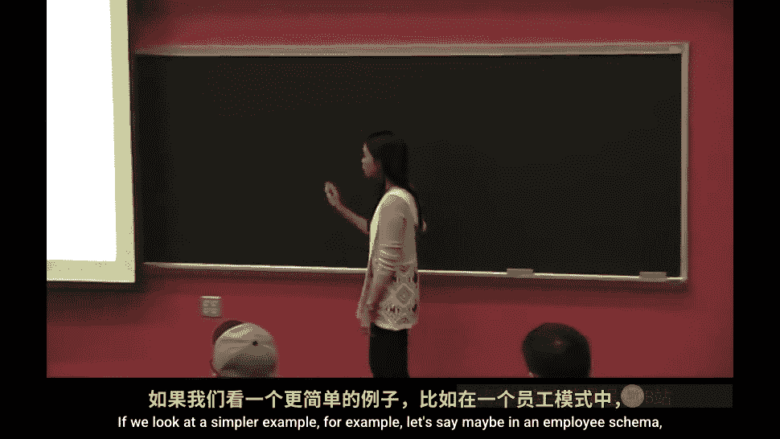
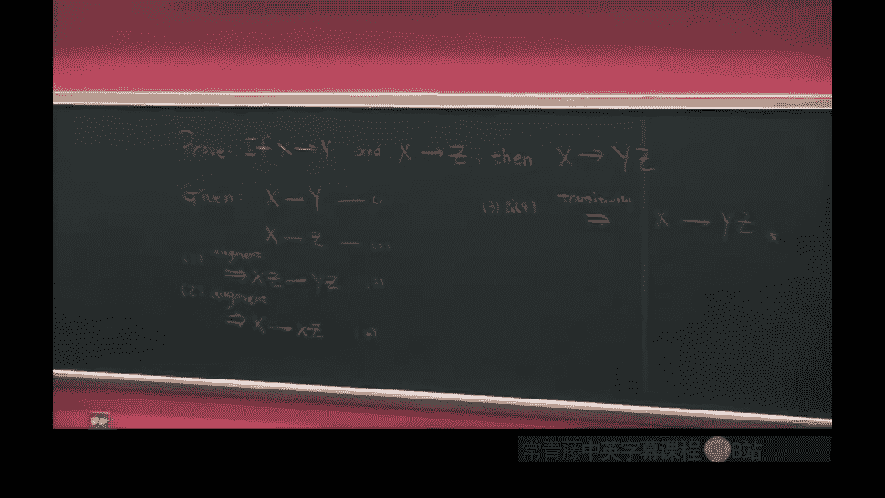
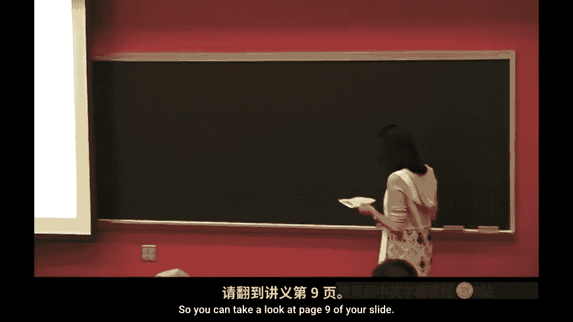
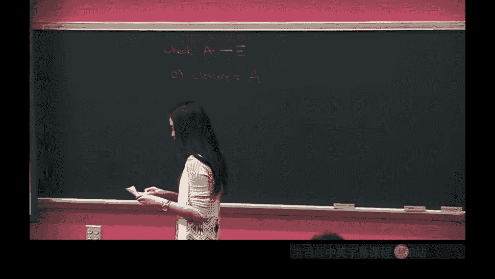
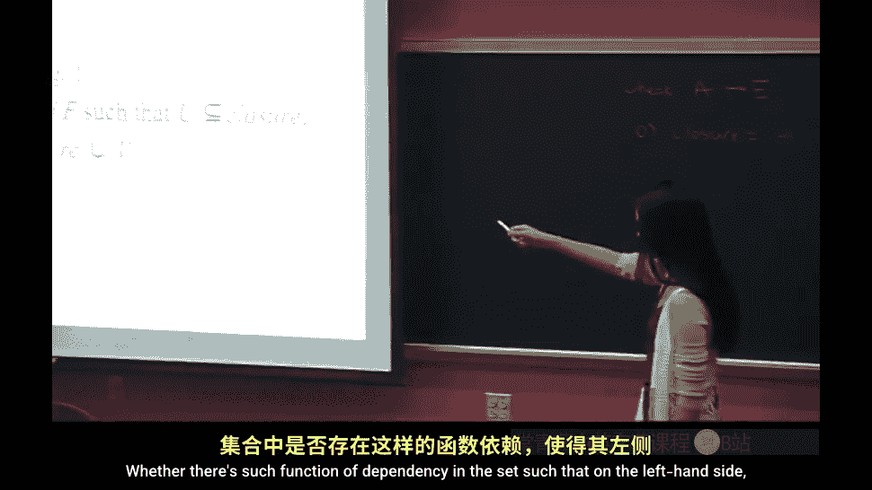
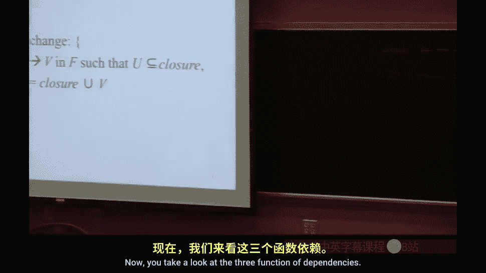
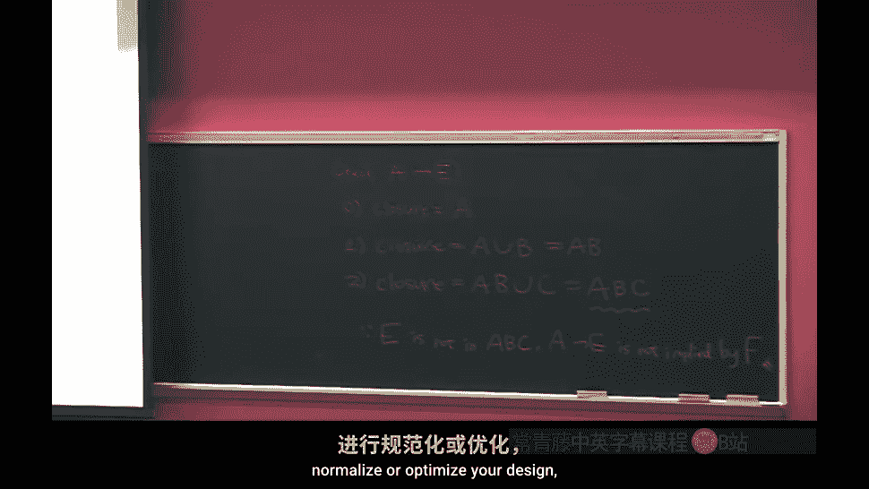
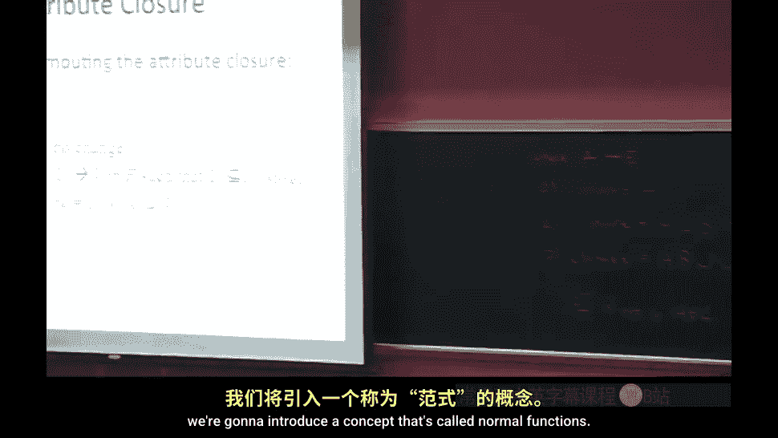
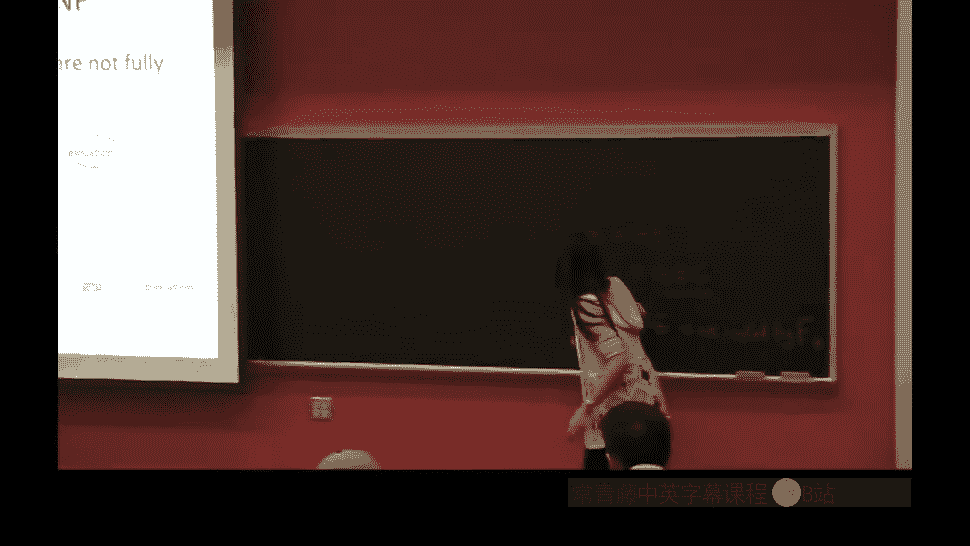
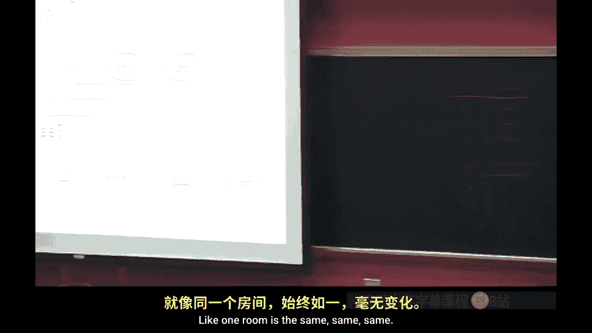

# 宾夕法尼亚州立大学【中英⚡数据库管理系统｜CMPSC431 Fall 2015, Database Management Systems】 p14 P15 阿姆斯特朗公理与范式 -BV1N76CBwEXb_p14-

Good morning， guys。So。Last night was the deadline。Reforming your team， so I won't take it anymore。嗯。

Yeah。Next Monday， we will。Great at midterm。Project phasease one。

So we will also be reviewing the midterm question。We made anything。Instead。

 you can find it a way to adjust your rate。We will possibly post the great。one。現でが。三で？三でい。

Today we are going to continue the lecture from Wednesday。

 where we talked about functional dependencies， remember。😊，So。Wow。I don't know。Look at your time。

It's not here。I didn't move it， but just flew around。Okay。

Last time we talked about function dependency， where we say when you have an ear model design in a table you might be able to find some attribute。

Can you determine other attributes， or in other words。

 some attributes are dependent on some other attributes。An example would be when we have zip code。

AndDe the date。Com address。Another example will be the example we worked out last time where we talked about。

An employee's rating can determine his hourance。so that's what the functional dependency we talked about and when we talk about functional dependency。

 we were thinking how we can infer more functional dependency based on some。

Basic ones that we identified， then that was where we talked about Armstrong's in the government。

And here is supposed to be the armstr making but didn't really messed up。

 so we have three basic atheoms in armstr makingiumians， the first one direct flexibility。

 the second one is augmentation and the third was sensitivity。😊，So maybe take a look at your slide。

For refxivity， we say if y is a subset of x， then x determines y。

And last time we talked about some examples。And then we have augmentation， which has a feeling。

 or you can say it's a taste of multiplication， so we say when x determines y。

 then xz determines yz for N and Z。This is kind of like you take a multiplication on both sides of me。

equation or equals。The fairway transitivity。If extra terms widening。全て。

So these are the three basic arms from India。嗯。And when we talk about Armstrong athemum。

 remember we say it's sound and。So we will talk about the soundness later。

Then based on the three armsmstrm ACMs， we have two other ones that are derived from them from the three basics。

 one in union and one。So last time I talked about we will prove the soundness of armsstrm I。

 but today I changed my mind， we're just going to prove the soundness of union and then from there you can try it out on the other one。

So。After learning our from aMs， we were working through this example which is a contract schema and remember whenever we talked about in this chapter when we were talking about schema for the sake of Prievity。

 we always use just the letter to represent the attribute， so one letter represent one attribute。

And when we were working through the example， you were given three functional dependencies which have C that determines all the others。

 and this is trivial because C is what。Primary key， and the second one will be JP determines C。

 and the third one is S determines C。In your task last time were to see how we can derive more function to tube based on this。

 and every derivis are based on one of the axis。So this is what we work through。

So given JP determines C and C determines all the others through transitivity。

 we can have JP determines all the others，Combine them together， then we can use transitivity。

And because of this， if some attribute sets can determine all the others， we say it's a key， right。

 it's a candidate key， the idea of candidate key。Then we have SD determines P。

 and through augmentation we can have J on those sides， so that's why we got SDJ determines JP。

And after getting these two。Now we see they both have JP but of different sides。

 so it might be tempting for you to use sensitivityivity so then we have SDJ determines JP and JP determines all the others。

 so with two of them together we can have。I DJ determine all the other。

And before we end the last lecture， I was asking you guys。

 can we cancel this out because both sites have J， you might want to cancel them out。

RightAnd some people were shaking their head， so the answer is no。你肯定用 want tell me我。

So we can have a really simple example to see why this will be。好，OK。To cancel out from both sides。

 but we look at a simple example。

嗯。Let's say maybe in employee。SchemaWe have SSN。And。然可以你。Together。We can。Comminine this。でた？

And this is， all right， right？お歳？系い。Can we cancel。那我一天哪。

Because the whole point is the functional dependency works。How he me。But now taking them out。

 cannot guarantee employee names。And he that。Pacle。婷定。Okay。

 so just remember when we have functional dependencies， even though we talked about augment。

 kind of having a sense of multiplication we cannot。Okay you can only action。They not。

So we also talks about the armsstrm axioms being sound incomplete。😔，And the more I think about it。

 I think it's a bit complicated。And instead of working through why each of them。This soundingcomp。

 I think today I'll focus on showing you why the additional ones。

 which are the union of the composition are staff。So in next slide。

 we will work through the soundness to prove the soundness of unions。

And I'll work you through on the black hole， but before we start。

 can you try to think about how we can prove it by using the three atheum？

So if you take a look at the union， it's basically saying if x determines y and x determines z。

 then x determines yz， so how do you go from the if those two given functional of dependency to the then？

By using the three basic cases。Try it。I'll write down the Gibbons first。So our goal。Is to prove。

If x determines y。And x determines Z。Then。Determins。我子。So just remember。

 when we talked about something determining something， they don't have to be a single attribute。

We can be set of the attributes so when they put them together。It's the concept of taking union。

 that's why this property is called union。Any thoughts？It is I don't know。Okay。

 so here are the given right， on the left side of then， it's the given。So let's start from the given。

嗯。union， so because each of them is a set set of attributes， Yeah， so when we use this。

 it means we take a union of the y set and D set。So there's no order。This start from the giving。

So we know X determines y。Andてこ。So let's say this is the given one。

So we can actually rewrite the first given。With augmentation。Yeah。So I'll write it like the human。

And through augmentation。I just put off man。What do you think we will do。

What do you think we should put on both sides？You are doing aation。We only have one thing left。

What it could be。诶人。Determines why I do。And because we know this is one of the axims in armturn axis。

 so we can use it， and this is for sure truth。Then let's try out。The second one。

 we also use augmentation。Okay。And how do you think it will transform it？你。Should we use why or。

If we want to make it somehow linked back to here。X， going say x。

 so what will happen if we do augmentation on both sides with x？The left side becomes。

Still x is not going to be x x， right， because x takes union itself。Still X。

 how about the right side？Now it becomes Xz。So have you observed anything？Now we got these two。

你天看空人呢。maybe not yet。We can use one more。It seems to help me wreck。Now we have X B determines Y Z。

 We also have X determines X Z， Or if you look at it in another order， we have X determine X Z。

 then X B determines a Y Z。 So this tells you we should use。Transitivity。

If you want to name the three and4， we can do that。うこ。So， three and four together。

Through transitivity。We know what。Now，X。Determined。Correct。We have x determines x v。

And then Xv determines Y Z。系。So based on sensitivity。Be the N have x determines Yz。

 and this proved the union property。So you can try it out for augmentation。I won't work through it。

In class。How about you work through it， send it to me by the end of today？Get one more。

Sound really tempt to work there。Anyone's going be back， Paul？I'll put the screen there。secondsも？好。

Allright。

Okay， so last time remember， the reason we were having Armstrong athems are because we want to。

Infer more functional dependencies based on the given ones。Correct。

And we said if we infer all of the possible functional dependencies based on the given ones。

 what is the final set called？Re call the closure， So if you look at here the F。

Is the given functional dependencies。And we say F plus。Is the。

All of the function dependency derived based on S。And it possibly call it the closure。Okay。So。

 as you can imagine。The more attributes we have in a schema。

 then the more function dependency we can actually derive from the given point。So we say computing。

 the closure of F can be expensive， size of closure is actually exponential。你当的。

So whenever you want to check， given these functional dependencies。

 whether unseen function dependency will be valid， it's actually not a really smart way if you say。

 okay， let me compute all of the possible functional dependencies first。

All of them in theclo in out whether they are included。So typically。

 we just want to check if a given。Is in。Instead of computing all of the possible one first。

So there is a very efficient way of doing it。An algorithm thinking is actually linear。

 the algorithm is linear。So we actually just want to compute another thing that's called the attribute closure。

 So we want to compute the attribute closure。B up here we said。And after be closure x。

 which we didnot it as x plus with respect to the F。And here I made it a bit unclear。

 but here I was saying x plus is the set of all attributes A such that x determines a。

It's in the closure of。And then after you compute the attribute closure。

 you just simply check with why。So here our goal is to see whether X determines y。I valid。

 given a set of options。So here it all sounds really convoluted。

 but let's take a look at the algorithm and work through an exam。

So here is the linear example I talked about。So we start out by assigning the closure。

Just to be x here the closure is not functional is not the closure for functional dependencies anymore。

 it's the attribute closure。You want to eventually compute。

 so in the beginning you have the closure assigned just to X。

And then we want to keep repeating it until the closure will stop changing。

 so the way you do it is if there is in functionalal dependency。

Call u the times V in the original function dependency。

 such that the u from the right side is a subset of the closure。Then we have the closure updated。

Into the closure taking union of the。right now you might be thinking， what is that？Really confusing。

So let's outke this algorithm right here and we can work through the example in the next slide。天才？

So you can take a look at page nine of your slide。

你害。These functions depend on least in F。We have A determines B， B determines C。Indeed，是。

Three of these function dependencies。 And we want to answer whether these function dependencies will imply a。

In other words， we are trying to see whether A difference E is in the closure。

I have to cluster whether it's in the closure or the。And as we talked about before。

 this is equivalent to checking whether B in the attribute。Its easy is in the。

So how are we going to do this？So our goal is to check。A。哎。So if you take a look at there。

 how should we start your closure？Seent0。그で。Start with。So we said initially， this is an initializing。

携さね。So the first tip the Croia。So we can map it back to the hour。It changing。Let's take a look。

 I there a function dependence。で、すねり。

A再成BB成C。Whether there's such formdependency in the set， such that。

嗯。On the left hand side， it will be a subset of the closure。Are there any of them。

Now you take a look at the three function dependencies。

 any of them on the left side side of the arrow。

Can be a subset of this。Yeah， it' the first one， right？The first one to。

A is a subset of the current closure。 So what should we do。

 We update the closure to take a union with。没有。Okay， so what would that be。B。So the first step。

We have the updated closure。is the current one taking union with B。で。All over again。

 so now our current closure。Becomes a B。So let's go back to check again this time they're comparing。

Are there any。function depend on the left hand side， you can give something。Other than one。

Now the second one。Because the second one is B determines C。So then we can use that one。

B are in because B is a subset。the current culture。でもいすね。So we have the current exposure。AB。

 taking union with the functional dependency right。Which is C， right？こやっていいます。

Now we update the current even more。All right， and let's see whether we can proceed even more。

 now we hack her encode being ABC。れ線はきです。And we go back to check our company。

Are there any of them on the Black hand side can be a subset brand here that we have to use？我们 use。

Right now we have use one。不管。え政権の。And the third one on left hand side is。Can you。NomalC is normal是。

So it means if you repeat again， there will be no change anymore。top the。And now we know。

This is the attribute。到这。And if you go back to。が。Trying to see whether this。

Being the function would be to value the functions。で感シ。Loia， will it。

So you only have to check on this side。Is it in。えまあ。So， we know。

Do the form dependency imply this to valid it？Okay， so then。Right now。Yes。异议。な。因年。嗯。A times B。

We want to make it a big fair。はい。By the基方。So this is working through this linear algorithm to check whether giving you a new function of dependencies will be valid given those goodaway。

So if I ask you， if I give you some functional dependencies in a set？And I tell you how about this。

 do these。If you find a new one， then you should be able to work through this simple algorithm and check。

I said now we'll talk enough about closure。Let's take a look how we will actually apply the idea we have learned so far。

into our design or more specifically， how would you do it on your project because your project now might exist some of the functional dependence？

So in order to see to what extent should you， let's say normalize or to optimize your design。

 we're going to introduce a concept that's called normal forms。

Let's think what I know。Normal forms actually help you define the problems that might arise from the current schema。

So right now you have the schemas that you've designed in your project， phase one。So。嗯。

If a relation is in a certain normal form， we have these four normal forms that we will talk about later。

 we'll talk about the first three today and then the voice card next time。

But if we say a relation is in a certain normal form， following the definitions and so on。

 then certain kinds of problems cannot arise so for each of the normal form。

They have certain kind of properties that will prevent some problems。

So the four thousand normal formss we have in relation model。

The first normal home where we denoted with1 and F and second normal home and third normal。おいか？

So actually， all of these in the order I write here， it gets increasingly restrictive。Okay。

 so you want to know this is more， the second one will be more restrictive than the first one。

 the one more restrictive than the second one and so on。In some sense， we can say if a relation。

Is in let me say Boycott， then it must be in all the rest， so it must be third one。

 so if a relation is in second normal form， it must already be satisfy。

Let's different the most basic one。So let's start from first one。

So first normal form is actually really simple， a relation is in first normal form if every field contains only。

Atomic value。So top meet values by that， we mean the value cannot be lists or set。

So like all the examples we have seen so far in every cell of the tables。

 we only have values that are just single value and we don't have like a center list in there。

So as you can see， it's actually an implicit requirement in the relational multily。But， actually。

SoThis is more limited in the relational model， but a lot of commercial。Applications。

 they don't really require that。 Also if you already have some kind of experience with no SQL。

 is really not the。So the values they have a lot of list and stuff to store。Information。

But for now we will learn about this， so it's the most original requirement。

Rber for the first normal phone。So left hand side， right hand side， super simple。

 Which one follows vote number。Second one， yay， so because。All the values。A atomic， that's it。 Okay。

 so this one it has set， so it cannot be atomic values， so it doesn't follow the course。That's it。

 so the times really simple。So you don't really have to worry whether your project contains glmo。😔。

是么。So it should have happened。And let's take a look at second and normal hole。

So for second normalphone， there's a couple- there are two terms。That we want to talk about。

 So is today easy。AndW。if removing attribute。Any attribute from X。

Makes X determines y not hold anymore， we call it a full functional dependency。Then the other case。

As you can imagine， we will call partial。So the partial functional dependency will mean if removing an attribute from x。

嗯。It's terms of white steel。So we want to use these idea。To define second。Sos for second normal home。

A relation R， if it's in normal form。Then。If every non key attribute in art is fully functional dependent on the cabinet key above。

Take a look at what it means actually we now。嗯。So for the non second monophone schema。

 we can always decompose them into it。can try that。So let's take a look at this example。

 I actually made a mistake on your slides。I think。I put here an arrow， so。

Either scribble it out or something just don't put an arrow there。

 so this will totally change the meaning， it means for SSN。And P number together， take them together。

 determines the rest instead of essence and determines the rest。

So here we have these functional dependencies given。On this example。We have。As I said earlier。

 I in andP number together。Deters the rest。 That's the first function dependency。

 And the second function dependency will be SSN itself。Determines the employee's name。

Sre functional dependencies will be the t number itself。Determins the P location P here talking。

So can you identify which of the following attribute are not fully functionally dependent on？

So you can think about， can you identify the attributes？That are on the right hand side。

 when we remove any attribute from the type hand side of the function dependency。

 then the functional dependency will not hold any。So the only one that satisfy that will be the hours。

 right， because for hours。The only thing determining it will be the SSN andP number together。

So if we remove anything from the latein side， this would be gone。

So we say Alice is fully functionally dependent。On those things。

 as the previous slide we said before。 So how about the others， Are they fully dependent。

If you look at employee a。It doesn't matter， right。

 because we still have the second functional dependency that will help the determineinate。Correct。

 how about project location。Same thing。 still some other things that can help to determine it。

 So here we are asking。Which of the following actually are not solely functional dependent on primary key。

 which is basically saying which are the partial， functionally dependent。So those are the two。

least two。Not fully dependent on it。So how would you decompose this？Into smaller tables as we。

That we want to decompose。嗯。Design that is kind of problematic。Into smaller ones。

 So they satisfy the。What would you do？m as the first table。To be location， yeah。Exactly。

 so this is how you would becomed。We have three smaller tables become post from the big one。

All right， we want to get rid of the functional dependency problem， so for the first one。

 as quoteote said。Then there will be the SSM determining。N我 will be the。Determining the location。

And then we have that taking care of。我啲 것만有。last one why don mind。Asけ doesnt mean where。

we put them together？This is why we identify them。We identify them out。 And if you put them together。

Then， let me think。First of all， it goes back to creating redundancy。Right， because it is。

We'll fully just determine it。And that fully determined， if you combine them together。

 do you think there will be more row than necessary？梦中。you are not fully functional dependent。

 the in education。そいお前な。Now， if you think of it。Let's think of it this way。SMM。哦。

You change the primary key with the S。 No， no， no， S doesn't。Determining P location。

 it's the P number。 Okay， So if we think of it in a practical or application side， right。

 So SSN determines the E name and project number determines project location。

 But then together doesn't mean SN always only go with one。Project number。

So even if you have the primary gear。What is the problem that come name。With what with combined with。

あん。So if we go back to the motivation of decomposing them。It's because we want to prevent redundance。

So if you think of it this way， one person can associate with multiple projects。Right， so。

Like an example。

Let's say we have asN。And fascinating me。

Now I got see one did。で先生。Let's the one， two， three。爱。

And we also have P number and implementationation。I have key number。嗯。正エリす。So today。

 if you combine them together， I want do。Did you combine them together？Then let's say if。了。

He actually associates with all of the project。Okay， so the row actually。でイリストなた。

And with the health of that one。Questions， so yeah， that was for。

But this began to end I think most of the times it happens。Oneder room with same。

 same same attribute。

changing。So 다음 내 was 못 다。You say we have to I need the department's idea that created that kind close DI。

あの。to say。哦嗯。Last time we also talked about another reason it because we want to avoid when we're updating it。

 you didn't update associated that。For example。Project numbers。Always associate。

With maybe a location。But if we put them all together and when you enter a new row。

 it's possible you get the association wrong， but if you only know the number。

I just have to refer to the external table。So the main motor of this decomposition is getting seam rose。

Having all the information that we have from them， Yeah， to keep the association separate。等会儿我们点了出来。

Okay， so。That was for decomposing a second normal foam。 And let's take a look at the next one。

Can you tell me whether this is in normal phone？In other words。

 can you find any attribute that is not fully functionally dependent？Anyone。Is this in second。

Some people whispering， yes， this is。Why， anyone can explain？Jump can you。You were like， yeah。No后。

All right， if you take a look at this one， okay， let's just start。 It is second in the second form。

You we take a look at this storm。No no， no， also， it has to be。I say left and side should be a key。

All right， so in other sense， if it's。If it's not in second normal form， we can decompose it。

 then it can be in another。系。It is in second form。Let's take a look at the definition。All right。

 got it。 so a relation R is in second normal form if every nuun he attribute in R is fully functionally dependent on the candidate key。

2。But you can go back。Is the number。定。So this is not。It is。 It is。Because。

If like D name and D manager calculate you that from the number and the number is not the candidate key。

嗯。Okay， on the。そういうふにの大社せ。嗯嗯。AndSo then every monkey key。

Yeah number the candidate but number the candidate。Yeah， you're right。

 I'm thinking did I actually miss。Did I actually miss it to make this here。Underline it yeah。For god。

Sorry。This is right， because if you would have underlyingline D number， then wouldt know。本当できましてです。

either。Yes it an over event， but no it's fine so God will live。So the通 states。Circle this far。

 I'll come back and correct it it next time。All right， yeah， circle that up and remind me。

tell you改做 after。他慢的。With this sha， he's sitting on the phone。

We should proceed to feel normal home and they'll come back next time。系래。

你 talk up and off home first。Sorry about that。Okay， third normal form。A lot more complicated。嗯。So。

The main point for throughout normal foam is your project phase two。

You will want to normalize your schemas into so health。Okay， so you work through them。

 identify the function pen and say how you would。Transform in。研究教。All right。

 so for third normal form， we say a relation R。Is你这么 phone。If they satisfied。One of these。

The second one should be the first one should be trivial。That's the one we already know。

And the second one we said is x contains the key for r， which means。X is a super key， right。

 we say if something contains a key。すべき。And the soil condition will be when egg is partial of。T和2。

Maybe take a look at here。This is the second one， x contains key。And if you take a look at that one。

 then we see the third one A is part of some key。And when I was making this。

 I was trying to keep key of pink and stuff， and I realized I'm printed out it all black and white。

W I when you see it， it's there。So if one of this is set this flag。

Continue this so R should not have。You functionally determined by another。

So if R is in third number form。Some we've done this is still possible。

 but is already a good condition。So your project only has to go through3。

And next time we will talk about boycott normal foam。嗯。And that would be the most optimized one。

 but sometimes it's not achievable。😔，这想要差不多。嗯。All right， we have a few slides left。

The same problem happened again。For the next slide， it looks really messed up。ああ、いったごいます。

He looks best about my。All right， if that no form， let's talk about some situations when the fatno form is violated。

😊，So if the no form is violated。In particular， the second condition。

Then one of the following will hold the first one we call the partial dependency。

 so that's x is a subset of some key。So in some sense， we want to say， okay。

 it's violated when we look at x determines A， but x doesn't contain key。 so two possible situation。

 the first one， partial dependency then exists substantive。So， X A。The pairs will still be storedund。

And it's all right， if this happens， we just go back to you second on。

So you don't have to push everything。All the way， if you can't solve it。

 then we want to make them as good as possible， but sometimes if you cannot solve it。

 you use this simple。那么感觉。On the basic。The second one is the transitative dependency。

So transitive dependency when x is not a proper subject。For example。

 one of the situation would be when it exists to change， so that's the transitivity。

So here you might still be like， what design anything new in the next slide。

 let's take a look at how these will look vigilant。So the given will be x determinemins A， right。

 as we talked about before。X determines A， but because the second condition is violated。

 it means x doesn't contain a key。So there are different kinds of cases， the first one。

 when we talk about partial dependencies。X might be itself in the key， so X doesn't contain a key。

 but him himself is in the key。Then the other are transitive dependency， for transitive dependency。

 we have two possible cases。The first one will be here， which is the transition we talked about。

 so it might be key determines x， and then x go ahead determines x。Then case2。Maybe you a sw around。

 maybe a itself is in the key。Allright， and because it's in the key now it also has the ability。Viみ。

All right。So。Let's take a look at the last example。Oh no， second class。

Maybe we can start at this one。That's fine。エ像のき。There， this one。 Yeah， so this is an northern。嗯。

They violated the just that。Is part of some people are we're talking about。Okay， by didn take arms。

 so I guess I either take it North turn。Yeah， thens one so this one is only talking about。

In this case。要该你。Yeah， so we are talking about only vi later。Yeah right。So even it's in the key。

 but X doesn't continue，Other ones won't be because neither the a is can。

 neither the x is the super key， other two will not。Yeah。

 let's talk about the next two slides next time。 Allright， and I'll fix the。

Whatever probably might happen for the second normal。

So we'll talk about this one in the next competition。

On Monday and on Monday Ill also return midterm one。And your project based。

