# 宾夕法尼亚州立大学【中英⚡数据库管理系统｜CMPSC431 Fall 2015, Database Management Systems】 p15 P16 第三范式（3NF）与期中考试1复习 -BV1N76CBwEXb_p15-

Car。知道。我们应该。have a couple of things to go through to do today。

 as you can see today we only have one sheet of the lecture slide。

 so I'll just quickly go through what we haven't finished from last time and also there was one thought that was were kind of confused last time from。

Second a normal form， so I'll clarify that today and after that we'll actually do a quiz today haven done it for a while。

My miss her。It's going to be really easy。And I'll just give you it huh。

It won't be discussed on this slide today， but it's really easy。They might tell you。

 I feel like you're going to least be distracted， know what' going listen， but anyway。

 they've got be arms from。And after that， I'll return the great image。😊。

For you and we will go through。The questions and discussed。

 so if you find any pause after I return it， that you think you get it right but we didn't give you the points。

You can come up to me and。After that。I told you guys I was going to give you back the project。

 the grade project phase one， but the TA needs a bit more time to wrap up because we are going to give you feedback。

She has actually rising feedback for you so other than giving it today。

 she will post the great so you can see the grades for your Ph one today on Angel。

 but we might wait till Wednesday。to get the feedback back。So yeah， sorry about that。

 but you can already start working on phase two based on what you have learned。Okay。All right。

 so I should actually go to。Let's quickly talk about something we got stock last。Which is here。哪一个。

In the last lecture。要请。No。Okay， let's look at here。Maybe tiny， I'll fix that later。

 but last time we were talking about this one。And remember， we were having a tiny debate on Twitter。

This is second normalphone。Right。And the answer is yes。不意子。John， you can figure it out， right？

Came to me and told me aboutSo let's take a look at them。Definition。Sorry about。But here is full。

 as you remember， here's partial， so we say a relation R is in second normalmal form if every non key attribute in R is fully functionally dependent on the candidate key of R and remember what the fully full functional dependency means。

Just right here， if removing attribute A from x makes x determines y， not a whole。

So then we went to look at this example。嗯。So ignore these red lines， the only one under is SSN。All。

 and then we figured this is like a normal phone。 Why is that？ Some people are arguing。

 but D name and D manager。Are determined by the number。However， is D number alone a candidate key。No。

 right， because if this will happen， it's either we also have this underlyingline。Rui。Yeah。

 that's or they together。Determinine them。Okay， so that last time we were a bit confused with this one。

 so I hope you can understand why this is thick。So let's move on to oh。Let's move on to today。

Hope this would work。So today I'm just going to finish up。

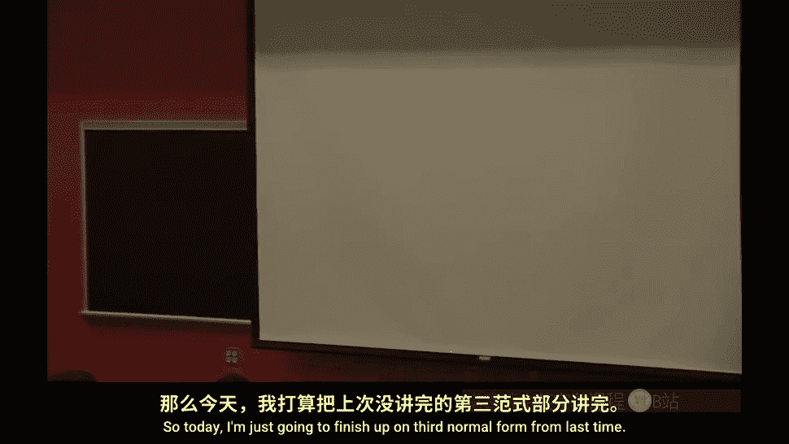

On third on the phone。All right， on third normalphone from last time。

 so last time we went through the definition for third normal phone。

 we say relation R we function depend tendencies F is in third form if for all the extra channelss A in what does F plus mean？

Closure， yeah， in the closure， satisfy one of these。

Rs so the first one we say is trivial because if a belongs to x， then certainly。

 then the second one is x contains a key for us， which means x is a super key or the third one will be a it's part of some key。

And we also said in your project， you are expected to transform your skin。And after that。

 let's take a look at two examples that we can see whether theres。对。The first one is this one。

 actually already have the answer down there， but if you look at it。Is this the phone normal phone。

Like following the rules， we can see。For example， on the functional dependencies， you can see S ID。

这条。好。And。こそ実て最。Since you take a look at the rules。On your site。

 then what is the first one based on which school？

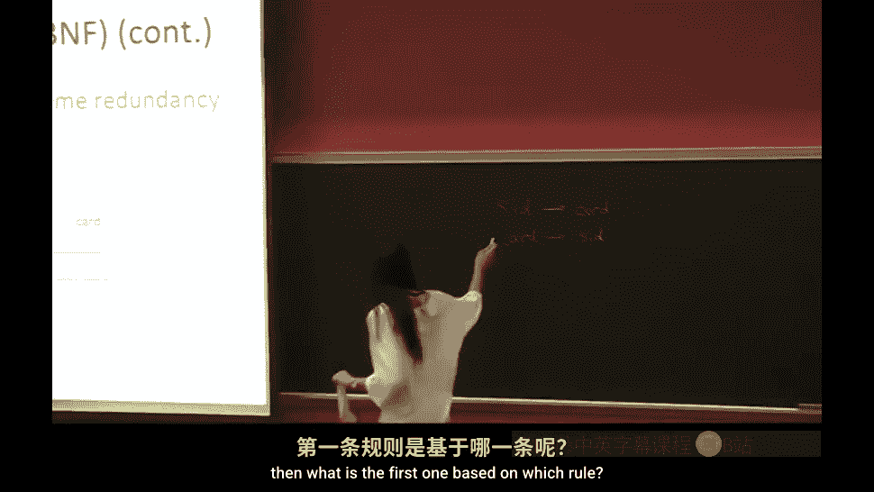

So if you sit here is the X。系。Here is the A。Then SID becomess car should be because of which。

Do you think it will be first one？That's the least likely one， right？Cd， if not caught as I get。

How about the second one， X contains the key for R， which is saying SID contains。啊。It's true。Yes。

 great， because SID is the primary key。😊，Okay， so this one is because。Okay， how about this one。

 How determine this I D。Will be the fur reason。not， I about a second one。Does co contain the key？

How宝졌。Is car a pot of sun for。Yeah。Okay， so if you work through this。

 then you can see this is that number phone。

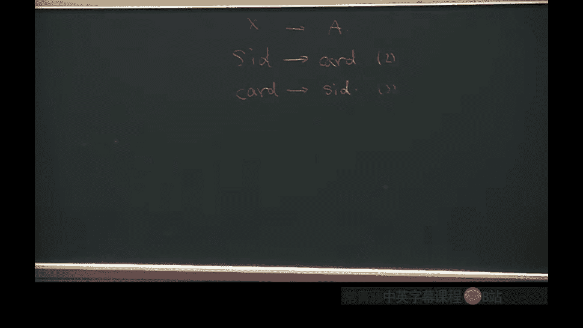

Let's take a look at the next one。

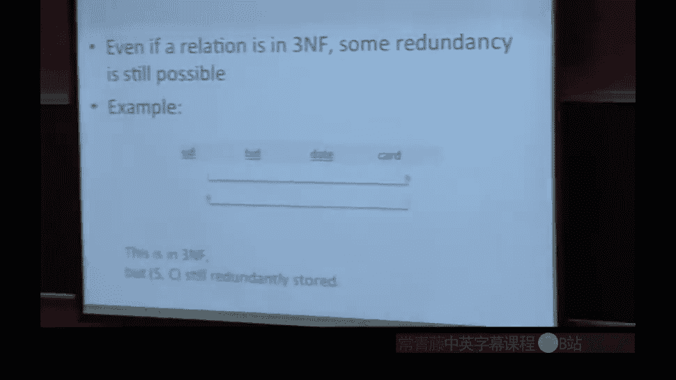

So you do take a look at this one。In the last time the slides I printed out， it was wrong。

 but I fixed it this one， so it should be correct one on your side。嗯。So this one。

 let we broke out the compose it went know。So。What would you do。けさ。哦。Not only one sheet。就是。Any。

Or maybe let's not think about it in the way that's the normal home， just by looking at it。

 by observing it in terms of designing it。 Do you think there is one part that seems not necessary to make the whole table。

To get that equal one。Or can we say， let's find out which。Po of it is stopping it。To be。

So here we have two functional dependencies， right？This first one。Is as the。The rest of them。

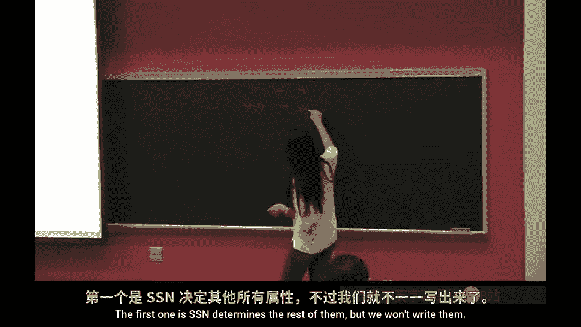

There' more right now。コびい。なか。え。大丈夫？That one。Do you think you follow not rules。嗯。たのも。やめて。Yeah。

 number two。完一下。Because SN。你的。So that's what the second。How about this one， we number De de names。

你 think。およ。No， right， Because even if you。你。Itsなで If you at the second one。Right， you didn't know。

And it's not gonna be so legal。So what would you do？Did he composer。我け。我就反都准备。It is and determines。

D number。

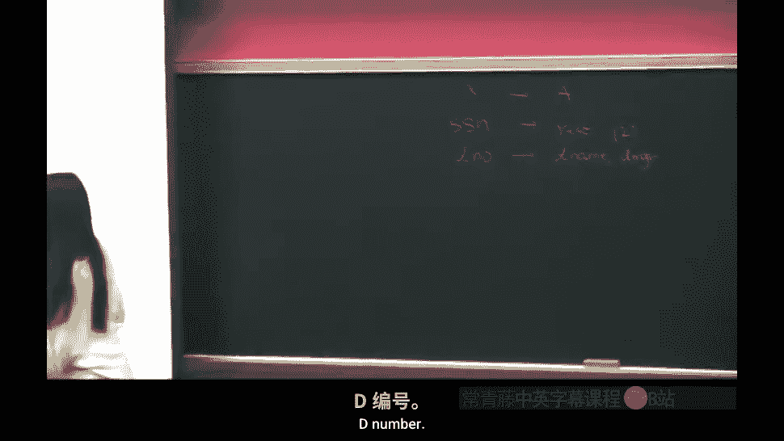

哦，不歉。Bless what you are saying， make it all the way there。

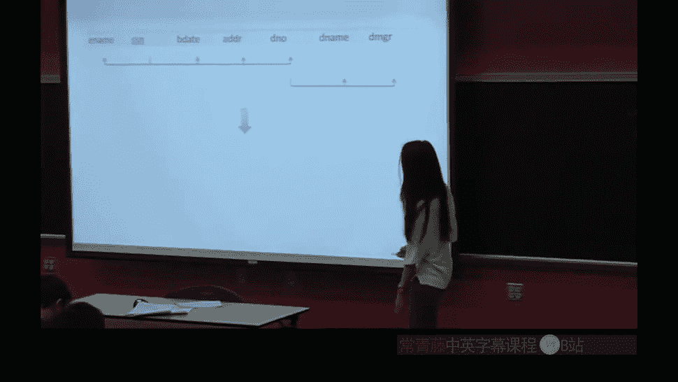

Do you think that will be better job？Make it in terms of designing and make it more efficient。4。

I can just definitely break it down。Okay。The whole time I was trying to pin you guys。

 but maybe I did a bad job。What we can do。All right。

 so now if we decompose it and you look at each of them。Do you think both of them are in the phone。

那 they啊哎。日さ除来。And as I said， we are having a quiz today。

Do you guys want me to review that for a few second。Yeah。All right， everyone got back。O。

So what I'm going to test on in the home in the quiz is going to be one second。

So what I will be testing on will be armsstr aium。You can remember what it is。

 so reflexivity is just basically saying when we talked about ex determined y。If， why is the subset？

Then， ex。All right， and this is the most trivial one。Then the second one is augmentation。

 we said it has a taste of multiplication because if you look at if x determines y。

 then we'll put a Z on both sides and it still is true。Okay， for N。But not the other way around。

 remember， we say we cannot cancel the。And the thermal is transitivity。

 which I think is a very intuitive one， but if we have x determines y and y determines Z。

 then x determines。So remember that example we work through。

Remember this one where you are given a schema？And I give you three of the functional dependencies。

 We said these are given。And later on， based on these three。

 we can actually derive more functional dependencies。In here。All right， let's just take a look。

So if I give you these two。What can you do with that？If I say。Through transitivity。认真。

And what if I do？AmentSo if it becomes this。Then it is， because。Acation。诶。How about this。

What does this make you want to do yeah。isn' that you chose？Oh。

 that is because then we have a JP here and we want to do transitivity。 Yeah， that that's just。

 for example。 So here， if we have those two， then we want to do。Transitivity。And then that gives you。

S speech。So then we take a look at Kia， we were talking about， can we do this？That's it。

It's going be easy， as always。Alright。So， everyone got theirmeterter。You are。将哦。于佳琪。A Brian。Okay。

So we'll just quickly go through。Most of the questions。

 I think some of them are don't really need to talk about them。So。Yeah。

 what I will do is I will show you。The grades for each section。And then we talk about this。

So let's look at the overall grade now。对。The distribution looks like this。All right。

 it's really good。So most people， God， make it bigger。と？Yeah。那么。

Tns of people got about 90 and our median is actually 92 really high， and our media is average at 87。

So。If you are。にし。So if your total weight grade is below 70。

 please contact me and we can talk about it so we can see how we can figure it enough to help you out。

And for 100， as I said， we have five people that got 100 and a lot of people just like one point off from 100。

 one point away。And the section that you guys did。The best。Is a section post。

 so most people up full points。All right。Yeah， half of the class full。

So let's just quickly look through。I think when graing were kind of。

We're not really strict either and those answers are just really simple and straightforward。

So for example， let's look at here。The first question we know。For each attribute of a relation。

 there is a set of permitted values for the。Oh be I can be okay。And this second question is ces。

First one， there cooking be more than one primary key， when you see here， which already put down。哦。

And the second one is the relational data model is the most widely used data model today。

 true or false， true， and then third one， data model is a collection of high level constructs for describing store data that has low level storage data。

also true。Just make it really complicated that it was true。In this one。

 which schema in the levels of abstraction allows states have access to be customized at the level of individual users or groups of users in some information in view on our storage。

Compーですで。答辩。External。In this one， really simple， we all work through it and our quits， right？

So you just want to answer whether it's logical data dependence or physical data dependence。

The first one， the ability to change the logical。having to change the external schema。

Is logical or physical？Logical， the on using new storage devices。Physical。

 the phone on change the index from has to entry。She could call before I adding new entities。

Logical and the last one using different file organizations or storage structures。In this one。

 we got a couple of different answers， but this one is which kind of data model？H啊。In this one。嗯。

So this question in section one we ask here。Atity in AC property， what does it mean。

 initially we produced straightforward for， you just explained。

 we aren't really looking for a specific answer as one of you。Describe it well。

 we give you the point。And these two actually got most of the points deducted from here。

 so the second question which two operated we learned in relation to algebra are Uary soy。It kind的。

而 can四。Contrary to binary。So Uri， which two are there？

Selection and projection and some people we didn't write down the symbols。

 we took out some point from that， so selection we use。Sigma， projection we use pie。Okay。

 so you want to write those two down and each of those things is one point。And for A question。

 which three operators we learned in relational algebra require the in relation to the union compatible。

 what do you mean by union compatible？Sa Stema， then what are the three operators that require them to be unit？

Union， intersection， and set difference。Okay， so a lot of people write down join。

 do join have to be union compatible？No， right， also right there。Crush credit。

 and that's the one that we put emphasis on this one does not have to be union compatible because when you take two tables taking a crush product。

 end result of this the two scheme are concatemate together。And so they don't have to have the。

So that's it for problem one。You guys did really well for that one and the second one was also pretty good。

I is from problem two。嗯。So for problem two。Also。Almost half of the class got full points on that one。

And the average for this session is 23。9。The media honey find which just one point off。

I kind of forgot which point most people。This。But guess you really like this one。

C。So this year we are just growing entity relationship models。

So most people lose points because of those two， actually。

But some people write down some that are really different from the answer I was looking for and div if you think your answer actually makes sense that I take up points it can come to。

Okay， so for the first time， we said professors can teach the same college in several semesters and each offering must be recorded than we mean。

Yeah I do a professor。Teachers。教しです。So by adding what can we fulfill the requirement where each offering must be recorded？

Yeah。We should add an entity here。You can put a semester or whatever。

So a lot of people right here only using attribute view。

Then remember we say that that multis as the kidnap。Because that is identified。

How about the second one transform from here is that professors can teach the same course in several semesters and only the most recent offering needs to be recorded and how do we change from here？

Yeah， we just change here。Thank。Okay， then let's take a look at。

I think those people got number three， right。So you're saying every professor teaches exactly one course。

 so if we change it based on that one。Exactly what means we should change here， right into what。

Big  arrow。And then we say in every quote must be taught by some professors。If not。

 I didn't put the ask。So we should change here into。Sick line because it's saying at least one。

 not at most。Okay， so some people kind of get it confused。Between F line and ever。

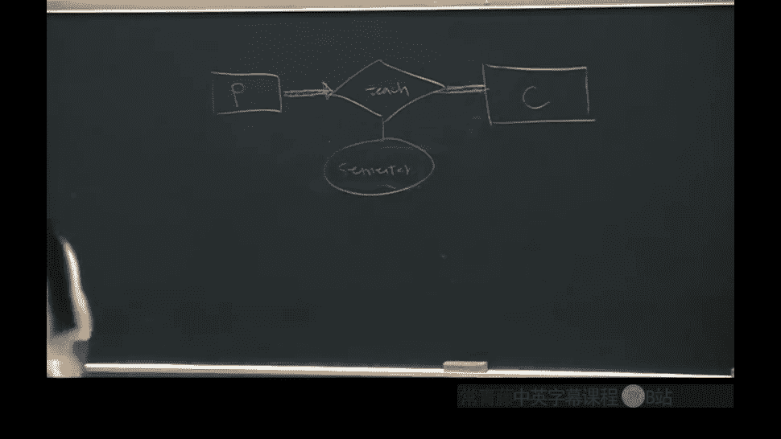

So， that's for。The third question was here。

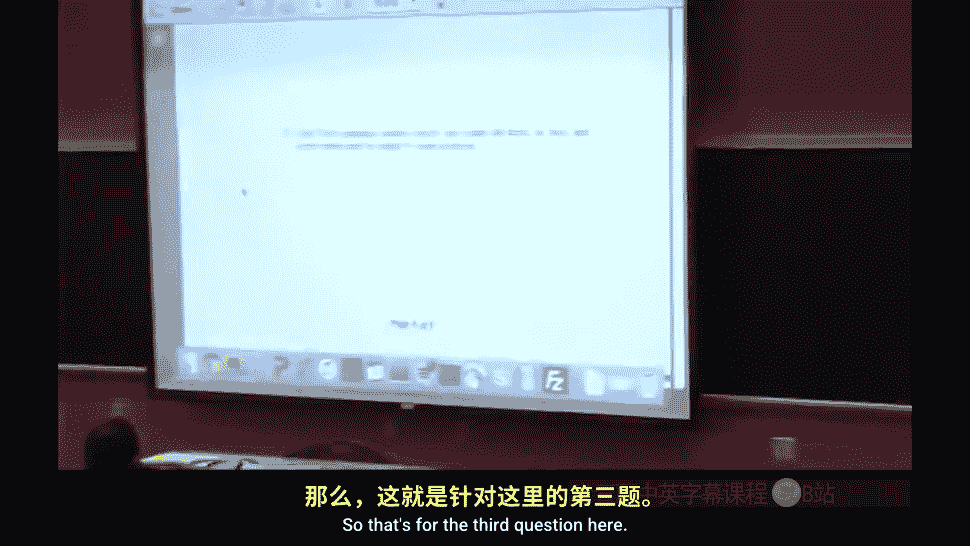

And the way we took out points。Basically， we made it one mistake and this one point off point。

You like took come too many， tell me。And here is the one actually。

Allow many different kinds of answers。Because some pause， the more I look at it interpretation。

Multiple ones， all can be valid。So。I don't think I'll。Draw all of them down。

 we can just talk through the requirements。So for the first time I say people working in a fashion industry can be designed or biased。

 and the whole thing I'm kind of following really similar example is the movie one we worked through in class。

 so what does the first requirement tell you？Is all right， we are doing the hierarchy。

 so if you didn't do the hierarchy， then that's wrong。Okay， and how do we denou Hararchy？

In the and with a。TriangleSo some people use diamond for that。Yeah， I took how points from。

So just remember the first one you can put people or you can define industry I dont you can fit people and then ease。

 and then you put designers bias as the child entities and the second one。

 the designers signed contract with brands and a designer can have multiple。我。嗯。So for this one。

This is where people get a lot of different kind of interpretation， so these together with the photo。

When I was designing it， I was actually thinking。You just simply have designers work for a brand。

 and then at that working relationship associate with the contract entity and the contract entity have time equity。

But some people will interpret that into different ones， like designers will sign a contract。

Okay or they will have and then separately design a work store a brand， so both are fine。

 I don't mind how so either way Ill give a point if I take off let you know as well and the third one is a brand can only have one designer at a time。

 a designer can also have only one。The designer can also only work for a brand at a time。

 so here is a lot of people have a lot of different interpretations as well when I was thinking about it。

 I was thinking about at most。So。A brand can only have at most one designer at a time。

 but if you interpret it into exactly one， that cool with me okay so for the third one。

 either at most one or exactly one。You'll be right。For the fourth one。

 we have designer design clothes， if a designer leaves the industry。

 the clothes key design will be removed from the fashion industry， so most of look up this right。

 what does this tint you， what kind of。We entity right so this is weak entity so a lot of people went denoting weak entity it lose a couple of points because maybe you didn't put the weak with thick line or you didn't put the relationship associating with weak entity with thick line or even。

The edge between them。できる。Okay so for here I make it really flexible if you only put the line between weak entity and the relationship associated you with that's fine and I was looking for。

See error， okay， but either way it's RA with me。In the fifth requirement。

 we have buyers work for retailers， a buyer can work at most one retailer while a retailer has to at least one buyer。

 so for here I think you guys should have no problem you just don competefuse with tick line。

With Admost one， which is arrow and thick language。so some people get it the other way around。

And the six point is actually easiest， the bias as black closed resigned by。

So you just simply have biasers having a relationship with a weekend。So this times really easy。

But some people lose some point just because of some little mistakes。Okay， then this one。之前考一个。Okay。

 this one's doing good。So most people。Yeah， most people got like 2 25。

 24 medium produced will be 22 points， and average for this section is 21。6。So I actually。

 I think I got all of the。Examples from lecture。Or the review review session。All these a musician。

So if you look at this， you should be able to fill out the blanks。

 and here is the really simple one create table。Students here， and the primary key should be。SID。

 so this is because we underline the SIV。In the second one。

So some people got a question in the exam asking me what is this referringing to so this is actually referring to both of these because it's weak entity。

 so weak entity in the relationship associating with together。Will being one table Okay。

 so what would be the primary key in order to refer to the weekend team？P name an SN。

 because it's partial key plus identifying owners's primary key。 And how about here， following key。

 A lot of people just put employees SSN。 And that's not what I was looking for。

 right Because we said before， if it's a primary key of that one， it's optional。

 But what we are actually looking for is。On the cascade right， because if the employees is gone。

 the associating weak entities will be gone Okay， and that's what we learned when we were learning about weak entities。

Right。And then let's move on to this one。嗯。I think most people will miss here。Okay， so。

Because we use for this one， exact one。Constraint。We can actually just put the manager's relationship with department。

 merge them together。Correct。😊，But when we do that， we have to be careful。 the SSN cannot be known。

Okay， so here is where we will put not milk。Okay， and what would the primary key for that be？Still。

 the I that's right here。 And the foreign key， what should you put right here。

S is in references which one？Employpoee and on the。My action。

 that's because here we have exactly ones that we don't allow。对 we。And this one。

Should have no problem I guess。So as I said before， these dmas are the one。Designing these tables。

So let's just take a look at each of them。So the first one。

 we say delete TFL from employees where EID equals to 99999。Do we have 9 and9 and9 in here， Yeah。

 so nothing will be deleted and use。啊。You should also say because theres no no。Okay。

 if you don't say， just nothing will happen。You can say that for everything right Okay。

 the second one， we add a topple。With EID12345， DID 4， and since 2015 to the working table。Is it。

Vient。No， why is that。There's no D I D equals to 4。 Okay， Okay， how about the third one。

 We want to add a couple of 2，0，0，4，5， where the name Laie age is 26 salaries is 1。

10000 to the employee table。 Can we do that。That is because。David already has。The same name。Okay。

 this one gentlemen so many。对。就在四房 to the last。The last one is。

The most kind of tragic one is something， so I saw a lot of really interesting answer。

 so a lot of people didn't get this didn't do this taught well either because。

Some people I have no clue of the relation of algebra you were。Kind of making operators on the spot。

 So I was trying to understand your operators and nice you couldn't。

 So if you write if you suio wrote something down， even though it's things like another language。

 I'll give you one。不的。Because I think you try， but yeah， otherwise。

 most of people have did really well in this section because。😊。

I actually didn't make it too complicated。So some people will lose point on really small things。

So your big idea is right， but for example， where you're joining tables。

 you just directly use natural drawing， but maybe you just specify as a country。I'll talk about。

So let's take a look。 The first one is to find the names of sellers who have reserved vote 104。

This is really important， this is almost like the first query that we learn。

So you just need to first do a selection on both， correct， and what after that。

We want to join with him。Sailors， yeah， drive with the sailors and do a projection to get a name right so you want the name。

 so the first one， most people got it completely right。Second个 one though。

I want to find the names of sellers who have dessert。

We want to find the SIDs of sellers who have reserved a wing and a rubvo。So a lot of people。

 when doing selection。They just directly say the color equal to blue。In color。悟空。

To bring and then do it on the folks。So what would this give you？Nothing， right。

 because there's no vote that will have other。At the same time equal to green blue。

So what should you use for that？Intersection， okay， so that one I was testing on intersection。

And for the third one， find the names of sellers will have reserve at least two boats。

 And here we have a lot of different kinds of cancer。 Some people with aggregation first。

 Okay you count it and then。You find the ones that are。Great here equal two。

And the other way is the way。That we taught in class there two weeks， the first one is to do。那种。

Between results。But a lot of people。

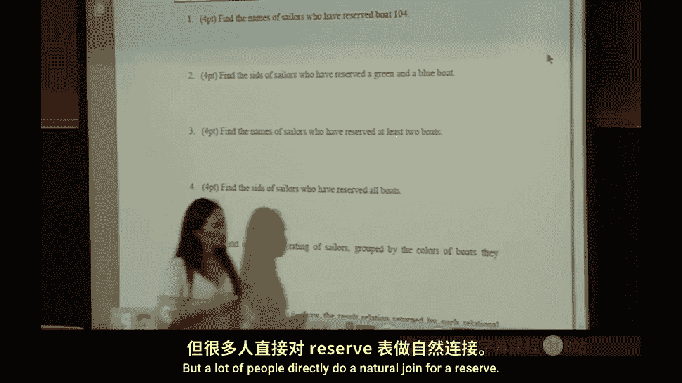

Theyre very clean。Do you need to join。

Or are we the。So they have reserve， a little art。Doing that with the。 I will this give you。ここ。Yeah。

 so it will still compare both as ID and the ID， so what should you do for here？佢世界。Yeah。

 specify what you want to compare。This there最近。All right， so if you don't have that， you lose one。

Because they've actually had a big deal that we， it's completely different。

Otherwise you can do cross product。And for this one I was also testing on you are supposed to do renaming we are remaininging the field into different names then we know which BIDs from which one if you didn't do remainingnaing at this point as what you can't say later I just here BID not equal to。

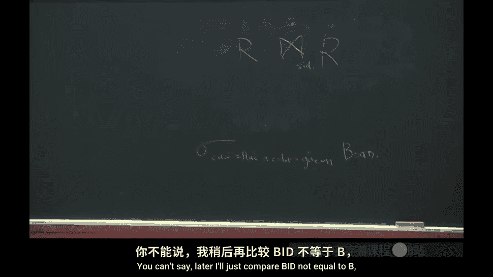

Did I don't know which VD。

So that's what third one in the fourth one。Reserve all boat。Some people really sneaky。

 you still do count and you just say if the count equals the fall， okay。

 I still gave you a point because I think that kind of smile kind of worked it around。嗯。

What do you think is really testing for this one division， so you're supposed to use division。

 so a lot of people when doing division。

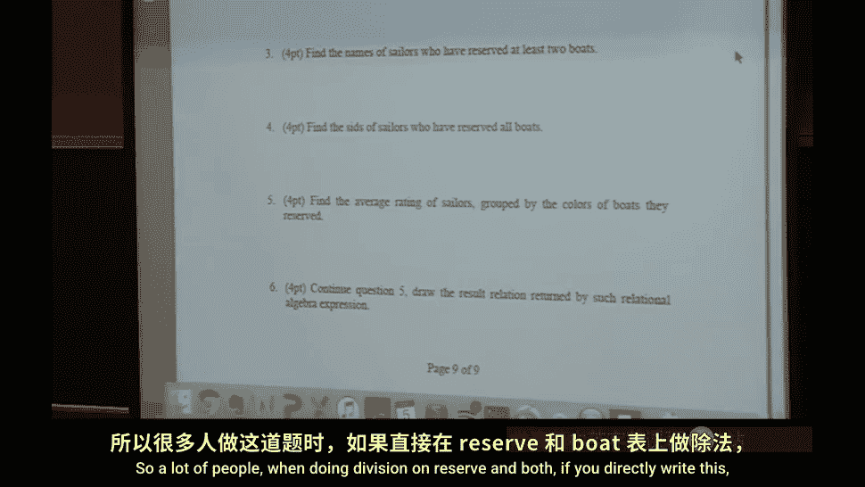

On reserve and both。If you directly write this， what is work？No， right， because they have other。F。

So in order to fit the format for division， what should you do？

You should do projection right and here we are actually projecting SID and VID and for both we only want。

第二笔。Correct， so you'd need to get to Ko and get it out。Alright， And this is one。

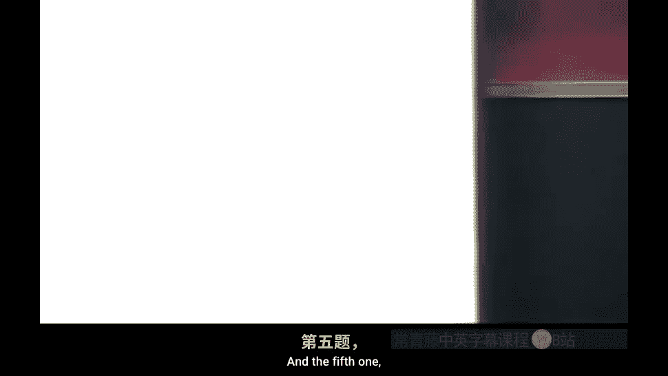

This one， we are trying to find the average rating of sellers group by the colors of both they reserve so budgets。

全ぱ？かウっていう。で。Like to they had。就好的。包。Because you have to specify。

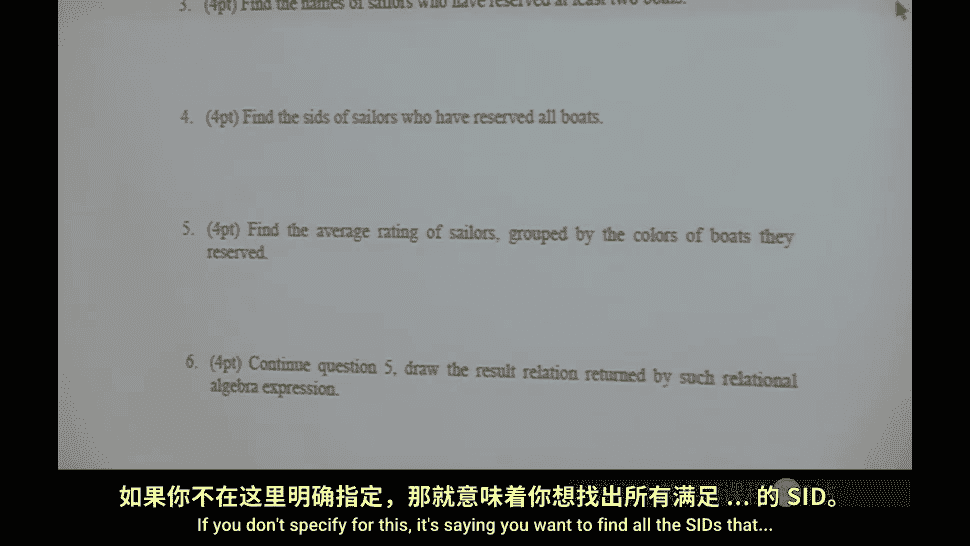

If you don't specify for this， it's saying you want to find obvious the I that question。

あと。よって。Oh， no that later you join back because following the division formula， it has been。

To feel tears。So for the fifth one。

What operator are we looking for？Also application， we want to use alpha right。

 And this why you will take two arguments， The first one the grouping group by the。

Co and first and the second one is the average。So that was the answer I was looking for but some people。

It very small， they do tons of lines， so the first one Ive chew glue in the second one， I chew gray。

 good one。It just bring。And then finally， you like union them all together。

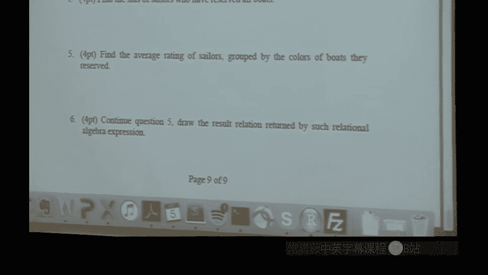

So that would be cool for me as well， but if you write that down。

 then the next question will be wrong because you don't have the color。

So that's for the fifth point I'm looking for a operators， okay， last thing。

 so for drawing the result， what am I looking for？う。

I'mLooking looking for drawing people that has two columns， three rows。So I'm just basically。

 and I want you to draw a table that has color average rating then each color with average and average ratingrating I don't require you to really compute it out because some people maybe exactly the last question。

A lot of people confuse the average rate。So that's all right for me。So yeah。

 if you have any question in terms of graing， you can come up here and we' will fix that。And oh yeah。

 so don't crossss away your cheat sheet for midm one， are you guys keeping it？

Because you can use it for final okay， so I was thinking don't go home and then like tear at all。

Yeah gone。系我 do you guys个。Yeah。