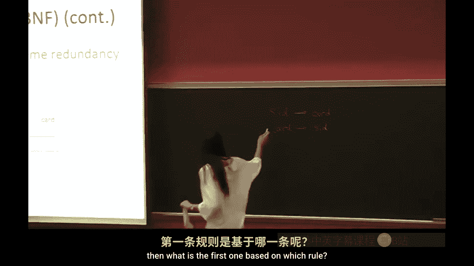
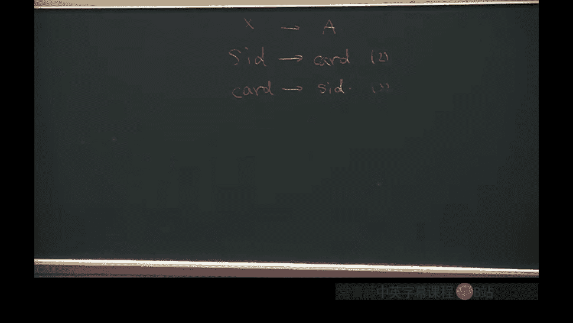
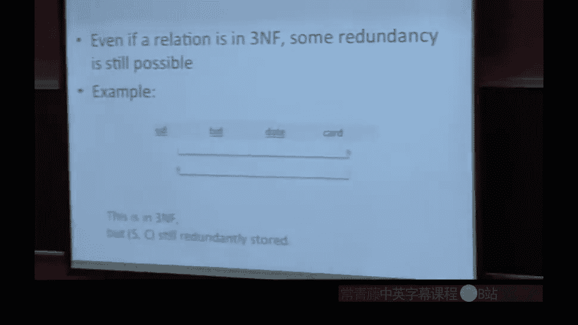
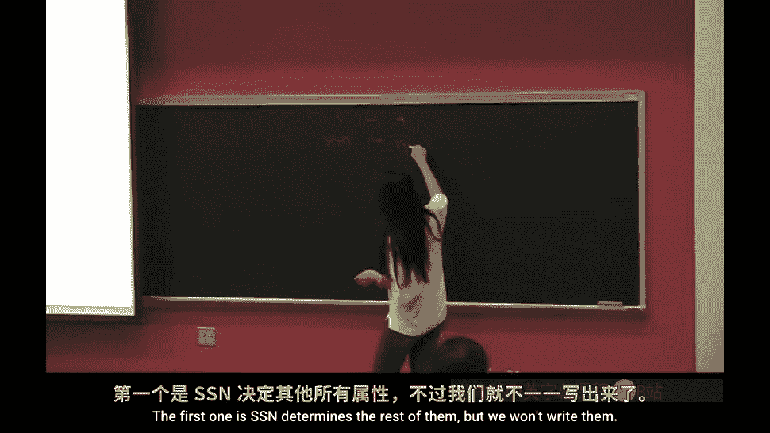
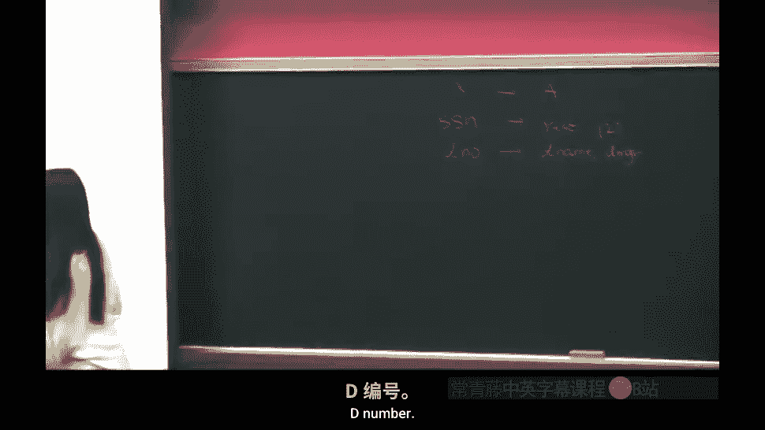
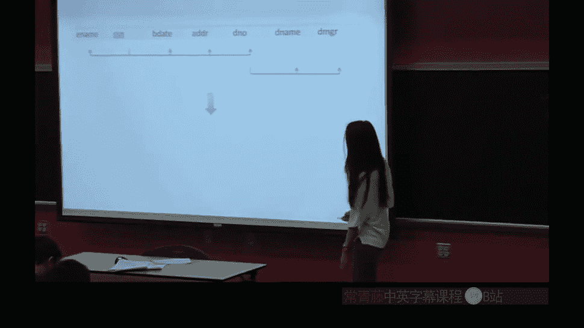
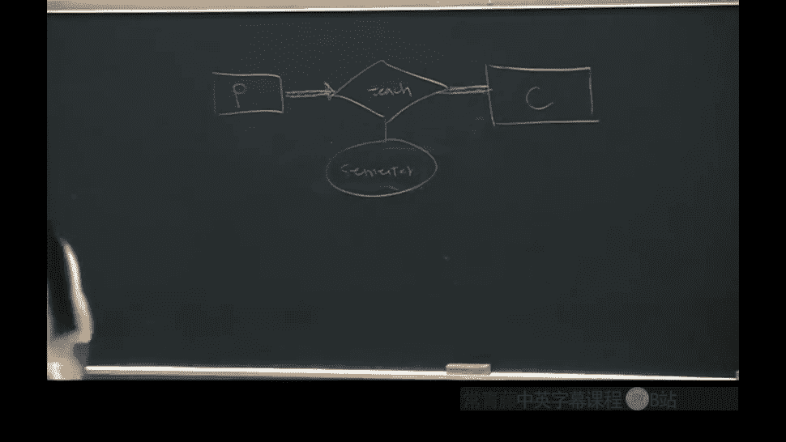
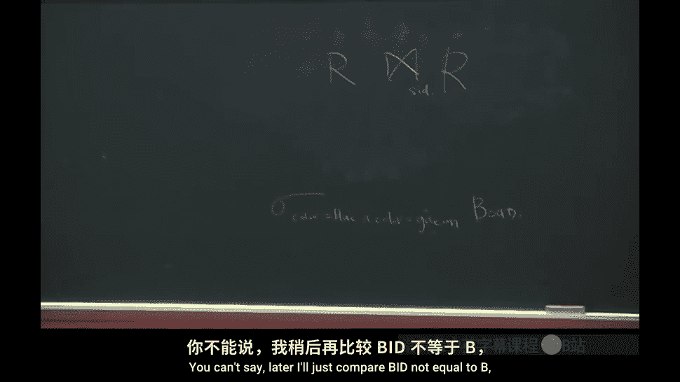
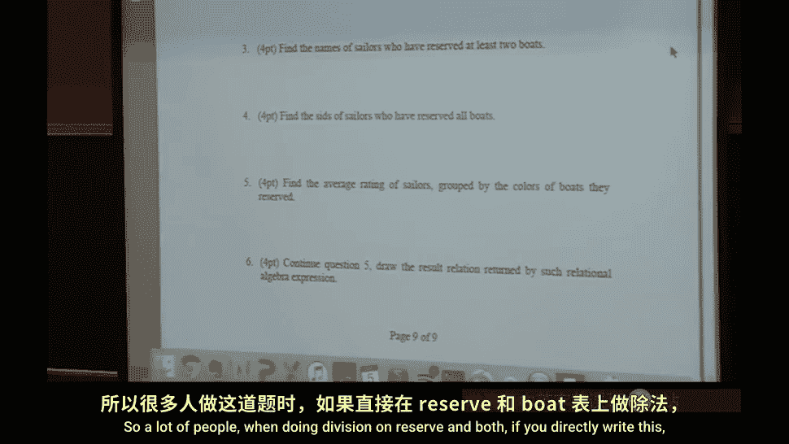
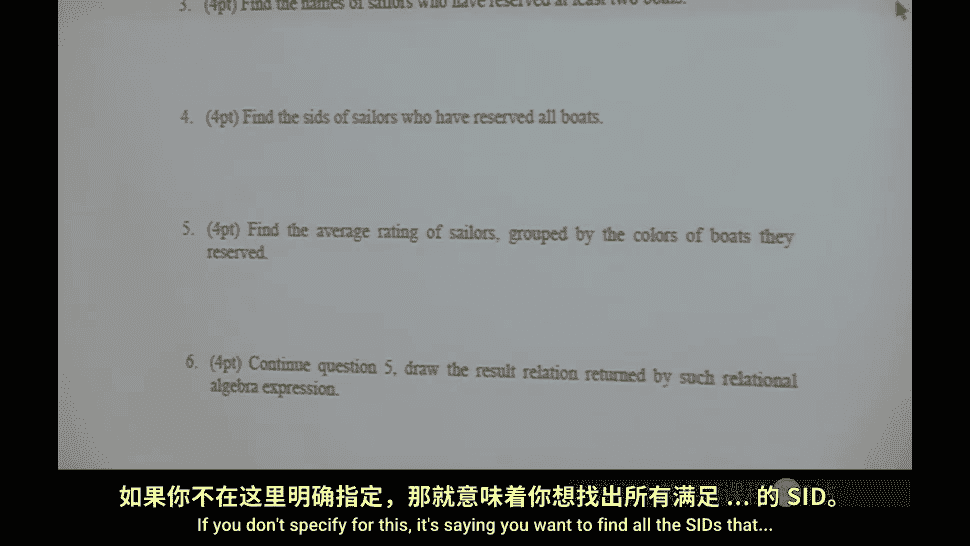

# 数据库管理系统：第15讲：第三范式（3NF）与期中考试1复习 📚

在本节课中，我们将要学习第三范式（3NF）的完整定义，并通过实例加深理解。随后，我们将对期中考试1的内容进行回顾，分析常见错误，并解答疑问。

## 回顾第二范式（2NF）的疑问

上一节我们介绍了第二范式（2NF），其中存在一个容易混淆的概念。本节中，我们来澄清一下。

第二范式（2NF）的定义是：关系R属于第二范式，当且仅当R中的每一个非主属性都**完全函数依赖于**R的任何一个候选键。

这里“完全函数依赖”的含义是：对于函数依赖 `X -> Y`，如果从X中移除任意属性A都会导致 `X-{A}` 不再决定Y，那么Y就完全函数依赖于X。

以下是一个例子，它属于第二范式：
*   **关系模式**：`(SSN, Pnumber, Hours, Ename, Pname, Plocation)`
*   **函数依赖**：`(SSN, Pnumber) -> Hours`；`Pnumber -> (Pname, Plocation)`
*   **分析**：虽然`Pname`和`Plocation`仅由`Pnumber`决定，但`Pnumber`本身并不是候选键（候选键是`(SSN, Pnumber)`）。因此，非主属性`Pname`和`Plocation`并非部分依赖于候选键，该关系模式满足2NF。

## 深入学习第三范式（3NF）🔍

在理解了2NF之后，本节我们来看看更高级的第三范式（3NF）。

关系模式R及其函数依赖集F属于第三范式（3NF），当且仅当对于F闭包（F+）中的每一个函数依赖 `X -> A`，都至少满足以下条件之一：
1.  **平凡依赖**：A是X的子集（即 `A ⊆ X`）。
2.  **X是超键**：X包含R的一个候选键。
3.  **A是主属性**：A是某个候选键的组成部分。

在项目实践中，你需要将你的数据库模式设计转化为满足3NF的形式。

以下是判断关系是否属于3NF的两个例子。

**例子1：判断是否属于3NF**
*   **关系模式**：`Student(SID, Name, Major, Advisor)`
*   **函数依赖**：`SID -> (Name, Major, Advisor)`；`Major -> Advisor`
*   **分析**：
    *   对于 `SID -> Name`：`SID`是主键（超键），满足条件2。
    *   对于 `Major -> Advisor`：`Major`不是超键，`Advisor`也不是主属性。因此，该依赖不满足3NF的三个条件中的任何一个。所以，这个关系模式**不属于3NF**。

**例子2：分解以达到3NF**
*   **关系模式**：`Emp_Dept(SSN, Ename, Bdate, Address, Dnumber, Dname, Dmgr_SSN)`
*   **函数依赖**：`SSN -> (Ename, Bdate, Address, Dnumber)`；`Dnumber -> (Dname, Dmgr_SSN)`
*   **分析**：存在传递依赖 `SSN -> Dnumber -> (Dname, Dmgr_SSN)`，导致其不属于3NF。
*   **解决方案**：将其分解为两个关系模式：
    *   `Employee(SSN, Ename, Bdate, Address, Dnumber)`
    *   `Department(Dnumber, Dname, Dmgr_SSN)`
*   分解后，每个关系模式都满足3NF，设计更高效。

## 期中考试1内容复习与答疑 📝

现在，我们来回顾一下期中考试1覆盖的核心知识点和常见问题。

### 函数依赖公理（Armstrong‘s Axioms）复习

以下是考试中涉及的关键公理：
*   **自反律（Reflexivity）**：如果Y是X的子集，则 `X -> Y`。这是最平凡的依赖。
*   **增广律（Augmentation）**：如果 `X -> Y`，则 `XZ -> YZ`。它类似于乘法运算，但注意**不可逆**（即不能从 `XZ -> YZ` 推出 `X -> Y`）。
*   **传递律（Transitivity）**：如果 `X -> Y` 且 `Y -> Z`，则 `X -> Z`。这是非常直观的。

例如，给定模式 `R(A, B, C, D, E, F)` 和已知函数依赖：
1.  `A -> B`
2.  `BC -> D`
3.  `D -> EF`

我们可以推导出新的依赖：
*   由1 (`A->B`) 和2 (`BC->D`)，利用增广律在1中加入C得到 `AC -> BC`，再与2通过传递律得到 `AC -> D`。
*   由2 (`BC->D`) 和3 (`D->EF`)，通过传递律直接得到 `BC -> EF`。

### 考试成绩总体分析

本次考试总体成绩良好。平均分87分，中位数92分。大部分同学得分在90分以上。如果你的总分低于70分，建议联系我进行沟通。

### 各题目详解与常见错误

以下是各部分的详细解析：

**第一部分：基础概念选择题**
这部分大家完成得非常好。需要留意的点包括：
*   一个关系可以有多个**候选键**，但只能有一个**主键**。
*   **外模式**允许为单个用户或用户组定制数据访问视图。

**第二部分：简答题**
*   **ACID属性**：只需描述清楚原子性、一致性、隔离性、持久性的含义即可得分。
*   **关系代数运算符分类**：
    *   **一元运算符**：选择（σ）和投影（π）。
    *   **要求关系并兼容的运算符**：并（∪）、交（∩）、差（-）。注意**连接（⋈）和笛卡尔积（×）并不要求并兼容**。

**第三部分：ER图设计**
常见错误集中在以下方面：
1.  **“每次授课都必须记录”**：这要求将“学期”或“授课”建模为**实体**，而非仅仅是“课程”的一个多值属性。
2.  **基数约束混淆**：注意区分“至少一个”（粗线）和“至多一个”（箭头）。例如，“每位教授恰好教一门课”应使用从“教授”到“教”的**箭头**（至多一个）和**粗线**（至少一个）组合表示。
3.  **弱实体的表示**：弱实体需用**双线矩形**表示，其与标识实体间的联系用**双线菱形**表示。在将ER图转为关系模式时，弱实体的主键由其**部分键**和**标识实体的主键**共同构成，外键约束应设置为`ON DELETE CASCADE`。

**第四部分：SQL表定义与约束**
关键点：
*   当将“管理”联系（1:1）并入“部门”表时，经理SSN字段必须声明为`NOT NULL`，以体现“每个部门必须有一个经理”的约束。
*   外键引用应明确，例如 `FOREIGN KEY (Mgr_SSN) REFERENCES Employee(SSN) ON DELETE NO ACTION`。

**第五部分：关系代数查询**
这是失分较多的部分，常见错误如下：
1.  **查询水手姓名**：`π_name(σ_{bid=104}(Reserves) ⋈ Sailors)`。大部分同学正确。
2.  **查询同时预订了红船和绿船的水手SID**：不能直接写 `σ_{color=‘red’ AND color=‘green’}(Boats)`，因为不存在同时有两种颜色的船。正确方法是分别选出预订红船和绿船的SID，再取**交集**：`π_sid(σ_{color=‘red’}(Boats) ⋈ Reserves) ∩ π_sid(σ_{color=‘green’}(Boats) ⋈ Reserves)`。
3.  **查询至少预订了两艘船的水手姓名**：常见错误是在对Reserves表做自连接时，没有对其中一个实例进行**重命名**，导致比较条件 `bid ≠ bid` 无意义。正确写法应类似：`π_name(Sailors ⋈ (ρ_{R1}(Reserves) ⋈_{R1.sid = R2.sid AND R1.bid ≠ R2.bid} ρ_{R2}(Reserves)))`。
4.  **查询预订了所有船的水手姓名**：这是**除法运算**的典型应用。不能直接写 `Reserves ÷ Boats`，因为模式不匹配。需要先对Reserves和Boats做适当的投影：`π_{sid, bid}(Reserves) ÷ π_{bid}(Boats)`。
5.  **按所预订船只的颜色分组，求水手的平均评分**：这里需要使用**分组聚合运算符**（ℱ）。例如：`ℱ_{color; AVG(rating)}((Reserves ⋈ Boats) ⋈ Sailors)`。或者，也可以分别查询每种颜色的平均评分，再将结果合并。

---
本节课中我们一起学习了第三范式（3NF）的严格定义和判断方法，并通过分解实例掌握了规范化过程。随后，我们系统复习了期中考试1的核心内容，特别是函数依赖公理、ER图设计、SQL约束以及关系代数查询中的易错点。请妥善保管好期中考试的备忘单，期末考仍可使用。对于试卷批改有任何疑问，欢迎随时提出。