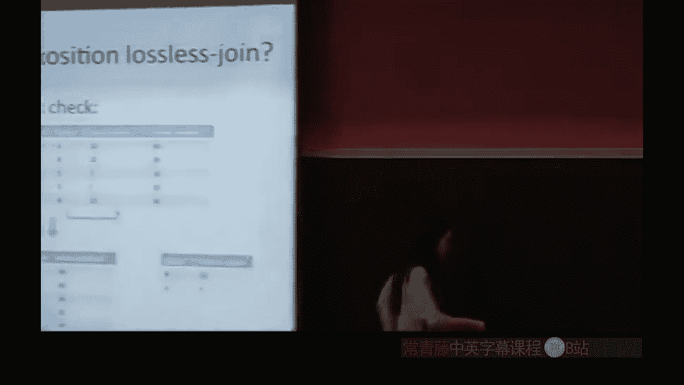
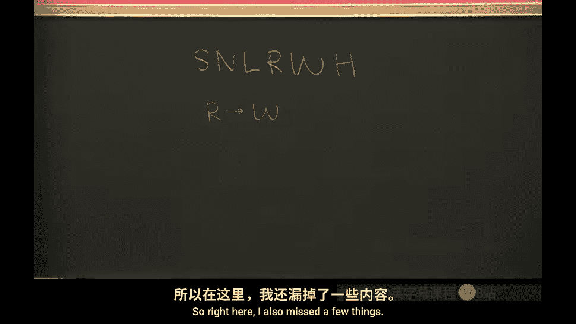
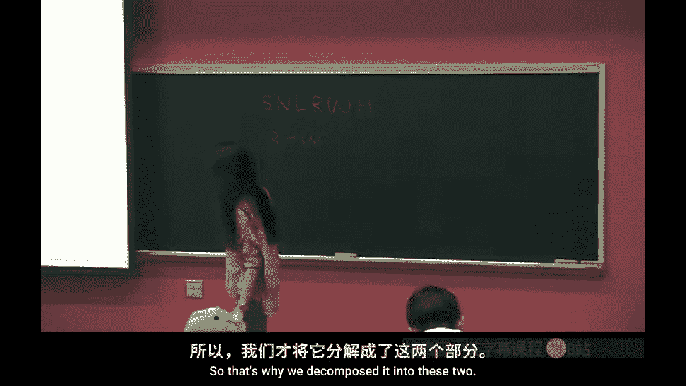
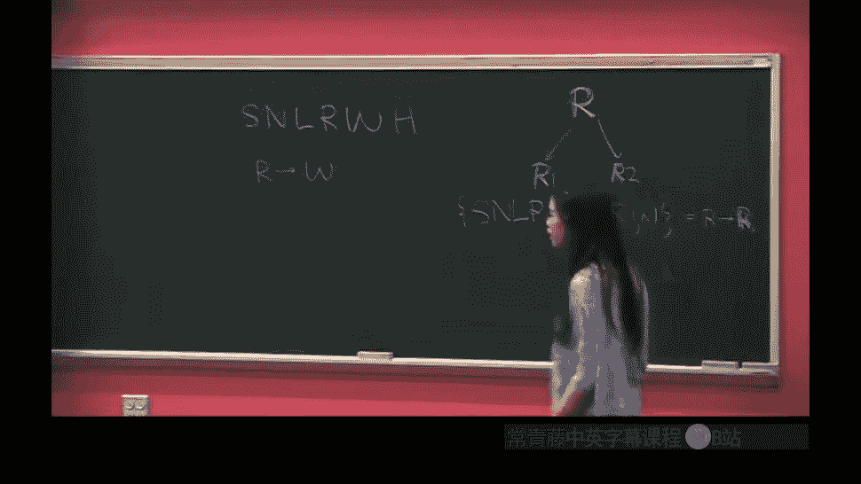
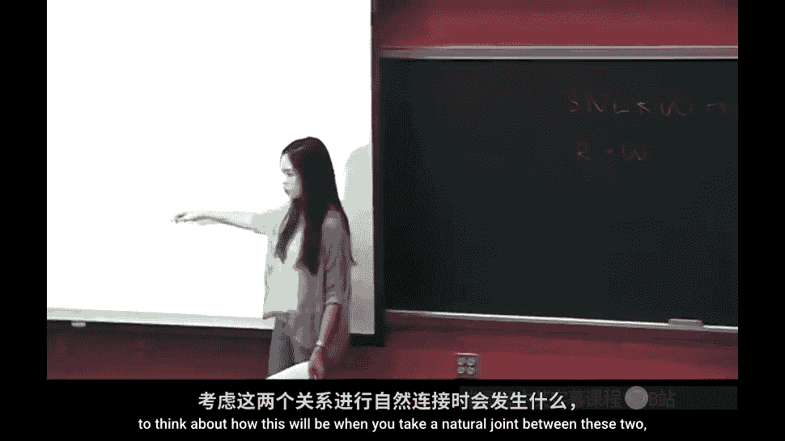
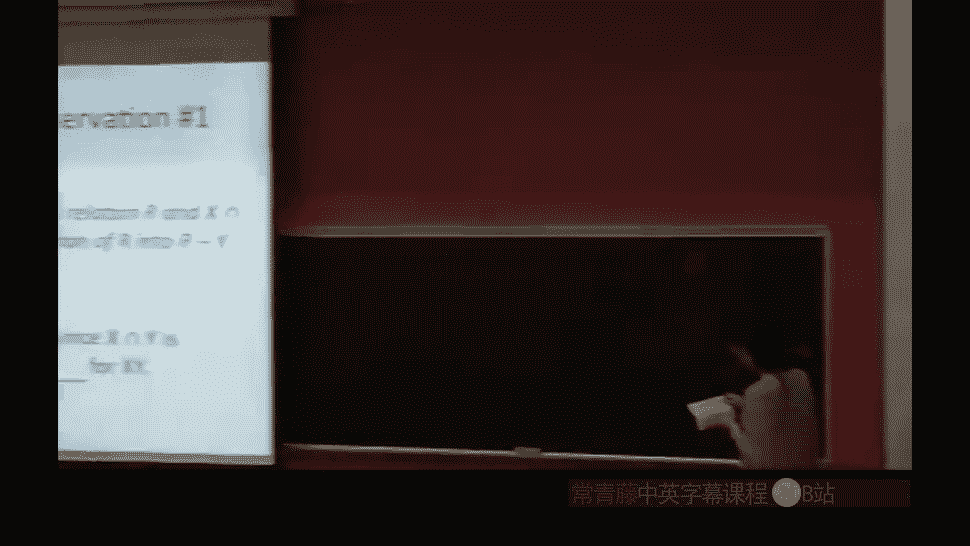
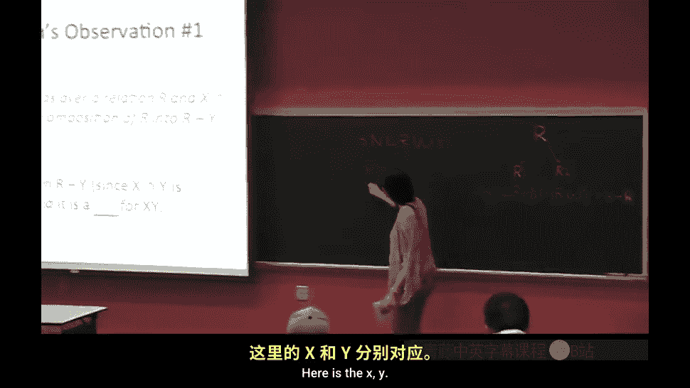
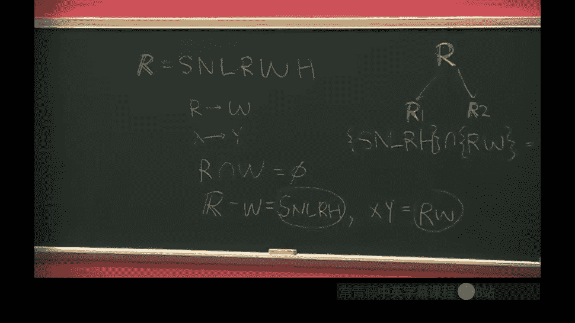
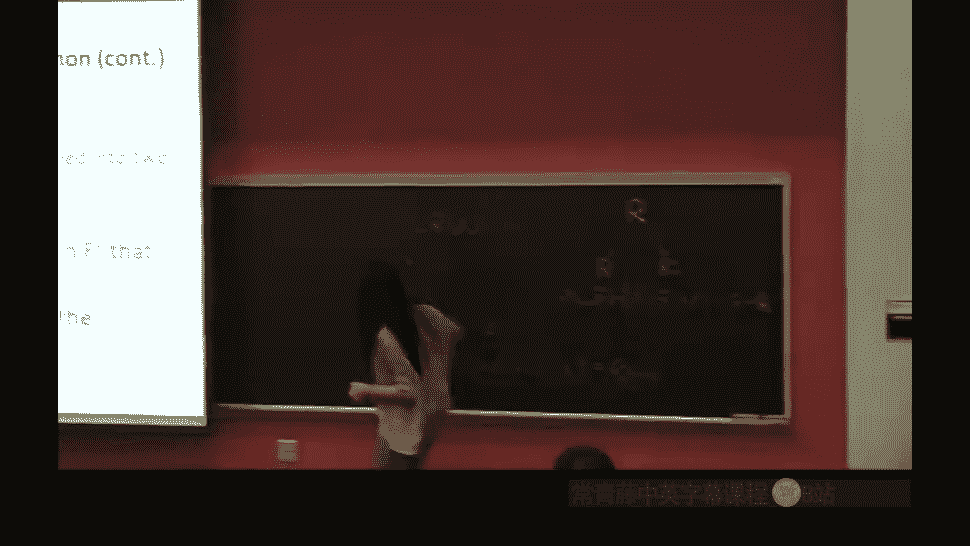
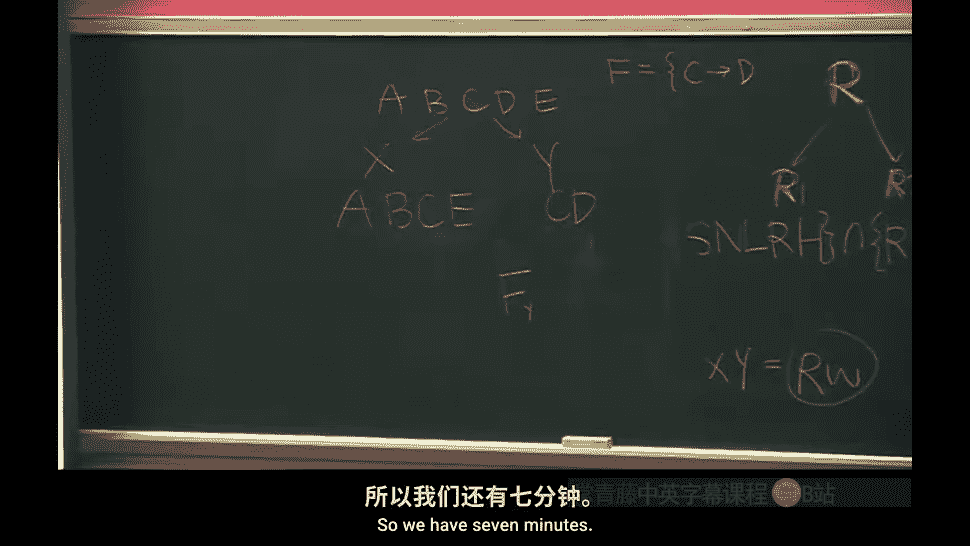

# 宾夕法尼亚州立大学【中英⚡数据库管理系统｜CMPSC431 Fall 2015, Database Management Systems】 p16 P17 BCNF范式与分解 -BV1N76CBwEXb_p16-

Okay guys， good morning。What I will be doing now is before we start the lecture。

 I will return the graded project phase one。All right， so I'll call the team name and then。Coれ。

I think we kind of get confused between team name and project name sometimes。

 call you project name this。嗯，这本。By。し。긴 거。系phone。Project X。Do you think such。What。电光。Cin of moves。

嗯 you0。Okay。AndW。他一辈 if句我。好，接据。Sing with Jacob。And， crystal。听飞静我。你个。先生。The team。一回。Allright。

So as you can see， we have grade that your project base was。Giveing feedback？

I won't put too much time talking about it now， leave。Last thing asked seven。

Our five minutes and D will come。And talk about。Well she thinks about how you guess good。

Like what kind of mistakes you have made and how you can improve next time So in general if I did a really good job。

 the score is really high。So yeah， you look at the book and for phase two we'll expect you to improve based on the feedback we gave you。

 the grade deal for phase two will be like， if you improve based on the feedback， you good point。😊。

Add it， but you can don't， then you get it hands off。Right。

So let's get started for today's lecture for those teams if you haven't got your。Parick。

A greater project can come to me。O。So today we want to wrap up the normalphones we were talking about before。

😔，So。Remember we were talking about first normal foam， second normal foam， and third normal foam。

And we have another normal home left， which is the Boycott normal home。Well talk about today。嗯。

So before I talk about the voice called normal foam。

 let's quickly just review the normal foam we have learned so called what kind of properties they have and when we encounter something that's not in such normal form we want to maybe be that normal form。

 what should we do？So the first one will be hit now， first on my form。

So first I' welcome to test still， we should just really basically see whether they have any nonatomic attribute。

And if we want to fix。As Ima to make the first normal foam。

 the remedy will just simply create relations for each nonatomic。

If I sayomic attribute of basic saying that values cannot be list or。Single values only in the。

In the simple one we learn is second normal phone。In second normal form。

 we introduce the idea of fully functionally dependent and partial， functionally dependent。

When we encounter something that is not in second normal form we want to solve it。

 we simply have to decompose and create a new relation for each partial dependency to make them all fully functional。

But second normalmal form is not that commonly desired， mostly we want things to be in。

In third whom the way we test it is。The schema should not have a nonkey attribute functionally determined by another nu key。

If you recall from。At a very short example asked。So to solve this problem， if we have a schema。

 that's not in on something we want it to be， we simply have to become close and create a relation that includes the non。

박 you time。So for your project phase two， you are expected to refine your school as。

You want to talk about your reasoning or you identify the function dependency saw and what you did。

 what approaches you took to make it。Then remember， we say when we list post normal home。

 second number form， third normal form and boy car normal form， we say is increasingly what？

좀 먹게 된 거 뭐。St or restrictive，The strictest one we want to talk about today is voice P。

OkayI think on the slides， I made the school points， but I think it was better you use numbering。

Because then we can map it to the third the moment we were talking about。こ。

So the definition for boys cont。Which we normally ensure just colored BCcNF。

Is that a relation R with functional dependency F？If invoices come a form if for all of the x determining A in the closure。

 is satisfy either the first one or the second point。So the first one being a belongs to x。

 which we have seen before， and we call is trivialpy。

And the second one would be x contains a key for R。 and because x contains a key， x can be a sub。

So when we compare this to the definition of third normal function。W can you observe。

What's the only difference？Okay， and recall how many rules are in the definition for certain。

Seeingms like to eat。 There was another one。Right after the ticketaway。You which one is it。

A being part of the key。你 remember白。Everyone looked so blank， but anyway。

That one is allowing more possibility for a sma to be。 so this is boys's polyal home。

 so it doesn't allow that， so it's actually strict out because these are or nothing。

So for boys not normal home。If either this is true。

Then boys talking normal so intuitively we say the only non trivial dependencies are those in。Heat。

that determines on it。笑。When you think about boys caught no foam， it's either。嗯。

Having this trivial functional dependencies or he determining other。

So interpretation or the way you can think about it is each talk little can be seen。

ity or a relationship that's identified by a key in dis regard。It's just a way of thinking。

So you do take a look at the finger here。We use the O holess to den attributes。

 which is like what we did in V art diagram。 And here don't get confused between these and。

Arrows in your diagram。 these are the oxs， and it's showing the functional dependencies。

So if a schema is seen boys count normal form， the attributes can be shown this way。

 So here is the key and only the key can determine something。All right。

 and this doesn't have to be single attribute can also be sets of attributes。

 but this one has to include key。So that's the idea of boys conference。So let's take it some。

Right until now you're a little bit confused， so let's take a really quick look at example to see whether。

冷生法じな。So for a voice phenomena form， we said it ensures that no redundancy at all can be detected using functional dependence。

What do we mean by that If you take a look at this example and we have one value missing here All right。

 the question mark， we don't know the value there。So if we say given x determines A。

And we go back to look at this instance， can we figure out what the value for the question mark is？

If x。This attribute determines。This attribute。It's also a， right。

 because here we have x corresponding to a。 So here should be the same。All right。

 so given this function dependency， we know the value what the question mark missing there is also okay。

So now we figure out until this part。Then is this instance in voice？Note that。

We haven't said who will be the key， all right？So if you take a look at this example。Because we say。

 let's assume we want this to be voice condo。And now we have functional dependency right here。

And if this is in boy current normal form， this functional dependencies has to either satisfy the first rule in the boy current normal form definition or the second rule。

Okay， so what is the first one。A belonging part of x。But as we can see right here。

 a is definitely distinct。From X， All right， so we don't consider the first of rule。

And how about the second one， The second one is saying x。Is the key。Correct。

 so let's assume x will be the key。All right。So what will happen if x is the key？

Then y is also a monkey attribute。 So X should be able to determine y as well， right。

Then what does this mean， they have x right here， two rows have the same value for key。

 so y1 should be equal to y2。Right。Then what do we learn from here， These two tucos are exact same。

Then we are storing redundancy。All right， so this is actually not。인포 가끔 거고。

So how do we fix it you think will make a voice condo normalmophone if we can discard here？Alright。

And which one you think picking the key gives it the possibility of becoming boys cognitive。Yeah。

 if we pick why。Right， because it's okay for a key。To have all the other values the same。没。

There you guys follow， so this one is not enforceible。嗯。

We'll work on more of the examples of looking at is this impose number？

normal phone was take a normal phone later， but today I want to stop here for all of them。

So for your project you don't have to really go all the way to Bo Fundal just until F。

Boice condo points definitely really desire， but sometimes it's not realistic estate。

So remember when we were talking about all the kinds of normal formss before， we were saying。

 what should we do to make it？In a normal home， there is one way。

Like we can break down the relations。And we call it decomposition。

Sometimes you have a really big table that has so many attributes and maybe that causes a lot of problem that doesn't fit a normal form in order to achieve that certain normal form we can do compost them in some ways。

But a lot of times not every kind of decomposing is correct or good。So later I want to talk about。嗯。

The conversation。Okay， how to achieve a good economy。

So here we call the properties of decomposition it is actually important to check that intocomposition。

I'm spelling one more X。It is important to check that healthy composition does not introduce new power。

So as we were discussing before， when we talked about different kinds of normal form。

 we thought about， okay， this might be not so ideal， this maybe it will create a more problem。

When we decomposed relations， we should check whether the decomposition we did。First of all。

 allows us to recover。The original relation， you don't want to make decomposition。

 actually lose information。Or actually cause wrong inflammation when you recover it back。

And the second one is remember at the very beginning of learning about your diagram design。Oh no no。

 like just basically。Designed of the relations。The sma， we were also thinking about。

 in some application， we have certain types of integrity country。Different scenarios with。

So you should also think about whether the composition you do will allow you to check the integrity question。

You don't want it to be like you design in such a way that you decompose it。

 but you lose the way of checking whether they you。And still hold。So there are two types of。

The composition。And actually each of them。Takes care of。So the first one is blossom。Lostless drawing。

This kind of decomposition definition helps us to make sure that decomposition we do can recover to the over。

And the second type is we call it dependency pose。So dependency preserving the composition allows us to check the integrity。

So later on， we want to talk about these two types of decomposition。

And how we can check whether the composition we do satisfy。So in the rest of this slides today。

 I think like here and there， I make some typos。bearear with me。

 I'll tell you where I make them and you can fix them。

So the first one is lossless joint the composition。So这这。The definition of it is a decomposition of a。

 or we say it's a relation into two schemas with attributes set。X and Y。

Is set to be a lossless join decomposition with respect to F。

 which are the set of functional dependency， right？For every instance。So， these are the subsets。

Offf the whole table right， every instance are that satisfy the dependent people。Yesす。The projection。

On the instance R， taking a natural join of the instance y instance R's projection of y is back to the R。

さがです。So imagine we have a schema。 Okay， that has a lot of attributes。 And when we decompose it。

 because we have some concern， it's not in a certain normal form， and we break it down。

 decompose it into。Set x and set y。 Okay， so both x and y are from the original attribute sex。

Then we want to check whether such decomposition is lossless join。

What we can do is we take the instance， okay， with the data in there。When we first take a projection。

On x set of x attributes， And we also take a projection on the instance with attributes in the Y set。

We take a natural join of them， which you should be familiar。个小心息。R is the。

Instance and X are saying which attribute to take out。Remember for the subscript？对。Okay。

 so we take a natural join of them。 if they satisfy lossless join， that would be goat back。

To the original instance。So in other words， we can recover the original relation from the decomposed relations。

 but you can see right here， remember we had examples before we didn't only decomose into just two subrelations。

 so this one actually you can infer it into more than two decomposed relations。

So that's what the next light I want to say and just simply cross out these two length。

 I was going to talk about another idea but I think it will make you really confused。

 so cross them out。So just basically remember the definition we had can easily be extended to cover a decomposition of audience into more than two relations。

 but for the sake of understanding the concept of lostless drawing in today's example。

 we will only talk about when you decomp post them into two。

So let's take a look at an example and see whether the decomposition is in muscle。

So here is the example we want to take a look at。So we have this original schema with the instance。

 so the schema has SP。Okay， let's say we decompose it。Into S and PDD。

 Let's not think about who's the primary key first Okay for losses join， we ignore that for now。

 So we do composeose it into S and PDD and very easily you can see we just kind of slice them right。

 take these two columns and that's this one。 So that's why we put the attributes here and then the other as well。

So because we want to check whether。It is in lossla's joint。

 remember in the last slide we say we just basically take a natural joint of those two so the result of taking a natural joint of those two。

Itsact right here。Okay， because when taking a natural joint， what does it do。When we take a nitrogen。

It finds the field with the same name， right， so they have the same name as P。

 so they will actually repeat it if it's both P1。Then it has another possibility of D being D3 it right。

 so it's adding more of the topples right here。So here you don't have to write down the whole sentence。

 but it's basically saying these two。Are created that were actually not in the original。对的。Correct。

So this means when we recover it bad， exactly。Not maintaining the real information。

So even though this is creating more information instead of losing information。We call this lossy。😔。

As long as it doesn't recover completely correctly back， it's lost。

Does it matter losing it or adding the？So if this happens after checking it。

 we know this is not equal to the original little R anymore， then this one is not lostless strong。

 decomposition。So we have a couple of observations and theorems。For loss this one。你干嘛。So we can say。

I kind of repeated here， but we have been using big R and the same purpose the whole time。

 So let R be a relation and FB set of functional dependencies that hold over R and the decomposition of R interrelations with attribute sets R1 and R2 is lossless if I think I wrote is。

you can change that isn't only if the closure contains either。Either R1 taking intersection。

 R2 determines R1。Or R1 taking intersection with R two determin。

So we can work on this example really quickly later。

 but this is a really easy rule of thumb for you to check whether the decomposition。です。

Lossses shown instead of going through what we were doing taking an approach。

 so this is a quicker test。So why does this make sense？Let's take a look at the。So。Okay， so now。

We have， if you recall we had an hourly employee example a few lectures ago。

 so remember we were saying we found that rating determines the hourly wages of that lecture。

 so because we don't want this to be kind of bothering us and we think it's not necessary to store them all in the one table。

 we to comp post them。ok。So remember when we had that。Let me write this down。

Do remember when we are talking about functional dependency， lighting can use a single letter。

Did signal know each attribute。So here I will use。Yes。ナスきマら。And we know rating。他面。系。So right here。

 I also missed a few things。 The first thing being SSN is the primary key Okay。

 on your slides not please underline here。

So we have this functional dependence。Where rating determines are the wages。So if we want。

 let's say we want to table between for。優생で。If we have such。No， right， because first of all。

 if we think about the first rule。W is definitely not part of our。

 wage is definitely not part of the raising and we think about the second rule。

Right here it has to be the key and ranking is not。 so that's why this is violating the no form。嗯。

For this reason， for they are determined。So that's why we be comp into these two and I also miss。

It isn't being the primary key for the left table and writing being the primary key for the right。

So if we do this tocom， do you think it lostless strong？Let's check it in two ways。

 the first way being we use the theem to think about it。If we do a natural join here。

 do you think we will perfectly recover？To the original one？

Or it's too hard to think on naturaltro don't。Okay。

 so let's think about it in the way that we learned about this quick checking in the previous life。

 so the quick checking is saying the original R。Let's not get confused with the R of that so here the R I say will be for the instance。

A further schema。So we decomos it into two partss， the first being R1， the right。So， our R has O B。

开说。What does R1 have？应该。S and。然。Hch。And this one。You have our。Correct。

So if you go back to take a look at how we can do a quick check in F of three。

 make saying if we view the this set or there。Already sex。

 but I'll just put on curly braces to make it big。So if we think of them as set， here being R1。

 here being R2， taking intersection over the。伪造品。ですか。Okay， and this one。Does it determine？

Either our one or our two。So yeah， this is really confused and this is the atrogy。😊，Okay。

I think our the。For stchema， I'll put them poll。So the big one。并啊。When I sayEma but the thing one。

 you just say did the。Okay， so because of this。We take an intersection of it and it becomes R。

 and we know it can determine。The artistema。So that in fear of free。It's correct。So it's a lawsuit。系。

So if this is not so intuitive to think about this is just a quick check。

 but the more intuitive way is really to think about how this will be when you take a natural join between these two and whether that will completely matched here right so if we do a really quick natural join you can see the rating 85 so here if we just appended so eight right here we have hour wages 10。

And。10 and55，7，7，10。And that's exact。So that's an example how we can use the quick check。

Seeing whether you is。A lost job。Another observation we have。We have two observations right here。

So that violates the home and it is lost his drawing yeah。

So there are two observations we have from working through this example。The first one being this。

Let's say if the functional dependency x determine y holds over a relation R。

 an x taking intersection of y' is empty。Then the decomposition of R into R set difference with Y and X Y is loss you'll be below what are you talking about。

 so let's take a look。An example we just work through right there。

So let's map that to here。Here is the X。

Okay，We want to say it and function dependency。In terms of why I holds co revelation。So。

 that would be X R。Ring while in our。In x taking intersection with what's empty。

Is our taking intersection with WMT？And we knew them a sex。

And they don't have any attributes over that right。

 because they are on both single attribute and they're different， so it is empty。

so that one correct you will。Taking intersection X empty。

 then the decomposition of R into R minus y and X y losses Here our minus y will be the original one。

How is art。Then the original one。Mine is y， which is W。一口土。S， N L，RH。喂。And what is XY？One of things。

A and why is。So that just RW？So these are the two the composition。It's saying into R。

 taking set difference with Y and X Y， if we decompose it that way， that's lossless too。

So can you see right here？This is exact same as it becomes with our once。This is exact same。

You might be wondering why this is true。And that is because if we take a look at here， at the X。

Which is the。Art， the rating actually appears in both sides， and it can work as a key。For the Xy。

Okay， makes sense。So these are all。There are ways we can think about。

Let me take a look at the losses。So there's another really interesting thing about lossless's joint。

😔，Which is the observation two。So if you take a look at here， we have an original emailR。

Let's say we just assume we lostless join decompose。Into R 1 and R2。 Okay。

 and we are not satisfied with that。 So we don't stop there yet For this R 1。

 even further losses joined to compose them into R 1，1 and R 1，2。Okay， so if we do it this way。

 which is decompose this even further， do you think when we look from R？All the way to R11。

 it will also be a lost join。If we lost his drawing， we lost it。We'll prove this， but。

It's also love strong。Just draw like a really simple whatever。So yeah， we take two steps。

Then from the beginning to the end， it's awful lovely。

And another interesting thing is that remember we say lost is join， then you can recover it back。

100% thing， so the way you can think about it is。When you take just R1，1 and hour and2 to recover。

 they will be able。To go back to R1。And if you go back again， all one r two recover。没有个白几。Okay。

 so if you want to think of it another way， then it's taking all1，0，1，2 and now2。AndThat goes back。

So that's for loss systemster， any question for loss systemster？

So now you know Hlo' joins is basically ensuring when you become pose that you don't lose any information。

recovery。So that's the first type。The second tip I want to talk about will be dependency preserving the。

So if you recall we have this example a few lectures ago when we talked about the contract and you were asked to given these functional dependencies and how you can use the Armstrong as to infer more dependencies right。

 so that was what we did back then。But now we want to take a look at this and see。

 do you think it's in voice coming？If contract ID is the key so C is the key。

And do you think it's voice Con normal home。Let'sTake a look。This one。For sure。

 but satisfy boys going phone right， because C is the key。Okay， how about the second one？

Do you think。C is not part of J P。So for the first rule， doubt。And for the second rule， KP。

Without the key。系。So this one out already， so it's not in voice color before。

And if we take a look even further。P is not part of SD。Okay， and is S a key？那。Okay， out again。

 so these two violates the boys's quantum the phone， so the whole schema is not in voice。

And let's say we want to fix the problem caused by this one first， saying okay。

 we see SD determines P makes a not always cut normal phone and ignore this for now。So yeah。

 if we saySD is not a peak， then it can actually become co set into this way。Okay。

Let's say this is the original schema。And we decompose them into these two parts。Okay。All right。

So we decompose them into two parts。It's a lossless joy， right？Do you guys want to do a quick check。

 or let's just assume let's lost' job for now， Okay， you can go back to check here。

So now we're happy with it， we think， okay， it's good that we fix the problem where the third one violates the boy's colon normal form。

 however we forgot we had a second given function dependency right， where JP determineds C。

So if you take a look at the one you'd become post into。

If you want to check whether GP determines C every time you enter a new couple， the new data。

 you actually have to join them all back and check whether that's still。

Is valid okay so if this is what happened， then actually is not is contradicting with the idea we talked about for decomposing to check integrity constraint efficiently。

So such decomposition is not dependency preserving。If we want to make。thecomposition。

 dependency preserving， let's take a look at what we can do。

I'm not sure whether I can finish all of the likes today if we can try。

So here is the definition for a dependence of preserving composition。 Again， I repeat here。

 but I don't show you guys already know all right， what R is and what F stands for。

And when we talk about X and Y， that's what decompose from off。

So before we introduce the definition for a dependency preserving thecomposition。

 let's talk about projection。Of F on x。 What does it mean。

So before when we talk to our relation algebra， every time we talk about projection it's selecting the attributes we want。

 so here is's really similar， but it's on the functional dependencies instead right。

So if we take a projection of function dependencies on x。

 then the return will be the set of function dependencies in the closure。That involve only academics。

What do we mean， So we will denote it as F。Subscript X。So if you think of it。

 it's like we already have。A set of functional dependencies。

 and we can infer the closure based on that， right？And today we want to do a projection of f on x。

 then binding from the closure。If both sides of the function dependency。

 something determines something， if both sides include the attributes。From X set。

Then we say it's a projection of F on。你 exactly clear。K of。So here it's basically saying， note。

 if we have you determining V。In the closure。Then it's in the projection of F on x。

 only if all of the attributes here， I put Y。 I don't know why。 the change it to U， in U and V on x。

To make it a bit clearer。I think we can walk through an example。

I'll just write down how you can think about this。

Let's say。Let's say originally， we have a scheme of it's just a。是点。And then。For x。

They we decompose them it and life。And say we have。嗯。Xing ABC。B。And why being。

And then if we have a set of social dependency。咩成。C determinant D， let's look at this one。黄名。

And we want to take a projection。F。あ why。Do you think C determining D will be in here？Yeah。

 because C and D are both from the attributes in life。Okay， exactly， all right， so that's how。

All right。

おだなで。女せめで。So I'll stop here for today and we will continue with examples on Friday。

 but now I want to have the TA tell you about the grading for phasease one and how you can improve。

Any team that I right Lake hasn't got your。嗯Great。