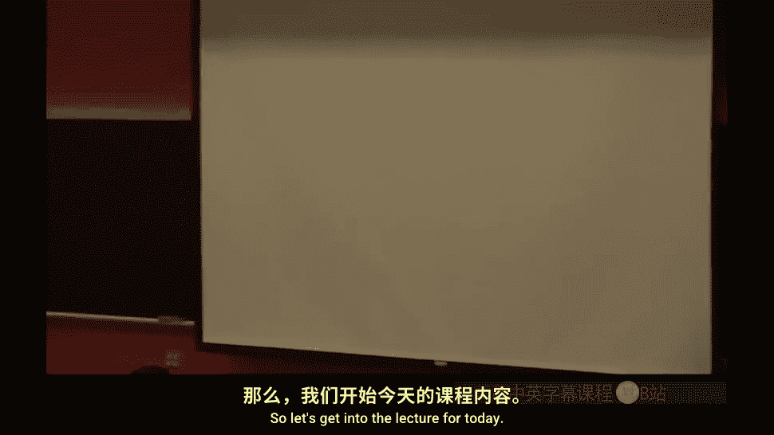
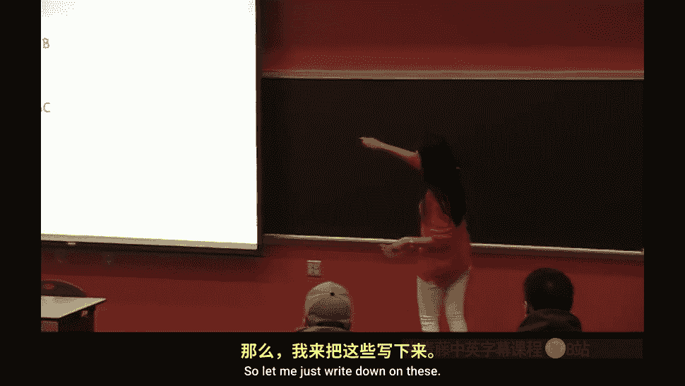
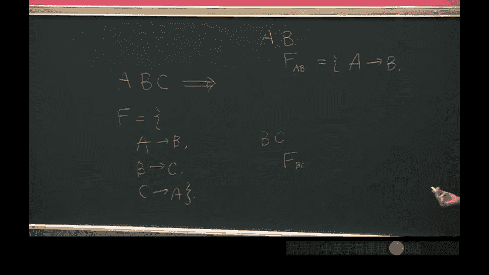
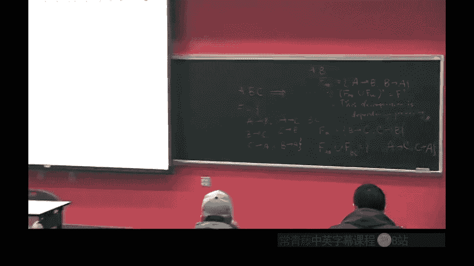
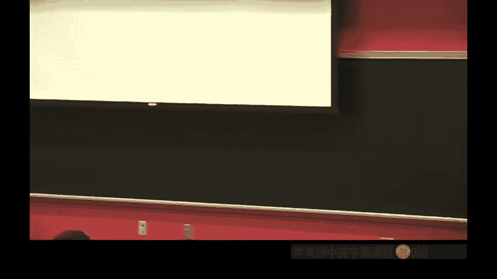
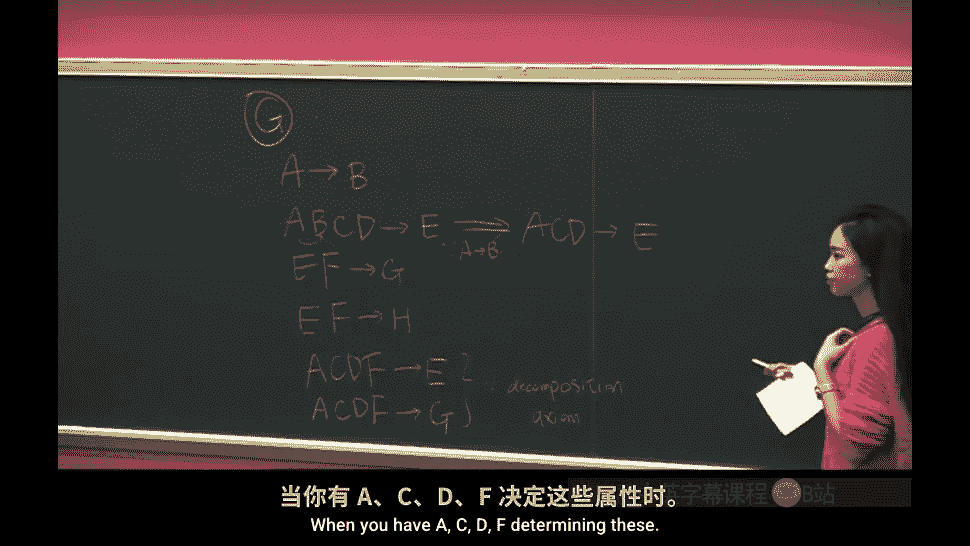

# 宾夕法尼亚州立大学【中英⚡数据库管理系统｜CMPSC431 Fall 2015, Database Management Systems】 p17 P18 分解为BCNF和3NF -BV1N76CBwEXb_p17-

对。觉得吗？Good morning， guys。So before we get started， I want to quickly go through this schedule a little bit so you know what's going on。

So today were。We seven， I was supposed to move on to chapter five today。

 so I think we need more time to finish up chapter 19， so we will get into chapter five next。

And for chapter5， well be。Going back to SQL programming again。

 so you guys will begraing your laptop again for next year。对。And also next week on Thursday。

 you'll be giving your presentation。Project phase two。嗯。How is everyone doing for the face suit？

Just get started， okay， I'm looking forward to it。So that will be held in an evening and I'll ask you guys for the time of they little teeth。

 a be latehead in the class when we have more people here。So in total， we might take two hours。

And I will ask you guys， what time like most people will be available and we'll be having。

Pizza will watch you this good presentation。Okay and next week we'll get to choose the flavor I think they're fun。

And I will post homework three today。It will be due in two weeks。

We also have two options for homework three because homework three actually will include Cha 19 and chapterpt  five。

And for each part， I think the workflow will be quite a lot。

 so I will ask you guys later as a remind before the past finishes。

 I will ask you guys whether you want to split that homework into two part and you submit the one for chapterer 191 and then a week later you submit the one for chapterpt five so you don't accumulate everything until month。

So that's for that。ok。So， let's get into。The lecture。

If I didn't remember wrong last time thing we finishes around him。嗯。

So right here was where we finished last time， we were talking about dependence in preserving thecomposition。

SoBefore I talked about this， let's just quickly review what are the two types of thecomposition。

Properties that we care about。Other than dependenceency preserving， anyone remember the other one。

When you don't want to lose any information during the detailedposition。You want to recover it。Fuck。

And it's still correct。That one is the loss let's join decomposition if you carry so for a loss let's join。

 the way we do it is after we decomose original relations for the decomose smaller relations。

 we take a natural drawing of them and then we check。

So here's the dependency preserving decomposition last time when we were talking about loss this。

 we mentioned sometimes an approach for decomposition might lead you to a losslessjoing result。

 however you might lose some dependency that was given at the beginning you might lose those integrity constraint you can say so let's talk about dependency preserving toent today。

 let's talk about what's the definition and how we can find whether a decomposition is dependency preserving。

So here I list again， I think I talked about here last time， but I'll just quickly review again。

 so here we all know when we use big R， we are talking about a relation and let's say today we decompose R relation R into set attribute of x and y so there are two relation one have attributes X and with attributes y。

 so just remember when we talk about x and Y we are not just saying single attributes。

 it will be a set of attributes。And for F， we are saying the given functional dependencies given that hold true over all of the instances in R。

So in order to check whether decomposition is dependency preserving。

 we want to introduce a really quick concept first。

 so it's called the projection of F on x if you can remember we will thenote that as F subscript X okay so the idea is really like the projection we do for relational algebra here are the attributes。

 we want to project on on the set of function dependencies X。

Where all of the functional dependencies in there， if they are saying U determining V。

 then U and these attributes should both be in the x attributes。Okay。

 so here is still a bit confusing but I'll go through。An example later so you can see that。

So the definition of the decomposition based on project the projection concept we just learned is that the decomposition of relation schema all the function dependencies F into schemas with attribute sets x and Y is dependency pre solving if when we take。

Projection of F on X and an union， projection of F on Y taking their closure。

 will'll go back to the original closure。So I just kind of talked through what this means。

 but here I have another interpretation for that， so if we take the dependencies in projection of x of f on x and projection of F on y and compute the closure of their union together。

 we get back all independentencies in。Eposure， so let's take a look at the next slide。

Everyone got that。So let's take a look at the next slide and we can see what I mean by that。So， here。

We have an example like this。We want to see whether。It is on。Depenency。So what I say here means。

We have an original R right here and we decompose them into two sets of attributes， one is AB。

 one is BC。And the given assumption dependencies for R are these three。And today。

 we want to check if given these dependencies and we composeose it this way。

 this standard of decomposition is dependency preserving。So it as you saw before。

In the previous slide， we want to check the prediction form。

So let me just write down on this question right here again。

。

Become close。And for ABC， the function of depend is right here。

We use a set does not matter right because the order of contractdepends does not matter。So。

A determine B。We also have。big see。And we also have seat。哦。

But since we break down the original art into ABNBC， let's first check both of their projections。

First， so we want to check this。You want to separately check。The projection。

Of F on A B and also the projection of。So according to here， what do you think？

Projection of F onable。If you recall， that means if it's projection means persist。penencies。

 both sides should be from him。So if we only look at here judging by these three。

 which one is the only one that was？The first one， right， because the first one。

 A is in him and B can goes in。Okay， so we can write down the。

Then let's take a look at this one。Which one do you think satisfy。Reく of。て one。系。

So so far we have meat and you might think， okay， let's just take a reunion and then check whether the closure is the same。

However， even though it looks like。If we take a union， we only have。嗯。A B， and BC。

 and if we take the closure， we can use for one moment。And is that same stuff？No， but actually。

You can derive here a bit more。We have more partial dependencies from here。

 right if we derive it into a closure， what else can you see based on A B， A A determines B。

 B determines C and C determines A。If we try to use presentsivity。We also下。Ex10 minutes。行。And then。

四场。哦。第一证。系。So， after applying。Transitivity in the armsmstring museums， armmstrm museums。

 we have three more， so if we look at these three and then go back to see whether we can fill it out。

With this be any of them？No right， because none of them。How about this one。有标片。

So we can write scene to turn the scene。I hear as well。How about this one？It goes up here。So。

 we have。Get the mess。keepSo right now。We got them all and we can take a union of the two project。

So you take in。关住嘅。You get all these four。I'll just write。Okay， all these four。

And do you get more than that。We could forward them together。对。Thank you coming。喺 time see。

Which comes from A becomes B and B becomes C。Which shows。we go this way。We have the determines。え。

So in total， when we have them together， we see we have H timess B， d determines A， b determine C。

 C determine D， these four plus h times C。Alright， and before we take the closure。

 we go back there and then imagine。です。でせ。that home。 So， this shows you。Okay。

 this this is the final one。So。Thisてか。医生。Is。天。You want to make it a bit more solid。诶 이 책 union。

Eic and take closure。Is it clear or it kind confusing？

Okay， so that's how you will check when you are given an example how you will check whether it is。

あ不죠。So until now， we have learned。Two types of。The composition， way of checking。

 whether to the conversation is good。But however， a lot of times when you。Are given a schema。

 And you are the one who wants to become process。 It might be hard to start。

 So there are some standard ways that can do it。 we call it normally。じゃ覚だね。So for normalization。

 we can use algorithms to convert relations into either voice phenomena form or to a removal。

 which are the two most commonly in desired。So a couple of things to note when you really try to decompose or maybe in your project。

 you might be able to notice when converting a relation R into Boy lonomorph form。

 it is possible to Lawson joint the compose of health ever。

 it is not guaranteed to be dependency preserving。But if we only lead today。

 let's say we only target on certain normal form， there's always a dependency preserving and losses joint to composition。

We won't try to prove this year and we't get way to complicate it。

 but I will show you a couple of examples when the boys come。Then be able to put the chief。

 but we can do with。So let's discuss。These two separately。

 let's try to approach the composing into boys coming。Which remembers the strictest。どもそね。So this one。

 take composition into police kind。We actually have an algorithm。

 and that's from one of our observations that we have。Obsservve last time。

So the algorithm only has two steps in the first step。

 suppose that the relation R is not in voice for phone， that's why I want to normalize it。

 they compose it。Then let x sets of attributes being a subset， strictly a subset of R。

A be a single attribute in a Okay， so it's not a set of attribute this time。

 Now a is just a single attribute。 then x determining a。

Be a function dependency that causes the violation of voice home。

 then can you recall how we will want to become postes？Well the answer is actually in the same study。

How do we want to decompose them？We wanted to decompose them into are taking a set difference。

From me of the day， and then。有。I'll show you how it works later。So if you notice that。

 then you do these steps and if either of these is still not invo normalphone。

 all you can do is to further decompose them， repeating the same step， thank keep going。

Until all of the econos relations we found are in voice， then we're satisfied。

 then the algorithm stop。But it's also possible just keep in mind。

 It's also possible you will never get to a point when all of the relations are enforce。

So let's take a look at this example。Which we have seen before， which is a contract schema。

 and today we wanted to decompose it into boys Club。And in the past。

When we use this example we didn't have the fourth functional dependencies okay so this one is added today and for the second one。

 when we are working through here， let's just ignore the second one。Okay， so I grade it。

So when we talked about this example earlier。We decompose this whole arm。Into these two sets。

And before we showed that it was lossless joint the compose。好。嗯。And also， let's take a look。

 do you think。This one is in voice Can normal form， if we put。SD is the key for this relation。

Do you think it will be voice card normal form， It carries the function dependency of S T determining P。

Eith recalled the rules for boyfriend。It is。How about this one。CsJDQV， if you take a look。

It has this J determining S right here， but for this one， the key is C。

Then do you think this one is Singapore's？等等。So the outcome one， all right， yes。

 we can post because of the。It isD determinemin hate， but for the upper one。

 it is not in voice con phone， and the second one it is invoice。So because we found。

So here I forgot to mention here we decomp it because of S determinant P。Okay。

 and if you recall the earlier algorithm when we try to decompose it into Boy honeymoron。

 remember we say we have the whole R decompposed into R minus a and Xa。 So right here the a is P。

 So if we have r minus a， then that's the whole thing minus P。 that's why we get that。

And with the second part， we want to decompose is X A。 So it's just basically x the union。

I that's SDP， Okay， that how comes from。So now we found here is not satisfied yet。

 so we want to further decompose it。So earlier we found which function dependency is the one that violating what is going move。

ある位。This one。Jy determiningmin is。It's bothering us if making a nu boys come on the phone。

 so we want to become close。Based on this fourth one。

 So what would you do if we repeat the same steps。Like earlier in the rule， we have x determining a。

Okay， so here is the A and then we want to have here picking out the A So the whole thing take out S will be the first for for the decomposed relation。

AndBecause this is x， this is a， so taking an union for them， which is the Xa。It the second part。

This James。They you take a look。Could we have another further decomposition？

And it is cost because of this。Okay， it will become。Thank too。Okay， as I said earlier。

So if you take a look again at that point， do you think there are both uniforms coming？For here。

We can say if J is the key then this， then boys got't no phone。他把底。

Is there any other that's bothering us。And we say ignore this。They should be fine， so now from here。

 all the way to here， weve becomecompposed twice。Then all of the stop related now。Our in。Okay。

 so up until here， we are trying to ignore the second function dependence。

So that is actually causing another problem if we want to talk about。

 we still want to check the JP determin C。So let's take a look at here。

So recall last time we say if you do a lossesless joint。

 maybe you lose the ability of checking some function dependencies， some integrity constraint。

 so when we want to check it， you take the decomposed relations and you join them back and whenever you enter a new couple。

 you do it that way to check whether you're still satisfied so we say this function dependency。

 JP determinants C， the one we've been ignoring， actually cannot be enforced without a joint。てかた。

So the solution right here， one of the solutions is actually to add a relation。Withs the attribute。

Oh CJB。Okay， or you wont say JPC， doesn't matter。So we want to add a relation with those attributes。

 so that's like mute table。And you can put it maybe here。

Can put it right here so we can composed actually into these one more。

So that every time you're entering a new couple and you want to check where the dysfunction dependency satisfy。

You just have to check that separately okay， then you don't have to take back the joint。

Of the other relations。However。Is that a redundancy over there？

It actually is because you store the repeated data right， so here's the redundancy。

And that's kind of a trade off you have to face when you want to really go to boys Cup。

So like here what I say， so storing redundant information that CJP is redundant。

 but it makes dependency enforcement cheaper in terms of whether you need to join so joins can get expensive。

And that one makes it you， so it's just kind of like looking it up like a dictionary。

We have a few notes on thecomposing into。こかのも。So as we saw earlier。

 when we were decomposing the relations， I actually just told you guys oh because of this function dependency。

 that's why we do it this way。 So if you think about it。

 when you start from scratch when you're decomposing it。

 actually there's no right or run or of which function dependency to choose first。Okay。

 so a lot of times if you choose the function dependency in different order。

 that might lead you to a different result of decomposition。So there's no exact answer。吃饼。And。

Like we saw earlier， so there might not be always a dependency to composition into a voice call。

So here I have a really quick example that we can see we actually don't know what to do with this one。

So here say we have a schema， SBD， okay， R here， and SB is our key。

And today you are given these two functional dependencies， the first one is SB， determining D。

 second one is D， determining B。Let's just say we saw the determiningmin B is broaden us。

 and you want to use that based on that to be comp into these two。So， we decompose them。

Into S D and D B。In this time。For this one， we have S being the key and here D being the key。

 However， if you go back to check， now we lost the ability of checking whether S be determining the because they're just not together anymore。

Or you have to join them again。So。This here we say then we cannot preserve as we。so here。

 if you're really pushing it， trying to become posted into voice called normal home。

 that that might not be evident good。I。Okay， so now we show you sometimes。

Transforming or decomosing into voice comm is pushing it， and maybe you say okay。

 then let's not have voice come on let's just have normal。Sove got number is also an option。

 and let's talk about the posting into the。Okay。So the decomposition into third。

 there's also an algorithm for that， the algorithm for decomposition into voice quantum normal phone can be used to obtain a lossless decomposition into thermal。

But as we talked about earlier， dependency preserving may not be short。So。Earlier， we said， okay。

 that's what we talked about。 We can add a relation of that to check the dependency or。

Here we want to talk about a concept called the Min cover。Instead of using the original F。

To discover what are the possible ways of decomposing it。We can use a minimum color。

It was deemed quite unin in it beginning。すけ。So what do we mean by a minimum cover？So right here。

 Ill give you the destination for that。So the minimum cover for F。嗯。

We normally denote minimal cover as G， okay so G can that every dependency in G is of the form x determining a。

 where a， the one on the right hand side is a single attribute， not like what we learned before。

 Sometimes they can be sets of attributes。And the second requirement is when you take the closure of the F and its minimum copper。

 it should be the same。The third one is if we modify the minimum cover G by deleting the functional dependency or by deleting attributes from in functional dependency。

 the closure will change。Okay， so right here， you can actually understand minimal cover in another way if you want to say。

 where does this minimal come from？So we say it's minimal in two aspects。

 The first aspect is that every function dependency in the minimal cover is as small as possible in the sense that each attribute on the left side is necessary。

 we'll talk about what necessary means later and the right side can only be as simple。Okay。

 then the second thing is every dependency in it is required for the closure to be equal to the closure of net。

So here you might steal computes， but we can look at an example of。でした？我 work咁 here。Or okay。

 allll right。어。

If so like we saw earlier in the example you are given with a set of functional dependencies that's in F。

 Okay， I'll write them down now。And your task is to find the minimum cover。Right。

So we have a determining B。ABCD。Determining E。EF determined。EF determining edge。And ACDF。Determining。

不清。Correct。And our goal。It's defined G， which is the minimum cargo。So here what I'll do first。

It's actually to repeat。 Okay， I'll write down first。

 And then what we would do is to become out to transform from here and also delete some of the comments。

So when I write down， let's first check。 remember， one of the requirement for function dependencies in the minimal cover is that on the right hand side of the determining  error。

 it can be an only single attribute。Okay， so let's check one by one。

So a determinant B iss okay on the right hand side， only single attribute。ABCD。Determining。Okay。

 he on a single attribute。Saying for E F。Determining G。And EF。就这。However。

 here we see ACDF determinant EG on the right hand side， we actually have two attributes。Okay。

 do you have any clue about what we should do to transform from here。

You recall one of the derived or additional axis for arms froms。Some of you proved。Decomposition。

 Yeah， decomposition。 Okay， so what would you do。Keep the lip inside the thing right。最要话飞 c。

That becomes。嗯。Okay， and then I'll keep goinging。 And then you have。Okay。So for these two。

It's because。Of the competition exit。The compositionposition8， so that's how we get。From here。

That's the first thing。let's take a look at the second thing。

 we want to check whether all of the functional dependencies in here on the left hand side that all the attributes are necessary。

what cleaning it？So you can take a look。 Those with lots of attributes on the left side are the suspicious ones。

 So let's start from this one Okay， so you see ABCD determinings E。But actually， if you look at it。

 we already have a determining fee。Right。I hate tell be like so。

So do you think it's necessary for us to write A，B，CD together determiningly？

So how can we transform if we already have。A determine。How can we make it even safer。AZD。

Deterrent in。 we don't need the be being count。That's because。And8。Right。Okay， so that's from there。

 we transform them into。Okay。Then let's take a look。these two。

Do you think there are any problem for them。Or you should be fine。Like the website EF。

Should be all right， okay， so let's pass them first。But how about when you look at it here？

When you have ACDF。Determining。

Mmhmm。そそ。非常で。F。We don't need the F right， or in another way you can say。If we write。嗯。

We don't actually is， So if it unnecessaryt need it。那我。So this one is not necessary。

Remember when we talked about the rules for finding a minimal。

 either function dependencies not necessary？分のね。So let's take this out， even though we decomp it。用那个。

Okay， if you don't forget why you do that。That's because we already derive。To。Okay。The we。

How about this one。ACDF determining G。Do you think it's necessary？Where did you find any sister？あてて。

嗯。From here， we actually have ACD。Determining E。And you can actually do。If we do this。

 what's it call。Is the augmentation right， if you do ACD determining E and augment both sides with F。

 now we have ACDF determining EF。And you find Geneva F on the right， left hand side， so you can do。

We have an EF that actually already determine your gene。So， together。Through what。Presivity。

 we have ACDF。so this one is not necessary in a sense that it can be derived from the other one already across the mountain as well。

And the reason it's because of this。3。系诶嗰一请啲。second the bottom how。哦。

The reason is because when you already have A and D。And that term。恋白と。Any questions for here？

So after all these steps， we found these left， A determining B， A， C， D determining E。

 E of determining G， and E of determining H。These left are in our minimal cup。For这。ok。

And you need more time to write this down。In more seconds or。Okay，So here。

 we just briefly talked about actually the steps we took when we tried to find out the minimum cover。

 okay， so if you recall what we did。Before the first thing。

 we try to put them into the standard form。 In a sense， on the right hand side。

 they are all single attributes。 that's the first step we took when we tried to figure out this example on the board。

And the second one， we say， we minimize the left side of each FD。

Okay so what we did was I think we did。Okay， yeah， we took out some of the attributes on the left hand side that are not necessary。

Okay， and the third one， we simply delete redundant functional dependencies。

 so sometimes we can find some。Depenencies in the set that can actually already be derived from other dependencies based on armsmsstrm axiium。

 like the earlier we did， we first did an augmentation and then we did a transitivity and we count。

Here's one。So now we have these steps， we actually have another example that we can work on or can save it up。

Do it work on it at home or you want to work for me。不です。What do you guys think？Save it up， okay。

So you can work on it。When you go back and you you found this rather difficult。

 we can go through it on one。So let's look at the next thing。 Okay， so now we learn about minimum。

And I'm wondering why we do even that， and if recall， that's because we want to compos into soil。

I think we are near the end。But today。So you want to do decompose into the。Let's take a look at here。

We have a couple of assumptions that we are making right here。So your goal。

 you want to obtain a loss joint and dependence of preserving decomposition into theno from relations。

So here we have a couple of notations。 As always， R is the original relation that we want to decompose。

 So this time we say we decompose them into R1 or2 all the way to R n。

 okay all these little relations。We already assume they are being thrown。Okay。

And R is given a set of functional dependencies。And this is where the minimal cover comes in。

 So before you do any of this checking。You already transform the F into it。Okay。

 so that's what we learned about minimal。And here， if I。We mean。Like we talked about earlier。

 the projection of F ontoto the attributes of RI。Okay， so that's how we did。So go back。

 that's our goal。 So we do the following。 We first identify the set， which we should call it in。

From the functional dependencies in F， that is not preserved。 Okay。

 so now we already decompose them into these relations。But recall。

 like earlier we worked on some examples， they can be lost with join。 However。

 some of the functional dependencies are still missing。

 that we have to actually go back to do a join。To detect those things。 So you first do that。

 identify those missing function dependencies and put them into R。 Then next step for each of them。

For each of the function dependency in， we just simply create a relation schema。XA。

And added to the decomposition of law， and that's super simple like we did the Fo right。

 but just simply take a union of app and create a new little table。Forour for that for that。

They' really easy， I forgot out whether we have an example for that。Before we go in。

 let's just quickly take a look at here。So。Not that。嗯。When we do all those。

Adding those little tables， little relations， they're already in。Okay。

You can think about what but they're already in that phone。

And also here we're talking about if you have。Lots of functional dependencies in the set end that all shares the same left side。

 you can actually combine， for example， if you have x determiningmin A。

 x determiningmin B and x determinant C。In your M set， Okay。

 these that are all missing from the function dependency in your final result of the decomposition。

 What you can do is actually you just。Combine them all， and that's because of the Union as。

Combine them all together， and them together。They together。You create just one team for that。

Okay so you don't have to create three separate relations or three separate tables of X A， X B。

 and X C instead you just create a whole table that's X A。I think we have time then we can。

Finish an example before we go。Okay， so that's this one。

Which is the example we have seen so many times。 and the one。

That we weren't able to make a dependency preserving earlier， right。

 we only decomposed to a point and then we couldn't make it。Deence preserving。So。What we can do。

Actually， I'm told to work through all of them because we actually work through it。

 but I just didn't talked about。How it actually should look like， I think I can just show you。

The final result， because I feel like you will be really repetitive。呃。I remember right here。

We actually worked through it all the way。And then back then， I just say then they just add this。

 But this is exactly what we talked about， right， if you have something missing。

Then you add a new relation to that。Okay， it。That's exactly the same for the example。Allright。

So before we go， actually I finish early today， I have a couple of things we want to discuss with you guys。

Okay， so I will post homework three today， but homework three actually include two parts。

 so the first part is from chapter 19， which is what we have been learning。

 other functional dependencies and。那么 from。OkayAnd it also includes chapter5。

 which we will start next Monday， and that will be all this EL programming。And for both pots。

 I actually think the workflow was a bit high。😔，So I've been thinking whether you guys will prefer you start working on the first。

 which is chapter 19 and do in week。And then the next part you in another bit， but they together。

Combine the grape for your home。Or you guys want me to post it and then collect it all after two weeks。

哦嘢哦。Okay， okay， just want to help you guys out because I'm always like waiting until the last minute。

 Okay， you guys are cool with that。 And that's all right。 and bring your laptop next Monday。

 And if you recall， we have。😊，Presentation next Thursday， right， we'll be having pizza yeah。

 and we want to decide the time now Okay， so we will be needing two hours。

I think in total for everyone to finish presentings。

So that's why I'll prepare food for you because I feel bad at's dinner time and also it's okay if some of the teammates really cannot come okay as long as there are some people that are here。

 but you can't just don't come saying ah， there's that one he will present at all so you can only not be here because you have to work or because you have other classes。

😊，Okay， so here you have different options。We have five to seven， six2 eight or seven to9。

 or you guys want to go eight to 10， thats okay， let's vote okay。517。62， a。98。Who wants it，5 to7？

It's all right to raise your hand You're giving him look， okay you're putting pressure on your。😊。

All right， six， two， eight。哦，谢谢。Three，4， five， six， seven，8， nine，10，11。1314。S tonight。そして。Thursday。

S9， one， two， three， two one eight to 10。One， two， three， four， five， six。😊，Okay。

 then we'll just have6 to。 Alright， and we'll just decide this way go next week。Okay。気てる。

And I'll send an email again to remind you guys。