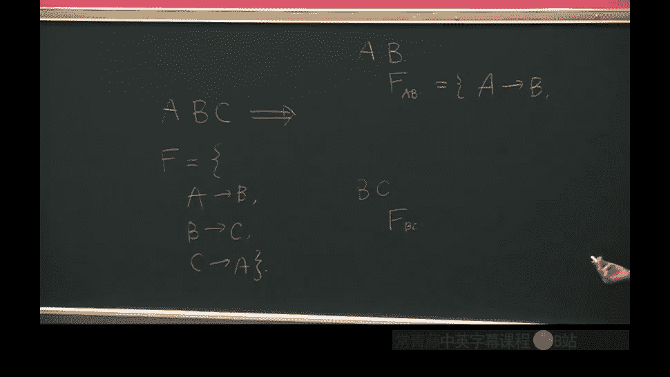
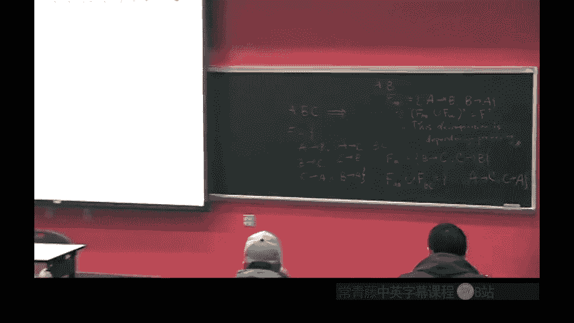
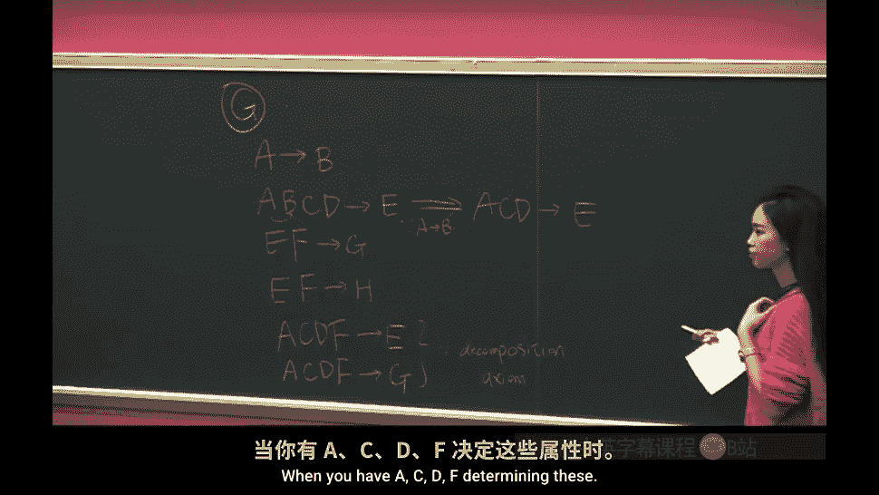

# 数据库管理系统：第4章：分解为BCNF和3NF

在本节课中，我们将学习如何将关系模式分解为更高级别的范式，特别是BCNF和3NF。我们将重点理解两种分解的关键属性：无损连接和依赖保持。通过具体的算法和示例，我们将掌握如何检查一个分解是否满足这些属性，并学习如何执行分解。

## 课程安排与回顾

在开始新内容之前，我们先快速回顾一下课程安排和上节课的内容。

上节课我们介绍了无损连接分解。我们提到，有时一种分解方法可能导致无损连接的结果，但可能会丢失最初给定的一些函数依赖，即完整性约束。本节课，我们将深入探讨依赖保持分解。

## 依赖保持分解

本节中，我们来看看什么是依赖保持分解，以及如何判断一个分解是否保持了依赖。

首先，我们引入一个关键概念：函数依赖集在属性集上的投影。给定一个关系模式R及其函数依赖集F，将R分解为具有属性集X和Y的两个关系。F在X上的投影，记作 **FX**，是指所有满足以下条件的函数依赖U → V：U和V中的属性都包含在属性集X中。

基于投影概念，依赖保持分解的定义如下：将关系模式R及其函数依赖集F分解为模式（X）和（Y），如果 **(FX ∪ FY)+ = F+**，则该分解是依赖保持的。换句话说，如果我们取F在X和Y上投影的依赖集的并集，并计算其闭包，能得到F的所有依赖，那么这个分解就保持了依赖。

让我们通过一个例子来理解。

假设原始关系R具有属性{A, B, C}，给定的函数依赖F为：{A → B, B → C, C → A}。我们将R分解为两个关系：R1(AB) 和 R2(BC)。

以下是检查步骤：
1.  计算F在AB上的投影 **FAB**：包含A → B。
2.  计算F在BC上的投影 **FBC**：包含B → C。
3.  取并集：{A → B, B → C}。
4.  计算该并集的闭包：通过传递律，我们可以推导出A → C和C → A。因此，闭包为{A → B, B → C, A → C, C → A}。
5.  比较闭包：该闭包与原始F的闭包{A → B, B → C, C → A}（通过传递律同样可推出A → C）相同。

因此，这个分解是依赖保持的。

## 规范化分解算法

到目前为止，我们已经学习了如何检查分解的两种属性。然而，很多时候我们需要从零开始对一个模式进行分解。为此，存在一些标准化的算法，可以确保分解达到特定的范式。

需要记住的关键点是：
*   将关系转换为BCNF的算法可以保证得到无损连接分解，但不一定能保证依赖保持。
*   总是存在一个达到3NF的依赖保持且无损连接的分解。

接下来，我们分别讨论分解到BCNF和3NF的算法。

### 分解为BCNF

首先，我们来看看如何将关系分解为BCNF，这是最严格的范式之一。

分解为BCNF的算法基于我们之前的观察。算法步骤如下：
1.  假设关系R不在BCNF中。找到一个违反BCNF的函数依赖 **X → A**，其中A是单个属性，且X不是超键。
2.  将R分解为两个关系：
    *   **R1 = R - {A}** （即从R中移除属性A）
    *   **R2 = X ∪ {A}**
3.  如果R1或R2仍然不在BCNF中，则对它们重复上述步骤。

让我们看一个熟悉的例子。考虑合同关系模式 `Contract (S, J, P, C, D, Q, V)`，其中{S, J}是候选键。给定的函数依赖包括 `SJ → P`, `S → P`, `J → S`, `JP → C`。

首先，`S → P` 违反了BCNF（因为S不是超键）。根据算法：
*   R1 = Contract - {P} = (S, J, C, D, Q, V)
*   R2 = X ∪ {A} = {S} ∪ {P} = (S, P)

检查R2，键是S，它满足BCNF。检查R1，它包含函数依赖 `J → S`，而R1的键是{J, C, D, Q, V}，J不是超键，因此 `J → S` 违反了BCNF。我们需要进一步分解R1：
*   基于 `J → S` 分解R1：
    *   R11 = R1 - {S} = (J, C, D, Q, V)
    *   R12 = {J} ∪ {S} = (J, S)

现在，R11和R12都在BCNF中。然而，我们忽略了一个函数依赖 `JP → C`。在最终分解 `(S,P)`, `(J,S)`, `(J,C,D,Q,V)` 中，要检查 `JP → C` 是否成立，需要将 `(J,S)` 和 `(J,C,D,Q,V)` 连接起来，这很不方便。

一个解决方案是添加一个额外的关系 `(J, P, C)` 来专门检查这个依赖。虽然这引入了数据冗余（CJP信息被重复存储），但它使得依赖的强制检查变得廉价（无需连接操作），这是一种权衡。

关于BCNF分解的几点说明：
*   选择违反BCNF的函数依赖的顺序可能影响最终的分解结果，没有唯一正确答案。
*   可能不存在一个能达到BCNF的依赖保持分解。例如，模式 `(S, B, D)`，键为 `SB`，依赖为 `{SB → D, D → B}`。为了满足BCNF，必须基于 `D → B` 分解为 `(S, D)` 和 `(D, B)`，但这将丢失检查 `SB → D` 的能力，因此不是依赖保持的。

### 分解为3NF

由于BCNF可能无法保持依赖，我们接下来看看如何分解为3NF，这总能得到一个依赖保持且无损连接的分解。

分解为3NF的算法可以利用BCNF分解算法来获得无损连接分解，但为了确保依赖保持，我们需要引入**最小覆盖**的概念。

#### 最小覆盖

最小覆盖是函数依赖集F的一个等价但更精简的集合G，满足以下条件：
1.  G中每个依赖的右边都是单个属性。
2.  **G+ = F+** （即闭包相同）。
3.  如果从G中删除任何依赖或删除任何依赖左边的属性，其闭包将改变（即无法再推导出所有原依赖）。

寻找最小覆盖的步骤：
1.  **右部化为单属性**：利用分解律，将F中所有右边有多个属性的依赖拆分为多个依赖。
2.  **最小化左部**：检查每个依赖，尝试移除其左边的冗余属性。如果移除后闭包不变，则该属性冗余。
3.  **删除冗余依赖**：检查G中的依赖，如果某个依赖可以从其他依赖通过阿姆斯特朗公理推导出来，则删除它。

**示例**：给定 `F = {A → B, ABCD → E, EF → G, EF → H, ACDF → EG}`。
1.  右部化为单属性：将 `ACDF → EG` 拆分为 `ACDF → E` 和 `ACDF → G`。
2.  最小化左部：
    *   对于 `ABCD → E`，由于已有 `A → B`，可简化为 `ACD → E`。
    *   对于 `ACDF → E`，检查发现 `F` 是冗余的（因为 `ACD → E` 已存在），可简化为 `ACD → E`。
    *   对于 `ACDF → G`，检查发现它可以通过 `ACD → E`（增广律得 `ACDF → EF`）和 `EF → G`（传递律）推导出来，因此是冗余的，可删除。
3.  删除冗余依赖后，得到最小覆盖 `G = {A → B, ACD → E, EF → G, EF → H}`。

#### 3NF合成算法

使用最小覆盖G，我们可以通过以下算法得到3NF的依赖保持且无损连接的分解：
1.  对于G中的每一个函数依赖 **X → A**，创建一个关系模式 **XA**。
2.  如果步骤1中创建的任何一个关系模式包含R的某个候选键，那么分解完成。否则，添加一个只包含R的任意一个候选键的关系模式。
3.  （可选）合并具有相同左部的关系模式。

**示例**：再次考虑合同模式 `Contract` 及其函数依赖。其最小覆盖可能包含 `S → P`, `J → S`, `JP → C` 等。
1.  为每个依赖创建模式：`(S, P)`, `(J, S)`, `(J, P, C)`。
2.  检查是否包含候选键。原始键是 `(S, J)`，它没有单独出现在任何模式中。因此，我们需要添加一个包含该键的模式 `(S, J, D, Q, V)`（这里把其他不属于任何依赖右部的属性也放了进来，通常放于键所在的模式）。
3.  最终分解可能是：`(S, P)`, `(J, S)`, `(J, P, C)`, `(S, J, D, Q, V)`。这个分解既是3NF，也保持了所有依赖。

## 课程总结

本节课中，我们一起学习了数据库设计中的关键步骤：关系模式的规范化分解。
*   我们首先明确了**无损连接**和**依赖保持**这两个分解过程需要追求的重要属性。
*   我们学习了如何检查一个给定的分解是否满足依赖保持，其核心是计算函数依赖集在子模式上的投影及其闭包。
*   接着，我们探讨了两种主要的规范化分解算法：
    *   **分解为BCNF**的算法能保证无损连接，但可能无法保持所有函数依赖，有时需要通过添加冗余表来检查依赖。
    *   **分解为3NF**的算法总能产生一个既无损连接又依赖保持的分解。该算法依赖于先求出函数依赖集的**最小覆盖**，然后通过“合成”每个依赖来创建子模式，并确保包含原关系的候选键。
*   我们通过多个实例逐步演练了寻找最小覆盖和执行3NF合成算法的过程。

理解这些分解技术和它们的权衡，对于设计高效、无冗余且能维护数据完整性的数据库模式至关重要。