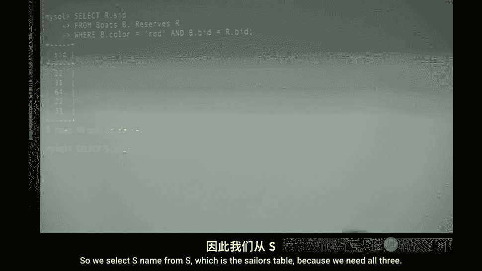
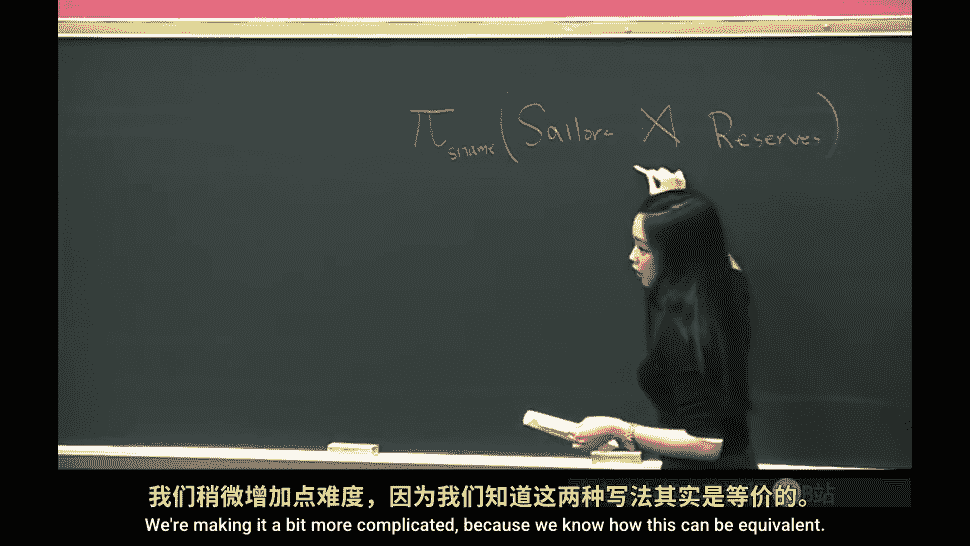
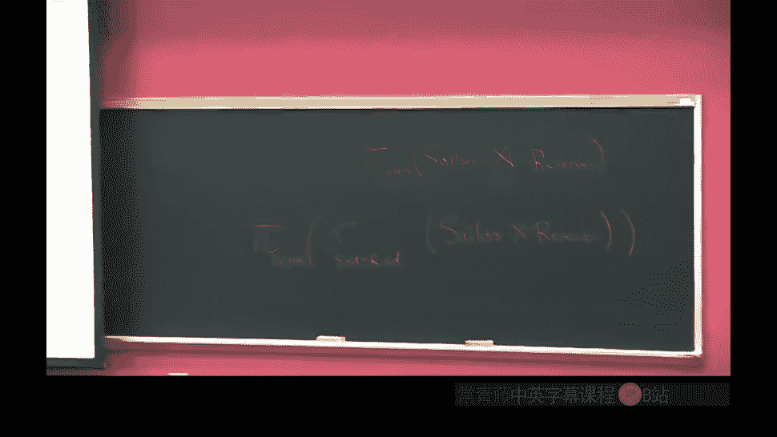
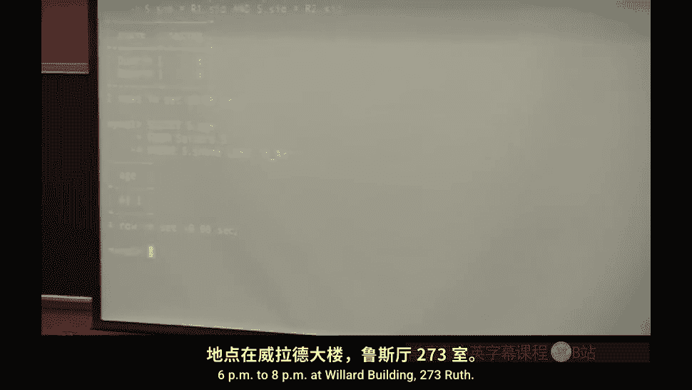

# 宾夕法尼亚州立大学【中英⚡数据库管理系统｜CMPSC431 Fall 2015, Database Management Systems】 p18 P19 SQL - 第1部分 -BV1N76CBwEXb_p18-

Good morning， guys。So today we are at week  eight already and we are actually at Z。😊。

Middle of this domestics lecture。先。We learning until 16。诶我。

Today is the AC and we'll be learning more about SEQL， continue from chapter4。

 but this time we'll focus more on querying。😊，のてルクや。So today， I guess most of you have your laptop。😊。

If not， you can write it on the slide。So just don't forget if this beat we need that trust。一个。

And I just want to quickly talk about what's going to happen。Can need a picture now。

As you all know this Thursday， we'll be having your project phase2 presentation。

And I can didn't write it here。It will be Thursday evening。According to our votes。On Friday。

And I book the room it would in wither building room。欧。6 PM 18 PM。

If someone your teammate cannot make it， someone can。A few more things。

 so this week we'll focus on SQL。And this would be what youll be using for your homework。

Part two and next week we'll get into mill equall， which is not included in the material。

And I feel organizing。Taught next week， so if you guys are interested in you'll see going do you have anything？

So let's get into today's lecture。哦后这没完。So we're at chapter five right now。

In chapter  five is always equal， which is in short for a structuredary language。

And what you will be learning in this chapter will basically include these things。

 so we will talk about all ourqueies express in SQL so far we have only learned about really simple ones today。

 but we're still focused on simple basic ones。Later on， we'll get into warrant Boston。So basically。

 we structure them into stem the curries and talk about nest crries and the aggregations in groups。

So all these， you can kind of map the concept into what we learned in relational algebras。

So I'll talk about how they can interact with each other。

So the schema we'll be using throughout this chapter will be something we'll really familiar with。

 which are the sellerors reserving folks and instances are。Okay so you get more sense of familiarity。

So these will be the s I would going be using this。And here will be instant。

Ex same instances we used before when we learned about。And today when we work on this。

 we won't have you， you don't need to type in my creative table or anything。

 later I'll show you where you can find it， I wrote the script so you can directly copy and paste it。

So all right， before we get started。For those of you who have laptops。

 please connect to your My SEva， either locally or so。洗らない？Who will be connecting to the CSE？Okay。

 so that would take a bit time。We'll wait for that and for those of you。그。Or you sit up。

 you can go to Angel。嗯。And under the last folder， there's a script for Le 19。四。

So you just think we need to copy and pick the whole thing。We look something like this。

 so I already wrote down。Create the tables。 And it's the。嗯。The values。At the intensive。

Before you do that， just make sure in your MySQL database， you don't already have these table。

remember， if we want to。To leave the table is completely what than we do。

We drop it or tru it if we want to get rid of it。你湾。

So if you already have some tables when you practice before。

 store in your database that are called Sars or both or reserves。

 just drop the table in the name of the table。But you can't get rid of it。Otherwise。

 you get errors when you paste it on。It needs a bit more time。Let's talk about the basic sl theory。

I'm sure some of you are already really familiar with it， So in the basic SQL query。

 we have three keywords which are select from and where okay so select。follows by。A keyword distinct。

 which is optional， and then a target list。I from follows by relationalist。

 where follows by qualification。So what we mean by the relation list。

After from will be the relations that you will be using for this query。

 which is kind of like when we talked about relation algebra。

 we would think about what are the tables that would be involved so in relation list。

 that's where you put those things。And the target list will be of the list of all the attributes that you want to take out。

 so this will be really similar when we do selection in the relation。

Piod is a bit confusing because after select。嗯。It's kind of like what we do for projection so here is a bit confusing because after select we actually put the attributes name that we want and that is similar to the projection。

In。Okay， and not the election。Because when selection actually happens， it's after where。

where we use some qualification， which are like conditions。In the。

 so remember in relation and algebragraph， we will have selection and then we could qualification。

The growths。So when you write some， don get confused between the select。So for the qualification。

 we're really familiar with it， could cooling we use comparison。😊，You can comment in terms of the。

And for the distinct keyword， if you put distinctt， it means if the result has duplicates。

 it would take eliminate。So when we talk with our relation over， we just。

Pretty much assumed the results will have no duplicates， but when you implement it in MySQL。

 if you have results that are actually duplicate， for example。

 when we just simply select the seller's age and maybe two people have the same age。

 when we do it in My SQL without using a distinct keyword， you will actually give a protocol copy。

Okay， so including the same view you can get rid of。懒不来。So let's work on。The first query。

 can take a look。I've exited out from the presentation here。You should be at your。大先こ。

I'll just quickly read。So for the first period。Its too small。We'll look at February 15th。

Think about what you would do from prayer。可以。Theth is asking to find the names and ages of goals。

我括拒姐。Do you think there's any qualification we need to include for this one？No。

And how what are the tables involved？So only so。And how about select， what do we want。

 what do we want to select？We want the names and ages right so we can directly get it from the seller table so what we can do right here is we can do select。

And ethnic name。So here you list the fields you want。

Then you press enter that we can type the front clause。啊。When you finish。Hi the is Stepie Collins。

We hit enter。念出去。Its extremely simple， we just simply have to follow after the select。

 we list the fields we want， which are the columns and then we talked about which table is from and then that list it all so here you can actually see for this name and really know how to pronounce and Gi Hiraio。

 both of them。With the name Harraio， you have seen eight。So let we talked to about earlierlia。

What do we do if we want to get rid of the duplicate？Distinct， okay， so you can put distinct。

Right here。Okay， you put S name。And then just do the same thing。

So here you can see that we didn't do this as10 rows。In the result， we did this。

We get only nine rows。So the different。舐めてて。So I don't have the copy of slide with me right now if I get into a slide that is not for a query。

 let me know， okay， so I'll jump back。So the next is for 3011， right？谢谁。So for Curry 11。

 we want to find all sellers with a rating above seven。

So we know select in from are definitely necessary to require them。

 how about the where clocks we need at this time？Do include where。Yeah。

 that is because we have the condition of war。Yeah， we want the rating about seven， Okay here。

Same thing we just do。And we only need a table of sail。This time we still don't need table。

Anywhere else， so you do the same thing， select。And。Here to specify the silk。

We doesn't specify what fields are required or our desire。

 so what can we do if we want to select all fields？Put this。哎。Maybe you code the E start。

Then you can get all of yourself。To select all。From。Sa love。And you say。Where。They're ratinging。

In above that。AndJust simply do that。And when you hit enter。

So because we didn't specify what fields we want， just simply return all of the columns。Okay。

 from the tables talk you want。And then it will get rid of the rows that have ratings not above。

That's very simple。All right。So let's think about what actually happened behind buildings these。

Sorry everything's kind of slow today。All right， so what could actually happen the whole process when we typed in the query and then the process something and then we turn to you is kind of like this so remember we put select from and where。

So the first thing you did is actually compute the cross product。

After the press product up the tables， you list after the front clock。Okay。

 so it gives you a super big table。That's what happens first。

And then it will go to the where clause to find what are the criteria you provide。

 and then get rid of those tuples that don't satisfy the qualification。

And the third thing that happens is it get rid of the columns that you don't want so based on。

Things you live after select。So it only keeps the attributes that you want。And eventually。

 if you have the distinct key。You will get rid of the people。就在 what开。So as I said right here。

 this is actually the least efficient way to compute it so right now you can think of it as what happened behind it。

 but later on later in the semester we'll talked about optimizing the queries so if you remember at the beginning of the semester we learned about there optimizer in the database。

 and that's what actually does， it will blend the query of what way it will be the most efficient way to produce it。

So every praie that you put last。But before now we can think of it。

So if you look at the cross spread， that's where。The least efficient part。

Because it generates all of the profit。Okay， so let's get back。嗯。To carry。So prepare one。

I think we were really familiar with that when we worked on the relational algebras。

 so it's just basically finding the names of sellers who have reserved vote number one， level three。

Okay。Anyone。So what tables do you think will be involved this time？Which tables？对。Resservve。

And so we actually need two this time。Okay so because sals and reserves。

 they actually both have SID in that， so we don't want to cause any confusion between those two。

 so remember what can we do when we were doing this？Remember when we have。We do。Okay。

 and for remainingnaming， you can actually。Gives different take with different names。

So here we use the similar idea。So here we start from select。

 but instead of just directly putting S name。We actually put S that S name because later on we want to call the cell is S and we want to call the reserves off。

And just remember， the reason we are doing this is because now we have two tables and they both have the field SD and we don't want to call any name。

刚进。So we select S name from S。And then next we talked about what is S。

 okay so from we say sailors and just put S。Okay， put it that way from Stas， and we call it S。

And also because we want to look at who reserved folks 103， so we actually need the reserve table。

 right？So we put reserve。And naming Bar。This is how we would it。So this is what I would normally do。

 if you won。I think some people work us。Okay， but to keep it simple， we just need it。

So this is the f class。What do you think will happen in the warehouse class？

What kind of condition do we want if we want to find in names of Sts who have reserved about one more？

In the qualification， what should we。So the right ID。From the reserves， right。

 from the reserves should be equal to 103， and I think I' put it into it。string so human wants to。

So we want where the vote ID is equal to 103。Do we ended here or was actually driven it？

What do we need？As I said。We need to let them know how theyre connected together。

 so this is similar to where we learn about relational cculus， when we learn about it really briefly。

 like we say you should actually say in also，Where the SID in S is equal to the SID in。

So this is how you will specify how to come。this is all you need to do when we want to find a names of sellers who have them built number one。

Ready。That cancer。And that' what you get。Okay，Because in a select clause。

 we only want the S names or we only get one。So before we move on to the next query。

 let's just quickly talk about like what I said default， what actually happened to。はい。

When it's getting caught。So here， I didn't put the cross product because it's really way too big。😔。

But so when we put it into relation to algebra， this is kind of what happened。

So we have the sailors table taking a cross product with the reserves Okay and here we do a selection。

 but again， they'll get confused with the select in SQLs。 we do a selection and as we said before。

 not only do we care about the boat I D equals one or three in the reserves we also need to do this comparison Okay。

 so that's how we are joined together get。Okay， and then finally， with a protection。

So the first step we talked about is the cross product so I didn't put it here as the masses tableC product and the second part is based on the criteria we only take out eventually three rows because we need to consider both where the SIs are the same and when the boat IDs equal to 1 of3 and finally we take a projection so that's where。

We got just the names。So this is what happened。And also earlier， when we talk about。

Naming the salesors as S and the reserves as R， this is what happened。

 so we are using the range variables actually， so it's only needed when the same relation appears twice in the front po。

 which we will see later， like before we have reserves that we needed two times。

Or like we did before， when the involved attributes have the same name。Okay。

 so that's what we would do， here's a bit cut out but this is what we did earlier right。

 and it's actually exactly the same if we can directly use the name。From the table。

 but this is a bit cleanup so we prefer way we。Allright。

Let's move on and take a look at February 16th。The room 16。

They want to find the SIDs of sellers who have reserve a re。

So what tables do you think of being bold？我。We need to sail。好。被告。Do we need all three。

 if we only one S I D cost。So we only yeah， boats and reserves， right， boats for the color。

Resservvees for the S。喺。So。this we want to select。我。いじゃさ。Is I from reserve？

So let's say later we will name reserves as R okay from， so we talked about two tables。

 so from votes。A B。And reserve。But all。And this is really similar to the one we just did earlier。

 so what do you think will happen in the warehouse cloth？你要。B or the。Exactly。

 so here we first want to say， okay， we want the boats that have color red。And not only that。

 we also want to specify that。It happens when。The BID votes are the same as the BID。没事。Okay。

They said what we want。Is this too small。People in the back。 It's all right。

So this is what we would do really similar to the long you stick。

 when you press enter what you're looking at。好。How about query2。The next one。

We want to find the names of sellers who have a re。

How many tables do you think of involved this time？o 你。So let just quickly do it。We want to select。

And this time we want the name， so it's from Saors we'll just to the name。And we just。

Imagine that later we will name the services S， both B and reserves us off。

So we select S name from S。

The sailors table。Because we need all three， so in a front plot you just simply put sailors。As S。그じゃ。

It are。唔早。Here it's very simple， which is lets download the keyboard that would get involved for each。

And for the wear clauses， we want to be a bit more careful because this time we're connecting more tables。

 so what do you think will be in the wear？Other than we already know， he color equal。It simple。

 what else？Showing all three， so what？So the R is like。Equals to S is ID D and then。啲。Yeah。

 RM BID equals2 B。possible玩。And just remember。When we are doing all these things， we use and to come。

They already when for。我不行。你觉问。All we did。Thank you。Where I get。这个。So far， everything's true。

All right， let's move吧。The query3。So for query3， we want to find the colors of both reserved by xar name block。

Again， how many tables do you think we get involved？Oing。And we want to select the color。

 so that's from the both table。So here we can just simply do we want to select。Color from book。

 and we know later the name goes as be。And same thing， we need all three tables。

So we just simply tighten down。Tler says S which numbers as R。Both。What happened in the warehouse？

同 one。We want the colors of boats preserved by lovers。

 at least we know we should deal with lover first。So that will be。From which table？Yes。

And the test name。Its equal to。はい、ラ'sトパスング五十。What else really similar to the wonderful？

What should we come here？Or exactly the same thing thing。And。The SID in of is equal to the SID in S。

And。BIU啊。Its people to。哋。Just the thing。The only difference right here at this time is that we are coming hearing the S。

In theて。And。you getYou get the colors。Any questions so far。So let's go on query4， so for queryie fo。

 we want to find the names of sellers who have reserved at least one vote。

Remember how we did it for relation to algebra？And you guys remember。

 and we want to find a name seller who have was at。How many tables do you think willll get involved？

Just sell it in remote。哎。So how would you write it down if you are parentranting relation？

Any。そは？でし？実重？哎。Because you won the name。系。Making it a bit more complicated because we know how this can be equivalent。

It can actually also be。Sa became。对です。And what what happened in the election？So here back practice。

I'm just saying。都 be。Here we do the greenna。And just assume。This is what we would do if we were in。

But what do you think what we should do？So equal care。

Thanks on that。So we already don't， because we want to find the names of the sta list。

Names of sellers who have reserved at this month， you want the names of sellers。

So at least hear is either right as。で、すね。that's what。周末。さ应该さ。Yeah， home seller。Yes。And reserve。啊。

So what happened in the warehouse class just？I。Yeah， just the as idea。So when it's I。感这。

There what you。And because we didn't put the stt。Or we get all of。か来。

So these are all the most basic one。Today， I actually only have。One more comfortable。

We'll move on to a the more complicated ones later next time。They might finish from me。

So let's take a look at what we can actually do when we want to do stream compacts。

Which is what we didn't do in relation to health。はい。

So we can actually do some string comparison in SL。Has anyone heard of regular expression？

So you guys have use regulation， so this is like the easiest。Easy， easy， easy version of that。

So we can do some expressions and strings in SQL， so the arithmetic expressions in string pattern matching are allowed in SQL。

 so later I'll show you what we can do for the U and the equal sign in the SQL。

So where the stream machineing really comes from。Is we can use like。

So you can compare something some string that is like a pattern。

 so we can match patterns so right here in SL， when you use underscore the， let's say anyone can。

When you use the percent signs， it's saying zero or more arbitrary。Okay。

 so these are the two we can use。So let's take a look at 37 or 17。

 we want to compute increment of the ratings of persons who have sold two different modes。It isて。

So you up writing here， I think I'll write on the note。

So here we want to compute increments for the ratings of persons。

We have sail two different boats on this。Judging by this query。

 what tables do you paint before being？Let's be down。What table do you think of me。

Do we need both at all？没有意。We just want the result of information。And then。The没见。肯定。

So we only need a sta and the up。So for now， let's put down says。うじゃあ。そ。But this will not even later。

So here it talks about the person who have sailed two different boats on the same day。

 do you think this is doable if we only have one copy of the result？But we actually need two。谢谢了。

So let's take a look， let's say okay。we think we already know we need two copies of that so what you can do is actually just like we did before a range variable。

 with the reserve， the first copy is R1。Then the second copyney， which is name it R2。

And we'll see how we will leverage this in the warehouse cloud。

So before thinking about how we would join the sailors and the reserve table together。

Let's take a look， We want to find the sail who have sail two different boats on the same day。

 so what you can do is actually。When you say we are one day。Is equal to the R2 date。

Because we want the information where you going be。On the same day， right。

And it also say no two different votes。So what you will want to do is to say。

And when the boat is different。So in SQL， when you want to do non equal to。

 you do this less than and great。Okay， this is enough。还有。行。When the B I Ds are different。So again。

 in the warehouse across we say， okay， we have two copies of reserves now in the two copies I want to find those couples where the days aren't the same。

But the BIDs are different。But what are left， we can't just do the experience。

 we need to join and say those people。So actually， what we will want to do is to join the sales table with each of them。

So what should we do if we want to join the Salor tableables group？What。但实际来说。い거て。I。And then。Okay。

A bit messy here。 we have three an。captain 18， four times。In this one， in the warehouse。

So now we can difficult talk and let's go back and take a look at the query again。

 actually out of these sailors that we have selected we want。The increment or the ratings of them。

And that's kind of weird so in a query it didn't say so。

 but let's just say because we want rating information afterwards。

 so let's also select their name so we know what are those ratings back， who are those ratings back？

Okay， so let's say we want the name， even though in the courage of the safe。

So it was the increment of the rating， so what you can actually do is do some little computation in the select class。

So the way to do it is to say。Instead of simply wanting the rating of the sts。

We can't actually increment it by one。So here is the concept we learned before。

 it's like computed as needed。The result is return。

All of the rating of the saless that you selected will be implemented by one。

 however it's not actually stored in the data。So what you're seeing is just the view of it。And。Later。

 let's say we want the column name still be ratinging。 So this is what you can do right here。

 You can say us。Ring。Okay so you do so when it's returned。

The color of the second column will be cerating。いければいい。So this is what we need to be。For a crazy。

If review again， we want the increments from the ratings of persons who have sell two different groups。

So ju by that， we know other than needing sellers and reserves。

 we actually need one more copy of reserves and right here what we did is we compare two copies of reserves that are in the same day。

 having the same day， but having different vote。And it's equalL to have different vote ID。

 this is the not equal。Okay，Le than and grade to them。

 and then we just simply join say table with each of the copies of results。

Because we want increments of the rating here we do rating plus one and we do us rating to remain。真定。

We copypy and paste。So。So if you look back to the instance。

 Dustin thes actually have rating seven so here in Babu， it's inement。没什。

And the very last query for today。Any question for this one。

So that one demonstrated and the expressions and extreme conceptly us。And also computed as needed。

And for credit 18。We' going try out the string matching。

So we want to find the ages of sellers whose name beginss and ends with the。

And has at least three characters。So here it begins and ends with。What do you think would do。

I'll keep this here。Ti Perie 180。So what tables do you think will be involved for this one？

We're only thinking about。Ages。Only sales。We only care about the ages if there is no reserved information needed。

 so from here we。And just as goes practice， even though they're just one。你 don't have。

And really simple， we want the age of the ceiling， right？So we just simply say select page。

Don'tAs has to tell us。So what do you think we will do for the warehouse cost？

You to find the sailors whose name begins and ends with me。And we use the like。

So what we are comparing。The ethnic。K you could like。Then after that， we can put the pattern。

The stream of that want to match。So to do that， you can take a look by setting the gain is an end with B。

 so all you can do。So I don't write it down yet because we will actually put something in between if you're writing。

So begin in end with me。OkayB， then B， and we put something into。So remember earlier we I saying。

 if there are anything in between。We can use any one character。なですか？You can his on。And then。Because。

We can actually have。At least three， right so we can have more than that。We use sense。So right here。

 it made a bit confusing， but if you only use percent sign， then only two characters will be allowed。

And the reason we're using the underscores is because underscores will make it to be at least three characters here we already have two characters。

 right？And the on school right here is like at least one。It cannot be no character right there。

So that's why we use this to make sure that we have at least。And here is the zero or more。

Even together， make sure you can have。太微。So that's how you would do this dream。And as you can notice。

 we didn't talk about applications and lower。So he's not taking care of you。

You can just simply me give。尤其是。For both sides， but later you will see what will get returned who actually have lower fee。

So how thanks it。He didn't show up but yeah。Bg this one and then returns the age。

So that will be the queries for today。Before we go， just want to remind you again。

The presentation is this Thursday 6 pm to 8 pm at Willard Building。

や。And you will need to turn in the project report at the spring。I don'tで。In。Oh。

 it's because he immediately only used the on the for saying one character， exactly exactly one。

 so for pretend you can be more。Because at least at least5。 and we were two ago。次。哦，等我给你讲好。

She need to three on those。到俾 b心片心片心片。And then precisely， I the sports。や的。Okay。

 and then homework is posted， okay， so it's due next Friday。ゃで。第个 Wednesdaynes。

