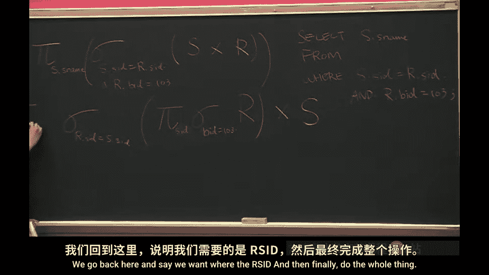
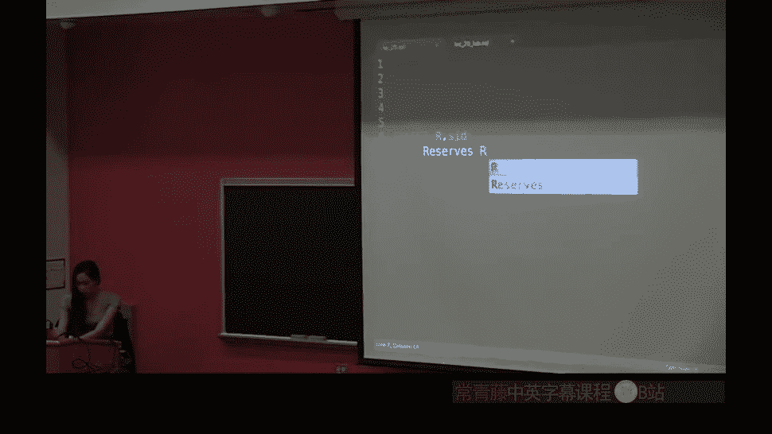

# 宾夕法尼亚州立大学【中英⚡数据库管理系统｜CMPSC431 Fall 2015, Database Management Systems】 p19 P20 SQL - 第2部分 -BV1N76CBwEXb_p19-

おりが。佢有。Okay， so let's get started for today's lecture。think most of you have your laptop with you。

If not all， you can write down the sequel。Com that we learned today on the flight。

So before we get started， I just have a couple of things that I want to talk about the first thing is that。

I'm thinking about from midterm too， we might。Test on really going to the computer lab and answer questions by working on my people。

So I'm thinking about making the midterm two part， and one part is going to come to classroom。对对。

And I thing can probably be the same for recent part。The thing is rich parts。

 and that we still have less。And then the testing time will be also shorter。

 so that's just part of my plan right now I just wanted to let you guys know。

If in the middle of learning it， you think that will be terrible idea。

I just think it's better to test it that way instead of testing you on the paper writing code。

The second thing is。

I'm going to talk a little bit more about other stuff。

 so if you haven't done so last time in terms of。Great the table。On your MySQL shelf。

 you can do it right now to also connect to your。Cical场。Either to easy or your local。哦。

Another thing is， so I originally planned to spend around three lecture shows on people。

 but now I think we might spend a little bit more。And also for no。s started next week。

 so I will still start next week maybe it's Wednesday or Friday。

 and then we will spend also a bit more on seafo because I think there's a lot of really good stuff。

from it， but then for all the chapters， there might be a trade off who will be learning about some。

Applications， but those will be mostly talk through instead of getting a hands on， so I might reduce。

あの在这上で。他 than that。Okay， so before later， before we finish the lecture， remember to remind me。

 I'll ask you guys for the flavor of pizza tomorrow。Okay。

 so we'll decide that before we finish the class。And。Before finish。

 I also ask around whether anything team will。If you have other obligational or you have to go later。

Okay， I'll ask you that that， please。All right， so let's talk about what well learn today。

Last time we learned about some really basic e commands for querying information。

And today we'll get into a bit further in terms of talking about the se of manipulation so if you study the textbook you'll see it talks about we have union intersect and accept however for the MySQL we use if you really try to test it out。

 even the bees really helps you to think the concepts is really easy to understand these two are not supported in our MySQL Okay so later on I'll show you what are the alternatives that you can implement not using these but using other stuff。

The union is supported in terms of the set manipulation for these two they not。

And we'll also talk about。The other set operations， the first one is in。

 we'll'll show you how it works later， basically it's like testing an element。

 whether it's in a given set。And also two really interesting operations one is。

Can put any operator that compare， compare the value。 And then you say any or compare to all of them。

 So this is similar to the ideal level compared here to some in the set。

 And this is compared to every。In it， I'll show you how it works later。And then we will also use Ex。

 which you can use to check if。Let's take a look at the first query。

So you you working on your laptop today， I think it might be a bit easier to open milk pad。

So we type on it。Because I'll keep going back and forth between the lines and after you' finish。

 coffee and past stuff。这是就是 lot意思。Allright， so let's look at this hurry。

 So we want to find the names of sellers who have reserved the red or。

I'm sure you guys are pretty familiar with this scheme of now。The sailors reserved。

Let's welcome this one what do you think， what are the tables that would be involved？いいんです。

If you want to find the names of sellers who have either a red or aqui。我菜 down。Temp play for。

And starts with the front clock。Out of the three tables， Staors reserve。Which are the ones you think。

Are required。Anyone。好。어な。All of them， because。First of all。

 we want the name of Pris in that own common。And thisel as people you remember。Also。

We want to know who reserves the boats that are red greens or reserves has to come from the reserves。

Then we move on and take a look at specifying the color of the boat， either red or green。

 and that only comes in the boat。So if you recall from last time， we can't ignore the。

The range variable， and that will still work， but these are using the variable name。For the table。

So when youre referring to the fields that you want to compare or to。So1 issues a lot easier。

And what are we trying to select？Heres they find the name that still is， so we are selecting them。

The name was。So you select。I start a name， catch I thin。In the cell and from it。啊。エステ。

Before we move on to the wear clause to think about how we would join the tables together。

I we specifying just a few things to note。Right here we're using select。

 but when you really map this idea to relation how well we learned before。

 this is actually the same for the projection。Because we're selecting fields that we want， however。

 when you look at the where later that we will put the criteria and the conditions to say which are the topples which are the rows we want。

 this where is like the selection in relation of algebra。

 you just don't get confused between the selection in relation to algebra and the select in SQL。

Sometimes they can't get to big companies。Also right here。

 we are selecting the S name from Sta table。So if you remember from last time。

 if the answer actually have duplicate result， duplicates toples in my SQL。

 it will actually return the duplicate so you might see the same name repeat。

Remember what's the key word that we can use to eliminate the。也不看。Okay。You can use this thing。So。

We'll be using the distinct quite a lot today just so that the answers are clearer instead of seeing a lot of BP。

So after all these， let's go back。And we think about our queryirie。

 So our goal is to find the names of sellers who have reserved a red or a green boat。

So now we have decided what's the field we want and what are the tables that will be involved。

 what should we put in the warehouse cloths？There are quite a lot of charm which it puts any at this time。

Let's start from thinking about how we join the tables together get up。

By doing what can we associate sailors and reserves table？

If you think of that in relation to algebra， it's basically taking a natural join between sellers and reserves。

In a natural joint， it is choosing these comparing the field with the same name。

That whether they have the same values， so here we can do the thing， you basically think， okay。

 now I want to make sure sailors are associatedsoci with the reserves。

And we just do as that SID equal to R。So what this is saying is by doing making sure the SID from sales table is equal to the SID from a reserve table and combining them。

So I only want the talk when this is true。So if we do the same thing。

To associate reserves and vote together， what do you think we should do？What's the common field？通了。

比较紧。So you can just do art， the BID equal to。So in my SQL， when we are doing comparison。

We directly use equal slide， so this is not assigning， it's just to compare whether equal。

Anyone remember if this comparing is not equal？Yeah， so I'll just quickly change it kit。

 but this is not what we want to do here， but it's less than or grade of。So that's for not equal。

But we are not doing this here， I'm just reminding you if you want to do a not equal。

So it's not like nothing like this。Allright， so now we are sure the sailor table and the reserve table are associated。

 also the reserve tables in both table are associated。

 what next we want to check because we want to find the sailors who have reserved a red or a greenbow。

So what should we do next。Thank。Go to next。I you hear。比较。そがか中。

Because in the table that the template I gave you， I have。Data type for color being stringed。

 so just don't forget。快。系。So here we use all because it's saying whether either reserved or red or。

So here you want to be careful。Do you think we should put。Around this this year。

Think about the logic。Its required， okay。嗯。Anyway， so that's what's。

If we want to fight the names of seller us will help observe the red earth window。

The part that you want to be careful of is just here we have a lot of terms in the warehouse cloth。

The those two offer joining the tables， this is for sailors and reserves。

 this is for reserves and boats， and then this whole thing。Just making sure you get。It fell started。

you already。You can copy it and we'll see what's going to happen。Yeah啊。So we past it。大家可。Recha。

Let's go back to。Did you take the word。recall when we were working on this cl relation algebra。

 we were saying there's another way of writing it。Instead of just directly using or in the condition。

If you recall， we actually try one approach where we use the concept of set。We use union。To do it。

 remember。Take out the sailors who have reserve green boats and we also。

Saors who have reserved red belts。Directly do an union between those two sets。So actually in my SQL。

 we can do that as well。So if we want to quickly， change this。By using。By using the concept of Union。

Okay， what do you think。Will will be doing。What we can actually do is， first of all we keep here up。

So when they goes all the way here， they will select。The sailor's name。

Where the sailor have reserved a rep。Okay。So if we take this whole thing in union。With this。Where。

The sub when the boat is green。It's what gives a。You think makes sense。Yes， right。

 because if can look at here thinking it sad。Of the seller's name who have reserved a reppo。

 and here is the set of the seller's names who have reserved。So we can actually do。Let's try it out。

You doesnt looking too fast for me。やに。就て下。Theは yeah is。But if you recall。

 here is actually not so good approach because it might cause some potential problems。

You look at here we are taking union。Betweenen two sets that are VS paying。

 the sailor instead of the sailless ID as not the primary king so we can do this its just because it happens in an example that will not cause the problem of singles having the same way that they are actually reserving different kinds of boats so here just for the purpose of practicing we will use as。

But if you think of that， really， we should take a union between S。

If you really want the name of the sellers， you can take the SI here first。

Then we can omit the sales page right here， because we can get the same from reserve。the好 thing。

Later， I'll show you have joined it。We just say it。Back then we can get it。

So later we'll learn that's actually the concept of nest programming。Any question for this so far？

So now if you take a look at query6， okay so we just did two approaches。For credit5。

You take a look at cl6。And let's think about。Doing it from。We have slide number five and six。

 vote for 36。Let's think about doing it and。Are set and the idea of you think set。So for Grie sake。

 who want to find the names of sailors who have reserved a wreck and a rainboat instead of wreck or。

So。We' thinking of it。The idea of Se， remember in relation to algebra， we can just directly。

Change here。It's interesting。Interse and step。So that means we are attending an intersection between the set of sailors who have reserve redcoat and the set of sailors who have resortd reco。

However， as I said in the beginning of the lecture， actually for organizedizedEQL that we are using。

 it not supporting。In。We will need to use other alternatives。So here you can get a little bit。カト。

If you writing on the paper， just give some space between。Will we changing around。So。

Here what we will do instead of using intersect because it's not supported。InMy SQL。

 we will use some other alternatives to do it。So before we start。

 you can actually think of each of these steps whenever we do a select from where or just select from。

 it gives you an intermediate table right it's an intermediate result so actually you can embed。

An intermediate result。another out query。To do comparison。Okay。

 so for this we will call it a nexttic clerk， and I'll show you how to what mean。So right here。

The first we can do。Is， for example， we。Forrenhesis around。And also put。Just to make it clear。

So right here we have this first。Table it gives you the a of sellers who have。

Reserve red so let's just temporarily store it into a table， so if you do us something。

 then the whole thing the whole thing will be called T1。You can name it whatever。

 like TMP or anything。And we want to say。I actually want to， so we go back up to do auto pro。

 you actually want to select。The S name into1。う。From the whole thing。Okay。

 so so far if you only look at here， I'm just saying I want to select the listening from T1。

 T1 is here the whole thing。From。Okay， and we keep going。So you can actually say。Where。

TheT ones that。Its actually in here。Does it make sense？

So you hurt if here I haven't done any invitation so it might be。かめてま。

So let me just repeat repeat again， so if you look at this， we have a。Most hourss have occurred。

We are selecting the S name from T1。So what this team？So here we actually say the whole thing。

When we do this intermediate result， we sawar it。Let's take one。

But what kind of estimate from T1 do we want so we specify where？The S name in T1。Is also。

In the S name。Of the second。So where does the idea of using step comes from exactly right here？

It is one of the。So just remember here intermediate result is a table here inter result。

Just to make it。We killed look clearer our。Any question for this one？Rights pretty clear。Try it。すごい。

拜的。All right， so this is a rather complicated version for solving this group。

So there's another way we can act。I'll give you a bit more time to。

So let's say today we know because my fe code does not providing intersection。

 you want to avoid using intersection， but you still want to solve this where we want to find the names of sellers that are reserved a red and the green boat。

So what we can do， actually。It's just to involve to include。Saamme table for multiple copies。我だな。够办的。

I'll leave it up here the rest down。So by that， I mean。嗯。Again， we only want the estimate， right？

Here is all the thing。Here。Well have some changes。So Michelle we need to say this because that's for。

The here instead of just directly including one copy of reserves and one copy of both。기어 보여 되 큰 가지。

And I'll show you why。So， we can do。じてそ。So。Right now， just。Before I explain why we need two coffee。

Just remember， we can't just directly say， I want the reserves of are and want a second copy to keep it saying his business is are。

 instead we should say， we should name look differently？You can say the those copies are fine。

They can call slide too。those copies be two， everyone。And why do we want two copies？

Because here the idea is this， when we have two copies， you can actually have， let's say， R1 and B1。

 taking care。The record where red。没事。In啊。can take care of the green rooms。Geting with。

So how do we proceed， so we can actually say where？

Same thing we want to associate the SID with the results first okay？So we just do this。Yes。

And we also want to associate S ID。Or two。Okay， so so far， it's easy。And what else？

We also need to associate。Now we say our one BID。Equal to the B1 the。And also。

 the are2 VID equal to the。Okay， so so far we're just trying to associate with。

Remember I said the reason we need two copies of each。

 two copies of reserved and two copiess of boats is because we want one sets of them to take care of the green boats。

 one sets of them to take care of the Red。So now let's say we want number one。

 set number one to take care of the rep though。And we can just basically say and the feet color。

Is red？And。The art B one color。B too color。Spring。So can you see why is this it happening here？

And why would physical work？You can it make sense。Make sense right， because we're here。

 we're basically just saying。For our one and V1。We want those where sailors only reserve the rental。

Then you could turn around and stage for R2 and P2 at1。The sailors were her on the music。But here。

 because we do this where。SID from S actually associates with F the reserves。

So the final resolver only gives you。The sailors who have reserved each color。

This is rather confusing。Maybe you would think it's easier。Okay， so it's just another option。

So we can take a look at。兵。嗯，好。嗯。Now， we might have made some mistakes。Anyway， I think。

Just think of it， is this correct， okay， I think a's previous one。😊，Yeah， so which way is that。嗯。

I think the first one is easier for me to think through。

 so we haven't talked about that efficiency or optimize。

So it just depends on you and the second one looks cleaner， so yeah。Depends on you， whichever。关钱。

So that is for Prairie five and six， which we like to do comparison。Also innovation。

So a little thing to note。It what I move on is here you would think it's really messy。

 you might want to do some initation。So。Just be careful， I think for the MySql we use。

 it it doesn't support when you want the im with tabs when you do select。I think for creating tape。

 we can do that professional， it doesn't support tabs， it gives you error， so if you want。

 you can use spaces and just do whatever you want。Okay。So it doesn't matter how many spaces you do。

If you think that we're healthy detention， you can do that， but just don how。Just one could know。ok。

Let's move on and take a look at growing 19。Or we want to find the SIDs of all sellers who have reserved red vote but not wearing votes。

What do you think we should do？Let's ignore this part。 think want be useful。やぶらかです。deleteて。So。

Let's think a one here。Do you think before we 19， we can change it up from here？

So here we're saying something that's in another set of love。For primary 19。

 it's basically saying something it's here， but not。In here。Correct。So we can actually follow。使いんです。

Format of solving be Que 19。If we say here， I also still taking care of the red。

G votes that are being reserved。And here also taking care of the green。All I need to do。

It is saying in red but not in green， which is like the set difference with current em and algebra。

All you need to do。It pretty not。Iing it makes sense。

We still need to fix it a bit more because here it's asking for the recycling。

For here if you think of it， here we have the sailors' names who have reserved red boats。

 and here we have sailor's name who have reserved cran boats， so if we do where not end。

It's basically saying that this set will take a set of。this。 it's India， but not。

Result recordss were not result。意。So here because it wants the SIDs。嗯。If what it only wants is SID。

 do you think we need the Salage people？No， because it's in reserve so we can take it out。Cer。

And because we don't need the S table here， take it out。嗯。And here now we want the SD。

 which directly comes from reserves。です。Now， instead of。嘅死。So that will be the final result。

So let's look at it again。The you'll see for this， the T1 point， the T1 is from here。Here。

So it just basically saying we want to select the SIDs。Wherein sailors have reserve their rep them。

And we need the both。还的靠近。And here's for joining the today。

And we just basically repeat the exact same thing。こだ。For doing this， I didn't say earlier， so for us。

 something you're basically giving an alias。And because the reason we need it right here is because we're specifying from where we're selecting information。

And here we are saying from where。We comparing we don't need it right here。

Because we're not doing any comparison。是外墙上。So for the second part， we don't have to say us T2。现在出啦。

Any question for question for 19？So it's very intuitive to directly change it up from the pre。

So so far we have done quite a lot in terms of compensating the fact that we don't have intersect。

And。My s， but we have un。So for question for Prairie 20。

 where we want to find all the SIDs of sails who have a rating of 10 or reserved both one of four。

 we can actually really simply use the union。就听的。So what do you think if we want to use union？

To solve query 20。What would you do， I'll just quickly type now。And we take the union。

With another select。Where。Okay。Okay， so。Your task right now is to finish。Here。Think think about it。

For this first set of select from where and the second set of select。If we want to do Curry 20。

Let's say for it the upper one。You want to get just these ID of seller who has a rating。

Then what would you do。What are the tables involved gold？你不 want to do that。one。

And we want to get the sailors who have rating equal to10。Only the seriously。Saay with S。

And we want to fill SID， so we select。deep。Where。The rating。AndSo this is the search。

How about the second part。We want the SIDs of sellers who have reserved both one hopeful。

So what do you think will be the table of very bold？Just the reserve right。

 because we only want the PSI。And for the reserve。What下。So we also want the entity。

 that's why we can take union， we you take a look at here and we call a more learning relation algebra to do a union。

Boths steps。Or both the inputs have to be union compatible。

And for you be compatibleible where saying the schema is the same。

 and here the schema is determined by the select。So here for the second part。

 we want to select the SID from reserve people where？We want to reserve both one not four。So。

 R B I D。八。So that we go back to take a look at this Or reason we can use unitss because my single。

support union and you can take union between two sets and here we're saying a rating of 10 or reserve 104 and that can map to the concept E。

But today we change it to rating of 10 in reserve vote1 and four。

 we can't correctly change this to interect。But we can just follow the steps we have learned before doing where in。

こな。Just remember in my sequel talk。Qu show you。All right。So just take a look at this slide。

So so far we actually have seen some queries that we did it in the way that is nested。

So we have an intermediate result embedded into an alar queryie。

 so this is what we call nesttic query， so it's a really powerful feature of fecal that we can use。

So early let me see。So far， we have put it in。The wear cloth in the front。

So later in the lectures out， not today， but maybe next time。

 I'll also talk about we have that having coffee。So all these， we can embed a sub query。

 which is like a sub intermediatemedia table in there。Do make it next。However。

 you cant make you can't put it in the select because it doesn't make sense。

 Select is also select only only selecting the。靠。So nestqueries can be rare from or unhappy。

I which we will talk about next time。So just for the sake of cl。

 the terms we will be using will be like in thatqueries in Al。

So let's go back to query1 that we have。Talked about a few times already。Anyone's unique me， please？

So for query one， if you go back to select 10， for query one we want to find the names of seller who have reserved about one or three。

 and last time we already。Use the very simple approach where we just basically select the name from。

Sailors。In reserves。And then directly they wear。The vote 103 is reserved。However， this time。

 if we want to change it into using NIS query。What do you think we can do？

So if you recall how we would do it in relation to algebra。

So in relation to algebra， if we want to find the names of cells who have reserved vote 113。

 one of the not so smart ways is to take the crush practice。

Even the later we learned about。嗯。拿出。For now， if we say， let's just directly。

Take a crush project a bit。And we take a selection。We're in the SSID。Eal to the Rs SI。And。The votes。

Being reserved。Has81。Thiss what we were doing really to algebra。

 and eventually we get the names from sayor。So this can directly map to the query we taught left sign。

Quickly wrap this down。哦，没有。Anyway， that's a right part of it， so we were doing some left。

The S S name。From。And you， say live as reserves are。Where you have。These two are。

Okay that's what we we just say SID。Equal to our S。Because it's as equal instead using that。

 we say end。Righting really。Pre my。And are BID equals。Three， because it' dis sequel。

So today we change it up into a way that we think might be more efficient because remember when we're talking about relation algebra。

 we saying we actually want to make intermediate real。

 a thiss small so you don't produce something massive。对。Pro。

So one of the way we can reduce the intermediate result that is smaller is actually。

Before coning it or associating it with the Salors table。

We just take out the reserved information where the vote is one。First。那。

So the same thing that would just saying me just directly。嗯。Select。The R。So here we are need hear。

Bアディ以コ。Because that's the only thing we care about， we don't care about both with other I。

we can take this out。And then do a projection， because。We only wanted the idea。那我就帮你个在。You want。

But the whole thing。We can stick to crossb even though we like drawing more。Well， then。

To take classroom。With the same us。去到北险。saying you want。你。开 is细啲。お週。Yeah。欢迎咪。高性。

He me。So then for this part， you can see weve already reduced the size of it。Because we。

T would discard information about it。Okay， so if you want to change this or maybe you want to base on this to write the query。

我不确定。So this is where the nest can come in。Could we follow that idea？

So let's try out what we will do doing a nest way， okay？So， here。

What do you think the inner query will be if we want to make it into outer part and inner？

leaveeave some space up them。In the thing we want to do first。That will be。Just taking。

The reserves information where VIDs one。So what you can do is just to do select art。s。Fund reserve。

Where。BI c。s equal to one of。Okay， so that's where the inner part。

 and you can directly map it to the relation output part we're dealing。

Then you're basically saying for the outer part， I want to handle。The seller。Okay。

 so you can say select。ですね。From sellers。Where。The S Id。Is in here。可。

Can you see why this is Matt back？这。Yeah， I just realized it's not that completely the same because right there we should do comparison between the same SI。

 but here we're directly using the concept of sets。Okay， so it's basically saying from here。

 I'll see how intermediate set first。Which is SID。That will satisfy his cartoon。

Like the corresponding Vi these one。Then， from the alpha car。They take the SI as well。

 so that's a bigger sense because that's all of the Ss of thes。And just say， I only want those。たらいい。

So we have two minutes left。Even though I only went through half of what Im planned for today。嗯。

Let's talk about。也是。So。Okay， I'll write it here。Anyone here is vegetarian？Yeahay。

 okay that's a lot easier， okay。So I'm not really familiar with the Lo piece of la and we know the fieldss I know I know Cove。

 I know Canyon。Please don't order fresh that。Before。Where else。다。你 are。All right。哦。

Anyone doesn't like pizza。I prefer chicken one。Okay， I'll get some chicken wing。

So have couple can pizza and doms。I don't think we have time to decide as flavorais。

 I'll take care of that， but we can vote for now from out of these fold。Any more that you know。

 that's not on the list， college pizza。他官丈。아 잘 안가。开始。啊。It's often okay， yeah。All right， okay。

 so before。We should go， but I would also want to ask you guys， how many slices can you guys eat？

I can only eat you like too and I'm like， super。But I'm not sure the average。

 like if we order like a medium size。Okay， I'll just that as well。

It makes there won't be a lot of Coke， who won Coke？男人。one boat。个 three个。Dominoes。好。All。7。

seven those college pizza。我们。Two votes， right。Bpa John。没有问题。Okay， so we'll get dominoes。Okay so。Yeah。

 you can go have any flavors you want and send me an email。Yeah。Before tomorrow。好。

