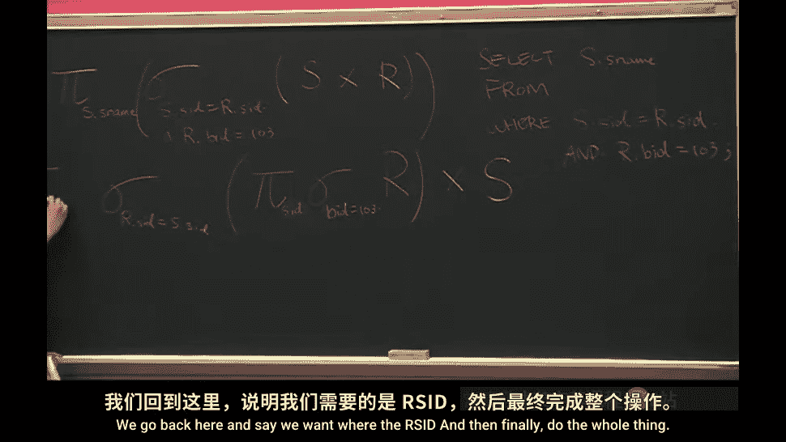
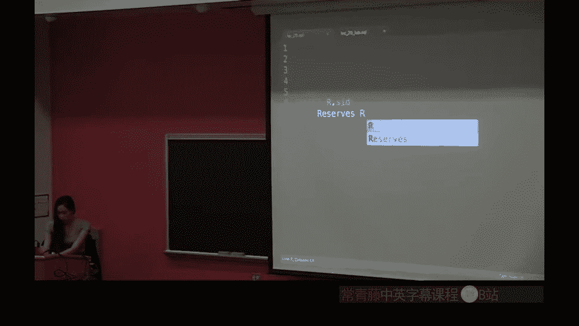

# 数据库管理系统：第2章：SQL - 第2部分 🗃️

在本节课中，我们将继续深入学习SQL，特别是集合操作和嵌套查询。我们将学习如何使用`UNION`、`IN`、`ANY`、`ALL`和`EXISTS`等操作符，并探索在MySQL中实现`INTERSECT`和`EXCEPT`功能的替代方法。课程内容将围绕一个“水手-预订-船只”的示例数据库展开。


## 课程概述与安排 📅

在开始今天的SQL内容之前，有几个课程安排需要通知大家。

首先，关于期中考试，我计划将考试分为两部分。一部分在教室进行，另一部分可能安排在机房，让大家实际操作MySQL来回答问题。这样做的目的是为了更好地测试大家的实际编码能力，而不是在纸上写代码。目前这只是初步想法，欢迎大家反馈。

其次，请大家确保已经按照上节课的要求，在自己的MySQL环境中创建了练习所需的表。你可以连接到学校的服务器或本地数据库。

最后，原计划用三节课讲完SQL，但现在看来我们需要多花一些时间。下周我们仍会开始新章节，但关于SQL的应用部分，我们会以讲解为主，减少动手练习，因此总体进度影响不大。

现在，让我们开始今天的学习。

## 回顾与本节重点 🔍

上一节我们学习了用于查询信息的基本SQL命令。本节我们将进一步探讨数据操作。

如果你看过教材，会发现它提到了集合操作`UNION`、`INTERSECT`和`EXCEPT`。然而，在我们使用的MySQL版本中，`INTERSECT`和`EXCEPT`并未被支持。不过理解这些概念仍然很重要，稍后我会展示如何用其他方法实现相同的功能。

本节我们将要学习以下内容：
*   支持的集合操作：`UNION`
*   成员测试操作：`IN`
*   两个有趣的比较操作：`ANY`（与集合中某些值比较）和 `ALL`（与集合中所有值比较）
*   存在性测试：`EXISTS`

## 基础查询与`OR`条件 ⚙️

让我们看第一个查询示例。我们希望找出**预订了红色或绿色船只的水手姓名**。

我们使用的数据库模式包含三个表：`Sailors`（水手）、`Reserves`（预订）和`Boats`（船只）。

要完成这个查询，需要考虑涉及哪些表。我们需要水手的姓名（来自`Sailors`），需要知道谁预订了船（来自`Reserves`），还需要知道船的颜色（来自`Boats`）。因此，这三个表都需要。

首先，我们写出`SELECT`子句。这里要记住，SQL中的`SELECT`对应于关系代数中的**投影**（Projection），而`WHERE`子句则对应于**选择**（Selection）。不要混淆这两个“选择”的概念。

我们选择水手的姓名：
```sql
SELECT S.sname
FROM Sailors S
```
为了消除可能出现的重复结果，我们可以使用`DISTINCT`关键字：
```sql
SELECT DISTINCT S.sname
FROM Sailors S
```

接下来，在`WHERE`子句中连接表并添加条件。我们需要通过`SID`连接`Sailors`和`Reserves`表，通过`BID`连接`Reserves`和`Boats`表。然后，添加条件来筛选颜色为红色或绿色的船只。

以下是完整的查询：
```sql
SELECT DISTINCT S.sname
FROM Sailors S, Reserves R, Boats B
WHERE S.sid = R.sid
  AND R.bid = B.bid
  AND (B.color = 'red' OR B.color = 'green');
```
请注意，最后一个条件`(B.color = 'red' OR B.color = 'green')`需要用括号括起来，以确保逻辑正确。

## 使用`UNION`实现集合并集操作 🔄

上一节我们使用了`OR`条件。回想在关系代数中，我们还有另一种思路：先分别找出预订红色船的水手集合和预订绿色船的水手集合，然后取它们的**并集**。

在SQL中，我们可以使用`UNION`操作符来实现。`UNION`在MySQL中是受支持的。

以下是使用`UNION`的写法：
```sql
SELECT DISTINCT S.sname
FROM Sailors S, Reserves R, Boats B
WHERE S.sid = R.sid
  AND R.bid = B.bid
  AND B.color = 'red'
UNION
SELECT DISTINCT S.sname
FROM Sailors S, Reserves R, Boats B
WHERE S.sid = R.sid
  AND R.bid = B.bid
  AND B.color = 'green';
```
这个查询将两个子查询的结果合并，自动去除重复项。

需要注意的是，这里直接对水手姓名（`sname`）取并集，理论上可能存在不同水手同名的情况。更严谨的做法是先对水手ID（`sid`）进行操作，最后再关联获取姓名。这涉及到嵌套查询的概念，我们稍后会学习。

## 实现集合交集：`INTERSECT`的替代方案 🤔

现在，考虑一个更复杂的查询：找出**既预订了红色船又预订了绿色船的水手姓名**。这对应的是集合的**交集**。

在关系代数中，我们会使用`INTERSECT`。但正如开头所说，MySQL不支持`INTERSECT`。因此，我们需要寻找替代方案。

本节我们来看看如何使用嵌套查询和`IN`操作符来实现交集功能。

核心思路是：将一个查询的结果作为另一个查询（外层查询）的判断条件。我们可以先得到一个预订了红色船的水手ID集合，然后在外层查询中，找出那些ID也出现在预订了绿色船的水手ID集合中的水手。

以下是实现步骤：
1.  创建第一个子查询（临时结果集`T1`），获取预订红色船的水手ID。
2.  创建第二个子查询，获取预订绿色船的水手ID。
3.  在外层查询中，从`T1`中选择那些水手ID，要求该ID必须`IN`（存在于）第二个子查询的结果集中。

对应的SQL代码如下：
```sql
SELECT S.sname
FROM Sailors S
WHERE S.sid IN (
    SELECT R.sid
    FROM Reserves R, Boats B
    WHERE R.bid = B.bid AND B.color = 'red'
    AND S.sid IN (
        SELECT R2.sid
        FROM Reserves R2, Boats B2
        WHERE R2.bid = B2.bid AND B2.color = 'green'
    )
);
```
在这个例子中，内层子查询`(SELECT R.sid ...)`生成了一个水手ID集合。外层查询的`WHERE S.sid IN (...)`则检查当前水手的ID是否在这个集合中。通过嵌套，我们实现了交集的效果。

## 使用表别名实现多条件连接 🧩

除了嵌套查询，还有一种实现“既…又…”查询的常见技巧：为同一张表创建多个别名（副本）。

思路是：由于一条预订记录只能对应一艘船，要同时满足“红色”和“绿色”两个条件，我们需要两份`Reserves`和`Boats`表的“副本”。一份用于关联红色船的预订，另一份用于关联绿色船的预订。然后，我们查找同一个水手（`S.sid`）在这两份副本中都有对应的预订记录。

以下是使用表别名的实现方法：
```sql
SELECT DISTINCT S.sname
FROM Sailors S, Reserves R1, Boats B1, Reserves R2, Boats B2
WHERE S.sid = R1.sid
  AND R1.bid = B1.bid
  AND B1.color = 'red'
  AND S.sid = R2.sid
  AND R2.bid = B2.bid
  AND B2.color = 'green';
```
这里，`R1`和`B1`处理红色船的条件，`R2`和`B2`处理绿色船的条件。通过`WHERE`子句将所有这些条件连接起来，最终结果就是同时满足两个条件的水手。

这种方法通常看起来更简洁直观，你可以根据情况选择喜欢的方式。

## 实现集合差集：`EXCEPT`的替代方案 ➖

接下来，我们查询**预订了红色船但未预订绿色船的水手ID**。这对应集合的**差集**（红色船水手集 减去 绿色船水手集）。

我们可以沿用嵌套查询和`IN`的思路，结合`NOT`关键字来实现。

首先，获取预订红色船的水手ID集合。然后，在这个集合中，排除那些也出现在预订绿色船的水手ID集合中的ID。

SQL语句如下：
```sql
SELECT R.sid
FROM Reserves R, Boats B
WHERE R.bid = B.bid AND B.color = 'red'
  AND R.sid NOT IN (
      SELECT R2.sid
      FROM Reserves R2, Boats B2
      WHERE R2.bid = B2.bid AND B.color = 'green'
  );
```
注意，这个查询只涉及`Reserves`和`Boats`表，因为结果只需要水手ID（`sid`），而这些信息在`Reserves`表中已存在。

## 组合查询：使用`UNION` 📤

现在来看一个可以使用`UNION`的简单例子：找出**评级为10或预订了104号船的水手ID**。

这很直接，我们可以分别查询满足两个条件的水手ID，然后取并集。

查询语句如下：
```sql
SELECT sid
FROM Sailors
WHERE rating = 10
UNION
SELECT sid
FROM Reserves
WHERE bid = 104;
```
`UNION`操作符会自动合并两个`SELECT`语句的结果并去除重复。要记住，使用`UNION`时，两个`SELECT`语句选择的列数和类型必须兼容。

## 嵌套查询简介 🎯

在今天的课程中，我们已经多次看到一种查询结构：将一个查询（子查询）的结果作为另一个查询（外层查询）的条件嵌入其中。这被称为**嵌套查询**（Nested Query），它是SQL一项非常强大的功能。

目前，我们主要将子查询用在`WHERE`子句中（例如，与`IN`或`NOT IN`配合使用）。实际上，子查询还可以用在`FROM`子句（作为一个临时表）和`HAVING`子句中（在分组后过滤，我们后续会学到）。但通常不能直接用在`SELECT`子句后面。


嵌套查询允许我们分步构建复杂查询，使逻辑更清晰，有时也能通过先过滤数据来提高效率。


## 嵌套查询效率示例 ⚡

让我们回顾一个简单查询，并用嵌套查询的思路重写它，体会其对效率的潜在影响。

假设要查询**预订了1号或3号船的水手姓名**。之前的简单写法是：
```sql
SELECT S.sname
FROM Sailors S, Reserves R
WHERE S.sid = R.sid
  AND (R.bid = 1 OR R.bid = 3);
```



在关系代数中，一个可能效率不高的方式是先对`Sailors`和`Reserves`做笛卡尔积，再进行选择。为了提升效率，我们可以在连接大表`Sailors`之前，先对`Reserves`表进行过滤，只保留预订了1号或3号船的记录，这样中间结果集会更小。


用嵌套查询实现这个思路：
```sql
SELECT S.sname
FROM Sailors S
WHERE S.sid IN (
    SELECT R.sid
    FROM Reserves R
    WHERE R.bid = 1 OR R.bid = 3
);
```
在这个查询中，内层子查询`(SELECT R.sid FROM Reserves R WHERE R.bid = 1 OR R.bid = 3)`首先快速筛选出目标水手ID集合。然后外层查询只需检查水手的ID是否在这个集合中。这种方法通常更高效。



## 课程总结 📝

本节课我们一起深入学习了SQL的更多功能。

我们首先回顾了基础的多表连接和`OR`条件查询。然后，重点探讨了集合操作：学习了如何使用`UNION`实现并集，以及如何使用`IN`、`NOT IN`结合嵌套查询来实现MySQL不直接支持的`INTERSECT`（交集）和`EXCEPT`（差集）操作。我们还介绍了通过为表创建多个别名来解决复杂连接条件的技巧。

此外，我们初步了解了强大的**嵌套查询**概念，看到了它如何让查询逻辑更清晰，并有可能通过减少中间数据量来提升查询性能。

这些知识是构建复杂SQL查询的基石。下节课我们将继续学习SQL的其他高级特性，例如更灵活的连接类型（`JOIN`）和分组聚合（`GROUP BY`与`HAVING`）。