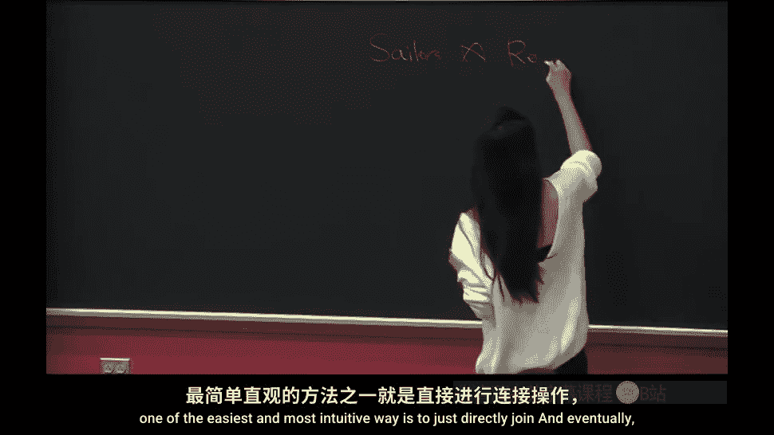
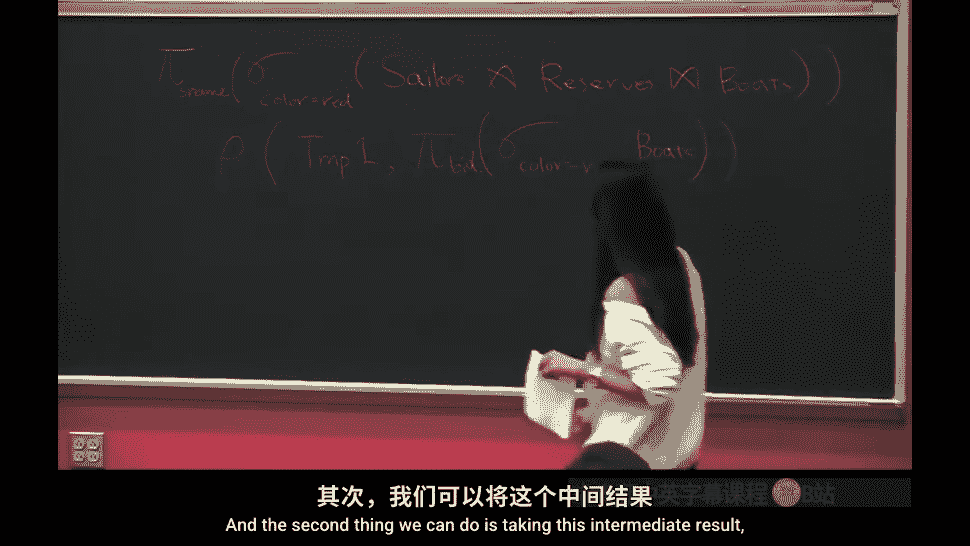

# 宾夕法尼亚州立大学【中英⚡数据库管理系统｜CMPSC431 Fall 2015, Database Management Systems】 p20 P21 SQL - 第3部分 -BV1N76CBwEXb_p20-

都光音。Okay。So how's the Home3 going for you guys？I we get started？I think about。

So it's due next Friday。Just don't forget and just want to remind you again from midterm two。

 as I said before， we will include。Deel， how to put it。

 so we will really get in the computer lab and then test you。表。I'm still thinking about it。Yeah。

 last time I was reflecting myself like so many people got 100， so I was like， did I make things too。

Yeah， we should aim for the normal distribution。 Let me think about that。

I think Alllan you guys have references。Depends on coffee。can be。All right。

So let's continue SQL programming today。

If you haven't done so， if you need to connect to your my or somebody can do it now。

If you want to write it on a slide， it's totally cool as well。

give you some time to do that and today a bit different that includes the instances I realized last time I didn't do that so it's harder for you to kind of go back and check what the answer of each query will be today I just put it on the first slide so if you can keep。

You， we bring back to。And one more thing before we start。

What do you guys think of yesterday doing this？Aation in。Let's see on really。Exhausting。坐企。

I'll think about next time and that we can try to take two extra time。地十一中三。

But I just feel like we will lose some extra time。I think about it。For the final presentation。

 final presentation I really found。いゃ。Everything more food。Okay， so if you're ready。

 let's take a look at22。あん。to。Okay let's take a look at Prairie2， so for Prairie2。

 when we go back to Prairie we have already worked on this before I want to find the names of sellers who have reserved a red boat。

😊，But remember last time we sort of stopped。At the point we were talking about nestqueries。

 if you remember， so for this worry too as well， we want to achieve it by doing nest query。

Okay。So。Let's think about it from the perspective of relation algorithms okay to find the names of sellers who have reserved a red boat。

 one of the easiest ways we could do， how many of the tables do you think willll be involved？

On the names of the sellers who have reserve。So， that will involve。Out of the three， how many。Anyone。

We want a name， so names come from。Deellers and the reserve information comes from。Reserve。

 how about the color。Comung from the boat so to do it in relation algebra。

 one of the easiest things roll into its play is to just directly join。

最後？Together。And eventually we take selection。嗯。呃。Selection under the both color。That is red。

Good projections。I just want those to me。Okay， so this is one way。doing the simulation of。

Theres not thing。So if you look at here， the first thing that would do is to join all three right here。

In just this pot itself， you can sort of identify the unnecessary stuff that we're generating in the middle of it。

Because if we do this， youll include all of the columns， the cells， all the columns in the drug。

 and all the column。When we first started in relation algebra。

 we was thinking about what are the ways that we can make things？

A lot more efficient where it would say generate less。Intermediate result， intermediate papers。

In the process。 So one of the ways is to identify here， and we can just do a selection of both。

We can just select the red book， so that shrinks the whole table and later when you join them。说说的。

The stuff we can do is after you select the red post。

 you can do a projection and only take house about ID because that's all we need。

We refer to the reserve information。And after that， we can project only the SID app。

And that will help us navigate to stay electricity。Okay。So one way to rewrite it。

This will lead us to the N query that we going to try out data。

 so one way to rewrite it as I said earlier， we can actually first start from。最近。' we only want rest。

We you take out the red roads。And as I said before， at this poll。

 we only need the vote ID so we take public。And this is an intermediate result， so we can。

Use work to store。Remember if they want to explore。

Like in the middle we have some results from our historians name。So use remains。诶。

So we can do that the first thing and the second thing we can do。

Is taking this in intermediate result。Take a join。会没事。

We know we can do so because here it includes the BID， so we are doing a that true joint。

This email the only BID and this BID is ID。And until this point。After we joined them。

 we said we only want the SID。Because that will lead us to the。Ret your name data。

And we can keep growing。Re name is perfect。Okay。And so far right now， if you look at here。

 we've actually got the SIDs of the sellers who have reserve breakfast。But because Mcqueie's here。

 we want the name。So what we can do。Just by simply taking12。ですよね。end the very last。

We said I wanted there。下次的 you该的。喂。That's one way of rewritinging。For cur。

 instead of writing the way in your first way。I would say this is a per one。谢。Okay。

 so how would we do that in equalQL？What do you think we should do？

We want to do it in terms of next。So what we can do。If you're writing on the paper。

 leave us space at the top first。So what we can do is actually let's handle the first step in approach two first。

So that would be。Let me write this down first and you can think about how we will feel that。

we want to start from this set of select from where。They handle the first line that we wrote。

For approach two。What do you think we should do？What would be in the front class。

 this are from the easiest。Just the boats ring， it just the boats。Okay。How about。The select clause。

关机电话。What is the thing that we do the projection？你你 yeah。Okay， so what's the criteria。

 what are the things， what are the roles we want to keep？That's the one we do the selection。

 what is it？You want the red boats。Color。Okay， so for this。

Only then we will get the both ID that are in color。And just to remind you again， in SQL。

 when we say select is actually projection we learned。

And in relation to algebra this selection is actually the wear glosss。justオ。Okay。

 so until here we can think of V3 lines as the11 we store right there that the intermediate。So도 아니。

And join the whole thing。With reserves information， So I'll show you how to do this class。

So we also have a select from where。Okay。And let's put this。Insect parentesis first。

So we said it will be an in query。In terms of regarding to this out。So you look at the second line？

We want to leverage the Inner Pervy， joining with the Re tablesel and do a projection of。

So what we can do is we know for the outside， we want the reserves。そ。The crown class has reserved。

Okay right because thats off。And then for select part。

 that's where we do the projection in relation algebra， that's where we want the SID only。

 so you say we select our。How about the week。What do you think we should did。

When you do the natural join between 10th one and reserves。It's comparing。

 the fields where they have the same name。And you can of that。

 the field they have the same name is VID。对。So the natural joint is actually equivalent to comparing whether they're both tables。

 the ideas。So what we can do right here is actually like this， you can say where our the the ID。

In 해요。So if you take a look at here。Because the inocqua actually generates just one column。

With O D BID。Okay， so for the outer part， when you do the comparison。

 you can just say the criteria set to be RBAD in。One的比。So this will achieve until the second。

For approach to。So far。So for least six lines。Were actually the temp to the renaming with。

So now you know how we can do the next query。How would you do for the very last？Also， select。要。我のちて。

Let's put this into production。あ？This up from the front plot， that's the easy one。

Oh being the pro class。せよ？And what。We'll be aware。Yeah。え最近で。And the easy part。

The project we did in the end， so that will be。do we want eventually。是你。Okay。

 but that's that the whole query， So I mentioned last time when we use the Myql show shell we use。

 it doesn't allow us。For so what we can do is just to face it。So。If this makes it clearer。

 I think that helps。To understand it。So when we think of it conceptually。

 we actually start from the most inner part to take the thing we want， and then we keep going。

I think a look。Sure what。And try in our show。Thanks， so that gives you。

let's take a look at what actually happened。はを。So the conceptual evaluation for a nestticqueries。

 when we think of it logically， we actually think of it starting from the most inner part。

 we think that it's easier to think， but actually when your query is being evaluated。

 it actually start from the outside。You start from the outer part and then for every outer part。

 it computes the inner。So it's like the forum。Okay， for every time you check with it， the inner code。

And recursively apply this process to further in our career。So so far for。The nest query。

 we take a look at this one we just wrote down。If we take a look at here。

 actually for every inner part。For all of the wear clauses。

It's completely independent to the outer part。 You take a look here。 we only care about。

What's happening in those？Here， we only care about what's happening in reserves。

 We don't really correlate that with the out part。So actually。

 SQL allows you to do a correlation between the inner query and the outer query。Okay。

 so what it means is that。再谢。So。In general， the inner self qua could be dependent on the road currently being examined in the outdoor。

And I'll show you what we can do。Practice is。So let's go back to query 1。Anyone still need this？

I doing。So for Curie one， we go back to Prairie Ro again， we have practiced it for quite a few times。

 it is where we want to find the names of sellers who have reserved vote number one03。Okay。

 so I'll show you how we can achieve this one by doing a correlated fitness。So to start with。

 because we want to find the names of sellers， of course， we saw from select。

And then is' from sellers。So now it's the interesting part。 So if you want to use a keyword。

 I think we didn't use it as， it's called exists。Okay so until this part。

 before we could before we move on， were basically saying from the seller's table。

 I want to select the S name where these tuples actually exist。Okay， then we keep going。

So what exists？We can select。All of the information。From。The reserves take hold。Where。

The BID is equal to one or three。And then。The S ID is equal。Does this make sense， Steve？

So as you can see here。After the aler query， when we get into the inner query。

 we actually don't have to worry about what are the columns we want to select。

 we should select all of them。But when we examine in the criteria we are looking into in the inner query is that not only we want the boat ID to be 103。

 but also。The SID in R is equal to the SID as where the S come from the output period。

And so this is how we would do with him。I think for the idea put it is。話は？Right。Here。Okay。

 so this is how we achieve full。Correlation。Inesically。Basically， you're just saying， yeah。

You want the。The slide essentially here。诶。So as you can see right here。Right here， the SI right here。

Actually， depend on。YesYes。This is what we can。All right。Next。

 let's take a look at more set comparison upgrades。So until now。

 we have learned about union and we know we can't actually intercept in My SQL。

 even though in the Sequel。Definition， but last time we tried out， if we don't have inters。

 how can we achieve by doing where？So let's take a look at some stiff comparison upgrade。

The first one will be unique， I don't think we will practice it today。Just remember if you use Uni。

 it means it will return truth。Is set or the test set is that？

The other two more interesting one is any and all， I think I just briefly talked about it last time。

 so for any it's saying compared to at least one of the topple in the set。And for the operator here。

 you can do either less than less or equal to， equal to， or this is the non equal to in my SQL。

 right？So it' is comparing to at least one of them。And for this one。

 it's actually comparing to all of the couples in the set。

So if you think of it in terms of in and not in， when we say in。The definition will be equivalent。

To equal to any of it。Okay， when we compare something in the that。

 So as long as one of them is the same。 Okay， so these two are equivalent。

 But when we look at not in。Not in is actually definition equivalent to。

Not equal to all of the things in the set。 so when you look at a set。

 actually none of that can be equal。 so then the not in will be true。Make sense。

So these are the second comparison operation with。Let's take a look at Pro 22。

 where we want to find sailors whose rating is better than a sub sailor called Russia。我括拒住。

Before I move on， I want you to think about it first。How would you achieve greater 22？

You will be using this query here。Yes。So for nesttic grade。

 what would be the thing you think we should put in the inner？If we look at。Cele。Yeah。

 we want the sailors who's rating。We want to select the area break。And with the name。

So what would you do for the innerper？Let's say we have select。What are the things we're selecting？

So国政。Rating okay， we want to select the rating from。と。Who's ratinging to be on？

take a look at the query and said we want to find sailors with ratings better than some sailor Po。

So for that， who would only warn the sailors with name Hirosia？Right。We can say。When the name。

This is the innoper law， so it will return the ratings of the seller's who names。

That's the first step。And when we look back to the query。

 but we want to find sailors whose rating is better than some。Obe品。系。So what you can do。

It's like this， we can say we want to select。Like from。

In this time we also want to select from Sar's table， however S is already taken in the inner query。

So what do you need to do。Is to make it another name so we can think it is to。也什ま。

So we want to select the name anymore more ID。From here， where。Where the rating is better。

 better than any of them， right。They wear the rating。It's actually greater。で。刚才。没 sense。

So right here is how you would do the set。即 by原 great。

So here it also makes sense because we are comparing rating。Like compared between rating。

 okay you can't do rating， maybe you can do rating larger than major。와주 그。对 at the。Instance。

Before we put it into the query， let think about what kind of answer will we get。So。Because here。

We want to find sailors with ratings better than some sailors called Harashsha So you take a look first for the inner part。

 the first thing we did was actually to identify whose name is Horaio right and we actually found two right here This is the first Horaa is is the second Horaa and the first Horaa has rating of seven。

 the second Horaha has a rating of。Okay， so for the out priority later on。

 whoever that will satisfy the criteria of having rating greater than any of them means as long as it's greater。

And7。Then。Okay， so then you can imagine you will return lots of them。 We will return Se 29。Salor 31。

 32， 58， 71， and 74， all these。太人。哎。So these are the sort lighting。But I will satisfy such。

So this is how we can use this set operator， So just do a little tweak on query 23。

 when we take a look at query 2。We want to find sailors whose rating is better than every secular call Russia。

So what would you do by just very simply。Moify from here。And need all。哦啊。Right， that's it。

That's for 23， so when we go back to take a look at here。

You can see because Harraio is have rating 7 and another Horahi is rating 9。 So this one。

 because we want to be greater than all of them。 So all of the one that eventually will satisfy has to have a rating greater than 9。

Okay， so you can expect the answer this time will only be sailor 58。And 71。对。我听得。Greateaer than all。

That's So that's the subtle difference between any and all。

 but not the subtle difference when you think of it as subtle for the。行。So before we move on。

 let's quickly think about。What this is actually equivalent to。不对。

That we will try out later okay so actually greater than all just simply means actually in the inner query later I'll tell you guys how we can do it。

 but you can actually take a maximum out of those first because we were saying greater than all as long as greater than a maximum。

😊，对。And for greater than any。As long as it's greater than。

Now I'll show you how it's to when we learn about aggregation。여밌生。So let's take a look at slides。

We will want to find the names of sellers who have reserve all them。So this is actually。

When we recall what we learned in relational outcomes。

What is the operator you use if you want to do such thing find all？

Like the Salless recoveries are involved。What's the upgrade。Division， right， Yeah。

 so by doing division， we can find Staless reserve over。

So it's just simply you take division between others。

And we just have to be careful about thischema so we make sure the X， Y and y。But here。

 actually in SQL， we don't have such thing。We don't have division。So you think of it in another way。

 we can actually do it in a way that we think of it in negation。Okay。

 so here we want to find the names of sellers who have reserved all bows。

One way of achieving this is actually we can think of it as for each sailor。

We check that there is no vote that has not been reserved。快啲成。没son。I'll type it down。

 You can think about how we will do this。So it's for each sailor。For each sailor。We check。There。Bats。

That。So we want to do it this way。😔，Think about how were do it and see。

You think we be need invested for。Okay。心在で。And has it occurred than one。对。哦。

How many layers do you think？But you say， which you forgot us。And that has not been。

Just think a again。这么对。这。Okay， let's coming from the ultimate part， let's we're coming together。

 okay。Let's say the first sentence we say for each say。OkayAnd because we eventually off the knee。

 so let's do it really quickly。Select from where。From each sailor， so it's from rectangle。

It's from the field， right？You can do one in May。Can we just select is that as name？诶。

So here's the tricky part。 we check that there is no vote that has not been reserved by this sailor。

 so what we can do actually is to say where。Not it。Okay， so for I think through week。

 but then we'll move on and see what is it check？So we won't select Tayloror's name from yours table where it actually doesn't exist。

So what is this something with the change？We want to check that there is no boat that has not been reserved by its。

So the first thing want to do is to do the boat， okay， we select left。The boat， I D。Of course。

 from the vote。結供。Where。The boat。It's not in。3。What do you think will be the last？你个见。不。

The reserves okay。Yeah。So I'll show you how it's， so here we are saying where the VID is not in the reserve table。

So it's not in。The BID from art。Where？Okay， so here， the interesting thing is we use the correlation。

So we actually do it all the way。Okay， so the reason it makes sense is。Right here。

 so far from the autoper and we go all the way to the inner row kind of just follow the logic we wrote down right and you can see eventually this is where the correlation happens。

 we just link it all the way back。确底 out。Okay， so from the outside of the things。

Take a look how it works So we first we want to we say we want to select the estimate from the seller people where theres no such toples in the nest in the inner。

That will make the estimate happen so we then went in to check in the Uniqua where we start right by selecting the vote ID and we don't want any vote ID that is not reserved。

バイ度せ。系。So actually， if you only take a look at these two。

It gives you the boat ID that is not preserved。Byu this salage。对。They eventually go back。

Is a sailor that doesn't have any of those boats。Then we can say the sailors have reserved all of those。

Okay啊。So the failure that will eventually be returned will only be those that has an。Okay。

 so because for exist when we use the exist， we are just checking whether they are such thing。

I think this is the hardest one。Out of all ofqueries。可。And only sail dust covers are gold。Allright。

Any questions for this one？So if you're selecting S S name， how does it know that？

Is it a does not exist？When we don't put any of those names， that's the whole tuple。

So the top will actually include the SID， that's why。Here it gets come in，All right。

Ready to move on to aggregation or more questions？Okay。After this one。

 I think all the rest of the curves are actually in the evening。So very useful as well。

Let's take a look at。Here。Like， let's take a look at the agregation we can actually。So， remember。

Well。Before we finish relation to algebra， we were learning an operator that will help us do application。

Which operator？We can do grouping。And we can compute， count self，The要法。the L operator。

 that's the one we use。Okay so in SQL， we can also。So before we talked about grouping。

 let's just quickly talk about these。Aggregation function。So we can do counts， we can do summation。

 we can do average， maximum and minimum。And just notes that for count some in average。

We can all do a distinct thing out of those。 So right here， the first one is counting。

The rows of the column。 So if you take a distinct， it's just saying we turn it into a set frame。

we only talk about how many distinct values are in there。

 and some can also do a distinct average could also do a distinct。But maximum minimum。

 even though when you do it distinct， there will be no error。It doesn't make sense。 okay。

 It's kind of an extra step to do this thing when you take maximum and admit。

Right so that's just what you can。You can put this thing， but it's just。Not helping anymore。

So let's think about query 25。 really easy。 We want to find the average age of all seven。包括今天。

Do think we need the wear it？We want to find the average age。

We don't need to wear cops for this one because we are not filtering out any couples in this silver table。

What the average age of old sellers， so of course。From the front cloth， it will be sellers。

So what are we selecting？The average age， so what we can do here。It is simply。

That's it that gives you the average age。So let's just take a look at whether he works。

That the average。All right， how about query 26， The 27 is really easy， How about 26。Still very easy。

 well define the average age of sellers with a rating of。Yeah， we just need to add a wear cost right。

 so based on this one， we add a wear cost。Where what？Ring equal to。Tra。だて。喂。Very。系。Easy to。

 we under the average age of the rating of 10。Said then。H的。う。Let's take a look at the next one。

It gets a tiny bit harder。Where we want to find the name and age of the oldest facility。

Think about what you would。What did。I'll try out wine Pray and you tell me whether you things I we as that would be。

So I also have select。And from。And I say， all right， I want the name of the sale which oldest。

 so I'll get the name。I also get to his age because he has maximum age。感せ。

Do you think this will be correct。Singlig。Let's take a look at the instances by。

The one that we oldest。 So out of all the sellers， we found。The oldest one is Bob， correct。 He's 63。

5 years old。So we try out。I query。In our show。God actually gives it dustin。With8。63。So what happened？

When we go back and look at here， Dustin is actually ageged 45。

So what actually happens is by doing that， youre saying I'll select the name， all。

 so actually sequences select left all of the names right here。

 and then you say I get the maximum of the age and it gets here。And because it only has one value。

 so they just make it all way up。It givess you just one row so that would be the wrong of。

We do it this way。So what do you think we should do， how can we fix it？我上に。

So we need some kind of。Yeah， we need some kind of wear。分か了です。So， let's change that。Can you。Yeah。

All in at is。Okay。Where。This person's age， right？So here's the interesting part we can actually do equal to right here。

Even though when we talk to our relation auto we tell with you everything that returned is a table so we shouldn't have value directly compared to a table。

 but theequco allows you to do so because that makes things easier。I'll show you how it's like。

 so here you're basically saying then。I just select。Maxum。啊。

Just be careful that we can't have the two sellers having the same fabric。Arrange by。

 So that's why well we。Use S too。Okay so here what we did is we want to select the S name from the stellar table where the sailor's age is actually equal to the maximum age。

Among the the。 so as I said earlier。When we learn of our relationship algebra。

 I kept telling you guys do not just compare directly with the table。

 the SQL allows you to do so when。What you select eventually can be just a single value then when you do such comparison。

 they will know。That you're comparing。Between村。験？这个定。So if we do this， we will expect。嗯。

The answer to be Paul， right， like we saw。It's right out。so this is the correct。Yeah。哦。

Allly ask this， okay， yeah， thank you that we will also select。やでした。Here。告诉你。ゆつで研キ。Okay。

 so that's for Cur 20 step。Ting make比 goodよ。And things got easier again。

 let's take a look at Queway 28。Or we want to count a number of samples。Anyone。

Any wants going to meet this？So what would you do to count the number of sews？Do need wear？No。

 we don't needs for query 28， we're just counting the number of sellers。So。cost very simple。

Sors people。So what should we do for here？晒啲一俾人沟。Or。We can just count all of the couples。

Was they stolen。Well， UV assumptions they don't store duplicateates。Saers。The also。

One thing to note right here is if we count the SID。嗯。Here we know because SID is the priority key。

 so there won't be any individual。But if there's any duplicate， what you can do is to do this thing。

And that will get rid。So either way， we can either do just count the SID or we can count the distinct SIs。

 or we can just count how many rows。えと。So here we can do all these。

 it's because we know in the table there's no。Repeat itself。来关。And just remember listening all of it。

Try it out。And we have 10。So for Caribbeion 29， we want to count the number of different seller names。

So we look back to the example。The only parts where two sellers have the same name is the。A Russia。

 So for this query， we want to count the15 names。The end we are expecting is actually not。这个骗子。

So what can we do？You want to count the S name。They instead of directly counting the estimate name because it's going to give us 10。

We should do。で。So carried rid of the duplicates。Try out。決必要ない。So。

Leave the rest to the next time because the next time。なか？Okay。So that's for that for today。

So just don't forget。The homework is due。Thanks Friday。And the week after we will actually have。

Project demonstration number one， so the T will post a schedule for teams to sign up so it's first come first so okay she will have some。

H swaps open and your team can decide when you want to meet your coach。

To showcase what we have done so far and that will happen in the week of 26。Okay。

 so from October 26 to 13th， thats when。协议。I will mostly be there。因我再回。开。你自己有我哋。么然主要。

