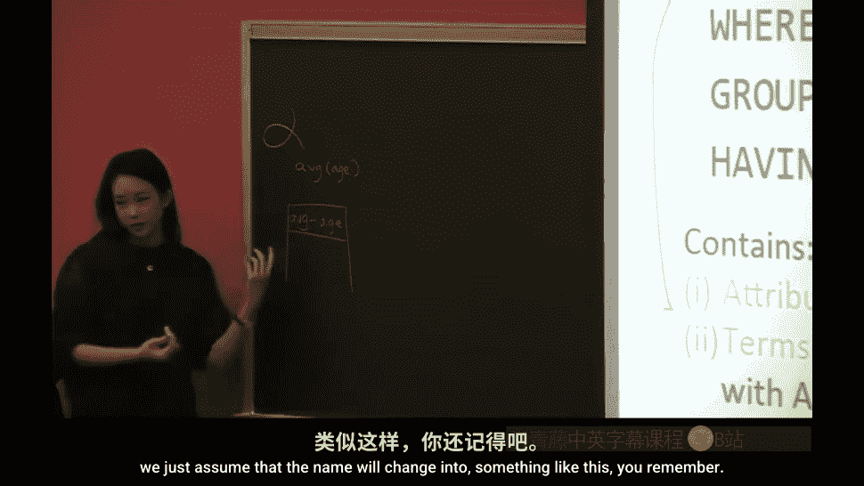

# 宾夕法尼亚州立大学【中英⚡数据库管理系统｜CMPSC431 Fall 2015, Database Management Systems】 p21 P22 SQL - 第4部分 -BV1N76CBwEXb_p21-

Good morning， guys。Before you started， I want to quickly。

Show you what's going happen in the next few weeks because I made a little bit of changes。

So today's the week， we' will continue our speaker。But we will finish it today and on Wednesday。

 we will start No SQL。So。I'm not sure how familiar you guys are with no sQL， but going choose。

Monggoini for our practice， where with no people， I'll talk about it。

Lecture finishes again as well so you can。When you go home。

 we can search for MongoD and install it on your left。In fact。嗯。Also。

Don't forget homework three is due this Friday and originally I have homework four scheduled to be due next Friday。

 but because our no starts a bit late， so I move it two weeks later。So that would be。The sick of。

And that would be purely onmost equalL。So I will do that and。

Next week be you will schedule the time with TA this week and you will be doing demonstration with the TA on your project。

Next week， so she will post， she will send out an email today。

And post the spreadsheet so it's first con so your team can just go out and sign up the time。

And for more detail on the demonstration， I think we have talked about it in the project description if you have any confusion can ask to me as well。

So that will be that。And before we end the lecture today， well have aquiz。Which is really easy。

I always say that though。All right， so let's get started on today's lecture。

 so I said we will finish chapter five today and we will start on S on Wednesday。

And just note that no SQL actually the material。結すく？

So I will try to find whether there are any supplementary material。you want anything。

Or we can just totally focus on the life。そうで。I start today lecture again。

 I put the instances that we'll be using today on the first slide。公关。OurCom are correct。

And before getting into newqueries， I just want to quickly talk about one of thequeries that most people off。

Confuse last time， so after the class， last time， quite a few of you came。Asking about is worry。

We were trying to implement the idea of division in relation。So if you recall， in this query。

 we're trying to find the names of sellers who have reserved full boats， which is the division。

You like。I feel maybe didn't put it。Clear enough so in the lecture a lot of people were like。

 why did this make sense why would this work so I put down the SQL commands right here。

 which is exactly the same we put last time and I wanted to talk you through white。

So if you take a look at here。It's a three layers nested。cl。And outside right here。

 we started from selecting the name of the sellers， so if you take a look at the outer car。

 you can think of it as the sellerar s such that and the not exist。Lead us into here。

 which is there is no boat B， not exist。 There is no boat B for the cell。Without。

 without is from here。Not in。 And then here we say without a reserved topic showing as reserved。

So this is the way you can try to think of it， if you want to interpret it into just one sentence。

 say as such that， there's no vote B with other reserves， Tco showing as reserved。

But if you feel like how this actually works？Behind the scene。

 then we can go back to look at the conceptual evaluation for it then we'll go back to look at。

What actually happened when the code was， it was executed。

So we go back to reviews the evaluation of net security， actually。

 the first thing you will do is to construct the cost credit of the table in the front class of the out level query。

 so it's like right here， but we only have one table， so we don't need the course。

You take the those powers of first。And then for Erow in the cross product。

 while testing the condition in the warehouseclo， it compute the software。So you look at here。

After knowing that part， then for each tu in the table， it computes the sub query Okay。

 so what happens to the third layer then right here would say it recursively applied the process to the inner self query。

Can you take a look at here？Then again， for this query， this one is its aler query。

 so for each of the top right here， it also computes one time the。

So if you want to make it a bit clearer when you think of it， you can think of it as four loops。

 just let it for loop so we can say for each sailor， okay， we take a tople and then。

For each boat in the boat couple and then for each reserve， so when we go into the most inner power。

 which S are we referring to， that's exactly that for loop。Of that couple。Okay。

So that's how you can think of it when you do。嗯。This kind of division。Concept。すいこか。So of course。

 when you think of it in division it's really different because we have a total different kind of logic when we think about division。

 remember when we're deriving the math behind the。Kind of different。

 but yeah you can think of it this way。Okayい。Yeah啊，我一定系听到这边。嚟我屈是收。嗯。We and。

How would you do if this work for sale of reserve。Okay， yeah。

 so the idea is because eventually we want say。And so you want to find a sailor that he has no votes not to the reserved party。

😀呵呵呵。😊，Yeah， that does kind of。Okay， so that's for this one。And let's start some new one。

 new prototype today。I'm not so sure whether we've worked on this one have we？

I went back to look at it that kind of forgot。 So for this one。

 we were trying to find the names of sellers who are older than the oldest seller with the rating of。

we worked onday？So let's try， if you need to connect to your my people go ahead now and you can think about what we would do。

インフメントです。If you want to find the names of sellers who are older than the older sellers with the rating。

And he thoughts of what you going do first。みな？Or do you think we will need a nested cling？

So we want to find the names of sellers who are older than the older sellers with the rating of。

How about we start from finding the oldest sellers with the rating of？

Then put back as the inner curry。And then we have something to come in。So let's try out we could。

But you knowcur first。So what would you do to find？The seller， the older seller with the rating。

It's 8。The age of the old self。

You would definitely select the maximum of the eighth， right？From sale tables， right。

 you don't need other table。So whats the。Priteria for that。Raise hand ten。

But that's that for the English。And go back to look at the query。

 we want to find the names ourselves were older。Then this age。And if you recall。

 even though in relation to algebra， we kept saying， don't forget when we do aggregation。

 this is one quite type of aggregation doing the alpha。

 the output is still a table so we can't just compare a value with the table but in SQL you can because you knows this is a single value so we can do comparison on that value。

You can just treat it as single button。So what would you do in the outer query？You can use this。

It's a threshold。To get the sailors to want。So if， let's say， okay， I'll put down， select。Fromwhere。

What do you think the al part will look like？Let's say we name this as two because you can't overlap the name。

Inner park， we use sailor to。The outputive part is as2。And we know you want the names。

So we select the name， right？How about here。工だ。Yes。It's to do8。Gra。

Do look greater than all or just gra？Because here only me return one that。小孩子。Yeah。

 we just simply have to put。来 that。So that's it for。Finding the selleror's names who are older。

And the older those with the ranking。So if you take a look at slight sticks。

 it actually has the same query。研究く出てた。So this will be the approach one。But is quote。Okay。こ頼です。は。

So earlier， it was mentioned we can use greater herds than all。

So how will we change this and you think we can just directly use grade them？When we compare all。

It means we compare all of the topples in the。In the software query。

So we actually don't need to take the maximum。Correct， so this is approach two okay。

 you can take a look at slide stiff on approach two。

 we can actually get rid of the Mac so we don't do any aggregation。

And we just say it's greater than all。As you recall， we have learned about this all。

For the set operators， so if you put all it means compare every single couple。いさね。Subly。はい。

So they will actually achieve the same answer。But one question here。

 which one do you think iss better， Which one do you think will be faster。First one。

Because for the first one， you actually get the maximum first。

 and then you only need to come here one。For each tuple in the outer query。

 you only compare with one value， however， if you do all， then for each tuple in the outer query。

 you will compare with every single tuple。In the subary， Okay， so the approach one。

 when we do the maximum， we simply compare with the maximum takes a lot of。Any question on this time。

Wai a bit。 And we can move on to。佢你就换。Okay。So up until now we have learned。

How did deal with the basics for a secret query？But there's one concept we haven't learned yet。

 which is the group。For you recall in relation algebra。

 right now we are able to do the alpha with only one argument。

 which is the one we compute that maximum minimum average de sumation all these things so if you remember in relation to algebra when we have two arguments for the alpha that means actually for the first argument that's our grouping material so we haven't learned anything about groups。

So if you look at K 31。In this row， you want to find the age of the youngerest seller for each rating level。

So right now we haven't learned about any grouping。So what would you do？To solve this query。

If we are doing it without a group。So one of the approaches I saw in midterm one， which is the。

I think I asked you guys to write the。Average。Rating or age for each color of。

GoodSo a lot of people did it in a way that will get us the correct answer。

 but you have a pre assumption saying， you know what are all the colors？So that's a brute forceway。

 which is like this。So here we do select from where same thing。

And because we want to find the minimum page。没那么 a。E see， and we select from Sals table。

 we call it S， that's our range variable。So here what I say。I mean。

You can just do it okay when rating is。Okay and then we move on in ratings too。嗰啲 keep到。Okay。

But this one has a drawback because if you add a new rating that's never seen before。

 then you can' detect it， this is still manual。So this is the approach you don't really have to write for because that's not the one。

嗯。So。Here I'll talk about grouping in SQL。So so far we have learned select from where have learned about group by and having。

So select from where E， you already know how to use it。So， group by。

Its the new thing that we want to introduce， which if you put the variable that you want to group base on。

 then you will group pin into。For example， we can do goby ES rating， then that would be goup rating。

And an interesting thing right here is having， so for the having clause it will actually we call it the group qualification。

 so it's similar to where， but it's the qualification for each group。

 okay if you look at the where it's actually the qualification for each tuple that it's selected from okay so later on we will show you how we can use having to see whether the group that you grouped out qualify。

A few things to note in the target list。which we are already really familiar with are the fields and columns that you want to keep so when you're using group by there are a few things that you want to pay attention to。

For example， for the attribute names。It can contain ash booms， turns a operate。

For the attribute these， it must be a subset of the grouping。Right here。

 I'll show you how it is later and also the terms with aggregate operations。

So the terms with aggregate operations are like minimum maximum average counting summation。

 all those things。And if you remember when we learned of our relation algebra。

When we do like average something， we just assume the name will change into， for example。

 if we have alpha。Like， average。8。Okay， one on whatever， then later on。The thing that return。

 we just say， we just assume that the name will change into。Something like this。

So right here， actually the same when you' do it in SQL。

It's actually the say it will just have a name kind of like that and sometimes it's hard to deal with names like that。

 you can't really control it because maybe you want it to be something else。

 then you can just rename it with us。Okay， so that's。そしか。

So that's like they'm renaming list in relationship。So let's try out a very simple example of group。

Oh the one we talked about before actually， so we want to find the age of the youngest seller for each rating level。

Can you think of how we do this？I'll get rid of。This for clarity 3。

So this is the rootte post of we were trying to Soul331。So now we know how to do grouping。

What do you think。How will we change it。Do we change any of these？They're the same。

So right now we already know grouping， so for this query。

 do you think we need anything in the warehouse cost？ we don't need it instead。You want group。喂hy。哇。

Thatぜ。So we want to select the minimum age of the sellers from the sellers table where we group by the rate。

If you want to make you having more information， which makes more sense。

 like which rating is this minimum age from， then we can simply just add one more column。Okay。

 so this is what we mean earlier when we talked about what should the target listing here include when we use grouping？

So if you recall earlier， we talked about。こちゃん。We say the target of this should include。诶。Here。

 which is the terms that have the aggregation。And this one， which is the attributes subset of the F。

You don't have to have both， but they can only need something to。

So if we take a look at how the result will be like。Okay， so this is what we look at。

 so as you can see right here。Which just simply let it have the automatic minimum nest up。

we didn't remain。So if you want to rename it。Well you cant do。Hes actually right here。That's it。

 Do you rename it？So if we go back to the heat。Then we have a do make for that call。

So maybe later on when we are doing this query， and you need to refer to that。给来穿来。快です。Allright。

So let's take a look at For week 32。Things were start to get tiny complicated。

So we want to find the age of the young Genzilla who is at least 18 years old for each raising level with at least two such。

So as the query goes on， it gets a bit confusing， but when we say at least to such sailors。

 it means we want the errorsrus to also be。Greatraer than 18。So what would you do by this one？

You can also change it。为什。Did we read it。just the first part saying find the age of the youngest St who is at least 18 years old。

Then what are we missing？Do we use the having or not yet because we need the 18 years？对。We right。

So right here we act a weird clock saying we only want those who are at least 810 years old。So。

Where will we use happen。When we take a look at the second half of the query。

 we say for each rating levels， so for each rating level， we have group by handle。

 with at least two such sail。This is where we want to use having， so if you do having。

And we just count the number of seller in each group。😔，あ。K。Okay。

Then at least to either do grades or equal to two or grade。Does doesn't matter。And that was。

So I'll leave this。See query comment right here， and you can take a look at slide 11 of the conceptual evaluation。

 what actually happened。So the very subtle difference between where and having is where is the qualification for each topple that you select having is the qualification instead for the topples but for the groups。

OkaySo if you take a look at slide 11， we will talk about when we have grouping in the SQL commands。

 what's the evaluation process， so the first step is the cross product of relation list that will be computed and again this time we only have from Salless so that's just one table we don't have to take the cross product。

Even look at the second step， so the topppples that fail qualification are discarded。

So second step will be based on the where class， so where class specify what is the qualification for the topples from this L。

And the third step saying unnecessary fields are deleted。

 which clause are we talking about right here？😔，Select right because select you throw away the unwanted field unwanted columns Okay so that's the third step。

 Okay， first step we look at the from， second step。

 we look at the where those that we look at select and the four steps saying remaining coupleples are partition into groups by the values of attributes in group。

Okay so so far in select from where we got the topples we want。

 we got rid of the fields we don't want， and we group it by eating okay so that's whats kind to happened in the fourth step。

Then in the fifth step， the group qualification is then applied to eliminate some groups。

 so that's when you look at having and then check each group。Okay， so the criteria。

 or we said the qualification you can put in happening is actually limited。

 you can't just put anything because it has to make sense when it's on a group level。

Which we will show you later， and then the one answer tople is generated per qualifyifier。

So that's the steps for that。So let's take a look at queryry 33。

And think about now we know the evaluation process， how we will do cur 3。So for queryrium 33。

He say for each rep vote， we want to find the number of reservations for this。What would you do。Okay。

So how many。听过照先过边度。2， which two。So and is up。reason we need two is because。For both。

 we want the color between。And reserves we have the reservation。And what are the things we want？

Do you want。For each red boat， we find a number of reservations for this vote so we can say。

 all right， we want to have。The boat， I D of the red boat。And you want to count。

We want to catch something。We want to count how many reservations。And just remember when we use this。

 we just make same count。All of the。てう。We're not specifying which be aware now。How about the vehicle。

Remember at the beginning of doing these queries when we weren't doing anything next。

 whenever we say we want to join and kind of associate two tables。What to。Something between them has。

BID。So the BID votes。The same。这 배て。Okay， so大好。今。Color as well， okay so we first joined them。And。啊。

他不在。We only want。The red。Int great。我你ま。So in the warehouse cloth， we have two terms， the first one。

Is for the sake of them， joining them， and for the second one is for the sake of just getting the record。

If we revisit the query again before we finish it， we say for each red vote。

 we want to find a number of reservations for this vote。So so far， we look at here。

The evaluation process like this。😔，We first take a cross product between the boats。And the reserves。

喂。And then。Each tople in the cross credit will be checked on whether they qualify based on the quality。

Okay， so ontopos are gone， then we select。Yes。Then unnecessary field of the passed away。

 and now we want to group them。 So what should we group by？Because after this death。

 we actually already don't have any boats with other colors and boats that are our。

Before we group in。These are already。So all we need to do。Is to have a group like。just業かてとす。スト。

Same select the BI D。嗯。I selected it because I just want the generated table later to have a column of this。

優政て。Thank。我日 you。Some you can me。So why would I want。Oh， if you don't， if you don't put this。

Since you already have a BA。でね。And we just don't see why you can instill the group。哦嗯。No。

 if you don't group it。It would actually have them all separate， so they won't aggregate it。会社ゃ。哎啥呀。

So things like they can't。They can't distinguish the difference Yeah so it counts them all so you take a look back at here。

 we don't do groupfi it just count like we did before counting how many sailors are in there right so it just basically count them all and the reason it gives the ID just because that's the first one。

So that's why we do that's a good question， yeah， so that's the difference。

The to do okay without grouping in。Some them together。Right right here。With growinging， we separate。

Alright， so。Before we move on， not done just yet。I want to talk about a wrong way。Of doing this。

 Okay， so about query 33， there is one way that we。不道。All right。

 so earlier we were talking about the having。So having is actually doing qualification on your groups instead of just each tough of them？

So let's say today we got confused and we thought about having we can just apply it as helpful。

Then you do having。好了。Its equal to red。 And we get rid of。好。Sos in the same budgetidge。

Read the race lighting。It's right。Get try it out。嗯。So we actually give you that。

So for this kind of qualification， it's not allowed。It's equalequel because if you look at it。

After it's being grouped by， you say having the color equals to red。

 it doesn't know which color out of the topples in the group that you're referring to。Okay。

We wantt do。Okay， so that's what 33。Let's take a look at where 34。

So this has a very subtle difference compared to。I think that's query。32。Okay， so in Cur 34。

 we want to find the average age of sellers for each rating level that has at least。I get all啲。

So for this it's saying when you want to find each rating level that has at least two sailors。

嗯 no no no no no forget about whatせ。Just think about what you were do for this one。

 So what would you do to find the average age of sellers for each rating level that has at least two。

😊，えも。Think about whether you will use where or happy。For the previous one。

 if you have in the earth select， if you are radar color， then you。

哦。Since we didn have we in the。So you can't do a big basement。你害。你声啲。Do we keep the I。Yeah，还是个。Oh。Oh。

 okay， I see。 So that's because when you're checking the habits。 So after。After here。

 because we include the color information， so it means each group has the color the having head them。

好了好， yeah。Okayて。All right， so what would you guys do for 34？Would you use where or having？还有。Having。

So let's see we want you to come。We want to select。The average age of sellers from each rating level。

 so we can't get the rating first since we're going to group by it。Anyway， the average age of。

'Then from the sellers。And good by what。你回府。And having worked。然。没。锻体健康。Here I have the。That would do。

So here's the difference between having where we is having to say we want to check。I后。

Any question on this slide。嗯。Conserv person could used as smart。好。For this one， note。

 because counting SID。It's the same。So actually， in here。

 it doesn't make a big difference because we are not doing any distinct， so in SQL。

 if you have duplicates， if you count the duplicates。Okay。

 so sometimes we will do maybe want to find a unique name， then we will do distinct。So， doesn't it。

Any other。Okay， move on next' to February 13thclock。I think I'll work on two more than we can。

Do the quick， and for the rest that is the thin。ISure you guys can figure it out。

 and I'll post the queries。Because theyre just very similar。Let's take a look at Ch 135。

Where we want to find the average age of sellers who are older than 18 years old for each breaking la that has at least two sellers。

Select them from is definitely required。Do we need wear for this one？We have。

Find the average age of shows who are older than 18 years。All right。

 so we need that because we see those who are over the。

And because we want information for each rating level， that tells us we will need group。

And because here we say for each rating level that has at least two sails that tells us as a qualification on the group。

So。不ても。And this start working in front of good。他。So the things we want are the average age of sellers。

For each rating level， so we can take the rating level。And。Take these simple。

Those are just the columns we want。And again， right here。

 we are always dealing with the weighting level and the age。

 so we don't know information from the boats or reserve we only need。嗯。From so。And also。

 when we read the query， we see that we want only information from the seller who are older than 19 years old。

 so we just need to do。And。Because we want that for each rating level。So that's what we look at。

It's also simple right here。But how about。Right here where。

We say for each raising level that has been。Can I directly say。です。Can I do that。

Do you think this will give us the right answer？If we rethink about the evaluation process。

Until here。We get all of the sailors that are greater。And then we do a group of five。

 so if here we simply count the SID。We have to count S greater or equal to two。

 that means you already count the ones that are older。But if you look at the query again。

 it's just basically same for each rating logo that has at least two sailors。Regardless of their age。

So here we actually cannot view this。But we will want to count the number of filling in each region。

Again。Without using。So what would we do？We can actually do this， okay。

 we have two less than or equal to。And then we open up a whole myticically。不 that。

So here what we can do is we will， because they're having， it will check on each。

So what you can do is by simply doing this， we do select。And just count the number of sellers。From。

A new of paper is， too。Where。As to rate is equal。So right here。

 it makes sense because after select from where we group by the rating and then for each rating group。

 it would do again in a group。And so it will have a corresponding rating and then each time it will check the total number of the sellers in that。

This is just the tiny difference， whether you can use havinglving or not， because even we use having。

 we get rid of the sailors that are not over。Yeah， I。Why did you explain that？Oh， yeah。

 that's just my understanding， but is older then？They're strictly gra。I don'， what do you guys do？

Yeah， we can't change this。でな。Thank you。Any question on this one？有吗？う。し下。Yeah。首先。开好。아六岁。と。

So if you're done， you can just come up and give it to me and then that'll be different。

