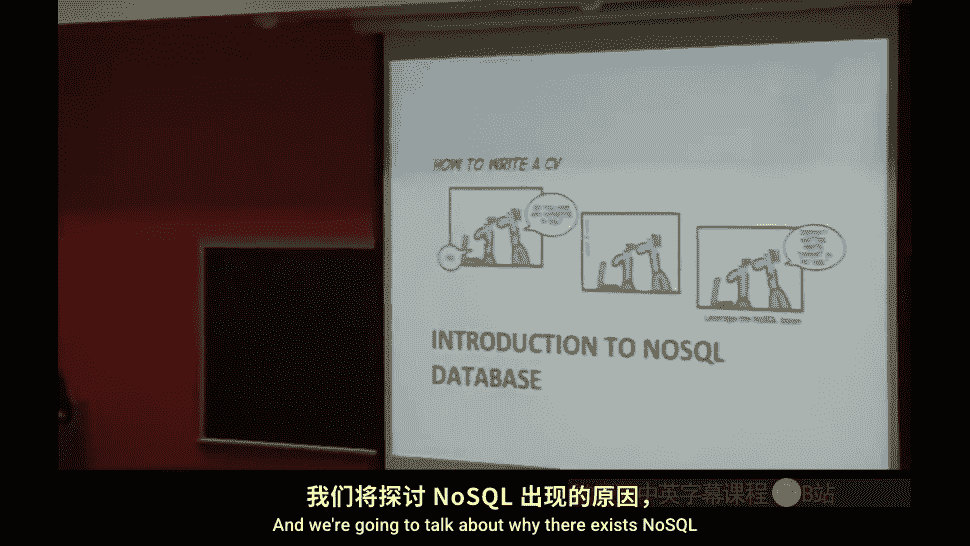
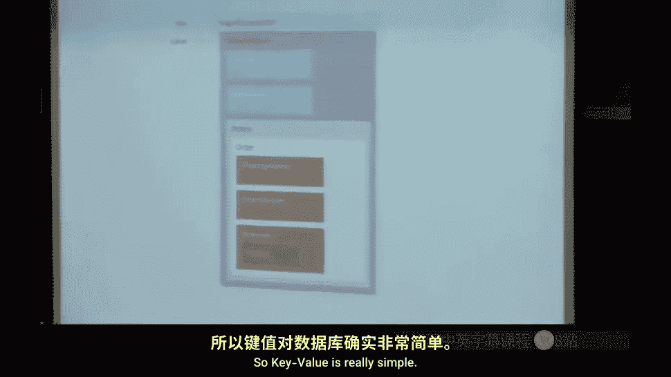
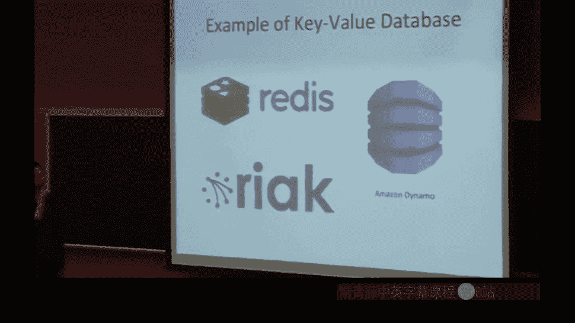
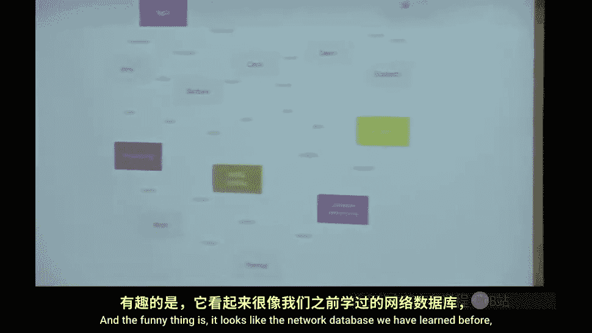
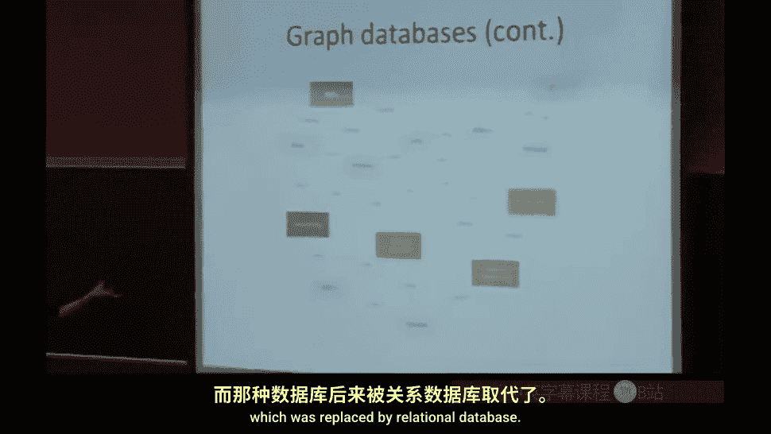

# 宾夕法尼亚州立大学【中英⚡数据库管理系统｜CMPSC431 Fall 2015, Database Management Systems】 p22 P23 NoSQL导论 -BV1N76CBwEXb_p22-

Good morning， guys。So today we're going to talk about No SQL， as you can see。

 I also have a comic on the slide that I realize it's really small when I print it out。

 hope you can read it though。嗯。So before we get started。

 just want to quickly tell you homework three on Friday， homework three。How's everyone doing。

See little guilty faces。All right， good luck so I think the TA sent out this email last night it's good a lot of you already filled it out so as you all know next week will be your project demonstration number one so you are going to schedule time with the TA to do demonstration for her and she sent out this doodle。

😊，Doodle sheet last  night。 So if you haven't done， so you can go out， go out to fill lab。

And she sends me in these emails， so you just have to click。All right。So that's for that and okay。

 let's get into today's lecture。

So we are at lecture 23。 and today we're talking about no sequL。So。

I think a really cool thing is in our department， No school No SeQL has never been taught before。

 so this is the very first lecture of North SeQL， in computeruter Science in Pennsylvania。😊。

So because it's not included in the textbook， but。I guess quite a few of you might have already heard about NorthsQL and wondering what it is is actually the trend right now。

 and we're going to talk about why there exists no SQL and what's the difference between No SQL and SQL that we learned and why we should use it。

 why people are using it right now。

Right。So， here is。Kind of like an imaginary evolution。Of no sequel。Okay， oh， by the way。

 so all of these things material wise， we don't really have a textbook that you can study from。

 but I put some references at the very back of this slide so you can just go on those web pages。

So those I think are really good materials you can them。

So this is the imaginary evolution of No SQL we can say。 So at the beginning。

 it all started out by just having things stored as key value okay everything has a key has a value。

 but at the time people found out when we do just key value， it's hard to get a range of keys。

 then people say， okay， let's make it a tiny bit more complicated， let's do order key value。

And when we do order key value， it's powerful because doing key value actually is a lot efficient in storage wise。

 however。Even though now it achieves doing a range key value， a range of keys。

 it's hard to do any computation on the attributes。 Okay， the fields that we have。

And that's why then people get into big table， which is what we we will talk about later is the column family。

 and then further people developed document， database。

 and then graph database actually for the purpose of social networks。Okay， so all of them。

 even though people starting out with the intention of keeping things simple is still gradually getting a bit more complicated。

 So they are all kind of moved towards SQL， but they are still not sQL。So what exactly is no SQL。

 I always show you how things are actually happening。 So no SQL。Actually， sends were not only sQL。

Okay， so it's not like we are not unique equalL， it's just， it's not only sequL。So No SQL。

 it is a non relational database management system。

It is designed for distributed data stores actually， so so far the SQL we have learned。

 it actually doesn't work so well when you have distributed computing going on so no SQL actually helps a lot in terms of distriing systems。

In data stores nowadays， you can imagine in Google， Facebook， Twitter， Instagram。

 large amount of data， terabytes of data or terabytes are being generated every day every second so SQL initially when it was first proposed relational data model。

In the 70s， they weren't thinking about this humongous amount datata。

 so that's why no SQL are actually emerging now to help out what SQL cannot handle。

And also the data story nowadays may not require to fix schema like we learned so far in SQL。

 we always design the table has these attributes， but if you go on Facebook nowadays。

 you can see they have tiny bit of function changes every day and you can imagine if we do that in tables。

 then you have to keep updating the field every single day because we have new attributes we want to introduce。

Right。So， no secret。Help that as well。 So who uses NosqL。

 These are just the more famous companies right there。 Google for sure， LinkedIn， Facebook。

 not sure whether you guys know this four square。It's for square and Twitter， and it's already。And I。

So this is from a list of companies using NoSQL， I haven't really gone into each single of them to see what they are using。

 but I looked into Twitter， so Twitter actually use a mixture of a lot of different kinds of databases some part of them they still use SQL but just for different kind of purpose these Twitter so big for didn' how to purpose use different databases。

 even when using NoSQL Twitter uses quite a few different kinds of NoSQL database I think that just depends on under Twitter。

 they have a little different groups working on different stuff and they use a different。

No SQL database。So this is one of the tweets I found a while ago and I really like I retweed it so that's people's understanding for the notation that what we talked about what we think of what is no SQL throughout the history and in the 70s we have noL SQL was not even introduced。

 okay then actually SQL was introduced because relational model was introduced in the 70s okay the SQL was based on that。

😊，And then in the 80s， people know about SQL。 That's when people start using SQL。 In the 2000。

 because of the Internet， people are like， no， we don't like SQL。 People start to realize。

 and you guys are learning it out。 But anyway， people in in the 2000 start to realize， okay。

 I mean SQL is not the best。 So around 2005， who would say maybe not only sQL。

 So that's no sQL we are learning today。Okay， and then back again，2013， now we still go back to SQL。

 But I think it still changes here and there。 So right now， people are depaing。

 They still think My SQL is better or they think no SQL is better。 So it really depends。

 I think people has different kinds of opinions based on what application they。I miss。All right。

 so why no equal？If so far as far as we know， we think SQA is pretty powerful。

 then why do we want no？So the main one of the major differences。

 difference between No SqL and SQL is that we're modeling。The data。

 No SQL in SQL or relational model actually think very differently so the starting point for relational modeling they will think what answers do I have you recall whenever we are talking about modeling your database so far we think about what data we store and then we design database based on that right we have sailors we have the sailor's name。

 all these things so the database is based on that for the design。On the other hand， no sequel。

It will be starting from what questions do I have， so what do I want to answer。

 So that's how they start by designing it instead of what data are。Because NoSQL is still flexible。

 so later on when your application is running， you can still update it。

 okay so how you initially design it does not have to fully depend on what answer you already。

Instead， you can just think about what question do I want to answer？那时。Okay。

 and also no SQL data modeling often requires a deeper understanding of the data structure and algorithms than relational data modeling tests。

In this sense， it's because。SQL actually takes her a lot of retrieving the data and how the data is stored for you。

 But as you saw earlier， at the very beginning of the imaginary evolution of No SQL。

 No SQqL a lot of times are just simply based on key values。

 So you can design your own data structure on top of that。

so you can have a deeper understanding of those， and you can also design how you want to retrieve the data differently。

Okay。So the next point is going to be kind of。Mind boggblling for you guys because we just learned about normalization and learn about different normal forms。

And that's for SequL。So two of the major tasks whenever people start working on NotesQL。

 the first thing is to duplicate data。You it was， we' spent so much time removing the duplication。

 but when you really learn about No SQL， we go back and duplicate more data。😊，Which is kind of crazy。

And the second thing is， we want to normalize it。Okay。

 so we have learned so much about normalization in No equalql we normalmalizing again。

So I won't get into too much about these today， but then in the next few lectures we're going to talk about。

More， what we mean by data duplication， normalization and why we do that when we work on peopleQ。

So NSQL solutions are surprisingly strong for hierarchical or graph like data modeling processing。

So when you see this line it's interesting how at the very beginning of the semester we were talking about different kind of data models and then we say now we decide relational data model is the most powerful。

 That's why we want to learn about it。 here when you go back。

 we say no CQL are surprisingly strong for hierarchical and graphlike data so you can see hierarchical and graphlike data is actually really similar to the data model we learn at the beginning。

 there are two more other than relational data model， one is hierarchical data model。

 and one is network network data model。So it's kind of interesting people are going back and forth a different kind of time people have different needs。

So now people have found the graph like model is important okay。

 and the big application is because of the social network， how people are connected to each other。So。

This graph is just showing you at different kind of decades。

 we have different needs for different data。 And at the very beginning， when it's in the 70s。

 all these things you can think of maybe bank transaction or booking tickets like for the train。

 for the flights or just buying stuff like order transaction for the shops， businesses。

 stuff like that。 So it's mostly rate related to the business transaction data。

 But then in the early 90s when I was born。 and then you guys were born。

 around the time and the Internet starts to take off And then web applications data started。

You can see it's growing exponentially， so these things include like personal user information like nowadays we shop online。

 we actually give them a lot of information about ourselves in a social graph， that's the Facebook。

 Twitter， Instagram， all those things and also geolocation data like you check in or when you didn't turn off the location syncnc。

 you walk around and they actually update them to the cloud and also use the generated content。

 so the blog， tweet， all those things。And YouTube YouTube is a big big one and machine logging data。

 you go to the website， you click on everything， actually it's all locked， all recorded。

 you click streams。So SQL database were never designed to handle these things that we never imagined like data will be generated at this kind of fast。

So that's why we need no SQL。 So let's take a look at the comparison between。

Relational database system and。So I'm sure you guys will be very familiar with the left slide it crossed out this very last one I decided on to talk。

嗯。So for relational data。Management system， we say IPMS。嗯。The data is very structured and organized。

 because we have already learned like the sailors table， the reserve table， the bill tables。

 they're all very structured and organized， they can put into tables。

And to deal with relational database， we use SQL so SQL standsfall structure query language。

 and we also know data and its relationships are stored in separate that's what we have learned and that's what you're working on for your project right。

And also we have DL and DDL， which is the data manipulation language and data definition language DL is for。

Like updating the table， inserting toling into the table， deleting tople from the table。

 and data definition finish as creating the table if you remember。And also。

Remember when we learn about ourD relational database， we learn about AsI properties。

The C Center for consistency Re database has really tight cut。However， on the other hand， no sequel。

It has no Declarative query language， so that's all we were learning。U tell like chapterpt five。

 we were learning about how we can implement the aquari language， No SQL has nothing like that。Okay。

 and no sQL。Pretty mind glowing， no predefined schema when you start you don't have to define how the schema is going to be like at all。

 just start it starts。in NoSQL， they have different kind of categories taking care of the data。

 how they will store it， so we have key value pair， we have column store。

 we have document store and graph database， which we will talk about each later。And here also。

 instead of focusing on AC property， no SQL focus on eventual consistency。

 so what this means is that。The system will become consistent over time eventually， okay。

 so what happens in between actually is not guaranteed sometimes in the middle of it might not become completely accurate。

 but it's so tiny so its only guarantee you。In the end， it'll be。

So rather than considering AC property like we did in relational database model。

 we care more about just eventually these。Okay， and the data isnt you know， unstructured。

 way is structure。And also compared to the AC property。

 No S will actually also have its own property， and it's the cap theorem。Can we will talk about it。

Which is a pretty interesting idea。And also compare to SQL。

Where SQL actually focused a lot more on how you aggregate the data。

 how the user eventually will view the data， because it has a relational idea in there。

 no SQL prioritizing high performance， high availability and scalability， which is more。

Thats the patient for now。Okay， that's for no sQL and doing a comparison。

Between it and relation database。So what exactly is CA theorem？Cap theorem， similar to AC theorem。

 each letter stands for one thing。 So for C it stands for consistency。And right here。

 the consistency we are saying is that data in the database remains consistent after the execution of an operation。

So it's actually， you might think it's very similar to the consistency we talk about in the AC property。

 however， as I said before， No SQL actually takes care of distributed system way better。

 so the consistency in CA theorem can also have an interpretation where we say all nodes see the same data at the same time okay distributed system had different nodes in the system so what they care about is the nodes are seeing the exact same thing instead of some people see this will see the other things。

So that's the consistency， slightly different from the ACs properties's consistency。

 but the higher level idea is the same。And the A stands for availability。

The availability here I only say system is always on no down you beA for sure right。

 and it's actually also saying the guarantees that every response the user sends who receives a message of。

Fil over6。Okay so in relational database， even though this can be guaranteed it wasn't。

Being emphasized， okay， so this is an emphasis in No。Finally。

 the P stands for practitionerition tolerance。As we said earlier。

 because thisOSSQL heavily distributes systems， so partition tolerance means that the system continues to function。

 even though the communication among the servers arereliable。

So you can also think of when it happens some arbitrary partition， okay system should keep going。

 so you can partition the system into different node but they should keep working。Okay。

So one interesting thing is that remember in AC property we say relational data model that all the transactions doesn't matter what。

 have to fulfill ACID however in CA theorem theoretically it's impossible to fulfill three of them at the same time。

 so the system will only aim for achieving two out of three。Okay。

 so two out of three means like among the C and A and P， we will have different kind of combination。

 so it just depends on what your application want， what your system want and you pick to。就他。

let's take a look。 We have different kind of combinations of C andP。

Here you can see we have consistency availability and partition tolerance and that's their combination right there if you look at CA when we only have consistency and availability。

 ignoring the fact that partition tolerance， we are basically saying we drop the emphasis working well on the distributed system and that gets back to our original relational database okay And here when we have AP which is availability and partition tolerance。

 these are the current databases that try to put emphasis on this so these are just the names of those databases。

 Yeah。What I don't why he only two so I kind' of gloss through that because it was proposed by a researcher and then he proved all these theories in the paper。

 but then he said only two have three to。Yeah so just take granted a few and that's a good question All right。

 and then if we only care about consistency of partition tolerance and we sacrifice the availability。

 then that's see So these are。😊，Pretty famous if you take a look at these database。

 I'm not sure whether you guys have heard of it， Anyone heard of Mon Pebe？Okay。

 so that will be the one we will learn in the next few lecture。

 so it's just different kind of databases have different focuses。So no sequel so far。

 it sounds great but it still has problems。ok。Yeah。Can we use a。You。Can0。But。

Then it's kind of like because so far we've worked on it towards in a way that's relational model。

 but if you still want to do it in those deeps， I'm totally with it。All right， so the pros and con。

Pros high scalability that's the whole rhythm we're using right we were talking about motivation of the web application。

 everything and for distributed computing， lower cost in the sense that because things are mostly storing key values so it saves a lot of space eventually theres lower cost and another good thing is the schema flexibility so we talked about at the beginning when you start data but you don't even care about what schema you're going to store also it can be semi structure。

And in those SQL， we don't have any complicated relationships， not like relational database。

 all we care about is how the entities are going to be connected together。

 what' out did relationship。Between them， however。One of the biggest cons is that it has no standardization。

 There is no best answer in no SQL。 Everything is just based on what you think。 Okay。

 some people might think it's awesome， but a lot of times you don't know what you're working towards。

 you don't know what's the optimize for your system。And also because it's so new right now。

 it has very limited query capabilities。But it's just a temporary thing it's just right now。

 it's not like SQL， it's so developed and it has already a lot of ready made prepared query。

So in this rest of the lecture， what I want to talk about today。

I want to introduce you with four different types of。No secret take。

Today there is nothing really too technical， kind of just kind of like sharing some thoughts with you guys and some knowledge。

 The first one is keyVS。Okay。100。Which is the sts form， as we saw earlier in the imaginary evolution。

Key out database first。And the second one is called Holin Family。The third one is graph database。

And the fourth one we'll talk about is document database。

So here I kind of change up the order actually， evolution wise， it's key value first。

 and then calling family， then documented it。Thank graph。

But I kind of put it this way if that's the order I want to talk。

So one thing to note that is actually there's no。Single solution you can say it's better than the other。

 so in No SQL it really heavily depends on what your application is， for example。

 when you have social networks to store， it's better to use the graph database right you don't want to go back to call and family or key value。

 it just really depends on what ones you want to use。

So I think it will be a good idea if you guys want to try out No SQL in your project。

 if you haven't started the coding card。And you want to try it out because I think if you have started in and don't discover the part you have to。

So later on， I will also tell you a few existing database for these NosQL categories that you can choose from。

Of course， I'm not going to have experiencing all of them。

 but I have two out of all so I can tell you what they're like。The first one， key value database。

 so it's the most basic types of among all the most equal databases。

 so that's how everything started， people are still saying that just store the data of key value。

OkayOne of the main benefits of it is whenever you retrieve something。

 you only retrieve from the key， that's it， you only care about primary key and there's nothing else you compare with so you can't get to be quite hassle because how you're going structure it really matters。

But every time when you retrieve something is' from the primary keep， okay？

And it is designed to handle huge amounts of data。And the person who proposed it is Amazon。

 they proposed it in an academic paper and they call it a dynamo， so now if you look at dynamo DB。

 that's the original key value database。So it allows the developer to store schema less data。

 we just don't care about schema at all， which is really different from what we have learned so far。

And also the database， it actually stores the data as hash table。As you can imagine。

 we have key value pair， key value pair， so by doing hash table。

 it's quicker to search through which key you actually want。So each key is unique as we said。

 key and key is a primary key。And the value， here's the interesting part。 The value， instead of。

Instead of following the rules like relationlational database where we have。

 we say the values can only be a topic， remember we can't have a set。

 we can't have a list of things in our SQL database for the values。

 no SQL it actually doesn't really care you can either have the value being string。

 the being JO you familiar with this。几三嗯。I'll show you guys soon in Mon did， okay。Question。

What it three months6， mean that。It doesn't really have。

Like can you have Rosa fields totally different from？Yeah， exactly。 That's exactly。 how。

 So when you start， you don't really design what the schema is going to be like。

 And each row insertion doesn't have to follow the other rules at all。Okay。

 so I'll show you guys how Json is like。In the next few lectures。

And another interesting thing is you can also put in a block， do you guys know a block？

When I first heard it， I just think the name is funny， but blob is basic， large object。

 So what blob is do I have a definition。So block basically data stores just store the data okay for block and without caring what's inside。

 so it is the application's responsibility to decocodete it， to understand it。

 so sometimes you can just put in like a huge whole string and it's just HTML but it won't care。

 it won't care what you're actually store in or you can store in， I don't know。

It's actually music and doesn't care。 Okay， audio file。

But the application will take care of decoding， so that's one of the cool things he addedd here for the value of just of。

ok 嗯。And for the key。It's really cool as well， the key can be strings， hashes， lists， sets。

 sort of sets， Okay， so key doesn't have to be just a string。Just a bat。同。Or just like numbers。

Fll remember he has to be unique。Okay， among OrEC。So for key value。

 they can be used as collection dictionaries in associative arrays。

 so they are actually really similar associative arrays really similar to the idea of math dictionaries。

 so it's easier to look things up whenever you talk about key values looking things up。

So key value stores follow two out of the three CAP， the first one is availability。

And a second one partition。So we only talk about out of the four categories of No SQL。

 we only talk about CAP in here because Gvalue is the only one that it's kind of cleaner and all of the databases follows A and P。

 but the other ones they have different kind of emphasis so then I won't talk about。

So key value is suitable for shopping cart contents， you can imagine user being the key。

 and then the rest is the value。What is has in the shopping cart or individual values like color scheme so you can just look up key value its really quick these these are just some of the application of course is way more than that Yeah so the keys can get anything right but wouldn't all the key types have to be the same else how do the looks。

Or can you have like one key be a has and no would be like a string。

 I think it depends on the database， whether they have that restriction。

 because as long as it's unique。Then they can differentiate it。

 but maybe having different types will make it less efficient。Allright。

 so this is just the pictorial representation of how the key value would be like it's nothing fancier just have the key and value and the value can be blocked anything。

So Key Valley is really simple。

Quite some of the databases for key value。

This is the beginning of everything that's the Amazon Dynamo D， okay。

 so they are the creator of key value database。I forgot when they proposed in the 80s or 90s around this time。

And then Redis， I actually really like it I used this one before。

 if you're thinking about trying it out in your project， you can try that one。

 It's really easy to get your hands on and they have really strong community support So the documentation is pretty awesome。

 And if you try Redis tutorial you can go online and you can they have like an interactive session you can learn with it。

 So it's pretty nice and another one， the last night is Riak， I'm not really familiar with this one。

So these are just them。Some of the examples of key values database。

 I decided to put this these slides because I just feel like now the logos for the database are so nice。

 So I have one slide each。 they're just pretty pretty。All right， so that's where。He validate。

So nothing fancy about it。But that's how it all started。The next one is called family。

At first when I learn about it， I think it's kind of。Awkward in some sense。

 but I'll show you how it actually works。So per column family database。

 the primary word on columns in every column is treated individually， so quite different from。

What we learn in relational database。But kind of is based on key value。

 So the values of a single column are stored contiguously in column storage data in column specific files so far it's still like what what's going on but in column stores。

 query processes work on columns too so basically。We're just saying we care about columns so much that we need the column Family database。

What it's actually taking care of is each row， they may have different combinations of the columns。

 different attributes。 Some are missing， some are there。 okay， for example。

 the first row we have column ABC， Second row， we only have B and then E okay so not everyone has the same column。

 but eventually when you want to compute the aggregation among the column。

 So let's say we want to take care of the min， the sum of the column column family optimize that Okay so they will retrieve the same column really quickly out of all of the rows。

 however key value doesn't really optimize that。 Okay it doesn't even care what youre doing whether they have the same columns。

So here， all data within each column data file have the same type， which makes it ideal for c。

And yeah， that's just basically what I was saying， column stores can improve the performance of queries as it can access specific data。

 okay。So high performance on aggregation curve。So if your application really cares about aggregation among the columns。

 along the columns， then call the family pretty often。嗯。Yeah， and just like I said before。

 the various rows don't have to have the same color。Okay。

 so this is kind of the core concept of no SQL。 You never put constrain whether rows should have the same activity。

Okay。So one pictorial representation of the Collin family you can see right here， these are each row。

Okay。So sometimes they share the same column。And sometimes， they don it。Okay， so that's basically。嗯。

I am not certain how commonly used from Col family database is。But time。Google has the big thing。

 right， guess it's。Pretty。Well established。 So Google Cloud big table。

It is one of the Colin Family database， a Cassandra， I think it's by Apache。

 it's also one of the examples， and another one is called simpleim D。

And the third one that I want to talk about， which。A person I really like is the graph data it。

They like graph I like social network analysis。That's my research and I like it。

 so graph database is stores the data。And graph。So how many of you have taken algorithms？Algorithm。

 so in algorithms， like， I guess you guys have older。Grab free， notes and。

So graphraph databasebase is capable of elegantly representing any kind of data in a highly accessible way。

 and it is a collection of notes。Okay， so that's how things are stor we graph。Here on your slide。

 I have a title。 I said each note， then it's actually each note I typed it wrong。

So in graph database， each node。Represents the similar idea we have in relation databases。

 so each node represents entity。So as you can imagine， maybe when we have G database for Facebook。

 each entity can be a user on Facebook。And each edge then represents the connection of relationship between two。

For example。You can have an edge between two users if they are friends。Ech between actually a user。

And a post。If the user have liked the post。Okay， so then if you have a graph that has nodes representing different types of thing。

 It can be a fan page。 It can be opposed。 It can be。A message。

 maybe like a chat conversation among a group and having different kind of relationships between these notes that we say this kind of graph is heterogeneous。

So in Graph database， every node and edge is defined by a unique identifier。

And each note knows its adjacent notes。So what's so powerful about graph databases。

You only for each note， you only just let it know what it is connected to。

so it doesn't have to store that much， you just need to know what's next to it。

 and if you want more and you propagate， jump to hop to another note and then you know more of the information。

So as the number of nodes increases， the cost of a local step remains the same。

 so even if you have more nodes，So going back。Use that a relationship telling edges between the。

So if you want have relationship should。lationship。Oh， so。

The thing that is similar to relation database is actually each edge。

 they can also have their own information。So they have the attributes as well。

 Theyre going be edge starting from an edge。has to think that。

Graph pictorially when you represent that you won't look that way。

 but in your attributes of your edge， you can store that。 This also involves a third note。O。

But I think when it all started out， they were thinking about termernary。

Okay it's just like basically between two。So that's most common in。So should know answers as well。

So as we said before， because each node only has to know the adjacent nodes。

 so even as the number of nodes increases， the cost of a local step it really let same okay you don't because you don't for example。

 Facebook doesn't get slower everything you do because more users are on there okay it doesn't take longer to find your friend when you put on the search bar even more people are registering。

It's still the same。So this will be a pictorial representation of the graph data things。Kind of pale。

 But here you can see。Here we have Martin， right， Martin is is friend with Paramont。

 and Martin is the author。Of the book， right， And this book is in the category of data。Okay。

 this kind of thing， so that can be a representation of graph。And the funny thing is。

It looks like the network database we have learned before。

Which was replaced by relational database， and things are going back。

So let me take a look at relational models versus graph model。How do we map the idea between them。

So in relational model。We have tables。And in graph models， we have vertices milk and edges。

Vorticusees are notes， okay， notes imagess， so that would be like the tables。In relation more。

In relational model， we have rows。Then the rows are the vertices， again， the notes okay。

And for the columns in relational models。That is like， the key。Okay，And。

When we do joins in relational model。That's actually taken care of by the inches。It just like。嗯，看ect。

To notes together。So that's for no。呃，官好。So。Quite some of the examples for graph databases。

 I was searching for the locals the other day。 I just laughed at that one。I think it looks hilarious。

 but for Neil4 J， I think that's the most famous one among all the craft。That's what gravity。

Just consist of notes and edges。All right， another benefit of the graph database is that when you think of the relationships and relation database。

Whenever you are going to create a new relationships between two entities。

 you actually have to start out creating a whole new table for that， right。

 a whole new table for the relationship defining what kind of schema you will want in that table。But。

In Gra database， you just add an edge and that's it。

Just add new in so it's really easy to establish newer kinds of relationships for example。

 I think Facebook they introduce。Was it in Spain like last week or two weeks ago that you can put different kind of emotions on the post。

 not just like， you can also have。I don't know like happy or different kinds， but it's just in Spain。

 they started out there， so that means you have different kind of relationship with the post now okay so that will be one of these now。

All right， the last one I want to talk about before we end this lecture is what we will actually learn in the next few weeks yeah。

Can you。Like combine the uses of these pros。I can have like a relational and also。 Yeah， yeah。

 actually， isn't Facebook mainly？I'm not sure about Facebook， but I know Twitter。

 they have a mixture of a lot of different database。 So they also use SQL。 but at the same time。

 they use Reddis for no SQL。 So I think under a whole system， as long as they can communicate。 Yeah。

 however you want to do the ports。Then that would work okay so it doesn't have to be just one。

 so maybe for you guys you guys for the project， you can have a little part taking care of I。对喂。

So for the last one I want to talk about is Do database， which is what we will get our hands on。

 I'm not sure whether Friday， but next week for sure。Okay。So document database， it is collection。あたと。

But the documents here are kind of different from what we know it's not just like articles。

 Okay documents can be anything as long as like text， and you can have a semi structure。

The data in this model is stored inside documents， and a document is a key value collection where the key allows access to its value。

And documents are not typically forced to have a schema and therefore are flexible and easy to change。

So I think most of the documentation they have basically rely on the format of JSO that I just。

Briefly showed you before， and I'll show you next time how Jason looks like。

So documents are stored into collections in order to group different kinds of data。Also。

 documents can contain many different key value pairs or key array pairs or even nested document。

So next time yeah， I should have included， but next time when I show you a format of JSON。

 you can get a sense and get a feel of how nest it it will look like so you can keep nesting in nesting and nesting in so it's a key value pair in the value you have another key value pair and in the value you have another key value pair so you can have the value of the value of value。

Okay， so that will be a very powerful change to look at in document data。

So I'll just quickly talk about how it's like today， so when we map it into relational model。

For the tables。We call it the collections。企。And for the rows。They will be talking。Okay。

 so collection， wine collection consists of multiple docking。And for each column。

Rely similar to the graph， it will be the key value pair。And one thing to note that。

The function we could do， which is join in relational data model。It'sactly not available。

In document database。I'll show you next time please。And why is not the baby。So。

Here we have a quick example of how the document database will look like。

Then I realized I have a little snippet of Jason。That's kind of how it's like。

Okay so you can see we will start out the key value pair outside we have here is the customer I。

 and then we describe what the customer is like So here is like customer information and then we have another one is the billing address and you can see they don't care about whether the value has to be atomic。

And also， if you want to make it nested， you can actually have company and the colon and then have more attributes for the company。

 So it can just keep nesting it。 Okay， so this will be really similar to what we will learn for Mongo Dpi。

 actually。So two of the examples of document databases， one is Mongo DP， one one is called couch DP。

 very relaxing， I guess， but for Mongo DP， I don't know， I just think it's really funny for Mongo Db。

That's what we will learn next time I think I won't ask you guys to install MongoD yet because I found there's an online terminal we can use。

 but I'm not sure what it will become a disaster like last time when we were trying to do my seat when everyone crashes but Ill send you guys an email as soon as possible to let you guys know okay even though you don't have an install。

 I can still give this administration。I'll Friday。And I think I'll include Mongo div in midterm two。

ok。Along with the seaequ that we live。即そそ。那那反我我的。I think it's November 10th。

Let's come into them actually。 Yeah， so here are the references if you want to take a look。

 I think they're very fun to read， Okay， they write it really nicely。

And I will post homework4 on Friday that will be on those single on things we learn okay and don't forget about homework three due on Friday。

To see you guys on Friday。