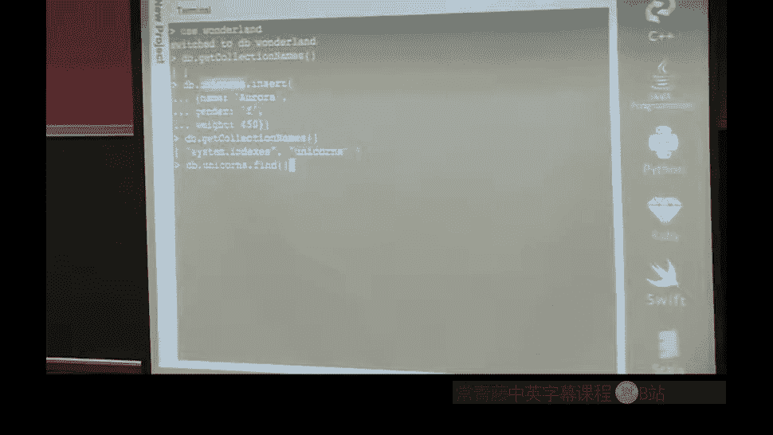
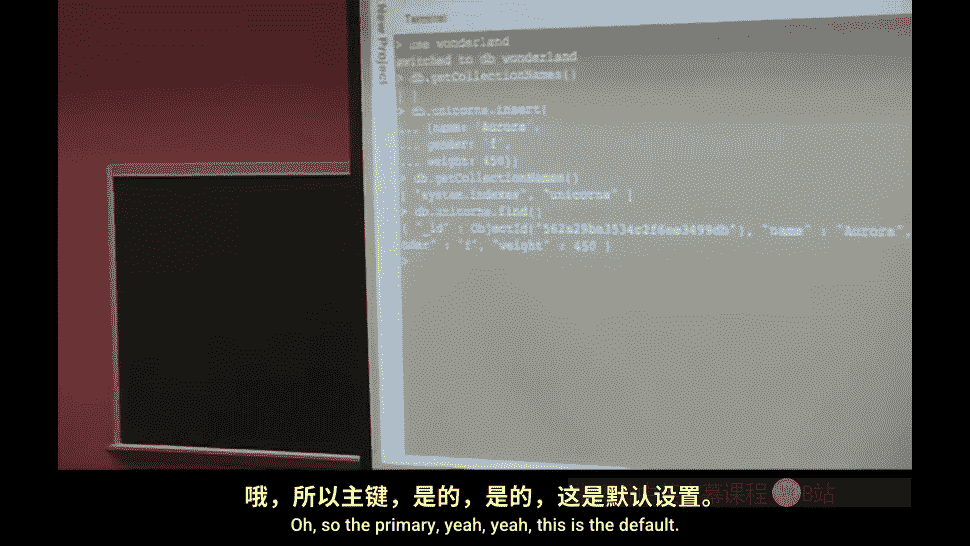
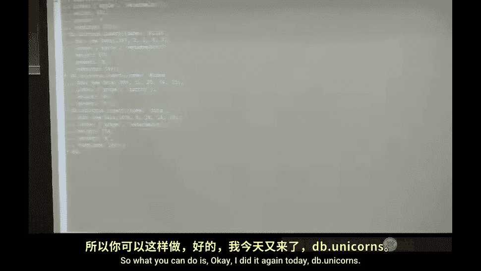
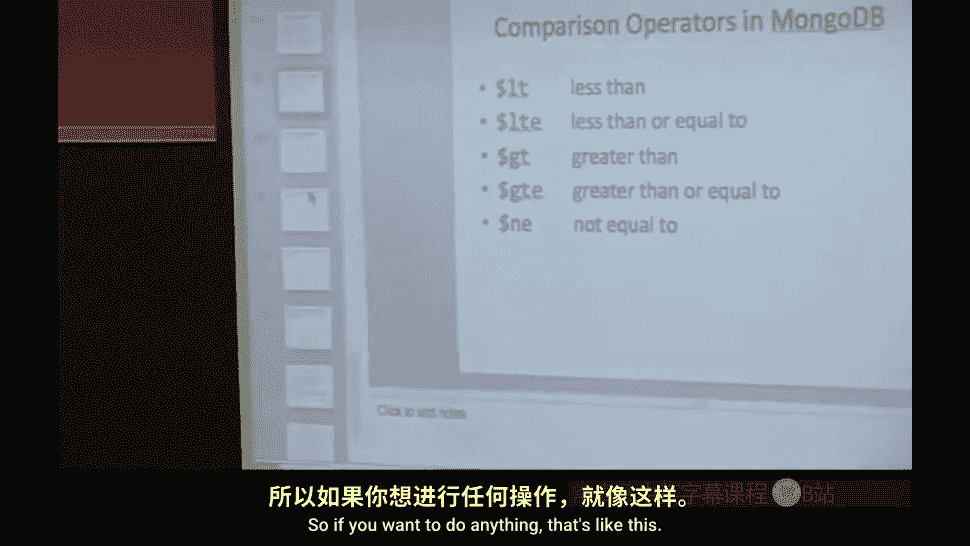

# 宾夕法尼亚州立大学【中英⚡数据库管理系统｜CMPSC431 Fall 2015, Database Management Systems】 p23 P24 NoSQL导论：MongoDB - 第1部分 -BV1N76CBwEXb_p23-

Good morning， guys。All right， so if you haven't done so you can turn your homework。

Three in right here and remind me maybe five minutes before we finish the class。

 I'll return homework two。I don't want it to do at the beginning because some people might not be here yet。

So last time we talked about。noing。And as promised today。

 we will talk about why of the databases in NosQL， which is Mongo Diti？Okay。

 and I think according to last I'm asking you guys quite a lot of you have already heard about Monoldb。

 but maybe you haven't tried it yet， so I'll show you how it is in action today。

 but before we do that we will kind of introduce what Monoldb is and what's so special about it。Okay。

 so today I won't really ask you to get hands on with Mongod。

 because I didn't ask you guys to bring a laptop comment and。

 but Ill show you how it's like and kind of do a comparison between MongodV's comments and SQL comment。

So let's to get started， Mongodb， actually the name comes from humongs。Okay。

 so the Mongol comes from Huongosis， which means it's supposed to deal with theonggo amount of data。

 which is like the motivation we talked about last time， no SQL。

 the reason it is born is because SQL actually wouldn't design having in mind that the data nowadays will be so big。

 SQL was introduced around the 80s。So MongoDb is scalable， high performance， open source。

 schema free， and document orient data。If you remember from last and we were talking about No SQL and one of the more important feature of No SQL is that they are schemaly or you can say schema less。

 so it's really different from SQL that we learn every time you create a table you have to define the schema first。

SQL but for no SQL， one of the benefits and interesting feature of it is that when you start it。

 you don't really care about what the schema is， just input data happening。Okay。

 so it's cinema free and also it's document oriented。

You you guys remember from last time we talked about four types of NosQL database。

The first key value and we have Colin family and we have graph databases。

Orientient and there's not one singleQL type that is better than the other。

 it just heavily depends on what you want to do with your J type。

But document orient database among all of the types of No equalQ database is the most popular one right now。

And Mongodibi is the one leading it。A little bit of background for a Mongo Dbe。我再先。

Document oriented database in the No SQL databases family。

And it isews the traditional table innovational database structure in favor of Jason like Do。

With dynamics。So last time I briefly talked about how things in document oriented database will be storelight and I talk about JSON and I think a lot of you haven't heard of what JSO format is like which I will show you later so JSON actually stands for JavaScript object notation。

And in MongoDB， whenever they talked about how their data format is like they actually say BON。

 and that means the binary version for JSON， so it's actually just what happens behind the scene。

 how they handle JSON， but when you read the data it is in JSON format。

MonggoDb is first developed in 2007 and a shipped to open source in 2009 and up until this year in July。

In the ranking， you can see this is like how the databases are being adopted。

And the most popular one are still Oracle， Mysql， microsl Sql 7。 Okay。

 and these are all relational database。 And you can see Mongo D right after them。

 This is the popularity of it。 It's the fourth most popular database being used and。

It's the number one no seek。Okay， it is the document。

So how Mongodb themselves is find themselves in terms of functionality。おき？

So you can see a relational database， even though they are not so scal， like we said before。

 they are not meant forororing a huge amount of data， the data functionality is strong。

 Okay number when we were learning my query data and everything is well developed。

 So RDPMS is right there。And the original idea of No SQL。

 if you remember from the imaginary evolution of No SQL， that's very beginning is key value。

 So key value store is really scalable， but when it was first developed。

 it actually lacks a lot of functionality Okay， it's just too simple。 It's just key value key value。

 that's all So MongoDb defined itself at this spot So they have good template functionality and good scalability and whetherre distributed it。

え年すこい。So just a quick example of how JO format looks like。

So this is super tiny but I just want to give you a favor of how JO is like。

 so this is one of the examples it's anonymized out right now。

 but it's one of the example if you use the Twitter API to get tweet from Twitter okay and this is what the data Twitter API will return you with。

So you will return you with a tweet and the tweet started out if you can see the text that's the content of the tweet and then it will keep going to include different kinds of information for example。

 here it has a user Earth and in the user they have so many different information for the user so in JSO everything is really nested and you can see this is what we call key value。

 key and then column value so that's how things are being installed。文じか。

So let's just really quickly talk about。How芒 be。Souring。Okay what's the wheel blocks for among those？

So， Mongo Db。For a MongoDb instance， it has database。So for this。

 you can think of it as the databases we have in SQL， remember when we first get into the SQL shell。

You actually have to type in show databases and that will show you what are the current databases you can use and for you guys if you use the CSE one。

 it will show you the words with your ID before we created。And then you choose use database use。

So Mon the TV has the exact same thing， So it's just a high level container， just like。

Nothing too different here， same thing database， for example， you have a project。

 this is for doing online shopping， then you have a database called onlineline Shop。

And you have another one for。Where enrollment of the courses， then no one can call me。

So a database have collections。What we mean by collection is。This is the idea of mapping to table。

えつ行かい。So for collections earlier， we showed you maybe tweetweet can be one kind of collection user can be one kind of color。

The they just have different terms of saying。High level believe sooner。And for collections。

 collections are made out of talking。So earlier you see whenever we use curly braces do to。

To put things together， that's a document。So for documents， you can think of it。That grows。気す。いやず。嗯。

And documents。発表伝説。Same in。嗯。一こ。So one thing that's really unique。

In MongoDb and makes it quite different from other databases。Whenever you ask the data from MongoDB。

 you have the choice of reserves returning into a cursor。

 so that's like the idea of point of you can store it in that point of first and then you can do some kind of processing maybe you say I want to skip。

View of the documents， or I want to do aggregation first。Before you return it， Okay。

 so it doesn't go too crazy until you see it。 you can kind of get a sense of how it saveized like first when you carry it and decide what you wants to do。

So to give you a more pictorial sense of how。Things are put together in Mongo Dipi。In this slide。

This is how it is。 So we have a collection。This whole thing is the collection of documents in each green box。

Is a document。So inside the document， we have this kind of format。

 so basically we just have field and value， view and value。 So that's the key value here。Right here。

 Okay， so one thing to note that is for each of the documents， the green thing here。嗯。

Each document within the collection doesn't have to have。The same set。あってる。

The unique thing about equal， the field can be different from document to talking。

 even though I think this example doesn't show anything。So don't get confused。

 it doesn't have to be using。So today I'll show you some of the queries in action and I think。

They are pretty simple， so you can just chill and watch how things are happening， okay？嗯，So芒 DB。いや。

You explain you like document， but I assume it's not like a text file。

 you can read it's like something that only the day。Oh， okay。

 so the reason they call it document is because not only they put it in a way that's key value。

But also because they claim it's more humanly readable。So it's more like this。

 You just read through it。 So they say it's called document。

 So document is like you can think of it as the table。In sequel， okay。いや。No， document is the bro。

The any collection needs to take。Alright， so momgo the。They have rich sets of。

Quries or in case semantics for reading and manipulating data。And they called them。

The way they design the semantic crew， Okay， so crew just basically standss for create， read。

 updateate。Nothing advantage is how they。name there。Just to give you a flavor of how prairie。

Are like how command are like in Mongo D。So I do compare between。

MongoDB's query and Power will look like when we do it in SQL。So for example。

 this is the C include the C。 So for creating things， it's similar if we want to insert a row in sQL。

 this is what we will do。specify the table that we want to insert values in and sometimes we specify the order of the fields that we will later enter the value for if it follows the original definition。

 then we don't do this okay then here's where we put the value。Then that is what we will do。

To achieve the same thing in Mongo Db。 Okay， so you basically say Mongodb always start。With the DB。

Objects， okay， so it's always you are doing things against。The database。So use Db。

 and then you specify which collection you want to insert the information into。

And then you basically open。The curly Bra saying， now I start this document。

Start this document and then put in。The data and then close the document。

So every time when you enter the document， it won't check whether the field does not exist。Okay。

 so it's al right。 You could just put in。其实 that一套 creating据。Like users in relation that。

Is it a document， it's called document in Mon， it's a collection？Oh，呃 use a。Is a collection。

Okay and for document， yeah， earlier I made a mistake。

 a document is like the row in SQL for each record， it's a document， yeah。

 and for overall is a collection。Theres one and they don't have to Thank。I that that's a Z and for R。

Which stands for read。This is how it would be like。I think when we were talking about SQL。

 we didn't talk about the limit， but it's just basically saying if you exceed or so the number of rows。

 you can say， I only want the first five。So MongoTb can also do that。

 So here if we want to select based on the criteria in SQL。

 we can say we want to we do projection first， right。

 doing what fields we want and what tables we are choosing from and what's the criteria qualification criteria of rows we want。

 So if we do it in。Mo the TV here's the interesting part， so we also say against the database object。

 okay now we are working on the user collection。Which is table in microT， then you want to find。

First， you say you want to find。The name and address。Okay。Based on this criteria， which is age。

That is。Greater than。Okay so in Monggo Db， the comparison operator is a bit different。

 so they all use this kind of dollar sign and then GT means greater than an LT means less。

GTE means greater n or equal to。That all you should。

 but this is a bit not so intuitive that's how we do it。But how do we choose idea this something？Oh。

 yeah。 so here。In Mo Db， if you don't specify it， I D comes with it automatically。

So that's why they've only specified the main important if the prediction is done before。こういうか。Yeah。

 it matters because for the fine。For the find function， it will just assume it has two arguments。

 so the first argument means the criteria。So that's perfectly。And the use stands for update。

 and this is how the update will be like。if you remember in SQL。

 whenever we want to update a table and then specifying what criteria and what we want to change until we use update Se where。

Okay so this is really simple， we just update the user table。And we set the rows。

We set the row status into a wherever the age is greater than 18。

 so that's what we will do given this in Mon Db。OkaySo these are really similar。

 this is the same criteria it's the same age， and then we do grade for than 18。And for setting。

 it has this set operator， okay， so you can see a lot of dollar signed in MongoDP。

 and then what do you want to set， I want to set the status field into a。

And here is the option called multi in multiple TBb， if you set the multi to be true。

 this is basically what we want because you want all of the rows that satisfy the criteria to be updated this way。

And you don't do that， only do it once。We'll only find the first one。

 we'll only update the first one。悲伤的应该。Okay？Update and the last one is delete is actually。

Really simple deletes just like this， okay。You just say I want to delete from the user table wherever the status is D。

 and that's what you would do in Mongo DB。 So later on when we are trying out in action。

 if you don't put any criteria in basic just means， you delete every row。In that。先方が。

So I will show you how things are like。So here I put a link。For an online show。

Well I think is pretty awesome， it's not like last time the disaster wanted kept praanking this one worked pretty well。

嗯。So today we'll use this and also like for the next slide。

 I put on everything that I will do and we just see how things are working。And。

In later slide you will keep seeing weird words like unicorn or something that's because I found this tutorial written by this guy that he just think is really an idea to use unicorns as an example。

 and I like his tutorial so if you guys are interested，And when you go home， you can see。

This is the book so it's written by Carl and he's the little Mongo Db book it's really neat。

 it's only around， I think 27 pages and after reading that you get a pretty good sense。

Of how things are like yougo。It's really concise。放这里。Oh。Allright。

So if you visit that website this is what you would see and it's just very basically among those the Okay so few up the global commentss you can try。

 I think we didn't put a lot of emphasis on this when we Ra SequL。You try it like hell。

 and that was show you a lot of different kind of general comments you can use。哦。

You can also do exit， but we won't do it there。ThatYou can exit from the shelf and one thing to note is。

If you type db。help in parenthsesis， it will give you the list of command you can do against the DB object。

 database object。Because these are those that you contri， but an interesting thing is if you do db。

hep without the parenthesis。Because the shell is written in JavaScript。

 it will actually just show you the body of the myth。Okay， let's do something。

You want to keep in mind so if you want to do any kind of comments。

Do it in the way that's it function。Alright， so let's start by。Creating a data。So in MonggoDP。

 when you want to create a database。Is this too small。I was fine。If you want to create a database。

 it's really simple， you just， even though you started now without any database in this session。

 okay， this temporary session， you can just directly say I want to use and then put the database name and not only it will switch it will create a database and switching to。

Okay， so today， because we are using the Carls unicorn example， I just say， one。Then switch。Okay。

Then remember， database inside database， the first level is collection。

 so now we want to check what collections we have。 It's really simple。 We just have to do DB do。

Get collection names。 And because now we don't have any collections。 you are supposed to see。Okay。

 so this means that。So what would you do if you want to enter any value？

So earlier we saw that's the see for the crew， then you can simply just do。Now we want to enter。

 for example， the first unicorn into the database， and we haven't created the unicorn collection yet。

 so you can just simply say without creating the tables or anything。

 you just start directly saying I want to create a unicorn database against the D object。And。

Insert value。The first unicorn， which has a name。aurora。And。Theed female。And the weight。Okay。

 so you can see here we all use curly braces to denote one document。So if you want to do multiple。

 you just keep going and then you can enter like open another one， close no。

 so that's you can enter multiple unicorns and you just finish this， then just do parenthe。Okay。So。

Now by doing this， not only did we create a unicorn collection， but we also enter the first unicorn。

So you can see if we。Do it again。Now we have a unicorn collection， but besides that。

 we also have system that indexes， so what is this？

The system that indexes in Monoldb is actually taking care of the indexing of all the documents。

Insight， so if you try。At least just say， let's list the unicorns we have。し。It's an imaginary animal。

我的す。啊啊嗯。😊，Oh， you mean here？変ては国です。

Sorry。No， it's。and this is the name of the collection。😊，So it's not a function in Mongodb。Yeahえま。😊。

はいでぜ。对人员非水。Oh， so we don't， it isn't end one step。Yeah， so like just like use Wonderland。

 we haven't created Wonderland， but we use it anyway。

 so not only will it doing so the switching into the Wonderland database。

 it actually creates it for him。So here the unicorn is the same。

 we haven't created a unicorn collection， but because of the first time doing it， it just creates it。

い。Yeah， so it's not a function though name of the collection。

Okay so now we say we want to list all of the documents in the Uniicorns collection。

 you can just say， okay， against the DB object on the unicorns collection we do find without any criteria。

 I will list all of the documents。And here you can see from MongoDb it actually creates an object ID for you。

 which looks like this。So it's generated off the。Okay。

 so that's what the system indexes are doing to help you index all documents。And。Actually。

 right here， if you want， if you don't like the way they generates it。

 you can just specify it in insert。Okay， just say， okay， for underscore ID， I have my way。

Of designing。So motions are you doing like this you don't have to。Defin gravity key uses。私銀民の。Oh。

 so the primary， yeah， yeah， this is。

The for any relationship also for any relationship of the relationship。

 we don't need to provide foreign key of。嗯嗯。Yeah。And also we note that we just insert data however we want。

 we didn't even specify when we start the collection saying， okay， I'm expecting these skills。

 just started。So now we have。First unicorn。I think we're supposed to sort a second。あ。All right。

 so now let's say now we found a second unicorn and we want to insert。Information of the unicorn。

You can just say。Okay， now we'll enter this one。In the name of the unit plan。Later。

And so far so good， and this is a male。And now things can start to get different。

 we can say the home， can whatever， maybe it's key from state college。Okay。

 the homeland State College and。Here's the example I don't really get。

 maybe it's a joke or something I don't know， is it a warm？Okay。So as you can see。

 the fields are really different， okay？But it's still okay。To do that。What。I have a。答べ过け。

For the one or home。Oh， thank you， all right。倒ルで。W mess around。Oh my God I can't get out of。这。

Geting desperate。😀は对。😊，Another single one。Bracket。結果でそ。Okay I don't know why it happened， okay。

 I guess it didn't， oh my god， let's take a look at the information。😊。

Let's see what kind of unicorn mean。Okay。It didn't even insert it。Let's do it again。Thanks。All right。

 let's do it again。L。没。Okay， this time remember。Okay， so now if you check it。

 we have the two year request。And they don't have to have it。The thinkと。

This is just to give you a sense this value。Doesn't care whether the schemas are the same or maybe you can just say there's no schema。

 okay they don't like the ideas。Because it'sキ on thisす。Allright， so now。When you want to try。

 if you want to try out， you can see。On Angel， I put the script。

Then you can insert a unicorn database that we can play around with。

 or we can do it when you go home。So now I'll delete these two unicorns first。我。

Insert new new unicorns， so we can see different kind of querying by selecting。啊。ためです。

I think right here。But if you go to Angel in under the La folder， I have the script for today。

So for the querying part， I think that's the most more interesting part， because so far。

 nothing is written。Now we enter some unicorns and let's see what we can do with it。Al right。

 so if you want to fill out， I think on slide 17， I actually。

One thing for you to fill out that's so slide 17 essay say insert data and we have the comment of what we can do to insert the data and I said try out the comment now and what will you see so that's the first time we create a collection in an insert document so what you will see will be the system index collection and the Uniorns collection Okay do remember I kind of missed that。

That's on slide 17。All right。So， now。We put in the new unicorns from the script。

And let's just quickly talk about。What we can do with this。Here， okay。So， yeah。

 so system next collection basically has documents that have only key。

They was documented。いやいやいや。All right， so later on， when we try out different kind ofqueries。

So just note that whenever we are doing kind of matching or criteria in Mongol DB。

 we just do it like fill column and then value。 So you're saying whether the field is matching certain value。

 and that's how you get the documents。Or earlier， we see you can do field。

 And then we have another set of curly braces。 and you do either it's greater than or less than。

 Okay， different kind of comparison operator。 And if you want to match multiple conditions。

 then you just。You comea and then the second。Okay， so this is assuming this is an an statement。

 Okay I think I put in。A blank right here， Okay so it's an end statement if you specify multiple sets of key values。

 it means all of them has to be true for the match。

So here are just the comparison operators that are in LongziP Actually。

 it's really selfish inflammatory， but I put it anyway in case you kind of forgot what it won't mean so LT means less than LTE means less than or equal to okay。

 really intuitive and N E is not。So if you are， I don't know how many of you。Writing latex。

I think some of you do， like we saw homework you guys routine in latex。

 so just don't get confused right here because。I think they， late text they have instead of。G， LT。

 I think it's GR anyway。 Just don't get up with the latex。

Then let's try out different kinds of queries for creating different unicorns than we're done from OV for devices。

And then I'll give you back to that home。All right， so now if you see the first cr we want to do。

Is to find the male unicorns way more than 700 pounds。So if you think of it this way。

 that means we are specifying two kind of criteria two separate criteria。

 first one is the gender of the unicor has to be male。

 and the second one is the weight being greater。So if you think of it， it's a separate two terms。

 it's an in。St， something in。So what you can do is。

bigger。Okay。I did it again， but D time。Like unicorn。And I want to find。Certain kind of unicorn。Which。

The male。Okay， that's the first thing you want to specify。And the second thing is the weight。

Has to be greater than 700。 So what you would do is to put weight at the feet。

Specify the criteria because now we are not matching equality， so to do it。

 you just put another set of curly braces and say。Graze or then。は。Okay？Not so intuitive， but still。

And we finished specifying what kind of documents we want， so then we put another。Racist。

And then finish this one。Then that gives you theる。他那。If we check it， yes， they are both。Male and。

The weight。Both above7。Okay， so that's very simple for the first。But for the second one。

When we want to find the unicorns that have no vampire field。

I don't know why he designed whether the unicorn is the Empire。In the data。

 it will have some of the unicorns we have this。嗯。vampire牌费。

I guess that's how many vampires do you to call。嗯。So you can， what you can do。

In Mongodvi to check whether those documents have the field because remember documents don't have to have the same field right so you can check what are the documents that don't have such field。

Yeah。The way we can do that is like。I think this is really interesting， so you can say。

Against the database object on the unicorn collection， we want to find。The unicorns。Coho。

On the vampire field。Okay。But vampire。And this is the one I didn't talk about。You want to say。

 so what happened to the vampire？You can do exist。So the exist。

 he were just basically saying whether the field exist。In that document。

 So if you state that as full， then this result will give you the document without the vampire do。オケ？

So this will come in handy later on if you design your database in MongolDb and all of the user have different kinds of field sets。

Then whatever filtering you want to do。Oh， then that's a lot。Anyone missed the。Commen。O，可。是吧。平てか。嗯。

Another。Query or another idea， I think that's really helpful。Is the set operator。张伟文。没。Oh yeah。Oh。

 I put vampire instead of vampires。Oh yeah， that's my fault here I type in so it actually gives me。

All of the unicorn， but they define it as vampires。So I missed the S， Okay， yeah， thank you。えこいですね。

できる。What。How来。你反咗啦我。分配いられた。We don'tOh the where。For the find。大の。呃小一呃。So if you want to do anything。

 that's like。

It's like this soap。

What we were doing the criteria is actually like what we would do for the where。In sQL。Okay。

 so that's the first argument。And the reason we didn't do the second argument is because we don't care about projection。

 we just select all the fields， but in MongoDP， if you give it two arguments。

 then the first one is to where what we would do in SQL。

 and the second one is like projection like what we do in select。呀你得咁先求呢。あるべきく。一眼。Yeah。あ？Oh。

 we'll try that cr。は。All right， so let's trial the wrist。To prairie。Yeah， so。

Yes we can do something I start from like a Facebook。I。こでだ。We need to which attributes we need right？

So if we want to put which attributes we want， I mean。

 that's fine now we can just put the attributes if there are。中なこ。Oh， like earlier， the way we did it。

嗯。The way we did it， we only specify the condition。And we didn't specify which field we want。

 and so you can see actually you need all the fields。

 you don't want all the all the Yeah so this gives you all the fuel。In all of the documents。

Whatever feels there。そいう難しだ。But this exist fault。自て？Yeah， yeah， yeah， so you need only。

If you only do fine。That gives you all of the。Okay， so that's like listing。

And we can try one really quickly。 You can also do limit。So I mean you only want one unit。Okay。

 dot limit， then that gives you the first。Okay， so you you think there's too many journal to see a snippet of it。

So sometimes。You want to be careful with， find everything you do store a lot of things and listing it will go crazy and just keep going。

 your show will never stop。😔，I wantた。I was like order handled in the database school。

 limit wasn't always return that exact view point。There was like you see going like I get easy。Yeah。

 so if you do limit one， it will give you the first one， according to its indexing。

But next time we will talk about， it will sort it first， maybe based on whatever field you want。

 or you can give it a random number and saying， skipip this many。😔，くさた。

We can I'll show you guys next。All right， so for the third query。Where we want to find the unicorns。

They're like apples or orange。All right， so this is。cute one。So again， same thing。

We find uns against the database object。So what are the criterias we are looking for？

So we know it's so they have a loft。F。Saying what kind of food the unicorns love so you can just put gloves。

And because it's either apple or orange， so what you can do is。So you are saying。嗯。

The thing that unicorn loves are in a set。And the scent has Apple and oil。

So what you can do is like this， so you say it will be in， okay this is a set operator。A set。Apple。で。

That's it， so in Mongo Db， whenever you use bracket。It means set。 So if you're in coding in Python。

 you can think of it as a list。 Okay， so I somehow found Mongo Db really relatable to Python。

 So this is like the list in Python。So you're just saying for the loft field。

 the criteria we are doing is whether it is in。This。That gives you those。Unicorns， who loves。

So you can see here。The theors。They love apple or sugar， so apple is in the set， apple watermelon。

 apple is in the set。So another thing to note here is that remember when we're talking about SQL。

 yeah。When we were talking about in SQL， the values can only be atomic okay。

 so just to remind you again， in Mongodb doesn't have no SQL in general， you don't have to。

 so you will see a lot of values of a key that is like list or set。わて。So we actually have。

A very last query。Yeah。I go out。あいも。Oh， if you want apple or orange， so one way will be。あと？

One way would be you can do it separately， like two lock fields。

 so the first one los in Apple and then you do another okay that's the first one and another one I will think of is doing。

Yeah， so another one will be if you put it into it。Out like you'd create another outer list。

 so then together is a list。You can do it。 I'm not sure whether it will work。YouT。Let's see， I don't。

Yeah， nothing。But I'm not sure whether any of the。Yeah， but I think that's another way。Yeah， I think。

But I'm not sure whether the database is。Allright， so I was say。

The fourth one next time and next time I will talk about different ways of querying in a lot more on that。

And now I will to return。你空开。2。And let meす。So before we go， I have one thing to add to you guys。

Remember I talk about we will have exam on SQL programming and no SQL programming。

 so I want to do it on the week of the exam so the good news is then the paper exam becomes shorter。

 okay maybe half of the time so you don't suffer there too long。So we have different options。

 we can either do this first。😡，Do the programming first， and then。Paper exam the second。

 which one do you guys prefer？What doesn't matter？啊。学しす。Doing them together。

It's hard because for the programming， I want you guys to be able to reference online。Okay。

 so I won't limit to you guys saying only one sheet of paper but for the exam。

 I still wanted to be like one sheet of cheat sheet。Okay， so。We can either do this in class。

 and then we meet up at the midterm time for this。Okay so because we're going to do it separately and the midterm time is again。

 Tuesday evening， so I'm just wondering whether you guys will want to do it on Monday or Wednesday。

If we do it on Monday， then the review session is the Friday， the week before。

I'm thinking I'll have the class off on Wednesday， otherwise I think it's two。

To me like two examined and the next。8ight o'clock class。即。はい。

Monday will be the exam and the Friday before will be review session。

Oh you think Monday AM is too hard。 Oh okay， then we can do review session on Monday。😊。

Paper exam on Tuesday evening。And then you wake up the next morning， is that better for it？

Someone's shaking my head really。好す。😀Yeah。😊，Or okay。

 maybe this is better or we can have Monday review session Tuesday we do the exam。

This one and Wednesday off。And then we do the coding on Friday。8 AM Friday， 8 AM。

Or you guys don't prefer coding an AM anyway。 It's just not an option for you。 Then we do paper exam。

In the morning。Nothing sounds better isn。That is because you're doing options if you didnt decide。

っぱい一象いく。I don't know， or I can just do whatever I want。 Okay， that's awesome。😊，All right。

 so if you have to go first， that's fine， but if you don't have to， I'll return the homework to now。

