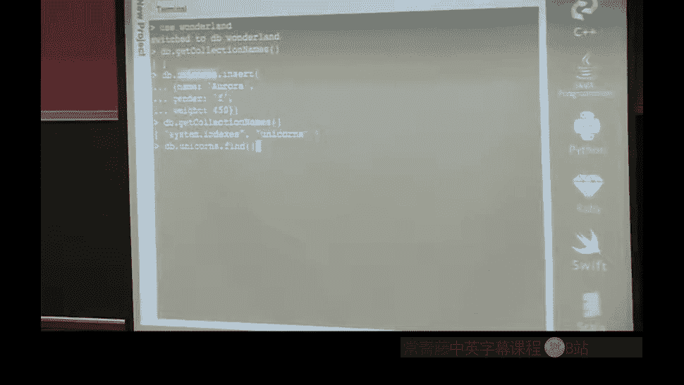
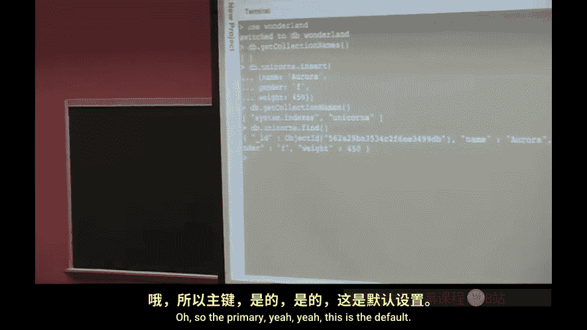
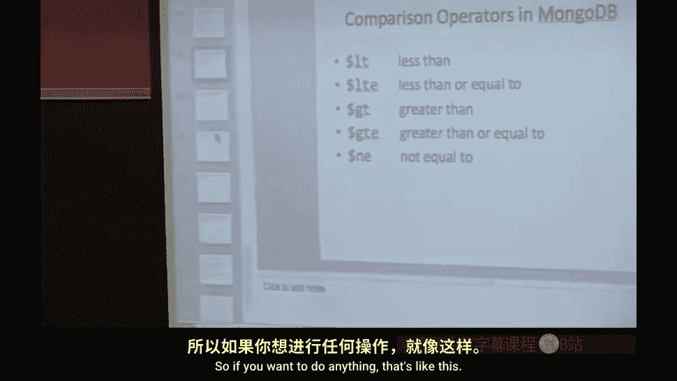

# 数据库管理系统：第23-24讲：NoSQL导论：MongoDB - 第1部分

在本节课中，我们将要学习NoSQL数据库家族中的一员——MongoDB。我们将了解MongoDB是什么，它与传统关系型数据库（如SQL）有何不同，并初步学习其基本的数据结构和操作命令。

## 概述：什么是MongoDB？

上一节我们介绍了NoSQL数据库的概念。本节中，我们来看看一个具体的、目前非常流行的NoSQL数据库：MongoDB。

MongoDB是一个可扩展、高性能、开源的**无模式**、**面向文档**的数据库。它的名字来源于“humongous”（巨大的），寓意其设计初衷是为了处理海量数据。与SQL数据库不同，MongoDB在创建时无需预先定义严格的数据结构（即模式），数据可以灵活地以类似JSON的格式存储。

## MongoDB的核心概念

为了理解MongoDB，我们需要先掌握其数据组织方式中的几个核心概念。

### 数据层级结构

MongoDB的数据组织遵循一个清晰的层级结构，从大到小依次是：实例（Instance）、数据库（Database）、集合（Collection）和文档（Document）。

*   **实例**：一个运行中的MongoDB服务进程。
*   **数据库**：一个高级别的数据容器，类似于SQL中的“数据库”。一个实例可以包含多个数据库。
    *   代码示例：`use myDatabase` （这条命令会切换到名为`myDatabase`的数据库，如果该数据库不存在则会创建它）
*   **集合**：数据库中的一组文档，类似于SQL中的“表”。一个数据库可以包含多个集合。
    *   代码示例：`db.myCollection` （这指向名为`myCollection`的集合）
*   **文档**：集合中的一条记录，类似于SQL中的“行”。文档是MongoDB中数据的基本单元，以**BSON**（Binary JSON，JSON的二进制编码格式）格式存储。一个集合包含多个文档。
    *   代码示例：`{“name”: “Aurora”, “gender”: “f”, “weight”: 450}`

### 文档与无模式

文档是MongoDB的核心。每个文档都是一个由键值对组成的数据结构。最关键的特性是**无模式**：同一个集合内的不同文档可以拥有完全不同的字段结构。

例如，集合中的两个文档可能是这样的：
```json
// 文档1
{
  “_id”: ObjectId(“…”),
  “name”: “Aurora”,
  “gender”: “f”,
  “weight”: 450
}
// 文档2
{
  “_id”: ObjectId(“…”),
  “name”: “Rogue”,
  “gender”: “m”,
  “vampires”: 99,
  “loves”: [“apple”, “watermelon”]
}
```
可以看到，文档2比文档1多出了`vampires`和`loves`字段，而文档1没有这些字段。这在MongoDB中是允许的。

## MongoDB的基本操作（CRUD）

了解了数据结构后，我们来看看如何对数据进行增删改查。MongoDB提供了一套丰富的操作语义，通常被称为**CRUD**操作，即创建（Create）、读取（Read）、更新（Update）和删除（Delete）。

### 创建（Insert）

在MongoDB中插入文档非常简单，无需预先创建集合。

以下是插入操作的示例，并与SQL进行对比：
*   **SQL**:
    ```sql
    INSERT INTO users (name, age) VALUES (‘John’, 25);
    ```
*   **MongoDB**:
    ```javascript
    db.users.insert({name: “John”, age: 25});
    ```
    执行此命令时，如果`users`集合不存在，MongoDB会自动创建它，然后插入文档。每个文档会自动生成一个唯一的`_id`字段作为主键。

### 读取（Find）



查询是数据库最常用的操作。MongoDB使用`find()`方法进行查询。



以下是查询操作的示例：
*   **SQL** (查询年龄大于18的用户姓名和地址，并限制返回5条):
    ```sql
    SELECT name, address FROM users WHERE age > 18 LIMIT 5;
    ```
*   **MongoDB**:
    ```javascript
    db.users.find(
        {age: {$gt: 18}}, // 查询条件 (WHERE)
        {name: 1, address: 1} // 投影，指定返回的字段 (SELECT)
    ).limit(5); // 限制返回数量 (LIMIT)
    ```
    *   `{age: {$gt: 18}}` 是查询条件，`$gt`是“大于”的比较操作符。
    *   `{name: 1, address: 1}` 是投影，`1`表示包含该字段，`0`表示排除。默认返回`_id`字段。
    *   `.limit(5)` 是链式调用，用于限制结果数量。

### 更新（Update）

更新操作用于修改已存在的文档。


以下是更新操作的示例：
*   **SQL** (将所有年龄大于18的用户状态设为‘A’):
    ```sql
    UPDATE users SET status = ‘A’ WHERE age > 18;
    ```
*   **MongoDB**:
    ```javascript
    db.users.update(
        {age: {$gt: 18}}, // 更新条件 (WHERE)
        {$set: {status: “A”}}, // 更新操作 (SET)
        {multi: true} // 选项：更新所有匹配文档，而非仅第一条
    );
    ```
    *   `$set` 是一个更新操作符，用于设置字段的值。
    *   `{multi: true}` 确保更新所有匹配的文档。如果省略，默认只更新第一条匹配的文档。

### 删除（Remove）

删除操作用于移除集合中的文档。


以下是删除操作的示例：
*   **SQL**:
    ```sql
    DELETE FROM users WHERE status = ‘D’;
    ```
*   **MongoDB**:
    ```javascript
    db.users.remove({status: “D”}); // 删除所有status为‘D’的文档
    // db.users.remove({}); // 警告：这会删除集合内的所有文档！
    ```

## 实践：基础查询示例




让我们通过几个具体的查询例子来加深理解。假设我们有一个`unicorns`（独角兽）集合，里面存储着形态各异的独角兽文档。


以下是几个查询场景及其对应的MongoDB命令：

1.  **查询体重大于700磅的雄性独角兽**:
    ```javascript
    db.unicorns.find({
        gender: “m”,
        weight: {$gt: 700}
    });
    ```
    这是一个“与”(AND)条件查询，文档必须同时满足`gender`为“m”且`weight`大于700。

2.  **查询没有`vampires`字段的独角兽**:
    ```javascript
    db.unicorns.find({
        vampires: {$exists: false}
    });
    ```
    使用`$exists`操作符可以检查某个字段是否存在。`false`表示查找不包含该字段的文档。

3.  **查询喜欢苹果或橙子的独角兽**:
    ```javascript
    db.unicorns.find({
        loves: {$in: [“apple”, “orange”]}
    });
    ```
    `$in`操作符用于匹配字段值在给定数组内的文档。注意，`loves`字段的值本身可能是一个数组（例如 `[“apple”, “watermelon”]`），MongoDB也能正确处理这种查询。

## 总结

本节课中我们一起学习了MongoDB的基础知识。我们首先了解了MongoDB作为面向文档的NoSQL数据库的核心特性：**无模式**和**可扩展性**。然后，我们学习了其数据层级结构：**数据库 > 集合 > 文档**，并理解了文档以灵活的键值对形式存储。最后，我们通过对比SQL，实践了MongoDB的**CRUD**基本操作（插入、查询、更新、删除）以及几个常用的查询操作符，如`$gt`、`$exists`和`$in`。

掌握这些基础是进一步探索MongoDB更高级功能（如索引、聚合、复制等）的关键。在下一讲中，我们将继续深入MongoDB的查询世界。