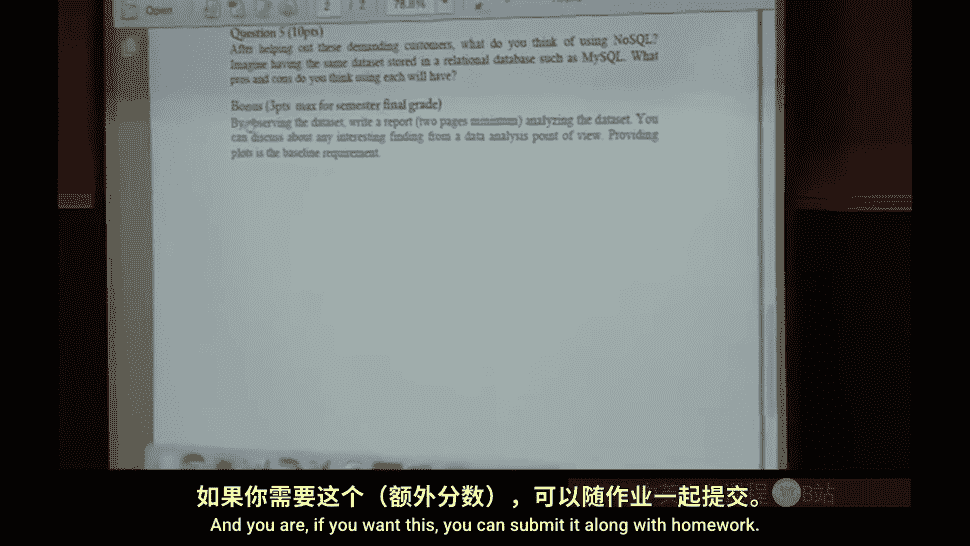
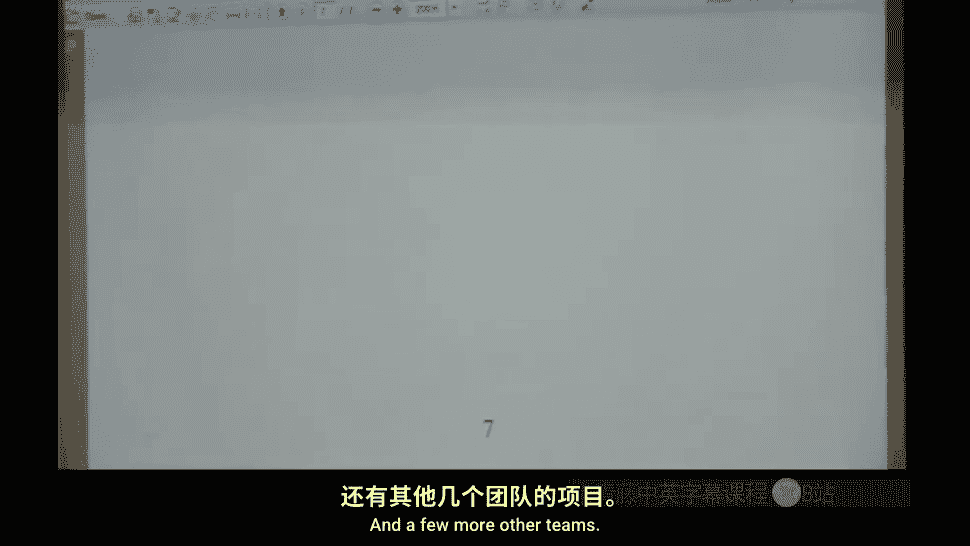
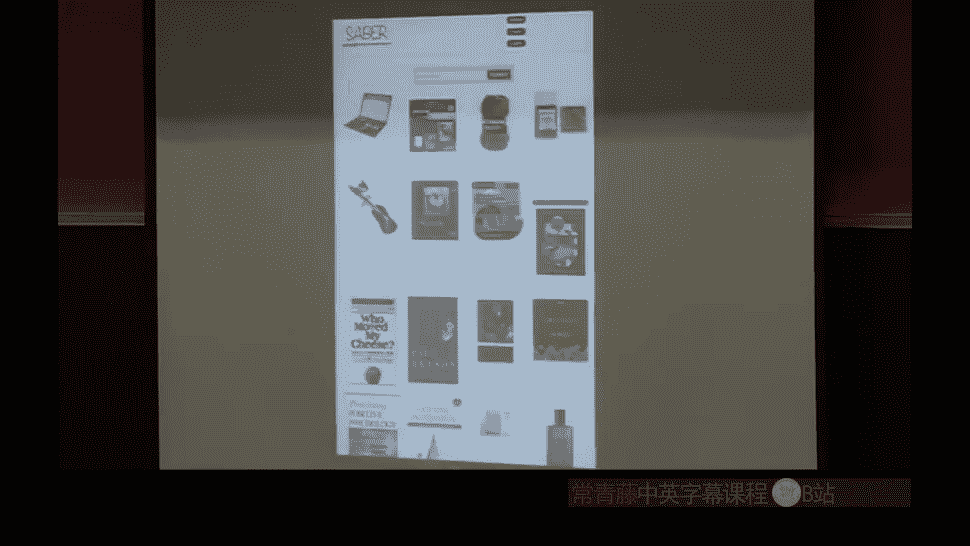

# 宾夕法尼亚州立大学【中英⚡数据库管理系统｜CMPSC431 Fall 2015, Database Management Systems】 p26 P27 数据库应用开发 - 第2部分 -BV1N76CBwEXb_p26-

Good morning， guys。Before we get started， I just want to show you。A couple of things， and。

And I might repeat against the growth class。So if you take a look at the schedule， we are。Right now。

Week 10。And all of the teams have finished the demonstration。And we are at chapter  six。

 which we will finish today。And originally， I was gonna have homework for due next Friday。

 but because I've been spending too much time writing it。 so I move it to。Week 12 Monday。

So that's a date before the winterter。So how the midterm week will be like this？

On Monday of the midterm two week。We have review session。And。As planned on Tuesday evening。

 we will have the midterm part one。Right now， I plan to have it done for。Programming part。

 so programming part might be done in the evening， but I'll now show you。

The first call will be done Tuesday evening and we will have no class on Wednesday。And on Friday。Oh。

 missing an end， but we go do mid Trump to part two in class。Friday。

So because now we split it into two parts， so we might have part one a bit shorter。

So that's the plant right now and as you see we have homework 4 and I want to quickly show you how。对。

So basically， homomopho we will be working on O SQL and you will be using MongolDb。

And I would recommend you to install Model TV on your local machine， it's going to be really easy。

 a lot easier than my SQL。Um because this time， instead of just having really small data set that we can normally do like just inserting the values into the database。

 this time we actually use a way bigger database， a data。So I got the data set from Yelp。Yelp。

 they hold the data challenge every half the year Okay so the researchers can submit their research question based on the data that Yelp provides with them Okay they can play around with them and come up with interesting research questions to help Yelp to see how they can improve their platform so they actually provide a lot of。

Different you of tables， so you want to think of it in tables。

 so they provide the business information， I think throughout 13 cities and they also provide the checkings。

 the user checked in on the businesses and the reviews the user have left and how much they tip and the user information。

For， if user a profile in their socially relationship， however， for our homework。

 we will only be using the business。So I already uploaded a data set。

To An and you can download it or you can direct them down， download it from them。Whatever you want。

So as I said， because the data is actually pretty big， of course compared to real world。

 it's a lot smaller， it's only。But it is 300。7 something megabytes， Okay。

 so you're going to import it into your database。And answer the question。

So a lot of the questions in this homework will be kind of open ended， for example， for a question。

Question three， I'll just ask you play around with a data set and you just tell me what you have hope。

Because as we all know， no school doesn't have a fixed schema。

Actuallyly every business listed in there might have inconsistence。Okay。

 so you can play around within it and see what other fields you see and what the fields might mean from business。

W vary， for example， for the hair sal along， they will have different。Comp here to the restaurant。

 this kind of thing it's going to be really fun to look at。Okay， and then we'll talk about。

That was the rating of。The business or how many people I left reviewed and where this。That is。

Located， okay， and in question 4， I listed 9 questions。 They're all kind of simpleful。

 but I just wanted to do。Get a sense of how you can retrieve data on different criteria in those sequenceQries。

So I made up these customers and they all have different kind of requirements and you're going to meet their requirements and find whether they exists such business。

Cant fit there。You know， pick their knee。And。In question 5。Okay。

 then you're just going to observe whether you think you think。

When we are approaching these kinds of problems， it is better to do it in。

then imagine what you would do in my SQL。So these are just all very open ended discussion。

And this time I start including bonuses because we haven't done this。So for bonuses。

 actually you can get three maximum points out of the hole for the total total whole semester grade。

But we are expecting a pretty high quality report so you can generate a report based on this data。

 I don't care what youre going to talk about， you can talk about whatever interesting thing you have found。

 but not just all writing， everything to see plots or some really basic statistical or just，Okay。

 that you have found and then you can discuss about it， two pages minimum double space stuff。

Double space， two pages minimum。你 talk about。Then the maximum grade extra grade you can get will be three points。

That's that and if you want this， you can submit it a long way。

So that's for home food。And we will get into the lecture for today， but remind me while we finish。

 I want to showcase you guys with。The project screenshots that we have collected。

Throughout the demonstration， so we didn't collect all of them， so yours is not shown。

 don't feel like out because mine is not good enough， just because your team havet。Subit it to them。

 so that's fine。All right， so today for lecture 27。So let's review a little bit from last time。

Last time， so as I said last time， in this chapter。

 it just really laid back you're just kind of learning about what are the packages。

 what are the technologies。Is this we are not asking you to solve any problem。

So if any problems related to Chaer 6 is asked in the exam， we won't test you， saying。

 is this thes right。We might just ask some kind of comparison， what's the pros and cons of different？

Approaches。Or giving you like a whole snippet of the code and ask you what approach this is。

So nothing too detailed about this check。So last time we discussed about there are two approaches for integrating the front end in the back end。

 or we can say your host language in the SQL， so we talk about two approaches。

 one of them is to embed the SQL code directly to the host language。

 which we mentioned embedded SQL if you remember， which is you can directly see the snippet of a SQL in the program。

And the second approach will be API， which is application programming interface。

 and the one we introduced was JDBC， and we will talk a tiny bit more。L这D。

And we also discussed about curA， which is the。Something that can help us to get the result when the result。

S to the host program。So using cursor， as we talked about last time is mostly needed for the select comm using SQL。

 that's because why。That is because， for example， for insert or delete or update。

 were not really return any results so we don't need to curor。

And we also quickly talk about dynamic SQL。Which is the commands are prepared in wrong time。

 so it's not just fixed。都么。And in terms of JDBC， we cover the architecture of it。

 there are four components of the architecture， and we also talked about four types of drivers。

 so just to refresh your memory of what the four types of drivers are， we have them right here。

Who can tell me what is the first one on the top left corner。So， it's。From one interface。

 still nothing to another interface。So these's the bridges。So this can see like three， in Cha6。

 there's not much that we can really test you on， so this might be。So for the second type。

We call it the direct transaction to the native API via non Java driver。So right there。

 I put different kind of colleges to distinguish。 Okay， JDBC is written in Java while DB API is not。

 So in this approach， we just assume the database will provide their own API and we can。

And remember last time we talked about this we'll have a drawback in the sense that then all of the clients using it will actually have to have the DPA API installed in their local machine。

Okay， so that's why this leads us to the third approach where we don't want installation to happen in all of the clients。

 instead， we just want it to have it maybe in the server in the cloud。To the system network。

So by using this approach， then on the local side， all the clients。

 what they need to install becomes so small， right， because all of the responsibility are here。

Because this is the middle where you can think of it as the network。Finally。

 the fourth type of driver。Similar to the second one， but instead of。

 so it's direct translation to the native API via Java Java driver。 So instead of having a nonja。

 this is how we have it It Java。 and I use the color to denote theyre both written and Java。

So the takeaway from this kind of different types of drivers。You just need to kind of get a sense of。

When we talked about it， why from the second how we lead to the third type， what on the third type。

So what are the pros and cons？So are these are the different drivers。这个意意思。So。In terms of JDB。

 we won't really spend time on talking about the semantics of it。

I feel like not every teams going to use through H JDVC， so it's not。

Such a point to really get into so much。😔，But if you look at textbook in section， I think 6。3。

 they actually spend a lot of time talking about the grandma and how you're going to use it。여 거 어떻게。

So what we will actually do， I'll just show you。The whole example of the code and we'll talk through what it's doing。

Okay， so that's going to be what we are going to mostly doing。

To show you the code and you look through it and you think it makes sense， you understand there。

 that's more than that。So let's take a look at one of the JGBC examples。都开的比较呗。It's not that bad。

So an assumption made in this example is before we get started， actually。

 the connection is established。 So you can think of the CON in the third line。

Because it's written in Java， as you can imagine Java alone。あおり。

Different classes in different kind of API date。So。As I said， just remember。

 in this assumption we already。発手です。So， here。He's not helping but that's the connection。

 it's already established。嗯。So in JDPC， what you can do is， for example， in this this example。

 our goal is just to simply get the metadata from the database so in the second line what we want to do is first of all。

 okay， in the first line in the connection， we say for the connection， we want to get the metadata。

 and the result we store it in a database。Which we call just simply。We just simply call it D。

And for tea companies make a data blockchain。We can get the tables from it。

So it means in the database， what are the tables？多分で。

And then we just saw it simply in the result set。And here you say we pass in parameters。

Lots of knowing， you don't really have to care about it's just based on the design of the API so different parameters and different。

So right here， if you just think of it specifying norm means。

 we're not really specifying any criteria we just want to get all of the tapes。In thisデ。

And here we have a temporary variable that will help us to store the table name in each case。

So here you can see for the results set， you can think of it as an iterator， so we loop。

 we iterate through the iterator with a water loop right every time we go through it。

And every time when we are at one position for the itera， we just want to get the table name of it。

So here for the table name， every time we just have the iterator to get the string table name。

 so you can think of it as this way so the get table is actually get the description of the date of the tables and。

Why does the information you can get in the description will be taken in？So every time we get one。

 we store it in here， we want to output it， okay we just print it out。Priinnttail。

 the attributes of the table and a table name are what？So on this table。

 every time we get what are the columns names？Off the table。Right here， it's very simple。 same thing。

 So just here we said we want to give the call。Off。Table based on the table name， right。

 look through again。And we get the call。And then move on， do the same thing with another loop。

 we can get all the primary keys。All of this corresponds。So this is。

 you can get a sense of how things are done。You can't really see any sequences of it。

Even though it's really interacting with SQL。But nothing you can see that looks like you。

So this is really different from the embedded。Just by the look。So this will be for JDBC。

 let's take a look at the last approach that we will talk about。So actually it's called equal J。

So SQL J， it stands for SQL just。The Jays just dropped。So again。

 this could be something really joblike but。It's tiny bit different from。啊，这个意思。So in JDBC。

 you can see， we can't really see anything about P quo in there。Just a few job like help。

But for SQL J， it wants to complement JDBC with a statement static query on。

So you can still see a little bit of s data。Which I'll show you later。SQL J is developed by a group。

Daabase vendors at Sun。So because right in SQL J， you can see a little bit of s。Of SQL， So actually。

 it's a lot closer to embedded SQL。So you might be thinking when we were talking about embeddeded SQL。

 we talked about the drawbacks of it and that's why I introduced JPBC。

 but right now we are going back to the middle of work。So actually， it's because of this。

 so when you think of JDBC， a lot of things are being。Evaluated when you compile it。

 So you might imagine， okay， these should all work right the ports should all connect how you input output between JDBC and SQL should work。

 However， maybe when you compile it， you see there's a type error。kind of mismatch。

So SQL J actually benefit of it is that Kpali would check it when it's Kli because you have so many things that just exactly way SQL。

Don a compound， so instead of finding it out when you find a compile it， it's done。

Okay so the compella can perform following tasks， for example， syntax checks。

 that I said in the strong types check and see whether the host is。

So SQL J is kind of between embedded SQL and G。So let's take a look at how sequence it will look。

Again， no'll need to remember how you will write them in， write them down。

 but just to get a sense of why they're different。So as you can see in SQL J。

 things will kind of look like that。 we all started out。You has okay， has just equalequ。

And equal it and then you open curly braces and just put directly the same thing that you look for or sQL。

And remember from embedded SQL right here， whenever we have the column and means this variable is from the host button。

If you can recall。So compared to JDBG， we'll look something like， okay。

 these two are doing different things。Compared to JDPC looks very different。

This isWhat tQ J will look like。So let's take a look at a whole example so we can see a bit more。

后 theyre来。For example， right here。So we have a bookstore example， okay。

 if we have database storing the books， I think none of the thing is working on the project for a bookstore。

For example， you you a perfect example。Then for books， maybe you can get the title of the book。

 the price of the book and the author。Okay， they' will be publish so but here we just care about this。

So if we are doing this， say we want to get information of the books。In SQL J。

He on the bookstore database， this is what we would do。So first of all， really simple， for example。

 we just want to declare the title， the price， and the author with the correct data type。

In the host program。And in order to interact it with SQL， we started out by doing this Okay， again。

 I have SQL， and this will be an iterator。And you just say， I want the iteration to be in class。

So following it， you're just basically saying， okay， in the class book， it's like a constructor。

 you're just saying， okay， I want to string title to the string。Okay。

 so here we're just creating this。class okay， but nothing is really created again， then you say。

 okay， for this class， I want an object books。Here so far， so good then again， because we want to do。

We want to execute SQL。 So here again。We need start out by this operator。

 and then books in then you put in what you will normally do。いし効果。

So all of these things will then be stored into books。Then through a while loop。

 you just loop through them。And then printnt。Nothing too hard about it。

To just remind you again when he's calling， it means these are from the host program。

 the title is from here。Because we select the title and price from books。Then。these are from SQL。

 and these are in the host。So if we want to do the same thing。In是 what will we。

So this is how things will look like in JD。So in JDBC。

 the assumption made in this example is we already declared the title price Off value。

I didn't put them here， but I can just assume it's already done。

So the different thing right here is we will start out by a prepared statement and you will do the exact same thing right here。

 but instead of having them as a comment like we did。 it's more like you're just passing a stream。

You're passing a string。And if you want to pass in any parameters in JDBC。

 the fun thing is you will just put a question mark okay。

 so the first question mark appearing in the screen， they will view it as the first parameter。

If there are two， then。If there are two then that will be the second。Okay so in JDBC。

 we started out like this preparing a statement and we're passing the argument like this before the statement we have right here。

As TT， you want to set the parameter。The first one， the often， okay。

 that's kind of a weird way of doing it， but this is how they set the。Pas it。

So instead of like here and where the author is equal to the author。Okay。

 declare initialize in the host program。Here we pass it in light。And to execute the query。

 just basically say statement and dot execute query。And then， the following hours。

so the way they do it is tiny bit different。So again， right here。

 you can see we have extracted our a title and price that here we can just directly save。For。

The are result set， but directly get the first thing because that would match to the title and the second thing that will match。

that's for Jesus。So if we go back to take a look at SQL J， you can。Math is to the step on slide nine。

So on S night， we are talking about the usage of SQL J Eta。

So if we look at this example and look at the steps。

 so you can see the first thing we want to do is to declare the itator class。

So here we have an iterator and you can just declare the class name。

 so actually it didn't have to be booked， but just for their clarity and call it book。

It's the first thing you want to do to declare the page agent to create a new Java class。

So this is what you create。And then you want to instantiate an iterator object from the new iterator class。

 this is what you did you just instant。But there's still no content。

Then you want to initialize the iterative using the SQL statement， which is exactly what we do。

initialize it。By sending in people coming。And then iteration， you read the rows， row by row。

 every time we do that next thenex， okay， row by row， we just iterate through the whole object。

And finally， when you're done， just closely。It's simple as that this is what we would do for using the SQL J to。

Just' like， here， this is the age director we have。They're actually too tight。

Of SQL J itators right here， the one we used。The first type， okay。So take a look at here。

 we will say for the iterator， we will access it through title。So。Right here for the first time。

 we call the name iterator， take complete1。This is the one we use in the exam。

So if you look back to the example， we actually need both the very local type and the name。

And every time we treat the call。And the second type we can do。Is positional。So if you recall。

 this is actually really similar to the idea when we were。About relation。

We can refer to the attribute either by the name or by the positionist。

Nothing fancy it just there are two types， so for a positional iterator you need only the variable variable type。

 okay， and later on I'll show you so you can use the fetch do into。

So to note that same thing as we did in relation of。

When we are just simply referring to the attribute。Assuming there's no naming conflict。

So there's actually no one approach that is better than the other， Okay。

 it's just a matter of what developer。So they have the same performance。But from here as well。

 we would just assume there's no naming conflict that。

So whether you want to use the name in curator or positional itator。It's all right。

So the comparison right here。I apologize if it's super tiny。

Behans half small and I've missed a few chunks of coat on your side。

 but it's the same as the left side。So on the positional iterator， I actually leave with the whole。

Thank you。Okay， basically， you can just drag it。Between we instantiate the books and starting a wild loop。

 we actually missed this chunk。And I also miss。Before we end the wild， it will actually do something。

 right， otherwise， we didn't do anything。But， that's not。Too bad。

 but I just want to show you the comparison between them。So the main comparison。

Are just the blue parts， okay， the red parts are the parts that made mistakes on your slide and the blue parts。

Or just the main difference。 So， for example， in the name iterator。

 you can see when we start the iterator， we have books。

 and then well talk about a title being stringed and float being priced。

 or we can say for the string type。 We're talking about the title F float type。

 We're talking about the price。 However， in the positional iterator。

Which just basically refer them by the types。 Okay， just different approaches。

And when we are fetching the information for the named iterator。

 we directly use the name to refer it， as we said， right， we directly say in the books iterator。

 the title is the first thing I want and in the bookss iterator。

 the prices in the second thing I want。And you do it。In a positional iterator。

 which is direct me to another SQL company。 fetch the books and then into B2。Okay。

 so that's just a different approach。Allright。So that would be for SQL J。

Didn't put too much emphasis on it ego， Any question for this？Pretty intuitive。All right。

So now I want to move on to the very last。Concept for chapterpter 6。Which is the store proceed。😔。

Tingle with a。Slide 12。So before we start， I want to ask you guys when you are creating your project。

 did you guys write up some programs functions？Now we repeat the same actions。

 keep repeating the same maybe SQL code。有。Or do you think there will be a means to do that？

Keep it begin the things。For example， you keep repeating。嗯。For example。

 you want kick water in the same way。We on方。Will you。Just write the whole chunk of Scocoa。

 or you want to package。Comp that you can be used。so that will be the stored procedure。Okay。

 so I would imagine maybe for if， let's say， if you want to do the functions。

 you might have stored it into。你跟你啲。Ja to connect between the database and the front end。

 maybe you would write it in Java。But one thing is actually you can write it on the service side。

You can create a function or using a state， you store the function。

On the server side in your equilibrium。So here we'll talk about store procedures。

So the running application logic directly。At the date of being。Advants， for example。

 we can minimize minimize the amount of data transfer between the data server and decline issuing the SQL statement。

 So instead of。every time sending all of them。Tuples back and then process it in another end。

You can actually have them done already。On the Z side， dance and the back。

So this will also help you to utilize the full power of the database because they have different kind of indexing abilities。

 so that might just boost the tu a lot more。So what exactly is the store procedure。

 so it's basically program executed for a single SQL statement。

 it can store the single SQL statement。And then it's executed and processly。

Instead of done on the clients。So a few more advantages of the store procedures is you can encapsulate application logic while staying close data。

 which means things are still done on the server side。

Or you can say you want to use the application logic like this。見す。For example。

 if your application is scheme。跌保一佢。Being retrieveed by different sites， different client side。

 they can you be used by well as well。And avoid couple at a time return of records through cursors。

 so so far when we see。In that a sQL or JTBC， we all have the cursor looping through it Okay so instead of using the cursor every time to check。

 okay， I want this tuple， I don't want this tuple， maybe you can have the topples already to。

So the store procedure just kind of looks like this okay when you do it in SQL。

 you can actually just create a procedure in SQL and then do the same thing you will normally do。

Okay， that's it。And。Not only can we do that， we can also send in some parameters。

There's nothing really fancy about this， but I just want to show you this is an option you can do for your project Okay so for here。

 let's say instead of every time saying I want to select the customer ID D and the name and then count them from the customers and orders。

 okay， this kind of criteria。Instead of doing it every time repeating it， we can just store it。

procedure。So we can also pass in parameters。喂嗯。Which I think you might use a lot。

 maybe when you're filtering things or whatever。So we create。

 we can create a procedure that takes into two parameters。

 Here you will see they have an in right here。 So in just basically saying this is the parameter going into this procedure。

 Okay， if you put out， it means， this is what the parameter will。What the procedurecedural output。

 Okay， And then in the procedure， these are the things we will do。先ポ。

So one benefit of using the procedure is that not only can we repeat the same SQL command that we want to use。

 you can also package something else， maybe you run a Java function。You can actually package it。

So you can create a procedure on the SQL server side， and then you say， okay。

 I wrote this in Java and you just directly link the jar file that you wrote。And then。

 it will execute。so this might come in handy。So you can also have that。In。

So what left to discuss would just be showing you how the store procedure is being called from either in SQL or JDBC or stick。

Nothing too fancy about it， I was just one to5 these shows and then we me wrap boxes。

And then show you the screenshot of each。So this will be how we will call it from the embedded SQL。

 okay， so in embedded SQL， as you might be already familiar with。

 we always start by executing SQL and then we do different stuff。Okay so here at the beginning。

 we say execute SQL and we declare different kind of variables and we can send them into the procedure we just store this is how it will be in embedded SQL。

And。In terms of JDPC。We will do it like this， okay， so we will prepare the call。In another object。

 and we will call it， here I miss an Naris， I miss quite a lot of things with time。

So this is how it will be done in。So just to remind you again， when you look at a JDBC code。

 there's nothing really。Look like equal you。But CQ J， on the other hand。Will look like this。Again。

 has have sQL， we have it here， right。We call it。So just to reemphasize again。

 if on exam these kind of things show up， I won't ask you to check whether any semantic error。

And I would just say according to the snippet， what do you think this will be in maybe8 SQL J？

So it's really easy， you just see the hashtag in SQL chain。

 okay but just want to make sure you can see what is it being good as SQL or it？😊。

Because I feel like every team had their own way of doing it， so there's no point of remembering。😔。

All ofす。Right。So chapterer 6 is relatively a lightweight chapter I just lay that。

Learning about what are the things existing there， before we finish， let's just summarize。

So what allows execution of parameter staticque within the hostman？下次。大谢。

Did just directly put it the next？The first approach。In白一口 okay。Because these are just a takeaway。

But compared to static。On the contrary of tactics， what allows execution of completely ad hoc careers within the host？

I think this is not a really good description， but what's the contrary of being stating？Dyna yeah。

 it is the dynamicacy。That we didn't spent too much time up。

 but we show you how you can transform the embedded one。

So what mechanism allows reriele of one river at a time and bridges impotence mismatch？どな。

This is an in。What helps you to retrieve？1。What do we put in the wild？Co sir， yeah。Okay。

 so if you remember one of the biggest reasons we are using cursor。Is because of the misback。

big times， because maybe in。Other language they cannot directly take in the table type return I。

 Okay so that's where we need a closer to look。Oneular。Next thing。

Some things such as JBBC introduce a layer of abstraction between applications and December。Aア。

So then the last two are what we'。Something that is static and queries check that compound powder。

The third approach we talked about。S jack， okay。Okay， last one。What？

Execute application logic directly at the circle。We can encapsulate。お。Don just few minutes ago。

We can create it oncoil。え生。そ。Yeah， yeah， its the。That's that for。So because this time。

 so for mid term two， we still have chapter7。Chapter  seven to go through so this time other than chapter six and seven mostly。

Solving problem in ay， I'll give you a queries and you write down what would be。If I think。

 other than chapter。19 is on schemeche of refinement。5ive is on SQL， and then we will have no SL。

You see other in in these three， these two are just very kind of， if you read it， you know it。

Kind of chapters， Okay， so when we test on the writing exam。

 just basically we will ask you this kind of thing like the something， this kind of thing。

 or we'll ask you the pros and cons doing comparison。変らな時。So if you came in late， just work， yeah。

Yeah okay， so it will be。

たての。It will be。We talk。I think I'll repeat again， so on week 12， we will have midterm。

 so what's going to happen on week 12 this looks exactly。Not better。

I don't know why I looks kind of pigy but。On week 12。

 what's going to happen is on Monday we will have a review session okay。

 and on Tuesday evening we will have。I guess the programming part， not。10， yeah。And on Wednesday。

 no class。And on Friday， yeah， first time no class I very surprise on Friday。

 we will have the second part。😊，In class。Okay。や time。And also Monday the review session。

 you'll be turning in homework book and I already posted on Angel so you guys can take a look。

 it will be on NoSQL using a really fun data。Okay， so before finish today， I want to show you。

The screenshots of some of the teams that we have collected throughout the demonstration once。

So if your team is not shown， it doest mean because you're not good enough maybe just because the TA forgot to tell you or forgot to send the TA the screenshot。

 that's it。So we have collected， I think， half of teams。

So this will be the first I want to show you guys。So this team have already developed interface looking like this。

Defing， okay。And this is their back end， I think a lot of teens use PhP my admin。え。More on the front。

 I just want to give you a sense of how other people's projects will。So you know where you're at。

So these are， yeah， their backends and they have the registration form。And the user can update their。

As well。在。And。

A few more other teams。So this is another team。And they have already been able to show the product on the pages。

はいです。This is another team。They already be able to display the data。In tables。

We kind got mixed up this is back to the first thing。Another听。

And show that all the users in the table and the addresses。This is the back end， how we developed it。

One more team。天しば。いってるろよ。And this is another product。

So that's that for the teams we have COVID team。I think most of the team have established a connection as the baseline。

based we said， so that's very good， but I think there are two teams that the coming is not there。

So just make sure that you can have the conversation stuff。As soon as possible。

 because then one month place there will be demonstration two。

 and then we would expect it to be like 90% or even。

When is demonstration two because demonstration two will be right before。Yeah。

 the week before the final presentation and for the final presentation you will be showing the whole class。

Good块。So that's it for today， get finished early and I'll see you guys。あまに。

