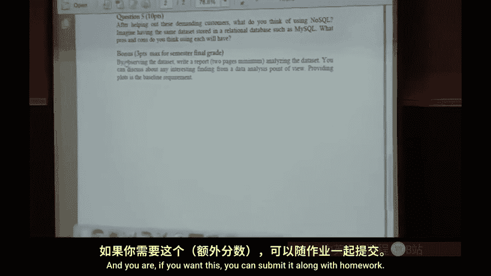
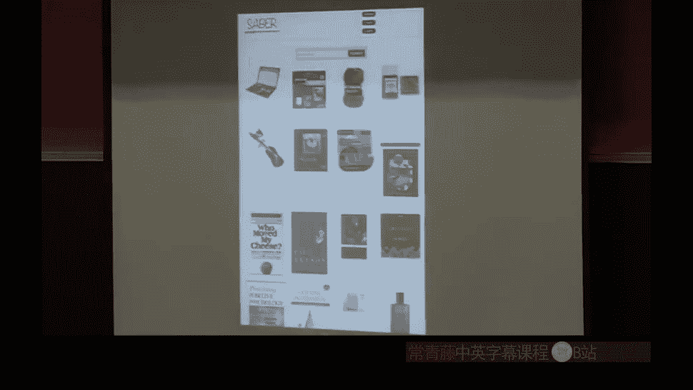

# 数据库管理系统：第6章：数据库应用开发 - 第2部分

在本节课中，我们将继续学习数据库应用开发，重点介绍连接前端与后端的不同技术方法，包括JDBC、SQLJ以及存储过程。我们将通过对比和示例来理解这些技术的核心概念与应用场景。

## 📅 课程进度与作业安排

上一节我们介绍了数据库应用开发的基本概念。本节开始前，我们先了解一下课程当前的进度和即将到来的任务。

目前是第10周，所有小组的项目演示已经完成。我们今天将结束第6章的学习。

关于期中考试（第二次），计划安排如下：
*   第12周周一：复习课。
*   第12周周二晚上：期中考试第一部分（编程部分）。
*   第12周周三：无课。
*   第12周周五：期中考试第二部分（课堂内进行）。



原定于下周截止的作业4，将延期至第12周周一提交。这是一份关于NoSQL和MongoDB的作业。

以下是关于作业4的详细信息：

*   **数据源**：作业将使用Yelp提供的数据集，该数据集包含商家、用户签到、评论等多种信息。本次作业仅使用其中的“商家”数据。
*   **数据规模**：数据集较大（约300MB），你需要将其导入MongoDB数据库进行操作。
*   **问题类型**：作业中的问题多为开放式。例如，有些问题要求你探索数据集并报告发现；有些则模拟客户需求，让你编写查询来寻找符合条件的商家。
*   **开放性讨论**：作业包含对NoSQL与SQL处理问题方式的对比讨论。
*   **加分项**：本次作业首次设置了加分项。你可以基于该数据集生成一份高质量的分析报告（至少两页，双倍行距），深入探讨你发现的任何有趣现象。最高可获得相当于学期总评3分的额外加分。

## 🔌 前端与后端集成方法回顾

在上一节，我们讨论了集成前端（宿主语言）与后端（SQL）的两种主要方法。本节中，我们将更深入地探讨其中一种方法及其变体。

这两种方法是：
1.  **嵌入式SQL**：将SQL代码直接嵌入到宿主语言（如C、Java）程序中。
2.  **API（应用程序编程接口）**：通过调用特定的API来执行数据库操作，例如我们介绍的JDBC。

我们还介绍了**游标**的概念，它主要用于处理`SELECT`查询返回的结果集，帮助解决宿主语言与SQL之间数据类型不匹配的问题。另外，我们简要提到了**动态SQL**，它允许在运行时构建和执行SQL语句。

## 🚗 JDBC 深入与驱动类型

现在，让我们更详细地看看JDBC。JDBC的架构包含四个组件，并且有四种类型的驱动程序。

以下是四种JDBC驱动程序类型：
*   **类型1：桥接驱动**：通过一个通用接口（如ODBC）连接到另一个接口。性能通常不是最优。
*   **类型2：本地API驱动**：直接将调用转换为数据库特定的本地API（非Java编写）。缺点是在每个客户端都需要安装该本地API。
*   **类型3：网络协议驱动**：通过中间件（网络服务器）与数据库通信。客户端只需安装很小的驱动，大部分工作由中间件完成，易于部署。
*   **类型4：纯Java驱动**：直接将调用转换为数据库特定的本地API，但该API是用Java编写的。通常能提供最佳性能。

理解这些驱动类型的优缺点很重要，例如从类型2发展到类型3主要是为了解决客户端安装依赖的问题。

## 💻 JDBC 代码示例

我们不会深入JDBC的每个语法细节，但会通过一个示例来理解其工作方式。以下代码示例演示了如何使用JDBC获取数据库的元数据（如表和列的信息）。

```java
// 假设数据库连接 ‘conn’ 已经建立
DatabaseMetaData dbmd = conn.getMetaData(); // 获取元数据
ResultSet rs = dbmd.getTables(null, null, "%", null); // 获取所有表信息

while (rs.next()) { // 遍历结果集
    String tableName = rs.getString("TABLE_NAME"); // 获取表名
    System.out.println("Table: " + tableName);

    // 获取该表的列信息
    ResultSet columns = dbmd.getColumns(null, null, tableName, "%");
    while (columns.next()) {
        System.out.println("  Column: " + columns.getString("COLUMN_NAME"));
    }
    columns.close();
}
rs.close();
```
这段代码展示了JDBC的风格：你看不到直接的SQL关键字，所有操作都是通过Java对象和方法调用完成的。`ResultSet`对象就像一个迭代器，允许你逐行遍历查询结果。

## ⚖️ SQLJ：介于嵌入式SQL与JDBC之间

接下来，我们介绍第三种方法：**SQLJ**。它旨在用静态SQL查询来补充JDBC。

SQLJ由多家数据库供应商和Sun公司共同开发。它的代码看起来更像嵌入式SQL，因为你能在程序中看到SQL语句片段。SQLJ的一个主要优点是，它允许在编译时进行语法和类型检查，而不是在运行时才发现错误，这提高了代码的可靠性。

以下是SQLJ的一个简单示例，用于从“books”表中获取信息：
```java
// 在宿主程序中声明变量
String title;
float price;
String author;

// SQLJ 迭代器声明
#sql iterator BookIter(String, float, String);

// 创建迭代器对象并执行SQL
BookIter books = null;
#sql books = { SELECT title, price, author FROM books WHERE author = :author };

// 遍历结果
while (books.next()) {
    #sql { FETCH :books INTO :title, :price, :author };
    System.out.println(title + ", " + price);
}
books.close();
```
在SQLJ中，以`#sql`开头的行表示SQL操作。`:author`这样的变量前加冒号，表示它是来自宿主程序的变量。

SQLJ迭代器有两种类型：
*   **命名迭代器**：通过列名来引用数据，如`BookIter(String title, float price)`。
*   **位置迭代器**：通过列的位置顺序来引用数据，如`BookIter(String, float)`。在获取数据时使用`FETCH ... INTO`语法。

这两种方式在性能上没有差别，选择哪一种取决于开发者的偏好。

## 📦 存储过程

最后，我们探讨本章的最后一个核心概念：**存储过程**。

试想一下，如果在你的项目中，需要反复执行同一段复杂的SQL逻辑，你会怎么做？是每次都在应用程序中重写这段代码，还是将其封装起来以便复用？存储过程就是为了解决这个问题而生的。

存储过程是**存储在数据库服务器端的一段程序**，它可以被客户端调用执行。它的优点包括：
*   **减少网络传输**：逻辑在服务器端执行，只需将最终结果返回客户端，避免了传输大量中间数据。
*   **充分利用数据库性能**：可以利用数据库的索引、优化器等特性提升处理速度。
*   **代码封装与复用**：将业务逻辑封装在数据库层，可以被多个不同的客户端应用程序共享。
*   **避免使用游标**：可以直接在服务器端完成复杂的数据筛选和处理。

一个简单的存储过程定义如下：
```sql
CREATE PROCEDURE GetCustomerOrderCount (
    IN customer_id INT,
    OUT order_count INT
)
BEGIN
    SELECT COUNT(*) INTO order_count
    FROM orders
    WHERE cust_id = customer_id;
END;
```
这里，`IN`表示输入参数，`OUT`表示输出参数。

存储过程不仅可以包含SQL语句，在某些数据库系统中，你甚至可以调用用Java等语言编写的函数。存储过程可以从嵌入式SQL、JDBC或SQLJ中调用，调用方式各有不同，但概念一致。

## 🎯 本章总结

本节课中，我们一起学习了数据库应用开发的几种关键技术。

让我们通过几个核心问题来回顾一下：
*   什么技术允许在宿主语言中执行**参数化静态查询**？答案是**嵌入式SQL**。
*   与静态查询相反，什么技术允许执行**完全动态的查询**？答案是**动态SQL**。
*   什么机制允许**一次检索一行数据**，并解决阻抗失配问题？答案是**游标**。
*   像**JDBC**这样的技术，在应用程序和数据库之间引入了一层抽象。
*   **SQLJ** 是一种静态的、可在编译时检查查询的技术。
*   什么技术允许**直接在数据库服务器端执行应用逻辑**？答案是**存储过程**。

第6章的内容相对概念化，在考试中，我们更可能考察对不同技术的理解、比较以及识别代码片段属于哪种技术，而非详细的语法。

## 🖼️ 项目展示预览


在结束之前，我想展示一些在项目演示中收集到的小组作品截图。这有助于大家了解其他团队的进展。如果你的团队截图未出现，仅仅可能是因为未提交给助教，并不代表项目质量。

（此处可描述展示的截图内容，例如：团队A已经开发出包含用户注册、商品展示的前端界面，并使用PHPMyAdmin作为后端管理；团队B能够将数据库中的数据以表格形式清晰展示在网页上；等等。）


看到大多数团队已经建立了基本的数据库连接并实现了核心功能，这非常好。请确保继续完善你们的项目，因为在大约一个月后，将进行第二次演示，届时我们希望看到接近完成度的版本。



本次课程到此结束。