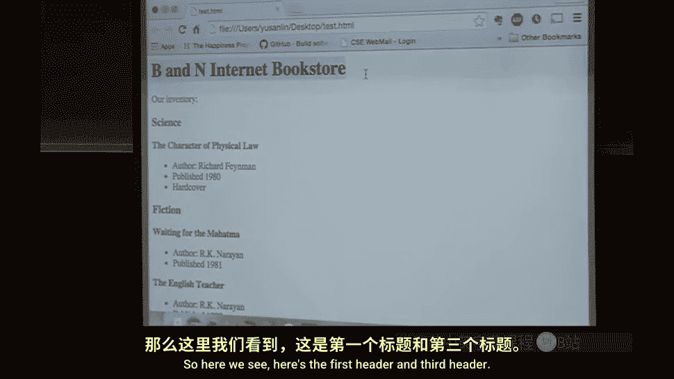
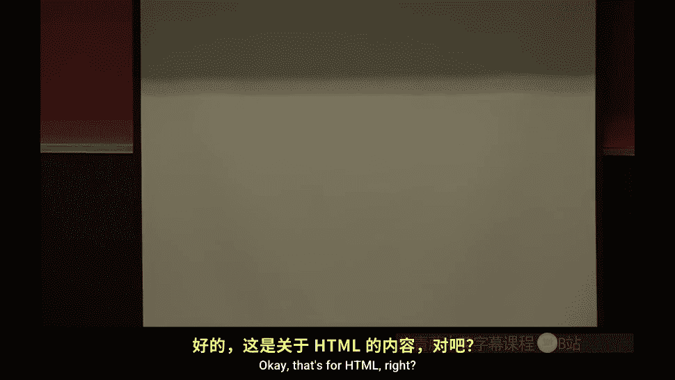
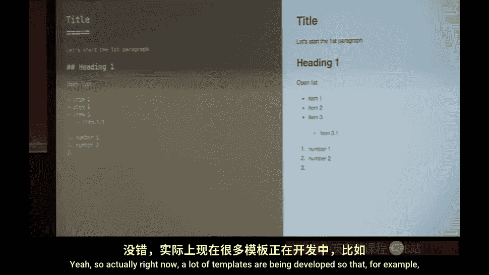

# 宾夕法尼亚州立大学【中英⚡数据库管理系统｜CMPSC431 Fall 2015, Database Management Systems】 p27 P28 互联网应用 - 第1部分 -BV1N76CBwEXb_p27-

稍微点。그 거。Good morning， guys。Okay， so today we will be talking about the last chapter for midterm two。

 which is Cha7， and it will be highly related to what you have done so far for your project but we're just talking about a bit more on the front end。

后这是吧？So up on sale now， you have not yet touched upon the concept of internet so far。

 everything we're talking about is assuming everything happens on the local machine。

 even though on NeSQL， we kind of mention a little bit about distributed computing。

 but in this chapter we are gonna mostly focused the ideal of Internet when we talk about database applications。

Allright。So what we will be coveringing today。these topics we'll first start out talking about the internet concept。

 which is really simple， an Internet concept along with communication Pro， which is a GTP。

 will be basically the most simple idea you have learned in computer network。

Who have to take in computer network。Oh， okay。So okay， then Ill put more emphasis on it today。

 I assume everyone had taken it right。So that will be。

 we'll talk about how the request is sent from the user when is communicating with a server and how things are sent back。

So for， what we're talking about today will not be so closely related to what we have learned so far in terms of database modeling on the first glance a bit。

 but then you can think of it why we want to talk about this because it's all about this playing thing。

On the intimate。And after talking the first two bullet points。

 which is highly related to community networks， some of you have taken the course before。

 we will talk about web data format， so these are the things I would assume most of you have a little bit of experience on。

 so who have written things on HTMLL before。Quite a lot of you。小呼哈嗯。

Like more of a basic understanding of the tax of Itma。So when you guys write here。

 you write it from the code instead of。Writing it from maybe a webage editor。大しオ。

And how about who has any experience in XML？Okay， all right， cool。How about Jason。

Good more of you Okay， so we are going to talk about the three data format。

 So one thing to note is that when you read the textbook when you want to understand then。

 actually textbook didn't measure anything about J song because it's more of a new thing。😊。

It was created in 2004， but I would just include it anyway because nowadays Jewss are actually largely replaced X。

And then we will talk about Markup versus Mark Down， who have heard of Markdown。

a lot of you it's like the fixed group of people who kept heard hearing the same thing so for Markdown I will talk about it a little bit。

 it was not mentioning the textbook either but I think it's worth melting because it's more of a what people are using right now in different kinds of applications。

😊，So I will have a comparison of it versus Markov， but before we getting there， just to remember。

 actually markdown is not the opposite of Markov， markdown is one kind of markup。

It's kind of tricky when I first heard of it， I was confused too， but actually it's the total beat。

 not how it looks like。Then we will talk about DTD， which is actually the document type definition。

At the very end so these are the things we were going to talk about。嗯。Oh， and also next time。

 maybe next lecture or on Friday， quickly go through one of the techniques you can use to scrape data from the web because I know some of you have already done collected data from the internet for your project but some of you haven't because some of you are struggling with how we can collect large amount of data to use it in your database。

 maybe for now you're just manually typing in some of the data entry。

 so maybe on Wednesday or Friday I will talk about one of the tools you can use。

So you don't have to get hands on you can just see me doing it。

 but I will show you why it's powerful。So what we will be talking about what basically， for example。

 we sold for Amazon and we sold for pot in the kitchen。

 and you can just basically write an automatic script for collecting all of the product information。

诶。Just to give you a little bit of preview of what's going to happen。All right。

 let's get started from the first two bullet points in terms of the computer networks ID。

So the first concept that we want to talk about today would be called Uni Re Ientifiers。

 which commonly record the U， so quite often you heard of URL instead says URLI。So you areI。

 what it means is actually。The Uni name needs to identify resources on the internet and the resource itself can be different kinds of speech。

 It can be the web pages， it can be images or download a downloadable， which means it can be video。

 anything or it can even be the mail address email know address you're sending to or you're receiving things from So it just any kind of resources that need any kind of complete communication。

So URI in general has three parts， okay the first part we call the protocol to access the resource。

 so one of the most common example of it will be。HテテP。Okay， so then by giving you HV。

 you know what is actually mean Okay so that's the first part of URI so other examples of URI。

 you can imagine maybe you know what normally happens when we have kind of a link。

So what happens before the column slash so we can also have FTP， or another type will be。

 do you guys know mail2？还 some。SMG。SYeah， that would be one as well okay， or HTTP。

So different kinds of protocols。So the earlier one I said the mail to。あ。If we just put MAIL to。

 and means click the link， it will open like the email， software。

 which just directly sent email to you。Okay so that's one of them as well。

 but all you have to know when you think of a protocol to actually a result to think of HTT。

OkayThen the second part of URI is the name of the host computer。

 so here we have an example of just the website of the department okay so that's the host's name of it and the third part of URI will be the past name of the resource so for example if we provide this path name all the way to the resource where the resource is here。

Index the Hm L。 That's the web page。 that's document。ねたこたら。So。Earlier。

 I said quite often you will hear URL。So URL actually standss for universal resource Lo。

And it's a stop of URI okay but we won't really get into too much detail of what's the difference between them because actually a lot of times people get confused and just use them interchangeably because when you look at this you actually it can be a URL as well so when you go back you can look up URL versus URLI when you over it's actually like some people say to the overlap。

 some people say。Outside of URI， so we're not really distinguishing the difference。Okay。

 so we might use it just。So here we say protocol to actually reasonable。So let's talk about pro。

We actually have quite a few of different kind of communication protocol。

So when we talk about communication protocol， we are saying it is a set of standards that defines a structure of messages between two communicating parties so that we can understand each other's messages。

 so as you can imagine when we have two parties trying to communicate with each other。

 we might have different kinds of benefits that they use so you needed some kind of protocol so that we can map it port it onto the protocol。

So some examples here， for example， TCP or IP， we won't get into too much of because it's a very computer network thing。

But。Another example will be HTT point。So HTTP will be one of。Tpes of communication。

So what actually is it？So I think some of you already know what FTP is。Tp， you can out。For example。

 when we are designing a website for this course， we can open like a software called Fzla or you can directly upload files from the comment line through the FTP icon。

And how about education。SGTV actually stands for high Prot Trans for Pro。

So you can think of it as more like a flying server protocol。

Two parties on each site of HGTTP will not be equipped。再从来个是个。disturbing the clay。

So that's what H TV definition is。So。Let's think about what actually happens when you click on。

In terms of having it。Proto help you。So when you click on the webp page， whatever link you click。

 okay let's say today you click on a link that goes to a course website。

 then the first thing that will happen is，The client which is the web browser you're using。

 does' a matter of Cr， Firefoxs， maybe not I。e， I guess。

The web browser will send an HTTB request message。So a request message。Will be sent to the7。

Click on the link。Later I'll show you how the re Christmasma。

So assume the server receives the request message without any error。

Then the Subba will reply the client， which is a web browser。With。HGTTV response message。So after。

 let's say there's no error either， so that we are just assuming it's a really smooth procedures。

 okay， no error happening。嗯。So after the HTTD response messages was received by the client。

 which is your web browser。It will display the things random things on your browser so then you can see it in the window。

Then funny。So what are we actually talking about here。

 what do we mean by the request message and the response？

So here will be an example I've shown discuss how they come here， how it looks like。

Care them and then。like。So here will be。し it？Of how the client request message looked like and the service response message look like when we use the HGTV growth culture。

So we just。Slightly observe the left， you can see if you want to get the certain web page。

And you talk about which。Browing you're using and you talk about。What kind of data form。

And on the right hand side， you will give you the status of the of the response。

time and what server is generating the results in the conference。

So let's go through a alignment that。Let's start from the request message sent via the client post。

So here will be an example。Of the request message okay so I broke them down into three parts。

 the first part will be the request line okay， and the first part type of the client and the further part will be what types of files would the question。

So actually here you can't really see it， but whenever you send a request or you receive a response。

The way they identify it the end of such message。Ex'sactly by using like an in。You could just say。

 actually， I'd be very in。I's the MY， so in now the message ends。后边。

So let's see what are included in the request line。

 so actually in the request line you can look at it into three pods。

 the get in the past in the version。So。Let's start with get。So gett is actually an HTTB method。

Who has designed？Who has designed webpage that includes a form？And when the people fill it out。

 you can send that。To the email of the onus of the web。Who have designed anything like？Okay。

 so if you design like a phone， okay on the web web page and you have different kind of fields or use it to fill out。

Whenever the user finished filling out， let's say you want the phone sent to be sent to the website owner' email。

 then we will have another HTP method we be use but that's what we call the post okay so here we can either use get or post for gettinging we're saying we want to receive this webage for posting it means we want to send to a certain a。

Okay， so that's what actually happened whenever you design such a poem and then the people feel that I click Submit。

So that's what the post would。So for request line， we can have two kinds of HTP methods， one is Gi。

 but quite often， we just use gifts because that's what happens。And for the second field。

 it's actually the UI field。 So as we said earlier here we kind of just make it really simple just say it's in the root。

 but this is not a very clever way of saying it because you don't know on the whole internet who's the root but here we're just using an example and earlier。

 as we said UI we have three parts right we started out saying what is the protocol and then we say what is the。

The domain name in the past。😔，To the resource。 So here we actually omit。The protocol。

 because we don't have to use it。て。So the second part will be the URI。

Or we say URL are out because we are not trying to distinguish。

And the third file would be the HT tack version here we won't get into into too much of it basically we have。

HTTE1。0。例ばかもいんですね。So， we just。All right。So that will be the first the request like you are saying I want to get。

A resource identified by is URI。V this kind of HTP version。

So the second line you're just basically about talking about what type of client we're using。

 so whenever we talk about the client in this scenario。

 we're just basically seeing what kind of browser。So you can also change this to Mozilla or any kind of safari and kind of browser。

 so that's the second line we want to use type of client。And then the third line。

 we will basically just state what kind of files that we want to access。

So here we only have text image， text and image。So if you are trying to receive any kind of videos through this request。

 it wont won't go through， so just the other kind of reasons work。

So that's where the request message。How about the response？So here will be the response message。

 actually the response message can be broken down into three big parts。

 the first part will be the status line okay。So the status line is just basically saying whether the response is okay。

So we have different kinds。嗯。Status code， you can see the first in the status line for the first part which you saying what version this is like the earlier one and for the second part you see the seat three digit。

 so I think quite often you will see if it's error。

 you can see 404 or 400 so those are where it's from。

And different kind of browser renders this information differently。

 it's just basically because they receive the code and for Chrome。

 they have one way of displaying it from Moette， they have another way and the third part is just saying if it's okay。

It's okay， then it's just basically okay， this is successful。

And the second big part of the whole response message would be the whole thing right here。

So right here a lot of things are optional， you can mention it you can emit it。

 but for the second part we say it's the header， so for the header it will include the date and server type。

 so here the server type is Apache and we say it's Linux。

And you can talk about what's the length of the content and what's the type of the content。

But so far we havet not gotten into the body of it， Okay， so for the header。

 you can just include different kinds of。Another example that is not here。

 but you can also include is the last modification。So quite often you will see last modified。

So that's the fit in the pot。And the third part of the whole response message was this is basically say that's the body。

So here are some of you might already noticed that's the HTML code that you might be familiar with。

So for the body part， it just contains the actual object。So a lot of times maybe it's not text。

 but it can still be rendered into different panes of textual message。It still contained it。

 but quite often you would just be。天的。To help you render the。So。

This will just basically be how it looks like when the client requests the web page。

And the server respond the weapon。To the client， so the browser， after receiving this。

 you can' just render things based on the content right here。

So a little bit of fact about entity taking。So whenever we talk about HTTP。

 now you can use websites to do so many things right。

 for example you are shopping on Amazon and maybe without even logging in。

 you can remember what you have put into the shopping cart because the browser helps you to keep track of it。

But actually， if you only talk about the STTTP itself。We call achieving the stateless protocol。

So by statelist， we are saying actually doesn't remember anything。So that。

Means every time when you send a request and you get the response， that's it。

 So for the next request the client makes， it doesn't care about what's the left。

The last request needs。So that's when we only started talking about HTT stuff。

 so HTTT doesn't have any session， it just doesn't remember it。

And every message is completely self contained so as you can see earlier。

 we make a request and we see the web page， we make another request we see on the webp page。

They are totally independent each other。So no previous interaction is remembered by the protocol。

So this actually creates trade off between the ease of implementation and ease of application development。

 so some people might think this is easier to design but some people might think this is。

So when it she was first is， they decided to make it stateless， so there were some tradeoffs of it。

So as I said earlier， for example， shopping cart is a highly required function in a lot of different applications。

 so for these kind of functionality we have to build on top of HGT。So here' just an example。

 so we say any state information， for example， shopping cart or user login information。

 or a lot of times you go to browse Amazon again and it remembers what you have viewed before。

So these are all remember and they need to be encoded in every achieve request and response。

Or other kinds methods that we can use。So I'm just sure a lot of you already know what can be used。

To achieve this。So what do you think will be？One of the most popular。あで？What。多分。Close my bed。我那个。

What commonly known name。Eas， like a very easy name。Like for example。

 sometimes you go to the website where the dialogue will pops out saying you turn this on。

 will be yeah， cookie。ジ。If you tend this on， then it gives you a better user experience。

 sometimes they would say this， right？The cookie is the most famous way of handling the fact that HGTP is state。

So cookie can help so sometimes you can turn it off right on the browser you can say， I don't want。

Because you might be doing something sneaky and you don't want it to remember。

 but if you have cookies on， then it will remember。So basically， when you。

So this is one the really annoying feature for me because if I go to browse some。

Shopping sites when things get really irrational just keep going to kind of shoes。

 different kind of products right and then you realize no I shouldn't buy them and you clean a log。

 And the next time you go to another website， for example， if I looking up dictionaries。

 there will be an ad showing the exact same shoes you have seen for。And that context。

It's a really dangerous thing。没有。Or another way of solving this problem would we dynamically generate unique URLs at the surface。

So one example will be。I'm not certain whether this is true。

 but I've seen it before and I think it might be true， for example， when you go to Google。

 you search the queries。Keep typing in different kind ofqueries sequentially。

 and you will actually see your previous queries being embedded。Into the URLs to keep Calcate。

I think it's still designed this way。Or。You can go to YouTube。And when you go to another。

Video maybe recommended if I one of the previous video， it will also show where it is from。

Okay on the URL， so that's another way。They can embed。example the user path in the URL。

 even though you have way shorter path to it directly to the video。

 you can still inbed maybe you are going through this and that。

So that would just be what basically we want to talk about for HTP there is so much more that we can learn about HTTP but we won't get too much into it because this is a database post but we just want to show you what are the basic concepts you can。

はいサ度判にして。觉定出来。So the next big topic that we will talk about today and also next time will be the data format。

Have people use on the web。So what do we mean by data format？

So there are three data formats that we want to talk about。In the parenthses。

 you just need to fill out what they sent for。嗯。What the shortenings of them are。

 and I think there them so for example， the first one， hypertext markup language。Let know。

How about the second one to go X out。And that one day。Java group ofnot pages。Okay。

 so these are the three data folks to。So I'm sure a lot of you are already familiar with these with this。

识 back佢。Had to review it again。So for HTMLL is the presentation language for the internet the most basic。

I don't remember when XML was really introduced， but when I first started learning to design the web page。

It was when I was primary school， so I was。I think10 years old。

15 years ago when I first started it I remember I bought this book of HTML and I was trying to learn it。

 but I was so young and I bought this like this book I only went through，Not even the first chapter。

 it was just too for an elementary school kid， so I gave it up。

 but now when I looked at it it's actually so simple you didn't even need a book to understand Okay actually amount is really simple。

 which I'll show you later。😊，Then we have XMma， so it's actually。Trying to。

Complement a lot of drawbacks。So XMLB say it's a self describing pattern。

You see like to white's higher。The third tab we want to talk about JSON。

 so it uses human readable text to transmit data largely。

 it has largely replaced XML so here even though JSON I think JSON is the only data format that keeps emphasizing themselves as being human readable but when you actually read HTMLM and XML。

 they're still pretty human readable okay so but that's just what JSON sell themselves so when you try to see is。

For us， every program， every programming like we look at it， it can be human readable。

 but maybe for other people that doesn't have any coding experience。

 maybe JO looks more like documents， just like we saw before when we talk about MongoD， right。

 this kind of messed a key value。For， it is slightly more human reachable。😡，Let's start。

 we will talk about these data format one by one。And so as I said before。

 when you go to look at textbook in chapter seven， they actually don't include JO。Okay。

 so the Jign just included in this next。So let's start from HTML。So HTMLm， it is。

A tie of Mark chocolateling。Why do we say it's Markup？

So it is marked up in a sense that it works by augmenting regular text with Mars that holds special meaning for the women。

So here note that it holds special meaning for a web browser， so basically you say in the tag。

 it's telling the web browser how to render this。Because the biggest tech of a web browser used to take the information and render it or show it display in a window。

 so it's telling the web browser。How it should look like， okay， not telling the user。

 telling the web browser。So。The basic format of HTML， you always have tax， Everything is intact。

 so we will have。This， we call it the start track。Stk tag and an tag。

 but basically just start tag with different kinds of elements in there。

 so we start it and we put contents in there and then we end the tag with backslash the same name。

So quite a lot of common tech we have will be， for example。

 the whole HTML document start with HTML tag and finally end with backslash HTML tag and you can put title。

In your HTMLKML document as well， and title means what you would see。When you open the browser。

 it has like the name of the web page， on the very top of it， not on the webage itself。

 but on the very top rendered by the browser， that is determined by the title。And we can also have。

 for example， UL， which stands well on order list， so that's like the bullet point。

Starting by an on order list， and then you can put LI for each bullet point entry。

 so these are just some of the examples。For1。Nothing fe of it， so here we can try to see an example。

Of。So they are pretty tiny， but。Okay so as you can see the HTML starts within HTML tag so here is actually all the way Con there okay start with an HTML tag and finish this with the backslash and as a lot of you may already know for Hm we have the head part so in this example we don't include anything in the head part just start head and then finish with a backslash head so quite often for the head part really similar to the response message by the HtP protocol it just contains a lot of different information for example earlier the title we talk about the title tag can be included in the header or in the header you can include different kind of style sheet for your web page so they all happen in the header and the second part would be the body itself the body is basically what you see on the web page。

 the contents of it So earlier you see when we return the content from the response message that includes the body。

So body we can， for example， for H1， it means the first header for the document。

 right you render it like the biggest text and we can have H3， which is the third header。

Of the whole document and B stands for being bold， like the texts are bolded， and as we said earlier。

 UL means we start this as an on order list and each allI is basically just。Entry of。第二个证。

So what we can do actually。llShow you if we。

Copy these things。

We copy these things and just basically save them。With an HTMLl file。For example。

 we can save them on desktop。No minute， that's how it should look like random browser。

 Okay this is just a very simple example of how。You can map the HTMLt on curve to how it actually。

So here we see。Here's the。

First header and third header。And here are the golden part， here are the onboard。这思。That's where Chi。

So as we said earlier， for HTMLML， here all of the tasks that it's saying is' just basically telling the browser。

 okay here is an on order list and then each of them are。

Enry of the word ofness or any other kind of formatting type of。

So there are actually some disadvantages of HTML， for example。

 the first thing is it cannot describe the structure of the content for more general applications。

 so it's not telling you anything about the structure of the data itself it just makes me say how I want it to look like so between the data there's no idea of what we learned in the relation model so this is like for example。

This is the book and these are the information what are the information we don't know because HTMLL only talks about how format you look like。

 so it's actually unsuitable for the exchange of conflict documents。

 so that's why we want to introduce Nick。Extensible marketly。

So XML is also markedup and its developed to remedy the shortcoming of， as we said earlier。

So it actually reached between the document oriented view。オデイタ？So。

ADocument or interview of days are implicit in HTML。Like we said before。

 thehi all it clear is how the document looked like。What does it look like when it's being displayed？

So the bridge between the document oriented view of data implicit in HTMLL and the sche oriented。

A data central to a database management system。So you you think of this way。

 when we look at the HM amount code， there is no concept of schema being explained。

But sometimes it might be useful。自分は？So what XmL does is actually。

It will help you to emphasize the idea of schoolmen in the sense that it can help us to describe the data by saying what are the attributes？

Relation。So what exactly is a？So XML is a hierarchy of user defined task called elements with attributes and data。

So it's very similar to the idea that we can map it to different kind of database we have them。

Or we can just directly map the type of relation with the。So here will be an example。

 instead of writing in HTML， we write it in XL this time。So for example。

 here I should have done an indentation here， but I did so here we still use the ideal of tags as you can see we have tags of books so we open a book tab and we finish a book tab but here we are not talking about the format at all we're not talking about how the browser should render at all were just saying how the data should look like so we have the book and then we talk about the books genre it is a science genre and the format is hot cover so these are we can say the attributes。

Of the book element。 Okay， so book is the element。 genre is theat。So for the book inside the book。

 the whole book tag， we can nest it with the author information and the author inside the author information。

 we can nest it again saying the author's first name is Richard， last name is Fa。

 and his famous book， it is the character of physical law。

OkaySo here we are using the very similar idea of HTML， which is the text。

 we have a sort attack in the tag， but instead of telling the browser how we are going to render it。

 the format of it， we just basically directly saying the structure of the data itself。

So here it' really missed it。So it's still a little bit different from relational model because we are allowing her。

So when we show this， which is the counter of power rock。

It might remind you of another format we have learned before that I kept saying looks so mess。

If you remember that's the JSO format， right in JSO format。

 we can also achieve this kind of nested structure。

Let's take a look at GSO formatma with the exact same data that we want to store。

So here is the JSson format。Okay。Instead of having tags here we're just basically using key value pair。

 so we say the okay the whole thing is a book， the whole thing with a pro brace。

 so we say the genre is science the form as hotcover and Arthur first name is this。

 last name is this and the title of the book is this。Okay。

 so instead of having different kind of tag to enclose it， which is directly use pre value pair。

 So you might be wondering so， as I said before， JO has largely replaced XML。

So you might be wondering why basically they're the same， right。

Using different ways of representing it， what's the benefit？Of JO， actually。

Here I will show you a comparison， but I won't really talk through it because。

So I found this in this reference here， so it's comparing different kind of pros and cons between XML and JSON。

But one of the most important thing you can remember is just JO is efficient in different kind of aspects。

 For example， just think of Json when we look back。For example。We have Jason represented this way。

 however。all'll need to represent them that way。嗯。Shallow or you can superficial way of judging them is just basically X I is taking more characters。

 as you can see the tags take up more characters， so when the data gets larger。

 JSO actually needs less characters or you can to let spikes。To represent the same。Okay。

 another way is who have learned about compilers。Some of you so okay。

 so basically whenever we write a piece of code and we send it to the compiler。

 the compiler will first start by passinging。Your code okay so it will have a passa which is actually similar to the database management system we have talked before it has a Paa so what the Paa does it will go through character by character and try to understand what are the chunk in your code Okay what is related to what so a lot of people they actually dont experiment on JSON versus XML in terms of paing and they found。

Most of the time， the pasta takes less time trying to understand JON。

 okay so we won't get into why how it actually works。

 but you can just remember for this kind of formatting of representing the same exact same data and idea。

 not only they take less character， but also passing is faster。Okay。

And another idea that will make JSsonN having more advantage。

 It's all because right now data is so much larger than the past。 Okay。

 so another advantage JSsonN has over XML is when you want to compress things。

 JSON can have a higher compressing rate。Things actually get smaller when you write。Right。

So that's for Jasonson。So those are the three。We data form that。So before we finish。

 I just want to quickly talk about markdown languages， so some of you have already heard of this。😔。

上也还呢。So so far， we have only talked about Markup in today's lecture。We say HTML is marked up。And。Ex。

So we are not really talking about really the JOs market because he doesn't have income tax。

So Jason's out of the discussion。In terms of line up and marked up。So markeddown。

 it is created by John Ruer in 2004， so they states themselves as being a lightweight markup language with plain text formats。

So as I said at the very beginning of the。Just don't confuse thinking markdown is a complete opposite of markup。

 so actually markdown is one type of mark it's really confusing but that's not actually how the way it is。

But so that's the logo of marked out。So where is Markdown Mon？

So Markdown is often used to format re files， for example， when you have your GitHub repository。

The way you're going to write， you read me。On the repository。Is actually through marketingdown。

So I think when you are trying to commit to that commit your readney file。

 the read Me file will have an extension called dotMD， so that's Mark。

And also for writing messages in online discussion forums and to create rich text using a plain text。

So I'm not sure I haven't seen forum using Macal before， but why would people want to use？😔。

Mark down instead of other types of data of like formatting language when we are。

So the weight is actually。So sometimes on the board， you are allowed to。Do some kind of formatting。

You want to hold the text。啊。Making different kind of headings。The way it is。

 you can take a look on the right hand side， we have HTML。

And on the left hand side we have markeddown。So as you can see。

 the way markdown represents things is very， okay， maybe weird for you。

 but if you only start out learning Markdown， it's so much simpler than HTMLt， comparing this。

 for example， you start out by the headache。So。In Mark out， the way heading works。

 it just you put heading。And then you put bunch of equal signs underneath it。

 it doesn't even care about how many equal signs you put， and it was， okay， this is the hip。

And then you can have stop hitting。Something like this and then followed by a line of。还分。

Then you can have， for example， if you could three of these， then you're saying that cooks up。

Of this time。And when you want to put paragraphs in HTML T， you actually need a P tag。

 but in here you just need an extra length line， land mills， okay， this is a whole paragraph。

A little bit more， for example， when we want to do bold， then you just put two star signs around it。

Yeah。😊，やないんです。After。要点。はい。Oh， for example， in GitHub。

 when you want to write the Reme file or actually a lot more examples if I didn't give enough。

Not sure how many of you write are。Have any of you。You try article， okay， so。

Then who has used Pythons？Pyon， i up notebook。Okay， so let's talk about R R actually。

I personally use R for。Profiling data because it we take a data set and we want to understand what's in the data set。

 so I will use R to plot different kinds of plots okay。

Who have written programs to plot plots before？We are the only weird ones， Okay， all right。

 so for art。😊，There's a language cohort art， okay， so a lot of statistics people use it。

It's really statistical friendly when you want to do different kind of statistical analysis。

But I think computer size people in general don't like it because it's super slow okay so it user friendly in a sense like you say。

 okay， I want to fit this linear regression and it will fit it for you and it's really easy to use but what's behind it is all the super slow implementation Okay but maybe statistical people they don't care about it because they have really small data set Okay so for R it's really good for doing those things and you can plot things into plot So what I will normally do is to。

Have the plots embed in different kinds of documents okay so they now talk about okay in this plot we identify this and this plot we identify that so one of the application markeddown can be used is to integrate it with R okay R is one of the languages you can integrate with there you can just directly write an markdown language document and embeddding R code。

And it generates the whole document embedding those points， Okay。

 so that's another application for Mark。So here another， a little bit more on markdown， for example。

 we have shopping lists and you can just say， okay， the bullet points start like this。

 we just put the。The dos， that's it。I'll quickly show you how it looks like。

I'm not sure about what are the softwares available for writing Markdown in。

Windows， but if you are。You my。There is a markdown tool， for example， we can just say this。啊。

Let' start the document I think this is a title， and then we just put。It on the right side。

 it knows it the title of it。And then we can say the thought of this paragraph。

And then that the first paragraph it， or you can say， I want heading one。

And if you think that looks too similar to the title， it can make it smaller。And then， just give。

And you can say we can open a list。Then we can say this is the item one。天。And if you want to make it。

A soft entry event then you can just stay。You just put an invitation。

So one of the funny things of markeddown。Is students for example， want to try the number of this。

You can say this is number one。And then you can keep going saying this in number two。

 but even if you keep putting all of them as one， it was still revenue。

So I think its just helping all the lazy people there， okay it would just help you directly。

Giving you the record。So that's for Markdown。嗯。Yeah， so actually right now。

 a lot of templates are being developed so that for example， you write in a latex。

I'm not sure how many of you do latex is' kind of a headache when you want to write things。

 it's really complicated we developed decades ago， so right now a lot of people are actually using templates for a markdown can write things in terms of markdown and the renders looking exactly like what you will put lots of effort。

Can that's。嗯。So before he finished。Let' just quickly talk about the document type definition。

 which is what we say about DTD。So the document type definition。Especially something that helps us。

 for example， to check， etca。So remember in X earlier， we have different kinds of elements。

 we can have book element， we can have author element， title elements， of all of those things。

So how do you know when you write a program it's actually following certain rules。

 whether it's valid？😔，So you can't just put whatever you want， you have to start with a DtD file。

 so saying these are the allowed elements in my document。Okay and for each kind of element。

 maybe the values will have certain kind of rules， maybe it has to be stringed。

 maybe it has to follow certain kind of formats。So that's what the DTD does。

 So DTD follows this form。 It will have this in a do type and put a name and tell you the rule of it。

So here is an example。Here we have element book list， and then we put parentheses around book。

 and we put a star after， so who's familiar with regularly。Good， quite a while of。

 so what does this mean， El booklets consists of what what？okay， when we have stars， it1 of zero。

It follows right after the book right here。So it's the basic state with the book。It can't be zero。

How about the plus site？あこの。So in the rules， if we have book element followed by a plot sign means。

起きたわね。1。Okay， so here the third example we have element book and it has to contain author， title。

 or I miss an element， but title， not title， title and published okay so published we have a question mark following it。

😊，Anyone knows what it means。There are or one， so we are saying it's optional， okay？

But it's supposed to be01， okay， 001 is small。Because optional you can interpret in zero or more。

So for question， Mark。It's zero。Okay， so these are just the rules in。Regulatorulars。Okay， so。Yeah。

 before finish， these are just all of the rules that you can look at for regular experts。

I will talk a bit more next time so we can see and then why regular expression is used。

Okay before you go， just want to quickly tell you for next Monday that will be the review session and homework Four will be due and Tuesday is midterm to part one in the evening。

 I will announce the classroom soon and Wednesday no class， not this， Wednesday， next Wednesday。

 and then Friday， next Friday will be midterm two part two in class。Yes。

