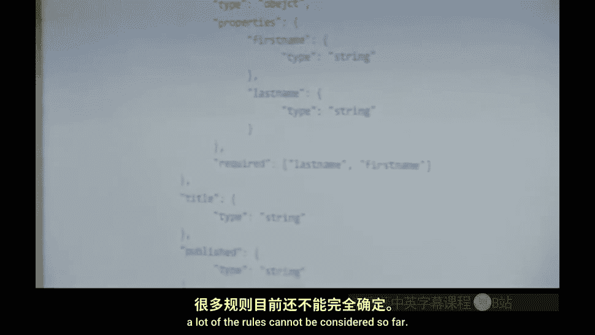
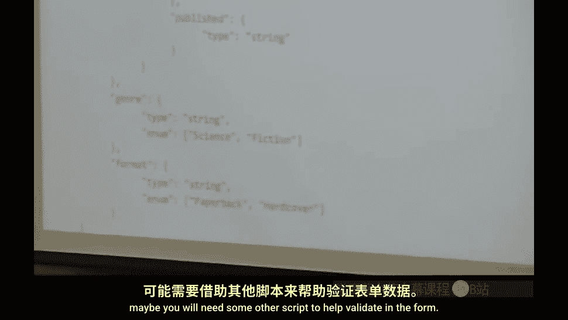
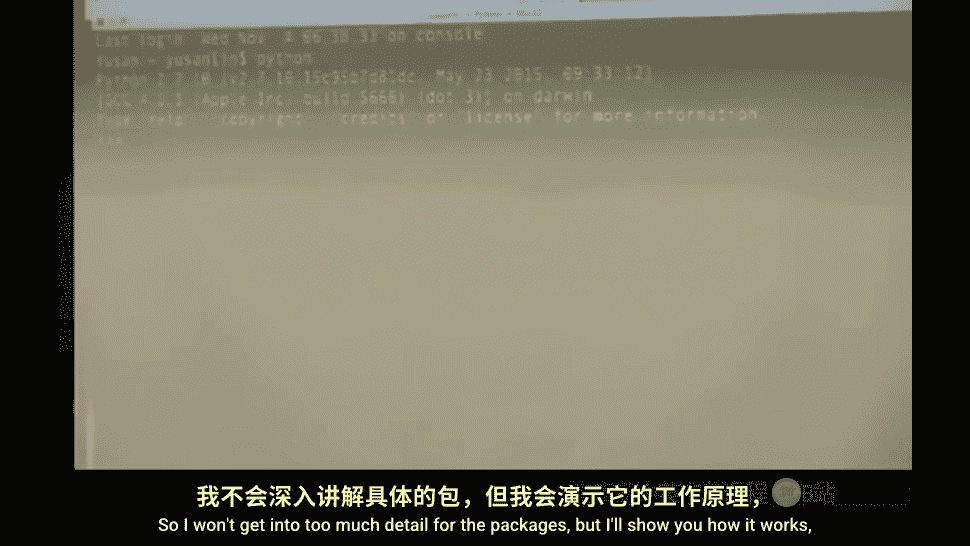
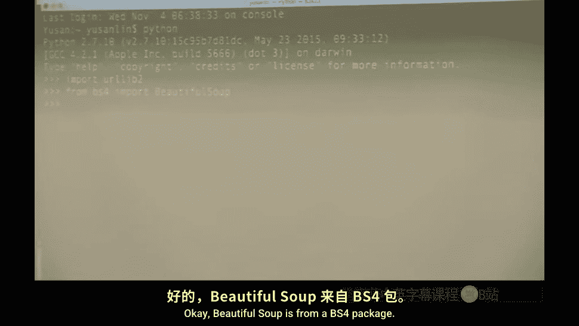
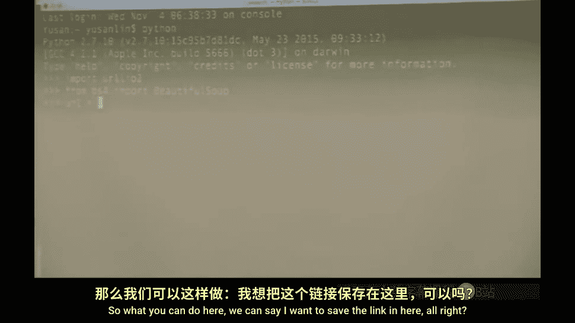

# 宾夕法尼亚州立大学【中英⚡数据库管理系统｜CMPSC431 Fall 2015, Database Management Systems】 p28 P29 互联网应用 - 第2部分 -BV1N76CBwEXb_p28-

う？So today we will continue Cha seven on the internet applications。Before we get started。

 I just want to check。How's homework doing？Have we got started？Who has started？

Is it going well or did you？Okay， thats， so don't forget on Friday you'll be turning it in Friday。

Okay。してる。All right， so you can still away on it all over the weekend Okay。

 I always like so nervous bit about it。Thank you。So just make sure。

If you have any questions try to visit the office hours so just in case we can。Rely us。Possible。

 okay， so yeah， you can board me in here。 usually I think Monday coming my class。

They Monday they find you before， actually it's supposed to be by class。Yeah。

 but sometimes we put a printer some issue， okay， so you're supposed to be back。Right。Okay。

 so today we'll continue chapter7。In today's lecture。Other than。

Regular materials that you will find your textbook。

 I will also show you how you can switch data from the web。And we can demonstrate on Amazon。

we can try to see how we can collect data our web pages。Okay， so let's get started。

 let's review a tiny bit from last time。So last time remember we were talking about DtD。

 which is the document type definition and if you can recall we use a little bit of regular expression to denote these things so basically。

 for example， for the first one we're basically saying in this DTD definition we're saying for our XML we can have a book list that includes zero or more book element that's what the star sign means and if we're using plus sign it means one or more if we're using question mark right here it means optional or to put it more concise or precisely。

We' talking about zero or1， so that's just regular expression。

And here I put the regular expression list again just so you don't forget。

So normally if we directly use comma， really similar to the criteria we have in No SQL。

 we just imply it's an end， okay， we are ending all of the terms。

 so it means expression one and expression two in expression three， all of them have to be true。

 so in regular expression， if you want to do or， you can directly use this quite into。

Today we'll talk one more in terms of how we can write BTD。So of course， in the exam。

 I won't ask you to write DTT， but I might give you a DTD and give you an example of saying does this follow the DTD？

Right。So for this DTD。Indeed D the definition， you can put different kind of。We' say hashtags。

For example， if we have hashtag PC data， it means we can only put parse characters。

 so instead of having this element including other elements， we can only put strings in this。

For example here， the example would be for the author's last name， you don't want last name。

On last hand， you have all the kinds of hierarchy or nested information。

 So it would basically just be。So here we will say for content types we can have element content or mixed content okay so when we talk about element content。

 it just basically like what you can think of the XML， you keep nesting the structure of the data。

 so for example， right here。We have。Book list， right， and inside book list， we have book In book。

 we have author， Okay， an author and title are on the same level of the hiarch。

 So it's achieved by Indonesia。So the most I think most important concept in DTD when you can show the hierarchy is the fact that it can contain elements instead of。

Just strings， Okay， if they only can contain strings or integer， then。

It're still being kind of like atomic， so that's what we learned from the relationship model。ButDTD。

Can power。そうです。So here are a few more that we haven't learned full， for example。

 if you use hashtag required and means this field is required， you have to provide it。

And if you use this with a parenthesis inside this or。

 it's kind of like enumerating the possibilities of choices that you can put。

And if following the choices， you put a value， what do you think will mean？Like for example。

 for the book format， we say we can put either a paperback or a hot cover and then right after the choices we put the paperback。

Yeah。Yeah， if you don't provide any， then you have。So right here， I think this is a realistic simple。

Concept to learn， so right here， for example， I'll write down an example and just tell me whether it's valid following this whole DTT rule。

Let's say。So what you you spot any mistake， then just tell。Okay。

 so today I have an X which's supposed to be following the whole BTD rule。

Can you spot any mistake out of it or you think it's all correct？Yeah。とかし。Yeah。

 last name is required， Okay， so right here we only have first name。So you're supposed to have blast。

Okay。What else。John Rise required。So here we have like， I forgot to talk about this。

 but this it means the attribute of the book element。 So here we have genre that's required。

 So in order to fix it， you can say in the book。I just say it's。でちゃ？Okay， remember， recall。

 this is the way to put action。What else。我走可边。Yeah， I think then that's it。

 so we're not missing anything else。So what if today？We only have book lists， start T of book lists。

 and end type of booklets。Do you think that will be valid？

Nothing inside this start pack of book list。😔，And was naughty， the read， so it will be valid， right。

 the reasonm being right there for the element of the book。We use star in a regular expression。

 so it means zero or more， so you can have an empty blue。According to this D TD。So simple as that。

If this appears in the exam， something like this will， okay that's the only way I'll tell。

 so I won't ask you to write down the whole DTT instead。XML and match the T。To see whether it's。

And I won't test on two tricky regular expression。Just a simple。All right。

 so remember last time we talk about when we think about XML。

 we can think of very similarly right now we have JSON format and one of the reasons I said。

 JSON format has largely replaced XML right now and one of the reason is because according to JSON format。

 it has a lot more benefit over XML in terms of either the compression rate when you compress the file or for the par to parse the format okay parsing JSON is a lot more efficient or when。

What else， I think querying a lot of different information from Jason。And experimentally。

 it takes less time。So now we also have Json and JSson also carries the same characteristic。

XML in the sense that we can help you to make the data hierarchy。Okay。So if that's the case。

Maybe Jason will have such thing。To us XML has BTD as well。Even though whenever we talk about NoSQL。

 we kind of say it's schema S or No schema we don't care about schema。

 but maybe in real life well whenever we use JSON it's still important for us to validate whether the JSON information you put in is correct according to different kind of application so nowadays JSON actually has their own way of validating the data just like XML has DTD。

 JSON has JSON schema， but it's still a very not mature schema， it's still in draft right now。Okay。

 so we say。JSO Schema is a standard currently in draft。

 which provides coherent schema by which to validate a JSO item against。

 so it's the same thing as XM having PC。You have something to check on。

So I won't really go through details of it， but I will show you an example on our slide I think it looks super tiny。

😔，It would just be something like this。It looks small。

 it's because Jason needs more lines for the curly races， but the idea is the same。

 so we started out having an object and the object is the book list and the book list we can have properties。

 which is the book is one of the properties and we keep nesting the information of it。Okay。

 so it's really similar， but because it's still in draft a lot of the rules cannot be considered so far。

 so whenever you use JSON schema maybe you will need some other script to help valid in the form。

 for example， on your website when you're entering a product。

Okay， maybe you will need some other external script， external functions to help valid it。

 but so far Jason can also do that。And I won't get too much into here。

I have references at the very end of the slide you can go on to look at it as well。

 there are two blog posts that can give really detailed information of this so because it's still in draft I feel like I should really talk about this is the way it is but if you want to use it in your project。

支械。So that's all we will talk about for the web data format。😔，So we talked about HTML。

 which is the most simple one， only takes care of how things will look like。

 how things will be rendered on the webpage， and then we move on and talk about X。

 which takes care of bridging just HTML， just showing the format on the screen and also thisEma in relationship。

And then moving on from XML， we then talk about JSON， even though it's not mentioned in the textbook。

 but because nowadays that's what a lot of industry a lot of companies are using。

 so we talk about JSON。And just to remember， Jason has actually a very similar idea as XML。

 just the way they present things different and that helps a lot of。

Benefit in terms of less data being stored or a higher。M efficient。

So that's all web data format then the next thing I want to talk about today will be scraping data from the web。

 Okay I think some of the teams have already scraped data。

From the web in order to populate their database。Which team。You guys。Partially。

 so what tool did you guys use to collect the data？Have呢个。对嗯。Okay， cool， so for scraping data。

 you can think of it as writing a program that will automatically collect data for you in the sense that you have a program。

 keep browsing whatever web pages you tell it to browse and it will take the data down for you but you can only get the one you can see on the webp page so you can't get things from the back so whatever that's in the source code of the whatever that's in。

What maybe HTML code， XM code over the web page then you can get it okay。

 the things other than that you can't do it or tried it before or didn't work for example。

 I was trying to say maybe I can connect to their database okay it wasn't impossible so you can get whatever you can see that's for web scraping。

So web scraping in general， people likes to script texts。

 but also you can still script images if you want， because in the source code。

 you can find the images。Link， so that's one way you can download it as well。

So data scraping is often used when the API of the desired dataset is not provided， for example。

 Twitter， a lot of researchers like to use Twitter and Twitter actually provides really nice API even though as I said。

 but a few lectures before they only provide you with 1% of the data they are just hiding over 99% back。

 they only give you1%， but still using their APIs better then compared to if you want to scrape Twitter。

 imagine if you want to write a program to get information from Twitter it will be kind of bizarre。

Because of the data amount。But today say we have a website that's relatively manageable and you want to collect data from there and scraping data is a good choice。

Okay so I think this will be useful in a sense that maybe you want to collect more product data for your project instead of keep entering them manually。

 continue this process， maybe you can try to see how you can automate the whole thing。

So I think there's a lot of different kind of tools for scraping。

 but I'm personally only familiar with everything that's related to Python。

 so I will show you in Python Hollywood。And it's very simple。

 it doesn't really require you to understand Python because the syntax is so simple。

Some of the tools that people normally use the most famous one is actually called Scpy。

Because when I first learned it， I was using windows and you guys know how things are likely we want to install some packages there。

 So I gave up then I moved on to the second package called a beautifulut soup Okay the name I think is really cute。

 but I don't know why I tried to look why they call it beautiful soup， couldn't really figure it out。

Yeah， that's their their look。 I guess it's Alice in the Wonderland or something。

 They just don't have their own logo。 They have this big picture on their web page。

 Okay and other than that， they have no formatting or any design whatsoever。

 But it's such a powerful tool。 I think in terms of the soup part， I still don't get it。

 you will keep constructing soup object when you're using beautiful soup。 So it's like yeah。

 you just keep constructing soup。 But the beautiful part is because theyre being sarcastic about a lot of the code when you really look into the source code of a lot of web pages。

 they call it ugly So they help you to beautify it。 Okay so that's what a beautiful soup does。

 And there are also other software where you can find online。😊，But I don't really recommend them。

 so some of them will be you enter a link onto a web page and it helps you to collect whatever you want。

 but I just feel like you have less flexibility out of that way because it determines what targets you want。

 I still think， in my personal opinion， writing code from scratch。Okay。

 so what we can demonstrate on is we can try on animals。诶。

So is there any particular thing you guys walk to？Great。

I last week was Halloween right and I was normally for my recommendation it will only show me these kind of books or bags or whatever cosmetics and last time it shows like Halloween stuff and I saw like a can of like a rose。

 something I was like what is this and I clicked in， it's a brand called Rose but it's poor brain"。

I was likeWhy would anyone want to eat that but I was just so tempted to read through it and I regret of why it just keep huming me in like had people talking about。

off the topic， what do you go？Oh yeah， and it keeps showing off because of the cookies。

 it remembers it so then the next I open and I want to buy someone something else because you use this as more poor product。

So don't click things that you think you'll be afraid of。A。Think。爱你爱 mean。Yeah。えそがいっぱいする。

Thanksgiving stuff。Thanksgiving decoration。Okay。You have a turkey？Let's start from here。

So say our first goal is to get all of the product name。Okay。

 so I'm not sure how many of you have tried this before， but in different in most of the browser。

 I think now you can inspect element， so for example， if I just right click。

On the Turkey product name， and you click In elementement。It will pop out。Like the source code。

Of the the whole web page。 and mostly it looks really tiny here。

 but it will target on the part that you clicked。 So right here。

I'm not sure whether I can zoom in but。Oh， I can。Okay。

 so right here your target on the product name we click earlier。

 so if you can see it is called the tissueue Turkey Center Pe Party accessory right here。

Okay so that's the part we want。These texts， okay， we don't really care about the class of the heading tube。

 but this is how we can fit。So automatically as you can think Amazon。

 they won't have someone to write all of the product on the web page and then encode it。

 so they will automatically generate it in a sense that you can just rely on the fact that all of the product names will be in heading to with this class okay that's our assumption to start with。

So what you can do。Let's say you have Python？

So。I won't get into too much detail for the package， but I'll show you how to。

So if you're using Python。And you will need to include two packages， the first one is URL Li two。

 its just basically helping you to read the w that's all nothing fancy in the second one。

Is beautiful soup。OkayBeauti suit is from a beautiful package。

All right， so let's start from reading。So the first thing you will want to do is。

To read this web page， okay， through the link。we can do here， we can say， I want to save。

The link in here。here's another example so as you can see here we have like a really long URL and including the query which just searched right really remember last time we said HTTP itself。

 the protocol is stateless so it doesn't remember anything you have done the previous steps and one of the ways to do it is cookie and another way is using URL remember that we can extend URL in a way that remembers the steps so not sure about Amazonita but maybe later on if we starting from here we query other stuff you will keep concatenating the query you have searched before so it remembers your path。

Okay so that is one example， right？So here we store the URLs and we can say。No， we can't beat it。哎。

Some pleasant music there。So we can open the URL。So then now the response object was stored。

 so it already visited the webage and get the information。😔，If you guys want。

 I can post this script so okay。All right， then。Right now we have a response object。

 but it hasn't give us the HTML code so we can store it a string。😔，by doing this。

 HTML equal to respond。Okay， so it just basically it reads all of the SML called a string in response。

 and then we store it in the SL battery book。If you're not familiar with Python。

 you can see so far we didn't try to declare anything okay so for using variables in Python you just directly use it and you don't even tell the data type it's really fast。

 okay， they would just automatically assign data types to the value。Okay， so now we have HTMLML。

 let's take a snippet of the HTMLML to see whether it works， so we can try to see the first。

 maybe 100 characters in you can see。You' started out that looks somehow like a shal cook already。

So what we want to do next is。The core of beautiful soup， so it's we want to make a soup object。

So what we mean by the soup object is that。I'll just call it soup and you can make the beautiful soup out of it。

The all the beautiful soup ingredients are the HTML。So now the soup itself。

 it has already helped you to organize the HTMLML code in the sense that you can trace the soup just based on maybe the class and the tag that we saw。

So let's go back to the source code。So right here， this is the one we want。Where is it。

Wwa's Turkey name。So this is the w。So I'll show you how you can do。To collect all of things。

So the way to do it now we have the soup object， right？

So the way to do it is we want to find stuff from the soup。

They say we you find and because earlier we saw it's a heading two。

 so you say but I want to find the H2， okay， where the H2 has such attributes。Of， for example。

We saw the attribute class has the value like this， right？That's what we directly copy from。

The class will be described in this way， so you don't really have to worry why they describe it this way it looks really messy。

 but just when they are designing it， have you guys heard CSS before？😔，Yes the style sheet right。

 so this is just how they tell for the style sheet， how it will be rendered， okay， different kind of。

So I just say for in the soup， I want to find the heading two if you remember H1 is like heading1 h doing heading。

So I want to find the heading two， which has the attribute of class in equal to this value。

And you can see here we will use just key value pairs to visit the attributes and if you have more criteria you want。

 you can just keep continuing with comma and the more key value。All right， so you do hit enter。

 Oh my god。哦。So if you hit110 code， you can see now you finds the first one。

 which is S2 with the class and。With that turkey information， the product。Okay so you you say。

 I don't like the fact that it gives me so much information， like outside right here。

 I only want the name of the product。Then we can do get text。Then it gives it just a name right here。

Starting from here， that's just the name。Impressive right。

 and this starts with a year that's because of the un problem you guys don't have to worry about。

It just all starts with you。So here you can see we only have just one product。

 what if we want all of them， so really simply you can just do。What you can do is， for example。

 you can say I was。Store all the product names。By doing fine all。So if you only do fine。

 it will only give you the first one， but if you do find O， it will give you。

All of the names that sat。So now we can see， for example， the product names。😔。

The first one is the turkey no， don' keep the text。The second one。

It's happyappy Thanksgiving streamer party accessory。And then they third one。

You don longer it's just leaves all right so then， for example we can see how many product we have collected and out of that page we have 15 of them。

So。Now you see how you can collect for example the name and then the price you can just。

By identifying what are the tag， what are the class for the price。

 then match two of these arrays together and you get the names。

So how about iterating through different pages because now we only get the first page？😔。

So the way to do it is to make the approach more generalized， whenever you find these things。

 you can try to see whether on the link， you would see any page information。If it doesn't。

You can click on the second page。If you click on the second page， sometimes then it will show。

Right here。You can see reference SRP2， means it's the second。So let's just assume it wasn't。Okay。

And it will show you more。O。So that's a super rough in production for how you can do scraping Okay I don't want to put too much detail in it because I don't think everyone will need it。

 but I think it will definitely come in handy doesn't matter for the project or in the future so when I go back I will pick the exact same code where you guys on Angel you can try to play around with。

Right。Okay， so。Rough discussion on beautiful food。Then let's take a look。

The later materials in this chapter。Which is less exciting。Important， in some sense。

So now we want to talk about。A little bit of how the internet application。Have。Hevo in some sense。

Okay， so started out， I think internet hasn't been around that long。

 but in the past the application was very different， who's familiar with HP。Some people， yeah。

 like I think like file transfer right you can sometimes。诶。Not properly。

 but you can download some stuff and that's through another peer in the P2B software I these kind of things。

 but now it's kind of gone but it was a big thing before and even earlier。

Maybe when internet first started， there was no such thing and the application is a lot more simple。

😔，back then。So right now we want to talk about this internet application of internet systems that we call it data in。

 okay， so everything is based on data。Then generally for these data intensive system。

 they can be divided into three components。Which are the data management。

 application logic and presentation， which we will talk about separately。

So the system architecture determines whether these three components reside on the single system。

 which we call as one tier or are distributed across several tiers。

So as you can imagine from the very beginning of these data intensive system。

 it all started out as single mission， and nowadays it will be more distributed。So the first version。

We started out by single tier， and then we would move on to two tiers and then three tiers。

For single in two tiers， we can think of them as the predecessor。3。So this first one， single tier。

The architecture looks like that on the right hand side， so as you can imagine。

What would this thing be？Yeah， that's the day evening。你。So that's the DBMS right there。Okay。

 so sitting on top of the database。We will have the application logic。

So basically you might have some functions reacting to help you access the database or provide you back with different kinds of results。

And sitting on top of the application logic。We will have the client。Okay。Then。

The thing that wrapping all of them together， including the client， the application logicing。

 and the big database。Is。A mainframe。So the main print。这道。So as you can see。

 this thing we can call it just one tier， is it just a single tier。

 so all of the functionality are combined into a single tier usually on a mainframe， okay。

 so that's the outer part and user access。Through the whole system， through the dump terminal。

So you can think of down terminals as just。Super boring interface， okay。

 the black black background one， and you can only do some really simple input。this point。

So that's back then back in the time when the whole data intensive system first started。

 so they weren't really providing any graphical interface， it just the thumb terminals。

Not the one that cashierers used though I think those are not bad document。

 so back in thumb terminals are the really simple。So the advantage of this is easy maintenance and administration because we're not distributing anything out。

 okay， everything is so subcontained it's just within this single machine。

 but the disadvantage of it。It's just later on people are expecting more of a graphical interface and also。

If today you need to work on different kind of machines， they need to be worked together。

 then the centralized computation of all of them is too much for a central system。

 so it's also hard for them to communicate because you have everything just wrapping together。😔。

So then we move on to two tier， so this is single tier from the very beginning， so for two tier。

We started out like this。对。So as you can see， were already have database management system。

Separate from the client side。 Okay， so the D BMS is still with application logic。

 And through the network， we can connect to the client site， a multiple clients。And for this kind。

 as you can see for the client side， we don't have anything else， it's just the client itself。

 so for this kind of two tier okay for two tier we also call it client server architecture for this kind of two tier architecture。

 we also call it thin client。Because the client doesn't parry anything else， so the client。

 the only thing they do is implement the graphical user interface， okay just the interface。

 nothing else， all of the logic sits on top of this。So we call it the thin coin。

And for this kind of architecture。Sober implement the business logic and data management。

So business logic race is basically the application logic。And as you can see。

We can think of here the website as the server computer and the right side as the client computer。

 and they interact with each other through the network。

 or we can think of it as like a protocol for them to communicate。哎。

So this is the first version of the two tier。 Then we have the second version。

Of the so some people might think I want the client's side to be more powerful so instead of having the application logic only sitting in a proper care。

 I just give every single client the application logic， so everyone carries me。So as you can imagine。

 the previous one is called a twin client， so what do you think this one will be called？T by。

I think it's kind of lean for。😊，So here we say。The client implements both the graphical user interface and the business logic。

 and the server now only takes care of data based management system。

So some of the disadvantages of this will be like no central place to update the business logic because now everyone has a copy of it。

 so when you want to update it， it's a lot harder。And then secondly can security issue。

 server needs to trust the client one example will be， for example， to serverize the bank。

And all of the clients are is ATM。 Okay， so the server needs to trust in a sense that the bank has to trust all of the ATM machines will operate in the same way。

 operate correctly。 Otherwise， maybe some machines went， whatever you input。

 it gives you like 100 times back then。The bank will be in trouble， okay？

So there are some problemss and con of it and also because the client is so heavy。

A lot of time was hard。Because you have to rely on the fact that everyone will get a copy of the application log。

😔，So that's for。食。And so now second tier， also compared to the single tier。

 it has more than just dotri it because we have the graphical edge。And。

Another thing to talk about for the security issue in a sense that we the server has to trust the clients。

嗯。Okay， so here we said you will be a problem because the application logic are set separately on each client right。

 So can you think of maybe there will be one solution that would make this not so big deal maybe。

In what way the database。Can take care of more functions。

 so everyone just directly use the function database provide。Then there'll be less problem。

What I'm trying to say is for the database， they can use store procedure。

 the thing we learned before， if they use store procedures。

 then there will be less variety of how things will be implemented Okay so that's why。

A benefit of having stored procedure in this sense。Okay， now moving on。

 people think second tier us two tier is still not enough， not ideal enough。

 so then we move on to half a three tier architecture。So compared to the two tier architecture。

 the three tier separates a bit further and now we have。对起。So the first tier is the presentation ti。

 you can think of your project going this way。Is the presentation ti which takes care of the interface to the user and also nowadays compared to the past。

 nowadays they will also focus on adapting to different devices。So some of you for the project。

 you might be later on allow the fact that when I use my phone。

 I can also see your product and then it will be rendered differently okay framework it will look differently。

So maybe on the left does looks one way， on halfway way。

 it looks one way and on the phone it looks another way， maybe you want to do it on the watch。

 it another way， okay， so it has different kind of interfaces。

 but same thing representing the same thing。In front of the second tier， we call the middle tier。

And now for the middle tier， it implements the business logic and also implements the complex actions maintain the states。

嗯。Which I'll talk about later。And also the middle tag can access different data measures。Right。

Then finally the last ti will be the data management here。

 as you can see this is where the database sits Okay so everything we have learned before in terms of how the relational data model was designed and how the SQL was done。

 everything of that is in database management2。So for the next slide。

 I'll just quickly show you some of the technologies that are being used in terms of these three tiers。

 but some of them are pretty outdated， but just keep your descends。

Of which technology relates to which？So just remember， we have presentations here， Moodles tier。

 and data management。So in this slide。Again， presentation， middle data management。

For the presentation part we can either use JavaScript or we can have cookies， okay。

 so you can think of that mapping into the web。And for the middle tier we have application logics。

 and here some of the tools we will use， maybe JSP， by Surlet。Or XS LT。

And if you recall from last time， okay， the way that you can communicate these two cus。

Is actually through STCP。Okay， so that's the communication protocol that we will be using。

 So through HTTP， we can communicate with application logic in the browser。

 And if you recall last time we saw the browser is the client。Okay。Yeah。

So communicating between the middle tier。In the database management system。自め。

Will be the JDBC andequ J we have learned。And you will remember。

 so here maybe we can have things written in Java， then we will want to use JTP。Question。

Which part do you need。哦，O。All right。So。Previously， we have introduced a single tier and two tier。

 and then I'll show you how the three tier will look。

Okay so three tier basically you just separate them all。

 and between them we all have their own protocol of communicating。So as you can see。

 this will be the data management tier and this will be the middle tier。

 takes care of the application logic， and this will be the presentation ti。And inside the network。

HGTP is a communication protocol， we can use JTPC different stuff。Then later on。

 we will talk about each tier separately， but we won't talk about the database management tier because that's what you're already doing。

As the DBM is part。So for the presentation here。It provides forms through which users can issue requests and display responses that a middle tier generates。

So one example， for example， you can use HTML to render thing， okay， that's one approach。

And code should be easy to adapt to different display devices and formats， so as I said before。

 maybe on laptop is one way， tableablet is one way， and then on your phone or here watch。

So all these things， one of the most popular way of taking care of rendering differently on different devices is。

Using style sheet。谢算。Taboo has developed web pages that will look differently on different devices。

You haveSo did you do it with CSS？Yeah， so you can see us as you can。

 I think one of the ways is maybe when the resolution is between a range。

 then you assign different kind of design。So these things can be done in CSS。

 we will go through a quick view of CSS next time to show you what they need。

 but I think most of you。はい。takes care of the design。So in some sense。

 before we move on to the middle ti， you can think of middle tier later。

The tear that takes care of what to this way， Okay， the what。

And the presentation here of how to display it。 So for CSS。

 it doesn't really care about what the contents are， what text you want to render。

 it cares about how things will look。So middle tier is what data。

 then presentation tier is how it looks like。Before the middle tier。

Mal tier it controls what data needs to be input and then controls the flow between multi action steps in a sense that。

Here the multi action means， for example， we go to Amazon and we first put things into。

The shopping cart and then remembers it And I you。Decide that you keep browsing and it's still there and then later on you go to check out and then you check out it has to remember what you have stored in the shopping cart before and after you check out you pay and then it has to remember the fact that you have paid and after you pay it has to clear out the shopping cart。

 all these steps so these are what the middleter is taking care of so as you can imagine the presentation care does not care。

It doesn't care about what you have put in a shopping car and just takes care of rendering it。

Other than that， middle tier also takes care of controlling access to the database layer。

So as you can see between middle tier and database tier earlier， we have JDBC。

 so that's how we can access the database。And sometimes middle tier will help you assemble dynamically generated HTML pages from database prior results。

 so sometimes instead of。No， so this part， for example， you return different stuff from the database。

And then you want to render different things。So pin tier is the part that helps you to generate the HTML code and then go up and send to the presentation layer。

 saying these are the things I want to display and maybe based on this HTML code。

 the presentation layer will then tweak it based on the CSS and then render it different。

So just a few more things to go through to give you a better sense of how these can map to some real light example。

 for example。For airline reservation okay for the database system tier。

All we care about all it takes care of is the airline information and the availability seat or customer information。

And in terms of the application server， it takes care of the logic to make reservation。

 to clean the reservation or today there's a new airline open。Application server takes care of it。

 and for the client program， it displays the forms and humor readable output and field validity。

Okay so you can see that's how they separate the task。

 the application server will not try to display any kind of forms for the client program。

 which is the presentation tier， or the database system will not try to implement functions unless you store procedure。

Another example will be， example。Course enrollment。Okay。

Then when enrolling the courses for the database system， which is the database management tier。

 you might have the student information， course information， instruction， things like that。

 in the application part， it would take care of the logic to add a course， drop a course。

 create a course。And the presentations here， display the form a human readable output。

And also field validity check。So after here I actually have slides for just talking about the advantages of the three tier architecture。

 and I think I won't really talk about it because it just read the in and you get it。

I that's it for today and on Friday I will finish。Cappter 7， which only have a few bits left。

Your Friday might be a short lecture and not show。And just remind you again about what's going to happen for next week。

Monday， okay， here I see， Monday almost4， so it's not Friday。

One day homework for you and we will have review session for the midterm two。And Tuesday。

 midterm to Part one， supposedupp not be program。E yeah。

 I'm not sure what our test on no equal is very。Technically hard。

 so maybe you guys can relax about it。So SQL was short， Okay。

 I won't like to test you on no SQL and not testing on SQL。

Because you guys have done it on the homework of the undertal SequL and Wednesday no class。

 next Wednesday and next Friday。Ma turn to party。s the writing。这包。快。What。

