# 宾夕法尼亚州立大学【中英⚡数据库管理系统｜CMPSC431 Fall 2015, Database Management Systems】 p29 P30 互联网应用 - 第3部分 -BV1N76CBwEXb_p29-

Good morning， guys。So today we will have the final lecture for midimm two。And before we get started。

 I just have a couple of announcements。So if you guys know。

 next week is the midterm two week and we have actually two parts for the midterm two。

 initially I was going to have the part one which is the programming。

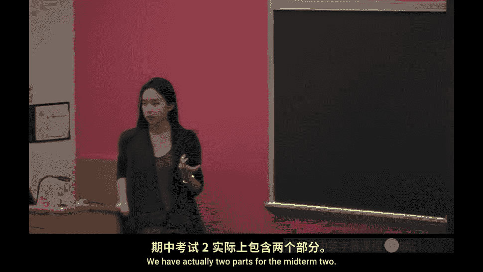

All done together of all of you， but because of the capacity of the computer rooms。

 we have to break it down to two groups。So initially I was thinking it will be awesome if we can have time just the same time。

 632。Almost eight， but because at the time。The computer room has a class so we can do before them and ask for them。

So I think some of you have sent me email about the conflict exam before now maybe this will have no conflict then so there are two times you guys can sign up based on your availability I will show you later at the form you can send to me so I can arrange who is gonna take which time so we have two groups the first group will be 5 to 6 pm and the second group will be late 8 to 9 pm Okay so you guys can decide whatever time that works for you overall I think the test will only take you like 15 minutes so we won't take up the whole an hour。

And that would be in 218， so that's the Linux computer room。

Okay so that we can do it there and for those of you。I think the outside students like Jason。

 you don't have。CC account， but the day me and TA can log in for you so you can just work on our account same thing okay and the good thing of using the Linux room is we don't have to do the VPN all over again you just get on the machine logging yourself and then you're ready to go。

That's for that。嗯。As we talk about bullet part two will be Friday。

So just remember Monday we'll be in the homework and review session and Tuesday evening will be the class and I show you this form to sign up later so you can pick the time if both works for you it tell me both look。

And Wednesday know class Friday they part two for the writing in class。嗯。So。Good talk。結こ？Angel。

 I will send out an email later after class again as well。

 So on Angel under the example there we have this。One time sign up。If you go in。

 you speak you have this Google's moment， just tell me。バつという。Just check it and then I'll arrange it。

And I was in as soon as possible。 Okay， so maybe it'll be nice if you guys can do today。

We can know it earlier。The next thing will be， so I put up this grips for。Scraping data。

 maybe you guys won't be interested at this point because。For the project。

 but you guys can take a look， put it in a lab， so it'll be simple code for escaping data from the web。

 exact same example we worked on for ecaping the Thanksgiving decoration stuff。

And then quite a few of you have talked to me about homework4。 So you， if you have started。

 you will notice that a lot of the questions in question 4， a lot of the。

I said requirements that I gave you actually would give you no result。😔。

So there are actually no restaurant that fit such requirements， so then you can have unfortunately。

 there's no restaurant， but the reason of that was because actually at the very beginning I had a bigger data set and I import it to my own database。

And for some reason， the data I gave you guys got truncated a little bit。

 so a lot of the Pittsburgh part got missing， but that's all right。

 you can just as long as your query is correct。Okay， then you got two points。

So I think some of them will have。We'll have to answer some of them。

I think a lot of them actually don't because。I chose a lot of them from Pittstburgh。And one of them。

 some people have。Some doubt。I think that's one of them in Pittsburgh。Okay。

 the shady side of Pittsburgh。You don't know shady size of neighborhood in Pittsburgh。

 so when you work on the question， you can just find one of the attributes city being Pittsburgh。

And then they book with these Shades。延期之中你话。Okay。So today we will finish up chapter7 and we'll be more of a back so we will just kind of work on different things like we can write which they all together and then we will import some JavaScript and we will try out different CSS okay so it's very simple I think a lot of you guys already have the knowledge of it but just in case you haven't started that for your project okay and that's kind of the。

The main topics for the rest of chapter。And also， before we finish the lecture for today。

 I have a quiz for you okay？对。Six okay quiz6 and it will be on DTD so if you remember the document tag definition that we talked about last time for XML。

 so it's really simple， really similar example so you can just I'll give you a DTD and then you just check with the example given。

Is following the That's all。BTD standss for document type definitions are do。That's that。All right。

 I think I。Announce everything I should。And now I'll quickly go through them again before。

So let's get started for today's。All right， so today we are。Lecture 13。So last time。

 if you remember at the end of the lecture we talked about in the end right now the database internet applications mostly sleep would be in three tier and for the three tier we have presentations here the middle tier and database management tier so as we talked about last time actually the very bottom database management ti is all we have learned about Z far。

until。Chapter5 for SQL queries， so today we will just kind of brush through presentations here in middle tier okay mostly put on presentation here。

 the reason being it's interesting to find that actually the technology and presentations here have moved up so slowly。

 however in the middle tier have changed so drastically。Throughout the past decade。

 so I think we'll mostly focus on presentation here because the things are just more stable at the moment for middleTer I'll show you later if you look at the textbook because it's published 2002。

 as you can imagine， 13 years ago， what they were using for the middle ti is actually totally different right now if you have heard of CGI。

No one is really using it right now， okay that's what I use when it was like primary school。

Really long time ago， when people use like guestbook。Discussion forum， all those。

So we will put more focus on presentation here and it will be really easy today。

 which just work on some really simple t examples。So a bit of overview of the presentation here。

 so we say the presentation here has the following functionalities， first of all。

 it the primary interface to the user so all the web design happens here。

And it adapt different display devices， like we said last time， for example， for the same website。

 it might be able to adapt to PC， to your tablet， and to your phone or to your watch。

So mostly the functionalities happen on presentations here is not that sophisticated。

 not that complicated。But things happen there might be just some field checking， for example。

 you fill out a form on the web page and you will check whether the information you put in is correct。

Other than that， not much is solely handled by presentations。Other than how it looks in。

So a couple of technologies that are being used for presentations。For example。

 if you want to pass data to the middle team。From the front end。

 you want to use it to input something。pass to the middle tier， then we use HTML forms。

 just simple forms， then user can type in the information， and then that would be passed。For example。

 login form， registration form， or maybe in your project you have an administrator that is being able to enter a new product。

 all these are just done by simple forms and I think a lot of you have already done that。

And the second one， I'll just think the functionality at the presentation here in a sense that。

It's a Java based scripting language that can。For lightweight computation in the client here。

So as you can imagine， if the job was based。えじゃまし。Okay just JavaScriptscript， that we will try today。

 we'll have some kind of funny example， but you can see what JavaScript can do。

The last technology that we will cover today。Very simple， CSS is one of them。

 so it takes care of how things look like， for example， formating the coloring。

How things are being located， being positioned on the web page， so it's just style sheets。

So style sheet， I think the dominant one will be CSF， if you remember it's cascading。Cascading what。

 cascading something heat。嗯。我的。あせて。It has hasn happy。What have the page。Oh。

 it's just cascading style sheet yeah。I was thinking CC I have for your first。Cascading spell。

So that's for the dominant way of displaying different formats。We actually have all technology。

I looked it up because I feel like it's very unfamiliar and I looked it up。

 so even though the textbook also managed。It's not really being used right now。

 Okay so at the beginning people have access out but not。So let's talk through each of them。三百我。

The first one is HTM of forms， so we will also I'll do some coding on right here today。

 but you don't have to write down anything， I just want you to kind of see how things change so you won't be testing on that just get a sense of how things are happening。

So for HTML forms， is the common way of passing data from the client to the middle team。

So when you think of HTML form even though you would think of it from the user input all the way to the back end。

 but actually it doesn't get right to the database okay so we have the three tier。

 it gets to middle tier， so how the middle tier wants to access the database is taken care by the middle tier。

 so the form is only doing from the client to the middle tier。

So I think quite a few things have already done。The functionality where users can input stuff。

But a lot of team haven't as well， so I would just show you how you can do super simple forms。

In team。So here we have this。Forミula kind of。puttingtting form in HTML so you always start from a form tag and you will put in some attribute and finish the form and inside you will put in whatever fields you want the user to put in and here in the form we have different variables。

 for example， the first is action you can say for this form I want which JavaScriptscript file to take care of it okay so that's a JSP file and then for method as we said few lectures ago if it's get it's more like a login form and if it's a post method it's like the user put in something and it was sent to the owner's email okay so that's post a bit different and you can also name the form that's just for identifying。

So if before we get our hands on just creating a super simple form。

 let's see what are the options we can have。What creating。For example， here we have input。

 input is the most simple but just a text view， okay， this long rectangular one。嗯。And also。

 I think input， if you try to use different types， you can also change it to radio button， Okay。

 different kind of things。 And we also have select that will be the drop down list and text area are just kind of like if you have any comments。

 that's like the bigger。Bigger text box， and you can specify how big you want it to be。All right。

 let me see。Okay， let's just try it out so you can see something。

So I think last time I asked a lot of you have already written HTMLL yourself before。

So let's just pretend you've never done it before。Okay。

 so as we talked about last time or last two lectures in HTML， we always start with an HTML tag。

 right？

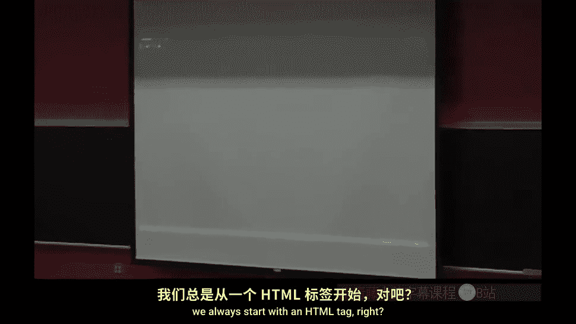

And we also。Finish with another sh tag。You don't have to write on。I'll just show you。

In the HTML we have different parts， the first part is the head part， and then we have the body part。

So。And head has all the information， for example， the title of the page or you can have the last or you can link different hoststalgy or external files。

And we have body， body is the one taking care of what contents be。So far so good。

 so since we want the form to be rendered on the web page。

 actually it will appear in the body section。Okay， so as we said earlier。

The form was stored with a form tag。😔，And finish with another。Let's say we want to give this。

Webage but heading。Then what you can do is actually， if you remember H1 means。Heading one。

 so we can just say today we want to do a registration form， maybe。So far it's super simple， okay。

 we just started out at an HTML file and we save it at the HTML and we say we have head part。

 we have body part and for this heading in the web page， we just call it the registry。

And now because we want to create a form， as we saw earlier。

 we have different attributes that we should put。So for example， we say for the action in this form。

 we just assume later on will have。JSP felt taking care of it。

 but today actually nothing will really happen， but we just say theres this imaginary JavaScript that will take care for taking the information to the middle tier。

But today we won't work on that part。And maybe what we want to do today instead of doing get。

 we want to do post because we are registering a user。So for the method， we do post。

And if we want to give name to this form， we can say， just make an assignment up。So for this。

This form we will create later， we give it a name， whatever you want to name it doesn't really matter。

So let's first say if we want to have the user type in the user name， if we directly put in the text。

 it will just be the point text。In the HTML， And it we say in the。In here we want to have。

For example， those recutangular thin box you see all the time on the。inputプ。That has the text type。

 okay， and they here we just name me whatever like user name。

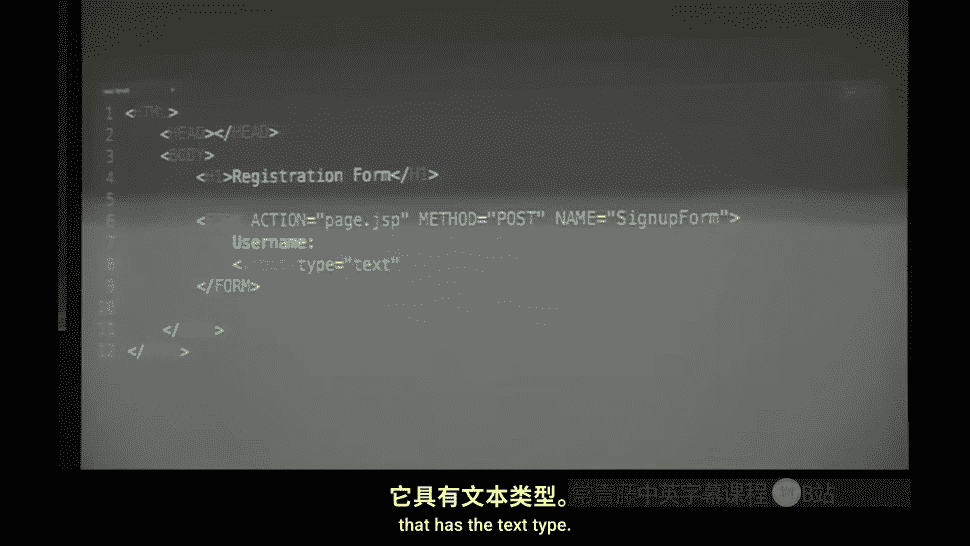

And as you can see in HTML， the form is interesting in the sense that only input doesn't have an anTec。

 so for input it's just a standalone tag。For some reason， they designed that。

And maybe you want the password field。If you don't want it to line up all in the same line。😡。

You can recall N HTML if we do the slash VR tag， that's for new。你解什啊？So for slash VR， that's for。你。

And say now， after that， we want to have a password。

You can also put an input in this time for the type you can actually put password。

 so that's how those text box are being achieved whenever you type in a password it doesn't show the password。

Okay so the name of this bill， you can just name a password。

Okay so now you can imagine now we do this so what you can see later other than the heading one。

 you will see a username in the text box for putting your username in password in a text box for putting password and when you type in。

 the password won't show the password you type it will just be those dots or those dots。

So this is what we can do。Okay， just say let's say this is the most simple form we want to do and if we want to submit the form。

We do another。Input， but we change the type to submit。😔，So I actually instead of being a text field。

 this time will give you like a button。Okay， so this is the。S8。So you can say for the value。

 the value is actually the label that was show on the bottom， so you can say。

 okay or submit or go anything else。And also， we keep this button there。

So now can imagine me other than two fields we have。

So we can go to open it up and see how it looks like。So that's the form which is。All right。

 so pretty simple， we have this heading one。And we also created it。To feel。

And you can try we type in。But so far because we actually are not linked in to any actual action。

 so if you submit anything it's not going to have anything to do， nothing's going to happen。

But that's just how we can achieve to。どっぱい？我的。嗯。You guys want to see a bit more of other kind of input fields or this。

くれな。应该。You guys can try out maybe radio button or any other type。Like drop down， just try out。

And inputプing。我的 phone。So that's where the STM metal part。Allright。

 so let's move on now we want to add a tiny bit of functionality to this form， lets say， for example。

 now even if the user don't type in anything in its submit。

 it will still go through maybe you want to say no at least you have to fill in the user name。

So this can actually be achieved。

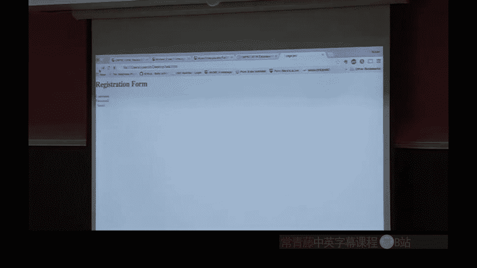

By using。Javascript。So before we get into that， let's quickly talk about what JavaScriptscript is。

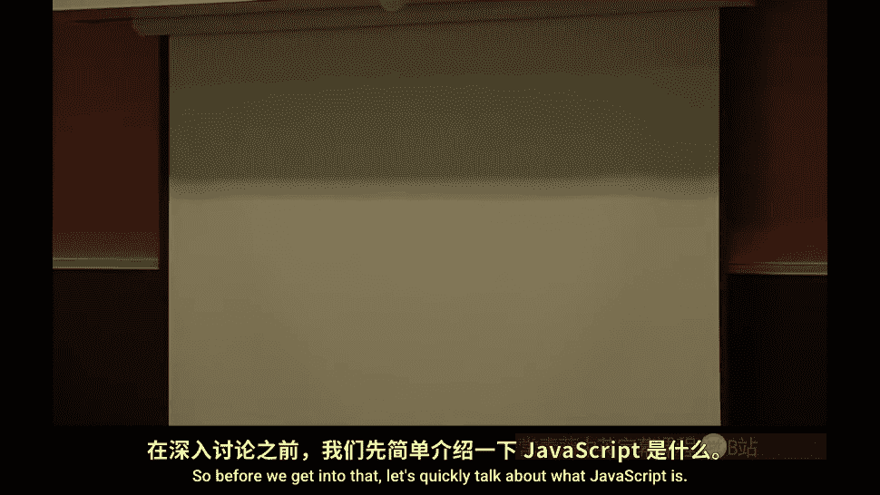

In terms of putting in in H。So the goal of it is to add a bit more functionality to the presentation ti。

 as I said the full presentation ti doesn't do much other than displaying and rendering。

So JavaScript can help you just a little bit more。Some sample applications for JavaScript。

 for example， you can detect the browser， maybe different browser are being compatible with different functionalities and you want to detect it first。

And the second one will be form validation， which we will try later， for example。

 if the user is missing some fill then you should pop out maybe a dialogue saying， hey。

 you should fill it out before you go to the next。Okay and the third one would be browser control。

 for example， you can say you want to open new window。I seen Windows。

 or a lot of times you will have like click to the previous page and then you will go back。

Doesn't matter what you previously。So usually the JavaScript can be embedded directly to the HTML with script tag。

 okay， the star tag and the AnTag， or a lot of times you can just write a completely separate script and then link to it。

Exterally。What we will try， we can just embed it in there。嗯。So if you embedded it in there。

 you can specify what the language is， but if you don't do it by default of JavaScript。

 because that's the common one。Yeah， and also E1， you can also。that's how you can link it outside。

 so if you have an external file， you can link it to the outside。

 if you don't want or if your JavaScript is really short。

 you can just directly input it embedded it in the web page。

so let's see what we can do to directly embed it in。O。

So normally the practice for putting script or personal preference。

 I just put it at the very end of the body session。So as we said earlier。

 you just start a script tag and then finish the script tag。

 and then you put in whatever functionality you want to have。

Inside here so say today we want to have functionality to test whether the user name。It's filled out。

 Okay， if it's not filled out， then we want to remind the user， hey。He was empty。

 just pop out a dialogue and tell the user to。Okay， so。Right here， as you can recall。

 I say JavaScript is a Java based language， so what you will see inside here is just really similar to what you will do for Java。

So we will say we want to declare a function， maybe we just say we want to test whether or name。

Empty。For this one， we don't have to give it any parameter because it's directly linking。记得。

Through the form within the same as Shan Al Cook。Okay。

 so what you can do is you can say I want to check the variable。What is x I want it to directly be？

The username right here。So what you can do is you can say I want to have the X。

 which is within this document。And in the forms， which form it is。Which is in the sign up form。

Right here， I think it's not so intuitive， but that's the way you can trace it to the variable。

And in the scam form， the one I want to check will be the username， okay， so that one。

 all of them are referred by the name which was put earlier。在学ホユ。

And you can say what I'm interested in is the username's value， I don't care about the type。

 I don't care about other stuff。I care about the value， so the value will be what the user typed in。

So what happens after we get the value of the username， you can say so。Today， if the username。

Is empty。Already it's no。Then we want to pop out。Like dialogue saying， please enter。

Or whatever you want。Not out。if you put alert， that would give you a popcor dialogue。

And because this is a wrong situation， you want to return false。And if this doesn't happen。

 then we can just return。アクショ？So that's it for the script part。

 you can see that we just define a function and then we tell the function what it wants to check。

 so the whole thing achieves some kind of field validity check。Okay。So this is really intuitive。

 but now don't forget you'll actually want to link it back to the form。

 otherwise nothing will happen， it will just be a standalone script there and the form will not know it's actually doing something for the form itself。

So what you can do。Is other than these attributes， you can put。When I。Submit the form， okay。

 you can say on submit， then I want to return。So this is a bit tricky。

 but you say I want to return this function， so that's what we declare right there and we'll help you to check it。

So now the form gets a bit more complicated， at least we have something going on other than just the feel in。

Happening。So we can save that。We refreshre it again， so now if we don't put anything in the username。

And you could submit， they would just pop out it。Okay， so that's the simplest。Viddity check。

So that's for JavaScriptscript。Bzy。And let me see。

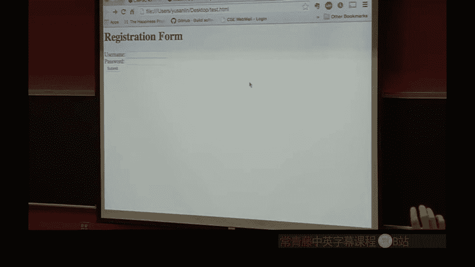

So if now we achieve a tiny bit of functionality， let's take a look at what we can do if we want to change up the style a little bit。

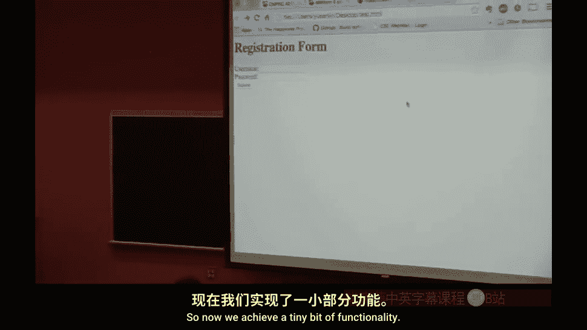

So here's another example we can just look through。So on slide eight。

 let's talk about the style sheet。So in general for the style sheets。

 the idea is that we want to separate the display from the content。😔，Yeah。嗯。

So is it better to do like think a validation with my jobs？I was。

 well was it better to do on your back？嗯。I think。Security wise。Howso by我。

I don't know exactly as well。Does earthquake。I'll say scripting and stuff like that is't I had it time me。

嗯。I think in a sense that some check， if you can do it in the browser level。

 it's a lot faster instead of accessing the database and a lot of check actually does not require you to go to database other than for example。

 the username is taken。Then you can't do it on the browser level right You actually have to go to the database and see。

 So I think it depends on what functionality you want to achieve。

 but if we only do on JavaScript level， a lot of function can be done faster。Okay。

Okay so let's talk about style sheet， so the idea for style sheets is where we want to separate display from content and adapt display to different presentation formats。

 so you can imagine sometimes you want to just design the website in one way and specifying the contents to display already。

 but you want to have other source for determining how it should look。

So you can notice sometimes this happens rarely， but sometimes if you go to Facebook and open it up。

 it will look old。😔，K of messed up in a sense that you only see the contents with all the color in darkgon。

 Okay， that happens really rarely， but happened to me sometimes maybe that's the time maybe their CSS is temporary not available。

 it didn't link it well so you can see all of the contents， but it's not displayed in a pretty way。

So that's when the CSS is missing， but the contents are all there so in terms of style sheets。

 there are two aspects， the first aspect is we can do document transformation。

 so document transformation it will help you to decide what parts of the document is display in what order。

Most common thing being used for style sheet is the second one， which is document rendering。

 so it will help you to decide how each part of the document is displayed。For example。

 earlier we have just plain text in our form and we have heading in our form。

 we also have the text field， so actually you can just say for all of the headings I want to display this way。

 for all of the text field， I want to display in and another。会招声影。

So why do we want to use style sheet？There are different reasons。

 the first of it will be we want to reuse the same document for different displays okay like we said before。

 last time we said actually CSS or other style sheet can help you to achieve on different devices in being rendered different。

So that's what the style sheet can do or another reason will be to tailor display to users preferences。

 so sometimes you can trigger some kind of saying the user want the same web page to display differently。

 for example on Angel you can set different things right so that's dump I as well。

Or third reason well be have to reuse the same document in different context。

Okay so there are two major st sheet languages， the first one is the one we will talk about today。

 cascading st sheet， which is actually CSS。So it is poor HTMLMl do。

And another one is extensible style sheet language， which we call it the XL。

 so it will be for the XML documents we talked about last time。

But remember earlier I said is actually slowly going away right now， so if you can think of it。

 there's this period of time when everything was done in HTML and then people say now I wanted to be more schema oriented instead of document oriented so they jump into XL to achieve the data hierarchy。

But nowadays people go back in JSO for the compression reason or efficiency reason。

 so now you do look at those source code again， like we did last time for M。

You can't see anything about XMN， it still looks like education。 so right now。

 instead of using XL to take care of the form， and people go back。Iて。

But when the textbook is written like 13 years ago， they are still talking about， hey。

 XL now replace。But now if you don't go back to look at later I will also talk about bootsottap。

 so a lot of people are using bootsottrap right now， it's actually a combination of a channel N。

So nostalgians we'll talk about would be。When we see focus on seat。So what is CSS exactly。

 So CSS stands for cascading style sheet， and it defines how to display HTML chair elements。

 which we will see later， so CSS files contains the style to finish。

 you can put the font you want to use you can use the font size and the color。

 all of different things or it you can even。あ， that's not。

And for many different HTML documents can refer to the same CSS file so within the same website。

 if you all refer to the same CSS file then everyone has the same style。

 same thing okay and if you want to change it up， change the whole website of the thing。

 but you want to have the content stay the same， then just change that one CSS file。Everyone changes。

Okay so CS is considered as the first step toward separation of the content from presentation。

 so instead of embedding all the style information in your HTML code like sometimes we write in word。

 you can imagine word you might say if you don't do this style thing like the title heading。

 you might say I will go manually highlight this line set it to 14 points set it to other fonts so this means heading one okay then everything is done in line okay you do it so separately so it's not consistent。

 you suddenly want to change the heading style， you have to go back to change the level again so if you imagine doing in word Microsoft Word then doing the top ones choosing the heading。

 choosing the title or heading one heading two， they are kind of similar idea。不。

So how would the CSS look like so CSS file is included into an HTML file with the following line so we can just link it later I'll show you we can use a link tag and link the external CSS file that we write。

Okay so within a CSS file， we have these kind of formula kind of。

 so you can always start with a selector and then within the curly braces you say what is the value of the property it's like key value pair。

 so example here will be， for example， for the body part I want all of the body parts background color。

 missing a D background color to be yellow。Then it's totally equivalent to doing it。

In HTML T directly， okay， saying it's the body and then the background color being yellow。

So let's just see。What we can do we want to try it。So， for example。

We can start a new file and we just simply save it a sample CSS。Whatever you want to name it。

And for example， today， we want to have。The body。Section in the part being。

 we can set the background color。And maybe we can try be fancy today let's make it all black。Okay。

If you are not familiar with this way of presenting color， its the hex number。For presenting color。

 Okay， so it's a 16。It's from zero to f0 means 0 and all the way when it goes to9， it goes to A B。

So it's not binary。Is this 6 hedermon， is it？テさ。Taxximal number。

So that's for're representing the color。 So if it's all zero， it means black。And maybe we can say。

Change it up even more drastically。 We want the font color to be all white。 So if you put O F。

 that means。So zero is the minimum is the hex number， F is the max。

It's not that important for this class。Just so you know， it's not a web design class。

 so we doesn't matter Okay， so maybe we don't like the default font so we can say we want to change the font family to maybe what's it called call agree。

So that's the one we always use for the slides because I like it。

 that we are using for the webage as well。So other than that， maybe we want to say for the heading。

 I also want to change it up。Maybe I want to put the head into。Orange。

 okay so you can see we can also put just some regular names for the color。

 you can say I want to put it on orange， and maybe other than just put it in on the left side。

 I can align it to。So this is just to show you these detailed syntax ast matter。

I' came to show you how we can just use an old uniform style。或者后悔 thing。Okay so now we design it。

 then we just need to link it back。So the way we can link it。

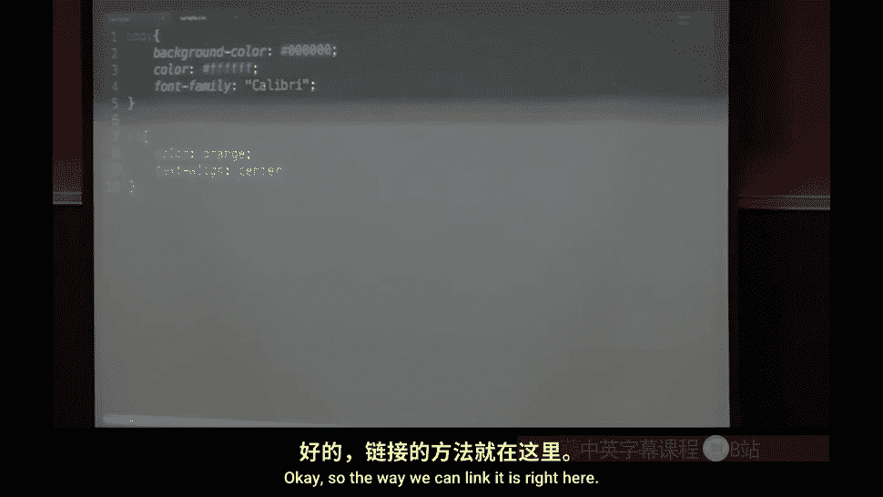

It's right here。As you recall， we will put things in the head part。

 okay so we can just link it in this way， we use a link tag。Can we do。

We say this one is a style sheet。And the type of it。One kind of text that sees has file。

And whenever we talk about HRREF。In。HTMO， the attributes are saying which link？So earlier。

 we created to be。Sample CSS to not do that， so if you go back。Can't see it。

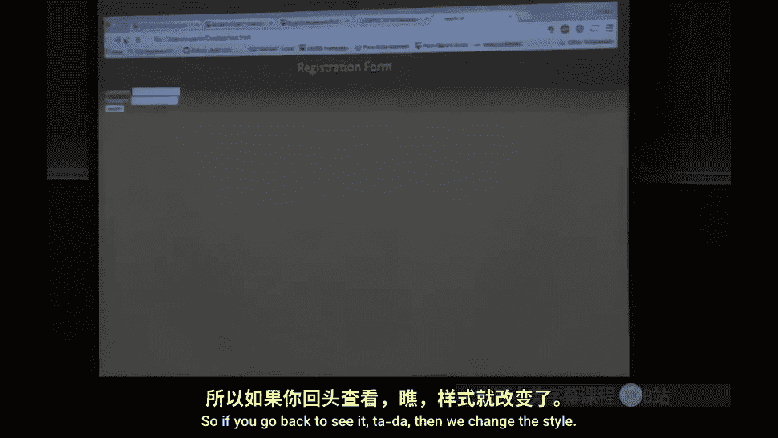

， then we changed this guy。Okay， so basically what we just did was we just specify we want the text to be white and we want the background to be black。

We want the heading to be orange。Okay， that's it and we change the font。So before we move on。

From CSS。Before we move on from CSA I just want to do a tiny bit more thing。

So I think JavaScript has been around for a long time。

There was a point in time people are also using， not sure whether you guys have heard of it and things called Java Alet。

Have you get heard of。Or it's too old， It's like。K of go handing him with JavaScriptscript。

 but it shows more of an animation or some more graphical functionality on the web page that I think is a really old technology so it's kind of going way now but JavaScript still stays so I just wanted to show you my first experience with JavaScriptscript when I was like 10 years old or something so we started learning computer class in primary school and at the time we were just using if you have heard of it。

 there's a software called Fron page。Showing the age now so that's like the web page editor okay you can use。

😊，It's terrible， but we still had a lot of fun as kids， so we were trying to use it。

 and at the time I think always the computer kit in class。

So I was looking online some of the cool stuff you can incorporate into your web page。

 and I found there was these little animations。

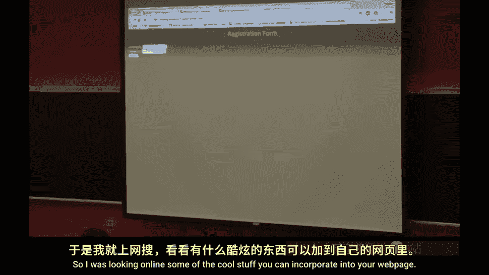

On your webp page you can do， for example， I don't know why I would think I could do it。

 but like when I was little I would just paste things to my source code of the webp page。

 things like that， so I found there were like some little raining animation or little clouds flying animation or snow。

So。Letに。So I found this snow JavaScript yesterday， I was really happy。

 and I just wanted to show them guys。So if you take a look。

So the main ideas I just want to show you for these drawho script。

They can achieve super simple animation as well。So when you open it up。

 it might be just way too detailed。What you want to understand but they will talk a lot about like the speed of the snow。

 how it's going to fly or maybe you can do some interaction with the snow so for your cur moving around the snow would change the direction all these little things okay so you don't have to understand this but there are so many different functionalities online you can just directly download it so for example I have this snowstorm JavaScriptscript and I want to try it out。

On my own。We picked right here， they can say for I want to incorporate the script。Which is a little。

Snowstorm。And this is just directly incorporating。ItInto our web page。Okay。

 so that's the whole reason I changed the background to life。So now， we have snow。Okay， so that's it。

 so you can see even just simple JavaScript。😊，Can do this without any image because they are all just little thoughts。

 so you can like change how the snow flies， stuff like that。あ对。

So that's the end of discussion on JavaScript。哎。So you can find out different kinds of little functionalities。

 of course for your project adding snow is not really useful。

 but you can add like more validity check， be？

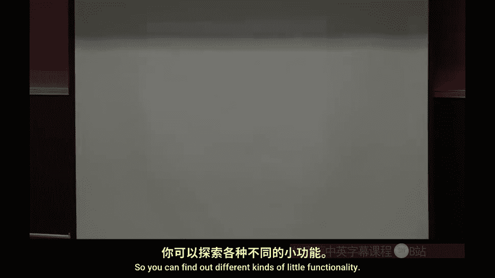

Well entertaining when I was little。And I was like， I think I was really cool。All right。

 so that's for JavaScript and that's all for the presentation team I will talk about today Okay。

 so because this is not a web design class， so I won't put too much of emphasis on presentation team。

Oh， before we move on， actually one more thing for the presentation ti。Yes。Btstrrap。

So I think a lot of you have heard of who has heard of who。

Quite a lot， Okay， so I think this has been the trend right now using bootstrap as your front end design。

嗯。So when I first got experience with Bocraft， I think it looks really fancy。

That's my first impression， it looked really neat， really smooth。

More of a modern way design so but then it got to a point that's being really overused。

 whatever tiny web page you go， it's bootstrap like doesn't matter how much content they have bootstap。

 Everyone looks like bootstap， but I still think it's like the best looking web design template so far。

So Botap actually originally is developed by people from Twitter。

So it's originally named Twitter Blueprint and developed by mock and Jacob at Twitter for internal use。

 so in the beginning they were not really trying to have other people who use it other than just Twitter people。

 they can have it internally maybe because at the beginning。

 maybe whenever they display their work progress displayed。But a presentation they have is too messy。

 so they decided， okay， within the company， we're going to have one uniform way of displaying the results。

 so that's why they developed a good strength。But then later on。

 they found out this thing can be really powerful because they design in the way that it's really easy to use and really easy to develop other kind of styles based on that。

😔，So they make it open source， it's an open source collection of tools for creating websites and web applications。

So as I said before。嗯。It actually it's the bootstrapap， as I said before。

 now people moved on for XML and go back to JSON along with HTML for displaying data。

 so bootstrapap you can think of it as a HTML and CSS based design。

So it comes with a lot of components already， comes withtyography， forms， buttons， navigation。

 and other interface components。You might not know where the course website is using Sc。Okay。

 so that's one。I chose you to Str for the course website。

Sttop and you can see this is just another bootstrap example。

 so this is the very typical bootsstrrap example。So I think when you go back。

 you can try to see what are the other bootstrapap example， and we also have a team。

 the project selling bootstrap templates。So you can go up to see how the general theme looks like。

 so they have different things。One of the most common is a lot of people will use Boottrapap to write their Gitthub repository。

Wki kind of so they will write their own documentation for the repository。

 or another one will be just this kind of really wide looking and every section is like a whole wide row of color。

So that's bootsstrap。But I was originally want to demonstrate how to do things in bootstrirap。

 but it will get too complicated because they have so many components developed by themselves。

 so I think you can go take a look if later on to change up if you're not using bootsottap or you're charging。

 you want to change it up。It's really easy to， just link it to a CSS box。Okay。

 and then you check out the documents and see how you can use different components。

I'll just quickly show you for the website of the course。Snow so。All right。

 so that's for this is Do in， so this will be the navigation bar。Okay then we also have right here。

 it's all done by Gotrap， even though there's， I don't know whether any one of you notice there's this flaw in my design。

 it cannot scroll down on the website， but I guess you guys can just scroll the right side。And so。

Yeah， this is a basic bootsrap example， but it doesn't look。

That fancy it because if you go to a lot of current website。

 I think a lot conference website or a lot of。嗯。Startup websites。

 they will look super boost grab stuff。So you can try it。

That's what blue Sc so that's the end of for our presentations here okay we kind of put a lot of time in there。

嗯。Okay， so we actually don't have time for。Middle tier。Or add too much fun but for middle tier。

 I think then I will talk about it after the midterm so it won't be in the midterm so today we are only。

Until which until 13th。Okay， so everything afterwards， we will have it for the next time， Okay。

 so midterm two， I won't test you。Of these things。So before you go， I just have this。

Its littlequiz for you。可可。