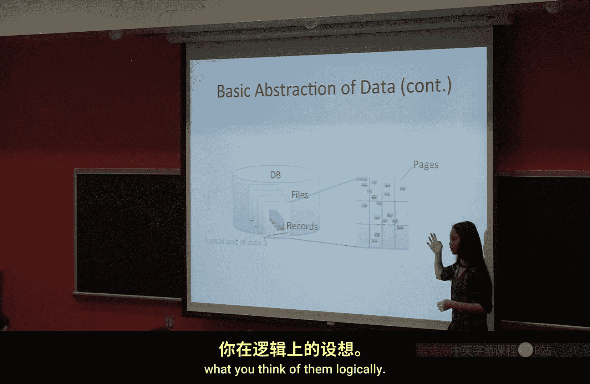

# 宾夕法尼亚州立大学【中英⚡数据库管理系统｜CMPSC431 Fall 2015, Database Management Systems】 p30 P31 文件组织 -BV1N76CBwEXb_p30-

我的爱。So， today， we will start。The very last part。你こで。So just see where we are。we are right now。出してる？

So， we are at the 13。Next week is the Thanksgiving break， so no class so this week would basically。

Mostly focus on chapter  eight。In you talk about later。And here I saying。Thank you， but。So又给们。

To the Wednesday after。先色だ。第三个。は。The first year。So that one will be onopardy。

I initially wanted to put it the Monday after the break， but I think it'll be too cool。😊。

I you put it on the Wednesday after。😊，Okay。And I'll make sure I posted it today。time to work on it。

Okay， like during this week， maybe you don't have to work on it。Pa it break。And don't forget。

 after you come back from the break， you'll be doing your project in two。Whi was expecting？

And for this one， it would be close to a finalcard。So the TA would check on。All of your are progress。

And it should be really similar to what you already want to demonstrate to the whole class。ok。So。

 yeah， we only have these。few weeks left， so as you can expect initially in the beginning of the semester。

 I said we will have 10 quizzes。But we we only have sticks。So four left is what you can expect less。

And two homework more， which will both be。I would make sure they will be way more lightweight than one you have。

F because it's near the end of the semester and I want you to put more time。So for the final。

Just make sure when we work through Cha A， chapter 12， and chapter 16。

 always the final for the final is a cuulative。So for that。

You want to make sure you maybe keep your cheat sheet from midterm one and two。

 don't want you to go home and say it's done the 0 pieces in your away。

 yeah you can keep it for your final， okay， for the midterm one which try two cheat sheet and then plus the third of sheet altogether。

So before we get started。I want to quickly ask you guys how the midterm was。Park 2 is good。

We better than part one。Yeah， so sorry I'm really sorry for part one and we are grading on it now。

 actually everyone performs pretty well， I think on their bridge。

 because the weight we're looking at right now is just whether you get the clarity right and because of the mistake so the result。

😊，And thanks again for Woodhal， who actually picked it the error from the script。来本。A lot of people。

前いですね。I'm really sorry for that。But I guess from midter to part two should we？

Try to make it not too hard and I thought a lot of people finished quite early as well。All right。So。

Before we get into。The lecture for today， I just want to quickly show you。

Conceptually where we're at instead of just on the schedule。

So let's go back all the way to lecture  one。Remember what we were talking about back then。

So in August， when we first have the lecture， we were talking about what will be introduced in this lecture。

So I gave you this big outline。So right now you can see we have cover all of the foundations part。

So far， and we have covered the applications part。So what's left？Will be V3。Okay。

 so all the things on the right hand side are actually covered up that we are not going to teach because those will be the grad student level material okay if you are interested you can look into those。

 but for these three aspects，All along the system side， we would just teach chapter8， chapter 12 and。

Okay so so far if you recall from the very beginning we were just talking about the ER model and everything。

 I remember I got a tiny complaint saying everything was so conceptual conceptual， so theoretical。

 I don't see how they're going to use it and then in the second part of the whole lecture。

 everything sub becomes too hands long you have to do this sequL you have to learn a lot。

And now we kind of sit back again for the very third part of the lecture。

Again we go back to more theoreticals。Okay， so what we will focus on。

Today we'll focus this week we will focus on storage and indexing so so far we have only talked about how we are going to design the database。

 how we are going to query information from the database but we haven't actually really touched on the topic of how the data is is actually being sold and how they are actually in regards to how they are stored how they are actually query are accessed in some sense you have the query but how things are actually accessed so that's what we will talk about for chapter 8 and we'll also talk about for different kinds of designs of the database when they areoring the files how we can assess the performance of different designs of database so we was teach you how to do cost evaluation to compute the cost of it and then the last two pathds we query evaluation if you recall when we were learning relational algebra we say for the same query we can actually write them in different kinds of relational algebra and at the time we were just briefly discussing okay。

Do this in the middle of it， not to way to the very last part of the relation of algebra to do it。

 We can think of it as being more efficient。 We we just say let's think about it that way at the time。

 And this part will actually really show you how things are being more efficient in the way that we actually evaluate the query that we learn in relation to algebra。

Okay， and then finally， we will touch on transaction management at the very end of the semester。

 okay， and this part we already covered。Right。So let's see what we will talk about today。

So 30 lectures， let's talk later， now we're going to talk about the system。All right。

 so chapter8 is called a storage in indexing。So the topics that will be covered。In this chapter。

The first thing is the overview of the storage end。

So basically it's saying how things are being stored， we have different kinds of mechanism。그 자꾸 남지。

And we will talk about how does the database management system store and access consistent data？

We'll then go on talking about file organizations and access methods， as you can see。

 saying just selfexloratory from the name， self organizations just telling you how the files are being stored and access methods are saying how the files can be accessed。

 different methods。And the fourth one is indexing， actually。

 indexing to saying we have a bunch of files， and in order to store them。

 we have to find out a way of how we can assign them on the disks。So that's from indexing。

And then a really， really important part in this chapter would be quantitative analysis。

 which is the IL cost， which is the one we talk about。For the cost of accessing。The data。

 and then eventually we talk about choice of indexes and performance。

 we will introduce a couple of different kind of indexing and we'll show you what's the comparison。

So let's start with the basic obstruction of data。😔，So data in a database management system。

Is a collection。Of record。So you can think of the records as the top that we learn in the relational database model。

So。It's a collection of records。The5。We'll talk about what these units are actually name with。

So here is an important thing， I'm not sure how many of you have taken。거기 architecture？什么你。

So maybe you have learned about this unit， so each file actually consists itself of one or in many pages。

Anyone have heard of the pages， the unit pages？So if you don't know the pages。

 you can think of it as like the minimum unit。Smallest unit that。To read right。So。

Here we have two main concepts that will help us to organize data to support FA access of records。

 which are the fall organizations and access methods。These two will be discussed separately。

In the rest of the chapter Okay， so basically we can just。

Put this chapter into one part for fraud organizations and one part for access。Today。

 we'll focus on the first。So each organization usually makes certain operation efficient。

 but other operations expensive。So later on when you learn different kind of organization systems。

You can think of them as having trade offs so this design will have a better advantages because of this。

 but maybe other scenarios。So to think about this basic abstraction of data in a more pictorial way。

 we have this graph right here。So here you can think of it as this way here we have the database。

 we always use this to represent the database and inside we have multiple files so for these purple little blocks。

 they are the records。Okay， so for left。You can think of them。A theological unit of data。

So here is really similar to what we can think about mapping into the relational data model。Earlier。

 I say we have a database and we have files and records， records we think of in those tupo。

 so for files maybe you can think of in those relations or a table。系。

So to map that to how they actually school is right here。We have multiple pages。

 and the the actually。す倍。So how we are actually assigned in the adverons might not completely map do what you think of。

So on the right hand side。We say for this kind ofconum presentation。

 it's the physical unit that it States。So logically。

 you think things are organized the way that you think it is， so that's for the logical school unit。

 okay， but physically， it might not be that way。So what bridges them together will be the FA organization。

😔，So it gives you the abstraction so you actually don't have to think about how they are actually stored。

So think of it this way， when we learned about our relational data model。

 we have the key and sometimes we say maybe， but we only talk about maybe back then。

 we say maybe when they're actually stored on the disk， they are stored by maybe by。

By sorting the key， okay， in the order of the key。Maybe not just one way or let's say here's an example。

 we say a file of employee records is sorted， like a salary of the employee you don't really have to write much。

 I just have a lot of space here。😔，So think about these two queries。

 when you already have files sorted by salary， and for the first query。

 when we want to find employees who make 90K to 100 k a year。

 that should be simple because the data is already sorted。F the salary。

 so you have a range of things you want so because the fact maybe we have the employees sorted in an increasing order based on the salary。

 then fetching the information per one should be easy just get them from 90 to 100 k。However。

Because it's sorted by salary， so there is no guarantee that we will have any clue of how the age is being sorted。

So for query2， then this will be。Potentily costly because for query1。

 we we in this way you can we only think of query1。

 so the design is easy for fetching based on the salary。

 it will be hard to fetch based on other attributes or other fields we can。But maybe in your design。

 the salary is more important than you can design it this way。Just a really simple toy。

So as you can imagine， in the whole database management system。

When we store the data because we have to store massive amount of data。

 so the data actually has to persist across program execution。

 so we wouldn't need external storage to store the data， as you can imagine。

So the data in database management system is stored on external storage devices and fetching into main memory for a processing。

This is easy right， you have someone else to store the real data and every time you need it。

 pull them into the main number。So there are two types that we will often use and they have their pro cons。

 The first one is the discs。So the discs can retrieve random page at a fixed cost so that's the design for it okay you don't have to go through all of the data for it。

 if you want something you can access it just based on maybe a key or whatever value it is so you can retrieve random page at a fixed cost accessing different pages is。

Okay。So some properties for this is there reading several consecutive pages much cheaper than reading them in a random order。

 so by this were saying you have to think of even though we say whenever we access it doesn't matter whichever page。

 it would be the same cost， but if the pages will be consecutive。Actually。

 you still have to think of the intermediate cost when it's moving to the next one。

 So if it's consecutive， it's still cheaper。But a lot of time we just consider the fact that you can't access random pages without too much overhead。

OkaySo this is the most important external storage devices or mostly used。

So the unit of a record or unit of a read or write is what that we said earlier。

So earlier we said pay would be the minimum unit back we read and write。

Typically it will be from 4KB to 8KB。You can think of it as the parameter for the database。

 so they can tune it based on what they want so they can set it to four or set it to eight。

And another device that is often used。We the tape。So we won't get into how actually they're designed very differently because's that's left for computer architect。

But you can just we just need to know the brief difference between them。

 so we set for disks accessing different pages require the same fixed amount， of cost。But for tapes。

 you have to actually read the pages in a sequenceel。

So say you want to find a page in the middle of it， you actually have to go through the previous one。

That's costly。But the material itself is cheaper than disk。

 so sometimes a lot of times it's still being used。And the main use of it will be for archival。

So here is just the brief hierarchy for different kinds of devices that can help us to store the data starting from the very top is the cache。

 okay， so we have it the smallest。And then we have main memory。And then we have flash memory。

 and then we have magnetic disc， and we have optical disc and then magnetic tapes。

I won't touch you on this， but these are what the computer architecture course will tell you。Okay。

 so at the beginning of today's lecture， we said we will start。Talk about storage engine。

Which would be covered right here。So what exactly is a storage engine。

 you can think of the storage engine as a whole framework。

For helping you we' doing the file organization， okay so that's the storage part， not the access。

So storage engine can think of it in three separate parts。

 which we call the different kind of managers， we have file manager， we have buffer manager。

 and we have disk space manager。So for the first one file manager。

 it takes care of the file and accesss methods layer and it makes calls to the buffer manager。Also。

 it provides the notion of records to the query。Okay so you can think of here as the one helping you to connect to a query。

 so when you make a query from SQL， this is the part like the front end that will help you。

Take care of it， so that's why we have directed。And the notion of f。Then we have buffer manager。

 so what buffer manager is actually doing is just to stage his pages from external storage to main memory buffer。

So as we talked about earlier， we have external storage saving the data and we need someone to actually pull it out to put it to the main memory so the query can retrieve them。

 so that's what the buffer manager is have。We just have a buffer between the file manager and disk spacemen。

So in terms of the disk space manager， it manages space， okay， again。

What do you think you will be in turn about？The unit I just keep using that。Yeah。

 in terms of the pages， okay？In terms of pages of this。

 so just keep thinking of these concepts in terms of pages。So again。

 file manager is the part of the taking care of the file access method。

So this will be the manager that we focus in the rest of today's lecture。对。All right。

 so we talked about there's file organizations in access methods。

 so let's start from file organization。I think that's。Yeah， we won't get into access methods。

It's different from。Thought organizations。So fire organizations。

It has the methods of arranging a file of records on external storage。

So the the that's being used to physically locate the record。I think you have learned。

 maybe you have learned the conflict of addresses on the disc。You can think of them as the record ID。

い粛をユーす。This is the term we will use in the rest of the lecture。

So just think of arranging a file like what will be based on， we will based on the record ID。

 which in short， we'll just talk about it as our ID later on。

So a storage engine may support a number of file organizations。

 you can imagine like we need to organize filess but there should not be just one certain way。

 so we will talk about different kinds of file organizations and they will being。

So in addition to cloud organization， auxiliary data structures。Such as indexes。

Allow us to find the RIDs。Of records with given values in index search key fields。So。

A way to put it will be RID is how things are actually stored。

OkayAnd indexing is a mechanism to help you to locate the RID。

So that's sitting between the logic and how it's actually been。So for a file manager earlier。

 we talked about a file manager。You will need to take care of a couple of operations。

So let's see what the file managers should do。So the file manager stores the record in the file。

 which may be in alternative organizations， so later we'll talk about three over the collection of disk pages。

So here are the basic operations that a file managers should be able to do。😔，The first one。

 which we say we will be able to step through all the records in the file。

 so a lot of times we just call this scanning。系。We say it's scanning。

 then it's stepping through all veteran。So here we also have。

The ability to retrieve particular record。Based on the。快点。All right you。Okay。

 so the file manager also should be able to retrieve particular record based on itsI did。

 as you remember， we say RAID is the one actually saying where it's physically stored。Okay。

 so every time when it's retrieved， it takes one hour。Also。

 the farm managers should be able to retrieve a set of records。Based on。

A search condition so a lot of times we don't know what the R is。

 but we know what are the conditions we want like earlier we said we want the employees between this range of the salary okay so that would be a search condition。

So for search condition， we can do equity search， which is just doing we only want the exact same equalco values。

 or we can do a range search just like the earlier 90K to 100K salary employed that's all we want。

Okay finally， the file manager。To be able to do。updates will be for insertion and deletion。

So he will be for the file manager， and early we talk about we have different kind of alternatives for thought organizing。

So here are the three。The first one， Google has， I think I've asked before。

 but Google has taken algorithms。So you have learned about data structures。Okay。

 so here the first one is。有点信。But the funny thing is like whenever we look at heat。

 do we think of the heat we learn in algorithm， but actually here doesn't really make any connection between the heat we learn and the heat here it is。

So just want to make sure you don't get。So here the first one is the heat files。

 so you can see in the parentheses we say random mode。So you can imagine。

The files actually won't be ordered， but just put it in whatever。however you want。

So here I have a typo， I say suitable when typical access if a file to each otheror actually is a file。

So if you read through it， it doesn't make sense， so it should be yes。So the heat cost。

It is suitable with typical access， it's a file scanned reing all records。What do we mean by that？

So heat file actually doesn't care about how you actually store the data。

 so you would think F when is' it going to be useful at all。

 so it will be useful when you also don't care about the order of the data。

 so the mechanism itself is so simple that it just takes care of storing the data storing the data storing data and every time when you want it to say give a video of the data。

so the design itself so lightweight， there's no complicated mechanism behind it。

And you don't require it， so that's when you might want。Which sounds not so realistic at all。

 because normally when we want files， we will have conditions that。

So a bit more sophisticated than this is the second one source of files。So sorted files。

Just as the name suggest， you will be sorting the files。

Based on whatever key you want or whatever action。So it's best if records must be retrieveed in some order or only a range of orders。

So like the one we saw earlier， right the employee being sorted based on the salary and when we do the query that that we want the employees in the range of salaries。

 then the social files will be a good choice。哎。And even more sophisticated than sort Fox is the one we just call indexing。

So for indexes， I only say data structures to organize records。

So in another way you can think of it as actually indexes， take care， the indexes are assigned。

Based on what data structured。So here is the flexible part。

 you can use different kind of data structures。In this design and your index has been based on that you have taken algorithm course before we have different kind of trees right and maybe you would say the tree。

 how should we do the order for the tree， maybe the root is number one and then always child2342345 okay。

It doesn't matter， but for the indexes， it's indexed based on the data structure that we would use。

 not just true。変る的。Okay， a bit more on indexes， actually。So it can be combined with files。就可以。

Ind files。So for the other two thought organizations。The alternatives。

They actually don't have the index file because as you can see earlier for heat and sorted files。

 they don't introduce the cost of the index， so there's no extra stuff to combine with files we only say okay just put it in random order or just sorted based on a certain attribute so we don't have the additional thing that we should combine with the files。

But for indexes， when we can't actually combine the index， it creates for it。And then with the f。

Just like sorter files， indexes can speed up the ss。As you can imagine， way better than。

Because what happens when you want to search for things？😔。

Because there's no order and there are no indexes， so when you want to search for things。

 you actually have to go through every single day that's for scanning scanning through all the files。

 all of the records to find the ones you want。But for indexes， just like the sort files。

 they speed out searches because they have something to base on to search for。Okay。Also。

 updates are much better。Then his sort of box。And we will see why later。However。

 this is the only design。We'll talk about。You can imagine we have introduced the concept index。

 so whenever we add something extra， if you have poor design， you will actually have large。嗯。

Amounts of files dedicated to the fact of storing indexes。

So there might potentially be a storage overhead。If your design is so bad that you need such a big file to store the indexes you created it。

Then that will possible。Yeah。This different from the event of decreased area。Yeah。

 so it's not that complicated， so here even though they use heat。

 the only idea they want to convey you just random more。So it's not like the it has been mixes。

description it has their bases。Yeah， in algorithm heaps have indexes。

 but here yeah that's a good question， but here the heaps does not have anyes Okay。

 so here the only thing that have the extra indexes。

So yeah just don't get confused between this heatap and the heap you learn in hour。Okay。

 so let's go through each organization one by one。 The first one we talk about is heatpot organization。

So we say it's a red curveb that can be placed anywhere。

In a file where there is a space for the record， whenever you want to add something。

 you don't even care where you're going to assign it just。So there's no concept of indexes。

Or than any。And there is no ordering of the record。And typically a single file for each relationship。

 for each table。So here you can think of it as a file and then that would be for pages， okay。

 pages might not be just that two couples。来屏冇。But here you want to show you。In the blue part。

 it's saying that's a one5， the green is the topples inside。So again， you might be thinking。

 what's so good about this if it's being randomly put， so the good thing。

Is that it's so likely there's no design behind it。

So if your application at the same time does not care about any ordering any retrieving based on conditions。

 this will actually be good okay you just display whatever you want。Light light design。

 but not so realistic， so not really being used。So the second organization that we want to talk about is thesort fire organization。

So you can see me for this one。We sort it based on maybe this is the ID for person。系。

The records are stored sequentially in a sort of order based on the values of the search key。

 so you can define what search key you want to use。Okay， to sort them。The files。

 it does not have to necessarily be the primary key we learned in relation data。

You can pick whichever you want to use。Desorted。However， it is actually very expensive。To do up。

Here you can see。Let's say today we want to update。

 we want to do an insertion of a person with ID 122。But we don't have any index。

 so the way we can put it is actually we have to go through and find the position first and we put in and then move them both。

Because everything has to be sorted ordered。So that's why it's expensive for updating and also saying for deletion。

 once you're deleted then you have to put it all back。So one way that can make it。

Not so bad is to use the idea of a point or change。So， I think。Most of you who are here have taken。

外穿T恤买外牌。122 like， I think C+ plus for data structure。

And I guess that's the first time that you guys learn about pointers。

So you can think of it as that thing， so instead of so here even though it's put in this way。

 okay so we use the pointer so here again， if we want to insert 122。

You can actually just break the chain here。And they get added right here the 122。

 and this one instead of pointing him down。The bottom one and then one next to it。

 which is pointed downward。That's an easier way。But then pictorially。

 it won't look like it's sorted anymore， but following the change still sort。

So that's the second method。Stillい気。And the third one is the indexes。So the index is。

 we can think of it this way。An index the file speeds up selection on the search key fields for the index。

So you can design a mechanism for indexing。Apendent on your thoughts。Okay。

And then it was speed of the selection so any subset of the fields or attributes of a relation can be the search key for an index on the relation so as I。

 it does not necessarily have to be the primary key okay you can choose different kind of keys。

 different kind of attributes to be the search key。So here， search key is not the same。

Al write a bit more on indexes， I'm not sure where it's going to be。A bit more on indexes， so index。

Contains a collection。Of data entries。So what exactly is data entry？

Here we just basically denoted as case star。So you can think of data entry as it's something combining of search key and it has enough information to locate data records with search key value。

I'll show you different kinds of data entry rate， we have three different alternatives and they have pros and cons。

So the indexes support efficient retrieval of all data entries with a given key value K and then use them to obtain data。

So far as confusing， but based on the above definition。

 do you think we can use sort of files as an index？Actually， why up if it's been sorted。

 maybe you can just directly take the attributes and being the index， but isn't necessary at。そ正織。

というこでそういう。真的。We are sorting according to statute。Mmm。It can be yeah， so it also can be necessary。

 even though you can think， oh， early Ron Ro only took care of it， it sorted。But it will be useful。

 for example。Today， you not only want to do update because earlier we have to change。

We can use the pointer chain， but for searching， if you only do sort， you do have to go through。

Today date， if we have indexes and plus some mechanism of search and for。Then index can useful。Okay。

But if we plus the index and that's not just sorted anymore， then it becomes fitting with it。

So what exactly is data entry， so here we have different alternatives for it。We offer。

Then see what they are。So the first alternative is just an actual data record with key value。

And the second one is we use the K。In the R Id。Okay， the RD of data record with search。

And the third one， instead of directly using the RID。

We use K along with list of variety IDs of data records for search key。Okay。

 so instead of just having like one value， one value here， we can have one value list of。

I'll show you how effective target。So open more on these。

So the choice of alternatives for data entry。Is actually related。To the index。

KUse to locate the data entrance with a given key value。So for indexing technique。

 you can think of different kind of data structures that we use for doing indexing。

So how the data entries will be actually will be related to what data structure you use。

So a couple of indexing techniques that you might have heard of， one is B plus3。

 and I think another one way more commonly heard is hasing。And you can have heard of the hashing。

 so the hash space structure。And typically index contains auxiliary information that direct searches to the desired data。

But let's take a look at what are the alternatives。So we just briefly went through three， right。

 the first one is an actual data worker with key valueK and the second one is pair。Kate。

 along with the RID。And a third one is K along with list ofor。

 so the second one and third one is actually raised。Can you start from the alternative one？

So for alternative one， the index structure is actually a fire organization for datamigrant instead of a heat file or sort of file。

So typically。Only at most one index on a given collection of data。Uses alternative。Otherwise。

 data records are duplicated leading to redundtive storage and potential inputs。

So if data records are very large。Then。Very very intuitiveally， actually。

 the number of pages containing data。So it's implying the index size as also。

Let's take a look at how alternatives want will look。I'm not sure whether when printed out。

 it's clear or that。Tray might make the background a bit different from the thoughts。

It's not too much to go。All right so this is for alternative one， you can see here for the blue one。

 we just say it's the data entry， okay， or is the data record？And here is the internal indexing note。

 Okay， so how can you the traverse to the data you want。Okay， really simple， that's alternative one。

 here's the data entry， and then we use different kind of index。

And then then point to different data entry Okay， so here it just in abstract okay。

 you don't know actually what data structure it is。

 so based on different data structure you will have different way of pointing to the data。Entry。

SoFor alternative  two and three， it will be based on this super simple alternative。

So for Al two and three， the data entries typically are much smaller than datarick？Oh yeah。

 so here for alternative one， the data entry is equal to the data record， or for Al two and three。

 they are different。However， on the slides I make them the same the you cross them like I'll show you way to cross it so for alternative two and three。

 it's better than alternative one with large data records， especially if you search keys are small。

 also portion of index structure used to direct search， which depends on size of the entries。😊。

Is much smaller than with alternative one， let's start with alternative two。

And you can see here I also put if equal to data record， this cross it， okay。

 the red copying too path。😊，So press it out and here they have records。Okay。

 so what's so different about alternative one and 2 is that。2。Alternative two。

 we move the data record。 So now it's separate from data entry。

 and not only we use the index to traverse to the data entry now。

 we use the data entry to go to the data record。So data entry， this is the K star。

And then here's the action record。And also another tiny mistake that I had。

 I just spotted this morning on your slides， I think there's one data entry pointing to two data records。

😔，around here。喂。So that should be like for alternative。😊，Yeah， sorry about that， I could。

 I think is this block point or this block it points to two。😔。

So why should we remove that because that should be for alternative three。

 so the only difference between alternative two and three。That。Okay， here again。No data records。

 okay， data records right here。是。Sat as alternative to that we use the data entry to point to the data record。

But instead of saying one data entry can only point to one data record。

 now alternative three has the ability of having one single data entry pointing to multiple data records。

So this map to the definition of it， a list of R Is instead of just one ID。

So refresh again for alternative two， we say the way we design it is the pair of K with RIDs， K ID。

 KRD， but for alternative three， we do K list of RIDs。So so far it's still really constant。

 you don't know why we are designing in this way， but we'll get in a little further。

So for Alern two and three， we say actually alternative three is more compact than alternative two。

But these two variable size data entries， even if search keys are。

So you can imagine earlier in Al three if。For different kind of data records。

 they can already be pointed by the same data entry then there's no point of giving them multiple entries right。

 we don't have the design。Okay， so on your slides， we actually still have。Index classification。

But I won't talk about it today， I want to leave them for next time， so the whole thing is' worked。

、感 together。The floor was finished。Just want to quickly。So here， even though I say for homework five。

It will be due on the 30th， but I move it。I moved into the second。So。I will post it today。哦，不认识。

So。Yeah， today is the 16th and I'll post homework five today。

 and it will be due the Wednesday after the break。After you come back to West， it's not Monday。

 I think that's too much。But turn it in on Wednesday and also don't forget。The week。

After the break is the week you'll have to do the demonstration。

 the second demonstration for your project。All right， so again， I。You mean the demonstration？

I don't think we'll be yeah， so again， it will be based on the TA。

 but I'll make sure she makes it like later。No no earlier than Wednesday， yeah， okay。

Do you still have some books。Okay， that's all， and I'll return to midterm on Friday。

