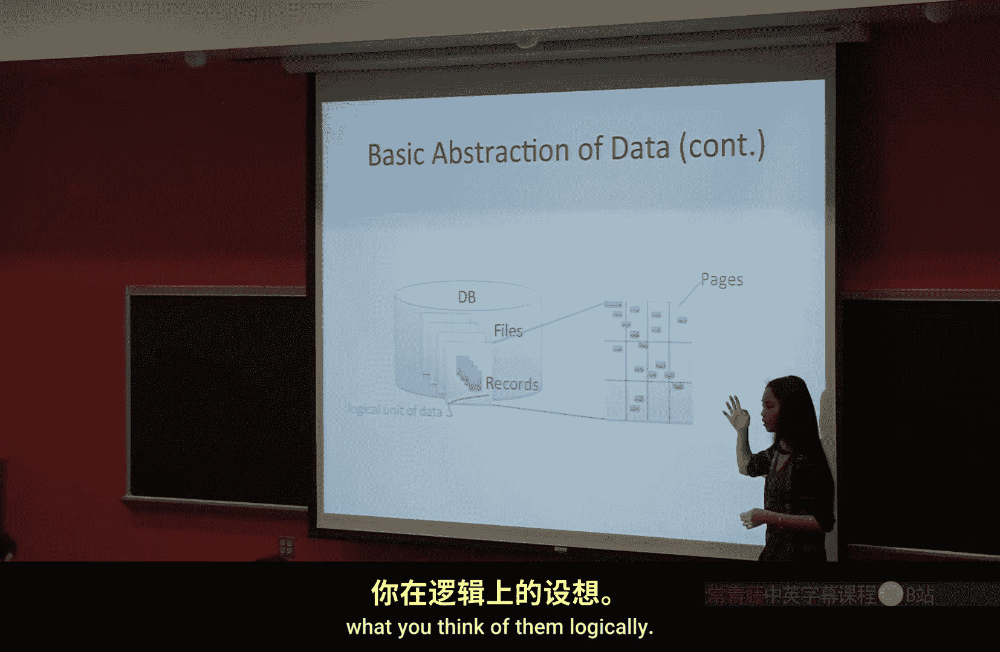

# 数据库管理系统：第8章：存储与索引

在本节课中，我们将要学习数据库管理系统如何存储和访问数据。我们将从数据的基本抽象概念开始，逐步深入到文件组织、访问方法以及索引技术。最后，我们会介绍如何对不同的存储设计进行性能评估。

---

## 数据的基本抽象

数据库管理系统中的数据是一个**记录**的集合。你可以将记录理解为关系数据模型中的**元组**。

每个文件实际上由一个或多个**页**组成。页是读写操作的最小单位。为了高效地访问记录，我们主要依靠两个概念：**文件组织**和**访问方法**。这两个概念将在本章后续部分分别讨论。

---

## 存储层次与设备

数据库中的数据量通常非常庞大，因此数据必须存储在外部存储设备上，并在需要时被提取到主内存中进行处理。

我们主要使用两种外部存储设备：
1.  **磁盘**：可以以固定的成本随机检索任意页。访问不同页的成本大致相同，但连续读取多个页比随机读取更便宜。
2.  **磁带**：必须按顺序读取页。虽然设备本身更便宜，但随机访问成本高昂，因此通常用于数据归档。

存储设备从快到慢、从贵到便宜的层次结构通常为：缓存 -> 主内存 -> 闪存 -> 磁盘 -> 光盘 -> 磁带。

---

## 存储引擎

存储引擎是负责文件组织的整体框架。它可以分为三个管理器：
*   **文件管理器**：处理文件和访问方法层，并向缓冲区管理器发出调用。它为查询提供记录的概念。
*   **缓冲区管理器**：负责将页从外部存储暂存到主内存缓冲区中。
*   **磁盘空间管理器**：以页为单位管理磁盘空间。

本节我们将重点讨论文件管理器。

---

## 文件组织

文件组织是指在外部存储上安排文件记录的方法。它基于**记录ID**来物理定位记录。一个存储引擎可能支持多种文件组织方式。

文件管理器需要支持以下基本操作：
*   **扫描**：逐步遍历文件中的所有记录。
*   **按RID检索**：根据其记录ID检索特定记录。
*   **按条件检索**：根据搜索条件检索一组记录。这可以是**等值搜索**（查找属性值完全匹配的记录）或**范围搜索**（查找属性值在某个范围内的记录）。
*   **更新**：插入和删除记录。

有三种主要的文件组织方式，各有其优缺点。

---

### 堆文件组织

堆文件组织是最简单的方式。记录可以放在文件中有空间的任何位置，没有特定的顺序，也没有索引。

**优点**：设计简单轻量。
**缺点**：除非扫描整个文件，否则检索特定记录效率很低。在实际应用中较少使用。

**适用场景**：当典型访问模式是扫描所有记录，且不关心记录顺序时。

---

### 有序文件组织

在有序文件组织中，记录根据**搜索键**的值按顺序存储。搜索键不一定是主键，可以是任何你选择的属性。

**优点**：当需要按顺序或仅检索某个范围内的记录时，效率很高。
**缺点**：插入和删除记录的成本很高，因为需要移动大量记录以维持顺序。一种优化方法是使用**指针链**，这样逻辑上有序，但物理上可以不连续。

---

### 索引

索引是一种数据结构，用于组织记录，以加快基于搜索键的查询速度。任何关系属性的子集都可以作为该关系上索引的搜索键。

索引可以与文件结合使用，显著加快搜索速度，并且更新操作通常比有序文件更高效。然而，索引本身会带来额外的存储开销。

索引包含一系列**数据项**。数据项是包含搜索键值 `K` 以及足够信息来定位对应数据记录的结构。

数据项有三种设计替代方案：
1.  **替代方案一**：数据项就是包含键值 `K` 的实际数据记录本身。
2.  **替代方案二**：数据项是键值 `K` 和对应数据记录的记录ID `(K, RID)` 对。
3.  **替代方案三**：数据项是键值 `K` 和具有该键值的所有数据记录的记录ID列表 `(K, List of RIDs)`。

**替代方案一**的索引结构本身就是一个文件组织。它可能导致数据冗余。如果数据记录很大，索引也会很大。
**替代方案二和三**的数据项通常比实际数据记录小得多，因此索引结构更紧凑。**替代方案三**在多个记录共享相同搜索键值时尤其高效。

索引技术（如B+树、哈希）的选择与数据项的设计方案密切相关。

---

## 总结

本节课中，我们一起学习了数据库存储与索引的基础知识。我们首先了解了数据在数据库中的基本抽象形式（记录和页），以及不同的存储设备（磁盘和磁带）。接着，我们探讨了存储引擎的组成部分，并重点介绍了三种文件组织方式：堆文件、有序文件和索引。我们详细比较了它们的优缺点，并解释了索引中数据项的三种不同设计方案。理解这些概念是评估和选择合适数据存储方案的基础。在接下来的课程中，我们将深入探讨具体的索引数据结构和性能量化分析。